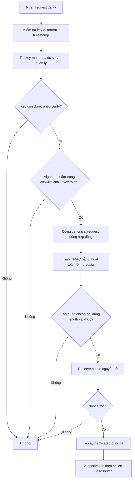

# Chọn HMAC algorithm cho xác thực HTTP request

## 1. Chọn thuật toán là một quyết định của giao thức

Trong module `SECURITY_AUTHENTICATION_HMAC_REQUEST_AUTHENTICATION`, client và server dùng **shared secret** để xác thực HTTP request bằng **HMAC (Hash-based Message Authentication Code)**. Hai phía thống nhất cách xây dựng **canonical request** từ method, URI, các header có ý nghĩa bảo mật và/hoặc hash của raw body. Client tính chữ ký trên dữ liệu đã chuẩn hóa; server dựng lại đúng các byte đã ký, tự tính HMAC và so sánh.

Để triển khai an toàn, câu hỏi **“chọn HMAC algorithm nào?”** không chỉ là chọn tên thuật toán cho `Mac.getInstance(...)`. Quyết định này kéo theo kích thước chữ ký, yêu cầu về khóa, định dạng truyền trên HTTP, khả năng tương thích giữa các bên, cách chống hạ cấp thuật toán (downgrade), chính sách xoay khóa và thời hạn hỗ trợ các phiên bản giao thức.

**Khuyến nghị khởi điểm cho một giao thức mới:** dùng **HMAC-SHA-256** với **khóa ngẫu nhiên ít nhất 256 bit (32 byte)**, truyền **tag đầy đủ 32 byte** dưới dạng Base64 chuẩn, quy định chặt canonical request và lưu thuật toán được phép trong cấu hình **phía server**. Một tổ chức có thể chọn HMAC-SHA-384 hoặc HMAC-SHA-512 vì yêu cầu tương thích/tuân thủ cụ thể; không suy ra rằng tag dài nhất luôn là lựa chọn tốt nhất cho mọi API.

Bài này tập trung vào chương **HMAC**, đề mục **Chọn HMAC algorithm**. Các ví dụ kết nối trực tiếp với mục tiêu của module: xác minh chữ ký, chống replay bằng timestamp/nonce, key rotation, proxy/gateway và ranh giới giữa **authentication** với **authorization**.

### Kết quả học tập

Sau bài học, bạn có thể:

- Phân biệt **HMAC-SHA-256**, **HMAC-SHA-384**, **HMAC-SHA-512** với các lựa chọn cũ như HMAC-SHA-1/HMAC-MD5 và với hàm hash thông thường.
- Đưa ra quyết định về **thuật toán, key length, tag length, encoding và cách định danh phiên bản**.
- Ngăn việc client tùy ý yêu cầu thuật toán yếu hơn, và thiết kế chuyển đổi algorithm/key mà không tạo cơ chế fallback nguy hiểm.
- Viết Java tạo/xác minh HMAC theo thuật toán server cho phép; kiểm thử bằng test vector và request đi qua gateway.
- Giải thích vì sao một HMAC tốt vẫn **không tự ngăn replay, không mã hóa dữ liệu và không thay thế phân quyền**.

## 2. HMAC cung cấp điều gì và không cung cấp điều gì?

HMAC kết hợp một **hàm băm mật mã** (ví dụ SHA-256) với khóa bí mật theo cấu trúc xác định. Về mặt khái niệm:

```text
tag = HMAC(hashAlgorithm, secretKey, canonicalRequestBytes)
```

Server dùng cùng khóa và cùng dữ liệu để tính lại tag. Nếu chữ ký khớp và secret chưa bị lộ, server có bằng chứng rằng request đến từ bên biết secret và **các trường được ký** không bị sửa kể từ khi ký.

Cần phân biệt:

| Cơ chế | Có secret chung? | Mục đích chính |
| --- | --- | --- |
| `SHA-256(message)` | Không | Tính digest của dữ liệu; **không xác thực người gửi**. Ai cũng tự tính lại được. |
| `HMAC-SHA-256(key, message)` | Có | Xác thực thông điệp và tính toàn vẹn của dữ liệu được ký giữa các bên chia sẻ key. |
| Mã hóa TLS/AEAD | Dùng bí mật phiên theo giao thức | Bảo mật đường truyền, có thể cung cấp bí mật và toàn vẹn ở lớp truyền tải. |
| Chữ ký bất đối xứng (ví dụ Ed25519) | Không dùng chung private key | Bên ký giữ private key; bên xác minh dùng public key. Mô hình tin cậy và quản lý key khác. |
| Phân quyền nghiệp vụ | Không phụ thuộc trực tiếp thuật toán HMAC | Quyết định principal có quyền gọi hành động trên tenant/resource cụ thể không. |

**HMAC không giữ bí mật body**. Cần TLS cho request đang truyền. **HMAC cũng không biết request đã từng được gửi**: request có chữ ký đúng có thể bị replay nguyên vẹn nếu thiếu timestamp và nonce được server kiểm tra. HMAC chứng minh quyền sở hữu secret, **không chứng minh quyền truy cập tài khoản/tenant khác**.

Để ngăn đổi trường quan trọng, hợp đồng phải ký đúng **method, raw URI/query và các header/body ảnh hưởng đến xác thực hoặc nghiệp vụ**. Thuật toán mạnh không cứu được hợp đồng bỏ sót resource ID hoặc số tiền cần bảo vệ.

## 3. So sánh những thuật toán có thể gặp

Tên dưới đây dùng tên giao thức để dễ đọc; cột Java là tên thường gặp với JCA (`javax.crypto.Mac`). Kích thước là **tag đầy đủ** của HMAC với hàm hash tương ứng.

| Lựa chọn | Tên thường dùng trong Java | Tag đầy đủ | Đánh giá cho API mới |
| --- | --- | ---: | --- |
| **HMAC-SHA-256** | `HmacSHA256` | 32 byte (256 bit) | **Mặc định nên chọn**: phổ biến, đủ mạnh cho đa số request authentication và có hỗ trợ tốt. |
| HMAC-SHA-384 | `HmacSHA384` | 48 byte (384 bit) | Phù hợp khi hợp đồng, hệ sinh thái hoặc chính sách mật mã đã chuẩn hóa SHA-384. |
| HMAC-SHA-512 | `HmacSHA512` | 64 byte (512 bit) | Có thể phù hợp ở môi trường sử dụng SHA-512; tag/header dài hơn, hiệu năng tùy nền tảng. |
| HMAC-SHA-1 | `HmacSHA1` | 20 byte (160 bit) | **Không lựa chọn cho thiết kế mới**; chỉ xem xét tương thích hệ thống cũ theo kế hoạch loại bỏ. |
| HMAC-MD5 | `HmacMD5` | 16 byte (128 bit) | **Không sử dụng cho thiết kế mới**; tránh mở thêm phụ thuộc vào họ thuật toán lỗi thời. |
| HMAC-SHA3-256 | Tùy provider, ví dụ `HmacSHA3-256` | 32 byte (256 bit) | Chỉ dùng khi có yêu cầu và **đã xác minh hỗ trợ tương thích giữa hai đầu**. |

Các lưu ý kỹ thuật:

1. **Không dùng MD5/SHA-1 cho giao thức mới.** Những va chạm thực tế của MD5/SHA-1 khi dùng như hàm hash thông thường **không đồng nghĩa** với việc người ngoài lập tức giả mạo được mọi HMAC-SHA-1/HMAC-MD5. Tuy vậy, không có lý do tốt để đưa lựa chọn lỗi thời vào hợp đồng mới khi HMAC-SHA-256 đã phổ biến.
2. **SHA-512 không mặc nhiên nhanh hơn hoặc an toàn hơn HMAC-SHA-256 trong mọi hoàn cảnh.** Hiệu năng phụ thuộc CPU, kích thước thông điệp, provider, HSM/KMS và chi phí truyền tag. Benchmark môi trường thực tế nếu throughput là yếu tố then chốt.
3. **Độ dài output không bằng ngay “độ mạnh bảo mật”.** Độ an toàn còn chịu giới hạn bởi entropy của khóa, số lần thử giả mạo, tag có bị rút ngắn hay không và thiết kế toàn bộ giao thức. Một tag SHA-512 dài 64 byte không khắc phục được khóa đoán được hoặc secret rò rỉ.
4. **HMAC-SHA-512/256 là thuật toán riêng**, không đồng nhất với cách lấy 32 byte đầu của HMAC-SHA-512. Không trộn lẫn cách đặt tên, implement và test vector.
5. **BLAKE2 keyed hashing không phải HMAC-BLAKE2 theo nghĩa tự động tương đương.** Nếu dùng primitive MAC khác, phải thống nhất một giao thức khác cùng yêu cầu tương thích, kiểm thử và đánh giá bảo mật riêng; không thay đổi cách tính chỉ vì cùng trả về 32 byte.

Trong Java, tên algorithm được provider thực tế hỗ trợ mới có ý nghĩa. Đối tác viết Go, Node.js, Python hoặc Java cần thống nhất **hàm HMAC và byte đầu vào**, không phụ thuộc vào tên phương thức của từng thư viện.

### Quy tắc chọn nhanh

- **Bắt đầu một API server-to-server mới:** HMAC-SHA-256, tag đầy đủ, khóa ngẫu nhiên 32 byte, encoding chuẩn hóa.
- **Đã có yêu cầu chính thức dùng SHA-384/SHA-512:** sử dụng khi hai bên hỗ trợ và có test vector chung; cân nhắc overhead nhưng không tự ý đổi sang SHA-256.
- **Phải duy trì client dùng SHA-1 cũ:** xác định deadline ngừng hỗ trợ, ràng buộc rõ algorithm với key/version cũ, giám sát và chuyển khóa; không triển khai cơ chế “thử hết các thuật toán cho tới khi khớp”.
- **Bên thứ ba muốn dùng SHA3:** xác minh phiên bản thư viện, provider, cách đặt tên và test vector; không dùng thuật toán mới chỉ vì tên nghe hiện đại.

## 4. Thiết kế khóa trước khi thiết kế header chữ ký

### 4.1 Entropy quan trọng hơn chuỗi trông dài

Đối với HMAC-SHA-256, khóa **32 byte ngẫu nhiên từ nguồn sinh số ngẫu nhiên mật mã** là lựa chọn thực tế tốt. Không sử dụng password dễ đoán, tên khách hàng, token ngắn, timestamp hay chuỗi cấu hình mặc định làm shared secret.

Ví dụ sinh key ở phía cấp phát bằng Java:

```java
import java.security.SecureRandom;
import java.util.Base64;

byte[] secret = new byte[32]; // 256 bit
new SecureRandom().nextBytes(secret);

// Base64 chỉ là dạng vận chuyển/lưu trữ byte, không tạo thêm entropy.
String encodedForSecureProvisioning =
        Base64.getEncoder().encodeToString(secret);
```

Dòng Base64 là **ví dụ minh họa biểu diễn khóa**: đừng in `encodedForSecureProvisioning` ra log hay console. Truyền khóa cho client server-to-server qua kênh cấp phát bí mật phù hợp; lưu trong secret manager/KMS/HSM hoặc kho bảo mật tương đương. Khi tính HMAC, hai phía phải giải mã đúng **cùng byte key** từ định dạng lưu trữ.

Không lấy mật khẩu người dùng rồi chuyển thẳng thành byte UTF-8 để làm secret. Nếu nguồn gốc chỉ là passphrase, bài toán quản lý key và KDF phải được thiết kế riêng. Tốt hơn là sinh key ngẫu nhiên dành riêng cho hệ thống request authentication.

### 4.2 Tách key theo phạm vi sử dụng

Nên có key riêng theo **client/application**, môi trường, dịch vụ hoặc ngữ cảnh bảo mật khi phù hợp. Không dùng cùng một secret cho production và staging, cho nhiều tenant không liên quan hoặc cho HMAC request và một cơ chế token khác.

Nếu cùng backend phục vụ nhiều host/audience, cần phân biệt rõ key được phép sử dụng ở endpoint nào. Có thể giới hạn `keyId` theo audience/service trong metadata server hoặc đưa audience đã chuẩn hóa vào canonical request. Nếu không, request hợp lệ ở một đích có nguy cơ bị chuyển sang đích khác khi cùng secret và contract được dùng lại.

### 4.3 Key ID là định danh, không phải bằng chứng

Client gửi `X-HMAC-Key-Id: merchant-42:v3` để server tìm đúng secret và metadata. Chỉ sau khi HMAC hợp lệ, timestamp/nonce đúng và key đang được phép verify, server mới suy ra principal của `merchant-42`.

Ví dụ metadata server-side:

| keyId | Algorithm | Trạng thái | Principal | Phạm vi |
| --- | --- | --- | --- | --- |
| `merchant-42:v3` | `HmacSHA256` | Active | `merchant-42` | `payments-api/prod` |
| `merchant-42:v2` | `HmacSHA256` | Verify-only đến thời điểm chuyển tiếp | `merchant-42` | `payments-api/prod` |
| `merchant-99:v1` | `HmacSHA512` | Active theo hợp đồng riêng | `merchant-99` | `payments-api/prod` |

Bảng trên chỉ minh họa metadata; **quyền** như `payments:create` hay quyền truy cập một tài khoản cụ thể phải được lấy từ policy server-side riêng. Key nào hợp lệ không có nghĩa được phép thao tác trên tất cả resource.

## 5. Tag length, encoding và tính tương thích

### 5.1 Dùng tag đầy đủ nếu không có yêu cầu rút ngắn rõ ràng

Với HMAC-SHA-256, giá trị tính toán là **32 byte**. Nếu sử dụng Base64 RFC 4648 dạng chuẩn, có dấu `=` padding theo quy tắc, chuỗi truyền đi dài **44 ký tự**. HMAC-SHA-384 có tag 48 byte → Base64 64 ký tự; HMAC-SHA-512 có tag 64 byte → Base64 88 ký tự.

```text
macBytes = HMAC_SHA256(secretBytes, canonicalRequestUtf8Bytes) // 32 bytes
signatureHeader = Base64_Standard_WithPadding(macBytes)         // 44 chars
```

**Không nhầm**: Base64 chỉ là encoding, không phải hàm băm hay mã hóa bí mật. Hex encoding cũng hợp lệ nếu hai phía đã thống nhất, nhưng 32 byte sẽ thành 64 ký tự hex. Base64URL (`-` và `_`) là biến thể khác Base64 chuẩn (`+` và `/`); không đổi lẫn chúng một cách tùy tiện.

Nếu hợp đồng dùng **truncated HMAC**, phải quy định rõ độ dài `t` (ví dụ tag 16 byte = 128 bit) và cách lấy **`t` byte đầu của tag đầy đủ**, rồi kiểm tra chiều dài trước khi so sánh. Với tag giả ngẫu nhiên `t` bit, xác suất đoán đúng sau `q` lần thử độc lập xấp xỉ `q / 2^t` khi các giả định bảo mật phù hợp. Tag rút ngắn làm giảm mức chống đoán chữ ký; cần rate limiting và đánh giá khối lượng request, vòng đời key và chính sách tuân thủ. **Đừng rút ngắn tag chỉ để tiết kiệm vài chục byte HTTP header.**

Không nhận đồng thời tùy ý 16, 20, 32 hoặc 64 byte tag cho cùng một key vì điều đó có thể tạo đường hạ cấp ngoài hợp đồng. Khi chọn HMAC-SHA-256 tag đầy đủ, server chỉ chấp nhận **đúng 32 byte**.

### 5.2 Canonical encoding phải có một cách hiểu duy nhất

Một quy ước minh họa:

| Thành phần | Quy tắc hợp đồng |
| --- | --- |
| `X-HMAC-Signature` | Base64 chuẩn có padding, encode từ tag HMAC đầy đủ. |
| `X-HMAC-Key-Id` | Một giá trị, định danh key trong bảng server. |
| `X-HMAC-Timestamp` | Unix epoch seconds, số thập phân chuẩn, ký trong canonical request. |
| `X-HMAC-Nonce` | Chuỗi ngẫu nhiên đủ entropy, mới cho từng request, ký trong canonical request. |
| Method | Chữ hoa như `POST`, `GET` theo quy tắc đã thống nhất. |
| URI | Raw path/query từ điểm xác minh; quy định rõ percent-encoding, query lặp và thứ tự. |
| Header được ký | Danh sách cố định, quy tắc trim/case/duplicate rõ ràng. |
| Body | Hash của **raw body bytes**, không serialize lại JSON trước khi hash. |
| Canonical bytes | UTF-8, phân cách dòng `LF`, không thêm dòng trống cuối trừ khi hợp đồng yêu cầu. |

Algorithm và tag encoding phải được gắn với **phiên bản hợp đồng**, không để mỗi client tự suy đoán. Đặc biệt, một body JSON có thể cùng ý nghĩa nhưng khác byte vì khoảng trắng hoặc thứ tự field, dẫn đến HMAC khác.

## 6. Khóa chặt lựa chọn algorithm để chống downgrade

### 6.1 Sai lầm: tin header algorithm do client khai

Cách làm nguy hiểm:

```text
Client gửi X-HMAC-Algorithm: HmacSHA1
Server lấy header này, thử HmacSHA1
Nếu không khớp, server tiếp tục thử HmacMD5 hoặc HmacSHA256
```

Khi một hệ thống cho phép client tự chọn thuật toán yếu hoặc **fallback qua nhiều thuật toán**, server không còn thực thi đúng chính sách mật mã. Ngay cả nếu thuật toán yếu chưa bị giả mạo tức thì, việc này mở ra bề mặt downgrade, sai hợp đồng, lỗi cấu hình và rủi ro duy trì không kiểm soát.

**Cách đúng:** `keyId` chỉ là khóa tra cứu. **Server** quyết định key nào đang được phép verify và thuật toán nào gắn với key đó.



Nếu hệ thống buộc phải có `X-HMAC-Algorithm` để liên thông với client, trường này phải **khớp chính xác** với metadata server và được bảo vệ theo hợp đồng ký; tuyệt đối không coi nó là chỉ thị cho phép vượt policy. Một phương án đơn giản hơn là bỏ header đó, chỉ truyền `keyId` và giao thức version; algorithm được ánh xạ server-side.

### 6.2 Gắn algorithm và version vào thông điệp ký

Có thể sử dụng domain separation qua prefix cố định:

```text
HMAC-REQUEST/V1
HMAC-SHA256
POST
/v1/payments?expand=detail
x-hmac-key-id:merchant-42:v3
x-hmac-timestamp:1795838400
x-hmac-nonce:2cbe36cfeb154e97b838d5b2462d96d1
content-type:application/json
body-sha256:<hex-sha256-cua-raw-body>
```

Các dòng chứa dấu `<...>` là ký hiệu **cần thay bằng giá trị thực**, không phải nội dung nguyên văn khi tính chữ ký. Để tạo chữ ký, nối các dòng bằng `LF`, không thêm `LF` cuối (theo ví dụ), mã hóa UTF-8 rồi tính HMAC trên byte canonical.

Tiền tố `HMAC-REQUEST/V1` và dòng `HMAC-SHA256` giúp hai phía tách bạch phiên bản/protocol context; **vẫn phải kiểm tra thuật toán bằng metadata server**. Prefix không cho phép xác minh mù bằng bất kỳ thuật toán nào client khai báo. Nếu body digest dùng SHA-256 cố định, hãy ghi rõ rằng **SHA-256 của body** và **hash bên trong HMAC** là hai lựa chọn thuộc hợp đồng; chúng có thể được version độc lập khi giao thức được thiết kế để làm vậy.

Không nhét toàn bộ cách chuẩn hóa của URI vào hàm HMAC: đó là phần **canonicalization**; HMAC chỉ nhận mảng byte chính xác. Một thay đổi trong cách normalize raw query, `%2F`, dấu `+` hoặc header trùng có thể làm tag sai, hoặc dẫn đến hai lớp gateway/backend hiểu resource khác nhau.

## 7. Ví dụ Java 17+: ký và xác minh đúng thuật toán đã cấp

Ví dụ dùng **JCA chuẩn của Java**, không cần thư viện bên ngoài. Hai phần được tách:

- Client/fixture ký bằng HMAC-SHA-256 được định trước.
- Server kiểm tra HMAC bằng **thuật toán gắn với key từ server-side registry**, chỉ cho phép HMAC-SHA-256 và HMAC-SHA-512 trong demo. **Đây là hai lựa chọn minh họa cho khả năng cấu hình**, không khuyến khích bật SHA-512 tràn lan nếu hệ thống chỉ cần SHA-256.

### 7.1 Tạo chữ ký phía client hoặc trong test fixture

```java
import java.nio.charset.StandardCharsets;
import java.security.GeneralSecurityException;
import java.util.Base64;
import javax.crypto.Mac;
import javax.crypto.spec.SecretKeySpec;

public final class HmacSigner {
    private HmacSigner() {}

    public static String signSha256(
            byte[] secretBytes, String canonicalRequest) {
        try {
            Mac mac = Mac.getInstance("HmacSHA256");
            mac.init(new SecretKeySpec(secretBytes, "HmacSHA256"));
            byte[] tag = mac.doFinal(
                    canonicalRequest.getBytes(StandardCharsets.UTF_8));
            // Base64 chuẩn RFC 4648, có padding.
            return Base64.getEncoder().encodeToString(tag);
        } catch (GeneralSecurityException e) {
            throw new IllegalStateException("HMAC configuration error", e);
        }
    }
}
```

`canonicalRequest` phải được dựng bằng **quy tắc giao thức** đã công bố trước khi gọi `signSha256`. Không tự biến JSON object thành chuỗi tùy ý rồi ký; không thay `rawBody` bằng JSON được parse/serialize nếu hợp đồng yêu cầu hash raw bytes.

### 7.2 Xác minh phía server: algorithm là thuộc tính của key

```java
import java.nio.charset.StandardCharsets;
import java.security.GeneralSecurityException;
import java.security.MessageDigest;
import java.time.Instant;
import java.util.Base64;
import java.util.Optional;
import java.util.Set;
import javax.crypto.Mac;
import javax.crypto.SecretKey;

record VerificationKey(
        String keyId,
        String algorithm, // "HmacSHA256" hoặc "HmacSHA512"
        SecretKey secret) {}

interface VerificationKeyStore {
    // Chỉ trả key còn được phép verify tại thời điểm now.
    // Tất cả metadata lấy từ server, không từ HTTP header.
    Optional<VerificationKey> findActive(String keyId, Instant now);
}

final class HmacSignatureVerifier {
    private static final Set<String> ALLOWED =
            Set.of("HmacSHA256", "HmacSHA512");

    private final VerificationKeyStore keys;

    HmacSignatureVerifier(VerificationKeyStore keys) {
        this.keys = keys;
    }

    boolean verify(
            String keyId,
            String signatureBase64,
            byte[] canonicalRequestBytes,
            Instant now) {

        if (keyId == null || keyId.length() > 128
                || !keyId.matches("[A-Za-z0-9._:-]{1,128}")
                || signatureBase64 == null
                || signatureBase64.length() > 128
                || canonicalRequestBytes == null) {
            return false;
        }

        Optional<VerificationKey> found = keys.findActive(keyId, now);
        if (found.isEmpty()) return false;

        VerificationKey key = found.get();
        String algorithm = key.algorithm(); // server-side metadata
        if (!ALLOWED.contains(algorithm)) return false;
        if (!keyId.equals(key.keyId())) return false;

        byte[] supplied;
        try {
            supplied = Base64.getDecoder().decode(signatureBase64);
        } catch (IllegalArgumentException ex) {
            return false;
        }

        // Yêu cầu Base64 chuẩn có padding và đúng một biểu diễn.
        if (!Base64.getEncoder().encodeToString(supplied)
                .equals(signatureBase64)) {
            return false;
        }

        final byte[] expected;
        try {
            Mac mac = Mac.getInstance(algorithm);
            mac.init(key.secret());
            expected = mac.doFinal(canonicalRequestBytes);
        } catch (GeneralSecurityException ex) {
            // Lỗi cấu hình/provider: fail-closed, báo lỗi vận hành nội bộ.
            throw new IllegalStateException("MAC provider/key error", ex);
        }

        // Demo dùng FULL TAG: 32 byte cho SHA-256, 64 cho SHA-512.
        if (supplied.length != expected.length) return false;

        // So sánh MAC dạng byte, hạn chế rò rỉ thời gian.
        return MessageDigest.isEqual(expected, supplied);
    }

    static byte[] canonicalBytes(String canonical) {
        return canonical.getBytes(StandardCharsets.UTF_8);
    }
}
```

Ví dụ server trên **chỉ làm verification cho signature**. Adapter HTTP và bộ xác thực đầy đủ phải thực hiện thêm những bước sau:

1. Giới hạn kích thước body/header; từ chối giá trị header trùng/nhập nhằng; dựng **canonical request** đúng hợp đồng từ method, raw path/query, các header được ký và hash raw body. Tên phiên bản/algorithm xuất hiện trong canonical cũng phải tương ứng với metadata key.
2. Parse và kiểm tra timestamp nằm trong cửa sổ cho phép bằng **clock server đáng tin cậy**, ví dụ ±300 giây. Timestamp và nonce phải thực sự nằm trong thông điệp đã ký.
3. Sau khi `verify(...)` trả `true`, **reserve nonce** bằng thao tác nguyên tử tại kho dùng chung giữa replica, ví dụ Redis `SET ... NX EX ...`; từ chối nonce trùng và **fail-closed** nếu kho lỗi.
4. Chỉ khi các bước trên thành công mới gắn **authenticated principal** từ metadata server; sau đó kiểm tra scope, tenant/resource, ownership và business rule. Không tin client có quyền chỉ vì `keyId` chứa tên tenant.
5. Không đưa shared secret, chữ ký đầy đủ hoặc body nhạy cảm vào log. Lỗi thuật toán chưa hỗ trợ hoặc provider sai là lỗi cấu hình cần chặn xử lý và cảnh báo.

Một ứng dụng có thể chỉ cho phép `HmacSHA256`; khi đó thu hẹp `ALLOWED` về một phần tử. Không nhận đầu vào `algorithm` từ client rồi dùng trực tiếp `Mac.getInstance(algorithm)`.

### 7.3 Vì sao cần so byte, không so chuỗi tùy ý?

Các cách sai:

```java
// SAI: dễ tạo nhiều cách encoding tương đương, hoặc so sánh không phù hợp.
return expectedBase64.equals(clientBase64);

// SAI: vòng lặp return ngay tại byte không khớp tiết lộ thông tin timing.
for (int i = 0; i < expected.length; i++) {
    if (expected[i] != supplied[i]) return false;
}
```

Hãy decode Base64 theo hợp đồng, kiểm tra chiều dài mong đợi và so mảng byte bằng `MessageDigest.isEqual` hoặc primitive so sánh mật mã tương đương trong thư viện đã chọn. Đây là **một phần** của chống timing leak; độ trễ tra key, thông báo lỗi phân biệt và số lần thử vẫn cần được kiểm soát. Phép so sánh không giải quyết được lỗi secret bị lộ hoặc canonicalization nhập nhằng.

## 8. Chống replay và gateway: thuật toán tốt chỉ là một lớp

### 8.1 Timestamp và nonce là thành phần bắt buộc của hợp đồng nếu muốn chống replay

Kẻ tấn công quan sát được **một signed request** có thể gửi lại nguyên bản mà không tính HMAC mới. Chọn HMAC-SHA-512 thay SHA-256 **không chặn được replay**. Server cần:

- Timestamp đã được ký, thường là epoch **seconds**, với cửa sổ chấp nhận đã định nghĩa.
- Nonce ngẫu nhiên duy nhất và cũng đã được ký.
- **Atomic put-if-absent** cho cặp principal/key + nonce trong kho dùng chung. Không làm `GET` rồi `SET` tách rời.
- TTL nonce phủ **toàn bộ thời gian request còn có thể hợp lệ**. Với cửa sổ đối xứng ±`W`, độ dài cửa sổ có thể là `2W`; cộng dự phòng cho clock skew và độ trễ theo chính sách.
- Idempotency key **riêng** cho tác vụ có tác dụng phụ như tạo thanh toán, bởi hai request hợp lệ với nonce khác nhau vẫn có thể là cùng một ý định nghiệp vụ.

Nếu nonce store lỗi hoặc clock server mất đồng bộ ngoài ngưỡng cho phép, hệ thống phải thực thi chính sách **fail-closed**, không bỏ qua kiểm tra replay để “giữ API hoạt động”.

### 8.2 Proxy/gateway có thể làm sai dữ liệu trước khi tính HMAC

Các thay đổi dễ gặp: rewrite `/v1/%2F` thành `/v1//`, sắp xếp lại query, decode `+`, thay `Host`, ghép header lặp, thêm/bớt whitespace, giải nén body gzip hoặc parse rồi serialize JSON.

Có hai lựa chọn kiến trúc chính:

1. **Xác minh tại gateway trước các biến đổi đã xác định:** gateway gắn principal đã xác minh cho backend qua kênh tin cậy; xóa header nhận dạng do client tự đưa vào. Backend vẫn **authorization** ở mức resource.
2. **Xác minh tại backend:** gateway phải chuyển nguyên những thành phần đã ký hoặc metadata request gốc được bảo vệ theo đúng hợp đồng. Backend không tin header “original URI” hay “verified client” do Internet tự gửi.

Khi debug sai chữ ký, kiểm tra **byte canonical trên từng phía** (không log secret/body nhạy cảm), loại HMAC algorithm, key/version, tag encoding và trạng thái gateway. Đừng mặc định rằng tăng độ dài tag hoặc đổi SHA-512 sẽ sửa lỗi URI/body canonicalization.

## 9. Migration thuật toán và key rotation có kế hoạch

Nhu cầu migration thường đến từ thay đổi tiêu chuẩn tổ chức, khách hàng/SDK hoặc việc loại bỏ algorithm cũ. **Algorithm agility** có kiểm soát là khả năng đổi phiên bản mà vẫn biết chính xác key nào dùng thuật toán nào; không phải việc chấp nhận mọi thứ client chọn.

Ví dụ hệ thống cũ dùng HMAC-SHA-1, đích là HMAC-SHA-256:

1. **Ban hành hợp đồng mới**, chỉ rõ `HMAC-REQUEST/V2`, `HMAC-SHA256`, encoding, raw target, header, body digest, timestamp/nonce và test vector. Không âm thầm đổi hành vi của cùng version.
2. **Tạo key mới** cho mỗi client (ví dụ `merchant-42:v4`) với secret ngẫu nhiên mạnh; metadata server gắn `v4` với HMAC-SHA-256. Không dùng lại secret cũ khi có thể tránh được.
3. **Cấp phát bí mật an toàn** và cập nhật client để ký theo version mới. Cho phép giai đoạn song song **hai key ID riêng biệt** trong thời gian ngắn, theo chính sách được phê duyệt.
4. **Server xác minh đúng một thuật toán cho từng key ID**; không “nếu SHA-256 sai thì thử SHA-1”. Cấu hình key cũ chỉ verify trong phạm vi/đến mốc thời gian cần thiết; khóa đã thu hồi phải bị từ chối.
5. **Quan sát usage theo key/version**: lỗi HMAC, request từ client chưa chuyển đổi, latency và lỗi canonicalization qua gateway. Không log secret hoặc MAC đầy đủ.
6. **Đóng cửa sổ migration**, vô hiệu hóa key cũ và bỏ thuật toán cũ khỏi allowlist khi không còn phụ thuộc. Kiểm thử các client bị chặn và cơ chế rollback **có kiểm soát chính sách**, không bật fallback mù.

Nếu hệ thống đang dùng HMAC-SHA-256 tốt và chỉ cần **key rotation định kỳ**, không nhất thiết đổi thuật toán. Xoay khóa là thay secret/`keyId` và vòng đời; đổi algorithm là thay mật mã/hợp đồng (và có thể kích thước tag). Hai thay đổi cần được theo dõi riêng.

### Bảng quyết định trước khi phát hành

| Câu hỏi | Quyết định có thể kiểm chứng |
| --- | --- |
| Chọn primitive nào? | HMAC-SHA-256 (mặc định) hoặc algorithm được phê duyệt khác, được hai phía hỗ trợ. |
| Key lấy từ đâu? | CSPRNG, entropy đủ mạnh, lưu/truyền qua kho và kênh bảo mật. |
| Ai quyết định algorithm? | Metadata key và allowlist **server-side**, không theo header tự khai. |
| Tag dài bao nhiêu? | Mặc định full tag; nếu truncate, quy định độ dài cố định và đánh giá rủi ro. |
| Truyền tag bằng gì? | Một encoding duy nhất, ví dụ Base64 chuẩn có padding; kiểm tra format chặt. |
| Những byte nào được ký? | Canonical request có version, method, raw URI, header bắt buộc và body hash theo contract. |
| Chống replay thế nào? | Timestamp đã ký + nonce đã ký, atomic reserve và TTL đủ dài ở kho chung. |
| Key hết hạn/rotation thế nào? | `keyId` theo version, trạng thái verify, mốc thu hồi, telemetry, migration window. |
| Authorization ở đâu? | Sau khi authentication hoàn tất; server kiểm tra quyền theo action, tenant và resource. |
| Proxy có giữ đúng dữ liệu không? | Test thực tế qua gateway, HTTP versions, query/percent-encoding, raw body. |

## 10. Kiểm thử algorithm bằng test vector và tình huống tấn công

### 10.1 Test vector độc lập cho HMAC-SHA-256

Một test vector phổ biến từ **RFC 4231 (test case 1)**, dùng byte thông điệp ASCII, **không liên quan đến canonical HTTP**:

```text
key (hex): 0b0b0b0b0b0b0b0b0b0b0b0b0b0b0b0b0b0b0b0b
data (ASCII): Hi There
HMAC-SHA256 expected (hex):
b0344c61d8db38535ca8afceaf0bf12b881dc200c9833da726e9376c2e32cff7
```

Có thể dùng đoạn kiểm thử Java sau (Java 17+):

```java
import java.nio.charset.StandardCharsets;
import java.security.MessageDigest;
import java.util.Arrays;
import javax.crypto.Mac;
import javax.crypto.spec.SecretKeySpec;

byte[] key = new byte[20];
Arrays.fill(key, (byte) 0x0b);

Mac hmac = Mac.getInstance("HmacSHA256");
hmac.init(new SecretKeySpec(key, "HmacSHA256"));
byte[] actual = hmac.doFinal("Hi There".getBytes(StandardCharsets.US_ASCII));

byte[] expected = java.util.HexFormat.of().parseHex(
        "b0344c61d8db38535ca8afceaf0bf12b881dc200c9833da726e9376c2e32cff7");
if (!MessageDigest.isEqual(expected, actual)) {
    throw new AssertionError("RFC 4231 test vector mismatch");
}
```

Key `0x0b` lặp lại chỉ có ý nghĩa **test vector**, không phải cách cấp khóa production. Vector này xác minh phép tính HMAC độc lập; để kiểm tra toàn bộ HTTP authentication, phải bổ sung **test vector canonical request** đã được cả client và server thống nhất.

### 10.2 Ma trận kiểm thử protocol

| Case | Thao tác | Kỳ vọng |
| --- | --- | --- |
| H01 — Golden vector | Key 20 byte `0x0b`, dữ liệu `Hi There`. | HMAC-SHA-256 ra đúng hex RFC 4231. |
| H02 — Full tag hợp lệ | Key SHA-256 đang active, canonical đúng, Base64 đúng 44 ký tự. | Verify thành công ở lớp chữ ký. |
| H03 — Sai chữ ký | Đảo một byte của tag sau khi ký. | Verify thất bại. |
| H04 — Sai key | Dùng đúng request nhưng ký bằng secret khác. | Verify thất bại. |
| H05 — Truncate bất ngờ | Gửi 16 byte đầu của tag HMAC-SHA-256 khi hợp đồng yêu cầu 32 byte. | Từ chối vì sai độ dài, không tự cho phép truncated tag. |
| H06 — Khác encoding | Gửi hex hoặc Base64URL có ký tự `-`/`_` hay bỏ padding khi contract yêu cầu Base64 chuẩn có padding. | Từ chối biểu diễn không đúng encoding; nếu chuỗi trùng hệt Base64 chuẩn thì không tồn tại khác biệt để phát hiện. |
| H07 — Client chọn algorithm | Đưa header `X-HMAC-Algorithm: HmacSHA1` cho key metadata `HmacSHA256`. | Không hạ cấp; từ chối nếu header trái hợp đồng hoặc bỏ qua như dữ liệu không tin cậy theo policy. |
| H08 — Key/version không khớp | Đổi `keyId` sang key dùng SHA-512 nhưng giữ tag SHA-256. | Verify thất bại; không fallback thuật toán. |
| H09 — Rotation | Chạy key cũ/new theo đúng mốc và trạng thái. | Chỉ key được phép verify và đúng thuật toán mới thành công; key revoked thất bại. |
| H10 — Sửa method hoặc URI | Ký `POST /v1/payments` rồi đổi thành `DELETE` hoặc query/path khác. | Sai chữ ký nếu các thành phần được ký như hợp đồng. |
| H11 — Sửa body | Thay số tiền hoặc chỉ đổi whitespace JSON sau khi ký. | Sai chữ ký nếu ký raw-body digest. |
| H12 — Replay | Gửi hai lần cùng signed request trong cửa sổ timestamp. | Lần đầu có thể thành công; lần sau bị chặn bởi nonce store nguyên tử. |
| H13 — Clock/nonce store lỗi | Clock sai ngoài health threshold hoặc nonce store ngừng hoạt động. | Không bỏ qua kiểm tra chống replay; fail-closed. |
| H14 — Gateway biến đổi | Test path `%2F`, query trùng key, body UTF-8/gzip qua gateway. | Nơi verify dựng đúng canonical bytes; mismatch bị từ chối, có chẩn đoán. |
| H15 — Thiếu quyền | Client có HMAC hợp lệ nhưng gọi merchant/tenant ngoài grant. | Authentication có thể thành công, authorization chặn (ví dụ `403`). |
| H16 — Cross-language | Cùng secret bytes/canonical bytes chạy trên Java, Go/Node/Python. | Cùng HMAC bytes, same tag encoding, không phụ thuộc serializer/framework. |

Các test integration nên dùng **timestamp và nonce xác định trong test vector**, cùng một định nghĩa canonical string gồm `LF` hay quy tắc được chọn. Khi benchmark throughput, đo thêm độ trễ/CPU tại điểm xác minh và overhead nonce store; tránh chỉ benchmark thao tác `Mac.doFinal` rồi kết luận toàn API sẽ nhanh tương ứng.

## 11. Bài tập tình huống và câu hỏi tự kiểm tra

**Tình huống:** Một API đang hỗ trợ `merchant-A:v1` với `HmacSHA1`. Nhóm triển khai muốn hỗ trợ `merchant-A:v2` với `HmacSHA256`, nhưng code mới đọc `X-HMAC-Algorithm` từ request rồi thử lần lượt SHA-256 và SHA-1 “cho tiện tương thích”. Client cũng tự gửi `X-Tenant-Id` trong header.

**Yêu cầu:** Hãy chỉ ra ít nhất bốn vấn đề và sửa thiết kế.

**Gợi ý lời giải:**

1. Không chọn thuật toán theo header do client khai: ánh xạ **`keyId → algorithm + secret + status + principal`** tại server.
2. Không thử nhiều thuật toán trên cùng một key/request: dùng **đúng một algorithm theo metadata key**; `v1` chỉ tồn tại trong cửa sổ migration có hạn, `v2` dùng secret ngẫu nhiên mới.
3. Gắn algorithm/protocol version vào canonical contract, quy định chính xác tag length/encoding và kiểm thử giữa các client.
4. Timestamp và nonce phải nằm trong chữ ký; phải dùng nonce store nguyên tử và TTL đủ dài để chặn replay.
5. `X-Tenant-Id` do client gửi dù đã ký cũng không tự là quyền: ánh xạ principal và kiểm tra **authorization theo tenant/resource**.
6. Kiểm thử gateway rewrite/path, theo dõi usage của key cũ và thu hồi hoàn toàn sau migration.

**Tự kiểm tra:**

1. Vì sao `SHA-256(request)` không thể thay thế `HMAC-SHA-256(secret, request)`?
2. Với HMAC-SHA-256 full tag, phải nhận bao nhiêu byte tag và bao nhiêu ký tự Base64 chuẩn có padding?
3. Vì sao SHA-512 output 64 byte không chứng minh rằng API có “512 bit bảo mật” khi secret chỉ có 256 bit entropy?
4. Nếu client gửi `X-HMAC-Algorithm: HmacSHA1` nhưng metadata key chọn `HmacSHA256`, server nên quyết định thế nào?
5. Có thể dùng cùng secret để ký hai dịch vụ khác nhau mà không ràng buộc audience không? Nguy cơ nào xuất hiện?
6. Khi key `v3` dùng SHA-256, vì sao không nên fallback sang SHA-1 nếu chữ ký kiểm tra thất bại?
7. Khi thay đổi raw query do proxy rewrite, đổi từ SHA-256 sang SHA-512 có giải quyết mismatch không?
8. Nếu signature hợp lệ nhưng nonce đã dùng hoặc principal không được phép truy cập tài nguyên, các bước kiểm soát tương ứng là gì?

**Ghi nhớ:** Với HTTP request authentication mới, **HMAC-SHA-256 + secret ngẫu nhiên 256 bit + full tag 32 byte** là điểm xuất phát phù hợp cho phần lớn hệ thống. Khóa chặt **algorithm theo key/version ở server**, chuẩn hóa đúng **byte canonical request**, kiểm tra **timestamp/nonce**, bảo vệ qua **proxy/gateway**, rồi thực thi **authorization độc lập** sau authentication. Những quyết định này quan trọng hơn việc đơn thuần chọn tên hàm băm có độ dài lớn nhất.

