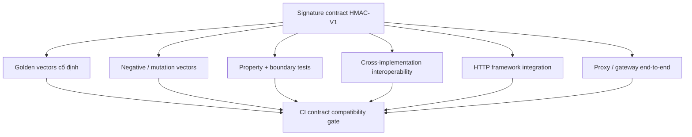
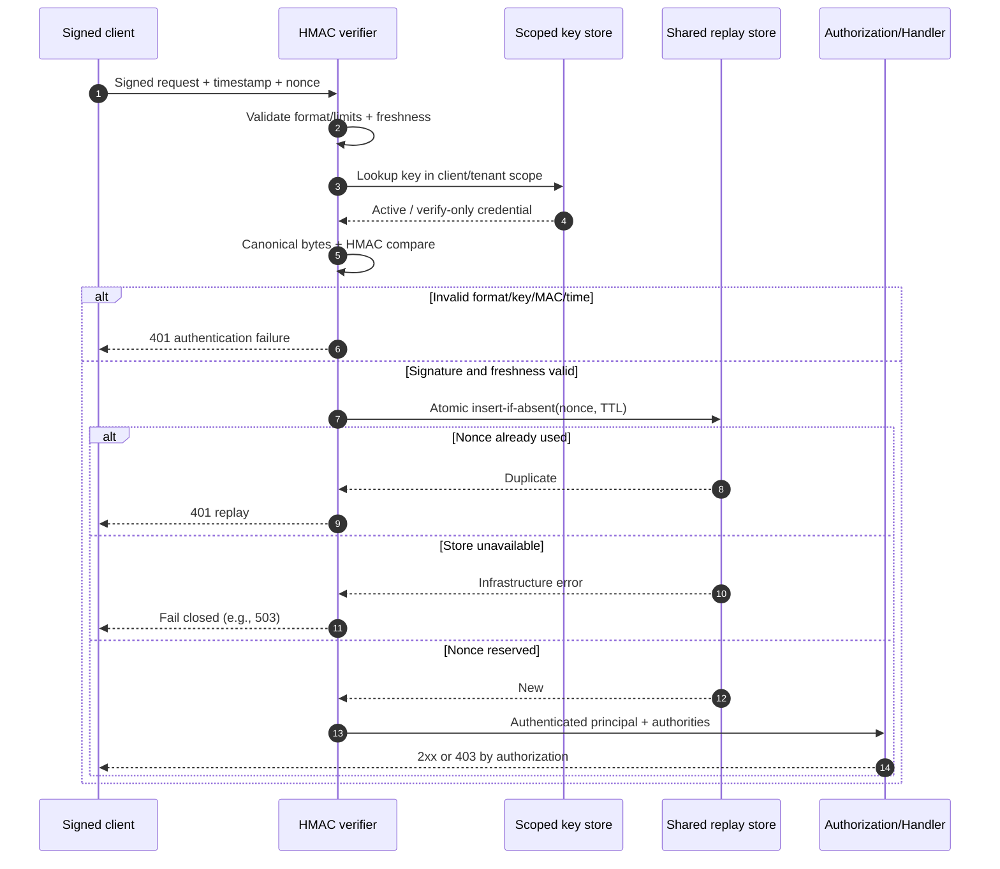
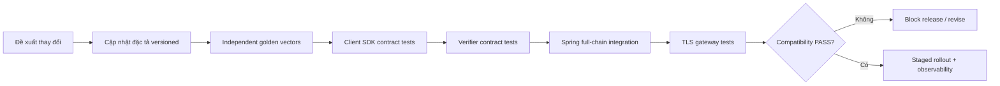

# Signature contract: kiểm thử hợp đồng chữ ký HMAC giữa client, gateway và server

## 1. Bối cảnh và mục tiêu

Trong chương **Contract testing**, bài **Signature contract** tập trung vào một câu hỏi quan trọng: **client và server có đang ký, truyền, tái tạo và xác minh chính xác cùng một dãy byte hay không?** HMAC-SHA256 là một thuật toán đã được chuẩn hóa, nhưng việc dùng thuật toán đúng không bảo đảm hai hệ thống có cùng cách hiểu về method, URI, signed headers, body, timestamp hoặc key.

Bài thuộc mô-đun `SECURITY_AUTHENTICATION_HMAC_REQUEST_AUTHENTICATION`: thiết kế xác thực HTTP request bằng **HMAC với shared secret** và **canonical request** gồm phương thức, URI, header và/hoặc body theo hợp đồng ký. Hệ thống phải xác minh chữ ký, chống replay bằng timestamp/nonce, hỗ trợ key rotation, tương thích proxy/gateway và phân biệt **authentication** với **authorization**.

**Contract testing** ở đây không chỉ là kiểm tra API trả HTTP 200 hay 401. Nó xác định một giao kèo có thể kiểm chứng giữa các bên triển khai độc lập, bao gồm:

- Cách chọn dữ liệu nào **được đưa vào MAC** và dữ liệu nào không.
- Quy tắc biểu diễn từng trường thành **byte**, bao gồm UTF-8/ASCII, xuống dòng, percent-encoding và thứ tự.
- Cách xử lý body rỗng, JSON khác whitespace, duplicate headers/query parameters, query encoding và request-target.
- Định dạng algorithm, signature, `clientId`/`keyId`, timestamp, nonce và version.
- Quy tắc server kiểm key, MAC, độ mới, replay, quyền và phản hồi lỗi.
- Những phép biến đổi gateway được phép thực hiện trước/sau điểm verify.
- Bộ **golden vectors**, negative vectors và integration tests chạy ở cả client/server để phát hiện thay đổi phá vỡ hợp đồng.

Sau bài, người học có thể viết một bản đặc tả `HMAC-V1` đủ rõ để client Java, client ngôn ngữ khác và verifier Spring Security có thể cùng thực thi; thiết kế vector cố định và test xuyên proxy; đồng thời phát hiện trường hợp test “xanh giả” do hai phía dùng chung đoạn mã canonicalizer lỗi.

## 2. Signature contract khác API schema như thế nào?

API contract thông thường có thể mô tả:

```http
POST /api/v1/orders?source=partner
Content-Type: application/json

{"sku":"P100","quantity":2}
```

Một kiểm thử REST thông thường xác nhận endpoint nhận JSON và trả phản hồi phù hợp. **Signature contract** còn phải trả lời:

1. `POST` có bắt buộc viết hoa trong canonical bytes không?
2. String được ký là `/api/v1/orders?source=partner` hay đường dẫn đã được URL-decode?
3. Header `Content-Type` có được ký không; `application/json` khác `application/json; charset=utf-8` ra sao?
4. Body digest được tính trên **raw byte HTTP entity** hay object JSON đã deserialize/serialize lại?
5. Ký `Host`, authority TLS hoặc giá trị host do proxy chuyển tiếp như thế nào?
6. Header nào chứa key ID, timestamp và nonce; các trường này có bắt buộc được MAC bảo vệ không?
7. Có newline cuối canonical request không? Các phần tử được nối bằng LF (`0x0A`) hay CRLF (`0x0D 0x0A`)?
8. MAC có được Base64 chuẩn với padding hay hex; signature tag có đúng 32 byte không?
9. Khi một upstream rewrite path, phía verifier xác minh **public target** hay target đã rewrite?
10. Khi kết quả chữ ký đúng, replay hoặc thiếu quyền sẽ được xử lý ở bước nào?

Chỉ một bất đồng nhỏ, chẳng hạn có/không có LF cuối hoặc encode khoảng trắng `%20` thành dấu `+`, cũng có thể khiến MAC của hai bên khác nhau. Contract testing biến những quy tắc dễ bị ngầm hiểu thành các đầu vào/đầu ra **cố định, versioned và kiểm chứng tự động**.

## 3. Thiết kế hợp đồng HMAC-V1 minh họa

Để bài học có thể kiểm thử cụ thể, ta định nghĩa một hợp đồng **tự thiết kế** tên `HMAC-V1`. Đây là ví dụ giáo dục, **không phải định dạng HMAC mặc định của Spring Security hoặc một chuẩn chung cho mọi API**. Một dịch vụ thật phải công bố đúng phiên bản của mình, threat model và các dữ liệu cần bảo vệ.

### 3.1. Đầu vào của request

| Trường | Nguồn | Quy tắc V1 minh họa |
| --- | --- | --- |
| Version | Header `X-Hmac-Version` | Chính xác `HMAC-V1`. Phải có một giá trị duy nhất. |
| Method | HTTP request method | ASCII uppercase; `POST` trong vector ví dụ. Không dùng header `X-HTTP-Method-Override` để đổi ngầm method. |
| Public request-target | URI nhìn tại điểm xác minh đã định | Origin-form ASCII `/path?query`, bao gồm dấu `?` khi có query, không bao gồm fragment; không decode/re-encode tại bước ký. |
| Public authority | Host/`:authority` tại ingress được tin cậy | Giá trị canonical được allowlist, lowercase; trong vector `api.example.test` không có port. |
| Content-Type | Header HTTP | Với endpoint ví dụ, chỉ `application/json`, không có tham số hoặc khoảng trắng dư. |
| Client ID | `X-Client-Id` | Đúng một giá trị, grammar ASCII có giới hạn. Chỉ là **gợi ý tra credential** trước verify. |
| Key ID | `X-Key-Id` | Đúng một giá trị, scope theo client/tenant và key lifecycle. |
| Timestamp | `X-Timestamp` | UTC dạng `yyyy-MM-dd'T'HH:mm:ss'Z'`; chính xác giây, không offset khác hoặc phần thập phân. |
| Nonce | `X-Nonce` | Chuỗi ASCII ngẫu nhiên đủ uniqueness, đúng một giá trị, giới hạn độ dài. |
| Body | HTTP entity bytes | Byte body sau transfer framing, **trước bất kỳ parse/serialize JSON**; V1 chỉ nhận content-encoding identity. |
| Body hash | Tự tính | Lowercase hex của SHA-256 trên byte body thực sự được gửi. |
| Signature | `X-Signature` | Base64 tiêu chuẩn có padding của **32 byte HMAC-SHA256**; bản thân signature không nằm trong canonical request. |

Trong ví dụ, `Content-Type`/`authority` được ký; hệ thống sử dụng GET/empty body phải định nghĩa riêng sự hiện diện của Content-Type và không nên tự ý bỏ dòng canonical tương ứng. Để tránh trường hợp “header có hoặc không tùy thư viện”, V1 demo cố ý chọn một endpoint JSON có `Content-Type: application/json` bắt buộc.

**Không tự suy rằng mọi hệ thống bắt buộc ký đúng danh sách trên.** Phạm vi signed fields phải được quyết định dựa trên điều gì ảnh hưởng đến routing, danh tính, quyền và ý nghĩa nghiệp vụ. Ví dụ nếu API ký query nhưng không ký method, kẻ tấn công có thể thử đổi phương thức mà không làm thay đổi tag; nếu body không nằm trong phạm vi ký, tính toàn vẹn payload không được bảo vệ bởi HMAC.

### 3.2. Cú pháp canonical request ở cấp byte

Hợp đồng quy định **10 dòng**, nối bằng byte LF `0x0A`, không có khoảng trắng đầu/cuối và **không có LF cuối**:

```text
HMAC-V1
POST
/api/v1/orders?source=partner
authority:api.example.test
content-type:application/json
x-client-id:partner-a
x-key-id:key-a-2026-11
x-timestamp:2026-11-28T03:00:00Z
x-nonce:8f247364-7d4b-479e-8c36-b640f1ad39a0
body-sha256:<lowercase hex SHA-256(body bytes)>
```

Cấu trúc gồm một dòng version, một dòng method, một dòng request-target và bảy dòng trường `authority`, `content-type`, `x-client-id`, `x-key-id`, `x-timestamp`, `x-nonce`, `body-sha256`. **Serializer phải xuất đúng 10 dòng như block**; một dòng bị thêm hoặc thiếu đều làm thay đổi HMAC.

Cần làm rõ thêm:

- Byte `LF` chỉ dùng **giữa** các dòng; không thêm CRLF hoặc newline sau dòng cuối.
- Tên của bảy trường có ký tự lowercase ASCII đúng như block; thứ tự cố định.
- Các giá trị ký là ASCII theo grammar của V1. Với request-target, mọi byte ngoài ASCII phải được percent-encode theo URL contract trước khi ký; không ký ký tự Unicode thô trong path/query.
- `body-sha256` chứa **64 ký tự hex lowercase**, không phải Base64 hay string Java mặc định của `byte[]`.
- Không có dấu `: ` (colon + space) sau tên dòng trường; dùng đúng một dấu `:` rồi giá trị.
- Mọi giá trị bị thiếu, duplicate hoặc chứa CR/LF, control chars và whitespace không hợp lệ phải bị từ chối **trước khi ký/xác minh**, thay vì parser tự chọn một giá trị.
- Bytes canonical là `UTF8(canonicalText)`. Vì ví dụ giới hạn tất cả phần text về ASCII, mỗi ký tự hợp lệ tương ứng một byte; phần body có thể chứa UTF-8 đa byte và được hash **riêng từ raw bytes**.

**Không copy một canonical request đã “trông giống đúng” từ log để làm golden vector.** Cần xác định từng byte, đặc biệt LF, hex encoding, percent escapes và việc có LF cuối.

### 3.3. Empty body, JSON và encoding

Body là **mảng byte**, không phải object JSON. Ví dụ:

```json
{"sku":"P100","quantity":2}
```

và:

```json
{ "quantity": 2, "sku": "P100" }
```

có cùng ý nghĩa dữ liệu trong nhiều trường hợp nhưng **khác byte**, nên SHA-256 body khác và chữ ký theo V1 phải khác.

Với body rỗng thực sự (0 byte), SHA-256 hex chuẩn là:

```text
e3b0c44298fc1c149afbf4c8996fb92427ae41e4649b934ca495991b7852b855
```

Body rỗng **khác** body chứa `{}`, `null`, một dấu xuống dòng hay chuỗi rỗng JSON `""`. Contract phải chỉ rõ endpoint có cho phép body rỗng không. Trong V1 demo, endpoint POST orders yêu cầu JSON body, nên empty body sau bước xác minh có thể bị validation từ chối; body digest rỗng vẫn cần được xác định nhất quán để kiểm signature ở các endpoint khác.

V1 minh họa yêu cầu `Content-Encoding` không có hoặc có giá trị `identity` theo grammar được cho phép; không hỗ trợ gzip. Nếu cần gzip, phải ban hành quy tắc rõ **ký byte nén hay byte đã giải nén**, kiểm thử proxy có nén/giải nén và phân biệt transport framing (chunked/Content-Length) với entity bytes. Không bỏ qua header encoding vì “proxy tự xử lý”.

## 4. URI, query và authority: những chỗ dễ bất đồng

### 4.1. Raw target hay normalized target?

Với hợp đồng này, client ký **origin-form request-target** đúng như URI được gửi tại điểm xác minh, ví dụ:

```text
/api/v1/orders?source=partner&tag=a%20b
```

Các chuỗi sau **không được tự coi là tương đương trong signature contract**:

```text
/api/v1/orders?tag=a%20b&source=partner
/api/v1/orders?source=partner&tag=a+b
/api/v1/orders?source=partner&tag=a%20b
```

Hai dòng khác nhau ở thứ tự query hoặc ký hiệu encode khoảng trắng. Với V1 demo **không sort query**, không decode rồi encode lại. Bất cứ thay đổi byte nào trong raw target có thể khiến HMAC sai, dù tầng ứng dụng cho rằng tham số tương đương.

Có thể xây hợp đồng ký **normalized query** với thứ tự sắp xếp và percent-encoding xác định rõ, nhưng khi đó phải test duplicate keys, empty values, `+`, `%20`, upper/lower percent escapes và Unicode. Không được lấy `Map<String, String>` rồi mất tham số trùng trước khi ký mà vẫn tuyên bố đã ký “toàn bộ query”.

### 4.2. Ràng buộc HTTP/1.1, HTTP/2 và proxy

Trong HTTP/1.1, `Host` là header; trong HTTP/2, `:authority` là pseudo-header. Demo sử dụng dòng canonical `authority:api.example.test` từ **public authority được edge/ingress đáng tin xác định**, không bắt client ký nguyên vẹn một header chuyển tiếp không rõ nguồn gốc.

Nếu gateway terminate TLS, rewrite path hoặc chuyển `Host: api.example.test` thành `Host: orders.internal`, backend **không thể** tự lấy internal host/path rồi mong tag client vẫn khớp. Cần chọn một phương án theo trust boundary:

1. **Backend verify:** giữ đúng public target/authority cần ký, hoặc đưa metadata đã được gateway xác thực qua kênh an toàn; backend phải chỉ chấp nhận metadata từ proxy được xác thực, không từ request client trực tiếp.
2. **Gateway verify trước rewrite:** gateway dùng public URI/authority, kiểm MAC/timestamp/nonce, rồi chuyển assertion về principal đã xác minh cho backend qua mTLS hoặc cơ chế service authentication tương đương; backend vẫn kiểm quyền.
3. **TLS passthrough:** backend trực tiếp thấy kết nối TLS/request, nhưng các proxy TCP vẫn có ảnh hưởng ở routing và cần được test theo topology thực tế.

Header `Forwarded`, `X-Forwarded-Host`, `X-Forwarded-Proto` và `X-Original-URI` **không đáng tin chỉ vì tên của chúng**. Nếu client có thể tự gửi mà backend dùng làm canonical input, attacker có thể tạo ambiguity hoặc giả mạo metadata. Gateway phải strip/overwrite chúng; backend chỉ tin nguồn đã được xác thực.

### 4.3. Duplicate header, case, OWS và smuggling

Theo HTTP, tên header là case-insensitive, nhưng nhiều thư viện có thể chuyển giá trị nhiều header cùng tên theo cách khác nhau. V1 demo quy định:

- Mỗi signed header application chỉ có **đúng một giá trị**; multiple instances hoặc comma-combined ambiguity bị từ chối.
- Tên header canonical viết lowercase ASCII theo danh sách cố định.
- Giá trị phải tuân grammar, không có leading/trailing optional whitespace ngoài hợp đồng; không chấp nhận CR/LF hoặc control characters.
- Không dùng logic “lấy giá trị đầu tiên nếu có nhiều” trên một tầng và “lấy cuối cùng” ở tầng khác.
- Content-Type phải là `application/json` trong endpoint demo; `application/json;charset=UTF-8` không tự động tương đương về chữ ký.

Sự bất đồng về cách parse có thể nguy hiểm hơn một MAC mismatch thông thường: nếu proxy và backend hiểu header/path khác nhau, request được ký theo một nghĩa nhưng handler thực thi theo nghĩa khác. Contract tests phải đi qua **cùng chuỗi parser, gateway và runtime** dùng ở production.

## 5. Key, version và định dạng MAC là một phần của hợp đồng

Client không chỉ biết một thuật toán HMAC. Nó cần biết cách chọn credential và định dạng dữ liệu:

| Thành phần | V1 demo | Tình huống sai cần test |
| --- | --- | --- |
| Algorithm | `HmacSHA256`, tag 32 byte | Bên gửi dùng SHA-1/SHA-512 hoặc tag bị cắt. |
| Secret | Byte secret do credential store cấp, không nhầm chuỗi hex với byte giải mã | Client ký “text hex” trong khi server dùng bytes decoded hex. |
| Client ID | `partner-a`, đã được MAC bảo vệ | Đổi client ID sau ký hoặc dùng key tenant B để mạo danh A. |
| Key ID | `key-a-2026-11`, gắn đúng client/tenant | Unknown, revoked, verify-only ngoài thời hạn. |
| Signature | Base64 chuẩn có padding, đúng 32 byte sau decode | URL-safe Base64, whitespace, thiếu/sai padding, tag sai kích thước. |
| Version | `HMAC-V1` trong header và dòng đầu canonical | Client ký V1 nhưng khai V2 hoặc server fallback V1 không an toàn. |
| Timestamp | UTC giây nguyên được MAC bảo vệ | Thiếu, sai format, lệch giờ quá hạn/tương lai. |
| Nonce | Giá trị đơn nhất được MAC bảo vệ | Replay cùng nonce, collision giữa nhiều node. |

**Phân biệt encoding secret:** nếu hai phía nhận cấu hình `aabbcc`, đây có thể là 6 byte ASCII của text `aabbcc` hoặc 3 byte hex `0xAA 0xBB 0xCC`. Một hợp đồng production phải quy định rõ key material storage/transport format. Không ghi secret vào test report/log; chỉ dùng secret giả không có quyền thật.

**Version negotiation:** server chỉ chấp nhận phiên bản có trong allowlist và được công bố, dùng đúng canonicalization/algorithm tương ứng. Không tự thử V1, rồi V2, rồi bỏ body/hash cho tới khi một tag khớp. Cách “chấp nhận nhiều cách ký” thiếu giới hạn có thể mở ra downgrade hoặc request confusion.

**Rotation:** một key có thể ở trạng thái `ACTIVE`, `VERIFY_ONLY` hoặc `REVOKED` theo chính sách; verify-only có thể được chấp nhận trong thời hạn chuyển tiếp, revoked luôn bị từ chối. Version của **signature protocol** và version của **HMAC secret/key** là hai khái niệm khác nhau; đổi key không nhất thiết phải đổi `HMAC-V1`.

## 6. Contract test suite phải chứng minh điều gì?

Một bộ contract tests tốt gồm nhiều tầng, mỗi tầng trả lời một câu hỏi riêng:



### 6.1. Golden vectors

Golden vector là một **bộ dữ liệu cố định**:

- Key giả, client/key ID và key encoding được chỉ rõ.
- Method, public target/authority, signed headers, timestamp, nonce.
- **Body dưới dạng byte** (UTF-8 string/hex hoặc base64 để không mơ hồ).
- **Canonical byte sequence** kỳ vọng, tốt nhất được lưu/so sánh ở dạng hex ngoài cách xem text.
- SHA-256 body kỳ vọng.
- Tag HMAC 32 byte kỳ vọng (hex và/hoặc Base64).
- Outcome kỳ vọng của verifier tại một `Clock` cố định, có replay store reset.

Golden vector nên được tính hoặc đối chiếu bằng **một triển khai độc lập** với production verifier, và được review như dữ liệu contract. Nếu client test gọi production `canonicalize()` để tạo canonical expected thì cùng một lỗi có thể xuất hiện ở cả actual/expected và làm test xanh giả.

### 6.2. Positive / negative / mutation vectors

| ID | Thay đổi so với request có chữ ký đúng | Kỳ vọng |
| --- | --- | --- |
| `P01` | Byte canonical y hệt fixture, key đang active, nonce mới | MAC đúng; authentication thành công nếu timestamp còn hiệu lực. |
| `P02` | Body rỗng trên endpoint hỗ trợ empty body | Digest là SHA-256 của 0 byte; MAC đúng. |
| `P03` | Unicode/UTF-8 đa byte trong body | MAC đúng trên **byte UTF-8 thực gửi**, không trên ký tự/DTO. |
| `N01` | Đổi một byte body sau ký | Chữ ký sai, thường 401; handler không chạy. |
| `N02` | Đổi method nhưng route tương ứng vẫn được xử lý | MAC sai nếu method được ký. |
| `N03` | Đổi raw query hoặc thứ tự tham số sau ký | MAC sai theo hợp đồng raw target V1. |
| `N04` | Đổi `X-Client-Id` hoặc `X-Key-Id` | Không thể mạo danh principal/key khác. |
| `N05` | Đổi timestamp hoặc nonce nhưng giữ tag cũ | MAC sai; không coi là test “timestamp expired” thuần. |
| `N06` | Signature thiếu/sai Base64/sai 32-byte length | Từ chối định dạng; không chạy phép MAC compare hợp lệ. |
| `N07` | Hai signed headers trùng tên hoặc giá trị gộp nhập nhằng | Từ chối theo grammar, không tự chọn một. |
| `N08` | Body vẫn có nghĩa JSON tương đương nhưng khác whitespace | Digest khác; MAC cũ sai. |
| `N09` | Key không tồn tại, revoked hoặc thuộc tenant khác | Authentication bị từ chối, không thử mọi secret. |
| `N10` | MAC đúng nhưng timestamp được ký thật đã quá hạn | Thất bại freshness; không nhầm với signature mismatch. |
| `N11` | Cùng signed request gửi lần thứ hai | Replay store từ chối; không thực thi lại nghiệp vụ. |
| `N12` | Hai request cùng nonce đến hai verifier đồng thời | Nhiều nhất một lần reserve thành công. |
| `N13` | MAC đúng nhưng principal thiếu authority | Authentication thành công, authorization 403. |
| `N14` | Gateway rewrite path/header/body làm thay đổi thành phần được ký | Kết quả theo contract verify point; không âm thầm bỏ trường ký. |
| `N15` | Unsupported `HMAC-V2` hoặc header version bị sửa | Không fallback sang V1 hoặc thuật toán yếu hơn. |

**Chi tiết quan trọng:** `N10` phải được tạo bởi **signer hợp lệ ký chính timestamp đã hết hạn**, không tạo MAC mới ở hiện tại rồi chỉ sửa header timestamp. Trường hợp sửa header chứng minh MAC mismatch, **không** chứng minh expiration check.

### 6.3. Property-based và fuzz contract testing

Bên cạnh dữ liệu cố định, sinh các input hợp lệ và không hợp lệ để kiểm:

- Canonicalization là **deterministic**: cùng đầu vào hợp lệ → cùng byte output.
- Header names viết khác hoa/thường trong HTTP nhưng đi qua parser hợp lệ phải ra cùng canonical names theo policy; duplicate signed header bị reject.
- Với raw-target V1, query order/percent escapes khác byte phải được phân biệt; parser không tự gộp.
- 0-byte, 1-byte, Unicode UTF-8 đa byte, JSON whitespace, data binary (nếu endpoint hỗ trợ).
- CR/LF injection, NUL/control chars, header quá dài, invalid percent encoding, nhiều query params.
- Đúng biên `now - maxPast` và `now + maxFuture`; ngoài biên một giây bị từ chối.
- Nonce uniqueness theo nhiều luồng, key lookup tenant isolation, concurrent replay atomicity.
- Header `Content-Type` được ký đúng; thay type/charset/trimming không tự tạo một chữ ký mới.

Property test không thể khẳng định “mọi thay đổi byte đều làm tag khác” như một định lý tuyệt đối vì MAC có không gian tag hữu hạn, dù collision là cực kỳ khó xảy ra với HMAC-SHA256. Khi dùng mutation test, **assert verifier từ chối các mutation có chủ đích** thay vì đặt một giả thiết toán học tuyệt đối cho mọi input có thể sinh.

## 7. Một manifest vector và nguyên tắc độc lập

Ví dụ cách mô tả test vector bằng YAML **ngay trong tài liệu** (không phải một file khác cần tạo):

```yaml
contract: HMAC-V1
vectorId: order-json-001
key:
  format: utf8
  value: TEST_ONLY_SHARED_SECRET_NOT_FOR_PRODUCTION
request:
  method: POST
  publicTarget: /api/v1/orders?source=partner
  publicAuthority: api.example.test
  contentType: application/json
  clientId: partner-a
  keyId: key-a-2026-11
  timestamp: '2026-11-28T03:00:00Z'
  nonce: 8f247364-7d4b-479e-8c36-b640f1ad39a0
  bodyUtf8: '{"sku":"P100","quantity":2}'
expected:
  canonicalVersion: HMAC-V1
  # Điền các giá trị này từ công cụ thứ hai độc lập;
  # sau đó khóa chúng lại bằng review/CI:
  canonicalHex: '<REVIEWED_CANONICAL_BYTES_HEX>'
  bodySha256Hex: '<REVIEWED_SHA256_HEX>'
  signatureBase64: '<REVIEWED_HMAC_BASE64>'
  verificationAt: '2026-11-28T03:00:01Z'
  outcome: ACCEPTED
```

Các trường `<REVIEWED_...>` là **placeholder có chủ đích**, không phải kết quả cryptographic đã được tính. Trước khi đưa manifest vào CI, bắt buộc thay chúng bằng những byte/tag **đã được tính độc lập và review**; test không được tự động lấy giá trị expected bằng cách gọi chính production signer. Một manifest dùng placeholder mà vẫn được coi là PASS là lỗi quy trình test.

Để tránh ngẫu nhiên và flakiness:

- Chọn secret **giả** cố định chỉ dùng test; không lấy secret trong repository production.
- Dùng `Clock.fixed(...)` hoặc tương đương để timestamp/nonce có outcome dự kiến.
- Cô lập replay store hoặc namespace theo vector/suite và reset có kiểm soát; không dùng dữ liệu nonce từ suite khác.
- Định nghĩa canonical bytes trong manifest theo encoding rõ ràng; có thể so sánh hex toàn chuỗi để kiểm LF/no trailing LF.
- Có ít nhất hai bên có **implementation độc lập**, ví dụ signer Java và signer Node/Python, hoặc client SDK và verifier service không chia sẻ canonicalization code.

Nếu chỉ có một codebase, vẫn có thể viết **reference implementation nhỏ trong test** dựa trên đặc tả và golden bytes đã review, rồi kiểm production implementation chống lại nó. Tuy nhiên “hai lớp Java gọi cùng một method chung” không đủ tính độc lập.

## 8. Java: biểu diễn canonical request chính xác

Ví dụ helper **chỉ phục vụ minh họa contract V1**, viết theo danh sách và thứ tự cố định. Các giá trị đã được kiểm grammar trước khi đi tới đây. Đối với ứng dụng production, kiểm header trùng và raw URI phải xảy ra ở lớp HTTP parser/verifier phù hợp, không thể chỉ tin các chuỗi đầu vào trong record.

```java
import java.nio.charset.StandardCharsets;
import java.security.GeneralSecurityException;
import java.security.MessageDigest;
import java.util.HexFormat;
import javax.crypto.Mac;
import javax.crypto.spec.SecretKeySpec;

record ContractRequest(
    String method,
    String publicTarget,
    String authority,
    String contentType,
    String clientId,
    String keyId,
    String timestamp,
    String nonce,
    byte[] body) {}

final class ReferenceContractV1 {
    private ReferenceContractV1() {}

    static byte[] canonicalBytes(ContractRequest r)
            throws GeneralSecurityException {

        String bodyHex = HexFormat.of().formatHex(
            MessageDigest.getInstance("SHA-256").digest(r.body()));

        String canonical = String.join("\n",
            "HMAC-V1",
            r.method(),
            r.publicTarget(),
            "authority:" + r.authority(),
            "content-type:" + r.contentType(),
            "x-client-id:" + r.clientId(),
            "x-key-id:" + r.keyId(),
            "x-timestamp:" + r.timestamp(),
            "x-nonce:" + r.nonce(),
            "body-sha256:" + bodyHex
        );
        // String.join không thêm LF sau dòng cuối.
        return canonical.getBytes(StandardCharsets.UTF_8);
    }

    static byte[] sign(byte[] testKey, ContractRequest request)
            throws GeneralSecurityException {

        Mac mac = Mac.getInstance("HmacSHA256");
        mac.init(new SecretKeySpec(testKey, "HmacSHA256"));
        return mac.doFinal(canonicalBytes(request));
    }
}
```

Đoạn code trên giả định `method`, `publicTarget`, `authority` và các header đã đạt grammar: nếu đưa chuỗi chứa CR/LF, chữ Unicode không được phép hoặc duplicate header vào thẳng record, nó không tự reject. **Không** dùng reference helper này thay cho input validation của server.

### 8.1. Test canonical byte fixture, không tính expected từ actual

Một test Java nên so sánh từng phần:

```java
@Test
void canonicalContractHasExactlySpecifiedLineBreaks()
        throws Exception {

    byte[] empty = new byte[0];
    ContractRequest r = new ContractRequest(
        "POST",
        "/api/v1/orders?source=partner",
        "api.example.test",
        "application/json",
        "partner-a",
        "key-a-2026-11",
        "2026-11-28T03:00:00Z",
        "8f247364-7d4b-479e-8c36-b640f1ad39a0",
        empty);

    byte[] actual = ReferenceContractV1.canonicalBytes(r);
    String text = new String(actual, StandardCharsets.UTF_8);

    assertEquals(10, text.split("\n", -1).length);
    assertTrue(text.startsWith("HMAC-V1\nPOST\n"));
    assertTrue(text.endsWith(
        "body-sha256:" +
        "e3b0c44298fc1c149afbf4c8996fb92427ae41e4649b934ca495991b7852b855"
    ));
    assertFalse(text.endsWith("\n"));
}
```

Các assertions này kiểm một số tính chất **cụ thể** (10 dòng, no trailing LF, body hash rỗng) nhưng chưa thay thế so sánh **toàn bộ canonicalHex và signatureBase64** với manifest gold đã review. Cần thêm phép `assertArrayEquals(expectedCanonicalBytes, actual)` và `assertEquals(expectedTagBase64, ...)` khi vector độc lập đã hoàn chỉnh.

### 8.2. Kiểm primitive bằng vector mật mã độc lập

Để xác định vấn đề nằm ở HMAC primitive hay ở canonicalizer, dùng một vector HMAC-SHA256 chuẩn đã được đối chiếu độc lập. Ví dụ vector HMAC-SHA256 phổ biến với key gồm **20 byte `0x0b`**, message ASCII `Hi There` và expected tag:

```text
b0344c61d8db38535ca8afceaf0bf12b
881dc200c9833da726e9376c2e32cff7
```

Hai dòng chỉ là cách xuống dòng hiển thị; ghép chúng thành **64 ký tự hex** liên tục. Test:

```java
@Test
void hmacSha256PrimitiveMatchesKnownVector()
        throws Exception {

    byte[] key = new byte[20];
    Arrays.fill(key, (byte) 0x0b);

    Mac mac = Mac.getInstance("HmacSHA256");
    mac.init(new SecretKeySpec(key, "HmacSHA256"));
    byte[] tag = mac.doFinal(
        "Hi There".getBytes(StandardCharsets.US_ASCII));

    assertEquals(
        "b0344c61d8db38535ca8afceaf0bf12b"
      + "881dc200c9833da726e9376c2e32cff7",
        HexFormat.of().formatHex(tag));
}
```

Đây là test cho **HMAC-SHA256 primitive**, không phải golden vector của `HMAC-V1`. Test này có thể thành công ngay cả khi canonicalization của client và server hoàn toàn sai. Kết hợp cả hai loại vector mới hữu ích.

## 9. Java: kiểm thử signer độc lập với verifier Spring Security

Trong một ứng dụng Spring Security, nên coi verifier là **hộp đen** ở tầng integration. Client test dựng HTTP request thật bằng signer fixture; verifier phải đi qua security filter và trả kết quả theo contract.

### 9.1. Một kịch bản MockMvc

Giả sử một endpoint test `POST /api/v1/orders?source=partner` dùng HMAC-V1, trả HTTP `201` khi đã xác thực và có authority `orders:write`. Spring Boot test phải nạp đúng `SecurityFilterChain`, credential repository fixture và replay store cô lập; nếu không, việc `MockMvc` trả 201 chưa chứng minh HMAC đã được kiểm.

```java
@SpringBootTest
@AutoConfigureMockMvc
class HmacContractMvcTest {

    @Autowired MockMvc mvc;

    // Chỉ là khóa giả dành cho môi trường test.
    private final byte[] testKey =
        "TEST_ONLY_SHARED_SECRET_NOT_FOR_PRODUCTION"
            .getBytes(StandardCharsets.UTF_8);

    @Test
    void validSignatureReachesController() throws Exception {
        byte[] body =
            "{\"sku\":\"P100\",\"quantity\":2}"
                .getBytes(StandardCharsets.UTF_8);

        ContractRequest req = new ContractRequest(
            "POST",
            "/api/v1/orders?source=partner",
            "api.example.test",
            "application/json",
            "partner-a",
            "key-a-2026-11",
            "2026-11-28T03:00:00Z",
            UUID.randomUUID().toString(),
            body);

        String signature = Base64.getEncoder().encodeToString(
            ReferenceContractV1.sign(testKey, req));

        mvc.perform(post("/api/v1/orders?source=partner")
                .header("Host", "api.example.test")
                .header("X-Hmac-Version", "HMAC-V1")
                .header("X-Client-Id", req.clientId())
                .header("X-Key-Id", req.keyId())
                .header("X-Timestamp", req.timestamp())
                .header("X-Nonce", req.nonce())
                .header("X-Signature", signature)
                .contentType(MediaType.APPLICATION_JSON)
                .content(body))
            .andExpect(status().isCreated());
    }
}
```

**Điều kiện fixture bắt buộc:** backend phải dùng `Clock` test cố định gần `2026-11-28T03:00:00Z`; nếu chạy tại ngày thực khác, timestamp sẽ hết hạn và test phải trả 401. Một test đáng tin dùng clock inject cả phía fixture/verifier hoặc đặt fixture time dựa trên một clock test do suite quản lý. Request phải có authority public đúng contract, route cần tồn tại và có quyền `orders:write` theo credential fixture.

Đoạn code không bao gồm import/JUnit setup đầy đủ vì tập trung vào **contract boundary**; `ReferenceContractV1` trong bài là reference implementation minh họa cho test, không phải production verifier. Trong bộ test chính thức, ngoài việc gửi request thành công, cần so sánh signature test signer với golden tag **được tính độc lập**.

### 9.2. WebFlux dùng WebTestClient

Đối với Spring WebFlux, dùng `WebTestClient` với application context có `SecurityWebFilterChain` hoặc dùng `bindToServer()` trên server thật:

```java
WebTestClient.ResponseSpec result = webTestClient.post()
    .uri(URI.create("/api/v1/orders?source=partner"))
    .header("Host", "api.example.test")
    .header("X-Hmac-Version", "HMAC-V1")
    .header("X-Client-Id", request.clientId())
    .header("X-Key-Id", request.keyId())
    .header("X-Timestamp", request.timestamp())
    .header("X-Nonce", request.nonce())
    .header("X-Signature", signatureBase64)
    .contentType(MediaType.APPLICATION_JSON)
    .bodyValue(request.body()) // exact bytes used by signer
    .exchange();

result.expectStatus().isCreated();
```

`request` và `signatureBase64` được chuẩn bị bởi cùng fixture client-side theo contract. Với reactive body, filter HMAC không được tiêu thụ `Flux<DataBuffer>` rồi khiến handler nhận body rỗng; cần một body decorator/cache có giới hạn và quản lý pooled buffer. Test phải vừa assert MAC được chấp nhận, vừa assert handler nhận đúng payload.

**Không dùng `mockUser`/`mockAuthentication` trong test nhằm chứng minh chữ ký**: các helper đó có thể bỏ qua việc xác minh HMAC. Chúng hữu ích cho unit test phân quyền riêng, nhưng không chứng minh API công khai yêu cầu signature hợp lệ.

### 9.3. Mutation test có giá trị hơn việc chỉ kiểm 401

Một test từ chối chữ ký cần quan sát:

- Input HMAC ban đầu đã được xác nhận hợp lệ trong **một request khác với nonce mới**.
- Mutation chỉ thay đổi **một trường đã ký**.
- Route/method hợp lệ để request thực sự tới verifier; nếu server trả 404/405 trước bước HMAC, test không chứng minh chữ ký bị phát hiện sai.
- Response là authentication failure theo contract.
- Handler hoặc service nghiệp vụ **không được gọi**; database/side effects không thay đổi.
- Nếu dùng metric nội bộ, failure được phân loại `SIGNATURE_INVALID` khi thực sự so sánh MAC, không gộp `KEY_NOT_ACCEPTED` hoặc `NONCE_REPLAY`.

Nếu gửi tag mới đúng với body đã sửa, request mới có thể hợp lệ và đó **không phải tamper test**. Để test toàn vẹn body, ký body A rồi gửi body B **mà giữ tag cũ**.

## 10. Timestamp, nonce và anti-replay thuộc signature contract

MAC đúng vẫn chưa đủ để tạo `Authentication`. Hợp đồng còn phải định nghĩa freshness và nonce semantics, vì kẻ có request đã ký có thể phát lại y nguyên trong cửa sổ thời gian hợp lệ.

Ví dụ V1:

- `X-Timestamp` UTC giây nguyên, được ký; verifier chấp nhận khoảng `now - 300s` đến `now + 30s`, **bao gồm hai biên**, theo `Clock` server.
- `X-Nonce` được ký và đủ ngẫu nhiên/unique trong scope client + key; server chỉ chấp nhận nonce chưa được ghi.
- Nonce store dùng chung tất cả verifier node, thao tác **insert-if-absent nguyên tử** với TTL đủ bao phủ cửa sổ freshness và clock margin.
- Chỉ reserve nonce **sau khi** MAC, key state và freshness hợp lệ. Store không sẵn sàng thì **fail closed** theo error semantics.
- Request ký đúng nhưng bị replay phải bị từ chối, ngay cả khi hai request dùng hai TLS session khác nhau.

Ví dụ logic flow:



### 10.1. Test thời gian và định dạng

Sử dụng `Clock.fixed(...)` để test:

| Case | Với `now = 03:00:00Z` | Outcome freshness |
| --- | --- | --- |
| `02:54:59Z` | 301 giây trước | EXPIRED |
| `02:55:00Z` | Đúng biên 300 giây trước | VALID |
| `03:00:00Z` | Hiện tại | VALID |
| `03:00:30Z` | Đúng biên 30 giây sau | VALID |
| `03:00:31Z` | 31 giây tương lai | TOO_FAR_IN_FUTURE |
| `03:00:00.000Z` | Phần thập phân không thuộc grammar V1 | MALFORMED |
| `10:00:00+07:00` | Cùng instant nhưng biểu diễn không hợp đồng | MALFORMED |

Test expired/future phải **ký trên chính giá trị expired/future** để cô lập freshness. Nếu chỉ thay timestamp sau ký, HMAC trở nên sai và không thể khẳng định timestamp policy đã hoạt động.

### 10.2. Concurrent replay qua nhiều node

Hai request có cùng MAC, timestamp và nonce gửi tuần tự giúp kiểm “seen before”, nhưng **không** kiểm tính nguyên tử khi hai verifier xử lý cùng lúc. Contract test cần một kịch bản gửi đồng thời qua nhiều backend cùng replay store:

1. Tạo một request đã ký với nonce cố định trong môi trường test.
2. Phát hai bản sao tới hai node gần đồng thời, đảm bảo đều đi tới điểm verify.
3. Assert **nhiều nhất một** request được đánh dấu xác thực thành công và có side effect nghiệp vụ.
4. Inject timeout/redis failover theo kịch bản riêng để chứng minh fail closed.
5. Đánh giá TTL khi timestamp có thể hơi ở tương lai, không để nonce bị xóa trong khi request vẫn còn hợp lệ.

Nonce **không phải idempotency key**: hai request có nonce khác nhau và chữ ký hợp lệ vẫn có thể gây hai giao dịch. API có side effect phải thiết kế idempotency nghiệp vụ độc lập.

## 11. Error semantics: kiểm thử cả status và nguồn lỗi

Một signature contract nên quy định phản hồi công khai, nhưng cũng phân loại nguyên nhân nội bộ có thể kiểm thử:

| Nguyên nhân | Authentication / authorization | HTTP gợi ý |
| --- | --- | --- |
| Thiếu/malformed header HMAC, unsupported version, bad tag | Authentication chưa thành công | 401 trong custom HMAC scheme minh họa. |
| MAC mismatch khi đã có key và tag đúng grammar | Authentication thất bại | 401 Unauthorized. |
| Timestamp ngoài cửa sổ hoặc nonce replay | Authentication thất bại | 401 Unauthorized. |
| Unknown/revoked key, key sai client/tenant | Authentication thất bại | 401 Unauthorized. |
| HMAC hợp lệ nhưng thiếu authority | Authentication đạt, **authorization** thất bại | 403 Forbidden. |
| Body quá hạn mức | Request limit | 413 Content Too Large. |
| Replay store không khả dụng | Lỗi hạ tầng chống replay | Fail closed; ví dụ 503 Service Unavailable. |
| Body JSON sai nhưng MAC đúng | Codec/validation sau authentication | 400 Bad Request theo API. |

Một hệ thống có thể chọn 400 cho một số lỗi định dạng request. Điểm quan trọng là **hợp đồng phải chọn và test nhất quán**, không coi mọi lỗi là signature mismatch. Trả về một thông điệp chung cho lỗi credential thường giúp tránh lộ sự tồn tại của key/client ID, trong khi telemetry nội bộ vẫn phân biệt `MISSING_SIGNATURE`, `SIGNATURE_INVALID`, `TIMESTAMP_EXPIRED`, `NONCE_REPLAY` và `STORE_UNAVAILABLE`.

Nếu trả HTTP `401`, cần tuân HTTP authentication semantics và challenge header `WWW-Authenticate` khi áp dụng; một custom scheme dùng các header `X-*` cần tài liệu hóa rõ cơ chế challenge, không tự tuyên bố một scheme chuẩn chưa được định nghĩa.

## 12. Contract testing qua TLS termination, gateway và proxy

Một unit test trên canonicalizer hoặc `MockMvc` không tái hiện tất cả các biến đổi của HTTP stack. HMAC hoạt động trên byte và ý nghĩa routing mà **gateway có thể thay đổi**.

| Gateway/proxy case | Thay đổi quan sát được | Cần assert |
| --- | --- | --- |
| Strip path prefix | `/public/api` → `/api` | Verify point nhận public target đúng hợp đồng hoặc gateway verify trước rewrite. |
| Query order/encoding | `a=1&b=2` → `b=2&a=1`; `+` ↔ `%20` | Signature outcome nhất quán với raw target policy, không normalize ngầm. |
| HTTP/2 → HTTP/1.1 | `:authority` thành `Host` | Canonical public authority nhất quán, không tin giá trị client giả mạo. |
| TLS termination rồi upstream HTTP/HTTPS | Backend thấy scheme/host nội bộ | Không ký nhầm internal authority/scheme thay cho public contract. |
| Duplicate signed headers | Proxy gộp/chọn giá trị khác server | Từ chối ambiguity, không cho signing confusion. |
| Body encoding | Gzip/decompress, JSON format, charset | V1 identity-only hoặc có policy rõ; hash đúng byte body được ký. |
| Chunked/Content-Length | Transfer framing thay đổi | Không ký framing nếu không có đặc tả riêng; hash entity bytes. |
| Retry sau upstream timeout | Gửi cùng request đã ký lần hai | Anti-replay/idempotency đúng; không thực hiện side effect lần hai. |
| Forged `Forwarded`/`X-Original-URI` | Client tự điền metadata gốc | Gateway strip/overwrite; backend chỉ tin proxy đã xác thực. |
| Direct-backend access | Bypass public gateway | Không bỏ authentication nhờ header do client tự đặt. |

### 12.1. Cách sắp xếp test suite

Chia hợp đồng thành ba mức:

1. **Pure byte/vector tests**: JUnit/reference client, không cần HTTP server; phát hiện format/encoding/canonicalization regression nhanh.
2. **Spring integration**: `MockMvc` hoặc `WebTestClient` có security chain, credential fixture, body reader và nonce store; phát hiện lỗi filter order, handler bypass, body consumption.
3. **Real HTTP gateway tests**: gửi qua TLS host, ingress, reverse proxy, multiple backend nodes và replay store; phát hiện path rewrite, forwarded-header confusion, body transform, mTLS/trust boundary.

Khi backend verify sau rewrite, test phải xác định rõ **public target** theo contract được bảo toàn bằng cách nào. Không được lấy giá trị `X-Original-URI` từ client bất kỳ rồi coi là nguồn canonical đáng tin. Một kiến trúc có thể chuyển verify đến gateway để sử dụng request chưa bị rewrite, nhưng backend vẫn phải xác thực danh tính gateway và authority của assertion.

## 13. Compatibility, versioning và phát hành hợp đồng

Signature contract là một phần **giao thức giữa client và server**. Thay đổi một byte trong canonicalization có thể làm mọi client cũ bị 401, dù JSON API schema không thay đổi.

### 13.1. Phân loại thay đổi

| Thay đổi | Tác động | Hướng phát hành |
| --- | --- | --- |
| Thêm signed header bắt buộc hoặc đổi thứ tự dòng canonical | MAC của client cũ sẽ khác. | Version mới hoặc kế hoạch migration có kiểm thử song song rõ ràng. |
| Đổi raw target sang normalized target | Thay đổi input signature, có thể gây bất đồng ở proxy. | Version mới, golden vectors và gateway tests mới. |
| Đổi format timestamp hoặc nonce grammar | Client cũ có thể bị reject ngay trước MAC. | Cần hợp đồng/version và thời hạn chuyển đổi. |
| Đổi signature Base64 sang hex | Wire format không tương thích. | Version mới hoặc negotiation được thiết kế rõ. |
| Rotate shared secret, đổi key ID | Không nhất thiết đổi canonical protocol. | Credential lifecycle, active/verify-only/revoke theo key scope. |
| Tối ưu code mà **canonical bytes không đổi** | Không đổi contract. | Regression/golden vectors phải tiếp tục PASS. |
| Tăng/giảm cửa sổ timestamp | Thay đổi security semantics/freshness. | Review threat model, replay TTL, client clock và rollout. |
| Đổi nơi verify từ backend sang gateway | Trust boundary và source public URI thay đổi. | Integration + security architecture review, staged rollout. |

**Không thay đổi signature contract âm thầm** qua một refactor như `URI.normalize()`, `ObjectMapper` config, framework upgrade hoặc “sort query params cho dễ cache”. Những thay đổi có thể phá tương thích hoặc vô tình mở request confusion.

### 13.2. Contract CI gate

Một chu trình phát hành mẫu:



Đối với nhiều client, có thể dùng **consumer-driven contract testing**: từng client/SDK chạy test vectors và yêu cầu hành vi mà provider công bố; provider chạy cùng vectors và kết quả lỗi tương ứng. Tuy nhiên việc mỗi client “tự nói tôi ký đúng” không đủ: cần golden bytes/tag được review và kiểm nghiệm bởi implementation độc lập.

Trong giai đoạn chuyển từ V1 sang V2, server có thể hỗ trợ đồng thời **các phiên bản được allowlist** trong một thời hạn rõ, nhưng mỗi request phải được xử lý bằng **một** contract do phiên bản khai báo hợp lệ chọn. Không thử fallback mọi format cho đến khi một chữ ký tình cờ khớp. Đo mức sử dụng V1/V2 bằng metric có nhãn **version hữu hạn**, không log secret, full signature, nonce hoặc raw body.

## 14. Một số failure mode contract testing phải bắt được

### 14.1. Dùng chung một lỗi giữa signer và verifier

Ví dụ cả client test và server cùng gọi `CanonicalRequest.toString()` chứa LF cuối ngoài hợp đồng. Test gửi request hợp lệ và server trả 200, nhưng **client bên thứ ba** ký đúng đặc tả không thể tương tác.

**Khắc phục:** golden vectors có canonical bytes/tag được duyệt độc lập; cross-language implementation; mutation test ở từng trường.

### 14.2. “Sửa” signature failure bằng cách bỏ bớt trường ký

Gateway rewrite path khiến HMAC sai, team quyết định **bỏ URI khỏi canonical string**. Tỷ lệ 401 có thể giảm, nhưng request có thể bị đổi đích mà HMAC vẫn đúng.

**Khắc phục:** sửa trust boundary, vị trí verify hoặc quy tắc canonical URI. Bất kỳ thay đổi signed fields nào cần threat model, version mới và regression tests.

### 14.3. Chỉ test JSON semantic equality

Hai client cùng gửi object JSON nhưng serializer khác thứ tự field. Nếu signer tính SHA body trên object đã serialize một kiểu còn client HTTP gửi kiểu khác, tag sẽ lệch.

**Khắc phục:** ký trên **byte[] payload cuối cùng**; truyền chính byte đó qua HTTP client, sau đó mới deserialize khi authentication thành công.

### 14.4. Timestamp test thực chất chỉ là signature test

Test ký timestamp mới rồi thay thành timestamp cũ **mà giữ MAC cũ**. API trả 401; test kết luận expiration pass, nhưng thực tế verifier có thể không hề kiểm thời gian.

**Khắc phục:** signer ký thật trên timestamp expired; `Clock.fixed` trong verifier; test biên.

### 14.5. Replay test chỉ tuần tự hoặc store riêng từng node

Một test gửi lại nonce tuần tự trên một node được 401, nhưng hai node dùng hai local set có thể **cùng chấp nhận** một signed request.

**Khắc phục:** atomic insert-if-absent trên shared store, concurrency test qua nhiều instance và kiểm side effects.

### 14.6. Proxy/header dẫn đến request-target confusion

Client ký `/public/api/orders`; gateway đổi `/api/orders`; backend dùng `X-Original-URI` do client tự gửi để tái tạo public path. Attacker có thể lợi dụng thông tin không tin cậy để khiến verifier và handler thấy hai đích khác nhau.

**Khắc phục:** xác thực nguồn metadata, strip/overwrite ở gateway, ràng buộc routing và ký đúng URI có hiệu lực.

## 15. Checklist nghiệm thu signature contract

- [ ] Hợp đồng nêu rõ tên/phiên bản thuật toán, cách biểu diễn secret, Base64/hex của tag và độ dài tag.
- [ ] Dữ liệu ký gồm đúng method, public URI/query, authority, header và body digest đã được threat model lựa chọn.
- [ ] Có grammar cho header đơn/duplicate, OWS/CRLF, URI percent-encoding, query order, empty values, body empty/UTF-8/Content-Encoding.
- [ ] Canonical byte format quy định chính xác LF/CRLF, thứ tự dòng, lowercase header names và trailing newline.
- [ ] Client/SDK ký **byte payload sẽ gửi thật**, không ký DTO rồi serialize lại theo cách khác.
- [ ] Timestamp, nonce, key ID, client ID và protocol version được MAC bảo vệ theo contract.
- [ ] Credential lookup ràng buộc client/tenant; key revoked bị từ chối; key rotation có thời hạn rõ.
- [ ] Nonce store shared/atomic/TTL phù hợp cửa sổ timestamp và fail closed khi dependency lỗi.
- [ ] Authentication failure 401 được tách khỏi authorization failure 403; codec error/body limit và store outage có semantics rõ.
- [ ] Có golden vectors **độc lập** với canonical bytes, body SHA và HMAC expected đã review; không dùng placeholder trong CI.
- [ ] Có test body tampering, signed URI/header mutation, malformed/duplicate headers, empty body và Unicode.
- [ ] Có test expired/future timestamp ký đúng, nonce replay tuần tự và đồng thời, cross-tenant key và key rotation.
- [ ] Spring MVC/WebFlux integration đi qua security chain thật và assert handler không chạy khi chữ ký sai.
- [ ] Proxy/gateway integration kiểm TLS termination, path rewrite, query encoding, authority/Forwarded, body transform và direct-backend bypass.
- [ ] CI ngăn thay đổi canonical contract không được version/review; metric theo version giúp theo dõi migration.
- [ ] Log/test artifacts không chứa production shared secret, full signature, canonical request nhạy cảm hoặc body thật.

## 16. Câu hỏi tự đánh giá

1. Tại sao hai bên cùng dùng HMAC-SHA256 vẫn có thể cho chữ ký khác nhau?
2. Contract phải quy định những byte nào trong canonical request ngoài danh sách field cần ký?
3. Vì sao `/orders?a=1&b=2` và `/orders?b=2&a=1` có thể không tương đương theo V1 raw-target?
4. Hash của body rỗng có giống hash của `{}` không?
5. Một JSON có cùng dữ liệu nhưng khác whitespace/order field sẽ ảnh hưởng `body-sha256` thế nào?
6. Vì sao không nên dùng `Map<String,String>` để canonicalize query có duplicate keys khi hợp đồng là raw-target?
7. Trong HTTP/2, canonical authority cần tương thích với `:authority` và reverse proxy thế nào?
8. Trường hợp nào khiến `X-Forwarded-Host` không đáng tin và có thể tạo request confusion?
9. Nếu test signer và verifier gọi cùng một canonicalizer lỗi, bộ kiểm thử có thể “xanh giả” vì sao?
10. Golden vector phải chứa những dữ liệu nào để so sánh **cấp byte**?
11. Test HMAC primitive với message `Hi There` đã đủ kiểm `HMAC-V1` chưa?
12. Để test timestamp expired, vì sao phải ký lại request trên timestamp cũ?
13. Hai request cùng nonce tới hai node đồng thời cần được kiểm bằng cách nào?
14. Vì sao khóa HMAC ở trạng thái `REVOKED` không được xác thực dù MAC tính đúng?
15. Key rotation và signature contract versioning khác nhau ở đâu?
16. Chữ ký đúng nhưng principal thiếu authority trả 401 hay 403?
17. Khi gateway rewrite URI có thành phần được ký, nên thay đổi vị trí verify hay âm thầm bỏ URI khỏi MAC?
18. Vì sao cần kiểm handler không chạy và database không đổi trong các tamper tests?
19. Một PR đổi normalized query hoặc thêm LF cuối canonical string cần đi qua những contract test và release gate nào?
20. Trong quá trình migrate V1 → V2, vì sao verifier không nên thử lần lượt mọi thuật toán/canonicalization cho tới khi một tag khớp?

**Ghi nhớ:** **Signature contract** là giao kèo **ở cấp byte và hành vi bảo mật** giữa mọi bên tham gia HTTP request HMAC. Nó quy định chính xác canonical request, tag encoding, key/version, timestamp/nonce, nơi verify và error semantics. Test mạnh phải dựa trên **golden vectors độc lập**, negative/mutation tests, full Spring Security integration và HTTP gateway tests; chỉ một request trả 200 từ hai thành phần dùng chung code ký chưa đủ chứng minh tương thích. Giữ nguyên hợp đồng hoặc version hóa thay đổi, chống replay nguyên tử và kiểm quyền riêng là điều kiện để hệ thống vừa tương tác được vừa an toàn.
