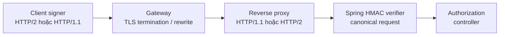
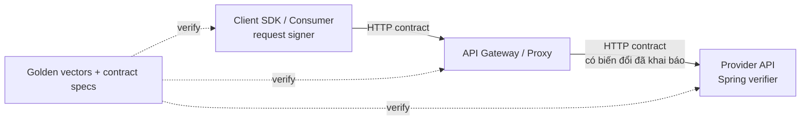

# Header contract: kiểm thử hợp đồng header cho xác thực HTTP request bằng HMAC

## 1. Bối cảnh và mục tiêu bài học

Trong module `SECURITY_AUTHENTICATION_HMAC_REQUEST_AUTHENTICATION`, client và server dùng **shared secret** để tính, xác minh chữ ký HMAC trên một **canonical request** theo hợp đồng ký. Request có thể được bảo vệ bởi HTTP method, URI/query, một số header và digest của body. Server còn cần kiểm tra timestamp/nonce chống replay, trạng thái key khi rotation, tính toàn vẹn qua gateway/proxy và **authorization** sau khi xác thực.

Một API có thể triển khai đúng thuật toán `HmacSHA256` mà vẫn không tương thích: client gửi `X-Key-Id` hai lần, gateway xóa `X-Timestamp`, client ký `Content-Type: application/json; charset=UTF-8` nhưng server chỉ thấy `application/json`, hoặc HTTP/2 thay đổi cách biểu diễn header. Những lỗi này thường bị bỏ sót nếu test chỉ kiểm tra chữ ký với một chuỗi byte dựng sẵn.

**Header contract** là thỏa thuận có thể kiểm chứng về **tên, số lượng, sự hiện diện, cú pháp, ngữ nghĩa, cách chuẩn hóa, phạm vi ký và quy tắc xử lý header qua các hop**. Trong chương **Contract testing**, mục tiêu không chỉ là kiểm tra parser, mà còn chứng minh client signer, API gateway và backend verifier đang hiểu cùng một giao thức.

Sau bài học, người học có thể:

- Xác định bộ header HMAC bắt buộc, tùy chọn và không được dùng để suy ra quyền.
- Viết một bảng hợp đồng xác định chính xác **header nào được ký và theo thứ tự nào**.
- Phân biệt tên header không phân biệt chữ hoa/thường với **giá trị header** phải tuân theo quy tắc canonical riêng.
- Kiểm thử header thiếu, trùng, rỗng, quá dài, sai định dạng, chứa ký tự điều khiển hoặc bị intermediary thay đổi.
- Tạo golden vectors ở mức byte, consumer/provider contract tests, `MockMvc`/`WebTestClient` và E2E qua proxy.
- Quản lý version của hợp đồng ký, key rotation, timestamp/nonce, HTTP error semantics và tương thích ngược.

## 2. Header contract là một giao thức, không phải danh sách tên

Một dòng mô tả “API dùng header `X-Signature`” là **chưa đủ**. Client còn cần biết định dạng, thời điểm tạo chữ ký, key nào được chọn và các thành phần phải được đưa vào chuỗi ký. Provider phải biết cách parse các giá trị, xử lý header trùng, bỏ qua hay từ chối giá trị không có trong hợp đồng.

Một header contract đầy đủ trả lời được:

1. **Trường nào bắt buộc?** Trên endpoint/method nào? Có chấp nhận giá trị rỗng không?
2. **Số lượng bao nhiêu?** Một header occurrence, một value hay được phép nhiều value?
3. **Cú pháp nào?** ASCII/UTF-8, format timestamp, key ID, nonce, hex digest và Base64 signature.
4. **Phần nào được ký?** Cách sắp thứ tự signed headers và tạo canonical bytes.
5. **Header nào không được ký?** Ví dụ `X-Signature` chứa kết quả MAC nên không tự đưa vào input MAC.
6. **Gateway được làm gì?** Rewrite path, `Host`, chuẩn hóa field name, thêm trace ID hay chuyển framing.
7. **Failure semantics ra sao?** Thiếu credential, chữ ký không khớp, nonce bị replay, key bị revoke hoặc kho key unavailable.
8. **Cách nâng version?** Client và server nhận diện version nào, có chấp nhận song song phiên bản cũ hay không.

Nếu hai phía thống nhất tên header nhưng khác một byte LF, một khoảng trắng hoặc một quy tắc gộp header, MAC cuối cùng vẫn khác. Vì vậy contract testing phải có **golden bytes** và kiểm chứng thực tế trên HTTP pipeline.

## 3. Một header contract HMAC minh họa

Giả sử API `POST /integrations/orders` nhận JSON. Ví dụ dưới đây là **hợp đồng ứng dụng giả định v1**, không phải một tiêu chuẩn HMAC chung cho mọi API:

| Header | Trạng thái v1 cho POST | Cú pháp/giá trị minh họa | Nằm trong phạm vi ký? |
| --- | --- | --- | --- |
| `X-Hmac-Version` | Bắt buộc, đúng một giá trị | Chính xác `hmac-v1` | **Có** — là dòng version trong canonical request |
| `X-Key-Id` | Bắt buộc, đúng một giá trị | Opaque ASCII ID, 1–64 ký tự theo allowlist | **Có** |
| `X-Timestamp` | Bắt buộc, đúng một giá trị | UTC ISO-8601 cố định, ví dụ `2026-11-28T03:15:00Z` | **Có** |
| `X-Nonce` | Bắt buộc, đúng một giá trị | Nonce ngẫu nhiên đủ entropy, format ASCII được định nghĩa | **Có** |
| `X-Content-SHA256` | Bắt buộc, đúng một giá trị | 64 ký tự hex lowercase của SHA-256 body bytes | **Có** |
| `X-Signature` | Bắt buộc, đúng một giá trị | Base64 chuẩn của HMAC-SHA-256 đầy đủ, 32 byte sau decode | **Không** — là output cần so sánh |
| `Content-Type` | Bắt buộc cho POST này, đúng một giá trị | `application/json` trong v1 ví dụ | **Có** |
| `Accept` | Tùy chọn | Header thương lượng response | Không |
| `X-Request-Id` / `traceparent` | Tùy chọn cho observability | Do gateway/backend kiểm soát nguồn tin | Không |
| `Host` / `:authority` | Bắt buộc ở tầng HTTP theo giao thức áp dụng | Có thể đổi khi proxy routing | **Không** trong v1 ví dụ |
| `Content-Length` / `Transfer-Encoding` | Theo HTTP transport/framing | Có thể biến đổi giữa các hop | Không |
| `Connection`, `Keep-Alive` | Theo kết nối HTTP/1.x | Hop-by-hop | Không |

**Quy tắc bổ sung:** đối với `GET` không có request body, v1 có thể quy định `X-Content-SHA256` bằng SHA-256 của dãy byte rỗng và **không dùng `Content-Type`**. Đây phải là một rule riêng cho `GET`, chứ không để mỗi client tự chọn signed headers theo ý mình. Mọi header nghiệp vụ ảnh hưởng tới routing, tenant hoặc hành động được phép phải được bảo vệ bằng HMAC hoặc một ranh giới tin cậy khác; không được sử dụng một custom header unsigned làm bằng chứng quyền.

### 3.1. Request trên HTTP/1.1

```http
POST /integrations/orders?source=partner HTTP/1.1
Host: api.example.test
Content-Type: application/json
X-Hmac-Version: hmac-v1
X-Key-Id: fulfillment-v2
X-Timestamp: 2026-11-28T03:15:00Z
X-Nonce: n-0000000000000001
X-Content-SHA256: <64-lowercase-hex-of-body-bytes>
X-Signature: <base64-of-32-byte-hmac>
X-Request-Id: external-debug-hint

{"orderId":"O-17"}
```

Các giá trị trong dấu ngoặc nhọn góc `<...>` là **placeholder**, không phải header có thể dùng để xác thực. `X-Request-Id` trong request đến từ Internet chỉ là correlation hint chưa tin cậy; không được coi là credential.

Khi tính digest, client phải lấy **đúng bytes của body sẽ gửi trên wire theo hợp đồng**, không hash một object JSON rồi serialize lại thành chuỗi khác. Server phải kiểm tra cùng bytes đó trước khi chuyển request cho controller; việc parser JSON chấp nhận cùng dữ liệu nghiệp vụ không bảo đảm HMAC giống nhau.

### 3.2. Quy tắc canonical request ở mức byte

Đối với `POST` v1 minh họa, đặt format gồm các dòng UTF-8, phân cách bằng **một LF (0x0A)** và **không có LF cuối**:

```text
HMAC-V1
POST
/integrations/orders?source=partner
content-type:application/json
x-content-sha256:<64-lowercase-hex-of-body-bytes>
x-key-id:fulfillment-v2
x-nonce:n-0000000000000001
x-timestamp:2026-11-28T03:15:00Z
```

Chữ ký:

```text
expectedMacBytes = HMAC-SHA256(
    keyRegistry["fulfillment-v2"].sharedSecret,
    UTF8(canonicalRequest)
)
X-Signature = Base64Standard(expectedMacBytes)
```

Các dòng header được sắp theo thứ tự **ASCII lowercase name tăng dần** trong ví dụ. Header `X-Hmac-Version` được bảo vệ bằng dòng `HMAC-V1` đầu tiên; parser phải yêu cầu header version khớp chính xác phiên bản canonical. `X-Signature` không nằm trong input của chính nó. Với `GET`, chính sách signed headers thay đổi theo route/method **do server xác định**, không cho client bỏ `X-Timestamp`, `X-Nonce`, key ID hay body digest khi chúng là trường bắt buộc.

Đây chỉ là một ví dụ để học contract testing. **Không được giả định** mọi chuẩn HMAC ngoài đời đều ký key ID hoặc method theo format này; cần test và triển khai đúng hợp đồng ký thực tế của dịch vụ.

## 4. Header name, header value và canonicalization

### 4.1. Tên header không phân biệt chữ hoa/thường

Theo ngữ nghĩa HTTP, `X-Key-Id`, `x-key-id` và `X-KEY-ID` là **cùng một tên field**. Một client HTTP/1.1 dùng chữ hoa không được làm verifier chọn một header khác. HTTP/2 và HTTP/3 yêu cầu tên field ở dạng lowercase trên wire.

Trong v1 minh họa, canonicalizer biểu diễn tên signed header bằng **lowercase ASCII**. Nó không biến đổi giá trị key ID:

```text
X-Key-Id: fulfillment-v2
x-key-id: fulfillment-v2
→ canonical line: x-key-id:fulfillment-v2

X-Key-Id: FULFILLMENT-V2
→ canonical line: x-key-id:FULFILLMENT-V2
→ có thể là key ID khác hoặc bị reject theo registry
```

**Tên field case-insensitive không có nghĩa value cũng case-insensitive.** Key ID và nonce thường được xử lý như opaque value; không tự lowercase hoặc Unicode-normalize mà thiếu hợp đồng.

### 4.2. OWS và khoảng trắng trong value

HTTP có cú pháp whitespace xung quanh field value. Một contract cần chọn **một quy tắc**: với các header HMAC trong v1, giải pháp đơn giản là yêu cầu giá trị normalized ASCII và **không chấp nhận** leading/trailing SP/HTAB hoặc ký tự xuống dòng trong giá trị mà application nhìn thấy; riêng `Content-Type` được kiểm tra đúng form `application/json`.

Khi phải hỗ trợ nhiều client HTTP với OWS hợp lệ, có thể quy định parser được phép trim SP/HTAB ở hai đầu trước khi canonicalize, nhưng phải áp dụng **giống nhau giữa signer và verifier** và không tự sửa interior whitespace. Quan trọng là kiểm thử được cùng một kết quả ở mọi hop.

Với ví dụ nghiêm ngặt:

| Giá trị nhận | Hành vi v1 gợi ý |
| --- | --- |
| `fulfillment-v2` | Chấp nhận nếu registry có key hợp lệ |
| ` fulfillment-v2` | Reject nếu giá trị sau HTTP parsing còn leading SP |
| `fulfillment-v2 ` | Reject nếu giá trị sau parsing còn trailing SP |
| `fulfillment  -v2` | Reject: không thuộc charset key ID |
| `FULFILLMENT-V2` | Không tự lowercase value; lookup theo opaque ID |
| `fulfillment-v2, reporting-v1` | Reject vì một header chứa nhiều ID |
| Value chứa CR/LF hoặc ký tự điều khiển | HTTP layer/validator phải reject; không log raw input |

Lưu ý HTTP stack có thể chuẩn hóa OWS **trước khi** application đọc được. Vì vậy test unit parser chưa chứng minh byte-level behavior tại edge; phải bổ sung E2E trên proxy thực.

### 4.3. Duplicate header không được chọn tùy ý

Ví dụ request mơ hồ:

```http
X-Key-Id: reporting-v1
X-Key-Id: fulfillment-v2
X-Timestamp: 2026-11-28T03:15:00Z
X-Nonce: n-0000000000000001
```

Nếu client ký theo header đầu nhưng gateway/backend lấy header cuối, hai phía có thể dùng key, danh tính hoặc policy khác nhau. V1 yêu cầu các trường HMAC là **single-valued**: nhiều occurrences hoặc một giá trị bị ghép dạng danh sách đều bị từ chối. Không dựa vào `getHeader()` trả về giá trị đầu tiên rồi bỏ qua phần còn lại.

Kiểm thử cả ba cách: hai dòng HTTP/1.1 riêng biệt, trường trùng tên khác casing và trường đã bị intermediary ghép dấu phẩy. Dù parser HTTP có thể kết hợp một số field, security contract phải xác định cách phát hiện và từ chối ambiguity.

### 4.4. Missing, empty, malformed khác nhau trong test

Thử từng trường hợp cho `X-Key-Id`, `X-Timestamp`, `X-Nonce`, `X-Signature` và body digest:

- Header hoàn toàn **không có**.
- Header có mặt nhưng value **rỗng**.
- Header value chỉ có **khoảng trắng**.
- Header **trùng**, giá trị giống nhau hoặc mâu thuẫn.
- Value vượt **giới hạn độ dài**.
- Sai cú pháp, ví dụ timestamp dùng millisecond epoch khi contract yêu cầu ISO-8601.
- Chứa NUL, CR/LF, ký tự điều khiển hoặc Unicode ngoài allowlist.
- Value bị gateway đổi hoặc loại bỏ.

Các ca này phải có expected outcome riêng; không gom tất cả vào một test `401` mà không xác định parser/verifier đã chạy qua nhánh nào.

## 5. Timestamp, nonce và key ID phải được bảo vệ

Ba trường `X-Key-Id`, `X-Timestamp` và `X-Nonce` không chỉ để “đọc cho có”; chúng ảnh hưởng trực tiếp tới tính đúng của xác thực.

| Trường | Test contract quan trọng | Hệ quả nếu thiếu ràng buộc |
| --- | --- | --- |
| `X-Key-Id` | Sửa key ID sau ký phải làm request thất bại; key revoked không được chấp nhận | Key confusion, sai client/tenant |
| `X-Timestamp` | Giá trị được ký; format UTC, precision và allowed skew được định nghĩa | Kẻ tấn công có thể sửa thời gian để kéo dài hiệu lực |
| `X-Nonce` | Giá trị được ký; uniqueness được kiểm tra atomically theo scope/TTL | Replay cùng một request đã ký |
| `X-Hmac-Version` | Version trong header khớp version của canonical bytes | Downgrade hoặc hai phía dùng contract khác |
| `X-Content-SHA256` | Header khớp digest của body thực sự được nhận và nằm trong MAC | Body có thể bị sửa sau ký hoặc không được bảo vệ |

Một ví dụ **không đủ an toàn**: server chỉ ký method, URI và body mà **không** bảo vệ timestamp/nonce, nhưng sau đó lại tin những giá trị này để chống replay. Khi ấy attacker có thể thay timestamp/nonce trong khi giữ MAC cũ. V1 vì vậy bắt buộc đưa timestamp/nonce vào canonical request.

Nonce store phải hỗ trợ **insert-if-absent nguyên tử** trên kho dùng chung (nếu nhiều instance) với TTL phù hợp. Một contract test cho header nonce chỉ kiểm tra cú pháp; cần test replay/concurrency riêng để khẳng định kiểm tra freshness có hiệu lực. Không dùng `requestId` hay `traceId` thay nonce.

### 5.1. Key rotation không phải nâng version của header contract

Version của **protocol/canonicalization** và version của **shared secret** là hai khái niệm khác nhau:

```text
X-Hmac-Version: hmac-v1   # Hợp đồng ký
X-Key-Id: reporting-key-v3  # Phiên bản credential
```

Một client có thể xoay `reporting-key-v2` sang `reporting-key-v3` nhưng vẫn dùng `hmac-v1` nếu contract không đổi. Verifier phải tra đúng key ID đang có hiệu lực, không fallback qua các secret khác khi MAC không khớp. Một request mang key đã bị revoke phải bị từ chối dù thuật toán MAC vẫn tạo ra kết quả đúng bằng secret cũ.

## 6. Body digest header phải thống nhất với bytes nội dung

V1 minh họa yêu cầu:

```text
X-Content-SHA256 = lowercaseHex(
    SHA256(rawBodyBytesAccordingToContract)
)
```

Với body rỗng, SHA-256 chuẩn là:

```text
e3b0c44298fc1c149afbf4c8996fb92427ae41e4649b934ca495991b7852b855
```

Với body JSON:

```json
{"orderId":"O-17","amount":125000}
```

Raw bytes của JSON trên **khác** với representation có xuống dòng, khoảng trắng hoặc đổi thứ tự field. Nếu contract ký raw bytes, client phải hash bytes đúng như khi gửi, server phải hash bytes đúng như khi xử lý; không parse rồi serialize lại JSON chỉ để tạo digest.

Các test tiêu biểu:

1. Body đúng và digest header đúng → có thể tiếp tục xác minh HMAC.
2. Body đổi một byte nhưng giữ digest và MAC cũ → từ chối.
3. Digest header đổi nhưng giữ MAC cũ → từ chối.
4. Digest header tự đổi thành digest của body mới nhưng **không** tính lại MAC → từ chối.
5. Body rỗng trên GET có digest rỗng chuẩn; không tùy tiện bỏ header.
6. Proxy giải nén `Content-Encoding` hoặc thay representation → test theo trust boundary, không âm thầm bỏ digest để “chữa” lỗi.

Nếu body rất lớn, tính SHA-256 theo luồng có thể giảm nhu cầu ghép mảng bytes; nhưng phải có chính sách giới hạn kích thước, replay body cho controller, memory management và backpressure. Trong Spring MVC có thể cần request wrapper riêng; trong WebFlux phải quản lý `DataBuffer` release/caching/replay cẩn thận.

`Content-Length` không phải bằng chứng toàn vẹn thay cho SHA-256. `Transfer-Encoding: chunked` là framing HTTP/1.1, có thể biến mất khi gateway chuyển sang HTTP/2 DATA frames. Không ký chunk sizes như là body application nếu hợp đồng ký dựa trên content bytes.

## 7. Gateway, reverse proxy và hop-by-hop header



Một request có thể đi qua nhiều hop với `Host` khác nhau, path được rewrite hoặc transfer framing bị đổi. Vì vậy header contract phải ghi rõ **thành phần nào được giữ nguyên và thành phần nào có thể được gateway tạo/thay**.

| Thay đổi của intermediary | Có thể gây mismatch? | Contract/E2E cần kiểm tra |
| --- | --- | --- |
| Đổi casing tên field | Không nếu canonicalizer đúng HTTP semantics | Client H1 mixed case ↔ backend H2 lowercase |
| Thay signed header value | **Có** | Backend reject hoặc gateway verify trước transform |
| Gộp duplicate `X-Key-Id` | Có thể gây ambiguity | Reject single-valued violation |
| `Connection: X-Signature` trên H1 | Gateway có thể xóa signature ở hop sau | Endpoint HMAC phải fail closed |
| HTTP/1.1 chunked → HTTP/2 DATA | Không nếu content bytes không đổi và ký đúng nội dung | Không ký `Transfer-Encoding`/framing |
| Rewrite path/query | Có nếu request-target nằm trong MAC | Xác định external/internal request-target được ký |
| Rewrite `Host`/`:authority` | Có nếu authority nằm trong MAC | Chọn authority contract ở trust boundary |
| Thêm `X-Request-Id`/`traceparent` | Không theo v1 vì không ký các trường đó | Không sử dụng làm danh tính, quyền hay replay token |
| Giải nén/chuyển mã body | **Có** nếu body bytes thay đổi | Digest phải bảo vệ đúng representation theo hợp đồng |

**HTTP/1.1 `Connection` là trường connection-specific**: intermediary phải xử lý những connection options mà nó liệt kê. Header `X-Signature` hoặc `X-Key-Id` bị nêu trong `Connection` có thể bị loại bỏ trước backend, dẫn tới `401`. Gateway do tổ chức kiểm soát nên từ chối các request HTTP/1.1 cố nêu **header HMAC bắt buộc** làm hop-by-hop option, đồng thời backend vẫn phải kiểm tra đủ credentials sau khi các header đã bị proxy xử lý.

HTTP/2 và HTTP/3 không cho phép các connection-specific fields của HTTP/1.1 xuất hiện như header thông thường; có ngoại lệ hạn chế cho `TE: trailers` theo quy tắc giao thức. Không ký `Connection`, `Keep-Alive` hoặc `Transfer-Encoding` làm dữ liệu end-to-end.

### 7.1. Xác minh HMAC ở gateway hay backend?

**Mô hình A — verify tại gateway trước rewrite:** gateway nhận request-target bên ngoài, dựng canonical bytes đúng hợp đồng, kiểm tra HMAC/timestamp/nonce/key; backend nhận verified identity qua mTLS, signed internal assertion hoặc kênh được bảo vệ tương đương. Gateway phải xóa mọi header danh tính tự khai từ client.

**Mô hình B — verify tại backend:** backend cần đúng representation của method/path/query và signed headers được client ký. Nếu gateway rewrite, contract phải quy định một cơ chế tin cậy để chuyển external request-target (hoặc client ký representation backend thật sự nhận). Không tin `X-Original-URI` hoặc `X-Forwarded-*` do client tự gửi.

Không thử một loạt path/host khác nhau rồi chấp nhận MAC nào khớp mà không có versioned contract; hành vi đó mở rộng tập request được chấp nhận và làm lỗi ký khó phát hiện.

## 8. Định nghĩa hợp đồng dưới dạng machine-readable

Một file đặc tả hợp đồng trong dự án thật có thể dùng schema dưới đây. Đây là **ví dụ YAML để giảng giải**, không phải cấu hình chuẩn được Spring Security hay một framework tự động hiểu:

```yaml
protocol:
  name: hmac-request-authentication
  version: hmac-v1
  macAlgorithm: HmacSHA256
  signatureEncoding: base64-standard
  canonicalCharset: UTF-8
  lineSeparator: LF
  trailingNewline: false

routes:
  - method: POST
    route: /integrations/orders
    requiredHeaders:
      - X-Hmac-Version
      - X-Key-Id
      - X-Timestamp
      - X-Nonce
      - X-Content-SHA256
      - X-Signature
      - Content-Type
    signedHeaderNames:
      - content-type
      - x-content-sha256
      - x-key-id
      - x-nonce
      - x-timestamp
    versionHeader: X-Hmac-Version
    versionInCanonical: true
    contentType: application/json
    requireSingleValue: true
    bodyDigest: sha256-lowercase-hex
    allowClientSelectedSignedHeaderSet: false

security:
  maxClockSkewSeconds: 300 # Ví dụ; chọn theo threat model
  nonceStore: atomic-shared
  rejectRevokedKeys: true
  rejectUnknownSignedContractVersion: true
```

**Cần bổ sung khi triển khai thật:** quy tắc raw path/query, duplicate query parameters, percent-encoding, OWS, body encoding/Content-Encoding, size limits, nonce syntax/entropy, TTL key và nonce, error response schema, cách gateway xử lý forwarding và các version contract được hỗ trợ. Các quy tắc này phải được test cùng nhau; không dùng YAML trên như một “spec hoàn chỉnh” để triển khai production.

Việc lưu spec một nơi rồi generate test fixtures cho client/server rất có ích, nhưng **không đủ** nếu cả hai phía dùng cùng một hàm canonicalizer có bug. Golden vectors nên được kiểm chứng độc lập.

## 9. Golden vectors: nguồn sự thật ở mức byte

Một golden vector tốt cần lưu:

```text
contract_version
test_key_id + test_shared_secret (chỉ secret giả)
HTTP method + exact raw path/query
header names, values, order/multiplicity ban đầu
signed header names theo policy server
raw body bytes (hex hoặc file fixture)
SHA-256 body bytes
canonical request UTF-8 bytes (hex)
expected HMAC-SHA-256 bytes (hex)
expected X-Signature (Base64 chuẩn)
expected verify outcome
```

Giữ cả **request representation** và **canonical bytes** để xác định mismatch ở bước parse, normalize hay MAC. Test vector phải có version, người duyệt và quy trình review khi hợp đồng thay đổi.

Ví dụ hằng số SHA-256 của body rỗng ở phần 6 là một vector độc lập cho digest; HMAC-SHA-256 còn có vector công khai để kiểm tra implementation cơ bản:

```text
secret = 20 bytes có giá trị 0x0b
message ASCII = "Hi There"
HMAC-SHA256 expected (hex) =
b0344c61d8db38535ca8afceaf0bf12b881dc200c9833da726e9376c2e32cff7
```

Vector này chỉ xác nhận thuật toán HMAC-SHA-256, **không** kiểm chứng quy tắc HTTP header. Để kiểm chứng giao thức, cần ít nhất một vector `POST` đúng định dạng v1 và một vector cho từng thay đổi nhỏ: tên field khác case, thêm whitespace, đổi body, nonce trùng, duplicate key ID và path bị gateway rewrite.

### 9.1. Golden vector nào bắt buộc phải thất bại?

Với một signed request hợp lệ, tạo các bản sao chỉ sửa **một thuộc tính** mà không ký lại:

- `X-Key-Id` đổi từ A sang B.
- `X-Timestamp` cộng một giây.
- `X-Nonce` đổi một ký tự.
- `X-Content-SHA256` đổi một nibble hex.
- `Content-Type` đổi từ `application/json` sang `text/plain`.
- Method đổi `POST` → `PUT`.
- Raw path/query đổi thứ tự khi contract không cho phép normalize tương đương.
- Body đổi một byte trong JSON.
- `X-Hmac-Version` đổi nhưng vẫn giữ MAC cũ.

Các ca trên phải **không được xác thực**, vì chúng làm thay đổi dữ liệu đã ký hoặc vi phạm ràng buộc của contract. Ngược lại, đổi **casing của tên header** mà giữ nguyên semantics phải không làm sai MAC trong hợp đồng chuẩn hóa lowercase.

## 10. Parser Java: lấy đúng một giá trị header

Đây là helper Java dùng trong một dự án **Spring MVC/Servlet** để minh họa quy tắc single-valued. Nó chỉ giải quyết việc đọc một trường, **không** tự đảm bảo HTTP container đã bảo toàn mọi header byte gốc:

```java
import jakarta.servlet.http.HttpServletRequest;
import java.util.Collections;
import java.util.List;
import java.util.regex.Pattern;
import org.springframework.security.authentication.BadCredentialsException;

public final class HmacHeaderContract {
    private static final Pattern KEY_ID =
            Pattern.compile("[A-Za-z0-9][A-Za-z0-9._-]{0,63}");
    private static final Pattern TIMESTAMP =
            Pattern.compile(
                    "[0-9]{4}-[0-9]{2}-[0-9]{2}T" +
                    "[0-9]{2}:[0-9]{2}:[0-9]{2}Z");
    private static final Pattern NONCE =
            Pattern.compile("[A-Za-z0-9_-]{16,128}");
    private static final Pattern BODY_HEX =
            Pattern.compile("[0-9a-f]{64}");
    private static final Pattern SIGNATURE_BASE64 =
            Pattern.compile("[A-Za-z0-9+/]{43}=");

    private HmacHeaderContract() {}

    private static String single(
            HttpServletRequest request, String headerName) {
        List<String> values =
                Collections.list(request.getHeaders(headerName));
        if (values.size() != 1) {
            throw new BadCredentialsException(
                    "Invalid HMAC credentials");
        }
        String value = values.get(0);
        if (value == null || value.isEmpty()
                || value.length() > 256
                || !value.equals(value.strip())
                || value.indexOf(',') >= 0) {
            throw new BadCredentialsException(
                    "Invalid HMAC credentials");
        }
        return value;
    }

    private static String checked(
            HttpServletRequest request, String name, Pattern pattern) {
        String value = single(request, name);
        if (!pattern.matcher(value).matches()) {
            throw new BadCredentialsException(
                    "Invalid HMAC credentials");
        }
        return value;
    }

    public static ParsedHmacHeaders parsePost(
            HttpServletRequest request) {
        String version = single(request, "X-Hmac-Version");
        if (!version.equals("hmac-v1")) {
            throw new BadCredentialsException(
                    "Invalid HMAC credentials");
        }
        String contentType = single(request, "Content-Type");
        if (!contentType.equals("application/json")) {
            throw new BadCredentialsException(
                    "Invalid HMAC credentials");
        }
        return new ParsedHmacHeaders(
                version,
                checked(request, "X-Key-Id", KEY_ID),
                checked(request, "X-Timestamp", TIMESTAMP),
                checked(request, "X-Nonce", NONCE),
                checked(request, "X-Content-SHA256", BODY_HEX),
                checked(request, "X-Signature", SIGNATURE_BASE64),
                contentType);
    }

    public record ParsedHmacHeaders(
            String version,
            String keyId,
            String timestamp,
            String nonce,
            String bodySha256Hex,
            String signatureBase64,
            String contentType) {}
}
```

**Giới hạn cố ý của đoạn mã:** `SIGNATURE_BASE64` yêu cầu biểu diễn Base64 chuẩn có `=` cuối, tương ứng 32 byte MAC, nhưng verifier vẫn phải **decode và kiểm tra đúng 32 byte**, đồng thời cân nhắc canonical Base64 encoding theo contract. `TIMESTAMP` mới kiểm tra hình dạng chuỗi, chưa validate ngày thực tế hoặc clock skew. `NONCE` regex chấp nhận định dạng, **không chứng minh entropy** của nonce và không thay thế nonce store.

`String.strip()` xử lý whitespace theo quy tắc Java và chỉ là policy nghiêm ngặt của ví dụ; hệ thống thực cần đặc tả OWS cho mọi HTTP stack. Parser phải từ chối các value chứa ký tự điều khiển; ở ví dụ, các pattern allowlist của header HMAC được ký tự hóa chặt chẽ và phần `Content-Type`/version là fixed value.

Ở request đi qua gateway, một số proxy/container có thể đã **gộp duplicate field** thành một string. Kiểm tra danh sách ở backend vẫn quan trọng nhưng không thay thế E2E test ở boundary ngoài.

## 11. Dựng canonical bytes và xác minh body digest

Ví dụ Java tiếp theo dựng đúng format v1 của `POST` trong bài này. Việc lấy `rawPathAndQuery` phải đã được giải quyết theo contract gateway, không dùng một URI đã rewrite tùy tiện.

```java
import java.nio.charset.StandardCharsets;
import java.security.MessageDigest;
import java.util.HexFormat;
import java.util.List;

public final class HmacV1Canonical {
    private HmacV1Canonical() {}

    public static byte[] bytes(
            String method,
            String rawPathAndQuery,
            HmacHeaderContract.ParsedHmacHeaders h) {

        if (!"POST".equals(method) || rawPathAndQuery == null) {
            throw new IllegalArgumentException(
                    "Wrong method or missing request target");
        }
        // Các giá trị h.* đã được parse theo contract chặt chẽ.
        return String.join("\n", List.of(
                "HMAC-V1",
                "POST",
                rawPathAndQuery,
                "content-type:" + h.contentType(),
                "x-content-sha256:" + h.bodySha256Hex(),
                "x-key-id:" + h.keyId(),
                "x-nonce:" + h.nonce(),
                "x-timestamp:" + h.timestamp()))
                .getBytes(StandardCharsets.UTF_8);
    }

    public static boolean bodyDigestMatches(
            byte[] receivedBody, String claimedLowerHex)
            throws java.security.NoSuchAlgorithmException {

        byte[] actualDigest =
                MessageDigest.getInstance("SHA-256")
                        .digest(receivedBody);
        byte[] claimedDigest = HexFormat.of()
                .parseHex(claimedLowerHex);
        return MessageDigest.isEqual(actualDigest, claimedDigest);
    }
}
```

`bodyDigestMatches` so sánh digest header và digest body thật; sau đó verifier còn phải tính HMAC trên `canonicalBytes`, tra secret theo `X-Key-Id` và so MAC. **Chỉ khớp body digest không phải đã xác thực**, vì attacker có thể tự thay digest chưa được ký và body cùng lúc. Tính toàn vẹn đến từ MAC bảo vệ toàn bộ canonical request, trong đó bao gồm digest header.

Lưu ý `bodyDigestMatches` nhận cả body dưới dạng byte array chỉ để code ngắn; production có thể hash theo stream/`DataBuffer` với giới hạn kích thước. Khi filter đã đọc body, không làm mất dữ liệu mà controller phải dùng tiếp.

### 11.1. Không lẫn parser và chính sách quyền

Sau khi kiểm tra:

1. Header bắt buộc đúng contract.
2. Body digest khớp raw content bytes.
3. MAC khớp secret của key version còn hiệu lực.
4. Timestamp nằm trong window, nonce chưa dùng và đã được claim atomically.

Server **mới** được tạo `Authentication` với client/tenant từ registry đáng tin. Spring Security hoặc business service tiếp tục quyết định `hasAuthority("ORDER_CREATE")`, tenant ownership và resource policy. Header `X-Key-Id` hoặc `X-Tenant-Id` từ Internet không tự cấp quyền cho request.

## 12. Unit test cho header parser

Ví dụ dưới đây sử dụng `MockHttpServletRequest` từ `spring-test` và JUnit 5 để kiểm tra **single-valued contract**. Trong project thật, thêm các imports và cấu hình dependency phù hợp:

```java
import static org.junit.jupiter.api.Assertions.assertEquals;
import static org.junit.jupiter.api.Assertions.assertThrows;
import org.junit.jupiter.api.Test;
import org.springframework.mock.web.MockHttpServletRequest;
import org.springframework.security.authentication.BadCredentialsException;

class HmacHeaderContractTest {
    private MockHttpServletRequest validPost() {
        var request = new MockHttpServletRequest("POST",
                "/integrations/orders");
        request.addHeader("X-Hmac-Version", "hmac-v1");
        request.addHeader("X-Key-Id", "fulfillment-v2");
        request.addHeader("X-Timestamp", "2026-11-28T03:15:00Z");
        request.addHeader("X-Nonce", "n-0000000000000001");
        request.addHeader("X-Content-SHA256",
                "e3b0c44298fc1c149afbf4c8996fb92427ae41e4649b934ca495991b7852b855");
        request.addHeader("X-Signature",
                "AAAAAAAAAAAAAAAAAAAAAAAAAAAAAAAAAAAAAAAAAAA=");
        request.addHeader("Content-Type", "application/json");
        return request;
    }

    @Test
    void acceptsRequiredHeadersWithSingleValues() {
        var headers = HmacHeaderContract.parsePost(validPost());
        assertEquals("fulfillment-v2", headers.keyId());
        assertEquals("hmac-v1", headers.version());
    }

    @Test
    void rejectsMissingNonce() {
        var request = validPost();
        request.removeHeader("X-Nonce");
        assertThrows(BadCredentialsException.class,
                () -> HmacHeaderContract.parsePost(request));
    }

    @Test
    void rejectsConflictingDuplicateKeyIds() {
        var request = validPost();
        request.addHeader("x-key-id", "reporting-v1");
        assertThrows(BadCredentialsException.class,
                () -> HmacHeaderContract.parsePost(request));
    }

    @Test
    void rejectsCommaJoinedKeyIds() {
        var request = validPost();
        request.removeHeader("X-Key-Id");
        request.addHeader("X-Key-Id",
                "fulfillment-v2, reporting-v1");
        assertThrows(BadCredentialsException.class,
                () -> HmacHeaderContract.parsePost(request));
    }

    @Test
    void rejectsUnknownContractVersion() {
        var request = validPost();
        request.removeHeader("X-Hmac-Version");
        request.addHeader("X-Hmac-Version", "hmac-v99");
        assertThrows(BadCredentialsException.class,
                () -> HmacHeaderContract.parsePost(request));
    }
}
```

Test dùng `MockHttpServletRequest` mô phỏng HTTP request đã được server parse, không phải raw socket test; một số container/proxy có hành vi ghép header hoặc từ chối HTTP syntax không hợp lệ từ trước. Test signer/verifier phải bổ sung bằng HMAC thực và golden vectors, thay vì chỉ kiểm tra parser.

### 12.1. Kiểm tra một biến mỗi lần

Khi tạo negative test từ request hợp lệ, chỉ thay **một** field, giữ nguyên những dữ liệu khác. Ví dụ signature hợp lệ với key A, rồi đổi `X-Key-Id` thành B **mà không ký lại**. Phải đảm bảo timestamp vẫn hợp lệ và nonce mới, để response `401` phản ánh ràng buộc key ID/MAC chứ không vô tình do clock skew hay replay.

Nếu test thiếu header nhưng đồng thời dùng một MAC placeholder, cần biết mình đang test **parser failure** chứ không phải MAC verification. Tách rõ các tầng kiểm thử tránh false positive.

## 13. Integration test với Spring MVC và MockMvc

Một integration test phải gắn security filters thực, request signer và registry test:

```java
@SpringBootTest
@AutoConfigureMockMvc(addFilters = true)
class HmacHeaderContractMvcTest {
    @Autowired MockMvc mockMvc;
    @Autowired CapturingAuditSink auditSink;

    @Test
    void tamperingSignedTimestampReturns401()
            throws Exception {
        byte[] body = "{\"orderId\":\"O-17\"}"
                .getBytes(StandardCharsets.UTF_8);

        String originalTimestamp = "2026-11-28T03:15:00Z";
        String changedTimestamp = "2026-11-28T03:15:01Z";
        String nonce = "n-0000000000000099";
        String keyId = "fulfillment-v2";

        // Fixture testSigner dùng đúng key test và HMAC-V1 canonical.
        String signature = testSigner.signPost(
                "/integrations/orders", keyId,
                originalTimestamp, nonce, body);

        mockMvc.perform(post("/integrations/orders")
                .header("X-Hmac-Version", "hmac-v1")
                .header("X-Key-Id", keyId)
                .header("X-Timestamp", changedTimestamp) // Chỉ sửa trường ký
                .header("X-Nonce", nonce)
                .header("X-Content-SHA256",
                        testSigner.sha256Hex(body))
                .header("X-Signature", signature)
                .contentType(MediaType.APPLICATION_JSON)
                .content(body))
            .andExpect(status().isUnauthorized());

        // Assert thêm: không gọi business service / không tạo đơn hàng.
    }
}
```

`testSigner` và `CapturingAuditSink` là **test helpers do ứng dụng tự xây dựng**, không phải API có sẵn của Spring. Test phải inject `Clock.fixed` vào verifier để cả timestamp gốc lẫn timestamp đổi vẫn nằm trong allowed window; test nonce store dùng namespace riêng hoặc reset. `testSigner` không được âm thầm ký lại khi header bị sửa.

Để có positive control, dùng **cùng endpoint và một nonce khác**, ký tất cả trường v1 đúng rồi assert request qua bước authentication; nếu client test thiếu `ORDER_CREATE`, kết quả có thể là `403` chứ không phải `201`, vì authorization vẫn tách biệt. Tốt nhất cấu hình client test có đúng authority cần thiết và assert một response nghiệp vụ thành công.

### 13.1. Kiểm tra response và side effects

Không chỉ `andExpect(status().isUnauthorized())`. Cần assert security chain HMAC đã thực sự chạy, principal chưa xác thực không được đưa vào `SecurityContext`, audit event thuộc `auth.failure` có `client_ref=unknown` và service/repository không phát sinh side effect.

Với public error semantics, mọi lỗi credential tương tự (key không tồn tại, MAC sai, timestamp sai) có thể dùng cùng mã lỗi bên ngoài như `INVALID_REQUEST_AUTHENTICATION` để hạn chế key enumeration. Reason code chi tiết chỉ ghi trong log/metrics nội bộ có kiểm soát.

## 14. WebFlux: contract test cho reactive header parsing

Trong Spring WebFlux, lấy danh sách giá trị qua `ServerHttpRequest.getHeaders()`; không chỉ gọi `getFirst()` rồi mặc nhiên chấp nhận header trùng.

Một parser minh họa:

```java
import java.util.List;
import org.springframework.http.HttpHeaders;
import org.springframework.security.authentication.BadCredentialsException;

static String uniqueHeader(HttpHeaders headers, String name) {
    List<String> values = headers.get(name);
    if (values == null || values.size() != 1) {
        throw new BadCredentialsException("Invalid HMAC credentials");
    }
    String value = values.get(0);
    if (value == null || value.isEmpty()
            || value.length() > 256 || value.indexOf(',') >= 0) {
        throw new BadCredentialsException("Invalid HMAC credentials");
    }
    return value;
}
```

Mỗi value còn phải được kiểm tra bằng regex/contract giống MVC; helper này mới xác minh **uniqueness**. Không nên giả định `HttpHeaders.getFirst` biết request có nhiều values hay không.

Với `WebTestClient`:

```java
webTestClient.post()
        .uri("/integrations/orders")
        .header("X-Hmac-Version", "hmac-v1")
        .header("X-Key-Id", "fulfillment-v2",
                "reporting-v1") // Cố tình duplicate
        .header("X-Timestamp", "2026-11-28T03:15:00Z")
        .header("X-Nonce", "n-0000000000000001")
        .header("X-Signature",
                "AAAAAAAAAAAAAAAAAAAAAAAAAAAAAAAAAAAAAAAAAAA=")
        .header("X-Content-SHA256",
                "e3b0c44298fc1c149afbf4c8996fb92427ae41e4649b934ca495991b7852b855")
        .contentType(MediaType.APPLICATION_JSON)
        .bodyValue(new byte[0])
        .exchange()
        .expectStatus().isUnauthorized();
```

Đây là **negative header parser test**: signature là placeholder và body rỗng. Chỉ dùng kết quả để assert duplicate header contract nếu có thêm audit/test instrumentation chứng minh parser từ chối **trước** MAC; `401` một mình có thể do placeholder signature sai. Khi test bằng HTTP server thật, HTTP client có thể gộp các values thành nhiều field lines hoặc một danh sách; vì vậy cần E2E kiểm tra wire behavior.

Để xác minh body trong WebFlux, `Flux<DataBuffer>` phải được đọc theo reactive chain với giới hạn kích thước và được release/replay chính xác. Không gọi `block()`/`subscribe()` thủ công trong `WebFilter`; `AuthenticationWebFilter`/`ReactiveAuthenticationManager` cần compose toàn bộ xác thực trước khi cho handler tiếp tục.

## 15. Consumer-driven contract test và provider verification

Header contract không chỉ là test của backend. Có ít nhất ba bên có thể phá tính tương thích:



### 15.1. Consumer test

Một test của SDK signer phải tạo ra:

- Header bắt buộc đúng tên và **đúng một value**.
- Format key ID/timestamp/nonce/digest/signature đúng contract.
- Canonical UTF-8 bytes trùng golden vector độc lập.
- Base64 MAC đúng với secret test và digest body thực tế.
- Khi ký hai request mới, nonce không bị tái sử dụng theo policy.
- Không ký header hop-by-hop hoặc tự chọn tập signed headers thiếu trường bắt buộc.

### 15.2. Provider test

Backend phải xác minh chính request do consumer tạo ra và từ chối các bản tampered. Provider test dùng test registry/key còn hiệu lực, `Clock` cố định và nonce store cô lập, rồi so status, audit, principal và side effects.

### 15.3. Gateway contract test

Gateway test xác nhận không tự ý thay giá trị signed headers, không để duplicate gây ambiguity, không forward connection-specific header vào HTTP/2/3 và không tin forwarded identity từ client. Nếu rewrite path nằm trong contract, cần kiểm thử **đường thực qua gateway** chứ không chỉ gọi backend trực tiếp.

Một công cụ consumer-driven contract testing như Pact có thể giúp xác minh **shape/HTTP headers** giữa consumer và provider, nhưng **không tự chứng minh cryptographic integrity**. Vẫn cần golden HMAC vectors, test tampering và anti-replay trong verifier, cùng E2E cho biến đổi qua các hop.

## 16. Error semantics là một phần của header contract

| Tình huống | Response thường dùng | Điều phải bảo đảm |
| --- | --- | --- |
| Thiếu `X-Signature`, key ID hoặc nonce | `401 Unauthorized` | Không bypass HMAC |
| Value credential malformed, duplicate hoặc sai MAC | `401` theo HMAC contract | Không tạo authenticated principal |
| Unsupported HMAC version | `401` hoặc mã thỏa thuận nhất quán cho credential protocol | Không âm thầm fallback version yếu hơn |
| HTTP message syntax/framing không hợp lệ | `400 Bad Request` từ parser/gateway | Không đưa request mơ hồ vào verifier |
| Body vượt giới hạn được phép | `413 Content Too Large` | Không cache toàn body vô hạn |
| Key đã revoked/timestamp quá hạn/nonce replay | `401` | Fail closed; không có side effect |
| HMAC hợp lệ nhưng thiếu authority | `403 Forbidden` | Authentication khác authorization |
| Key store hoặc nonce store không hoạt động | Lỗi server phù hợp, thường `503` | Không coi lỗi hạ tầng là MAC hợp lệ |

Theo HTTP semantics, response `401` phải có challenge `WWW-Authenticate` phù hợp với authentication scheme được API công bố. Nếu ứng dụng tự định nghĩa một scheme `HMAC`, cần có tài liệu về challenge; đừng trả `WWW-Authenticate: Bearer` nếu HMAC-only endpoint không hỗ trợ Bearer.

Ví dụ phản hồi lỗi công khai có thể chuẩn hóa:

```http
HTTP/1.1 401 Unauthorized
Content-Type: application/problem+json
Cache-Control: no-store
WWW-Authenticate: HMAC realm="integrations"

{
  "type": "about:blank",
  "title": "Unauthorized",
  "status": 401,
  "code": "INVALID_REQUEST_AUTHENTICATION",
  "requestId": "req-8f42"
}
```

`HMAC` trong response trên là **scheme giả định**, không mặc nhiên là một scheme đã được định nghĩa bởi Spring Security. Contract test cần xác minh status/response schema không vô tình tiết lộ secret, signature server tính, danh sách key hợp lệ hoặc trạng thái tồn tại của key.

## 17. Security logging và tracing trong contract tests

Trước khi HMAC verifier thành công, `X-Key-Id` và `X-Client-Id` vẫn là dữ liệu chưa được xác thực. Khi signature sai, security audit nên có `client_ref=unknown`, request ID/tracing context đã chuẩn hóa và reason code nội bộ, không gán danh tính từ header tự khai.

Không đưa các dữ liệu sau vào log/test snapshots có khả năng xuất hiện trong CI artifacts:

- Shared secret production, decoded key material hoặc expected MAC.
- Raw `X-Signature`, canonical request chứa PII, raw body nhạy cảm.
- Nonce và timestamp cùng signature đầy đủ, vì có thể hỗ trợ replay trong cửa sổ cho phép.
- Raw `X-Forwarded-*` hoặc request ID có ký tự điều khiển.

Giữ test fixtures dùng **secret giả**, audit event reason code theo allowlist và route template, không log raw URI/query. Nếu cần xác định request nào gây ra một mismatch, dùng request ID và trace ID đã được gateway/backend tin cậy sinh hoặc sanitize; chúng **không thay thế** credential và không nên là metric label có cardinality cao.

## 18. Contract versioning và kế hoạch nâng cấp

Một ngày nào đó v2 có thể yêu cầu ký thêm `X-Tenant-Id` hoặc đổi cách canonicalize query. Thay đổi này có thể không tương thích dù endpoint REST và JSON schema không đổi.

Quy trình nâng cấp đề xuất:

1. **Định nghĩa v2 độc lập:** tên header/version bắt buộc, signed headers, canonical bytes, signature encoding, các rule parser/body.
2. **Sinh golden vectors v1/v2:** fixture positive và negative cho từng version; xác nhận không downgrade.
3. **Provider hỗ trợ song song có thời hạn:** router contract lựa chọn verifier theo `X-Hmac-Version` đã validate và policy server, không “try v2, fail thì thử v1”.
4. **Client chuyển dần:** rollout SDK có telemetry theo contract version từ những request **đã xác thực**; không gán key ID trước auth thành danh tính.
5. **Quản lý key riêng:** xoay secret không nhất thiết đổi protocol version; vẫn kiểm tra revocation và permissions.
6. **Kiểm thử gateway:** đảm bảo proxy không bỏ header mới, không rewrite signed fields ngoài hợp đồng.
7. **Ngừng nhận v1:** sau migration deadline/compatibility window, provider từ chối v1 theo policy, cập nhật tài liệu và CI tests.

Một API mới triển khai v2 **không nên** chấp nhận giá trị `X-Hmac-Version` mơ hồ hoặc thiếu rồi tự đoán version. Nếu legacy client cần fallback, phải công bố một contract legacy riêng có giới hạn rõ ràng, không silent downgrade.

### 18.1. CI contract gate

Để kiểm soát regression, pipeline CI có thể gồm:

```text
1. Validate format/schema của contract spec
2. Verify independent golden canonical bytes + MAC vectors
3. Run client SDK signer tests
4. Run provider parser/verifier negative and positive tests
5. Run Spring MVC MockMvc hoặc WebFlux WebTestClient integration
6. Run gateway protocol/rewrite E2E trong môi trường test
7. Verify 401/403/503 semantics, anti-replay, key lifecycle
8. Check audit redaction và metrics bounded labels
```

Không cần kết nối tới secret manager production trong CI. Dùng test secrets trong fixtures, clock và nonce store được kiểm soát. Khi gateway cấu hình đổi, chạy lại bộ E2E dù service Java không đổi.

## 19. Ma trận kiểm thử header contract

| # | Tình huống | Outcome kỳ vọng | Phần contract được kiểm tra |
| --- | --- | --- | --- |
| 1 | POST đúng toàn bộ header, key active, nonce mới | Auth success; tiếp tục authorization | Positive control |
| 2 | `X-Key-Id` thiếu hoặc trống | `401` | Presence và nonblank |
| 3 | `X-Key-Id` trùng hai values | `401`/reject | Single-valued |
| 4 | Casing tên `x-key-id` khác | Không làm sai MAC | Header name case-insensitive |
| 5 | Casing **value** key ID thay đổi | Theo opaque ID; thường `401` | Header value semantics |
| 6 | `X-Timestamp` không đúng UTC format | `401` | Syntax |
| 7 | Timestamp đổi sau khi ký | `401` | Signed timestamp |
| 8 | Timestamp nằm ngoài allowed skew | `401` | Freshness |
| 9 | `X-Nonce` bị sửa sau khi ký | `401` | Signed nonce |
| 10 | Nonce đã dùng, MAC vẫn hợp lệ | `401` | Atomic replay protection |
| 11 | Hai request đồng thời cùng nonce | Tối đa một request được chấp nhận | Concurrency |
| 12 | `X-Content-SHA256` thiếu hoặc không đủ 64 hex | `401` | Header digest syntax |
| 13 | Body đổi một byte, digest/MAC giữ nguyên | `401` | Content integrity |
| 14 | `Content-Type` đổi sau ký | `401` | Signed content type |
| 15 | Signature Base64 sai hoặc decode ra không đủ 32 byte | `401` | Signature encoding |
| 16 | `X-Hmac-Version` không được hỗ trợ | Reject theo contract | Version binding |
| 17 | Key ID v1 đã revoked nhưng signature đúng bằng secret cũ | `401` | Credential lifecycle |
| 18 | Key ID đúng nhưng secret client dùng là key khác | `401` | Không fallback keys |
| 19 | Signed headers bị gateway biến đổi | Fail closed hoặc verify ở trust boundary đúng | Proxy contract |
| 20 | `Connection: X-Signature` trên H1 | Gateway reject hoặc backend thiếu signature → `401` | Hop-by-hop semantics |
| 21 | HTTP/1.1 → HTTP/2/3, body bytes giữ nguyên | Auth success nếu canonical semantics không đổi | Protocol translation |
| 22 | HMAC đúng, client thiếu `ORDER_CREATE` | `403`, không có side effect | Authorization riêng |
| 23 | HMAC đúng, client truy cập tài nguyên tenant khác | `403`/`404` | Ownership |
| 24 | Registry/nonce store không khả dụng | Lỗi server, fail closed | Dependency behavior |
| 25 | Response unknown key ID so với known ID + bad MAC | Cùng lỗi công khai | Không lộ key enumeration |
| 26 | Gateway gửi verified client ID qua header nội bộ | Chỉ tin kênh/assertion đã bảo vệ | Gateway identity trust |

**Nguyên tắc test:** mỗi negative test chỉ sửa một điều kiện khi có thể; giữ timestamp và nonce hợp lệ, body đúng, key registry đầy đủ. Nếu tất cả requests đều trả `401` vì test clock sai, bộ test “wrong signed header” có thể xanh giả.

## 20. Bài thực hành: consumer, gateway và provider cùng một header contract

Giả sử dịch vụ có hai endpoint:

- `GET /integrations/orders/{id}` yêu cầu `ORDER_READ`.
- `POST /integrations/orders` yêu cầu `ORDER_CREATE`.

Hai client:

- `partner-reporting`, tenant A, có `ORDER_READ`; các key `reporting-v1`/`reporting-v2` trong vòng rotation.
- `partner-fulfillment`, tenant B, có `ORDER_READ` và `ORDER_CREATE`.

Thực hiện:

1. Viết contract v1 rõ ràng cho GET và POST: required headers, signed headers, canonical bytes, raw path/query, body hash, encoding và error response.
2. Viết consumer signer tạo test request với đầy đủ header; ghi lại canonical bytes và expected MAC vào fixture được review độc lập.
3. Viết parser/provider verifier kiểm tra **đúng một giá trị** mỗi header bắt buộc, format chặt và key version còn hiệu lực.
4. Dùng `MockMvc` hoặc `WebTestClient` viết positive test với nonce mới, clock cố định và quyền phù hợp.
5. Tạo negative tests bằng cách chỉ đổi `X-Key-Id`, `X-Timestamp`, `X-Nonce`, `Content-Type`, body hoặc version sau khi ký. Assert `401`, không có principal/side effect.
6. Thử duplicate header với tên khác casing, dấu phẩy sau gộp, header trống, Unicode/control characters và giới hạn độ dài.
7. Test nonce lặp trên hai requests, key rotation overlap và key revocation. Đừng “chữa” replay bằng cách tắt nonce store.
8. Gửi requests qua gateway/proxy thực: HTTP/1.1, HTTP/2 nếu hỗ trợ, rewrite path, signed header forwarding và `Connection` token edge cases.
9. Test `403` khi client ký đúng nhưng thiếu quyền, và lỗi server khi nonce/key store unavailable.
10. Đặt consumer/provider/gateway contract suite vào CI, liên kết thay đổi spec với cập nhật golden vectors và versioning review.

### Câu hỏi tự kiểm tra

**1. Header `X-Signature` có cần nằm trong canonical request không?** Không trong contract v1 này: nó là kết quả HMAC, không thể đưa chính kết quả vào input theo cách tuần hoàn. Các header khác được ký theo danh sách do server quy định.

**2. HTTP header name khác chữ hoa/thường có khiến chữ ký sai không?** Không nếu canonicalizer chuẩn hóa lowercase như hợp đồng; giá trị key ID vẫn có thể case-sensitive.

**3. Vì sao không thể dùng `request.getHeader("X-Key-Id")` rồi bỏ qua headers trùng?** Vì nhiều values có thể làm gateway và backend hiểu key ID khác nhau. Cần kiểm tra single-valued và ambiguity.

**4. SHA-256 body digest đúng có đủ xác thực request chưa?** Chưa. Digest không dùng secret; phải xác minh HMAC bảo vệ header digest và các trường bắt buộc, đồng thời kiểm tra nonce, timestamp và key lifecycle.

**5. Có nên thêm `traceparent` vào signed headers mặc định không?** Không bắt buộc. Trong v1 nó chỉ phục vụ observability và có thể do gateway thay đổi; không dùng làm bằng chứng danh tính hay quyền.

**6. Vì sao test sai key ID phải có positive control?** Để biết `401` đến từ lỗi key ID thật, không do clock, nonce, route, body hay một filter khác đã chặn toàn bộ requests.

**7. Key rotation có buộc đổi `X-Hmac-Version` không?** Không. Phiên bản shared secret và phiên bản protocol là hai phạm vi khác nhau.

**8. Nếu gateway rewrite URI làm HMAC sai, nên cho backend thử mọi path?** Không. Phải xác định trust boundary và canonical request được ký, rồi fix contract/điểm xác minh.

**9. HMAC đúng nhưng thiếu `ORDER_CREATE` có phải lỗi header contract không?** Không. Xác thực đã đúng, nhưng authorization từ chối; thường là `403`.

**10. Consumer-driven HTTP contract test đã đủ chứng minh chống replay chưa?** Chưa. Cần test nonce store nguyên tử, clock skew và concurrency riêng, dù schema header đã đúng.

## 21. Ghi nhớ

**Header contract là hợp đồng byte-level và security-level giữa signer, intermediary và verifier.** Nó phải quy định tên field, single/multi-value, required/optional, cú pháp, canonicalization, signed headers, body digest, gateway transformations và error semantics. Đối với HMAC, `X-Key-Id`, timestamp, nonce, version và digest body phải được ràng buộc đúng hợp đồng; `X-Signature` chứa kết quả kiểm tra, không phải quyền truy cập.

Một bộ contract test đáng tin có **positive controls, golden vectors độc lập, negative tests thay từng byte/field, kiểm thử Spring Security thực và E2E qua gateway/proxy**. Khi thay đổi contract, phải có versioning, migration và kiểm tra downgrade; khi key rotation, không được bỏ revocation; khi nonce store lỗi, không được bỏ chống replay. Chỉ sau khi xác thực HMAC hợp lệ mới được xác định client từ registry và áp dụng **authorization/tenant policy** riêng biệt.
