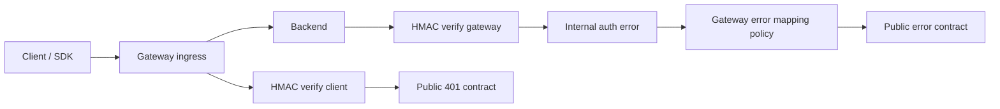
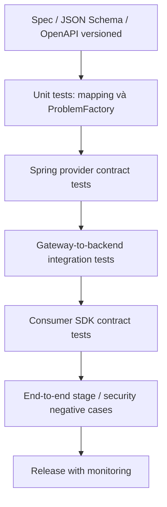

# Error contract: kiểm thử hợp đồng phản hồi lỗi cho API xác thực HMAC

## 1. Mục tiêu và bối cảnh

Bài **Error contract** thuộc chương **Contract testing**, trong module **SECURITY_AUTHENTICATION_HMAC_REQUEST_AUTHENTICATION**. Module thiết kế xác thực HTTP request bằng **HMAC với shared secret**; client và server cùng tuân thủ quy tắc dựng **canonical request** từ HTTP method, URI, header và/hoặc body, rồi xác minh MAC. Hệ thống còn kiểm tra timestamp/nonce chống replay, xoay vòng và thu hồi khóa, đi qua gateway/proxy, và thực hiện **authorization sau authentication**.

Một hệ thống có thể kiểm tra HMAC đúng nhưng vẫn gây lỗi tích hợp khi:

- Spring MVC trả `401` kèm JSON riêng, Spring WebFlux trả `401` với body khác;
- gateway giữ status nhưng xóa `WWW-Authenticate`, hoặc đổi một `503` do Redis chết thành `401` “bad signature”;
- client tích hợp chỉ nhìn chuỗi `message` nên vỡ khi backend sửa câu chữ;
- một service trả `status: 401` trong JSON nhưng HTTP status line lại là `403`;
- response vô tình tiết lộ “key tồn tại nhưng đã bị thu hồi” hoặc expected HMAC.

**Error contract testing** là quá trình kiểm chứng *một cách tự động và có thể lặp lại* những điều mà bên cung cấp API cam kết cho bên tiêu thụ API khi xảy ra lỗi: mã HTTP, header, media type, cấu trúc JSON, mã lỗi công khai, cách retry, tính bảo mật và các bất biến side effect. Khác với chỉ viết tài liệu API, bài kiểm thử phải chứng minh **các triển khai thật** (filter, controller, gateway, backend) giữ đúng cam kết đó.

Sau bài học, người học có thể:

1. Phân biệt **error semantics**, **error contract** và **contract test**; biết phần nào phải ổn định và phần nào được phép thay đổi.
2. Định nghĩa một error contract dùng dạng **Problem Details** (`application/problem+json`), có `code` và `requestId` mở rộng, cùng header theo HTTP semantics.
3. Tạo **ma trận request kích hoạt lỗi → expected status/headers/schema**, đặc biệt cho HMAC failure, replay, timestamp, key rotation, authorization, rate limit và sự cố nonce/credential store.
4. Viết provider-side test bằng **MockMvc** hoặc **WebTestClient**, thêm consumer-side test và kiểm thử qua gateway.
5. Kiểm tra response nhất quán mà **không so sánh cứng** các giá trị động như request ID hoặc thời gian.
6. Đảm bảo error response không lộ shared secret, signature kỳ vọng, trạng thái key/tenant hoặc nội dung canonical request.
7. Đưa các bài kiểm thử vào CI, kiểm soát thay đổi breaking và xử lý những giới hạn ở HTTP parser, proxy và response streaming.

## 2. Contract khác với implementation như thế nào?

Trong xác thực HMAC, phía server có thể phân loại lỗi nội bộ rất chi tiết: `unknown_key`, `invalid_mac`, `timestamp_out_of_window`, `nonce_replay`, `credential_revoked` hoặc `nonce_store_unavailable`. Tuy nhiên, việc **công bố tất cả lý do đó cho client** có thể tạo oracle đoán key và cung cấp thông tin cho attacker.

Do đó cần tách ba lớp:

| Lớp | Ví dụ | Ai được phụ thuộc vào? |
|---|---|---|
| **Internal reason** | `invalid_mac`, `credential_revoked`, `redis_timeout` | Log/telemetry nội bộ, theo RBAC và retention |
| **Public error semantics** | Chưa có bằng chứng xác thực hợp lệ → 401; đã xác thực nhưng không đủ quyền → 403 | Tất cả HTTP consumer |
| **Wire error contract** | Status line, `WWW-Authenticate`, `Content-Type`, JSON fields `code`/`requestId` | SDK, client, gateway, integration tests |

Một bài test “`verifyHmac()` ném `BadCredentialsException`” chỉ kiểm tra **logic thành phần**, chưa kiểm tra response HTTP đến client. Ngược lại, test “HTTP trả 401” cũng chưa đủ nếu body khác schema, thiếu challenge hoặc controller vẫn thực thi.

### 2.1. Những cam kết ổn định

Đối với một phiên bản API, nên coi các thuộc tính sau là thành phần hợp đồng:

- **HTTP status** phù hợp nguyên nhân công khai; `401` không dùng thay cho mọi lỗi.
- **Header bắt buộc theo từng status**, đặc biệt `WWW-Authenticate` khi 401; `Cache-Control: no-store` khi policy yêu cầu; `Retry-After` chỉ khi có giá trị/ý nghĩa đúng.
- **Media type** của error body: `application/problem+json` nếu response có thể được tạo dưới dạng Problem Details.
- **Kiểu dữ liệu** của `type`, `title`, `status`, `detail`, `code`, `requestId`; tên trường viết đúng và ổn định.
- **Code công khai** có tập giá trị hữu hạn; client không cần parse natural-language `detail`.
- **Request correlation**: `X-Request-Id` và `requestId` trong body là cùng một giá trị nếu cả hai được công bố.
- **Không phát lộ thông tin nhạy cảm**; cùng nhóm authentication failure có cùng public shape và thông điệp chung.
- **Không thực thi handler** khi authentication/authorization thất bại.

### 2.2. Những điều không nên “đóng băng” quá mức

Contract không nên giả định request ID luôn là một chuỗi cố định, JSON properties luôn giữ nguyên thứ tự, chữ hoa/thường của tên HTTP header phải giống hệt, hay `Content-Type` không bao giờ có parameter charset.

Nếu muốn cho phép server thêm trường mở rộng an toàn, consumer nên **bỏ qua trường không biết**; provider phải kiểm soát bằng allowlist để không bổ sung secret. Đặt `additionalProperties: false` tại schema public có thể phù hợp với phiên bản hợp đồng tuyệt đối không mở rộng, nhưng sẽ biến một bổ sung trường vô hại thành breaking change. Bài này chọn chính sách **consumer tolerant, provider explicit allowlist**.

Không dựa vào chuỗi `title` hoặc `detail` để xử lý bằng máy nếu API có thể localize chúng. Trong bài này, `code` và status là tín hiệu ổn định; thông báo mẫu của **authentication failure** vẫn được cố định để kiểm tra tính bảo mật.

## 3. Thiết kế hợp đồng lỗi dạng Problem Details

Problem Details for HTTP APIs (RFC 9457) dùng media type `application/problem+json`. Các trường chính:

| Trường | Ý nghĩa | Chính sách bài học |
|---|---|---|
| `type` | URI reference định danh loại lỗi | Dùng `"about:blank"` cho các nhóm HTTP chuẩn trong ví dụ |
| `title` | Tóm tắt ngắn về loại lỗi | Khi dùng `about:blank`, dùng reason phrase tương ứng HTTP status |
| `status` | HTTP status code dưới dạng số | **Phải khớp status line** nếu có |
| `detail` | Mô tả dành cho lần lỗi cụ thể | Dùng câu chung cho HMAC failure, không lộ nội bộ |
| `instance` | URI reference định danh lần xảy ra lỗi | Không bắt buộc trong contract này |
| `code` | Extension do API định nghĩa | Enum ổn định cho consumer |
| `requestId` | Extension do API định nghĩa | Opaque, dùng đối chiếu support/log |

`code` và `requestId` **không phải trường chuẩn bắt buộc của RFC 9457**; đây là lựa chọn contract của hệ thống ví dụ. Vì muốn client dễ tích hợp, bài học yêu cầu chúng trên mọi response Problem Details **do ứng dụng và gateway công khai tạo được**, đồng thời mô tả ngoại lệ khi request bị HTTP parser hoặc transport từ chối trước tầng sinh body.

### 3.1. 401 chung cho HMAC authentication failure

```http
HTTP/1.1 401 Unauthorized
WWW-Authenticate: HMAC realm="partner-api"
Content-Type: application/problem+json
Cache-Control: no-store
X-Request-Id: req-b72f

{
  "type": "about:blank",
  "title": "Unauthorized",
  "status": 401,
  "detail": "Authentication is required or invalid.",
  "code": "AUTHENTICATION_FAILED",
  "requestId": "req-b72f"
}
```

`HMAC` trong `WWW-Authenticate` là **authentication scheme riêng do API định nghĩa**. Nó không mặc nhiên là scheme HMAC chuẩn mà tất cả SDK HTTP hiểu. Hợp đồng tích hợp cần mô tả realm, các header/metadata được ký, canonical request, thuật toán, thời gian và nonce. Với HTTP 401, response phải có ít nhất một challenge `WWW-Authenticate` áp dụng cho tài nguyên bảo vệ; không đưa `Basic` hoặc `Bearer` chỉ vì framework mặc định bật chúng nếu endpoint thực tế chỉ nhận HMAC.

Các trường hợp sau nên dùng **cùng thông báo công khai**: thiếu credential HMAC, sai MAC, key ID không tồn tại, key bị revoke, timestamp ngoài cửa sổ, nonce replay, body digest sai. Log nội bộ vẫn phân biệt lý do thực nhưng response không giúp dò key.

### 3.2. 403 cho authorization failure

```http
HTTP/1.1 403 Forbidden
Content-Type: application/problem+json
Cache-Control: no-store
X-Request-Id: req-41e9

{
  "type": "about:blank",
  "title": "Forbidden",
  "status": 403,
  "detail": "Access denied.",
  "code": "ACCESS_DENIED",
  "requestId": "req-41e9"
}
```

Ví dụ client ký request đúng và có key active, nhưng không được phép xóa tài nguyên thuộc tenant khác. **Authentication đã thành công**, còn authorization từ chối. Không mặc định gắn challenge HMAC cho 403: challenge dành cho tình huống cần xác thực theo semantics HTTP, còn quyền không được khắc phục chỉ bằng ký lại.

Một số API dùng 404 thay 403 để không tiết lộ tài nguyên tồn tại. Nếu có chính sách đó, phải định nghĩa route/điều kiện rõ ràng và test riêng; không tùy tiện đổi theo key ID hoặc vì lỗi triển khai.

### 3.3. 503 khi không thể xác minh vì dependency lỗi

```http
HTTP/1.1 503 Service Unavailable
Content-Type: application/problem+json
Cache-Control: no-store
Retry-After: 5
X-Request-Id: req-18c0

{
  "type": "about:blank",
  "title": "Service Unavailable",
  "status": 503,
  "detail": "Service is temporarily unavailable.",
  "code": "SERVICE_UNAVAILABLE",
  "requestId": "req-18c0"
}
```

`Retry-After: 5` ở đây là một **giá trị minh họa**: không buộc tất cả 503 phải có header hoặc phải dùng 5 giây. Provider chỉ gửi nó nếu có một khoảng chờ hợp lý theo policy. Timeout Redis sau thao tác atomic claim nonce có thể để trạng thái **không chắc chắn** (lệnh đã thực thi nhưng response thất lạc), nên retry vẫn phải dùng nonce/timestamp mới và tuân thủ idempotency nghiệp vụ. **Không fail-open** khi không thể xác minh trạng thái nonce hoặc credential.

## 4. Bảng quy tắc status và mã lỗi công khai

Để contract test được, mọi nhóm phải có một expectation cụ thể:

| Tình huống | HTTP | Public `code` | Header/chính sách |
|---|---:|---|---|
| Thiếu/sai HMAC, key unknown/revoked, sai body hash, timestamp ngoài cửa sổ, nonce replay | **401** | `AUTHENTICATION_FAILED` | `WWW-Authenticate`, `Cache-Control: no-store` |
| HMAC hợp lệ, client không có quyền trên scope/tenant/resource | **403** | `ACCESS_DENIED` | Problem JSON, không công bố chi tiết quyền nhạy cảm |
| Cú pháp request/application JSON sai | **400** | `INVALID_REQUEST` | Problem JSON nếu application có thể tạo |
| HTTP parser từ chối request-line/framing trước filter | Thường **400** hoặc lỗi parser phù hợp | Có thể không có `code`/JSON | Ngoại lệ theo khả năng server/gateway |
| Header vượt giới hạn an toàn | **431** hoặc policy rejection phù hợp | `REQUEST_HEADERS_TOO_LARGE` nếu tạo body | Có thể bị connector từ chối trước app |
| Body vượt giới hạn | **413** | `PAYLOAD_TOO_LARGE` | Có thể đóng connection để tránh drain body quá lớn |
| Media type không hỗ trợ | **415** | `UNSUPPORTED_MEDIA_TYPE` | Contract cho endpoint |
| Validation nghiệp vụ không phù hợp | **422** hoặc 400 theo policy | `INVALID_INPUT` | Không echo dữ liệu nhạy cảm |
| Rate/quota exceeded | **429** | `RATE_LIMITED` | `Retry-After` nếu policy có |
| Bug hoặc lỗi server bất ngờ | **500** | `INTERNAL_ERROR` | Không lộ stack trace |
| Kho credential, Redis/KMS/Vault không khả dụng | **503** hoặc 5xx phù hợp | `SERVICE_UNAVAILABLE` | Fail-closed, có thể `Retry-After` |
| Gateway nhận response upstream không hợp lệ | **502** | `UPSTREAM_ERROR` | Không biến thành chữ ký sai |
| Gateway hết hạn chờ upstream | **504** | `UPSTREAM_TIMEOUT` | Không mặc định rằng backend chưa xử lý |

**Lưu ý:** HMAC field thiếu/sai định dạng có thể được coi là authentication failure 401 theo contract; request HTTP sai cú pháp ở parser có thể bị chặn bằng 400 trước đó. Contract test phải tách hai loại, không ép tất cả lỗi thành 401 chỉ vì API yêu cầu HMAC.

**Lưu ý về preflight:** CORS `OPTIONS` preflight có thể được security policy cho phép đi qua mà không có HMAC. Contract cho preflight phải tách khỏi contract cho request nghiệp vụ, không kết luận “mọi OPTIONS thiếu HMAC phải 401”.

## 5. Đặc tả máy đọc được: JSON Schema

Một mẫu JSON Schema (draft 2020-12) dành cho **body public do ứng dụng kiểm soát**:

```json
{
  "$schema": "https://json-schema.org/draft/2020-12/schema",
  "$id": "https://docs.example.test/schemas/hmac-error-v1.json",
  "title": "Public API Problem Details v1",
  "type": "object",
  "required": [
    "type",
    "title",
    "status",
    "detail",
    "code",
    "requestId"
  ],
  "properties": {
    "type": {
      "type": "string",
      "const": "about:blank"
    },
    "title": {
      "type": "string",
      "minLength": 1
    },
    "status": {
      "type": "integer",
      "minimum": 400,
      "maximum": 599
    },
    "detail": {
      "type": "string",
      "minLength": 1
    },
    "code": {
      "type": "string",
      "enum": [
        "AUTHENTICATION_FAILED",
        "ACCESS_DENIED",
        "INVALID_REQUEST",
        "REQUEST_HEADERS_TOO_LARGE",
        "PAYLOAD_TOO_LARGE",
        "UNSUPPORTED_MEDIA_TYPE",
        "INVALID_INPUT",
        "RATE_LIMITED",
        "INTERNAL_ERROR",
        "SERVICE_UNAVAILABLE",
        "UPSTREAM_ERROR",
        "UPSTREAM_TIMEOUT"
      ]
    },
    "requestId": {
      "type": "string",
      "minLength": 1,
      "maxLength": 128,
      "pattern": "^[A-Za-z0-9._-]+$"
    }
  },
  "additionalProperties": true
}
```

Đây là **schema dùng để minh họa**, không phải tài liệu đã được publish tại URL `example.test`. Khi triển khai, đưa schema vào kho hợp đồng và tham chiếu bằng version cố định.

### 5.1. JSON Schema chưa đủ để bắt mọi lỗi

Schema trên kiểm tra kiểu/trường/code, nhưng **không tự phát hiện**:

- HTTP status là 401 còn `status` trong body là 503.
- `code: AUTHENTICATION_FAILED` đi với status 403.
- Thiếu `WWW-Authenticate` khi 401.
- Header `X-Request-Id` khác body `requestId`.
- JSON chứa secret dưới một extension field mới nhưng vẫn hợp lệ vì `additionalProperties: true`.
- Lỗi 401 sau khi business handler đã thực hiện side effect.
- Cùng một nhóm auth failure nhưng `detail` khác nhau theo key ID, vô tình tiết lộ trạng thái key.

Vì vậy, cần test **cross-field, cross-layer và security invariant** bên cạnh schema validation. Consumer tolerance không phải quyền cho provider tự do công khai mọi dữ liệu nội bộ.

### 5.2. Cross-field invariants

Ví dụ các điều kiện kiểm tra:

```text
body.status == HTTP response status

HTTP 401:
  body.code == "AUTHENTICATION_FAILED"
  body.title == "Unauthorized"
  body.detail == "Authentication is required or invalid."
  WWW-Authenticate chứa challenge áp dụng cho API HMAC

HTTP 403:
  body.code == "ACCESS_DENIED"
  body.title == "Forbidden"

HTTP 503 do dependency:
  body.code == "SERVICE_UNAVAILABLE"
  không phát challenge HMAC sai nghĩa

Nếu X-Request-Id tồn tại và body có requestId:
  chúng phải trùng nhau

Mọi ứng dụng-managed security error:
  Content-Type tương thích application/problem+json
  Cache-Control theo policy (ví dụ no-store)
  không chứa sharedSecret, signature, expectedMac, canonicalRequest...
```

Khi contract dùng `about:blank`, `title` nên là reason phrase tương ứng status. Nếu API tương lai chọn type URI riêng, phải version hóa hợp đồng phù hợp, không biến mọi message text thành mã lỗi.

## 6. OpenAPI là tài liệu; contract tests là bằng chứng

Nên mô tả response lỗi trong OpenAPI 3.1 rồi kiểm thử implementation so với đặc tả. Ví dụ **trích đoạn** (không phải OpenAPI file hoàn chỉnh):

```yaml
openapi: 3.1.0
info:
  title: Partner HMAC API
  version: 1.0.0
paths:
  /partner/orders:
    post:
      responses:
        "201":
          description: Order created
        "401":
          description: HMAC authentication missing or invalid
          headers:
            WWW-Authenticate:
              required: true
              schema:
                type: string
              description: HMAC challenge applicable to this endpoint
            X-Request-Id:
              schema:
                type: string
          content:
            application/problem+json:
              schema:
                $ref: "#/components/schemas/PublicProblem"
        "403":
          description: Authenticated client is not authorized
          content:
            application/problem+json:
              schema:
                $ref: "#/components/schemas/PublicProblem"
        "503":
          description: Authentication dependency unavailable
          content:
            application/problem+json:
              schema:
                $ref: "#/components/schemas/PublicProblem"
components:
  schemas:
    PublicProblem:
      type: object
      required: [type, title, status, detail, code, requestId]
      properties:
        type:
          type: string
        title:
          type: string
        status:
          type: integer
        detail:
          type: string
        code:
          type: string
        requestId:
          type: string
```

Tài liệu API không tự chứng minh gateway giữ challenge/header đúng, hay bộ lọc Spring không đưa stack trace ra response. Do đó, **OpenAPI/schema validation** và **provider/consumer contract testing** phải hỗ trợ nhau.

Trong ví dụ OpenAPI, có thể khai báo security scheme tùy biến hoặc mô tả đầy đủ HMAC bằng extension/documentation riêng. Không giả vờ rằng `type: apiKey` mô tả trọn quy trình HMAC canonical request, timestamp và nonce; nó chỉ biểu diễn một phần cơ chế nhận credential, không đủ để client tính chữ ký.

## 7. Thiết kế fixture: điều gì kích hoạt mỗi lỗi?

Trước khi viết test, cần định nghĩa **đầu vào tạo lỗi** và bảo đảm lỗi xảy ra ở **đúng bước**.

| Fixture | Điều kiện tạo request | Lỗi mong đợi tại verifier/application |
|---|---|---|
| `missing_signature` | Thiếu header chữ ký trên route bắt buộc HMAC | Authentication failure → 401 |
| `unknown_key` | Key ID không tồn tại trong fixture registry | Authentication failure → 401 |
| `revoked_key` | Credential tồn tại nhưng state REVOKED | Authentication failure → 401 |
| `tampered_method` | Ký POST, gửi PUT, giữ raw path/query/body | MAC mismatch → 401 nếu tới verifier |
| `tampered_path` | Ký raw path A, gửi path B | MAC mismatch → 401 nếu route đi qua verifier |
| `tampered_body` | Ký body A, gửi body B | Body digest/MAC mismatch → 401 |
| `expired_timestamp` | Ký request đúng nhưng clock lệch ngoài cửa sổ | Authentication failure → 401 |
| `replayed_nonce` | Gửi cùng proof hợp lệ lần hai, nonce đã atomic claim | Authentication failure → 401 |
| `forbidden_tenant` | HMAC hợp lệ, principal thiếu quyền trên tenant/resource | Authorization → 403/404 theo policy |
| `invalid_json` | HMAC hợp lệ trên chính bytes JSON sai cú pháp | Controller/request parse → 400 |
| `oversized_body` | Body vượt giới hạn trước/during verification | 413 |
| `rate_limited` | Quota điều khiển bởi fixture đạt ngưỡng | 429 |
| `nonce_store_down` | Simulate Redis timeout/connection refusal | 503/5xx, fail-closed |
| `credential_store_down` | Tra credential thất bại do hạ tầng | 503/5xx, không gắn nhầm “unknown key” |
| `upstream_timeout` | Backend vượt gateway deadline | 504 hoặc policy tương ứng |

### 7.1. Tránh false positive cho changed method hoặc replay

Ví dụ cần chứng minh **đổi method làm MAC sai**:

```text
Tạo signature hợp lệ cho POST + nonce N-fresh.
Đổi method HTTP thực nhận thành PUT, giữ cùng signature.
Chỉ gửi request đã đổi tới verifier.
Kiểm tra internal reason=invalid_mac,
không phải nonce_replay, expired_timestamp hoặc 405 do route.
```

Nếu trước đó bạn đã gửi POST hợp lệ với nonce N-fresh, lần PUT kế tiếp dùng lại nonce này có thể bị 401 vì replay, **không chứng minh method được ký**. Hãy dùng fixture nonce mới chưa claim hoặc chạy unit test crypto riêng; chọn route có PUT được lọc qua verifier để không nhận 405 quá sớm.

Ví dụ chứng minh **JSON sai**:

```text
bodyBytes = UTF8("{ invalid json")
signature = HMAC(canonical(method, path, bodyBytes, ...))
MAC pass, timestamp/nonce pass
JSON parser fail → 400 INVALID_REQUEST
```

Nếu ký body JSON hợp lệ rồi đổi thành JSON sai sau ký, bạn sẽ nhận 401 do MAC mismatch, **không test được contract lỗi validation**.

### 7.2. Fake clock, nonce namespace và key state

Tạo môi trường test cô lập:

- **Clock cố định/điều khiển được** dùng chung signer và verifier; không dựa timestamp cũ có thể hết hạn khi chạy lại CI.
- **Credential registry fixture** cho key active, revoked, expired và key gateway nội bộ; secret chỉ dùng trong test.
- **Replay store** riêng cho mỗi test hoặc namespace riêng; với test concurrency, dùng store thật hoặc mô phỏng atomic semantics đúng.
- **Idempotency/correlation** cho request có side effect; kiểm tra handler/DB/outbox không chạy khi xác thực thất bại.
- **Gateway route policy** được đặt rõ để không vô tình bypass authentication ở CORS preflight hoặc health endpoints.

Không dùng mock trả một `Authentication` đã xác thực cho mọi request rồi coi đó là test end-to-end HMAC; kiểu mock đó chỉ thích hợp khi test riêng authorization/controller.

## 8. Provider contract testing với Spring MVC

Trong Spring Security Servlet stack, lỗi authentication thường phải đi đến `AuthenticationEntryPoint`; authorization bị từ chối có thể đi đến `AccessDeniedHandler`. Các lỗi ở controller có thể qua `@RestControllerAdvice`. Custom filter đặt trước `ExceptionTranslationFilter` cần handler phù hợp, không giả định mọi `AuthenticationException` đều tự được bắt.

### 8.1. Ví dụ JUnit 5 + MockMvc kiểm tra response

Đoạn code giả định test context đã có **HMAC security chain thực**, route `POST /partner/orders` và `MockMvc`. Request thiếu HMAC được dùng làm fixture đơn giản; đây là **provider-side HTTP contract test**, không phải test toàn bộ signer.

```java
import static org.springframework.test.web.servlet.request.MockMvcRequestBuilders.post;
import static org.springframework.test.web.servlet.result.MockMvcResultMatchers.*;

import org.junit.jupiter.api.Test;
import org.springframework.beans.factory.annotation.Autowired;
import org.springframework.boot.test.autoconfigure.web.servlet.AutoConfigureMockMvc;
import org.springframework.boot.test.context.SpringBootTest;
import org.springframework.http.MediaType;
import org.springframework.test.web.servlet.MockMvc;

@SpringBootTest
@AutoConfigureMockMvc
class HmacErrorContractMvcTest {

    @Autowired MockMvc mockMvc;

    @Test
    void missingHmacHasStablePublicContract() throws Exception {
        mockMvc.perform(post("/partner/orders")
                    .contentType(MediaType.APPLICATION_JSON)
                    .content("{\"sku\":\"A7\"}"))
                .andExpect(status().isUnauthorized())
                .andExpect(header().string(
                        "WWW-Authenticate", "HMAC realm=\"partner-api\""))
                .andExpect(header().string("Cache-Control", "no-store"))
                .andExpect(header().exists("X-Request-Id"))
                .andExpect(content().contentTypeCompatibleWith(
                        "application/problem+json"))
                .andExpect(jsonPath("$.type").value("about:blank"))
                .andExpect(jsonPath("$.title").value("Unauthorized"))
                .andExpect(jsonPath("$.status").value(401))
                .andExpect(jsonPath("$.code")
                        .value("AUTHENTICATION_FAILED"))
                .andExpect(jsonPath("$.detail")
                        .value("Authentication is required or invalid."))
                .andExpect(jsonPath("$.requestId").isNotEmpty());
    }
}
```

**Điểm cần nhớ:** `WWW-Authenticate: HMAC realm="partner-api"` là giá trị minh họa của hợp đồng này; production có thể đặt realm khác hoặc thêm tham số challenge, miễn bên cung cấp và tiêu thụ đồng thuận. Nếu định nghĩa *exact challenge* là yêu cầu, assert nguyên chuỗi. Nếu hỗ trợ nhiều scheme hoặc tham số, parser/validator nên kiểm tra challenge tương ứng thay vì hard-code thứ tự toàn bộ header.

### 8.2. Helper kiểm tra cross-field invariant và dữ liệu nhạy cảm

Test có thể lấy response thực, parse JSON bằng Jackson và so khớp những thuộc tính phụ thuộc nhau:

```java
import static org.junit.jupiter.api.Assertions.*;

import com.fasterxml.jackson.databind.JsonNode;
import com.fasterxml.jackson.databind.ObjectMapper;
import org.springframework.mock.web.MockHttpServletResponse;

final class PublicErrorAssertions {
    private static final ObjectMapper MAPPER = new ObjectMapper();

    static void assertHmac401(MockHttpServletResponse response)
            throws Exception {
        assertEquals(401, response.getStatus());
        assertTrue(response.getContentType() != null
                && response.getContentType()
                    .startsWith("application/problem+json"));

        String challenge = response.getHeader("WWW-Authenticate");
        assertNotNull(challenge);
        assertTrue(challenge.contains("HMAC"));

        assertEquals("no-store", response.getHeader("Cache-Control"));

        JsonNode body = MAPPER.readTree(
                response.getContentAsByteArray());
        assertEquals(response.getStatus(), body.path("status").asInt(-1));
        assertEquals("about:blank", body.path("type").asText());
        assertEquals("AUTHENTICATION_FAILED", body.path("code").asText());
        assertEquals(
                "Authentication is required or invalid.",
                body.path("detail").asText());

        String requestId = body.path("requestId").asText();
        assertFalse(requestId.isBlank());
        assertEquals(requestId, response.getHeader("X-Request-Id"));

        // Kiểm tra shape/rò rỉ dữ liệu; mở rộng bằng fixture chứa secret
        // sentinel và policy về các extension fields được cho phép.
        assertFalse(body.has("sharedSecret"));
        assertFalse(body.has("expectedSignature"));
        assertFalse(body.has("canonicalRequest"));
        assertFalse(body.has("stackTrace"));
    }

    private PublicErrorAssertions() {}
}
```

Một assertion chỉ tìm đúng tên field không đủ để phát hiện secret nằm trong `detail`, một field lạ hoặc HTML body. Vì vậy cần **test sentinel**: trong môi trường test, tạo secret/key ID/body chứa chuỗi đặc biệt chỉ phục vụ kiểm thử rồi kiểm tra response/headers/log công khai **không chứa** những sentinel đó. Với test “unknown key”, có thể kiểm tra không lộ chính key ID và không công bố “key tồn tại/không tồn tại”.

Không đưa secret production vào CI logs, snapshot test hoặc report thất bại. Test capture nội dung response có thể ghi vào log CI; dùng toàn bộ fixture giả định.

### 8.3. Kiểm thử “401 nhưng handler không chạy”

Dùng `@SpyBean` hoặc spy/mock theo phiên bản Spring Boot mà project hỗ trợ để kiểm tra:

```java
// Khung assertion: phụ thuộc cách khai báo spy bean của phiên bản đang dùng.
mockMvc.perform(post("/partner/orders")
        .contentType("application/json")
        .content("{\"sku\":\"A7\"}"))
    .andExpect(status().isUnauthorized());

verify(orderService, never()).createOrder(any());
```

Trong test tích hợp có DB/outbox, nên kiểm tra thêm **không có row mới** hoặc event nghiệp vụ. Một response status đúng nhưng handler đã được chạy trước khi filter báo lỗi vẫn **vi phạm contract bảo mật**.

## 9. Provider contract testing với Spring WebFlux

Spring Security WebFlux dùng `ServerAuthenticationEntryPoint`, `ServerAccessDeniedHandler` và có thể dùng `AuthenticationWebFilter` với `ServerAuthenticationEntryPointFailureHandler`. Test phải chạy qua **security chain thực**, tránh chỉ mock controller vì khi đó không kiểm tra được filter.

```java
import org.junit.jupiter.api.Test;
import org.springframework.beans.factory.annotation.Autowired;
import org.springframework.boot.test.context.SpringBootTest;
import org.springframework.http.MediaType;
import org.springframework.test.web.reactive.server.WebTestClient;

@SpringBootTest(webEnvironment =
        SpringBootTest.WebEnvironment.RANDOM_PORT)
class HmacErrorContractWebFluxTest {

    @Autowired WebTestClient client;

    @Test
    void missingHmacUsesSameProblemContract() {
        client.post()
                .uri("/partner/orders")
                .header("Content-Type", "application/json")
                .bodyValue("{\"sku\":\"A7\"}")
                .exchange()
                .expectStatus().isUnauthorized()
                .expectHeader().valueEquals(
                        "WWW-Authenticate", "HMAC realm=\"partner-api\"")
                .expectHeader().contentTypeCompatibleWith(
                        MediaType.parseMediaType("application/problem+json"))
                .expectHeader().valueEquals("Cache-Control", "no-store")
                .expectBody()
                .jsonPath("$.status").isEqualTo(401)
                .jsonPath("$.code")
                    .isEqualTo("AUTHENTICATION_FAILED")
                .jsonPath("$.detail")
                    .isEqualTo("Authentication is required or invalid.")
                .jsonPath("$.requestId").exists();
    }
}
```

Đây là ví dụ dành cho ứng dụng **chạy WebFlux và có WebTestClient được cấu hình**. Nếu phụ thuộc đang dùng `spring-boot-starter-web`/MVC, việc có class `WebTestClient` không tự biến ứng dụng thành reactive security stack; hãy chọn test phù hợp với server thật.

Với WebFlux, cần bổ sung trường hợp body chứa HMAC: nếu filter đọc body để hash, body downstream phải được replay/decorate đúng sau khi xác thực. Test một request hợp lệ có JSON body để chắc controller nhận đúng bytes; test request sai MAC để chắc controller **không được gọi**. Không dùng `block()` hoặc `subscribe()` thủ công trong filter, và không để lỗi `DataBufferLimitException` bị chuyển thành 401 thay vì 413.

### 9.1. Test không lệ thuộc thứ tự/chi tiết serialization

Một JSON object có thể được Jackson xuất ra theo thứ tự field khác mà vẫn tuân thủ contract. Dùng `jsonPath` hoặc parse `JsonNode` thay vì so sánh nguyên chuỗi JSON nếu thứ tự/whitespace không phải điều cam kết.

Tương tự, HTTP header names không phân biệt hoa thường; assertion kiểm tra tên header theo semantics của framework. `Content-Type` có thể có charset parameter: dùng matcher compatible media type, đừng so sánh nguyên chuỗi nếu contract chỉ yêu cầu media type.

## 10. Consumer-driven contract: góc nhìn từ client/SDK

Provider-side test có thể pass nhưng client vẫn bị vỡ nếu nó đang phụ thuộc vào một trường không nằm trong contract. Để phát hiện, bên tiêu thụ viết các kịch bản **mình thực sự cần**, còn provider xác minh rằng các kịch bản đó được phục vụ.

Ví dụ một Java SDK chỉ cần:

- Nếu HTTP 401, đọc challenge HMAC, phân loại `AUTHENTICATION_FAILED`, có thể yêu cầu người dùng kiểm tra secret/clock và **ký request mới**; không retry cùng nonce vô hạn.
- Nếu HTTP 403, báo thiếu quyền, không tự đổi secret.
- Nếu HTTP 429, tuân thủ `Retry-After` nếu header hợp lệ và có policy retry.
- Nếu HTTP 503, backoff có giới hạn, không mặc định đây là lỗi signature; với thao tác có side effect phải có idempotency.
- Với `requestId`, ghi ra mã support an toàn; không log body/signature nhạy cảm.

### 10.1. Consumer test không cần biết implementation exception

Một client test có thể dùng mock HTTP server để trả response 401 theo contract:

```http
HTTP/1.1 401 Unauthorized
WWW-Authenticate: HMAC realm="partner-api"
Content-Type: application/problem+json
X-Request-Id: req-test-501

{"type":"about:blank","title":"Unauthorized","status":401,
 "detail":"Authentication is required or invalid.",
 "code":"AUTHENTICATION_FAILED","requestId":"req-test-501"}
```

Client assertion:

```text
Given SDK receives HTTP 401 / AUTHENTICATION_FAILED:
  it raises an AuthenticationFailed result,
  preserves safe requestId for support,
  does not parse "detail" as an enum,
  does not expose secret in logs,
  does not retry indefinitely using identical signature/nonce.
```

Đây là **consumer behavior**, khác với việc test Spring Security thực tế. Có thể ghi contract bằng Pact hoặc một framework tương đương, nhưng không cần phụ thuộc thư viện cụ thể để hiểu nguyên tắc.

### 10.2. Hợp đồng consumer có thể cho phép mở rộng

Bên tiêu thụ không nên yêu cầu `requestId == "req-test-501"`; giá trị là động. Thay vào đó kiểm tra format an toàn, sự hiện diện và khả năng chuyển nó qua luồng xử lý. Nếu provider thêm trường `supportUrl` theo allowlist, một consumer tolerant vẫn parse được các trường chuẩn và bỏ qua phần không cần.

Đối với code công khai, không dùng `error.getMessage().contains("expired key")` để nhận diện tình trạng key, vì API **không nên phân biệt public** unknown/revoked/invalid MAC. Điều cần hỗ trợ là một cách xử lý ổn định dựa trên `status + code`.

## 11. Contract test qua gateway và proxy

Trong kiến trúc nhiều hop, gateway vừa là **consumer** của backend vừa là **provider** đối với client Internet. Nó có thể xác minh HMAC client ở ingress, rewrite raw URI/body/header, ký lại request bằng secret nội bộ rồi gọi backend. Phải test response trên **ranh giới mà client thực sự quan sát**, không chỉ test backend riêng lẻ.



### 11.1. Ma trận trách nhiệm theo hop

| Nguồn lỗi | Trạng thái nội bộ | Gateway nên làm gì? | Bằng chứng test |
|---|---|---|---|
| Client không gửi/chữ ký HMAC sai ở ingress | Authentication failure | Trả 401 public, không forward tới backend | Backend call count = 0, challenge đúng |
| Client đã được verify, nhưng key gateway → backend sai/revoked | Internal auth failure | Không công khai chi tiết key gateway; ánh xạ lỗi nội bộ sang public 5xx theo policy | Client không bị hướng dẫn thay secret sai; alert nội bộ |
| Client đã verify nhưng backend từ chối quyền | Authorization failure | Trả 403/404 theo hợp đồng public | Không đổi thành 401 |
| Backend trả lỗi ứng dụng hợp lệ | 400/422/5xx tương ứng | Chuyển hoặc chuẩn hóa theo contract | Status + code + JSON shape đúng |
| Gateway không lấy được connection backend | Upstream connection/pool failure | 502/503/504 theo nguyên nhân và policy | Không giả thành invalid HMAC |
| Gateway timeout sau khi gửi POST | Upstream timeout | 504 hoặc status contract; preserve request ID | Client không được giả định chưa xử lý giao dịch |
| Proxy đổi raw path/query/body trước khi backend verify chữ ký client | MAC mismatch tại backend | Chẩn đoán internal canonical mismatch; public response theo boundary policy | Không tiết lộ canonical/secret |
| Gateway đổi body sau verify rồi ký lại hợp lệ | Outbound signed request mới | Backend verify signature nội bộ đúng | Client/tenant claims được ký và phân quyền |

Nếu backend gửi `WWW-Authenticate: HMAC realm="gateway-internal"`, gateway **không được chuyển nguyên challenge này cho client Internet** khi client không được sở hữu credential nội bộ. Contract public 401 phải phản ánh scheme thực sự dành cho client. Với lỗi hệ thống do gateway ký sai, response public nên được phân loại là sự cố tích hợp/5xx theo policy, không buộc client ký lại secret của mình.

### 11.2. Test end-to-end với proxy thật

Các bước:

1. Đặt client test ký request bằng shared secret **chỉ dùng test** và timestamp/nonce mới.
2. Gửi qua gateway triển khai thật hoặc cấu hình gần production; không bypass routing/filter.
3. Kiểm tra request sai HMAC bị chặn ở ingress và backend không nhận request.
4. Kiểm tra request hợp lệ được gateway verify và ký lại **sau mọi rewrite**; backend thấy đúng method/raw URI/body mà nó phải verify.
5. Mô phỏng backend trả 403/503 theo fixture và xác nhận gateway giữ/chuẩn hóa public contract đúng.
6. Mô phỏng backend trả 401 với **internal realm**; xác nhận gateway không lộ nó ra public response.
7. Kiểm tra response trong HTTP/1.1 và HTTP/2 (nếu có) vẫn giữ header semantics; lưu ý hop-by-hop headers không nên được chuyển tiếp bừa bãi.

Một lỗi proxy có thể bị che nếu bạn chỉ test gateway với mock backend mà không kiểm tra raw method/URI/body thực tế. Kết hợp contract tests với proxy integration tests cho những trường hợp biến đổi dữ liệu được ký.

## 12. Khi nào contract được phép không có JSON?

Không phải mọi lỗi mạng hoặc lỗi HTTP đều có thể tạo response Problem Details hoàn chỉnh.

| Điều kiện | Khả năng tạo JSON theo schema | Quy tắc test |
|---|---|---|
| HMAC verifier từ chối trước controller, response chưa commit | Có | **Bắt buộc** theo contract |
| Authorization deny sau authentication, response chưa commit | Có | **Bắt buộc** theo contract |
| Controller ném validation exception, response chưa commit | Có | **Bắt buộc** theo contract |
| HTTP parser từ chối request-line/framing không hợp lệ | Có thể không | Test status/connection behavior riêng |
| Body quá lớn ở reverse proxy trước ứng dụng | Tùy proxy config | Test giới hạn và error mapping ở edge |
| Response streaming đã gửi một phần bytes | Không thể thay status/body theo HTTP đã gửi | Test stream termination/transport/error telemetry |
| Client ngắt kết nối trước khi server ghi response | Có thể không có response tới client | Test cleanup, cancel và log an toàn |
| TLS handshake thất bại trước khi có HTTP | Không có HTTP response | Kiểm thử TLS/transport riêng |

Đừng viết test “mọi exception luôn có JSON” rồi sửa application để cố ghi `401` sau khi response đã commit. Điều đó có thể sinh response hỏng, double-write hoặc thêm JSON giữa byte stream.

Với lỗi sớm ở gateway/proxy, nếu muốn đồng nhất JSON, phải **cấu hình chính gateway/proxy** để tạo đúng status/headers/body và kiểm thử trên giao diện Internet của nó.

## 13. Kiểm thử bảo mật: hợp đồng không được trở thành oracle

### 13.1. Nhiều nguyên nhân nội bộ, một public response

Tạo nhóm fixture:

```text
A: missing_signature
B: unknown_key
C: revoked_key
D: wrong_mac
E: timestamp_outside_window
F: nonce_replay
G: tampered_body
H: tampered_method
```

Các test nên so **những trường public ổn định**:

- `status`, `code`, `title`, `detail`, `type`, `Content-Type`, `WWW-Authenticate`.
- Không ép `requestId` phải bằng nhau vì request nào cũng có ID mới.
- Không công khai key existence, key version/revocation time, expected signature, server canonical string.
- Không ghi `Authentication` vào security context, không chạy handler nghiệp vụ trên bất kỳ auth-failure fixture nào.
- Không “đốt nonce” bằng request sai MAC: claim nonce phải sau khi MAC được xác minh theo threat model.

Đừng dựa vào việc error body giống nhau để kết luận toàn bộ pipeline constant-time. Lookup key, body read, parse header và network latency có thể tạo side channel; rate limiting, giới hạn input, chiến lược lookup và kiểm tra MAC an toàn vẫn cần thiết.

### 13.2. Kiểm tra sentinel

Trong môi trường test tạo:

```text
TEST_ONLY_SECRET_SENTINEL_4cc8
TEST_ONLY_SIGNATURE_SENTINEL_29e1
TEST_ONLY_CANONICAL_SENTINEL_a75f
```

Sau khi gửi request lỗi, scan public response (headers/body), structured logs cho đối tượng truy cập thấp và telemetry. Các sentinel này **không được xuất hiện** ở nơi contract không cho phép. Với log nội bộ cần chẩn đoán, có thể lưu request ID, route template, reason hữu hạn, hop và credential reference được pseudonymize; không lưu secret, raw signature hoặc full body.

Khi một fixture giả chữ ký sai định dạng có chứa sentinel, parser HMAC phải trả response công khai chung; không chép nguyên header input vào `detail`. Nếu dùng JSON Schema có `additionalProperties: true`, test sentinel còn quan trọng hơn vì schema không tự cấm field mới.

## 14. Tách lỗi authentication và authorization trong contract suite

Một test phân quyền cần **authentication thành công thật**. Ví dụ:

```text
Given:
  client-a có key active, nonce mới, MAC hợp lệ
  client-a chỉ có scope orders:read

When:
  POST /partner/orders/42/delete
  được ký đúng method, raw path, body, timestamp và nonce

Then:
  HMAC authentication = success
  authorization = denied
  HTTP 403 ACCESS_DENIED
  không có thao tác xóa
```

Nếu test dùng chữ ký sai rồi mong `403`, nó đang test lỗi authentication, không chứng minh authz. Ngược lại, nếu API trả `401` cho một principal đã xác thực nhưng thiếu quyền, consumer sẽ nghĩ cần đổi key và retry sai cách. Có thể có policy dùng `404` để ẩn tài nguyên; trong trường hợp đó phải định nghĩa và test một cách nhất quán.

### 14.1. Thay đổi HTTP method sau ký

Một regression thường gặp: client ký `GET`, proxy đổi thành `DELETE` nhưng giữ chữ ký. Nếu canonical contract bao gồm method ở điểm verify, MAC phải fail. Để test chính xác:

1. Ký request GET mới, timestamp hợp lệ, nonce chưa dùng.
2. **Chỉ** đổi actual HTTP method thành DELETE trước khi gửi, giữ các field khác.
3. Chọn route đi qua HMAC verifier, không bị trả 405 trước đó.
4. Assert invalid MAC nội bộ, public 401 và handler xóa không chạy.
5. Test đối chứng: ký DELETE đúng, credential active → MAC pass; nếu thiếu scope xóa thì 403.

Một test nhận 401 vì nonce từ positive fixture đã bị claim **không chứng minh** method được ràng buộc. Những contract tests cần kèm component test hoặc instrument nội bộ xác định đường lỗi.

## 15. Gateway, key rotation và retry: contract không chỉ là JSON

### 15.1. Key rotation

Trong giai đoạn rotation, key cũ và key mới có thể cùng ACTIVE. Sau khi revoke key cũ, request ký đúng bằng secret cũ vẫn phải bị từ chối. Public 401 không cần nói “key cũ đã revoke”; nhưng contract về success/failure phải được thử ở từng trạng thái.

| Credential state | HMAC cryptographically valid | Expected authentication |
|---|---|---|
| Key cũ ACTIVE trong cửa sổ chuyển tiếp | Có | Pass nếu timestamp/nonce/policy khác hợp lệ |
| Key mới ACTIVE | Có | Pass nếu các điều kiện khác hợp lệ |
| Key cũ REVOKED | Có | 401 auth failure |
| Key ID unknown | Không có credential được chấp nhận | 401 auth failure |
| Credential store unavailable | Không thể xác minh | Fail-closed, 5xx theo policy |

Không biến lỗi store timeout thành unknown key hoặc revoked key; đó là lỗi hạ tầng, và việc client thử secret mới không giúp khắc phục.

### 15.2. Retry và idempotency

Contract 401 có thể khuyến khích client kiểm tra clock/key/nonce, **không** hứa retry cùng chữ ký sẽ thành công. Với nonce replay protection, retry cần timestamp/nonce mới và tính lại signature. Với request tạo thanh toán/đơn hàng, nonce mới **không ngăn tạo hai giao dịch** nếu lần trước đã thực thi nhưng response bị mất; cần idempotency key ở tầng nghiệp vụ.

Với 429/503/504, client có thể backoff có giới hạn dựa trên `Retry-After` khi có; nhưng timeout không chứng minh backend chưa commit. Consumer contract test nên kiểm tra SDK không tự retry request non-idempotent một cách vô điều kiện.

### 15.3. 401 bên trong và 401 bên ngoài

Backend có thể từ chối chữ ký gateway nội bộ (key gateway revoked, audience sai, nonce replay hop nội bộ). Mặc dù status nội bộ là 401, nguyên nhân không phải credential của client Internet. Gateway phải ánh xạ response theo public error policy đã quy định và log/alert sự cố nội bộ. Test phải phát hiện việc gateway forward `WWW-Authenticate` nội bộ nguyên xi hoặc trả lời client “invalid client secret” khi thực ra key gateway bị sai.

## 16. Quy trình CI/CD và thay đổi hợp đồng

Một hợp đồng lỗi chỉ đáng tin khi được kiểm tra thường xuyên ở nhiều mức:



Đề xuất phân lớp để test chạy nhanh mà vẫn sâu:

| Lớp | Thời điểm chạy | Mục đích |
|---|---|---|
| Unit | Mọi commit | Mapping exception→HTTP status/code, body factory, header policy |
| Provider contract | Mọi PR/build CI | Response của security chain và controller tuân thủ schema |
| Consumer contract | Khi SDK/API thay đổi | Consumer parse và phản ứng đúng, provider đáp ứng expectation |
| Gateway integration | PR liên quan proxy/security hoặc nightly | Rewrite/header forwarding/error mapping qua hop |
| Negative security tests | PR security, nightly, release gate | Nonce replay, invalid MAC, revoked key, spoofed headers |
| End-to-end stage | Trước release | Các thành phần cấu hình gần production |
| Runtime canary / monitoring | Sau deploy | Drift về 401/403/503, content-type, challenge, key rotation |

### 16.1. Hành vi thay đổi tương thích và không tương thích

| Thay đổi | Đánh giá điển hình | Cách xử lý |
|---|---|---|
| Thêm trường extension public mới an toàn, consumer bỏ qua unknown | Có thể tương thích | Test provider allowlist và consumer tolerance |
| Đổi tên `requestId` thành `traceId` mà không giữ alias | Breaking | Version hóa/migration, sửa SDK và test |
| Đổi `status` từ integer sang string | Breaking | Không làm âm thầm |
| Thay `AUTHENTICATION_FAILED` thành `INVALID_SIGNATURE` | Breaking và có thể gây rò nguyên nhân | Giữ code hoặc phát hành contract version mới có review bảo mật |
| Bỏ `WWW-Authenticate` khỏi 401 | Vi phạm HTTP/contract | Chặn release |
| Đổi 503 Redis unavailable thành 401 | Vi phạm error semantics | Chặn release |
| Gateway forward challenge nội bộ | Vi phạm boundary/security contract | Chặn release |
| Thay câu chữ `detail` của lỗi không bảo mật mà consumer không parse | Có thể tương thích | Phụ thuộc contract localize/thông điệp đã công bố |
| Đổi format request ID đã cam kết | Có thể breaking | Kiểm tra regex/SDK và nâng version nếu cần |

Nếu chấp nhận nhiều phiên bản API song song, chạy contract suite theo từng version/route. Không sửa snapshot test để “khớp với response mới” mà chưa xem thay đổi có breaking hay làm lộ thông tin không.

### 16.2. Cách ghi nhận kết quả contract test

Một báo cáo test có giá trị nên liệt kê:

```text
Contract: partner-hmac-errors-v1
Provider: gateway public edge + backend HMAC verifier
Consumer: partner Java SDK
Fixture: revoked_key
Expected: 401 / AUTHENTICATION_FAILED
Observed: 401 / AUTHENTICATION_FAILED
Headers: WWW-Authenticate, Content-Type, Cache-Control PASS
Problem JSON schema: PASS
RequestId header/body match: PASS
No secret sentinel: PASS
Handler side effects: NONE
Internal reason (restricted): credential_revoked
Verdict: PASS
```

Không ghi shared secret, raw signature, canonical body hoặc sensitive request headers vào artifact CI. Log test failures nên hiển thị tên fixture, route template, hop và request ID giả định đủ để tái hiện, không phải toàn bộ request có secret.

## 17. Ma trận kiểm thử chấp nhận đầy đủ

Bảng này là checklist để hiện thực bộ contract test thực tế:

| STT | Fixture | Expected public response | Bất biến cần kiểm tra |
|---:|---|---|---|
| 1 | Thiếu tất cả HMAC headers | 401 / `AUTHENTICATION_FAILED` | Challenge đúng, không handler |
| 2 | Thiếu duy nhất chữ ký | 401 / `AUTHENTICATION_FAILED` | Cùng public shape với key unknown |
| 3 | MAC sai một byte | 401 / `AUTHENTICATION_FAILED` | Không lộ expected MAC |
| 4 | Key ID không tồn tại | 401 / `AUTHENTICATION_FAILED` | Không tiết lộ key existence |
| 5 | Key đã revoked | 401 / `AUTHENTICATION_FAILED` | Không nói “revoked” ra public |
| 6 | Timestamp quá cũ/tương lai | 401 / `AUTHENTICATION_FAILED` | Không lộ chi tiết policy nội bộ |
| 7 | Nonce đã dùng | 401 / `AUTHENTICATION_FAILED` | Không gọi handler lần hai |
| 8 | Body bị thay một byte sau ký | 401 / `AUTHENTICATION_FAILED` | Internal reason đúng, không claim nonce cho MAC sai |
| 9 | HTTP method bị đổi sau ký | 401 nếu tới verifier | Không nhầm 405 với bằng chứng HMAC |
| 10 | URI/query bị proxy rewrite sai hợp đồng | 401 tại điểm verify | Xác định hop lỗi, không lộ canonical |
| 11 | Key active, HMAC hợp lệ, thiếu quyền | 403 / `ACCESS_DENIED` | Auth pass, authz fail |
| 12 | JSON sai cú pháp nhưng HMAC trên bytes đó hợp lệ | 400 / `INVALID_REQUEST` | Lỗi parser/controller, không phải MAC |
| 13 | Body vượt giới hạn app | 413 / `PAYLOAD_TOO_LARGE` | Không đọc/buffer vô hạn |
| 14 | Header quá lớn tại connector | 431/400 theo connector | Ghi nhận ngoại lệ không có JSON nếu hợp lý |
| 15 | Quota/rate limit | 429 / `RATE_LIMITED` | Không lẫn với wrong signature |
| 16 | Redis replay store timeout | 503/5xx theo policy | Fail-closed, không giả thành nonce replay |
| 17 | Credential store unavailable | 503/5xx theo policy | Không giả thành unknown key |
| 18 | Gateway connection pool timeout | 503/5xx theo policy | Không biến thành 401 |
| 19 | Gateway/backend upstream timeout | 504 / `UPSTREAM_TIMEOUT` | Retry/idempotency semantics đúng |
| 20 | Backend trả internal 401 challenge | Public mapping theo policy | Không forward internal realm |
| 21 | Key rotation old/new active | Auth pass khi đúng key/policy | Principal/tenant đúng |
| 22 | Old key revoked sau rotation | 401 / `AUTHENTICATION_FAILED` | Cùng public response với unknown key |
| 23 | Client disconnect trước khi gửi lỗi | Có thể không có response | Không cố double-write |
| 24 | Response streaming đã commit rồi lỗi | Theo transport, không JSON mới | Không ghi thêm 401 sau commit |
| 25 | Hai request trùng nonce đồng thời qua hai node | Tối đa một auth pass | Atomic replay claim thực sự |
| 26 | Request ID/header spoofing | ID an toàn do ingress quản lý | Không echo CRLF hoặc chuỗi quá dài |
| 27 | Consumer nhận extension field mới | Parse thành công nếu tương thích | Không phụ thuộc thứ tự JSON |
| 28 | Cấu hình gateway thay Content-Type | Contract test fail | Không trả HTML với nhãn JSON |
| 29 | Error body status không khớp HTTP status | Contract test fail | Bắt cross-field invariant |
| 30 | Secret xuất hiện ở `detail` hoặc extension | Contract test fail | Sentinel/security assertions |

Một CI suite nên giữ **ít nhất một positive control** cho mỗi nhóm âm tính: ví dụ credential active + MAC/freshness hợp lệ phải pass authentication, request có quyền đầy đủ phải vào handler. Nếu verifier lỗi và từ chối mọi request, chỉ chạy negative tests có thể khiến suite xanh giả.

## 18. Bài thực hành: xây dựng error contract cho API đối tác

Hệ thống thực hành gồm:

- Client ký `POST /partner/payments` bằng `HMAC-SHA256`, canonical chứa method, raw path/query, key ID, timestamp, nonce và SHA-256 byte body.
- Gateway xác minh client HMAC, kiểm tra clock skew và nonce qua Redis, sau đó có thể rewrite và ký lại request tới backend.
- Backend Spring Security kiểm tra chữ ký gateway, principal/tenant và authorization.
- Client SDK cần phản ứng đúng với 401, 403, 429 và 503.

### Nhiệm vụ

1. **Công bố error contract v1:** định nghĩa media type, JSON fields, status/code mapping, `WWW-Authenticate` cho 401, cache policy, request ID và retry metadata. Nêu rõ trường hợp parser/stream không thể xuất JSON.
2. **Tạo JSON Schema/OpenAPI:** đưa code enum và required properties vào schema có version; thêm kiểm tra body status khớp HTTP status và request ID header/body trùng nhau.
3. **Tạo fixtures:** unknown key, revoked key, invalid MAC, replay, timestamp cũ, body bị sửa, key active nhưng không được phép ghi, Redis timeout và gateway timeout.
4. **Viết provider tests:** ít nhất một test Spring MVC hoặc WebFlux cho 401 và 403; dùng fixture HMAC đúng để kiểm thử 400/403, không dùng chữ ký sai làm giả lỗi khác.
5. **Viết consumer test:** mock HTTP 401/403/429/503, kiểm tra SDK không parse `detail` làm enum và không retry vô hạn request thanh toán.
6. **Viết gateway test:** mô phỏng backend challenge nội bộ, lỗi pool/timeout, rewrite URI/body; kiểm tra mapping ra public status/body/header.
7. **Viết security assertions:** thử secret sentinel, key ID được khai báo từ request chưa xác thực, expected MAC/canonical; chứng minh không xuất hiện ở response hoặc log công khai.
8. **Tích hợp CI:** chạy schema validation, provider/consumer contracts, negative security tests và smoke test qua gateway; xuất báo cáo fixture/status/headers/schema/side effects mà không lộ secret.

### Câu hỏi tự kiểm tra

1. Vì sao chỉ kiểm tra HTTP 401 là chưa đủ để gọi là test *error contract*?
2. `WWW-Authenticate` có ý nghĩa gì với 401, và tại sao không forward nguyên internal realm từ gateway/backend?
3. Khi key bị revoke, có nên trả “key đã thu hồi” cho client hay chỉ ghi internal reason?
4. Vì sao `status` trong JSON phải khớp HTTP status line nhưng JSON Schema một mình chưa kiểm tra được?
5. Tại sao test JSON validation cần ký chính xác **bytes JSON sai** để HMAC vẫn pass?
6. Vì sao không nên giữ cứng request ID, thứ tự JSON properties và `Content-Type` parameter trong consumer assertion?
7. Trong trường hợp Redis timeout sau `SET NX`, tại sao không được suy ra nonce chắc chắn chưa dùng?
8. Tại sao request 403 cần positive authentication fixture?
9. Vì sao gateway phát public 5xx khi lỗi key gateway–backend có thể hợp lý hơn public 401 yêu cầu client Internet đổi secret?
10. Khi response đã commit, contract còn yêu cầu gì và không thể hứa điều gì?
11. Bằng cách nào test phát hiện provider bổ sung extension field chứa secret dù JSON Schema cho phép additional properties?
12. Nếu provider tự thay error code mà snapshot test mới vẫn xanh, vì sao đó chưa chắc là thay đổi tương thích?

**Kết quả cần đạt:** người học xây dựng được **error contract v1 có thể kiểm thử tự động** giữa client, gateway và backend: status/header/Problem Details ổn định, mã lỗi đủ cho consumer xử lý, authentication và authorization không bị trộn, lỗi Redis/connection vẫn fail-closed và được phân loại đúng, các trường hợp parser/stream được mô tả thực tế, và không có dữ liệu HMAC nhạy cảm lọt ra phản hồi công khai.
