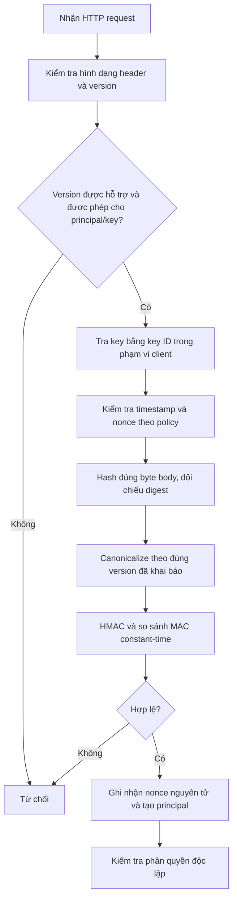

# Version contract trong HMAC Request Authentication

## 1. Vì sao contract của chữ ký cần có version?

Trong hệ thống xác thực HTTP request bằng **HMAC với shared secret**, phía client và phía server phải thống nhất chính xác cách chuyển một request thành chuỗi byte được ký (*canonical request*). Chỉ một khác biệt nhỏ như thứ tự query parameter, dấu xuống dòng, cách mã hóa khoảng trắng hoặc header được đưa vào chữ ký cũng khiến hai bên tạo ra MAC khác nhau. Ngược lại, nếu một thay đổi khiến trường quan trọng không còn được ký, request có thể vẫn hợp lệ về mặt HMAC nhưng bị thay đổi ý nghĩa trên đường truyền.

**Version contract** là hợp đồng có phiên bản giữa bên gửi và bên xác minh, quy định cả cấu trúc request, cách canonicalize, thuật toán ký, biểu diễn chữ ký, phạm vi trường được bảo vệ, luật kiểm tra thời gian/nonce và các trường hợp phải từ chối. Contract testing kiểm tra hai phía có thực hiện **cùng một hợp đồng ở cùng một version** hay không, đặc biệt khi nâng cấp client, server hoặc gateway.

Ví dụ: hệ thống đang dùng `hmac-v1`, chỉ ký method, path, query, một nhóm header và body digest. Khi yêu cầu bảo vệ thêm `Host` và `X-Tenant-Id`, việc âm thầm sửa bộ canonicalization cũ sẽ làm các client đã triển khai v1 lỗi hàng loạt. Hướng đúng là công bố `hmac-v2` với một contract tường minh, hỗ trợ chuyển tiếp có kiểm soát và kiểm thử cả hai phiên bản trong thời gian chuyển đổi.

> **Phạm vi:** `hmac-v1` và `hmac-v2` bên dưới là **giao thức minh họa do bài học định nghĩa**, không phải tên của một chuẩn HMAC chung. Khi tích hợp với một hệ thống thực, mọi chi tiết phải lấy từ hợp đồng đã được hai phía chấp thuận.

## 2. Phân biệt những loại version dễ nhầm

| Khái niệm | Ví dụ | Tác động lên HMAC |
| --- | --- | --- |
| API version | `/v1/orders`, `/v2/orders` | Path thay đổi thì dữ liệu được ký thay đổi; chưa chắc thuật toán ký đổi. |
| **Signature contract version** | `hmac-v1`, `hmac-v2` | Xác định chính xác thuật toán, canonical request, signed fields và wire format. Đây là đối tượng chính của bài. |
| Key ID / key rotation | `partner-01`, `partner-02` | Chỉ ra secret nào cần tra cứu; đổi secret không tự động đồng nghĩa đổi signature contract. |
| Phiên bản triển khai | Client `2.4.0`, server `3.1.0` | Nhiều bản phần mềm có thể cùng thực thi một contract; không dùng số build làm signature version. |

Một client dùng API `/v2/orders` vẫn có thể ký theo `hmac-v1` nếu hai bên đã thỏa thuận như vậy. Ngược lại, server hỗ trợ `hmac-v2` không có nghĩa mọi key đều được phép dùng v2: chính sách cần gắn version được phép với từng client/principal và từng giai đoạn chuyển đổi.

## 3. Định nghĩa một contract `hmac-v1` có thể kiểm thử

Giả sử client và server thỏa thuận một profile minh họa như sau. Các quy tắc này là **normative trong phạm vi ví dụ**: thay đổi một quy tắc có thể khiến kết quả ký khác đi.

| Thành phần | Quy tắc `hmac-v1` |
| --- | --- |
| Khai báo version | Header bắt buộc `X-HMAC-Version: hmac-v1`; version đồng thời xuất hiện trong canonical request. |
| Định danh khóa | `X-HMAC-Key-Id` bắt buộc; server chỉ tra key theo định danh client/key đã cấp phép, không tin key do request tự cung cấp. |
| Thuật toán | `HmacSHA256`, key là chuỗi byte bí mật được cấp qua kênh an toàn; dữ liệu vào là UTF-8 của canonical request. |
| Chữ ký | Base64url **không padding** của 32 byte MAC; đặt trong `X-HMAC-Signature`, không ký chính header này. |
| Body digest | SHA-256 của đúng byte body đã thống nhất tại điểm ký/xác minh, biểu diễn bằng **64 ký tự hex thường** trong `X-Content-SHA256`. Body rỗng có digest cố định `e3b0c44298fc1c149afbf4c8996fb92427ae41e4649b934ca495991b7852b855`. |
| Timestamp | `X-HMAC-Timestamp` là số giây Unix UTC, dạng thập phân chuẩn; không chấp nhận số có dấu hay biểu diễn mơ hồ. |
| Nonce | `X-HMAC-Nonce` là giá trị duy nhất cho từng request; ngoài môi trường test, nên sinh ngẫu nhiên đủ mạnh (ví dụ ít nhất 128 bit). |
| Các header được ký | `x-content-sha256`, `x-hmac-key-id`, `x-hmac-nonce`, `x-hmac-timestamp`, `x-hmac-version` theo thứ tự từ điển tăng dần. |
| Phạm vi bảo vệ | Method, path, query, các header kể trên và body digest. `Host`, `Content-Type` và header phân quyền riêng khác **chưa được bảo vệ** trong profile v1 minh họa. |

### 3.1. Canonicalization phải được mô tả ở mức byte

1. **Method:** dùng HTTP method viết hoa ASCII, ví dụ `GET` hoặc `POST`; từ chối method không thuộc tập được hỗ trợ.
2. **Path:** dùng path của request-target **bên ngoài** mà client thực sự ký; bắt đầu bằng `/`, giữ dạng percent-encoded theo hợp đồng. Không tự sửa `//`, `%2F`, dấu chấm phân đoạn hay slash cuối theo cách khác giữa hai phía. Nếu dạng path mơ hồ, hai bên nên từ chối request thay vì đoán cách chuẩn hóa.
3. **Query:** tách thành từng cặp key/value, giữ cả tham số trùng nhau và giá trị rỗng (`key=`), giải mã percent-encoding hợp lệ thành UTF-8 rồi mã hóa lại theo RFC 3986 (`%20` cho space, `%2B` cho dấu `+`, hex của escape viết hoa). Sắp xếp theo key rồi value đã mã hóa; nối bằng `&`. Query rỗng là chuỗi rỗng. Không coi dấu `+` chưa escape là space theo quy ước form-urlencoded; nếu tầng framework áp dụng quy tắc khác phải xử lý nhất quán ngay tại ranh giới giao thức.
4. **Header:** chuẩn hóa tên header thành chữ thường, bỏ khoảng trắng OWS ở đầu/cuối giá trị, giữ nguyên ký tự bên trong. Từ chối header cần ký bị lặp, chứa CR/LF hoặc sai định dạng; không tùy tiện nối các giá trị trùng nhau. Danh sách header bắt buộc là cố định cho v1.
5. **Body:** hash đúng byte payload mà phía nhận kiểm tra. Phải xác định rõ ký trước/sau các bước như giải nén `Content-Encoding`, xử lý `Transfer-Encoding`, chuyển charset hoặc rewrite body qua gateway. Không ký JSON sau khi parse rồi serialize lại, trừ khi hợp đồng định nghĩa riêng một thuật toán JSON canonicalization.
6. **Encoding:** ghép các dòng bằng **LF (`\n`, byte `0A`)**, không dùng CRLF và **không có LF ở cuối**. Các chuỗi header, path/query và chữ ký phải dùng biểu diễn/encoding được thống nhất, tránh chuyển đổi theo locale.

Canonical request v1 gồm đúng các dòng sau, theo thứ tự, nối bằng một ký tự LF giữa hai dòng:

```text
HMAC-REQUEST
hmac-v1
<METHOD>
<CANONICAL_PATH>
<CANONICAL_QUERY>
x-content-sha256:<BODY_SHA256_HEX>
x-hmac-key-id:<KEY_ID>
x-hmac-nonce:<NONCE>
x-hmac-timestamp:<UNIX_SECONDS>
x-hmac-version:hmac-v1
x-content-sha256;x-hmac-key-id;x-hmac-nonce;x-hmac-timestamp;x-hmac-version
<BODY_SHA256_HEX>
```

Dòng thứ năm tồn tại ngay cả khi query rỗng. Đưa version vào **cả header và chuỗi ký** giúp chống việc thay `X-HMAC-Version` để ép server diễn giải chữ ký theo profile khác; bộ xác minh còn phải có chính sách cho phép version đó.

### 3.2. Golden vector: cùng input phải ra cùng canonical request và signature

Request kiểm thử (body có **0 byte**, timestamp và nonce chỉ là giá trị cố định cho fixture):

```http
GET /v1/orders?b=2&a=1 HTTP/1.1
Host: api.example.test
X-HMAC-Version: hmac-v1
X-HMAC-Key-Id: partner-01
X-HMAC-Timestamp: 1795849200
X-HMAC-Nonce: nonce-0001
X-Content-SHA256: e3b0c44298fc1c149afbf4c8996fb92427ae41e4649b934ca495991b7852b855
X-HMAC-Signature: OccC2e0gyGrXB8B9rx9MD5SL4kFW3WGed1VoFjZFJ4I
```

Client và server phải độc lập tạo đúng **366 byte UTF-8** của chuỗi sau:

```text
HMAC-REQUEST
hmac-v1
GET
/v1/orders
a=1&b=2
x-content-sha256:e3b0c44298fc1c149afbf4c8996fb92427ae41e4649b934ca495991b7852b855
x-hmac-key-id:partner-01
x-hmac-nonce:nonce-0001
x-hmac-timestamp:1795849200
x-hmac-version:hmac-v1
x-content-sha256;x-hmac-key-id;x-hmac-nonce;x-hmac-timestamp;x-hmac-version
e3b0c44298fc1c149afbf4c8996fb92427ae41e4649b934ca495991b7852b855
```

Với test secret **chỉ dành cho ví dụ** là `contract-test-only-secret` (UTF-8), kỳ vọng:

```text
HMAC-SHA256(canonical_request, test_secret)
  -> Base64url(no padding) = OccC2e0gyGrXB8B9rx9MD5SL4kFW3WGed1VoFjZFJ4I
```

Đây là **golden vector**: đặt vào hợp đồng giữa client Java, một client viết bằng ngôn ngữ khác và API/gateway. So sánh **byte canonical**, **digest** và **MAC** trước khi kiểm thử HTTP để biết lỗi nằm ở normalization hay verifier. Key và nonce ở trên ngắn/dễ đoán nhằm làm fixture dễ đọc; tuyệt đối không dùng trong production.

Ví dụ JUnit 5 tự chứa để khóa kết quả vector và phát hiện thay đổi ngoài ý muốn:

```java
import static org.junit.jupiter.api.Assertions.assertEquals;
import static org.junit.jupiter.api.Assertions.assertNotEquals;

import java.nio.charset.StandardCharsets;
import java.util.Base64;
import javax.crypto.Mac;
import javax.crypto.spec.SecretKeySpec;
import org.junit.jupiter.api.Test;

class HmacV1GoldenVectorTest {
    private static final String EMPTY_SHA256 =
            "e3b0c44298fc1c149afbf4c8996fb92427ae41e4649b934ca495991b7852b855";

    private static final String CANONICAL = String.join("\n",
            "HMAC-REQUEST",
            "hmac-v1",
            "GET",
            "/v1/orders",
            "a=1&b=2",
            "x-content-sha256:" + EMPTY_SHA256,
            "x-hmac-key-id:partner-01",
            "x-hmac-nonce:nonce-0001",
            "x-hmac-timestamp:1795849200",
            "x-hmac-version:hmac-v1",
            "x-content-sha256;x-hmac-key-id;x-hmac-nonce;x-hmac-timestamp;x-hmac-version",
            EMPTY_SHA256
    );

    private static String sign(String canonical) throws Exception {
        Mac mac = Mac.getInstance("HmacSHA256");
        byte[] secret = "contract-test-only-secret".getBytes(StandardCharsets.UTF_8);
        mac.init(new SecretKeySpec(secret, "HmacSHA256"));
        byte[] tag = mac.doFinal(canonical.getBytes(StandardCharsets.UTF_8));
        return Base64.getUrlEncoder().withoutPadding().encodeToString(tag);
    }

    @Test
    void matchesPublishedGoldenVector() throws Exception {
        assertEquals(366, CANONICAL.getBytes(StandardCharsets.UTF_8).length);
        assertEquals("OccC2e0gyGrXB8B9rx9MD5SL4kFW3WGed1VoFjZFJ4I", sign(CANONICAL));
    }

    @Test
    void modifyingSignedNonceChangesTag() throws Exception {
        String modified = CANONICAL.replace("nonce-0001", "nonce-0002");
        assertNotEquals(sign(CANONICAL), sign(modified));
    }
}
```

Hai unit test trên kiểm tra **vector mật mã**. Trong dự án thật cần kiểm tra riêng `canonicalize(httpRequest, version)` có tạo ra chính chuỗi này, rồi đưa request qua verifier thật để khẳng định chữ ký đúng được nhận và thay đổi ở một trường có ký bị từ chối. Không thay thế kiểm thử liên thông bằng cách để cả client và server dùng chung một hàm canonicalization trong cùng test: như vậy một lỗi chung có thể bị che khuất.

## 4. Khi nào tạo `hmac-v2` và thế nào là tương thích?

Giả sử một hệ thống SaaS bổ sung xác thực theo tenant và định tuyến đa host. HMAC v1 minh họa chưa ký `Host` và `X-Tenant-Id`. Nếu server dựa vào chúng để chọn tenant hoặc policy, request có thể đổi ngữ nghĩa mà không đổi MAC. Đề xuất `hmac-v2`:

- Giữ thuật toán HmacSHA256, định dạng body digest và nguyên tắc canonicalization của v1.
- Đổi `X-HMAC-Version` và dòng thứ hai của canonical request thành `hmac-v2`.
- Yêu cầu và ký thêm `Host` (hoặc authority đã được quy ước chính xác ở gateway), `Content-Type` nếu được dùng để diễn giải payload, và `X-Tenant-Id`; xác định rõ giá trị khi không có body/Content-Type.
- Công bố **danh sách signed headers mới, thứ tự và ví dụ golden vector mới**; không suy diễn rằng một verifier v1 có thể tự nhận diện v2.
- Gắn policy `allowedSignatureVersions` với client/key và có mốc ngừng hỗ trợ v1 cho từng nhóm tích hợp.

`hmac-v2` ở đây là **ý tưởng mở rộng**, chưa đủ là một specification có thể triển khai nếu chưa chốt canonical form của authority, header `Content-Type` tùy chọn, danh sách signed headers và golden vector v2. Không được cho phép v2 hoạt động thật khi các chi tiết đó chưa được tài liệu hóa và kiểm thử.

| Thay đổi | Có cần tăng signature contract version? | Lý do |
| --- | --- | --- |
| Đổi secret và `X-HMAC-Key-Id`, giữ nguyên quy tắc ký | Thường không | Đây là key rotation, không đổi cách diễn giải byte được ký. |
| Thêm một header phản hồi hoặc field API không nằm trong signed input | Không nhất thiết | Giao thức tạo chữ ký request không đổi. |
| Sửa thứ tự query, escape `%20`/`+`, hoặc quy tắc ghép dòng | **Có** | Cùng request có thể cho ra MAC khác. |
| Bắt buộc ký thêm tenant, host hay content type | **Có** | Phạm vi dữ liệu chống sửa đổi đã đổi. |
| Chuyển HmacSHA256 sang thuật toán hoặc encoding chữ ký khác | **Có** | Kết quả và logic xác minh không tương thích. |
| Đổi API path `/v1` thành `/v2` nhưng giữ nguyên quy tắc ký | Không tự động | Path mới được đưa vào MAC như dữ liệu thông thường. |

**Tương thích ngược** ở đây nghĩa là server chủ động tiếp nhận một tập phiên bản đã công bố cho từng principal trong giai đoạn chuyển đổi. Nó **không** có nghĩa `hmac-v2` phải tạo cùng chữ ký với `hmac-v1`, và càng không có nghĩa server được thử v1 khi chữ ký v2 thất bại.

## 5. Quy trình xác minh phải ràng buộc chặt version

Một pipeline xác thực HTTP an toàn theo contract đã công bố có thể thực hiện theo thứ tự sau:



Cần phân biệt **nonce được kiểm tra trước** với **nonce được ghi nhận như đã dùng**: không để request có MAC sai chiếm nonce hợp lệ của client. Với nhiều node, thao tác đăng ký nonce cần tính nguyên tử (`putIfAbsent` kèm TTL trên kho dữ liệu dùng chung, hoặc cơ chế tương đương); race giữa hai request giống nhau chỉ được nhận một lần. Thời gian cho phép lệch đồng hồ (ví dụ ±5 phút) và TTL phải thống nhất trong policy, dùng clock giả trong test, không phụ thuộc vào giờ thực của CI.

Server có thể đọc version chưa được xác thực **chỉ để chọn bộ quy tắc kiểm tra**. Version trở thành đáng tin cậy sau khi đã được MAC bảo vệ và policy chấp nhận. Tuyệt đối không triển khai logic kiểu `if v2 fails -> try v1`, không tự chọn thuật toán từ input tùy ý và không tự hạ xuống version yếu hơn do client gửi sai cấu trúc. Khi loại bỏ v1, cấu hình phải từ chối v1 ngay cả khi MAC v1 vẫn đúng.

Khi so sánh MAC, giải mã Base64url theo format đã chốt, kiểm tra đúng độ dài 32 byte, rồi so sánh byte bằng hàm không rò rỉ thời gian theo nội dung, ví dụ `MessageDigest.isEqual(expectedMac, suppliedMac)` trong Java. Tránh log shared secret, raw MAC, raw Authorization hoặc payload nhạy cảm; có thể ghi key ID đã kiểm soát, version, nguyên nhân lỗi đã phân loại và correlation ID.

## 6. Bộ contract test cần có

Contract test phải chạy ở **ranh giới producer/consumer**: client SDK tạo chữ ký và server/API gateway xác minh chúng theo cùng fixture độc lập, kể cả trường hợp lỗi. Các kỳ vọng bên dưới dùng `AUTHENTICATED` / `REJECTED` để tránh nhầm thành `200` / `403`: một request được xác thực vẫn có thể bị từ chối **phân quyền**.

| Nhóm | Input / tình huống | Kỳ vọng |
| --- | --- | --- |
| Golden vector v1 | Request mẫu ở mục 3.2, cùng test secret | Cùng 366 byte canonical và đúng MAC đã công bố; verifier chấp nhận nếu timestamp/nonce được cố định theo clock test. |
| Query tương đương | `?b=2&a=1` và `?a=1&b=2` | Canonical query và MAC giống nhau theo v1. |
| Query có duplicate và encoding | `?tag=b&tag=a&q=hello%20world` và biến thể thứ tự; thêm trường hợp literal `+` | Giữ đủ duplicate, sắp xếp đúng; `%20` và `+` được xử lý theo RFC 3986, không bị nhập nhằng. |
| Thay đổi dữ liệu đã ký | Đổi method, path, query value, nonce, timestamp, key ID hoặc byte body | Verifier từ chối chữ ký cũ. |
| Sai body digest | Header digest không khớp byte body, kể cả khi chữ ký dựa trên digest header | Từ chối trước khi chấp nhận authentication. |
| Sai định dạng | Header bắt buộc trùng nhau, timestamp sai, chữ ký Base64url lỗi, query percent-encoding lỗi, CR/LF trong header | Từ chối nhất quán; không thử chuẩn hóa mơ hồ. |
| Version lạ | `X-HMAC-Version: hmac-v3` hoặc thiếu version | Từ chối theo mã lỗi contract, không tự fallback. |
| Chống downgrade | Request ký theo v2 nhưng bị đổi header thành v1; hoặc client v2-only gửi MAC v1 hợp lệ | Từ chối do MAC/policy; không tự giảm version. |
| Giai đoạn dual-accept | Client A được phép v1/v2, client B chỉ v2 | A dùng version nào đã thỏa thuận thì được xác thực; B dùng v1 phải bị từ chối ngay cả khi MAC đúng. |
| Replay | Gửi lại cùng nonce, principal và request đã ký trong cửa sổ timestamp | Chỉ một request được chấp nhận trên cả cụm node. |
| Clock skew | Timestamp trong/ngoài biên lệch thời gian đã cấu hình | Xử lý đúng tại hai ranh giới, có clock injection. |
| Key rotation | Hai key ID đang active cùng áp dụng một signature version | Key đúng được nhận; key đã revoke/không thuộc client bị từ chối. |
| Proxy/gateway | Path rewrite, percent-encoding, query reorder, header forwarding, `Content-Encoding` | Byte được ký giữ cùng nghĩa ở điểm xác minh; khác biệt phải được phát hiện bằng test qua gateway thực. |
| Phân quyền | MAC đúng nhưng principal không có quyền trên resource | Authentication thành công, authorization từ chối, không coi là lỗi HMAC. |

Lưu ý quan trọng: test `Content-Type`/`Host`/tenant phải thể hiện **giới hạn của v1** và xác nhận chúng được bảo vệ theo **v2 sau khi v2 được đặc tả đầy đủ**. Không viết một test v1 kỳ vọng chỉnh `Host` sẽ làm MAC sai trong khi contract v1 không hề ký `Host`: test như vậy tự mâu thuẫn với hợp đồng.

### 6.1. Tổ chức kiểm thử để không che giấu sai lệch

1. **Shared contract fixtures:** lưu request đầu vào, body bytes (ví dụ UTF-8 hoặc hex), canonical bytes, digest, MAC dự kiến, version và kỳ vọng chấp nhận/từ chối như những vector bất biến đã được review. Có thể phân nhóm theo `hmac-v1`/`hmac-v2`.
2. **Consumer conformance:** client Java hoặc SDK ngôn ngữ khác tự canonicalize và ký, đối chiếu từng byte với vector đã phát hành.
3. **Provider conformance:** gọi verifier qua HTTP/filter thực với request/fixture do phía độc lập tạo; kiểm tra security principal, lỗi xác thực và policy version.
4. **End-to-end qua proxy:** gửi request tại ranh giới public (TLS termination/load balancer/API gateway), kiểm tra path, host, query, body mà verifier thực nhận. Nếu gateway phải biến đổi dữ liệu được ký, xác minh tại gateway trước khi biến đổi hoặc thiết kế lại điểm ký/xác minh trong contract.
5. **Compatibility matrix trên CI:** chạy test cho các cặp client-version/server-policy đang được hỗ trợ; chỉ cho phép xóa fixture v1 sau khi chính sách và traffic đã loại bỏ v1.

Trường hợp sử dụng Spring Security Servlet, có thể tích hợp provider conformance qua `MockMvc` với filter HMAC thật; với WebFlux, dùng `WebTestClient` và authentication `WebFilter` thật. Mô phỏng body đã được đọc/cache đúng cách để kiểm tra body digest; tránh test trực tiếp một hàm ký rồi kết luận toàn bộ filter đã đúng. Cả hai nhánh phải kiểm chứng thêm filter ordering để request chỉ được tạo authenticated principal **sau khi HMAC và chống replay hợp lệ**.

## 7. Nâng version mà không tạo lỗ hổng downgrade

Một kế hoạch chuyển từ `hmac-v1` sang `hmac-v2` trong hợp đồng client–server có thể theo trình tự:

1. **Đóng băng v1:** công bố specification, golden vector và các trường hợp từ chối của v1; mọi thay đổi về canonicalization đều đi sang version mới.
2. **Đặc tả v2 trước khi bật:** chốt signed headers, authority, body representation, error semantics và golden vectors của v2; chạy conformance test độc lập trên client và server.
3. **Triển khai server dual-accept theo allowlist:** key/principal nào được phép dùng v1/v2 phải được quy định rõ. Mỗi request chọn **một** version và chỉ được xác minh theo đúng version đó.
4. **Nâng client có kiểm soát:** phát hành SDK cấu hình rõ `signatureVersion=hmac-v2`, thử canary, theo dõi tỷ lệ request theo version và lỗi MAC theo key/client (không log secret).
5. **Chặn version cũ theo từng nhóm:** sau khi các client hợp lệ chuyển xong, chỉnh policy thành `v2-only`, thử cả MAC v1 *đúng* để chứng minh server thực sự từ chối downgrade.
6. **Loại bỏ hỗ trợ v1:** xóa mã chỉ dành riêng cho v1 khi hết thời gian hỗ trợ; giữ fixture lịch sử nếu cần kiểm tra hồi quy và kiểm toán.

Rollback chỉ được thực hiện trong cửa sổ tương thích đã phê duyệt, bằng thay đổi policy tường minh và có giám sát. Không để server tự rollback khi gặp lỗi xác minh chữ ký: đây là một nhánh downgrade có thể bị kẻ tấn công kích hoạt.

## 8. Tiêu chí hoàn thành một version contract

Một signature version chỉ được coi là đủ rõ để tích hợp khi trả lời chính xác được các câu hỏi sau:

- Request nào được ký và byte nào được hash: method, path/query, tập header, body, encoding, newline, dạng digest/MAC?
- Ai công bố version và bên nhận chọn verifier thế nào; policy của từng key/client cho phép những version nào?
- Mỗi thay đổi về query, URI, header, body, timestamp/nonce, key rotation và proxy được kỳ vọng chấp nhận hay từ chối?
- Có golden vectors độc lập, negative vectors và ma trận tương thích đang chạy trên CI không?
- Quy trình chuyển version và thời điểm ngừng version cũ có thể kiểm thử bằng một MAC hợp lệ của version cũ không?

**Bài tập thực hành:** từ fixture mục 3.2, viết một hàm `canonicalizeV1(HttpRequest)` để tạo đúng 366 byte; ký bằng `Mac` của JDK rồi đối chiếu signature. Tiếp theo, thêm ba test: query đổi thứ tự vẫn cho cùng chữ ký; đổi một byte body làm verifier từ chối; client bị cấu hình `v2-only` từ chối request v1 dù MAC v1 đúng. Cuối cùng, chạy request qua proxy mô phỏng rewrite path để tìm điểm cần đặt verifier. Bài tập này kiểm tra đồng thời hợp đồng byte, tính tương thích theo version và ranh giới xác thực/phân quyền.

**Tài liệu nền để đối chiếu:** RFC 2104 (HMAC), RFC 3986 (URI và percent-encoding), RFC 9110/9112 (HTTP semantics/message syntax). Khi muốn dùng giao thức ký HTTP chuẩn hóa thay cho hợp đồng tự thiết kế, có thể nghiên cứu thêm RFC 9421 (HTTP Message Signatures); không mặc định các quy tắc của RFC 9421 tự động trùng với profile minh họa trong bài.
