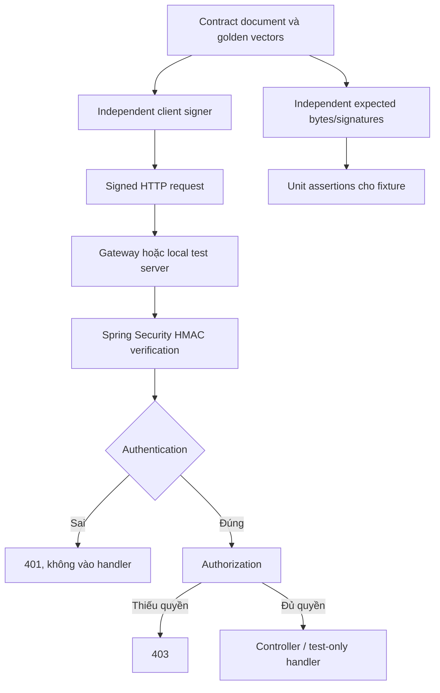

# Client fixture trong contract testing cho xác thực HMAC HTTP request

## 1. Client fixture là gì và giải quyết vấn đề nào?

Trong module `SECURITY_AUTHENTICATION_HMAC_REQUEST_AUTHENTICATION`, client ký HTTP request bằng HMAC với **shared secret**. Cả hai phía phải thống nhất **canonical request**, gồm HTTP method, URI/path/query, các header đã chọn và/hoặc hash của body theo hợp đồng ký. Server xác minh chữ ký, timestamp/nonce chống replay, key rotation rồi mới tạo principal cho bước authorization.

Khi triển khai nhiều service hoặc nhiều ngôn ngữ lập trình, lỗi thường không nằm ở riêng thuật toán HMAC-SHA256: phía Java có thể ký path đã decode nhưng client JavaScript lại ký raw path; HTTP client có thể serialize lại JSON; gateway đổi host/path; hoặc timestamp/nonce được tạo khác định dạng. Cả client lẫn server đều có thể “đúng theo code của mình” nhưng không tương thích trên wire.

**Client fixture** là một bộ dữ liệu và công cụ kiểm thử đóng vai trò **client độc lập**, có khả năng tạo request hợp lệ theo hợp đồng, ký bằng credential test, gửi request thật và tạo các biến thể lỗi một cách có kiểm soát.

Fixture thường gồm:

- **Protocol specification:** quy tắc canonicalization, signed headers, encoding, key ID, timestamp, nonce và signature.
- **Test credential:** key ID/version và shared secret *chỉ dành cho môi trường test*.
- **Deterministic signer:** từ input xác định tạo canonical bytes và chữ ký xác định.
- **Clock/nonce provider:** cho phép đóng băng thời gian khi unit test và tạo nonce mới khi integration test.
- **Golden vectors:** các input và expected bytes/signature được kiểm tra độc lập.
- **Request builder và sender:** gửi đúng method, raw URI, headers và **chính body bytes đã ký**.
- **Mutation helpers:** thay path, query, body hoặc header **sau khi ký** để tạo negative cases.
- **Assertion layer:** kiểm tra HTTP response và xác nhận server không thực hiện side effect khi từ chối.

Mục tiêu của bài là thiết kế một fixture giúp trả lời đáng tin: “Client và service có thực sự thực hiện **cùng hợp đồng ký HMAC** không?”, thay vì chỉ chứng minh hai class cùng repo gọi lại cùng một hàm.

### Kết quả học tập

Sau bài này, người học có thể:

1. Phân biệt client fixture, unit test của verifier và contract test end-to-end.
2. Tạo request HMAC độc lập bằng Java 17, kiểm soát URI và raw body bytes.
3. Dùng test vectors xác định để tránh cả client và server cùng mắc một lỗi canonicalization.
4. Thiết kế test matrix cho happy path, signature mismatch, replay, clock skew, key rotation và 401/403.
5. Kiểm tra hợp đồng khi request đi qua gateway/proxy có rewrite và forwarded headers.
6. Tổ chức fixture có khả năng bảo trì, bảo vệ test secret, tránh flaky tests và không tạo side effect production.

## 2. Client fixture khác gì với unit test và mock server?

Ba phương pháp thường bổ sung cho nhau:

| Phương pháp | Thành phần thật | Điều chứng minh | Hạn chế |
| --- | --- | --- | --- |
| Unit test canonicalizer | Hàm xây canonical bytes | Cùng input cho đúng canonical representation | Không chứng minh HTTP client gửi đúng bytes |
| Unit test HMAC primitive | `Mac`/SHA-256 và known-answer vector | Thuật toán/encoding được cài đặt đúng | Không chứng minh hợp đồng URI/header/body |
| Client fixture + service integration | Client signer độc lập, HTTP codec, server filter/verifier | Hai phía tương thích tại ranh giới HTTP | Có thể chưa bao gồm gateway nếu gọi localhost |
| Client fixture + gateway E2E | Signer, HTTP client, proxy/edge, Spring Security, handler | Hợp đồng ký còn đúng sau các phép chuyển tiếp | Khó kiểm soát time/network, cần fixture chuyên biệt |
| Mock/fake server | Client thật, server giả mô phỏng contract | Client gửi đủ header/body và ký đúng theo oracle | Fake nếu copy logic client sẽ bỏ sót bug chung |

**Nguyên tắc độc lập:** Đừng gọi production `HmacVerifier` hoặc production `CanonicalRequestBuilder` từ fixture client chỉ để tính expected signature. Nếu cả hai phía dùng cùng code sai, test có thể luôn xanh.

Có thể tái sử dụng **đặc tả công khai** về phiên bản hợp đồng, nhưng cần ít nhất một trong các oracle độc lập: golden vectors đã review, reference signer ở ngôn ngữ khác, hoặc test vectors được kiểm chứng bằng một implementation khác.

Một client fixture thực dụng thường có hai đường kiểm tra:



## 3. Viết protocol contract trước khi viết fixture

HMAC-SHA256 chỉ xác định cách tính MAC trên một chuỗi bytes với secret. Nó **không tự quy định** HTTP request phải được biến thành những bytes nào.

Một đặc tả có thể dùng bảng quyết định:

| Thành phần | Contract mẫu trong bài | Trường hợp phải đặc tả thêm |
| --- | --- | --- |
| Contract version | `HMAC-v1` ở đầu canonical string | Version do header nào chọn và có nằm trong dữ liệu ký không? |
| Method | Chữ hoa ASCII, ví dụ `POST` | Method lạ, method override header |
| Request target | `raw path` + `?raw query` nếu có | Percent encoding, query order, duplicate keys |
| Content-Type | Chính giá trị header gửi đi, chữ thường tên field `content-type` | Khoảng trắng, tham số charset, trùng header |
| Body | SHA-256 của **exact HTTP entity bytes** | Body rỗng, Content-Encoding, chunked transfer |
| Timestamp | Unix epoch seconds dưới dạng chữ số thập phân | Clock skew, timezone, độ dài, overflow |
| Nonce | Chuỗi duy nhất trong thời hạn cho phép | Độ dài, entropy, phạm vi key/client, atomic reserve |
| Key ID | Header `X-Key-Id` chọn key/version | Chữ hoa/thường ID, duplicate, revoke/rotation |
| Signature | HMAC-SHA256, Base64 chuẩn có padding | Base64url, chữ hoa/chữ thường, malformed input |
| Header names | `X-Key-Id`, `X-Timestamp`, `X-Nonce`, `X-Signature` | Signed vs unsigned header list, canonical whitespace |
| Response | `401` nếu authn sai; `403` nếu authn đúng nhưng thiếu quyền | Scheme `WWW-Authenticate`, error body và correlation ID |

**Đây là một hợp đồng minh họa, không phải chuẩn HMAC chung.** Nếu ứng dụng dùng `Authorization: HMAC ...`, JSON canonicalization hoặc signing protocol chuẩn hóa khác, fixture phải tuân theo **đúng version thực tế**, không trộn quy tắc giữa nhiều kiểu.

### 3.1. Ví dụ canonical request theo từng dòng

Ta chọn chuỗi UTF-8 với dấu phân cách LF giữa các dòng:

```text
HMAC-v1
POST
/v1/orders?item=7
content-type:application/json
BASE64(SHA256(EXACT_BODY_BYTES))
1795834800
nonce-vector-001
```

Trong ví dụ trên, dòng `BASE64(SHA256(EXACT_BODY_BYTES))` diễn giải cách tính, không phải literal thực tế. Khi ký, fixture phải thay dòng đó bằng Base64 của digest thật.

Giả sử client gửi body:

```json
{"quantity":2,"currency":"VND"}
```

Body trên và biến thể có whitespace hoặc thứ tự trường khác có thể mang cùng ý nghĩa nghiệp vụ nhưng **khác raw bytes**. Nếu hợp đồng ký raw bytes thì SHA-256 cũng khác. Client fixture không nên “làm đẹp” JSON sau khi tính chữ ký.

### 3.2. URI đúng theo hợp đồng, không dùng route template

`/v1/orders/42` và `/v1/orders/43` phải có canonical bytes khác nhau nếu path được ký. Không lấy route pattern `/v1/orders/{id}`, `@PathVariable` hoặc một URI đã bị proxy rewrite rồi cho rằng nó tương đương public target.

Nếu contract ký query, phải quyết định cách xử lý `a=1&b=2`, `b=2&a=1`, duplicate keys, dấu `+` và `%20`, `%2F`, fragment, query rỗng. HTTP fragment (phần sau `#`) **không** được gửi tới server trong HTTP request target và không nên được xem là thành phần ký server có thể kiểm tra.

### 3.3. Header là một phần của wire contract

Tên HTTP header không phân biệt hoa/thường, nhưng value có thể cần normalize theo hợp đồng. Đặc biệt:

- `Content-Type: application/json` khác `application/json;charset=UTF-8` nếu contract ký nguyên value.
- Gateway có thể thêm `X-Forwarded-Proto` hoặc thay `Host`; không tự đưa header được thêm **sau khi ký** vào danh sách signed headers.
- Duplicate `X-Signature` hoặc `X-Key-Id` cần được reject hoặc canonicalize theo rule đã công bố; không tùy tiện lấy giá trị đầu.
- HTTP/2 sử dụng `:authority` và `:path` ở wire level; fixture phải xem HTTP client có làm thay đổi request target và authority không.

## 4. Cấu trúc một bộ fixture dễ bảo trì

Gợi ý trách nhiệm theo thành phần, không bắt buộc mỗi thành phần là một file riêng:

| Thành phần | Nhiệm vụ |
| --- | --- |
| `ContractSpec` | Khai báo version, thuật toán, signed fields và validation rules |
| `FixtureCredential` | Chứa key ID và test secret theo version, không log value |
| `FixtureSigner` | Xây canonical bytes theo contract rồi tính HMAC |
| `FixtureRequest` | Lưu URI, method, headers và bản sao body bytes đã ký |
| `Clock` | Cố định timestamp cho test vectors; thời gian thật cho E2E |
| `NonceSource` | Nonce có thể điều khiển/quan sát, tránh trùng giữa cases |
| `VectorCatalog` | Golden inputs và expected canonical/signature |
| `FixtureTransport` | Gửi request qua `HttpClient`, WebTestClient hoặc client ngôn ngữ khác |
| `MutationFactory` | Đổi path/header/body sau khi ký, **không re-sign** |
| `ContractAssertions` | Assert status, reason nội bộ trong test, side effect và metrics |

Mối quan hệ mong muốn:

```text
FixtureCredential + Clock + NonceSource
                  |
                  v
          FixtureSigner
                  |
                  v
     SignedFixtureRequest
             |          |
             |          +--> Mutation (giữ chữ ký cũ)
             v
          HTTP transport
                  |
                  v
    Test server / gateway / verifier
                  |
                  v
     Assertions: 2xx, 401, 403, 5xx
```

Fixture tạo request và dữ liệu test; **không** được can thiệp trực tiếp vào security context của Spring để “giúp” request xác thực.

## 5. Java 17: client fixture tự ký và gửi exact body bytes

Đoạn mã sau là một **fixture độc lập dành cho test** dùng JDK `HttpClient`, `MessageDigest` và `Mac`. Nó thực thi đúng **hợp đồng minh họa tại mục 3**: method viết hoa, raw path/query, một signed header `content-type`, SHA-256 raw body, epoch seconds và nonce.

Để tập trung vào contract, ví dụ giả định tất cả path đã được encode hợp lệ và không có query canonicalization bổ sung; nếu production contract có quy tắc khác, phải điều chỉnh cả fixture và test vectors độc lập.

```java
import java.net.URI;
import java.net.http.HttpRequest;
import java.nio.charset.StandardCharsets;
import java.security.GeneralSecurityException;
import java.security.MessageDigest;
import java.time.Clock;
import java.util.Base64;
import java.util.Locale;
import java.util.Objects;
import java.util.function.Supplier;
import javax.crypto.Mac;
import javax.crypto.spec.SecretKeySpec;

public final class HmacClientFixture {

    private final String keyId;
    private final byte[] testSecret;
    private final Clock clock;
    private final Supplier<String> nonceSource;

    public HmacClientFixture(
            String keyId,
            byte[] testSecret,
            Clock clock,
            Supplier<String> nonceSource) {
        this.keyId = Objects.requireNonNull(keyId);
        this.testSecret = Objects.requireNonNull(testSecret).clone();
        this.clock = Objects.requireNonNull(clock);
        this.nonceSource = Objects.requireNonNull(nonceSource);
    }

    public SignedRequest sign(
            String method,
            URI uri,
            String contentType,
            byte[] rawBody) throws GeneralSecurityException {

        Objects.requireNonNull(uri);
        byte[] body = Objects.requireNonNull(rawBody).clone();
        String normalizedMethod = Objects.requireNonNull(method)
                .toUpperCase(Locale.ROOT);
        String headerValue = contentType == null ? "" : contentType;
        String path = uri.getRawPath();
        if (path == null || path.isEmpty()) {
            path = "/";
        }
        String rawTarget = path + (uri.getRawQuery() == null
                ? ""
                : "?" + uri.getRawQuery());

        String timestamp =
                Long.toString(clock.instant().getEpochSecond());
        String nonce = Objects.requireNonNull(nonceSource.get());

        byte[] digest = MessageDigest.getInstance("SHA-256")
                .digest(body);
        String bodyHash = Base64.getEncoder().encodeToString(digest);

        String canonical = String.join("\n",
                "HMAC-v1",
                normalizedMethod,
                rawTarget,
                "content-type:" + headerValue,
                bodyHash,
                timestamp,
                nonce);

        Mac mac = Mac.getInstance("HmacSHA256");
        mac.init(new SecretKeySpec(testSecret, "HmacSHA256"));
        byte[] signatureBytes = mac.doFinal(
                canonical.getBytes(StandardCharsets.UTF_8));

        return new SignedRequest(
                uri,
                normalizedMethod,
                headerValue,
                body,
                keyId,
                timestamp,
                nonce,
                Base64.getEncoder().encodeToString(signatureBytes));
    }

    public record SignedRequest(
            URI uri,
            String method,
            String contentType,
            byte[] body,
            String keyId,
            String timestamp,
            String nonce,
            String signature) {

        public SignedRequest {
            body = Objects.requireNonNull(body).clone();
        }

        @Override
        public byte[] body() {
            return body.clone();
        }

        public HttpRequest toHttpRequest() {
            return requestWithUri(uri);
        }

        // Chỉ dùng trong negative test: đổi URI SAU KHI ký.
        // Method, content type, body và HMAC header không đổi.
        public HttpRequest tamperUriForTest(URI differentUri) {
            return requestWithUri(differentUri);
        }

        private HttpRequest requestWithUri(URI targetUri) {
            HttpRequest.Builder builder =
                    HttpRequest.newBuilder(targetUri)
                            .method(method,
                                    HttpRequest.BodyPublishers
                                            .ofByteArray(body.clone()));

            if (!contentType.isEmpty()) {
                builder.header("Content-Type", contentType);
            }

            return builder
                    .header("X-Key-Id", keyId)
                    .header("X-Timestamp", timestamp)
                    .header("X-Nonce", nonce)
                    .header("X-Signature", signature)
                    .build();
        }

        @Override
        public String toString() {
            return "SignedRequest[redacted]";
        }
    }
}
```

**Giới hạn của ví dụ:**

- Đây là fixture để kiểm thử, không phải thư viện client production. Secret phải là **test-only credential** được cấp an toàn, không hard-code secret production.
- Mảng `testSecret` được sao chép khi khởi tạo. Điều này hạn chế việc sửa từ bên ngoài nhưng **không bảo đảm xóa sạch mọi bản sao secret khỏi JVM memory**.
- `SignedRequest` có `toString()` đã che thông tin, nhưng vẫn không được log trực tiếp `signature()`, `body()`, raw credential hoặc secret từ nơi khác.
- Java `URI` và `HttpClient` có thể xử lý URI/HTTP version theo semantics của chúng. Với path chứa encoding đặc biệt, test cần kiểm tra **raw request target thực sự đến server**; không mặc định Java transport phát nguyên chuỗi ứng dụng đã dựng.
- Việc ghi `Content-Type` bằng đúng `headerValue` giả định contract ký giá trị đó không biến đổi. Không tự `trim()`/lowercase nội dung nếu contract không yêu cầu.
- Fixture mặc định dùng epoch seconds, không phải ISO-8601. Time format và header names phải trùng version của server.
- `tamperUriForTest()` giữ chữ ký cũ một cách cố ý, do đó **không được dùng trong client thật**.
- Đối với JSON body, fixture ký **byte array đã được tạo một lần**, không tạo lại JSON khi truyền `HttpRequest.BodyPublisher`.

## 6. Tạo dữ liệu test xác định với Clock và nonce

Muốn so sánh một chữ ký với golden vector, input phải cố định hoàn toàn, bao gồm thời gian và nonce. Ví dụ:

```java
Clock fixed = Clock.fixed(
        Instant.parse("2026-11-28T03:00:00Z"),
        ZoneOffset.UTC);

HmacClientFixture fixture = new HmacClientFixture(
        "contract-client-v1",
        testSecretBytes,
        fixed,
        () -> "nonce-vector-001");

byte[] rawBody =
        "{\"quantity\":2,\"currency\":\"VND\"}"
                .getBytes(StandardCharsets.UTF_8);

var signed = fixture.sign(
        "POST",
        URI.create("https://api.example.test/v1/orders?item=7"),
        "application/json",
        rawBody);
```

Dạng này dành cho **golden-vector/unit test**, vì cùng input phải ra cùng chữ ký. Đừng gửi lặp nhiều lần với nonce cố định đến một server đang bật anti-replay rồi kỳ vọng mọi lần đều thành công.

Trong integration test chạy với server thật, sử dụng thời gian gần hiện tại và nonce mới cho mỗi request:

```java
HmacClientFixture onlineFixture = new HmacClientFixture(
        "contract-client-v1",
        testSecretBytes,
        Clock.systemUTC(),
        () -> "it-" + UUID.randomUUID());
```

`UUID.randomUUID()` tiện để giảm trùng trong môi trường test; hệ thống production phải xác định yêu cầu entropy/độ dài nonce, scope theo client/key và atomic reservation. Nếu contract yêu cầu fixed-length Base64url hoặc một nguồn entropy riêng, fixture phải tuân thủ đúng quy tắc đó.

### 6.1. Chống flaky tests với thời gian

Các lỗi thường gặp:

- Client fixture đóng băng `Clock` ở một ngày cũ nhưng test gửi đến server dùng wall-clock hiện tại: server trả `401` vì timestamp quá hạn.
- CI chạy ở timezone khác và code dùng `LocalDateTime` không có zone: timestamp lệch.
- Test `Thread.sleep()` để chờ nonce TTL: chậm và không ổn định.
- Các test chạy song song dùng cùng nonce và cùng credential: một test bất ngờ bị replay.

Giải pháp:

1. Unit test dùng `Clock.fixed(...)` và fake server clock.
2. Integration test dùng thời gian hiện tại hoặc điều khiển được clock ở hai phía.
3. Mỗi case có nonce riêng; chỉ case **replay cố ý** mới dùng lại cùng nonce.
4. Dùng in-memory/fake nonce store có tính atomic cho unit test và store thực hoặc Testcontainers ở integration test.
5. Có timeout rõ ràng cho network, Redis và key store; không che outage thành “signature invalid”.

## 7. Golden vectors: oracle độc lập của hợp đồng

Một client fixture không đáng tin chỉ vì nó tự xác minh chữ ký do chính nó tính. Cần có **golden vectors** được xây dựng/kiểm chứng từ một implementation độc lập rồi review.

Một vector nên ghi lại:

| Field | Nội dung ví dụ |
| --- | --- |
| `vector_id` | `hmac-v1-post-json-001` |
| `contract_version` | `HMAC-v1` |
| `method` | `POST` |
| `raw_target` | `/v1/orders?item=7` |
| `content_type` | `application/json` |
| `body_bytes_utf8` | `{"quantity":2,"currency":"VND"}` |
| `timestamp` | `1795834800` |
| `nonce` | `nonce-vector-001` |
| `test_key_id` | `contract-client-v1` |
| `test_secret` | Test-only secret có thể được quản lý ở fixture store |
| `expected_body_sha256_base64` | Digest được reference signer tính độc lập |
| `expected_canonical_utf8` | Chính xác từng byte, kể cả LF và encoding |
| `expected_signature_base64` | Chữ ký reference signer đã được review |
| `expected_http_result` | Authentication accepted trên server test |

Các giá trị digest/signature mong đợi **phải được tính thật**; không điền placeholder rồi gọi đó là golden vector đã pass. Có thể lưu dữ liệu fixture không nhạy cảm trong repository, nhưng secret test nên có chính sách riêng; nếu một test key được cố ý public làm known-answer vector, phải bảo đảm nó **không dùng ở bất kỳ môi trường thật nào**.

### 7.1. Known-answer test cho HMAC primitive

Ngoài vector full HTTP request, có thể dùng bộ kiểm thử HMAC-SHA256 đã được công bố, ví dụ test vector trong RFC 4231, nhằm chứng minh cách gọi thuật toán và bytes đúng. Điều này không đủ để chứng minh canonicalization HTTP.

Với body rỗng, SHA-256 Base64 có giá trị xác định:

```text
SHA256(empty_bytes) in Base64:
47DEQpj8HBSa+/TImW+5JCeuQeRkm5NMpJWZG3hSuFU=
```

Nếu hai implementation không khớp ngay cả digest body rỗng, cần kiểm tra Base64 alphabet, padding và liệu chúng có vô tình hash chuỗi `"null"` hoặc `"{}"` thay vì byte array rỗng.

### 7.2. Ký tự xuống dòng và encoding

Golden vector nên có trường hợp:

- LF (`0A`) so với CRLF (`0D 0A`) trong canonical string.
- UTF-8 với tiếng Việt/emoji trong raw body.
- Path và query có percent encoding.
- Header có khoảng trắng, casing và nhiều giá trị theo policy.
- Body rỗng, JSON có khoảng trắng, body nhị phân.
- Base64 chuẩn và Base64url (nếu contract có hỗ trợ).

Không dựa vào `System.lineSeparator()` vì chạy trên Windows có thể tạo CRLF trong khi contract yêu cầu LF. Dùng `"\n"` hoặc byte `0x0A` theo hợp đồng.

## 8. Gửi request qua HTTP client và test server thật

Client fixture hữu ích nhất khi gửi request qua đúng transport mà production sử dụng. Với JDK `HttpClient`:

```java
HttpClient http = HttpClient.newBuilder()
        .connectTimeout(Duration.ofSeconds(3))
        .build();

var signed = onlineFixture.sign(
        "POST",
        URI.create("http://127.0.0.1:" + testPort
                + "/api/orders?item=7"),
        "application/json",
        "{\"quantity\":2}".getBytes(StandardCharsets.UTF_8));

HttpResponse<String> response = http.send(
        signed.toHttpRequest(),
        HttpResponse.BodyHandlers.ofString(StandardCharsets.UTF_8));

assertEquals(201, response.statusCode());
```

`testPort` đến từ cổng ngẫu nhiên của Spring Boot integration test; test server phải có credential tương ứng được cấp từ test registry. Ví dụ trên **giả định** route tạo đơn hàng được cấu hình trả `201` và dùng dữ liệu test, không phải API production.

Đối với hợp đồng ký public URI đằng sau proxy, không thể thay `https://api.example.test/...` bằng `http://127.0.0.1/...` rồi tự cho rằng canonical host/scheme không đổi nếu host hoặc scheme nằm trong signed fields. Trong fixture cần tách:

- **Public signing target:** những trường contract yêu cầu ký.
- **Transport destination:** địa chỉ socket/host mà client test kết nối.
- **Trusted proxy mapping:** quy tắc chuyển tiếp path, host và scheme từ ingress tới service.

Nếu contract chỉ ký raw path/query như ví dụ của bài, test localhost đơn giản hơn. Nếu hợp đồng ký host/scheme thì phải mô hình hóa chúng và kiểm chứng HTTP/2 `:authority`, `Host` hoặc đường đi qua edge thật.

### 8.1. Test không được bỏ security filters

Trong Spring MVC, `@AutoConfigureMockMvc(addFilters = false)` khiến request bypass Spring Security; đó không phải contract test HMAC. Với `WebTestClient`, phải kết nối qua security chain hoặc server thật, không gọi thẳng controller qua mock đơn giản.

Một test end-to-end phải có bằng chứng:

- Request đi qua authentication filter/manager.
- HMAC được xác minh với key test trong registry.
- Nonce được reserve theo chính sách.
- Authorization được áp dụng.
- Controller không chạy khi request bị từ chối.

## 9. Ma trận hợp đồng: positive và negative cases

Một fixture hữu ích phải hỗ trợ cả request hợp lệ và request thay đổi đúng **một chiều** sau khi ký.

| Case | Dữ liệu fixture | Kỳ vọng khi route protected |
| --- | --- | --- |
| Happy path | Method/path/header/body và signature khớp, nonce mới | Authentication accepted; HTTP theo endpoint |
| Thiếu credential | Bỏ chữ ký hoặc header bắt buộc | `401` theo contract |
| Sai signature | Thay một byte trong signature hoặc canonical signed field | `401`, handler không chạy |
| Changed method | Ký `POST`, gửi `PUT` không re-sign | `401` nếu method được ký và route hợp lệ |
| Changed path | Ký `/orders/42`, gửi `/orders/43` không re-sign | `401` nếu path được ký |
| Changed query | Ký `view=short`, gửi `view=full` không re-sign | `401` nếu query được ký |
| Changed Content-Type | Thay signed header value sau khi ký | `401` nếu header được ký |
| Changed body | Ký body A, gửi body B cùng method/path | `401` nếu raw body được ký |
| Header name casing | Thay `Content-Type` thành `content-type` | Chấp nhận nếu HTTP/contract coi như nhau |
| Duplicate auth header | Hai `X-Signature` hoặc `X-Key-Id` | Reject ambiguity theo contract |
| Malformed Base64 | Signature không decode được | `401`/`400` theo contract, không `500` |
| Expired timestamp | Thời gian ngoài window | Từ chối trước business |
| Future timestamp | Vượt clock skew cho phép | Từ chối theo policy |
| Replay | Gửi lại đúng signed request với nonce cũ | Lần lặp bị từ chối |
| Concurrent replay | Hai request cùng nonce tới hai replica | Tối đa một request accepted |
| Active/overlap key | Đúng key version và trạng thái | Xác thực thành công |
| Revoked key | Ký đúng bằng key không còn được phép | Từ chối |
| HMAC đúng, thiếu authority | Credential hợp lệ nhưng policy không cho | `403`, không gọi là signature mismatch |
| HMAC đúng, đủ authority | Credential có scope phù hợp | Business response thành công |
| Key/nonce store outage | Dependency không thể xác minh | Fail closed, `5xx` thích hợp; không bypass |
| Proxy rewrite | Signed public target qua gateway | Kết quả theo canonical contract, không thử nhiều target |

Không khẳng định **mọi** negative HTTP request phải trả `401`. Một raw URI bị firewall từ chối có thể nhận `400` trước verifier; body quá lớn có thể `413`. Muốn chứng minh chữ ký ràng buộc path/method, chọn **hai route hợp lệ trong cùng phạm vi bảo vệ HMAC** và quan sát nguyên nhân rejection.

## 10. Changed path/body test: mutation sau khi ký, không tạo lại signature

Một lỗi fixture phổ biến là sửa path rồi gọi `fixture.sign(...)` lần nữa. Khi đó client tạo chữ ký mới cho path đã sửa và server vẫn có thể xác thực hợp lệ, nghĩa là test **không kiểm tra** khả năng phát hiện tampering.

Thứ tự đúng:

```text
1. Chuẩn bị input A.
2. Tạo SignedRequest A: signature = HMAC(canonical(A)).
3. Chỉ thay đúng một thành phần thành B trên HTTP request gửi đi.
4. Giữ timestamp, nonce, key ID, signature của A.
5. Đảm bảo nonce A chưa từng được sử dụng trong test khác.
6. Gửi B, assert authentication rejection trước controller.
7. Dùng nonce mới, ký B đúng cách rồi gửi B làm positive control.
```

Ví dụ Java dùng method chuyên biệt ở `SignedRequest`:

```java
var original = fixture.sign(
        "POST",
        URI.create("http://localhost:" + testPort + "/api/orders/42"),
        "application/json",
        "{\"quantity\":2}".getBytes(StandardCharsets.UTF_8));

HttpRequest changedPath =
        original.tamperUriForTest(
                URI.create("http://localhost:" + testPort
                        + "/api/orders/43"));

// Chữ ký và nonce vẫn thuộc /42, nhưng request thực được gửi /43.
var response = http.send(
        changedPath,
        HttpResponse.BodyHandlers.discarding());

assertEquals(401, response.statusCode());
```

**Quan trọng:** Không gửi original request trước rồi mới gửi mutated request **cùng nonce**. Nếu nonce đã dùng, server có thể trả `401` vì replay, khiến test “changed path” đỗ giả. Hãy giữ mỗi case độc lập hoặc dùng nonce mới ngay từ đầu.

Đối với changed body, fixture phải cho phép đổi `byte[]` sau khi ký mà không tự tính lại signature. Khi test muốn xác minh body binding, giữ method/URI/header/timestamp/nonce y nguyên, chỉ thay body và assert mismatch.

### 10.1. Positive control loại trừ lỗi routing

Sau changed-path negative, ký **chính path mới** với một nonce mới:

```java
var positive = fixture.sign(
        "POST",
        URI.create("http://localhost:" + testPort + "/api/orders/43"),
        "application/json",
        "{\"quantity\":2}".getBytes(StandardCharsets.UTF_8));

var accepted = http.send(
        positive.toHttpRequest(),
        HttpResponse.BodyHandlers.discarding());
```

Assert result đúng theo endpoint/test policy. Positive control chứng minh path B tồn tại, cùng security chain HMAC được áp dụng và client được phép dùng path đó. Nếu path B bị `404` vì route không có handler, negative `401`/`404` chưa chứng minh đầy đủ path signing.

## 11. Replay, timestamp và Clock trong contract tests

Chữ ký HMAC đúng không đủ để ngăn phát lại một request y nguyên. Một contract test tốt chứng minh cả freshness và nonce semantics.

### 11.1. Test replay tuần tự

```text
Given:
  - key test active
  - timestamp trong cửa sổ
  - nonce N chưa từng dùng
  - request R có signature đúng

When:
  1. Gửi R lần đầu -> accepted
  2. Gửi lại chính R -> rejected as replay

Then:
  - Chỉ lần đầu đến business handler
  - Lần thứ hai không có side effect
  - Không tự gán lỗi lần hai thành signature mismatch
```

Với API ghi dữ liệu, nên dùng endpoint no-op hoặc business fixture có idempotency/cơ sở dữ liệu tách biệt. Replay nonce và idempotency key là hai cơ chế khác nhau: dùng nonce mới cho cùng nghiệp vụ **không tự động** ngăn tạo hai giao dịch.

### 11.2. Test replay đồng thời

Hai request dùng cùng credential và nonce, gửi gần đồng thời tới các instance khác nhau. Replay store phải thực hiện thao tác **atomic** (ví dụ `SET ... NX EX` ở Redis hoặc unique constraint phù hợp). Test khẳng định tối đa một request accepted; không dùng thuật toán `exists()` rồi `set()` có race.

Cần cẩn thận phân biệt request đã bị timeout ở client với request đã được server xử lý: nếu transport mất kết nối sau khi nonce được reserve, client không được mặc định tái sử dụng nonce để retry. Fixture cần theo dõi kết quả quan sát và không giả định timeout có nghĩa nonce chưa dùng.

### 11.3. Timestamp boundary

Với một server clock có thể điều khiển, test các thời điểm sát:

- Ngay trong cửa sổ cho phép.
- Ngay ngoài cửa sổ cho phép.
- Timestamp tương lai vượt clock-skew tolerance.
- String sai định dạng, overflow hoặc thiếu trường.
- Chuyển giao timezone/UTC.

Trong integration test không điều khiển server clock, dùng timestamp gần hiện tại và clock skew hợp lý. Đừng viết test phụ thuộc `Thread.sleep()` nhiều phút; thay bằng injected `Clock` ở unit/integration fixture khi có thể.

## 12. Key rotation và kiểm thử credential theo phiên bản

HMAC client fixture nên hỗ trợ nhiều credential **test-only**:

```text
test-client-A:
  key-v1: previous_allowed trong overlap
  key-v2: current
  key-v0: revoked

test-client-B:
  key-v1: active nhưng authority chỉ đọc
```

Đây là danh mục giả định phục vụ bài tập. Key lifecycle phải do **server-side credential registry** kiểm soát, không phải chỉ do client fixture tự khai.

Ma trận rotation:

| Trạng thái key | Signature hợp lệ | Kỳ vọng |
| --- | --- | --- |
| Current active | Đúng trên canonical request | Authentication accepted |
| Previous trong overlap | Đúng và window còn hợp lệ | Accepted nếu policy cho phép |
| Revoked | Đúng theo secret cũ | Authentication rejected |
| Unknown key ID | Dù có chữ ký do client tự tính | Rejected, không lộ key tồn tại |
| Sai key/version | Ký bằng secret B nhưng khai key ID A | Rejected |
| Chuyển từ v1 sang v2 | Re-sign đúng key ID/version | Accepted theo policy mới |
| V1 sau khi hết overlap | Dù trước đây từng accepted | Rejected |

**Không cache kết quả “key hợp lệ” vô hạn trong test/server**: điều đó che bug revoke. Khi kiểm thử key rotation, phải có fixture độc lập cho mỗi version và reset state giữa các run. Response public nên giữ semantics chung cho unknown/revoked/invalid signature; audit nội bộ có thể phân loại kỹ hơn với kiểm soát truy cập.

### 12.1. Key ID không phải identity

Một request gửi `X-Key-Id: partner-A-v2` chưa chứng minh nó đến từ partner A. Chỉ sau khi server tra key record, xác minh HMAC và freshness/replay, mới được gắn principal/authority. Trong test, không gọi trực tiếp `SecurityContextHolder.setAuthentication(...)` hay inject authentication mock để thay thế client ký thật.

## 13. Tách contract xác thực khỏi authorization

Fixture phải cho phép tạo hai request **đều có HMAC hợp lệ** nhưng khác kết quả authorization.

Ví dụ API `POST /api/orders` cần authority `orders:create`:

| Test principal sau xác thực | Credential và HMAC | Authorization | HTTP |
| --- | --- | --- | --- |
| Client writer | Hợp lệ | Có `orders:create` | `201` nếu nghiệp vụ thành công |
| Client reader | Hợp lệ | Chỉ `orders:read` | `403` |
| Unknown client | Không có key tin cậy | Không đến authz như principal hợp lệ | `401` |
| Client writer, body bị tamper | HMAC sai | Không đi đến authz theo credential đó | `401` |

Khi test `403`, **đừng dùng signature sai**. Nếu credential không được xác minh, server trả `401` là đúng và test chưa đi đến authorization. Fixture nên có key test được server ánh xạ rõ các authorities; đảm bảo test dựa trên signed request thật và không bypass security chain.

Đối với tenant/ownership, authority tổng quát như `orders:read` chưa đủ để được đọc mọi order. Test authorization còn cần các tài nguyên ở nhiều tenant và kiểm tra policy tại service/resource layer.

## 14. Spring Boot contract test: bố trí fixture và assertions

Có hai cách chính:

### 14.1. Test application qua HTTP thật

Ví dụ Spring Boot integration test trên cổng ngẫu nhiên:

```java
@SpringBootTest(
    webEnvironment = SpringBootTest.WebEnvironment.RANDOM_PORT)
class HmacClientContractIT {

    @LocalServerPort
    int port;

    @Test
    void validSignedRequestIsAccepted() throws Exception {
        HmacClientFixture fixture = testFixtureWithFreshNonce();

        byte[] body = "{\"quantity\":2}"
                .getBytes(StandardCharsets.UTF_8);

        var request = fixture.sign(
                "POST",
                URI.create("http://127.0.0.1:" + port
                        + "/api/orders"),
                "application/json",
                body);

        HttpResponse<Void> response = HttpClient.newHttpClient()
                .send(request.toHttpRequest(),
                        HttpResponse.BodyHandlers.discarding());

        assertEquals(201, response.statusCode());
    }
}
```

`testFixtureWithFreshNonce()` là helper do test dựng, lấy test secret từ fixture environment, `Clock.systemUTC()` và nonce source duy nhất. Test server phải có key test tương ứng và endpoint trả `201`. Không sử dụng endpoint ghi production hoặc shared test database không cô lập.

Đây là kiểm thử **HTTP boundary** và security chain; không cần gọi trực tiếp `HmacVerifier`. Muốn test case signature sai, sử dụng mutation ở client fixture và test thêm verify service/repository không được gọi.

### 14.2. MockMvc và WebTestClient

`MockMvc` hoặc `WebTestClient` giúp kiểm thử Spring Security nhanh hơn khi chưa có gateway. Fixture vẫn có thể cung cấp signed headers/body:

```java
// Ý tưởng: fixture.sign(...) tạo SignedRequest.
// Test adapter đưa chính body bytes và signed headers vào MockMvc.
var signed = fixture.sign("POST", testUri,
        "application/json", exactBody);

mockMvc.perform(post("/api/orders")
        .contentType("application/json")
        .content(exactBody)
        .header("X-Key-Id", signed.keyId())
        .header("X-Timestamp", signed.timestamp())
        .header("X-Nonce", signed.nonce())
        .header("X-Signature", signed.signature()))
        .andExpect(status().isCreated());
```

Nếu contract ký hostname/scheme, `testUri` phải chứa đúng origin mà `MockMvc` đưa vào servlet request; nếu không, test có thể sai do fixture ký một URI khác servlet nhận. Trong `WebTestClient`, tương tự cần kiểm tra URI normalization và cùng body bytes. **Không tắt security filters** để “làm test nhanh hơn”.

Ưu tiên ít nhất một nhóm test HTTP thật cho raw URI, content encoding và proxy/gateway; mock transport không luôn tái hiện chính xác HTTP/1.1 vs HTTP/2 hoặc encoding do client thật phát.

### 14.3. Assertions về side effect và reason code

Một test signature sai nên chứng minh:

```text
HTTP status            = 401
authenticated principal = absent
business handler calls  = 0
database side effects   = 0
security reason internal= invalid_signature
```

Reason code có thể lấy từ test audit sink hoặc verifier spy **chỉ trong môi trường test**. Response public không nhất thiết phải nói “key chưa tồn tại” hay “signature mismatch”; tránh biến HTTP authentication thành oracle giúp attacker đoán key.

## 15. Gateway/proxy contract: client ký public request hay upstream request?

Khi gateway rewrite, các giá trị có thể thay đổi:

```text
Client signed target:   https://api.example.test/v1/orders?item=7
Gateway upstream URL:   http://orders-svc:8080/internal/orders?item=7
```

Nếu contract ký **public URI**, server verifier phía sau gateway phải được cung cấp đủ metadata tin cậy để dựng lại public target, hoặc việc xác minh phải được thực hiện **tại edge trước rewrite**.

Header `Forwarded` theo RFC 7239 có thể mang `for`, `by`, `proto`, `host` nhưng **không có original path/query chuẩn**. Các header như `X-Forwarded-Prefix`, `X-Original-URI` phụ thuộc gateway; chỉ tin nếu ingress **loại bỏ giá trị do client tự khai** và service chỉ nhận request từ trusted proxy.

Client fixture phải có **hai nhóm test**:

1. **Positive proxy contract:** ký target public A, gửi qua gateway, upstream rewrite theo cấu hình được phép, server vẫn xác minh thành công.
2. **Negative proxy contract:** ký A, thay public path hoặc signed header thành B **sau khi ký**, gateway chuyển tới B, server từ chối trước handler.

Thêm security test cố ý gửi `X-Original-URI` hoặc `X-Forwarded-Host` giả để xác minh ingress không cho client tự áp đặt canonical target. Không sửa verifier thành “thử public rồi internal path cho đến khi signature khớp”: như vậy một chữ ký có thể vô tình được áp cho nhiều logical target.

### 15.1. Fixture không được dùng raw header proxy làm bằng chứng authentication

Một fixture test có thể cố tình gửi:

```http
X-Forwarded-Host: trusted.example.test
X-Original-URI: /v1/orders?item=7
```

Đó là **untrusted request input** nếu đi trực tiếp từ client. Chỉ metadata do proxy đã kiểm soát tạo ra mới được dùng theo policy. Chữ ký HMAC hợp lệ của một request target cũng không tự cấp quyền trên tenant/tài nguyên khác sau khi gateway đổi routing.

### 15.2. Kiểm tra raw path/query và signed headers trong test

Để tránh false positives:

- Ghi lại target thực sự đến server bằng một test-only request capture có quyền truy cập kiểm soát, **không in signature/secret**.
- So sánh canonical request target ở client test với phần target được phép do ingress bảo toàn theo contract.
- Test `%2F`, dấu `+`, `%20`, duplicate query keys và prefix rewrite.
- Test case gateway thêm/bớt `Content-Type` hoặc Content-Encoding, nếu header/body được ký.
- Khi HTTP/2 và HTTP/1.1 chuyển đổi, xác nhận host/authority semantics theo contract.

Một unit test gọi trực tiếp service và tự gắn `X-Original-URI` không chứng minh gateway trust boundary; cần test end-to-end qua gateway thật hoặc môi trường giả lập có policy sanitization tương đương.

## 16. Kiểm thử cross-language và contract versioning

Mục tiêu dài hạn của fixture là giúp client Java, JavaScript, Go, Python hoặc một ứng dụng mobile đều tạo cùng canonical bytes theo cùng version.

### 16.1. Golden vector là ngôn ngữ trung lập

Mỗi implementation nên có test:

```text
given contract version V and exact input bytes X
when client implementation builds canonical request
then canonical bytes == independently reviewed expected bytes
and HMAC(signature) == independently reviewed expected signature
```

Nếu chỉ so sánh “client A tạo signature bằng client B”, cả hai có thể cùng dựa vào một library sai. Cần oracle bên thứ ba/golden vectors và test edge cases encoding.

### 16.2. Đổi hợp đồng không đồng nghĩa đổi key version

Có thể có:

- `HMAC-v1` ký method/path/header/body hash.
- `HMAC-v2` thêm signed host hoặc thay quy tắc query.
- `key-v3` là secret mới do rotation.

**Contract version và key version là hai trục độc lập.** Test phải kiểm tra những combination được server policy cho phép, không suy rằng “key v2 đồng nghĩa canonical HMAC-v2”.

Khi migration:

1. Công bố version marker/negotiation rule.
2. Cung cấp golden vectors cho từng version.
3. Chạy CI contract tests cho client cũ/mới.
4. Xác định thời điểm ngừng version cũ và rotation overlap.
5. Không fallback thử nhiều canonical formats vô hạn cho một request chưa rõ version.

### 16.3. Binary compatibility không bảo đảm wire compatibility

Hai SDK cùng có method `sign(HttpRequest)` nhưng nếu một bên thay JSON serializer hoặc URL encoder, signature có thể khác. Vì thế contract test phải dựa trên **bytes thực gửi**, không chỉ public API của SDK.

## 17. Bảo vệ test credentials, log và dữ liệu fixture

Client fixture thường chứa secret test và chữ ký; đó không phải lý do được phép ghi chúng vào logs/CI artifacts.

Các nguyên tắc:

- **Không dùng shared secret production** trong test vector, CI hoặc local developer machine nếu không có kiểm soát đặc biệt.
- Dùng credential riêng cho test môi trường, scope tối thiểu, có thể rotate/revoke và không có quyền với dữ liệu thật.
- Không log `Authorization`, `X-Signature`, secret, expected HMAC, raw body chứa PII hoặc canonical string nhạy cảm.
- Không đưa raw key ID, nonce, request ID hoặc path có resource ID vào metric labels; dùng route template, reason code allowlist.
- Với test failure, hiển thị `vector_id`, tên trường khác biệt và trạng thái; redaction nội dung nhạy cảm trước khi ghi CI report.
- Không commit file test configuration chứa credential thực. Nếu golden vector cố ý dùng key công khai, đánh dấu rõ **public test vector only** và không dùng ở bất kỳ service thật nào.
- Khi test qua gateway, không cho proxy access log ghi full authentication headers/body.
- Reset nonce store/test database và cô lập credential của các job CI song song; không dùng cùng nonce namespace giữa test runs.

Nếu có bằng chứng secret thật đã rơi vào logs/artifact, cần theo quy trình security incident: hạn chế truy cập, điều tra phạm vi và **rotate/revoke** credential. Chỉ xóa một dòng log không bảo đảm secret chưa bị sao chép.

## 18. Tránh những lỗi làm contract test “xanh giả”

| Sai lầm | Vì sao nguy hiểm | Cách khắc phục |
| --- | --- | --- |
| Client fixture gọi lại server canonicalizer | Hai phía có thể cùng bug | Có reference/golden vectors độc lập |
| Ký trên JSON object rồi gửi JSON serialize lần khác | Raw body bytes thay đổi | Tạo một `byte[]` và dùng cho cả ký lẫn gửi |
| Dùng nonce cố định cho mọi integration test | Request sau bị replay | Nonce độc lập; cố định chỉ khi test vector |
| Reuse nonce trong changed-path negative | `401` có thể do replay | Dùng fresh nonce riêng, positive control |
| Sửa path rồi tự động re-sign | Không còn negative test | Mutate request **sau khi** ký |
| Gửi tới route không tồn tại | `404` che lỗi signature | Test các route protected hợp lệ |
| Chỉ assert `status != 200` | Không phân biệt `401`/`403`/`500` | Assert stage và no side effect |
| Test `403` bằng signature sai | Chưa đến authorization | Dùng credential HMAC hợp lệ nhưng thiếu quyền |
| Mock security context thay vì gửi HMAC | Bypass authentication contract | Gửi request ký thật qua filter chain |
| Bỏ qua percent encoding/host/gateway | Local pass, production fail | Test raw URI và proxy E2E |
| Dùng wall-clock cũ trong vector integration | Timestamp expired | Fixed clock ở cả phía hoặc timestamp mới |
| Test trên một instance nonce store cục bộ | Không phát hiện multi-node replay | Atomic shared store, concurrency test |
| Bắt exception hạ tầng thành `401` chung | Che key/nonce store outage | Fail closed và phản hồi `5xx` phù hợp |
| Dùng key revoked để làm positive fixture | Tất cả request bị từ chối | Key active riêng, revoked dành cho negative test |
| Đưa secret/header vào failure output | Rò credential qua CI | Audit/redaction theo allowlist |
| Cho gateway thay signed request target tùy tiện | Signature mismatch hoặc route confusion | Chính sách canonical target và trust boundary rõ ràng |

## 19. Bài thực hành: xây client fixture và contract suite cho signed orders API

Cho service Spring Boot bảo vệ `POST /api/orders` bằng HMAC-SHA256. Hợp đồng ký gồm uppercase method, raw path/query, `Content-Type`, SHA-256 của raw JSON body, Unix epoch seconds và nonce. Client gửi key ID, timestamp, nonce và chữ ký trong header riêng. Server có key registry với rotation, Redis nonce store atomic, Spring Security authentication và authority `orders:create`. Gateway đổi public prefix `/v1` thành upstream `/internal` theo chính sách tin cậy.

### Các bước thực hiện

1. **Viết bản đặc tả HMAC-v1:** xác định từng dòng canonical bytes, encoding, LF, query rules, header normalization, body bytes, timestamp/nonce và signature Base64.
2. **Tạo ít nhất năm golden vectors:** body rỗng, JSON tiếng Việt, query percent-encoded, header case/whitespace và binary body. Xác minh expected values bằng implementation độc lập.
3. **Xây `HmacClientFixture`:** inject `Clock`, nonce provider và test credential; trả immutable signed request hoặc defensive copies; không log secret.
4. **Kiểm chứng fixture:** so canonical bytes và signature với golden vectors; kiểm tra JDK HTTP client gửi đúng body/path/query.
5. **Tạo happy-path suite:** HMAC hợp lệ và quyền `orders:create` trả business status đúng, server nhận đúng body.
6. **Tạo mutation suite:** sửa method, path, query, signed header hoặc body **sau khi ký**, giữ chữ ký cũ, assert authentication rejected và handler không chạy.
7. **Tạo freshness suite:** expired/future timestamp, nonce replay tuần tự và đồng thời nhiều instance; dùng atomic nonce store.
8. **Tạo credential suite:** current key, overlap key, revoked key, unknown key, sai key/version; response không tiết lộ trạng thái secret.
9. **Tạo authorization suite:** HMAC hợp lệ của client chỉ có `orders:read` phải trả `403` trên `POST /api/orders`.
10. **Tạo gateway suite:** ký public target rồi đi qua rewrite; phát hiện path/host/header spoof, xác minh trust boundary.
11. **Tích hợp CI:** chạy unit golden vectors thường xuyên, integration HMAC trong pipeline và proxy E2E trong môi trường phù hợp; cô lập nonce/key/test data cho từng job.
12. **Báo cáo rõ:** vector ID, contract version, request/expected status, lỗi theo stage, server không có side effect; không xuất secret/chữ ký vào report.

### Tiêu chí hoàn thành

Client fixture đạt yêu cầu khi:

- Độc lập với verifier production và khớp golden vectors đã được kiểm chứng.
- Tạo signature từ **đúng HTTP method, URI, signed headers và body bytes thực gửi**.
- Có thể điều khiển Clock và nonce để test tái lập được, đồng thời không vô tình kích hoạt replay trong case khác.
- Chứng minh signature mismatch, timestamp/replay, key rotation và 401/403 được phân biệt đúng.
- Kiểm tra gateway rewrite và forwarded metadata dưới ranh giới tin cậy, không chấp nhận một chữ ký cho nhiều logical target ngoài hợp đồng.
- Tất cả negative cases không chạy business side effect; không có shared secret hoặc credential nhạy cảm trong logs/CI artifacts.

**Kết luận:** Client fixture là một **người thực thi hợp đồng ký từ phía đối tác/client**, không phải bản sao của server verifier. Khi được kiểm chứng bằng test vectors độc lập và HTTP thực, nó phát hiện những khác biệt rất nhỏ ở byte-level canonicalization, URI, header, body và thời gian; đồng thời tạo nền tảng tin cậy để kiểm thử chống replay, rotation, gateway và authorization mà không làm giảm bảo mật HMAC.
