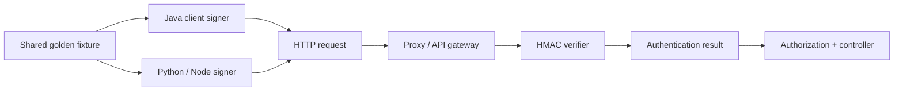

# Cross-language fixture: bộ dữ liệu kiểm thử hợp đồng HMAC giữa nhiều ngôn ngữ

## 1. Vì sao HMAC cần cross-language fixture?

Trong xác thực HTTP request bằng **HMAC với shared secret**, client ký một **canonical request** và server tự dựng lại cùng chuỗi byte để kiểm tra chữ ký. Một bên có thể viết bằng Java/Spring Security, bên còn lại dùng Python, Node.js, Go hoặc một SDK khác. Các bên đều có thể dùng đúng HMAC-SHA256 nhưng vẫn tạo ra chữ ký khác nhau vì sai khác nhỏ trong cách chuẩn hóa URI, header, body hoặc mã hóa chuỗi.

**Cross-language fixture** là tập đầu vào và kết quả chuẩn đã được cố định (*golden vectors*) để nhiều implementation đối chiếu với nhau. Nó trả lời câu hỏi: **Với cùng secret, method, raw request target, headers, body và hợp đồng canonicalization, liệu mọi ngôn ngữ có tạo đúng cùng một dãy byte và chữ ký?**

Bài thuộc chương **Contract testing** của module `SECURITY_AUTHENTICATION_HMAC_REQUEST_AUTHENTICATION`. Phạm vi xuyên suốt là xác thực request bằng HMAC, bao gồm method, URI, header, body, timestamp/nonce chống replay, key rotation và đường đi qua proxy/gateway. HMAC chứng minh tính toàn vẹn của phần dữ liệu đã ký và quyền sở hữu secret theo mô hình tin cậy của hệ thống; **phân quyền** vẫn là bước kiểm tra riêng sau xác thực.

Sau bài này, người học có thể:

1. Định nghĩa fixture độc lập ngôn ngữ với **byte đầu vào**, **canonical bytes**, body hash và chữ ký kỳ vọng.
2. Kiểm tra cùng một golden vector bằng Java, Python và Node.js mà không phụ thuộc cách biểu diễn chuỗi nội bộ của từng runtime.
3. Xây các biến thể positive/negative để bắt sai khác ở header, URI, body, timestamp, nonce và secret/key version.
4. Kết hợp test thuần mật mã với test HTTP end-to-end qua gateway và bộ lọc xác thực.
5. Phát hiện fixture bị cập nhật tùy tiện hoặc hai implementation cùng dùng một quy tắc sai.

## 2. Cố định hợp đồng ký trước khi tạo fixture

**HMAC-SHA256 chỉ nhận byte, không hiểu HTTP.** Vì vậy bản thân thuật toán HMAC không quyết định cách lấy `request URI`, chuẩn hóa header hay băm JSON. Các quy tắc sau là **hợp đồng `HMAC-V1` minh họa cho bài học**, không phải một tiêu chuẩn áp dụng chung cho mọi API. Khi làm dự án thật, fixture phải phản ánh chính xác hợp đồng đã được client và server thống nhất.

| Thành phần | Hợp đồng `HMAC-V1` dùng cho fixture |
|---|---|
| Secret | Giải mã trường `secretBase64` thành byte, không dùng nguyên văn chuỗi Base64 làm secret. Chỉ là khóa test, không phải production key. |
| Method | `POST`, viết hoa ASCII; không tự thay đổi case trong quá trình ký. |
| Request target | Chuỗi raw path và raw query: `/v1/orders?currency=VND&orderId=42`. Giữ nguyên thứ tự query, dấu `%` và cách percent-encoding; không decode rồi encode lại. |
| Header được ký | Đúng bốn header: `content-type`, `x-client-id`, `x-nonce`, `x-timestamp`. Bắt buộc hiện diện đúng một lần mỗi loại. |
| Header name | So sánh không phân biệt ASCII hoa/thường; đưa về lowercase và xếp tăng dần theo tên. |
| Header value | Giữ nguyên case và khoảng trắng bên trong; chỉ loại bỏ `SP` (`0x20`) và `HTAB` (`0x09`) ở **hai đầu**. Không dùng hàm trim có bộ ký tự rộng hơn quy tắc này. |
| Header không hợp lệ | Từ chối tên header bất hợp lệ, CR/LF trong value, thiếu hoặc trùng một signed header. Không chọn ngẫu nhiên giá trị đầu/cuối khi trùng. |
| Body | SHA-256 của **byte body thật**, xuất hex chữ thường. Không parse rồi serialize JSON để tính hash. |
| Canonical text | UTF-8, ghép bằng LF (`\n`), **không có LF sau dòng cuối**, không có UTF-8 BOM. |
| Chữ ký | `HMAC-SHA256(secretBytes, canonicalBytes)`; kết quả hex chữ thường, 64 ký tự. Header truyền trên HTTP có dạng `X-Signature: v1=<signatureHex>`. |

Canonical request gồm các dòng theo thứ tự:

```text
HMAC-V1
<HTTP_METHOD>
<RAW_PATH_AND_QUERY>
content-type:<normalized-value>
x-client-id:<normalized-value>
x-nonce:<normalized-value>
x-timestamp:<normalized-value>
body-sha256:<lowercase-hex-sha256-of-body-bytes>
```

Dấu `<...>` ở đây chỉ là ký hiệu giải thích. **Không** thêm dòng trống cuối, không đưa dấu `<` hoặc `>` vào canonical request thật. `X-Signature` không được ký trực tiếp; phiên bản hợp đồng đã được ràng buộc bằng dòng đầu `HMAC-V1`. Trong hệ thống thật, cần định nghĩa thêm cách xử lý signed-header list, key identifier, scheme, host, cổng, method override và các trường định tuyến hoặc xác định danh tính nếu những trường này ảnh hưởng bảo mật.

## 3. Golden fixture có dữ liệu byte cụ thể

Fixture dưới đây chứa payload JSON có tiếng Việt `cà phê` nhằm phát hiện lỗi UTF-8. `bodyBase64` giúp kiểm thử đúng **48 byte UTF-8**, kể cả khi editor, runtime hoặc HTTP client có quy tắc xuống dòng khác nhau. `headers` được lưu dưới dạng **mảng name/value**, vì cấu trúc này còn cho phép mô phỏng header trùng hoặc khác casing; JSON object không thể diễn đạt an toàn các trường hợp đó.

Nội dung có thể được chép nguyên vẹn vào file tài nguyên test của từng ngôn ngữ, ví dụ `src/test/resources/contracts/hmac-v1-post-order.json`. Đây chỉ là **đường dẫn ví dụ trong project triển khai bài tập**; bài Knowledge hiện tại cung cấp fixture ngay trong Markdown.

```json
{
  "schemaVersion": "cross-language-hmac-fixture-1",
  "id": "post-order-utf8-001",
  "canonicalVersion": "HMAC-V1",
  "algorithm": "HmacSHA256",
  "secretBase64": "dGVzdC1zZWNyZXQtMjAyNi1vbmx5",
  "method": "POST",
  "rawRequestTarget": "/v1/orders?currency=VND&orderId=42",
  "headers": [
    { "name": "Content-Type", "value": "application/json; charset=utf-8" },
    { "name": "X-Client-Id", "value": "client-demo" },
    { "name": "X-Nonce", "value": "nonce-0001" },
    { "name": "X-Timestamp", "value": "1735689600" }
  ],
  "signedHeaders": [
    "content-type",
    "x-client-id",
    "x-nonce",
    "x-timestamp"
  ],
  "bodyBase64": "eyJvcmRlcklkIjo0MiwiaXRlbSI6ImPDoCBwaMOqIiwiYW1vdW50IjoxNTAwMDB9",
  "expected": {
    "bodyLengthBytes": 48,
    "bodySha256Hex": "c1676be6f2118d970438930362965718a9cd0ab79c81a7b7130a0174a310769d",
    "canonicalLengthBytes": 235,
    "canonicalUtf8Base64": "SE1BQy1WMQpQT1NUCi92MS9vcmRlcnM/Y3VycmVuY3k9Vk5EJm9yZGVySWQ9NDIKY29udGVudC10eXBlOmFwcGxpY2F0aW9uL2pzb247IGNoYXJzZXQ9dXRmLTgKeC1jbGllbnQtaWQ6Y2xpZW50LWRlbW8KeC1ub25jZTpub25jZS0wMDAxCngtdGltZXN0YW1wOjE3MzU2ODk2MDAKYm9keS1zaGEyNTY6YzE2NzZiZTZmMjExOGQ5NzA0Mzg5MzAzNjI5NjU3MThhOWNkMGFiNzljODFhN2I3MTMwYTAxNzRhMzEwNzY5ZA==",
    "canonicalSha256Hex": "423321db345da1b5cf70dc9bdb32f8af84abd66e84c7ec4426830cfde9bc25f4",
    "signatureHex": "aa34741a22119dfe8e95109cccc3b2b3b11ca01a1702f6c8c21b561722cccf4a"
  }
}
```

Giá trị `secretBase64` tương ứng byte UTF-8 của chuỗi test `test-secret-2026-only`; secret này **cố ý công khai trong fixture** và tuyệt đối không dùng cho request thực. `X-Timestamp: 1735689600` là **00:00:00 UTC ngày 01/01/2025**. Nó được cố định để chữ ký không thay đổi theo thời gian; khi kiểm thử verifier có kiểm tra freshness phải giả lập đồng hồ server tại thời điểm này hoặc tạo riêng fixture dynamic. Không gửi nguyên fixture này vào API production rồi kỳ vọng bước timestamp còn hợp lệ.

Diễn giải byte đã chuẩn hóa của fixture:

```text
HMAC-V1
POST
/v1/orders?currency=VND&orderId=42
content-type:application/json; charset=utf-8
x-client-id:client-demo
x-nonce:nonce-0001
x-timestamp:1735689600
body-sha256:c1676be6f2118d970438930362965718a9cd0ab79c81a7b7130a0174a310769d
```

Các dòng trên ghép bằng LF, không có LF cuối. Quan hệ kiểm thử cần giữ là:

```text
bodyBytes       = Base64Decode(bodyBase64)
bodySha256Hex   = lowerHex(SHA256(bodyBytes))
canonicalBytes  = UTF8(join(lines, LF))
canonicalHash   = lowerHex(SHA256(canonicalBytes))
signatureHex    = lowerHex(HMAC_SHA256(Base64Decode(secretBase64), canonicalBytes))
```

Đối chiếu nên thực hiện theo thứ tự: **body byte → body hash → canonical byte → canonical hash → HMAC**. Nếu chỉ so sánh chữ ký, rất khó nhận biết sai ở URI, encoding, newline, header hay secret.

## 4. Consumer test bằng Java (JUnit 5 và Jackson)

Ví dụ sau đọc JSON fixture từ test resources, dựng canonical request bằng Java và so sánh **từng bước** với golden vector. Ví dụ dùng JDK 17+ (`HexFormat`), JUnit 5 và Jackson; đây là bộ ký **độc lập** để kiểm tra tương thích, không gọi trực tiếp hàm ký của server đang được kiểm thử.

```java
import com.fasterxml.jackson.databind.JsonNode;
import com.fasterxml.jackson.databind.ObjectMapper;
import org.junit.jupiter.api.Test;

import javax.crypto.Mac;
import javax.crypto.spec.SecretKeySpec;
import java.io.InputStream;
import java.nio.charset.StandardCharsets;
import java.security.MessageDigest;
import java.util.ArrayList;
import java.util.Base64;
import java.util.HexFormat;
import java.util.HashMap;
import java.util.Locale;
import java.util.Map;
import java.util.Set;
import java.util.TreeSet;

import static org.junit.jupiter.api.Assertions.*;

class HmacCrossLanguageFixtureTest {
    static String hex(byte[] bytes) {
        return HexFormat.of().formatHex(bytes);
    }

    static String sha256Hex(byte[] bytes) throws Exception {
        return hex(MessageDigest.getInstance("SHA-256").digest(bytes));
    }

    // Hợp đồng chỉ bỏ ASCII SP và HTAB ở hai đầu.
    static String stripOws(String value) {
        int begin = 0, end = value.length();
        while (begin < end && (value.charAt(begin) == ' '
                || value.charAt(begin) == '\t')) begin++;
        while (end > begin && (value.charAt(end - 1) == ' '
                || value.charAt(end - 1) == '\t')) end--;
        return value.substring(begin, end);
    }

    @Test
    void javaMustMatchSharedGoldenVector() throws Exception {
        try (InputStream stream = getClass().getResourceAsStream(
                "/contracts/hmac-v1-post-order.json")) {
            assertNotNull(stream, "Fixture JSON phải nằm trong test resources");
            JsonNode f = new ObjectMapper().readTree(stream);
            JsonNode expected = f.get("expected");

            byte[] key = Base64.getDecoder().decode(f.get("secretBase64").asText());
            byte[] body = Base64.getDecoder().decode(f.get("bodyBase64").asText());
            String bodyHash = sha256Hex(body);
            assertEquals(expected.get("bodyLengthBytes").asInt(), body.length);
            assertEquals(expected.get("bodySha256Hex").asText(), bodyHash);

            Set<String> signed = new TreeSet<>();
            for (JsonNode item : f.get("signedHeaders")) {
                String name = item.asText();
                assertTrue(signed.add(name), "Trùng signed header name");
            }

            Map<String, String> headerValues = new HashMap<>();
            for (JsonNode header : f.get("headers")) {
                String name = header.get("name").asText()
                        .toLowerCase(Locale.ROOT);
                if (!signed.contains(name)) continue;
                String value = stripOws(header.get("value").asText());
                assertFalse(value.contains("\r") || value.contains("\n"));
                assertNull(headerValues.putIfAbsent(name, value),
                        "Trùng signed header: " + name);
            }
            assertEquals(signed, headerValues.keySet(),
                    "Thiếu một hoặc nhiều signed headers");

            var lines = new ArrayList<String>();
            lines.add(f.get("canonicalVersion").asText());
            lines.add(f.get("method").asText());
            lines.add(f.get("rawRequestTarget").asText());
            for (String name : signed) {
                lines.add(name + ":" + headerValues.get(name));
            }
            lines.add("body-sha256:" + bodyHash);
            byte[] canonical = String.join("\n", lines)
                    .getBytes(StandardCharsets.UTF_8);

            assertEquals(expected.get("canonicalLengthBytes").asInt(),
                    canonical.length);
            assertEquals(expected.get("canonicalUtf8Base64").asText(),
                    Base64.getEncoder().encodeToString(canonical));
            assertEquals(expected.get("canonicalSha256Hex").asText(),
                    sha256Hex(canonical));

            Mac mac = Mac.getInstance("HmacSHA256");
            mac.init(new SecretKeySpec(key, "HmacSHA256"));
            assertEquals(expected.get("signatureHex").asText(),
                    hex(mac.doFinal(canonical)));
        }
    }
}
```

Trong code production, parser phải kiểm tra chặt hơn: tên header phải hợp lệ theo HTTP, `signedHeaders` đúng whitelist và viết lowercase, `method`/request target đúng hợp đồng, không có header trùng ngay cả khi HTTP library đã chuẩn hóa cấu trúc. Đoạn test phía trên cố ý giữ phạm vi minh họa việc so sánh một golden vector hợp lệ.

## 5. Consumer test bằng Python (pytest)

Ví dụ Python sử dụng standard library và `pytest`, đọc đúng cùng JSON fixture. Điểm dễ sai là `hashlib.sha256()` phải nhận **`bytes` từ Base64**, không phải chuỗi JSON; `hmac.new()` cũng phải nhận secret byte đã giải mã.

```python
import base64
import copy
import hashlib
import hmac
import json
from pathlib import Path


FIXTURE = Path("src/test/resources/contracts/hmac-v1-post-order.json")


def build_canonical(fixture):
    body = base64.b64decode(fixture["bodyBase64"], validate=True)
    body_hash = hashlib.sha256(body).hexdigest()
    signed = sorted(fixture["signedHeaders"])
    values = {}

    for header in fixture["headers"]:
        name = header["name"].lower()  # tên header ASCII theo HTTP
        if name not in signed:
            continue
        if name in values:
            raise ValueError(f"Duplicate signed header: {name}")
        value = header["value"].strip(" \t")  # chỉ SP và HTAB
        if "\r" in value or "\n" in value:
            raise ValueError("CR/LF in signed header")
        values[name] = value

    if set(values) != set(signed):
        raise ValueError("Missing signed header")

    lines = [
        fixture["canonicalVersion"],
        fixture["method"],
        fixture["rawRequestTarget"],
        *(f"{name}:{values[name]}" for name in signed),
        f"body-sha256:{body_hash}",
    ]
    return body, body_hash, "\n".join(lines).encode("utf-8")


def sign(fixture, canonical):
    key = base64.b64decode(fixture["secretBase64"], validate=True)
    return hmac.new(key, canonical, hashlib.sha256).hexdigest()


def test_python_matches_shared_golden_vector():
    f = json.loads(FIXTURE.read_text(encoding="utf-8"))
    body, body_hash, canonical = build_canonical(f)
    expected = f["expected"]

    assert len(body) == expected["bodyLengthBytes"]
    assert body_hash == expected["bodySha256Hex"]
    assert len(canonical) == expected["canonicalLengthBytes"]
    assert base64.b64encode(canonical).decode("ascii") == \
        expected["canonicalUtf8Base64"]
    assert hashlib.sha256(canonical).hexdigest() == \
        expected["canonicalSha256Hex"]
    assert sign(f, canonical) == expected["signatureHex"]


def test_signed_header_mutation_invalidates_old_signature():
    f = json.loads(FIXTURE.read_text(encoding="utf-8"))
    mutated = copy.deepcopy(f)
    mutated["headers"][0]["value"] = "application/json; charset=UTF-8"

    _, _, changed_canonical = build_canonical(mutated)
    changed_signature = sign(mutated, changed_canonical)
    assert changed_signature == (
        "6081011b5eb7d781354cc2063afb199a134385331f60572799ee900bb58ff39b"
    )
    assert not hmac.compare_digest(
        bytes.fromhex(changed_signature),
        bytes.fromhex(f["expected"]["signatureHex"]),
    )


def test_header_name_case_and_outer_ows_are_equivalent():
    f = json.loads(FIXTURE.read_text(encoding="utf-8"))
    mutated = copy.deepcopy(f)
    mutated["headers"][0]["name"] = "CONTENT-TYPE"
    mutated["headers"][0]["value"] = (
        " \tapplication/json; charset=utf-8\t "
    )
    _, _, canonical = build_canonical(mutated)
    assert sign(mutated, canonical) == f["expected"]["signatureHex"]
```

Ở test âm, chữ ký **đúng cho request bị thay đổi** là `6081011b...58ff39b`, khác chữ ký đã phát hành cho request gốc `aa34741a...2cccf4a`. Verifier nhận request sau biến đổi nhưng mang **chữ ký cũ** phải từ chối; không ký lại request khi dựng ca kiểm thử tampering. Đoạn test này xác nhận tính khác biệt ở mức mật mã; để kiểm tra HTTP status và side effect, phải có test verifier/integration riêng.

## 6. Consumer test bằng Node.js (node:test)

Node.js dùng `Buffer` và `node:crypto`; tránh trộn `string` JavaScript (UTF-16) với byte ký. Ví dụ dưới đây minh họa consumer thứ ba cho cùng fixture, không cần thư viện HMAC bên ngoài.

```javascript
import test from 'node:test';
import assert from 'node:assert/strict';
import { createHash, createHmac } from 'node:crypto';
import { readFileSync } from 'node:fs';

const f = JSON.parse(readFileSync(
  'src/test/resources/contracts/hmac-v1-post-order.json', 'utf8'
));

test('Node matches the same HMAC golden vector', () => {
  const key = Buffer.from(f.secretBase64, 'base64');
  const body = Buffer.from(f.bodyBase64, 'base64');
  const bodyHash = createHash('sha256').update(body).digest('hex');
  const signed = [...f.signedHeaders].sort();
  const values = new Map();

  for (const header of f.headers) {
    const name = header.name.toLowerCase();
    if (!signed.includes(name)) continue;
    if (values.has(name)) throw new Error(`Duplicate signed header: ${name}`);
    const value = header.value.replace(/^[ \t]+|[ \t]+$/g, '');
    if (/[\r\n]/.test(value)) throw new Error('CR/LF in signed header');
    values.set(name, value);
  }
  if (values.size !== signed.length || signed.some(n => !values.has(n))) {
    throw new Error('Missing signed header');
  }

  const lines = [
    f.canonicalVersion,
    f.method,
    f.rawRequestTarget,
    ...signed.map(name => `${name}:${values.get(name)}`),
    `body-sha256:${bodyHash}`,
  ];
  const canonical = Buffer.from(lines.join('\n'), 'utf8');
  const canonicalHash = createHash('sha256').update(canonical).digest('hex');
  const signature = createHmac('sha256', key).update(canonical).digest('hex');

  assert.equal(body.length, f.expected.bodyLengthBytes);
  assert.equal(bodyHash, f.expected.bodySha256Hex);
  assert.equal(canonical.length, f.expected.canonicalLengthBytes);
  assert.equal(canonical.toString('base64'), f.expected.canonicalUtf8Base64);
  assert.equal(canonicalHash, f.expected.canonicalSha256Hex);
  assert.equal(signature, f.expected.signatureHex);
});
```

Trong code verifier thực, tránh so sánh chữ ký bí mật bằng toán tử `==`/`===`; hãy kiểm tra cú pháp, giải mã chữ ký và dùng phép so sánh theo thời gian hằng (`MessageDigest.isEqual` trong Java, `hmac.compare_digest` trong Python, `timingSafeEqual` với hai `Buffer` cùng độ dài trong Node.js). Các phép `assertEquals`/`assert.equal` ở đây chỉ nhằm đối chiếu **golden output công khai** trong kiểm thử hợp đồng.

## 7. Ma trận fixture cần chia sẻ giữa client và server

Một vector thành công là điểm xuất phát. Bộ fixture thực tế nên bổ sung nhiều ca độc lập với `id`, `baseFixtureId`, `mutation`, `expectedCanonicalSha256Hex`/`expectedSignatureHex` khi kết quả ký có ý nghĩa, và `expectedVerifierResult`. **Không** gán chữ ký kỳ vọng cho những request phải bị từ chối trước canonicalization (ví dụ header bắt buộc bị thiếu).

| Fixture hoặc phép biến đổi | Kỳ vọng kiểm thử thuần mật mã | Kỳ vọng verifier HTTP |
|---|---|---|
| Baseline `post-order-utf8-001` | Body hash, canonical byte và HMAC khớp golden vector. | Accept khi key hoạt động, đồng hồ được cố định và nonce chưa dùng. |
| Đổi `Content-Type` sau khi ký, giữ chữ ký gốc | Canonical bytes và HMAC mới khác vector gốc. | Reject vì signature mismatch. |
| Đổi casing **tên** `Content-Type` và thêm OWS hai đầu | Canonical bytes vẫn giống vector gốc theo `HMAC-V1`. | Accept nếu các điều kiện khác hợp lệ. |
| Đổi `charset=utf-8` thành `charset=UTF-8` | Canonical bytes khác vì **giá trị** header là chuỗi phân biệt hoa/thường. | Reject nếu vẫn dùng chữ ký gốc. |
| Đảo thứ tự hai query parameter | Raw request target và canonical bytes khác. | Reject nếu vẫn dùng chữ ký gốc; tuyệt đối không tự sắp xếp nếu hợp đồng không cho phép. |
| Đổi byte của `à` trong body, giữ chữ ký gốc | Body SHA-256 và HMAC thay đổi. | Reject, không thực thi nghiệp vụ. |
| Cùng JSON nghiệp vụ nhưng khác whitespace hoặc thứ tự key | Body byte khác dù JSON parse có thể tương đương. | Reject nếu chữ ký không tính lại. |
| Bỏ `X-Nonce`, gửi hai `X-Timestamp` hoặc lặp `Content-Type` khác casing | Input thiếu/mơ hồ; test parser phải phát hiện. | Reject trước xử lý nghiệp vụ; mã lỗi theo API. |
| `X-Timestamp` cũ nhưng có HMAC **hợp lệ trên chính timestamp cũ** | HMAC có thể vẫn khớp. | Reject vì vượt giới hạn freshness, không gán nhầm thành signature mismatch. |
| Dùng lại nonce và signature của request đã được chấp nhận | HMAC có thể vẫn khớp. | Reject vì replay; kiểm tra nonce store nguyên tử. |
| Dùng key cũ đã thu hồi hoặc key id không hợp lệ | Một HMAC có thể đúng với secret lịch sử. | Reject theo key policy; kiểm thử key rotation tách riêng. |
| Chữ ký hợp lệ, thiếu quyền tạo đơn hàng | Cryptographic contract pass. | Authenticated nhưng authorization trả `403` hoặc mã theo API. |

Trong các ca header định danh như `X-Client-Id`, thay giá trị có thể khiến server chọn **secret khác** hoặc không tìm thấy client. Yêu cầu bất biến là **request không được xác thực thành công**; muốn khẳng định nguyên nhân chính xác là HMAC mismatch, fixture phải kiểm soát key lookup và nhánh lỗi.

Khi tạo corpus, mỗi fixture cần cung cấp tối thiểu: **tên ca**, phiên bản hợp đồng, thuật toán, key hoặc key reference trong test, byte body, raw target, header dưới dạng mảng, danh sách signed headers, expected bytes/hash/signature, expected verifier outcome và điều kiện môi trường (clock, nonce store, key status). Có thể nhóm theo `canonical-v1`, `negative-header`, `negative-payload`, `replay`, `key-rotation`, `proxy-compatibility` để dễ lần theo phạm vi lỗi, nhưng vẫn phải dùng cùng nguồn hợp đồng.

## 8. Test mật mã khác với test HTTP và test gateway

Fixture thuần mật mã chỉ trả lời việc **các runtime có dựng cùng canonical bytes và HMAC hay không**. Để hoàn thiện contract testing cho HMAC request authentication, cần chạy thêm test qua đường đi thực tế:



**Lớp 1 — Golden unit/contract test.** Java, Python và Node chạy chung fixture, so sánh body hash, canonical bytes, canonical hash và signature. Bài test phải deterministic, chạy offline và không yêu cầu server hoặc clock thật. Đây là nơi phát hiện những khác biệt `LF`/`CRLF`, UTF-8/BOM, hex lowercase, Base64, OWS và thứ tự header.

**Lớp 2 — Verifier contract test.** Tạo request từ fixture, cấu hình server với secret test, **clock cố định** tại `1735689600`, nonce store mới và identity có quyền thích hợp. Gửi request gốc để kiểm tra accept; với từng biến thể tampering, ký dữ liệu gốc trước rồi sửa **một phần của request mà không ký lại**. Quan sát cả lý do reject và việc không có side effect. Nếu framework đổi media type trước khi đi đến bộ xác minh, dùng tầng HTTP phù hợp để xác nhận dữ liệu thực tế mà verifier nhận được.

**Lớp 3 — Gateway/proxy compatibility test.** Gửi fixture qua ingress, reverse proxy và gateway giống môi trường triển khai. Thu thập an toàn tên và giá trị header **đã được chuẩn hóa/che nhạy cảm**, raw target và body hash ở ranh giới HMAC verifier. Nếu gateway thêm `X-Forwarded-*`, đổi `Host`, normalize query hoặc gộp duplicate header, phải xác định những trường đó có được ký không và ai được phép cung cấp chúng. Gateway thay signed bytes thì việc verifier từ chối là đúng hợp đồng; giải pháp là thống nhất ranh giới/cách canonical hóa, không bỏ qua sai lệch chữ ký.

Đặc biệt cần tách các kết quả lỗi có thể cùng trả `401`:

| Nhóm kiểm tra | Điều kiện kiểm thử | Bằng chứng cần tìm |
|---|---|---|
| Parsing/canonicalization | Thiếu header, duplicate, ký tự không hợp lệ | Mã lỗi đầu vào hoặc dấu vết verifier test đã được lược thông tin nhạy cảm. |
| Signature | Dữ liệu ký bị sửa nhưng signature gốc giữ nguyên | Có kiểm tra HMAC và kết quả mismatch; endpoint không chạy. |
| Freshness | Timestamp cũ/mới vượt skew nhưng signature được tạo đúng | Lý do timestamp ngoài cửa sổ. |
| Replay | Nonce và signature đã được accept trước đó | Lý do nonce đã dùng; xử lý chống race ở tầng lưu trữ. |
| Key lifecycle | Key không tồn tại, đã thu hồi, hoặc không còn được chấp nhận | Lý do chính sách credential/key version. |
| Authorization | HMAC pass nhưng client thiếu scope/role | Authentication thành công, authorization từ chối theo policy. |

Chỉ ghi **mã lỗi, tên bước, phiên bản hợp đồng, request correlation id và các fingerprint không đảo ngược cần thiết**. Tránh log raw shared secret, toàn bộ chữ ký, canonical request chứa dữ liệu cá nhân hoặc body nhạy cảm. Trong ứng dụng Spring, dùng test spy/metric nội bộ để phân biệt nhánh verifier với nhánh phân quyền, nhưng không mở rộng thông tin lỗi cho client theo cách giúp dò khóa.

## 9. Quản lý fixture như một phần hợp đồng công khai của API

Golden vector phải được **đóng băng theo version**, lưu trong source control và sử dụng nguyên vẹn ở các repository client/server/SDK. Trong CI, mỗi ngôn ngữ cần chạy test cùng bộ fixture; một thay đổi canonicalization chỉ được chấp nhận khi có quyết định version hóa và cập nhật tất cả consumer liên quan.

Các nguyên tắc vận hành:

1. **Nguồn kỳ vọng độc lập:** tạo và rà soát golden values từ đặc tả, ưu tiên kiểm chứng chéo bằng một implementation thứ hai. Đừng để test gọi chính hàm production rồi tự ghi lại kết quả expected; cách đó sẽ che lỗi chung.
2. **So byte trước chữ ký:** nếu expected canonical bytes không khớp, hiển thị độ dài byte, vị trí byte đầu tiên lệch và dạng hex/escaped được phép trong môi trường test; không đẩy raw secret/body nhạy cảm vào CI logs.
3. **Quy tắc version rõ ràng:** thay đổi thứ tự header, normalization, cách xử lý raw query hoặc body đều có thể làm thay đổi HMAC, vì vậy cần version hợp đồng mới hoặc lộ trình rollout đồng bộ.
4. **Key rotation có kịch bản riêng:** fixture có thể sử dụng nhiều test key id/version để kiểm tra lựa chọn secret trong thời gian chuyển tiếp, thu hồi, và kết thúc grace period. Không đưa secret production vào fixture.
5. **Clock và nonce có thể điều khiển:** golden fixture giữ timestamp cố định cho test thuật toán; integration test dùng fake clock và nonce store độc lập để xác minh freshness/replay nhất quán.
6. **Kiểm thử ranh giới HTTP:** các server, thư viện và proxy có thể chuẩn hóa request trước khi ứng dụng nhìn thấy. Cần kiểm tra data tại điểm xác minh, đặc biệt nếu ký raw URI, header nhiều giá trị hoặc transfer encoding.

### Tiêu chí hoàn thành bài thực hành

Một bộ cross-language fixture được coi là hoàn thiện khi Java, Python và Node.js đều tạo ra **235 canonical bytes**, body SHA-256 `c1676be6...10769d`, canonical SHA-256 `423321db...bc25f4` và HMAC hex `aa34741a...2cccf4a` từ **cùng một JSON fixture**. Đồng thời, ít nhất một ca thay signed header phải cho chữ ký khác (ví dụ `6081011b...58ff39b`), một ca chuẩn hóa hợp lệ phải giữ nguyên chữ ký, và các trường hợp replay/freshness/key rotation phải được kiểm tra ở verifier với clock, nonce store và key state xác định.

Thực hành cuối bài: bổ sung fixture mới có body tiếng Việt ở dạng Unicode escape JSON (nhưng byte payload khác), raw URI chứa `%2F` và query lặp, cùng một ca hai header khác casing. Giải thích rõ trường hợp nào **cần tạo HMAC mới**, trường hợp nào **phải bị từ chối trước khi ký**, và trường hợp nào **giữ nguyên canonical bytes** theo hợp đồng. Từ kết quả đó, viết một kiểm thử xuyên suốt client → gateway → verifier để đảm bảo hợp đồng ký HMAC thực sự giống nhau trên toàn bộ đường đi.
