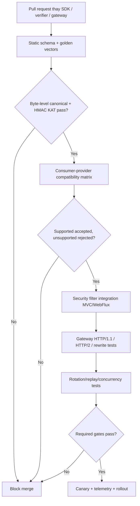

# Compatibility test cho HMAC HTTP: giữ hợp đồng ký an toàn qua các phiên bản

## 1. Vấn đề cần giải quyết

Trong module `SECURITY_AUTHENTICATION_HMAC_REQUEST_AUTHENTICATION`, ứng dụng xác thực HTTP request bằng **HMAC với shared secret**. Client và server phải hiểu giống nhau về **canonical request**: HTTP method, URI/query, tập header được ký và/hoặc digest body, cách nối bytes và định dạng signature. Bên nhận còn phải kiểm **timestamp/nonce chống replay**, vòng đời key/rotation, các biến đổi qua proxy/gateway rồi mới thực hiện **authorization**.

Vấn đề phát sinh khi các thành phần không nâng cấp cùng lúc:

- SDK Java phiên bản cũ còn ký URI theo quy tắc v1 trong khi backend mới xây canonical request v2.
- Gateway HTTP/2 đổi casing tên header, rewrite đường dẫn hoặc chuyển body trước khi request đến verifier.
- Backend hỗ trợ key mới nhưng một nhóm client chưa cập nhật `X-Hmac-Key-Id`.
- Hệ thống thêm signed header `X-Tenant-Id` vào phiên bản mới nhưng verifier cũ không ràng buộc trường này với chữ ký.
- Một deployment trộn hai bản backend, khiến cùng một request được chấp nhận ở node A nhưng trả 401 ở node B.

**Compatibility test** là kiểm thử có kiểm soát để xác nhận **những cặp phiên bản client, verifier, gateway và policy nào phải tương tác được**, những tổ hợp nào phải bị từ chối, đồng thời bảo đảm sự tương thích **không mở ra lỗ hổng xác thực, replay hoặc phân quyền**.

Chủ đề thuộc chương **Contract testing**. Kết thúc bài, người học có thể:

1. Phân biệt tương thích ngược (*backward compatibility*), tương thích xuôi (*forward compatibility*) và thay đổi phá vỡ giao thức (*breaking change*) trong HMAC.
2. Định nghĩa hợp đồng ký **byte-level**, versioning, policy chấp nhận và ngày ngừng hỗ trợ.
3. Xây bộ **golden test vectors** và ma trận client × verifier × gateway × key state.
4. Kiểm positive/negative cases: signed header, raw URI/query, body bytes, HTTP/1.1–HTTP/2, duplicate headers và proxy rewrite.
5. Ngăn **downgrade**, version confusion và nhánh fallback mơ hồ khi triển khai nhiều phiên bản.
6. Kiểm compatibility khi **key rotation**, nonce/replay store và mapping authority/tenant thay đổi.
7. Đưa các bài contract tests vào CI/CD và quy trình rollout từng giai đoạn.

> Các tên header, phiên bản và đường dẫn trong bài là **giao thức ví dụ**, không phải chuẩn HMAC mặc định của HTTP hay Spring Security. `SPECIAL_NOTE` không có ràng buộc bổ sung.

## 2. Tương thích trong giao thức HMAC khác tương thích API thông thường

Với REST API thông thường, đổi thứ tự field JSON, thêm optional field hoặc chuyển tên header thành chữ thường đôi khi không thay đổi ý nghĩa nghiệp vụ. Nhưng HMAC kiểm tra **bytes của canonical representation**, không chỉ ý nghĩa mà một JSON parser hoặc router suy ra.

Ví dụ, hai request:

```http
POST /api/orders?customer=42&state=new HTTP/1.1
Content-Type: application/json

{"orderId":"O-1","amount":100}
```

```http
POST /api/orders?state=new&customer=42 HTTP/1.1
content-type: application/json; charset=UTF-8

{"amount":100,"orderId":"O-1"}
```

có thể được một controller diễn giải gần giống nhau, nhưng nếu hợp đồng ký giữ nguyên raw query và raw body thì **cả query, Content-Type và body bytes đã đổi**. Không thể coi chúng tương thích về chữ ký chỉ vì JSON tương đương sau khi parse.

### 2.1. Ba loại tương thích phải phát biểu rõ

| Loại | Câu hỏi | Ví dụ trong HMAC |
| --- | --- | --- |
| **Backward compatibility** | Verifier mới có còn chấp nhận request hợp lệ do client cũ tạo không? | Verifier v2 tiếp tục hỗ trợ canonical v1 cho client nằm trong thời hạn migration |
| **Forward compatibility** | Client mới có tương tác an toàn với verifier cũ không? | Client mới chỉ dùng v1 trong một khả năng đã thương lượng được xác thực; hoặc không hỗ trợ và từ chối |
| **Security compatibility** | Sự chấp nhận cũ/mới có giữ nguyên yêu cầu integrity, freshness và authorization không? | Không bỏ kiểm tenant/header mới chỉ để chữ ký v1 đi qua |

**Tương thích không có nghĩa “phải chấp nhận mọi thứ”.** Một verifier cũ không hiểu phiên bản canonicalization mới cần **từ chối an toàn**, chứ không thử nhiều thuật toán/secret hoặc lược bỏ các signed fields cho đến khi MAC khớp.

### 2.2. Contract testing khác unit test và E2E test thế nào?

| Tầng | Phạm vi | Điều kiểm tra |
| --- | --- | --- |
| HMAC unit test | `Mac`, digest, canonical builder từng phiên bản | Kết quả known-answer trên bytes cố định |
| **Compatibility contract test** | Cặp consumer/provider version, giao thức ký, schema header, error semantics | Tổ hợp được hỗ trợ phải accept, tổ hợp không hỗ trợ phải reject |
| Provider contract verification | Server thật với vectors đã được consumer công bố | Không phá behavior của các consumer còn được hỗ trợ |
| Gateway/edge contract test | Wire request thực qua reverse proxy, HTTP versions | Những trường được ký giữ ngữ nghĩa; public target nhất quán |
| End-to-end test | Client SDK → gateway → verifier → authz → service | HTTP outcome, principal, replay, quyền và side effects |

Một contract test HMAC **không thể** chỉ kiểm response JSON schema. Phải xác minh **canonical bytes** và chữ ký, đồng thời kiểm các điều kiện security được áp dụng ở đúng phiên bản.

## 3. Hợp đồng cần được version hóa gồm những gì?

### 3.1. Ma trận thành phần của signed request

| Thành phần | Câu hỏi phải trả lời trong contract |
| --- | --- |
| Algorithm | `HmacSHA256` hay thuật toán khác? Cách encode MAC hex/Base64? |
| Shared secret | Key bytes lấy từ đâu? Key ID là case-sensitive không? Key rotation chọn version nào? |
| Protocol version | Định danh phiên bản được truyền thế nào, có nằm trong dữ liệu được ký không? |
| Method | Uppercase trước khi ký? Cho phép method nào? |
| URI | Ký raw path/query hay percent-decode/re-encode? Xử lý slash, dấu `+` và query trùng thế nào? |
| Host/scheme | Có ký public authority không? Gateway TLS termination và rewrite ảnh hưởng ra sao? |
| Signed headers | Danh sách field, tên lowercase, giá trị, order, whitespace, duplicate handling |
| Body | Ký raw body bytes hay digest? Charset? Ký body rỗng như thế nào? |
| Message framing | Dòng nối `LF` hay `CRLF`, newline cuối, length prefix, separators |
| Timestamp | Format, UTC/epoch unit, độ lệch quá khứ/tương lai, signed field |
| Nonce | Format/độ dài, phạm vi uniqueness, TTL và atomic reservation |
| Failure semantics | 400/401/403/413/429/5xx và safe response body, challenge |
| Authorization | Identity/key mapping, authorities, tenant/resource scope |
| Proxy trust | Vị trí verify trước/sau rewrite, trusted forwarding metadata |

Không chỉ ghi `"SHA-256 + headers"` trong tài liệu rồi xem đó là contract. Một khác biệt trong **cách chuẩn hóa query hoặc một ký tự newline** sẽ khiến SDK và verifier không liên thông.

### 3.2. Phải phân biệt version của giao thức với version của key

Giả sử:

```text
canonicalization_version = v2
key_id = payment-service-key-2026-b
signature_algorithm = HmacSHA256
```

Các trường này **không thay thế nhau**:

- **Protocol/canonicalization version** định nghĩa cách tạo message được ký.
- **Key version/key ID** giúp chọn shared secret hợp lệ theo lifecycle.
- **Algorithm identifier** định nghĩa primitive cryptographic (và đôi khi chính sách kích thước MAC).

Key có thể được rotate mà không thay format canonical; ngược lại, một canonical version mới có thể được triển khai với cùng key registry và key active theo chính sách. Không dùng `keyId` suffix để ngầm suy diễn một parser/canonicalizer chưa được công bố.

### 3.3. Ví dụ hợp đồng v1 và v2

Giả sử API hiện có:

**V1 (legacy):** method, raw target, Content-Type, key ID, timestamp, nonce, SHA-256 raw-body digest; dùng `LF`, không có LF ở cuối. Client v1 không gửi header version.

```text
HMAC-V1
POST
/api/orders?tenant=t1&include=items
content-type:application/json
x-hmac-key-id:orders-key-a
x-hmac-nonce:nonce-001
x-hmac-timestamp:2026-11-28T00:00:00Z
<sha256-body-hex>
```

**V2:** bổ sung version header `X-Hmac-Version: v2`, ràng buộc `X-Tenant-Id` và áp dụng canonical query rule **được định nghĩa riêng** (ví dụ sort key/value đã percent-encode theo một quy tắc cụ thể).

```text
HMAC-V2
POST
/api/orders?include=items&tenant=t1
content-type:application/json
x-hmac-key-id:orders-key-a
x-hmac-nonce:nonce-001
x-hmac-timestamp:2026-11-28T00:00:00Z
x-hmac-version:v2
x-tenant-id:t1
<sha256-body-hex>
```

Đây là **sơ đồ format**, trong đó `<sha256-body-hex>` là placeholder, không phải một test vector chữ ký đã tính. Nếu muốn triển khai, phải đặc tả chính xác cách sort query, xử lý duplicate params, percent encoding, Unicode, empty values, signed header order và byte representation. Một implementation v2 không được chỉ lấy bất kỳ query map từ framework rồi tự sort nếu contract yêu cầu raw representation khác.

**Chốt security:** v2 phải buộc version và tenant trong **signed bytes**; không cho client sửa `X-Hmac-Version` hoặc `X-Tenant-Id` rồi giữ chữ ký cũ. V1 không bảo vệ trường tenant mới, vì vậy không cho dùng v1 trên endpoint yêu cầu tenant integrity mới trừ khi đã có một ranh giới/authorization policy độc lập bảo vệ tenant.

## 4. Thiết kế chính sách chấp nhận phiên bản không bị downgrade

### 4.1. Không được “thử từ v2 xuống v1 đến khi MAC khớp”

Đây là cách thiết kế nguy hiểm:

```java
// KHÔNG LÀM:
if (!verifyV2(request)) {
    return verifyV1(request); // thử format yếu hơn khi chữ ký sai
}
```

Một attacker có thể thay header version, lược bớt signed fields hoặc gửi input mơ hồ để buộc server đi vào nhánh v1. Nếu v1 không bảo vệ một trường có ý nghĩa bảo mật mới, fallback này tạo **downgrade vulnerability**.

Thay vào đó, dùng chính sách:

1. Parse version header theo format **đơn trị**, từ chối duplicate/unknown/malformed.
2. Chọn **chính xác một** canonicalization algorithm theo version và policy endpoint/client.
3. Kiểm chữ ký bằng key hợp lệ của client theo version đó.
4. Sau xác thực, xác nhận client được phép dùng version đã chọn; chưa xác minh không được tin `X-Client-Id` tự khai báo.
5. **Không thử version khác chỉ vì signature mismatch.**
6. Không để request **không có version** trở thành v1 trên mọi endpoint. Legacy no-version chỉ được chấp nhận tại route/scope đã cấu hình, trong cửa sổ migration cụ thể và với policy đủ mạnh.

### 4.2. Version header được ký, nhưng chọn parser trước verify có an toàn?

Server cần đọc version header để biết cách dựng canonical bytes. Đây là **untrusted selector** lúc ban đầu, nhưng an toàn nếu:

- Giá trị chỉ được dùng để chọn **một parser thuộc allowlist**, không cấp quyền hoặc tin danh tính.
- Canonicalization của phiên bản đó **bao gồm/bind version value** theo contract, để thay value khiến chữ ký sai.
- Sau MAC success, **version policy** còn được ràng buộc với verified client/route/key.
- Unknown version, duplicate version hoặc value sai format **bị từ chối**, không fallback sang default.

Với legacy v1 không có version header, route nhận v1 phải được bảo vệ bởi chính sách thời hạn, danh sách client đã migrate và những khả năng bảo mật bắt buộc mà v1 thực sự cung cấp. Sự tồn tại của client cũ không cho phép nới authorization toàn API.

### 4.3. Chính sách phiên bản theo đường dẫn và mức độ bảo mật

| Endpoint/nhóm consumer | V1 | V2 | Quyết định |
| --- | --- | --- | --- |
| `GET /api/orders`, client legacy đã đăng ký trong migration | Tạm chấp nhận nếu hợp đồng v1 bảo vệ đủ dữ liệu | Chấp nhận | Deadline ngừng v1 |
| `POST /api/orders` yêu cầu signed tenant mới | Từ chối nếu v1 không ràng buộc tenant đáng tin | Chấp nhận | Không hạ yêu cầu integrity |
| API quản trị chỉ triển khai từ v2 | Từ chối | Chấp nhận nếu đủ scope | Không mở legacy mode |
| Version rỗng/không xác định/duplicate | Từ chối trừ legacy route policy rõ | Từ chối nếu malformed | Fail closed |
| V2 signature sai nhưng v1 MAC có thể khớp | **Không fallback** | Từ chối | Không downgrade |

Mỗi thay đổi policy phải được review như một thay đổi security, có audit, rollback plan và deadline; không coi đây chỉ là “compatibility flag” vô hại.

## 5. Ma trận tương thích: client × verifier × gateway × key policy

### 5.1. Các loại thành phần

- **C1:** SDK cũ chỉ có HMAC-V1, chưa gửi version header.
- **C2:** SDK mới mặc định ký HMAC-V2, có thể phát v1 *chỉ nếu được cấu hình an toàn và policy cho phép*.
- **S1:** Verifier cũ chỉ hiểu HMAC-V1.
- **S2:** Verifier mới hỗ trợ v1/v2 bằng parser riêng, policy theo route/client; không fallback mơ hồ.
- **G0:** Gateway giữ đúng canonical representation mà backend cần.
- **G1:** Gateway rewrite path/Host/header/body khiến signed bytes khác nếu không có hợp đồng riêng.
- **K1/K2:** Key policy/revision mới hoặc cũ trong lúc rotation.

### 5.2. Ma trận mong đợi cho request thật

| Client | Server | Gateway | Kết quả mong đợi |
| --- | --- | --- | --- |
| C1 (v1) | S1 | G0 | PASS nếu key, freshness, nonce và quyền hợp lệ |
| C1 (v1) | S2 với legacy policy | G0 | PASS trong thời gian/scope hỗ trợ v1 |
| C1 (v1) | S2 sau v1 cutoff | G0 | REJECT theo policy, không silently accept |
| C2 (v2) | S2 | G0 | PASS nếu v2 canonical bytes và policy hợp lệ |
| C2 (v2) | S1 | G0 | REJECT an toàn: server không hiểu v2 |
| C2 (explicit v1, được policy cho phép) | S1 | G0 | Có thể PASS nếu SDK còn tạo đúng v1 và endpoint cho phép |
| C2 (v2) | S2 | G1 chưa hỗ trợ contract | REJECT hoặc lỗi gateway, không bỏ kiểm MAC |
| C1 (v1) | S2 | G1 có trusted external-target contract | Có thể PASS nếu chính sách v1 cho phép và target được ràng buộc đúng |
| C2 (v2), key mới ACTIVE | S2 revision mới | G0 | PASS sau kiểm toàn bộ security invariants |
| C2 (v2), key mới ACTIVE | S2 revision cũ | G0 | Có thể bị REJECT do key propagation; phải quan sát và khắc phục rollout |
| C1/C2, key REVOKED | Mọi verifier đúng policy | G0/G1 | REJECT, bất kể chữ ký cryptographic khớp |

Không nên viết contract “C2 × S1 bắt buộc phải thành công” nếu S1 không hỗ trợ v2. Đó là **tổ hợp không hỗ trợ**; compatibility test phải xác minh **không bị accept nhầm**, chứ không ép server cũ đoán protocol mới.

### 5.3. Ma trận 4 chiều cần tối ưu số lượng test

Không nhất thiết thử mọi tổ hợp phiên bản × method × header × gateway × key state một cách cơ học. Tạo:

1. **Baseline/golden** cho từng phiên bản được hỗ trợ.
2. **Các cặp client-server** trên/ngoài support matrix.
3. **Boundary cases** tại ngày cutoff, key rotation overlap, timestamp window và nonce expiry.
4. **Gateway profiles** HTTP/1.1, HTTP/2 và rewrite thật.
5. **Security regressions**: version mismatch, downgrade, unsigned security header, double nonce reservation, permission bypass.

Mỗi case phải ghi rõ **tổ hợp được hỗ trợ, lý do và expected outcome**, không chỉ ghi “401 là pass”.

## 6. Golden vectors: oracle chung cho mọi client và verifier

### 6.1. Tại sao không chỉ cho SDK tự ký rồi server tự verify?

Nếu cả client và server đều dùng chung thư viện canonicalizer bị lỗi, test “client tạo chữ ký rồi server kiểm” vẫn xanh. Với **golden vectors** có expected bytes và signature đã được tính/đối chiếu **độc lập**, một thay đổi vô ý của sort query, encoding hoặc signed headers sẽ bị phát hiện.

Một fixture tốt tối thiểu lưu:

| Nhóm | Trường |
| --- | --- |
| Case identity | `id`, `description`, `contract_version` |
| Key | Test-only secret bytes + key ID, tuyệt đối không phải production secret |
| HTTP input | Method, raw target, signed header occurrences/values, raw body bytes |
| Canonical oracle | Expected canonical bytes (Base64/hex) và length |
| MAC oracle | Expected HMAC-SHA256 hex/Base64 cố định đã review |
| Security policy | Frozen clock, nonce state, key lifecycle, permitted protocol versions |
| Outcome | Expected accept/reject, reason nội bộ, status HTTP nếu có |

### 6.2. Ví dụ manifest fixture (dạng minh họa)

```yaml
id: compatibility-v2-post-orders-001
contractVersion: v2
algorithm: HmacSHA256
testSecret:
  encoding: utf8
  value: test-only-not-for-production
request:
  method: POST
  rawTarget: /api/orders?include=items&tenant=t1
  headers:
    Content-Type: application/json
    X-Hmac-Version: v2
    X-Hmac-Key-Id: orders-test-key
    X-Hmac-Timestamp: '2026-11-28T00:00:00Z'
    X-Hmac-Nonce: nonce-compat-001
    X-Tenant-Id: t1
  bodyUtf8: '{"orderId":"O-1","amount":100}'
canonical:
  encoding: base64
  expectedBytes: "<BASE64_OF_REVIEWED_CANONICAL_BYTES>"
signature:
  encoding: hex-lower
  expected: "<REVIEWED_HMAC_HEX>"
expectation:
  supportedByVerifier: v2
  authentication: accept_if_fresh_and_nonce_unused
```

**Các chuỗi trong dấu `<...>` là placeholder**, không phải fixture chạy được. Để thành test thực sự phải thay bằng canonical bytes và MAC đã được tính độc lập, rồi **khóa expected trong source/test resources**; không tự sinh expected từ output hiện tại của signer. Với binary body, dùng `bodyBase64`/raw bytes thay vì đưa qua JSON/YAML string có thể bị đổi newline/Unicode.

### 6.3. Test chuẩn với JUnit 5

Một cách thể hiện consumer/provider contract trong Java:

```java
import static org.junit.jupiter.api.Assertions.assertArrayEquals;
import static org.junit.jupiter.api.Assertions.assertEquals;
import java.nio.charset.StandardCharsets;
import java.util.HexFormat;
import org.junit.jupiter.api.Test;

class HmacCompatibilityFixtureTest {

    @Test
    void v2CanonicalBytesMatchGoldenFixture() {
        // fixture là dữ liệu versioned, được review độc lập.
        HmacContractFixture fixture = fixtures.load(
            "compatibility-v2-post-orders-001"
        );

        byte[] actualCanonical = canonicalRequestBuilder
            .forVersion(fixture.contractVersion())
            .build(fixture.request());

        assertArrayEquals(
            fixture.expectedCanonicalBytes(),
            actualCanonical
        );
    }

    @Test
    void v2SignatureMatchesIndependentGoldenSignature() {
        HmacContractFixture fixture = fixtures.load(
            "compatibility-v2-post-orders-001"
        );
        byte[] actualCanonical = canonicalRequestBuilder
            .forVersion(fixture.contractVersion())
            .build(fixture.request());

        byte[] actualMac = signer.sign(
            fixture.testSecretBytes(), actualCanonical
        );
        assertEquals(
            fixture.expectedHmacHex(),
            HexFormat.of().formatHex(actualMac)
        );
    }
}
```

Đây là **mẫu cấu trúc test**, không phải API có sẵn: `fixtures`, `HmacContractFixture`, `canonicalRequestBuilder` và `signer` được dự án triển khai. Mục tiêu là **oracle tách biệt** với mã được kiểm, cả ở tầng canonical bytes lẫn chữ ký.

### 6.4. Mỗi thay đổi protocol phải có test vector mới

Khi đổi v1→v2:

1. Giữ lại vector v1 để kiểm compatibility theo thời hạn hỗ trợ.
2. Bổ sung vector v2 trên input chuẩn, raw body và các trường mới.
3. Bổ sung **negative vector**: phiên bản header bị sửa nhưng signature không đổi; tenant bị sửa; v2 request gửi đến v1-only verifier.
4. Không thay `expectedSignature` v1 chỉ để test xanh sau khi đổi code.
5. Khi ngừng v1, test **rejection policy** cho endpoint đã cutoff; có thể giữ unit test canonical v1 để hiểu/kiểm migration legacy nếu thư viện vẫn còn code.

Golden vectors hữu ích cho Java, Go, JavaScript và các SDK khác vì cùng chuẩn bytes. Nhưng fixture cần được bảo vệ khỏi “trôi” do YAML formatter, Unicode normalization, UTF-8 BOM, CRLF/LF hoặc serializing JSON lại.

## 7. Compatibility test với signed headers, URI và body

### 7.1. Header names và values

HTTP field names **case-insensitive**. V1/v2 nên công bố canonical names dạng lowercase. Tuy nhiên **giá trị** header không tự case-insensitive và không được tùy tiện trim/collapse whitespace nếu hợp đồng chưa quy định.

| Thay đổi | Khi nào có thể tương thích? | Khi nào phải reject? |
| --- | --- | --- |
| `X-Hmac-Nonce` → `x-hmac-nonce` | Khi canonicalizer normalize tên theo contract | Nếu verifier chỉ hỗ trợ format cố định trái với contract |
| Đổi thứ tự dòng header trên wire | Khi ký theo thứ tự canonical cố định | Nếu implementation ký theo thứ tự parser ngẫu nhiên |
| Thêm header observability **không nằm trong signed set** | Nếu header không tác động security decision | Nếu header mới đổi tenant/quyền nhưng không được ký/kiểm riêng |
| Thêm signed header bắt buộc ở v2 | Khi client v2 tạo signature mới và server v2 kiểm | Không cho v1 silently bỏ qua trên endpoint cần integrity đó |
| Duplicate `X-Hmac-Key-Id`/`X-Hmac-Version` | Không nên chấp nhận như field đơn trị | Reject tại edge và verifier theo policy |
| Giá trị `Content-Type` bị thêm charset | Chỉ khi contract canonicalize giá trị này nhất quán | Reject khi signed value đổi trái contract |

**Các header bắt buộc đối với HMAC** phải có số lần xuất hiện và format rõ. `getHeader(...)` hoặc `HttpHeaders.getFirst(...)` không đủ để kết luận request ban đầu không có duplicate nếu gateway đã gộp. Kiểm thử cả **trước và sau proxy**.

### 7.2. URI, query và percent encoding

Một thay đổi tưởng vô hại có thể phá chữ ký:

```text
/api/orders?a=1&b=2
/api/orders?b=2&a=1

/api/orders?name=red%20fox
/api/orders?name=red+fox

/api/orders/%2Fdetail
/api/orders//detail
```

Không giả định các cặp trên tương đương. Nếu v1 ký raw query còn v2 sort/encode lại theo quy tắc versioned, đây là **breaking change** đối với bytes được ký; kiểm hai canonical builders riêng. Với query trùng:

```text
?scope=read&scope=write
```

phải định nghĩa giữ cả hai, sort theo cách nào hoặc reject. Không biến `MultiValueMap` thành `Map<String,String>` rồi âm thầm bỏ một giá trị, gây khác biệt giữa client, gateway và backend.

### 7.3. Raw body, compression và JSON

Nếu ký `SHA256(rawBodyBytes)`, hai body sau có thể khác MAC:

```json
{"amount":100,"currency":"VND"}
```

```json
{"currency":"VND","amount":100}
```

JSON parser có thể coi là cùng dữ liệu, nhưng raw bytes khác. Đừng thay đổi body serializer trong SDK mà không có contract/regression test. Một gateway decompress, re-encode JSON hoặc thêm newline có thể làm mismatch. Khi migrate sang canonical JSON scheme mới, hãy **version hóa rõ quy tắc** và kiểm dữ liệu nhị phân, Unicode, số thập phân, repeated fields và payload lớn.

Nếu verifier đọc body trước controller, cần kiểm **body được phát lại nguyên vẹn** (Servlet request wrapper có giới hạn hoặc WebFlux `DataBuffer` decorator), không cho request bypass HMAC vì lỗi body buffering.

### 7.4. HTTP/1.1 và HTTP/2

HTTP/2 yêu cầu lowercase names trên wire, dùng pseudo-headers `:method`, `:path`, `:authority`; khi gateway chuyển sang HTTP/1.1, `Host`/request target có thể bị tái tạo. Test từ cả hai protocol versions nên xác nhận:

- Cùng **logical signed fields** được canonicalize giống nhau theo hợp đồng.
- Host/authority được ký hay được kiểm qua trusted gateway metadata rõ ràng.
- Không ký hop-by-hop headers (`Connection`, `Transfer-Encoding`) như end-to-end fields.
- Không bỏ qua content-length/body framing ambiguity khi proxy chuyển protocol.

**“Proxy giữ nguyên header” không có nghĩa giữ nguyên mọi wire bytes.** Điều cần giữ là các giá trị/representation mà contract HMAC đòi hỏi và ranh giới tin cậy của chúng.

## 8. Triển khai version dispatcher an toàn trong verifier Java

Một dispatcher nên có **allowlist và policy theo route**, không phải một vòng lặp thử mọi version.

### 8.1. Tách parse, verify và authorization

```java
import java.util.Map;
import java.util.Set;
import org.springframework.security.authentication.BadCredentialsException;

enum HmacProtocolVersion {
    V1, V2
}

interface VersionedCanonicalizer {
    byte[] canonicalize(VerifiedRequestBytes request);
}

record VerifiedRequestBytes(
    String method,
    String rawTarget,
    Map<String, String> signedHeaders,
    byte[] rawBody
) {}

final class HmacVersionSelector {

    HmacProtocolVersion select(
        String versionHeader,
        boolean versionHeaderPresent,
        boolean legacyRouteAllowed
    ) {
        // Caller phải kiểm duplicate header và format trước khi vào đây.
        if (!versionHeaderPresent) {
            if (!legacyRouteAllowed) {
                throw new BadCredentialsException(
                    "HMAC protocol version required"
                );
            }
            return HmacProtocolVersion.V1;
        }
        if ("v2".equals(versionHeader)) {
            return HmacProtocolVersion.V2;
        }
        // Không có fallback khi version sai, thiếu context hoặc lạ.
        throw new BadCredentialsException(
            "Unsupported HMAC protocol version"
        );
    }
}
```

`VerifiedRequestBytes` chỉ là tên DTO chứa bytes/tập field đã parse; **không có nghĩa request đã được xác thực**. Trong sản phẩm thực tế nên đặt tên `ParsedRequest` hoặc `RequestToVerify` để tránh gây hiểu nhầm; bài giữ tên đó để minh họa dữ liệu đầu vào canonicalizer mà không gán `Authentication`.

### 8.2. Quy tắc gọi verifier

```java
// Pseudocode nghiệp vụ: tên method do ứng dụng định nghĩa.
Version version = versionSelector.selectVersion(request, routePolicy);

Canonicalizer canonicalizer = canonicalizers.get(version);
if (canonicalizer == null) {
    throw new BadCredentialsException("Unsupported HMAC version");
}

KeyMetadata key = keyRegistry.resolve(request.keyId());
routePolicy.requireAllowedVersion(key.clientRef(), version);
keyPolicy.requireActiveAndInScope(key, request);

byte[] canonical = canonicalizer.build(request);
byte[] expected = hmacSha256(key.secretMaterial(), canonical);
byte[] supplied = signatureDecoder.decodeStrictly(request.signature());

if (!MessageDigest.isEqual(expected, supplied)) {
    throw new BadCredentialsException("Invalid HMAC credentials");
}

freshnessPolicy.validateSignedTimestamp(request.timestamp());
nonceStore.reserveAtomicallyOrReject(key.clientRef(), request.nonce());

Authentication authenticated =
    principalFactory.createFromTrustedRegistry(key);
// Sau đó SecurityFilterChain/AuthorizationFilter kiểm authorities.
```

Pseudocode này thể hiện **thứ tự và invariants**, không phải một implementation hoàn chỉnh. Cần kiểm độ dài signature, encoding, duplicate headers, body size, timestamp/nonce scope, key rotation/revoke, error handling và cache freshness. Việc dùng `MessageDigest.isEqual` giúp so MAC bytes theo cách tránh vòng lặp short-circuit tự viết; không phải đảm bảo toàn pipeline constant-time.

Chọn protocol version trước khi biết client identity **chỉ là lựa chọn parser**. Nó không chứng minh client được phép dùng version đó; phép kiểm phải được ràng buộc với **trusted key metadata và policy**.

### 8.3. Vì sao không dùng chung một canonicalizer có nhiều if lồng nhau?

Một hàm có nhiều nhánh `if (v1) ... else if (v2)` có thể dùng được nhưng dễ vô tình sửa behavior cũ khi phát triển v2. Thực tế nên:

- Đóng băng contract v1 trong golden vector/tests.
- Có implementation v2 với tập quy tắc được mô tả rõ.
- Dùng dispatcher theo version, không tự động chuyển request sang v1.
- Thay đổi protocol phải được review tương đương thay đổi security-sensitive code.

## 9. Contract test Spring MVC và WebFlux

### 9.1. Test provider bằng MockMvc

Với Spring MVC, contract test phải chạy qua **SecurityFilterChain** và verifier thật hoặc một test harness giữ nguyên canonical builder, key policy và replay guard. Không chỉ test controller với `@WithMockUser` vì annotation có thể tạo Authentication mà không verify HMAC.

Ví dụ test cấu trúc, với các helper do test project cung cấp:

```java
import static org.springframework.test.web.servlet.result.MockMvcResultMatchers.status;
import org.junit.jupiter.api.Test;

class HmacProviderCompatibilityTest {

    @Test
    void supportedLegacyV1RemainsAcceptedWithinMigrationWindow()
        throws Exception {
        SignedContractFixture legacy = fixtures.load("v1-legacy-order");

        // Clock, nonce store và key registry đều được inject từ fixture.
        mockMvc.perform(legacy.toMockMvcRequest())
            .andExpect(status().isCreated());
    }

    @Test
    void v2WrongSignatureMustNotFallBackToV1() throws Exception {
        SignedContractFixture downgraded =
            fixtures.load("v2-invalid-signature");

        mockMvc.perform(downgraded.toMockMvcRequest())
            .andExpect(status().isUnauthorized());
    }

    @Test
    void legacyRequestRejectedAfterCutoff() throws Exception {
        migrationClock.setAt("2026-12-01T00:00:01Z");

        SignedContractFixture legacy =
            fixtures.load("v1-legacy-order-fresh-at-cutoff");

        mockMvc.perform(legacy.toMockMvcRequest())
            .andExpect(status().isUnauthorized());
    }
}
```

Đây là **mã minh họa trong một test class**, không tự chạy nếu chưa hiện thực `fixtures`, `SignedContractFixture`, `migrationClock`, registry, endpoint giả và test nonce store. Không dùng cùng timestamp/chữ ký đã hết hạn trong test cutoff rồi kết luận policy version đã hoạt động: phải ký một **fixture mới hợp lệ về freshness** nhưng không còn được phép về version.

### 9.2. Tránh đánh đồng 401 và 403

| Tình huống | Authentication | Authorization | HTTP thường mong đợi |
| --- | --- | --- | --- |
| Version unsupported, signature mismatch, key revoked | FAIL | Không tiếp tục | **401** theo HMAC contract |
| HMAC/version/key/freshness/nonce hợp lệ, thiếu authority | PASS | DENY | **403** |
| Request malformed header/duplicate/oversized | Không hoàn tất | Không tiếp tục | **400** hoặc 401 theo policy của parser |
| Key registry/nonce store outage | Không thể chứng minh hợp lệ | Không tiếp tục | **503/5xx**, fail closed |
| WAF/gateway chặn request trước backend | Backend không chạy verifier | — | Status của gateway, có thể 403 |

Chỉ assertion `status().isUnauthorized()` không cho biết lý do 401 là version bị cấm hay timestamp hết hạn. Test cần thêm **reason code nội bộ do server tạo** hoặc spy/test hook đã giảm nhạy cảm để xác minh đúng nhánh; không trả chi tiết registry/key/expected MAC ra API response.

### 9.3. WebFlux: subscription và body replay

Trong Spring WebFlux, verifier chạy trong `SecurityWebFilterChain` với `AuthenticationWebFilter` hoặc custom `WebFilter`, principal đi qua `ReactiveSecurityContextHolder`. Dùng `WebTestClient` để gửi fixture HTTP:

- V1 legacy còn được phép, v2 mới được phép: tạo Authentication với đúng authorities.
- V2 signature sai: không fallback xuống v1 và không gọi downstream handler.
- Gateway thay path/content-type/body: reject nếu signed bytes không còn khớp.
- Body được giới hạn và cung cấp lại cho handler sau khi verifier đọc.
- Nonce được reserve **một lần** trong pipeline, kể cả khi có retry/cancellation; không gọi `subscribe()` thủ công để thử nhiều version.

Nếu parser/HMAC tính toán CPU-heavy và secret lookup dùng blocking SDK, cần đo latency/scheduler phù hợp; không `block()` trên Netty event loop.

## 10. Consumer-driven contract test và vai trò của gateway

### 10.1. Consumer contract không chỉ là status/body

Với nhiều SDK, consumer-driven contract có thể ghi:

```text
Consumer Java SDK v1:
  produces protocol=v1, raw query preserved, lowercase canonical headers
  expects provider S2 to support until cutoff
Consumer Go SDK v2:
  produces protocol=v2, signed version + tenant, sorted canonical query
  expects provider S2 to accept v2
Consumer JavaScript SDK v2:
  uses UTF-8 raw body bytes and explicit query encoder
  expects same golden MAC as Go/Java v2
```

Các công cụ CDC như Pact hữu ích để xác nhận tương tác HTTP, header tồn tại, response schema và provider behavior; nhưng **không tự thay thế byte-level golden HMAC vectors**. Muốn kiểm signature, cần test plugin/custom matcher/test harness có oracle bytes và key fixture độc lập.

### 10.2. Hợp đồng gateway cần tách riêng

Khi request đi qua NGINX/Ingress/API Gateway, kiểm:

1. Header `X-Hmac-Version`, `X-Hmac-Key-Id`, `X-Hmac-Timestamp`, `X-Hmac-Nonce`, `X-Hmac-Signature` và signed business headers được forward đúng hợp đồng.
2. Duplicate/malformed security headers bị từ chối, không được một hop chọn giá trị đầu còn hop khác chọn giá trị cuối.
3. HTTP/1.1 ↔ HTTP/2 không làm sai canonical field names/values.
4. Public URI ký trước/sau rewrite đã có cơ chế nhất quán; backend không tin `X-Forwarded-*` từ client không đáng tin.
5. Body digest được tính từ đúng bytes mà verifier dùng; không nén/giải nén/re-serialize không có contract.
6. 401/403/5xx từ verifier không bị gateway biến thành 200 hoặc có error detail chứa secret.

Nếu gateway **xác minh HMAC** rồi truyền danh tính nội bộ, phải test thêm kết nối bảo mật gateway → backend, loại bỏ header `X-Verified-Client` do internet client tự gắn, xác thực gateway identity và policy quyền. Không chấp nhận một asserted principal chỉ vì client có thể gửi header giống vậy.

## 11. Key rotation và chống replay trong giai đoạn hỗ trợ nhiều version

### 11.1. Hai trục migration độc lập

| Trục | Chuyển đổi | Lỗi thường gặp |
| --- | --- | --- |
| Protocol | V1 → V2 | Canonical request mới, signed headers mới, downgrade |
| Shared-secret key | K1 → K2 | Key ID mapping, secret propagation, overlap, revoke |

Một request **V1 + K2** có thể hợp lệ nếu policy chủ đích cho phép; một request **V2 + K1** cũng có thể hợp lệ trong cửa sổ key overlap. Không dùng assumption “key mới thì chắc protocol mới” trừ khi chính sách có ràng buộc rõ ràng và được kiểm.

### 11.2. Kiểm ma trận version × key state

| Version | Key state | Expected |
| --- | --- | --- |
| V1 còn trong legacy window | K1 ACTIVE hoặc RETIRING còn hạn | Có thể được xác thực nếu đủ mọi điều kiện |
| V2 đã hỗ trợ | K2 ACTIVE | Có thể được xác thực |
| V1 sau cutoff | Bất kỳ key nào | Từ chối do version policy, không dùng key mới để bypass |
| V2 | K2 STAGED | Từ chối, chưa được dùng |
| V2 | K1 REVOKED | Từ chối kể cả MAC khớp |
| V1/V2 | Key lookup timeout | Fail closed; không fallback sang known key từ cache stale ngoài policy |
| V1/V2 | Key ACTIVE, nhưng scope không cho endpoint/tenant | Từ chối phù hợp authentication/authorization contract |

### 11.3. Replay không được reset khi nâng cấp version

Trong giai đoạn V1/V2 cùng tồn tại, timestamp và nonce vẫn phải:

- Nằm trong nội dung **được ký** ở từng phiên bản.
- Có giới hạn freshness và một thao tác **atomic reserve nonce** trong store đủ nhất quán giữa các instances.
- Có scope theo verified client/key family đúng policy; nếu cùng client dùng V1 và V2, không vô tình dùng hai nonce namespaces độc lập rồi cho cùng nonce được sử dụng lại trái hợp đồng.
- Không bị xóa hoặc coi là “fresh” chỉ vì client đổi key ID hay canonical version.

Hệ thống ghi dữ liệu còn cần **idempotency key và business deduplication**: một client có thể gửi hai request mới được ký hợp lệ với hai nonce khác nhau nhưng cùng một thao tác nghiệp vụ. Replay protection không thay thế nghiệp vụ exactly-once.

### 11.4. Quan sát rotation và rollout

Theo dõi:

- Tỷ lệ request xác thực thành công/thất bại theo **protocol version enum hữu hạn**.
- Lỗi `UNSUPPORTED_VERSION`, `SIGNATURE_INVALID`, `KEY_NOT_ACCEPTED`, `TIMESTAMP_OUT_OF_WINDOW`, `NONCE_REPLAY`.
- Key policy revision được áp dụng ở verifier/gateway; số node còn cache revision cũ.
- 403 authorization denial sau khi HMAC thành công; tránh nhầm với lỗi signature.

Không dùng raw key ID, nonce, full URI, signature hay client-supplied tenant làm Prometheus labels. Audit key rotation có thể có **opaque key reference** ở storage có kiểm soát; metrics chỉ nên dùng version/route/region nhóm hữu hạn.

## 12. Triển khai không gián đoạn: expand → migrate → contract

### 12.1. Giai đoạn Expand: server hiểu cả hai version an toàn

1. Định nghĩa V2 format, security invariants và golden vectors trước khi viết code.
2. Triển khai verifier S2 có parser v1/v2 riêng, **không fallback khi chữ ký sai**.
3. Đưa S2 vào các vùng/nodes trước client v2. Trong lúc này, client v1 tiếp tục dùng hợp đồng v1 ở những route còn được phép.
4. Đưa v2 vào gateway test/real traffic với HTTP/1.1/HTTP/2 và URI rewrite, xác nhận signed bytes.
5. Kiểm nonce store, key registry và policy chung giữa các nodes.

Không mở v1 trên những endpoint mới chỉ cần v2; backward compatibility phải gắn với **route/scope và migration deadline**, không áp dụng mọi nơi.

### 12.2. Giai đoạn Migrate: nâng cấp consumer

1. Cập nhật SDK client để tạo V2 canonical bytes và signature theo fixture.
2. Canary theo nhóm client được phép; đo tỷ lệ 401, 403, latency HMAC, nonce replay và key state rejections.
3. Nếu client cần v1 trong thời gian chuyển đổi, cấu hình chính sách explicit với deadline. Không để SDK tự động downgrade khi nhận 401 hoặc 403.
4. Mở rộng rollout khi gateways và backend nodes đã cùng support V2 và key policy revision mới.
5. Chuẩn bị hỗ trợ lỗi có reason code nội bộ và request ID đáng tin; không log raw MAC/secret.

### 12.3. Giai đoạn Contract: ngừng legacy behavior

1. Thông báo lịch cutoff và kiểm các consumer contract còn khai báo V1.
2. Tại deadline, từ chối V1 ở route/scope hết hỗ trợ; kiểm behavior trên **mọi** node/gateway.
3. Bỏ nhánh acceptance cũ khi an toàn; giữ regression tests chứng minh unsupported V1 **không được accept**.
4. Ngừng key cũ theo lifecycle policy riêng, không nhầm `protocol cutoff` với `key revoke`.
5. Ghi audit/version policy change và monitoring sau rollout.

### 12.4. Rollback không có nghĩa hạ cấp bảo mật

Khi deploy S2 hoặc SDK V2 gặp sự cố, có thể cần rollback code nhưng:

- Không được quay về S1 nếu đã có client V2 và endpoint mới cần signed tenant/headers mà S1 không bảo vệ.
- Không tái kích hoạt protocol V1 đã cấm hoặc key đã REVOKED chỉ để giảm 401.
- Nếu rollback có thể gây mất integrity của một trường, ưu tiên **fail closed**/giảm chức năng có kiểm soát thay vì chấp nhận request thiếu bảo vệ.
- Mọi thay đổi policy acceptance phải có approval/audit và một cửa sổ hỗ trợ cụ thể.

## 13. Negative compatibility tests: phải từ chối đúng

Một bộ test tương thích an toàn cần nhiều **negative assertions** hơn chỉ xác minh old/new happy path.

| Test case | Điều cần chặn | Expected |
| --- | --- | --- |
| V2 signature sai nhưng V1 signature có thể khớp một representation khác | Downgrade fallback | Reject, không retry V1 |
| `X-Hmac-Version` bị sửa, MAC giữ nguyên | Version tampering | Reject |
| Version thiếu trên endpoint V2-only | Implicit legacy default | Reject |
| Version unknown/duplicate/mixed case ngoài contract | Version confusion | Reject |
| V1 request trên endpoint buộc signed tenant | Unsigned security-sensitive field | Reject |
| Signed tenant bị đổi nhưng signature giữ nguyên | Tenant tampering | Reject |
| Signed Content-Type/body digest sai | Integrity mismatch | Reject |
| V2 query sort theo raw order V1 | Canonicalization mismatch | Reject hoặc kết quả chính xác theo v2 contract |
| Header HMAC trùng giá trị khác nhau | Request desynchronization | Reject |
| Client mới gửi V2 tới S1 | Unsupported protocol | Reject an toàn, không accept ngẫu nhiên |
| Key đã REVOKED nhưng secret vẫn trong cache | Stale key acceptance | Reject |
| Key V2 mới STAGED | Premature activation | Reject |
| Cùng nonce đã dùng qua V1 rồi ký lại bằng V2 của cùng client | Replay scope fragmentation | Reject nếu scope theo client |
| Nonce store timeout | Replay fail-open | Fail closed; 5xx policy |
| HMAC đúng nhưng thiếu authority trên resource | Authentication/authorization confusion | 403 |
| Gateway thay signed path/body không có hợp đồng rewrite | Proxy mismatch | Reject trước khi tạo Authentication |
| Client gửi `X-Verified-Client` giả | Gateway identity spoofing | Không tin/không cho phép bypass |

Với mỗi negative case, kiểm ít nhất: HTTP status, internal reason code, **Authentication không được tạo**, business controller không chạy hoặc không thực hiện side effect. Đừng xem mọi 401 là “đã reject đúng version” nếu lỗi thực tế là timestamp quá cũ do test fixture không freeze clock.

## 14. CI/CD: contract verification để ngăn phá vỡ consumer

### 14.1. Các tầng trong pipeline



Không nhất thiết chạy full multi-region/distributed chaos tests trên mọi pull request nhỏ. Một kế hoạch CI thực tế:

| Tầng | Khi chạy | Gate |
| --- | --- | --- |
| Canonical/HMAC golden vectors | Mọi PR liên quan signer/verifier | Bắt buộc |
| V1/V2 support matrix in-memory | Mọi PR security | Bắt buộc |
| MockMvc/WebTestClient filter tests | Mọi PR ảnh hưởng Spring Security | Bắt buộc |
| Gateway integration có HTTP/1.1/HTTP/2 | Trước merge vào release branch hoặc nightly + trước release | Bắt buộc cho thay đổi proxy/version |
| Distributed nonce/key rotation tests | Trước release và khi đổi replay store/key policy | Bắt buộc cho thay đổi liên quan |
| Canary metrics/audit | Deploy từng môi trường | Theo dõi trước khi mở rộng |

### 14.2. Baseline test artifacts và review

Lưu fixture/version manifest với:

- ID case và phạm vi hỗ trợ.
- Expected canonical bytes và chữ ký được duyệt độc lập.
- Min/max client/provider version theo policy.
- Frozen time và nonce store isolation.
- Key lifecycle state/revision/overlap.
- Expected status và reason nội bộ.
- Gateway profile và transformation contract.

Review mọi thay đổi golden fixtures như review API security contract. CI **không được tự động cập nhật expected theo actual** để “giữ test xanh”. Nếu protocol thực sự đổi, thêm version, migration plan và negative tests cho phiên bản cũ.

### 14.3. Phát hiện regressions khi rollout

Các chỉ số hữu ích:

```text
hmac_authn_attempts_total{protocol_version,outcome,reason}
hmac_signature_invalid_total{protocol_version,route_id}
hmac_unsupported_version_total{route_id}
hmac_nonce_replay_total{protocol_version}
hmac_key_policy_revision_applied{region,component}
hmac_authz_denied_total{policy_id,route_id}
```

Đây là **tên ví dụ**, không phải metric mặc định. Nhãn chỉ nhận giá trị hữu hạn do server định nghĩa; không gắn key ID, raw nonce, signature, full path/query, request ID hoặc raw client identity vào metric labels. Nếu một region tăng 401 sau deploy, đối chiếu gateway, canonical version và key policy revision trước khi kết luận HMAC crypto có lỗi.

## 15. Các lỗi thực tế thường bị bỏ sót

### 15.1. “Provider luôn backward compatible vì nhận cả v1 và v2”

Sai nếu v1 không ký một header nay dùng quyết định tenant, quyền hoặc route. Chấp nhận v1 **chỉ hợp lệ trong phạm vi security invariants v1 vẫn đáp ứng**, hoặc cần một cơ chế tin cậy độc lập để bảo vệ trường mới.

### 15.2. “Client v2 nhận 401 thì tự thử lại với v1”

Sai: 401 có thể do signature/key/timestamp/nonce sai. Tự downgrade làm attacker có thể điều khiển phiên bản qua failure injection. Chọn version theo capability/policy đã được xác thực hoặc cấu hình từ trước, không theo “thử đến khi qua”.

### 15.3. “V1 và V2 cùng dùng key thì signature cũng tương thích”

Sai: MAC phụ thuộc **canonical message bytes**. Dùng cùng shared secret không làm hai canonical versions có chữ ký giống nhau. Key rotation và protocol evolution phải được test độc lập.

### 15.4. “Chỉ có status 200 là đủ kiểm compatibility”

Sai: một endpoint có thể cho 200 do được mở `permitAll` hoặc do security filter bị bypass. Cần assert principal/authorities được lấy từ registry **sau khi chữ ký hợp lệ**, timestamp/nonce đã được kiểm và không có đường bypass.

### 15.5. “Test HTTP request bằng MockMvc là đã kiểm gateway”

Sai: `MockMvc` không tái hiện đầy đủ HTTP/2 pseudo-headers, TLS termination, ingress rewrite, duplicate merging hoặc byte-for-byte raw transport. Dùng proxy thật trong integration test khi ranh giới đó là một phần contract.

### 15.6. “V2 thêm header tùy chọn thì không cần tăng version”

Không phải lúc nào cũng đúng. Nếu header mới ảnh hưởng security decision hoặc content integrity, một verifier v1 **không ràng buộc header đó vào MAC** có thể dẫn đến bypass. Có thể thêm header observability không ảnh hưởng bảo mật, nhưng field quyết định tenant/resource/permission thường cần versioned contract hoặc biện pháp bảo vệ độc lập.

### 15.7. “Mỗi version có nonce store riêng cho dễ triển khai”

Nguy hiểm khi cùng client có thể ký cùng nonce trên hai versions trong overlap: một request đã được xử lý có thể được cấp cửa sổ dùng nonce lần nữa ngoài ý muốn. Xác định **nonce scope** theo verified client/key family và dùng store chia sẻ khi policy yêu cầu.

### 15.8. “Mỗi lần lỗi key lookup thì fallback secret cũ”

Sai: registry outage khác invalid credential. Không dùng secret/key đã revoke từ cache stale ngoài policy; không chấp nhận request chưa được xác thực chỉ để giữ availability.

## 16. Checklist áp dụng Compatibility test cho HMAC

1. **Đóng băng hợp đồng từng phiên bản:** algorithm, key/version, method, raw target/query, signed header set/order/encoding, raw body digest, timestamp/nonce và error semantics.
2. **Phân loại thay đổi:** tương thích ngược, tương thích xuôi có điều kiện hay breaking change; lập support matrix có deadline.
3. **Bảo vệ version negotiation:** signed version ở bản mới, selector allowlist, route/client policy, reject unknown/duplicate và không fallback khi MAC mismatch.
4. **Duy trì independent oracle:** golden canonical bytes và expected MAC cố định, test across Java/Go/JS SDK nếu có.
5. **Kiểm cả accepted và rejected pairs:** client cũ–server mới, client mới–server cũ, legacy sau cutoff và downgrade attacks.
6. **Kiểm signed headers/body/query:** case tên header, duplicate, whitespace, Content-Type, Unicode, percent encoding và raw body.
7. **Chạy gateway contract tests:** HTTP/1.1/HTTP/2, TLS termination, path rewrite, forwarding trust, buffering và body transformations.
8. **Tách key rotation khỏi protocol migration:** ACTIVE/RETIRING/REVOKED, registry revision, fallback không tùy tiện.
9. **Giữ replay invariants:** timestamp và nonce signed, atomic nonce reservation, shared scope xuyên phiên bản và idempotency nghiệp vụ.
10. **Kiểm authentication/authorization:** HMAC/version sai → thường 401; HMAC hợp lệ thiếu quyền → 403; hạ tầng store outage → fail closed.
11. **Đưa vào CI và canary:** fixture review, supported-pair gates, distributed replay/key tests và dashboard có nhãn không nhạy cảm.
12. **Rollback có kiểm soát:** không hạ chuẩn integrity, không tái chấp nhận version/key đã cấm chỉ vì lỗi deployment.

**Điểm cần nhớ:** Compatibility test trong hệ thống xác thực HMAC không phải thử xem “client cũ còn nhận 200 hay không”. Nó là bằng chứng rằng **mọi tổ hợp phiên bản được hỗ trợ đều ký/xác minh đúng cùng canonical bytes**, còn các tổ hợp không hỗ trợ hoặc làm suy yếu bảo mật sẽ **bị từ chối có chủ đích**. Một chiến lược tốt kết hợp golden vectors, policy versioning chống downgrade, hợp đồng proxy/gateway, key rotation, replay protection và authorization để nâng cấp an toàn mà không tạo khoảng trống xác thực.
