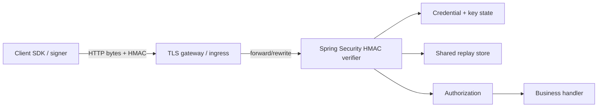
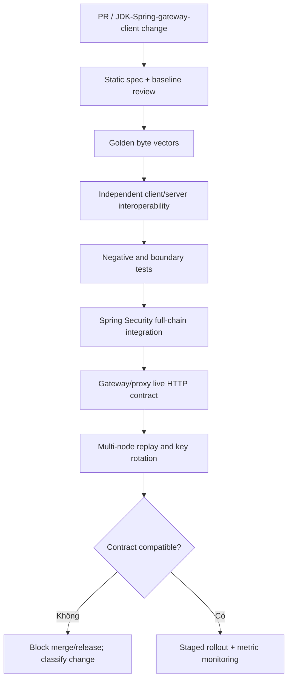
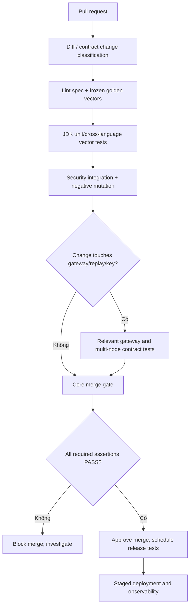

# Contract regression: kiểm thử hồi quy hợp đồng xác thực HMAC

## 1. Vì sao hệ thống HMAC cần contract regression?

Trong chương **Contract testing**, bài **Contract regression** tập trung vào việc **chứng minh một thay đổi kỹ thuật không làm phá vỡ hợp đồng đã công bố giữa client ký HTTP request và server xác minh HMAC**. Hồi quy có thể xảy ra dù thuật toán HMAC-SHA256 không đổi: chỉ một refactor chuẩn hóa URI, một thay đổi cách serialize JSON, nâng cấp thư viện HTTP hoặc gateway rewrite path cũng đủ khiến hai bên dựng canonical request khác nhau.

Bài thuộc mô-đun `SECURITY_AUTHENTICATION_HMAC_REQUEST_AUTHENTICATION`. Hệ thống sử dụng **shared secret** để xác thực HTTP request bằng chữ ký trên **canonical request** gồm phương thức, URI, header và/hoặc body theo hợp đồng. Ngoài so sánh HMAC, verifier còn kiểm **timestamp/nonce chống replay**, thực hiện **key rotation**, đi qua **proxy/gateway** và tạo principal để **phân quyền riêng với xác thực**.

**Contract regression không chỉ hỏi “request hợp lệ còn trả 200 không?”.** Cần bảo đảm đồng thời:

- Những request **đã hợp lệ theo phiên bản hiện hành** vẫn xác thực được khi khóa/policy còn hiệu lực.
- Những request **đã bị từ chối** vì chữ ký sai, replay, timestamp không hợp lệ, dùng khóa bị thu hồi hoặc thiếu quyền **không bất ngờ được chấp nhận**.
- Các **byte được ký** vẫn được diễn giải nhất quán qua phiên bản client, gateway, Spring Security, framework HTTP và backend.
- Khi cố ý thay đổi giao thức, mọi bên chuyển sang một **phiên bản contract mới** có thời hạn tương thích và đường rollback rõ ràng.
- Không tối ưu tốc độ, khắc phục lỗi 401 hay tăng khả năng tương thích bằng cách vô hiệu hóa MAC, bỏ body khỏi signed fields hoặc cho qua khi replay store lỗi.

Sau bài học, người học có thể thiết kế một bộ **regression suite có baseline đóng băng**, tạo golden vectors độc lập, kiểm lỗi âm tính, chạy kiểm thử xuyên Spring MVC/WebFlux và gateway, đánh giá key rotation nhiều node, xây merge gate trên CI và đọc kết quả một cách không nhầm giữa **breaking change**, **regression** và **thay đổi policy có chủ đích**.

## 2. Contract, compatibility và regression khác nhau thế nào?

**Signature contract** mô tả client cần gửi gì và server cần xác minh ra sao. **Contract regression testing** lặp lại các khẳng định đó sau mọi thay đổi có thể tác động đến đường đi request. Không chỉ kiểm tra giá trị MAC, regression còn kiểm hành vi xác thực và khả năng tương tác giữa các phiên bản.

| Khái niệm | Ý nghĩa | Ví dụ |
| --- | --- | --- |
| Contract | Quy tắc công khai, có phiên bản, giữa signer và verifier. | `HMAC-V1` ký method, raw URI/query, signed headers, SHA-256 body, timestamp và nonce. |
| Golden vector | Một cặp input/output cố định đã được kiểm tra độc lập. | Canonical bytes và HMAC tag kỳ vọng cho payload UTF-8 cụ thể. |
| Backward compatibility | Server mới tiếp tục chấp nhận request hợp lệ của client cũ trong phạm vi phiên bản còn được hỗ trợ. | Client V1 với key còn hiệu lực vẫn ký được sau nâng cấp Spring Boot. |
| Negative compatibility | Những request vốn bị cấm vẫn bị cấm. | Request sửa body sau ký vẫn phải bị 401, không được “tự chữa” canonicalization. |
| Regression | Hành vi mới lệch **không có chủ đích** so với contract/baseline. | Refactor bỏ LF giữa hai dòng; server mới từ chối mọi client đã ký V1 đúng. |
| Intentional breaking change | Thay đổi contract được thiết kế và version hóa. | V2 buộc ký thêm `Host`, V1 chỉ được hỗ trợ trong giai đoạn migration. |
| Policy change | Thay điều kiện nhận request mà không nhất thiết đổi thuật toán ký. | Giảm cửa sổ timestamp, thay TTL nonce hoặc revoke một key. |
| Implementation change | Thay code/framework nhưng **không** thay contract. | Chuyển từ MVC sang WebFlux mà canonical bytes và outcome phải giữ nguyên. |

Một test “còn trả 200” **không chứng minh tương thích** nếu cả client test lẫn backend cùng gọi một canonicalizer bị lỗi. Một test “mọi request V1 đều 401” có thể là **thay đổi policy có chủ đích** sau khi V1 đã bị ngừng hỗ trợ. Vì vậy, test phải gắn với **phiên bản và vòng đời contract được tuyên bố hỗ trợ**; không đóng băng một cách mù quáng mọi hành vi từ quá khứ.

### Hồi quy phải kiểm cả hành vi cho phép và cấm

Ví dụ người dùng sửa một dòng mã để khắc phục mismatch khi proxy đổi đường dẫn. Nếu sau thay đổi hệ thống tiếp tục nhận request hợp lệ nhưng đồng thời **không còn ký phần path**, test happy-path sẽ xanh. Mutation test “ký path A, gửi path B” phải đỏ, vì phần mục tiêu HTTP đã mất bảo vệ.

Một regression suite mạnh được xây từ **bất biến bảo mật** và **kết quả thực tế**. Nó không chỉ là một tập status codes ngẫu nhiên.

## 3. Ranh giới nào phải được khóa thành hợp đồng?

Một request HMAC đi qua nhiều tầng:



Tập regression cần phân biệt các lớp:

| Lớp contract | Cần giữ ổn định | Điều có thể khiến hồi quy |
| --- | --- | --- |
| Client wire format | Tên header, format timestamp/nonce, signature encoding, signed content. | Đổi HTTP client/serializer, tự động thêm charset, base64 URL-safe. |
| Canonicalization | Thứ tự trường, newline, URI encoding, raw body byte, quy tắc header. | Refactor StringBuilder, query parser, JSON mapper, URL normalization. |
| Credential selection | Client ID/key ID có scope đúng tenant, trạng thái key, thuật toán. | Cache key stale, sai mapping key rotation, fallback qua tenant khác. |
| HMAC verification | HMAC trên đúng canonical bytes, kiểm tag và length. | Thay provider JCA, decode tag lỏng, so sánh không đúng. |
| Freshness/replay | Timestamp đã ký, clock window, nonce atomic, TTL/kho chung. | Đổi clock policy, local cache, sai TTL, fail open khi Redis timeout. |
| Security integration | Chỉ tạo Authentication sau verify, authorization độc lập. | Filter order, reactive context, test dùng mockUser che đường verify. |
| Gateway/proxy | Public path/authority và signed headers được bảo toàn hoặc xác minh trước rewrite. | TLS termination, strip prefix, query normalization, header forwarding giả. |
| Error semantics | 401/403/413/429/503 theo nguyên nhân, không xử lý nghiệp vụ khi auth sai. | Bắt exception sai, exception handler fallback 200, lẫn auth với authz. |
| Observability | Metric/log đúng lý do, không tiết lộ secret. | Bật debug dump request, gộp mọi lỗi thành `signature_invalid`. |

**Quyền sở hữu của test:** unit test canonicalizer kiểm byte; integration test kiểm security chain; HTTP end-to-end test kiểm proxy; concurrency test kiểm replay; test triển khai đa phiên bản kiểm compatibility. Một tầng kiểm thử không thay thế được tất cả các tầng còn lại.

## 4. Baseline phải được đặc tả, không chụp từ code hiện tại

Một lỗi quy trình thường gặp là khi test đỏ, người viết cập nhật file expected bằng output mới của production implementation để “sửa snapshot”. Nếu output mới chứa sai khác chưa được review, regression suite đã mất khả năng phát hiện hồi quy.

Với HMAC, **nguồn sự thật** cần là:

1. **Đặc tả signature contract có phiên bản**, ghi rõ signed fields và ngữ nghĩa HTTP.
2. **Golden vectors bất biến** gồm input và expected canonical bytes/tag được tạo hoặc xác thực bằng triển khai **độc lập**.
3. **Bảng kết quả chấp nhận/từ chối**, kể cả 401/403, freshness/replay và key lifecycle.
4. **Compatibility matrix** nêu client/gateway/backend versions nào vẫn phải hoạt động.
5. **Threat model và change log** giải thích vì sao phải ký những trường cụ thể, vì sao có cửa sổ timestamp và các đường vào cần bị chặn.

Không dùng response đang chạy trong production làm baseline tự động cho các ca bảo mật. Production có thể đang **chấp nhận sai**; regression test nên bảo vệ **hợp đồng và bất biến**, không làm lỗi cũ trở thành chuẩn.

### Một mẫu baseline dễ audit

```yaml
contractVersion: HMAC-V1
scenarioId: order-post-v1-001
clockUtc: "2026-11-28T03:00:01Z"
request:
  method: POST
  publicTarget: /api/v1/orders?source=partner
  publicAuthority: api.example.test
  contentType: application/json
  clientId: partner-a
  keyId: key-a-2026-11
  timestamp: "2026-11-28T03:00:00Z"
  nonce: "8f247364-7d4b-479e-8c36-b640f1ad39a0"
  bodyUtf8: '{"sku":"P100","quantity":2}'
key:
  format: utf8
  value: "TEST_ONLY_SHARED_SECRET_DO_NOT_USE_IN_PROD"
expected:
  canonicalHex: "<REVIEWED_HEX_BYTES>"
  bodySha256Hex: "<REVIEWED_SHA256_HEX>"
  signatureBase64: "<REVIEWED_HMAC_BASE64>"
  authentication: ACCEPTED
  authorization: ALLOWED
  httpStatus: 201
```

Đây là **mẫu YAML trong bài**, không phải file được tạo thêm. Các giá trị `<REVIEWED_...>` là chỗ điền có chủ đích; **không được** commit một manifest chứa placeholder mà coi test thành công. Trước khi suite đi vào CI, cần tính và review expected bytes/tag bằng signer/reference **độc lập**, sau đó khóa chúng. Khóa test là dữ liệu giả, không cấp quyền trong production.

Golden vectors cần ghi cả **encoding của secret**: text `aabbcc` dưới UTF-8 **khác** 3 byte tạo bởi giải mã hex `AA BB CC`. Không được tự đoán hay thay cách decode key sau refactor. Với body, chọn cách lưu byte không nhập nhằng (hex hoặc base64) nếu có byte không in được.

## 5. Ví dụ một hợp đồng canonical HMAC-V1 có thể khóa hồi quy

Để làm bài tự chứa, ta dùng một contract minh họa; **không** coi đây là chuẩn mặc định của Spring Security.

### 5.1. Input và phạm vi signed fields

Giả sử API demo yêu cầu:

- HTTP method: ASCII uppercase `POST`.
- Public origin-form target: `/api/v1/orders?source=partner`, dùng **raw target** theo hợp đồng, không tự sort query.
- Public authority được edge tin cậy xác định: `api.example.test`.
- Content-Type: chính xác `application/json`.
- `X-Client-Id`, `X-Key-Id`, `X-Timestamp`, `X-Nonce` bắt buộc, **đúng một giá trị** và đều được ký.
- `X-Hmac-Version: HMAC-V1`, version được biểu diễn ở dòng đầu canonical.
- Body: đúng mảng byte HTTP entity theo contract, chưa parse/serialize JSON; body digest dùng SHA-256 hex lowercase.
- `X-Signature`: Base64 chuẩn của tag HMAC-SHA256 32 byte; **không** ký chính header signature.

Canonical text gồm **10 dòng**, nối bằng LF `0x0A`; không thêm LF cuối:

```text
HMAC-V1
POST
/api/v1/orders?source=partner
authority:api.example.test
content-type:application/json
x-client-id:partner-a
x-key-id:key-a-2026-11
x-timestamp:2026-11-28T03:00:00Z
x-nonce:8f247364-7d4b-479e-8c36-b640f1ad39a0
body-sha256:<64 lowercase hex characters>
```

Ở đây một dòng version + một dòng method + một dòng target + bảy dòng thông tin còn lại = **10 dòng**. Khi test bytes, cả LF cuối, thứ tự trường và chữ thường trong tên header đều phải được assert. Một LF cuối hoặc đổi byte `%20` thành `+` có thể làm tag khác.

Client tạo:

```text
bodyHash     = SHA256(rawBodyBytes)
canonical    = UTF8(join10LinesWithLFWithoutTrailingLF(...))
expectedTag  = HMAC_SHA256(sharedSecretBytes, canonical)
X-Signature  = standardBase64(expectedTag)
```

Server phải tái tạo **chính xác canonical bytes** từ HTTP request đã qua các bước được cho phép và so sánh MAC. Không parse JSON rồi serialize lại trước khi tính body hash, trừ khi contract sử dụng một chuẩn canonical JSON đã được quy định độc lập.

### 5.2. Những byte “tưởng tương đương” nhưng không tương đương

| Tình huống | Hai giá trị | Bất biến hồi quy |
| --- | --- | --- |
| Query order | `?a=1&b=2` và `?b=2&a=1` | V1 raw-target không tự sort; khác byte thì tag khác. |
| Space encoding | `q=a%20b` và `q=a+b` | Không tự thay percent encoding. |
| Percent escape | `%2F` và `%2f` | Không tự normalize nếu hợp đồng ký raw bytes. |
| Duplicate query | `?tag=a&tag=b` và `?tag=b` | Không biến multi-value thành Map đơn và làm mất dữ liệu. |
| JSON spacing | `{"a":1}` và `{ "a": 1 }` | SHA-256 body khác nếu byte khác. |
| JSON property order | `{"a":1,"b":2}` và `{"b":2,"a":1}` | Không tự coi tương đương ở raw-body contract. |
| Content-Type | `application/json` và `application/json;charset=UTF-8` | Demo V1 yêu cầu đúng một grammar; không tự bổ sung tham số. |
| Header duplicate | Hai `X-Timestamp` khác nhau | Từ chối nhập nhằng, không lấy đầu ở gateway và cuối ở backend. |
| Empty body | 0 byte và text `{}` | Digest khác; validation có thể khác nhưng MAC ký đúng bytes. |
| Unicode | `é` UTF-8 và dạng tổ hợp Unicode khác bytes | Không normalize Unicode ngoài hợp đồng. |

SHA-256 của body 0 byte là một vector ổn định:

```text
e3b0c44298fc1c149afbf4c8996fb92427ae41e4649b934ca495991b7852b855
```

Đây là **digest của empty body**, không phải HMAC tag của ví dụ POST orders. Tách test body digest khỏi test canonical serialization giúp tìm lỗi chính xác hơn.

## 6. Cấu trúc một bộ contract regression nhiều tầng

Một suite vận hành tốt thường có các vòng xác nhận:



| Tầng | Tốc độ kỳ vọng | Phát hiện được | Không thể thay thế |
| --- | --- | --- | --- |
| Pure canonical vector test | Nhanh | Byte canonical, digest, tag, encoding và newline sai. | Filter order, proxy, replay store. |
| Cross-language SDK test | Nhanh/trung bình | Khác biệt serializer, Base64, URI parser giữa client. | Security chain thực, gateway. |
| Parser/mutation test | Nhanh | Header/query nhập nhằng, body mutation, untrusted header. | Race nhiều verifier, TLS proxy. |
| Spring MVC/WebFlux integration | Trung bình | HMAC filter/WebFilter, body replay, principal, 401/403. | Rewrite/TLS thật ở gateway. |
| Multi-node nonce/key test | Trung bình/chậm | Atomic replay, TTL, cache key/revocation, race. | Tương thích request-target HTTP bên ngoài. |
| HTTP gateway/contract test | Trung bình/chậm | TLS termination, path/host rewrite, header forwarding, body transform. | Phát hiện mọi bug của pure cryptographic primitive. |
| Rolling upgrade compatibility | Chậm hơn | Khả năng phục vụ client V1/V2 và version cũ/mới khi deploy xen kẽ. | Thử nghiệm độc lập về an toàn mật mã. |

Không cần mỗi pull request chạy toàn bộ load/stress test dài. Nhưng **những ca security contract cốt lõi** cần nằm trong merge gate, còn gateway, multi-node hoặc soak test nên có một quy tắc chạy bắt buộc trước phát hành và khi thay đổi lớp liên quan. Lịch chạy phải minh bạch; không gắn nhãn “CI PASS” nếu các tầng bắt buộc chưa chạy.

## 7. Golden vectors và independent oracle

### 7.1. Vì sao client test không được lấy expected từ production verifier?

Ví dụ cả client test và verifier production cùng gọi một phương thức `canonicalize()` bị lỗi thêm newline cuối. Test tính expected từ cùng code, verifier cũng tính cùng lỗi, request được chấp nhận và suite **xanh giả**. Một client khác triển khai đúng contract thì bị 401.

Vì thế:

1. Ghi đặc tả bytes thành tài liệu/version không phụ thuộc một thư viện.
2. Chuẩn bị **reference signer độc lập** hoặc một triển khai ở ngôn ngữ khác.
3. Tạo tập input/output được review như dữ liệu test bất biến.
4. Trong test, so sánh output thực tế với **expected đã lưu**; không tái tính expected bằng chính hàm đang kiểm.
5. Khi expected thay đổi, bắt buộc phân loại: bug fix để trở lại contract cũ hay versioned breaking change.

Có thể dùng HMAC known-answer test từ vector chuẩn để kiểm **primitive** rồi dùng golden contract vector để kiểm **cách dựng thông điệp**. Một HMAC-SHA256 primitive đúng không có nghĩa canonical request đúng.

### 7.2. Kiểm thử ở cấp byte: ASCII, UTF-8, CRLF, LF

Golden fixture nên giữ:

- Raw bytes request body; đối với binary, biểu diễn bằng hex/base64 thay vì text không rõ encoding.
- Raw request-target hoặc canonical target đã được quy định (phân biệt wire target và URI parser).
- Canonical bytes expected (hex) và HMAC tag expected (Base64/hex).
- Chi tiết secret test encoding (UTF-8 bytes, hex bytes hay base64-decoded bytes).
- Một `Clock` cố định, trạng thái key và replay store fixture.
- Outcome kỳ vọng cho request lần đầu và replay lần sau.

Nếu JSON body có Unicode, test không nên dựa vào charset mặc định của máy chạy. Trong Java dùng `StandardCharsets.UTF_8`. Nếu hợp đồng chỉ cho phép header ASCII, reject non-ASCII trong các signed header thay vì chuyển đổi tùy ý qua locale hoặc bộ giải mã HTTP.

### 7.3. Java: đối chiếu canonical bytes độc lập với implementation

Đoạn code mang tính minh họa. `FixtureRequest` và `productionCanonicalizer` thuộc ứng dụng test, còn chuỗi expected được tạo **trực tiếp theo đặc tả** và phải kiểm lại bởi vector đã review.

```java
import static org.junit.jupiter.api.Assertions.*;
import java.nio.charset.StandardCharsets;
import java.security.MessageDigest;
import java.util.HexFormat;
import org.junit.jupiter.api.Test;

class CanonicalRegressionTest {
    @Test
    void emptyBodyDigestDoesNotRegress() throws Exception {
        byte[] digest = MessageDigest.getInstance("SHA-256")
            .digest(new byte[0]);

        assertEquals(
            "e3b0c44298fc1c149afbf4c8996fb92427ae41e4649b934ca495991b7852b855",
            HexFormat.of().formatHex(digest));
    }

    @Test
    void canonicalTextUsesExactLineDelimiters() {
        // Vector đã được khóa theo HMAC-V1 demo, body rỗng.
        String expected = String.join("\n",
            "HMAC-V1",
            "POST",
            "/api/v1/orders?source=partner",
            "authority:api.example.test",
            "content-type:application/json",
            "x-client-id:partner-a",
            "x-key-id:key-a-2026-11",
            "x-timestamp:2026-11-28T03:00:00Z",
            "x-nonce:8f247364-7d4b-479e-8c36-b640f1ad39a0",
            "body-sha256:e3b0c44298fc1c149afbf4c8996fb92427ae41e4649b934ca495991b7852b855"
        );

        byte[] expectedBytes =
            expected.getBytes(StandardCharsets.UTF_8);

        byte[] actualBytes =
            productionCanonicalizer.canonicalize(
                fixtureRequestWithEmptyBody());

        assertArrayEquals(expectedBytes, actualBytes);
        assertEquals(10, expected.split("\n", -1).length);
        assertFalse(expected.endsWith("\n"));
    }
}
```

`productionCanonicalizer` và `fixtureRequestWithEmptyBody()` là API **do dự án cung cấp**, đoạn code không tự biên dịch nếu chưa triển khai chúng. `expected` ở đây kiểm một vector canonical cụ thể, nhưng suite chính thức vẫn cần golden tag độc lập cho body thực và nhiều input variation, không chỉ kiểm độ dài hay prefix.

### 7.4. Test HMAC primitive để khoanh vùng lỗi

Vector HMAC-SHA256 đã biết với key 20 byte `0x0b` và message `Hi There` cho tag hex:

```text
b0344c61d8db38535ca8afceaf0bf12b
881dc200c9833da726e9376c2e32cff7
```

Hai dòng là cách hiển thị; ghép thành 64 hex ký tự. Java:

```java
@Test
void hmacSha256PrimitiveKnownAnswer() throws Exception {
    byte[] key = new byte[20];
    java.util.Arrays.fill(key, (byte) 0x0b);

    javax.crypto.Mac mac =
        javax.crypto.Mac.getInstance("HmacSHA256");
    mac.init(new javax.crypto.spec.SecretKeySpec(key, "HmacSHA256"));

    byte[] tag = mac.doFinal(
        "Hi There".getBytes(java.nio.charset.StandardCharsets.US_ASCII)
    );

    assertEquals(
        "b0344c61d8db38535ca8afceaf0bf12b" +
        "881dc200c9833da726e9376c2e32cff7",
        java.util.HexFormat.of().formatHex(tag));
}
```

Nếu primitive test PASS nhưng golden contract tag FAIL, cần kiểm body bytes, canonicalization và secret encoding của contract trước khi kết luận JCA/HMAC có lỗi. Nếu primitive FAIL, nghi ngờ input/provider/setup test hoặc thuật toán.

## 8. Bảng kiểm thử hồi quy positive và negative

Với một request hợp lệ ban đầu đã có tag `T`, các mutation sau cần có kết quả rõ ràng. Đối với negative tests, mỗi ca nên thay **một yếu tố** và kiểm cả **HTTP outcome lẫn side effect**.

| ID | Thay đổi từ baseline | Kỳ vọng | Lỗi hồi quy phát hiện |
| --- | --- | --- | --- |
| `P01` | Client V1 ký đúng, key active, timestamp mới, nonce mới, đủ quyền | 2xx/201 và handler thực thi đúng. | Đột ngột mất tương thích V1. |
| `P02` | Body UTF-8 đa byte được ký trên byte thực gửi | MAC pass, payload đến handler nguyên vẹn. | Charset/serializer đổi dữ liệu ký. |
| `P03` | Body rỗng ở endpoint thực sự cho phép body rỗng | Digest chuẩn, chữ ký hợp lệ. | Null/empty confusion. |
| `N01` | Ký body A nhưng gửi body B | 401; không có side effect. | Body digest bị bỏ khỏi contract. |
| `N02` | Ký method POST rồi gửi method khác trên route còn hợp lệ | 401 nếu method được ký. | Verifier bỏ method. |
| `N03` | Ký raw URI/query A rồi gửi raw URI/query B | 401; không normalize ngoài contract. | Sort/decode query ngầm. |
| `N04` | Sửa signed `Content-Type`/header đã ký | 401 hoặc reject grammar theo policy. | Header không còn được bảo vệ. |
| `N05` | Sửa client ID/key ID sau ký | Không mạo danh client/tenant mới. | Credential lookup không bị ràng buộc. |
| `N06` | Base64 signature lỗi, tag thiếu byte, header trùng | Từ chối input; không được bypass verifier. | Parser chấp nhận dữ liệu nhập nhằng. |
| `N07` | Timestamp hết hạn **được ký hợp lệ** | Auth failure, không vào handler. | Freshness check bị bỏ. |
| `N08` | Timestamp trong tương lai quá ngưỡng **được ký hợp lệ** | Auth failure. | Cho phép future vô hạn. |
| `N09` | MAC đúng nhưng nonce đã reserve | Replay bị chặn; side effect không tăng. | Nonce guard bị tắt. |
| `N10` | Hai node xác minh cùng nonce đồng thời | Tối đa một request vượt guard. | Check-then-set race/local store. |
| `N11` | Key `REVOKED` tính MAC đúng theo secret cũ | Auth failure. | Cache key stale hoặc fail-open key state. |
| `N12` | Key của tenant B dùng dưới client ID tenant A | Không cấp principal A. | Cross-tenant lookup/mapping lỗi. |
| `N13` | Key verify-only trong cửa sổ chuyển tiếp được cho phép | Accept đúng policy; hết hạn thì reject. | Rotation gây outage hoặc chấp nhận quá hạn. |
| `N14` | MAC đúng, thiếu authority `orders:write` | 403; không có side effect. | Authentication bị nhầm với authorization. |
| `N15` | Nonce store timeout/unavailable | Fail closed; không vào handler, lỗi hạ tầng. | Bỏ replay khi dependency lỗi. |
| `N16` | Proxy đổi signed path/header/body mà chưa cập nhật contract | Verify fail hoặc kiểm đúng tại điểm trước rewrite. | Gateway âm thầm làm sai canonical input. |
| `N17` | Client tự gắn `X-Authenticated-Client`/`X-Original-URI` | Không bypass HMAC/trust boundary. | Tin header client giả. |
| `N18` | Unsupported version/algorithm hoặc cố downgrade | Reject theo allowlist; không thử fallback tùy tiện. | Verifier tự chuyển xuống scheme yếu. |
| `N19` | Body vượt giới hạn, header/query quá dài | 413/4xx theo contract, không OOM. | Input-limit regression. |
| `N20` | HMAC đúng, body JSON sai cấu trúc | Authentication đúng; codec/validation 400. | Mọi lỗi bị gộp thành signature invalid. |

**Tránh test xanh giả:** 404/405 ở mutation method/path **không chứng minh MAC đã phát hiện thay đổi**. Chọn endpoint/route mà request vẫn tới verifier, hoặc assert metric/tracing nội bộ chứng minh verifier đã chạy và xác định lý do. Không chỉ assert “không trả 200”.

### Mã lỗi phản ánh đúng tầng

Một policy có thể chọn `401 Unauthorized` cho thiếu/malformed signature, MAC sai, timestamp/nonce hoặc key không hợp lệ; `403 Forbidden` cho request **đã xác thực** nhưng thiếu quyền; `413` cho body quá lớn; `429` cho rate limit; `503` cho replay store hỏng nếu hệ thống fail closed. Lỗi JSON syntax có thể trả 400 sau authentication.

Đây là ngữ nghĩa mẫu; API phải quy định rõ lỗi nào trả 400 hay 401 và tuân HTTP challenge semantics phù hợp khi dùng 401. Test cần khóa **quyết định đã công bố**, không áp một response code duy nhất cho mọi lỗi.

## 9. Cô lập từng nguyên nhân để tránh test không đúng mục tiêu

### 9.1. Test expired timestamp

Sai:

1. Tạo request hợp lệ với `timestamp=03:00:00Z` và MAC `T`.
2. Đổi header thành `02:00:00Z` nhưng giữ `T`.
3. Nhận 401 và kết luận “đã kiểm expiration”.

Thực tế request có **MAC sai**, nên test có thể qua dù verifier bỏ qua timestamp.

Đúng:

1. Dùng `Clock.fixed(03:00:00Z)` ở verifier.
2. Dùng **signer fixture độc lập** ký trên `timestamp=02:54:59Z` nếu cửa sổ quá khứ 5 phút.
3. Gửi đúng timestamp + chữ ký đó và nonce mới.
4. Assert kết quả là `TIMESTAMP_EXPIRED` nội bộ, response authentication failure, handler không chạy.
5. Kiểm biên `02:55:00Z` được nhận (nếu contract cho phép biên) và `03:00:31Z` từ chối khi maxFuture=30 giây.

### 9.2. Test body tampering

Sai: cả signer lẫn HTTP client cùng gửi body B và ký body B, rồi coi đó là “thay body mà HMAC vẫn đúng”.

Đúng: signer ký byte body A, HTTP client gửi **byte body B**, giữ nguyên tag của A. Assert MAC mismatch và không có side effect. Song song có positive vector ký body B đúng để chứng minh route và credential hoạt động.

### 9.3. Test key rotation

Sai: dùng key đã revoke để tạo signature malformed, server trả 401 rồi kết luận đã kiểm revoke.

Đúng: signer dùng **đúng secret bị revoke**, tính MAC hợp lệ theo protocol, chọn timestamp trong cửa sổ và nonce mới. Kết quả vẫn phải auth failure **vì key state**, không phải do MAC sai hoặc timestamp.

### 9.4. Test replay

Sai: gửi cùng request hai lần nhưng lần thứ hai bị rate limiter chặn trước verifier; test kết luận nonce store hoạt động.

Đúng: xác nhận hai request đều tới replay guard theo đường kiểm thử cô lập, lần thứ hai bị từ chối do nonce đã reserve; với concurrency, assert tối đa một side effect và atomicity.

## 10. Kiểm thử Spring Security mà không bypass HMAC

Một regression suite thuần về canonical bytes không thể phát hiện filter order bị đổi, request body bị tiêu thụ, principal gán trước khi verify hoặc exception bị map sai.

### 10.1. Spring MVC/Servlet

Trong Spring MVC, HMAC có thể nằm ở một `OncePerRequestFilter` hoặc authentication component dưới `FilterChainProxy`. Khi integration test, cần bật đúng `SecurityFilterChain`. Tránh:

- Dùng `@WithMockUser`/`mockUser` cho ca nhằm chứng minh HMAC: helper cấp danh tính giả có thể che việc filter không xác minh request.
- Dùng `MockMvcBuilders.standaloneSetup(controller)` không add security chain nhưng kết luận authentication thành công.
- Đăng ký cùng custom filter như **Servlet container filter** và **Spring Security filter** khiến request bị verify hai lần.
- Dùng `ContentCachingRequestWrapper` như thể nó tự phát lại stream body sau khi verifier đã đọc hết. Cần replayable wrapper được thiết kế theo contract và có body limit.

Ví dụ skeleton (fixture/service do ứng dụng cung cấp, không phải API dựng sẵn):

```java
@SpringBootTest
@AutoConfigureMockMvc
class HmacContractRegressionMvcTest {

    @Autowired MockMvc mvc;
    @Autowired IndependentTestSigner signer;

    @Test
    void tamperedBodyCannotReachBusinessHandler() throws Exception {
        byte[] signedBody =
            "{\"sku\":\"P100\",\"quantity\":2}"
                .getBytes(StandardCharsets.UTF_8);
        byte[] sentBody =
            "{\"sku\":\"P100\",\"quantity\":999}"
                .getBytes(StandardCharsets.UTF_8);

        SignedHeaders headers = signer.sign(
            "POST",
            "/api/v1/orders?source=partner",
            signedBody,
            "nonce-regression-body-001"
        );

        mvc.perform(post("/api/v1/orders?source=partner")
                .header("Host", "api.example.test")
                .headers(headers.asHttpHeaders())
                .contentType(MediaType.APPLICATION_JSON)
                .content(sentBody))
            .andExpect(status().isUnauthorized());

        // Trong test đầy đủ: verify(orderService, never()).create(...);
        // hoặc assert số bản ghi/side effects không thay đổi.
    }
}
```

`IndependentTestSigner` và `SignedHeaders` là fixture tự xây theo hợp đồng, **không nằm sẵn trong Spring**. Test cần inject `Clock` phù hợp và một replay store cô lập; nonce trong ví dụ phải phù hợp grammar thực tế (ví dụ nếu API yêu cầu UUID thì dùng UUID fixture). Đoạn code chỉ mô tả cách **giữ signature của body A khi gửi body B** và cách assert HTTP; production suite phải thêm các assertion về service/database không bị gọi.

Trong Servlet security chain, nếu custom filter tự ném `AuthenticationException`, vị trí tương quan với `ExceptionTranslationFilter` ảnh hưởng cách map sang 401. Regression test phải kiểm cả thứ tự filter hoặc failure handler thay vì chỉ đặt filter trước `AuthorizationFilter` rồi giả định mọi exception đều được bắt đúng.

### 10.2. Spring WebFlux

Với WebFlux, dùng `WebTestClient` trên application context có `SecurityWebFilterChain` hoặc server HTTP thật:

```java
byte[] payload =
    "{\"sku\":\"P100\",\"quantity\":2}"
        .getBytes(StandardCharsets.UTF_8);

HttpHeaders signed = testSigner.sign(
    "POST", "/api/v1/orders?source=partner", payload);

webTestClient.post()
    .uri("/api/v1/orders?source=partner")
    .headers(h -> h.addAll(signed))
    .bodyValue(payload)
    .exchange()
    .expectStatus().isCreated();
```

Đây là skeleton; `testSigner`, credentials, endpoint, trusted authority và clock fixture do test cung cấp. `WebTestClient.bindToController(...)` đơn lẻ **không đảm bảo** HMAC `SecurityWebFilterChain` được thực thi. `bindToApplicationContext(...).apply(springSecurity())` hoặc `@SpringBootTest` với client cấu hình đúng là các cách kiểm full chain trong môi trường tương ứng.

Reactive verifier có thể đọc `Flux<DataBuffer>` để hash body; nó phải cho downstream nhận lại đúng bytes và quản lý pooled buffers. Test regression cần kiểm:

- Handler đọc được cùng payload sau khi xác thực thành công.
- Không phát sinh double subscription, body truncation hoặc buffer leak khi lỗi/cancel.
- Authentication đi theo Reactor Context, không dùng ThreadLocal `SecurityContextHolder` làm nguồn identity reactive.
- Retry/resubscribe không khiến nonce được reserve hai lần ngoài chính sách hoặc cho handler chạy trước verify.

**Không thay thế thử nghiệm qua gateway bằng WebTestClient in-memory** khi regression liên quan tới TLS, HTTP target hoặc proxy rewrite.

## 11. Replay regression: concurrency, TTL và phân tán

Một hệ thống có thể PASS mọi golden vector nhưng vẫn chấp nhận cùng request hai lần vì nonce store bị thay bằng cache local hoặc thao tác check-then-set có race.

### Bất biến

Khi request có key/client/timestamp/nonce đã được MAC bảo vệ và nằm trong cửa sổ:

- **At most one** request được chấp nhận cho cùng nonce namespace trong khoảng mà timestamp còn có thể hợp lệ.
- Reservation phải nguyên tử, dùng chung giữa **tất cả node có quyền verify**.
- Chỉ reserve nonce sau khi key, freshness và MAC được xác minh; request giả mạo không được tự chiếm replay store.
- Khi store không sẵn sàng, endpoint cần chống replay phải **fail closed**.
- TTL phải đủ lâu để nonce không bị xóa trước khi cùng timestamp hết được chấp nhận.

Redis có thể dùng primitive dạng:

```text
SET replay:<scope>:<keyId>:<nonce> 1 NX PX <ttlMillis>
```

`NX` và TTL phải được áp dụng trong **một thao tác nguyên tử**; không dùng `EXISTS` rồi `SET` tách rời. Với cửa sổ `maxPast=300s` và `maxFuture=30s`, một TTL cố định đúng 300 giây từ lúc reserve có thể không đủ. Tính cả phần tương lai và biên lệch đồng hồ giữa các verifier.

### Ma trận replay hồi quy

| Ca | Setup | Kết quả cần assert |
| --- | --- | --- |
| Replay tuần tự cùng node | Gửi lại đúng signed request. | Lần đầu tối đa một lần vào handler; lần sau bị từ chối. |
| Replay đồng thời khác node | Barrier phát hai request cùng nonce qua node A/B. | Nhiều nhất một reservation thành công, side effect không nhân đôi. |
| Verifier restart | Reserve nonce, restart một instance, gửi lại. | Replay vẫn bị chặn nhờ store chung. |
| TTL boundary | Dùng `Clock.fixed` và cửa sổ quá khứ/tương lai. | Nonce không biến mất khi timestamp còn hợp lệ. |
| Store timeout | Inject timeout khi MAC đã đúng. | Fail closed, không tạo principal/side effect. |
| Redis failover | Test topology và failover semantics. | Không mất khả năng chống replay trong yêu cầu kiến trúc; nếu không bảo đảm, từ chối. |
| Key rotation | Cùng client với key ID đang chuyển tiếp. | Namespace/TTL giữ ngữ nghĩa; không mở đường phát lại qua key alias sai. |
| Gateway retry | Gateway retry sau timeout upstream. | Không có duplicate business execution; có idempotency policy riêng. |

**Nonce không phải idempotency key.** Hai request có nonce khác nhau có thể được xác thực hợp lệ và cùng tác động nghiệp vụ. Với tạo đơn hàng/thanh toán, test phải có idempotency key hoặc cơ chế nghiệp vụ tương đương khi retry là một phần contract.

## 12. Regression sau key rotation và thay đổi credential lifecycle

Thay khóa có thể khiến client đúng HMAC nhưng nhận 401. Một regression suite nên kiểm cả correctness lẫn khả năng deploy xen kẽ.

### Ví dụ các trạng thái key

| Trạng thái | Ý nghĩa mẫu | Hành vi regression |
| --- | --- | --- |
| `ACTIVE` | Key được dùng để ký request mới và xác minh. | Signer mới dùng key hiện hành; server accept. |
| `VERIFY_ONLY` | Key cũ tạm được xác minh trong cửa sổ chuyển tiếp. | Client cũ còn hoạt động trong hạn; không được kéo dài vô hạn. |
| `REVOKED` | Key đã thu hồi hoặc bị lộ. | Từ chối **kể cả** MAC chính xác và timestamp hợp lệ. |
| `EXPIRED` | Key quá khoảng hiệu lực. | Không cho phép request mới chỉ vì tag trùng. |
| `UNKNOWN` | Key ID không thuộc client/tenant được khai. | Không enumerate và không tìm toàn bộ tenant để thử secret. |

Thứ tự rollout thường là: cập nhật verifier hỗ trợ key mới → kiểm khả năng xác minh ở mọi node → chuyển signer sang key mới → quan sát lưu lượng key cũ → kết thúc chuyển tiếp và revoke key cũ. Mọi bước cần test khả năng phục vụ các client/servers **đang đồng thời chạy hai phiên bản**.

### Những regression dễ bỏ sót

- Cache credential ở một node vẫn giữ secret của key revoked và tiếp tục chấp nhận.
- Một backend đã deploy hỗ trợ key mới nhưng một backend cũ chỉ biết key cũ, load balancer gây 401 ngẫu nhiên.
- Client ID không được ký hoặc verifier dùng key ID để tìm secret trên mọi tenant, tạo lỗi cross-tenant.
- Header `X-Key-Id` được proxy strip hoặc normalize bất ngờ.
- Thay phiên bản **signature protocol** đồng thời với **key rotation**, làm khó phân biệt loại lỗi.
- Bật fallback “thử mọi key đang có” để tránh 401, gây vượt scope credential, overhead và rủi ro oracle.

**Lưu ý:** đổi key **không nhất thiết** phải đổi `HMAC-V1`. Version của canonical protocol và key ID/version của credential là hai trục độc lập; test matrix phải quản lý chúng riêng.

## 13. Regression khi thay đổi gateway, TLS termination và URI handling

HMAC có thể vỡ sau khi thay gateway/nginx/ingress dù test trực tiếp verifier vẫn PASS. Gateway terminate TLS và chuyển HTTP request sang upstream có thể sửa URI, host, query, header, body hoặc framing.

### Những tình huống quan trọng

| Thay đổi | Rủi ro | Regression test |
| --- | --- | --- |
| `/public/api/orders` → `/api/orders` | Backend thấy path khác client ký. | Sign public target, đi qua gateway thật; verify theo điểm đã chỉ định. |
| Reorder query hoặc decode `%2F` | Raw target đổi bytes hoặc ý nghĩa. | Golden query vectors, assert reject/accept theo raw-target policy. |
| `Host`/`:authority` đổi sau TLS termination | Public authority và internal host khác nhau. | Test header/authority có xác thực; không tin `X-Forwarded-Host` từ client. |
| TLS termination rồi HTTP upstream | Backend nhìn scheme `http` trong khi client `https`. | Hợp đồng scheme/authority rõ ràng, kiểm hop security policy. |
| `Content-Type` thêm `charset=UTF-8` | Signed header value đổi. | So đúng byte theo grammar; không tự “nới” header. |
| Proxy nén/giải nén body | SHA-256 body bytes khác. | Contract định nghĩa byte nào được ký; test content-encoding. |
| HTTP/2 → HTTP/1.1 | `:authority` thành `Host`, header casing/framing đổi. | Contract tập trung semantic fields có chuẩn hóa rõ; test cả hai protocol. |
| Header duplicate/`Forwarded` giả | Parser của gateway và backend khác nhau. | Test spoofed headers, reject ambiguity và direct-backend bypass. |
| Retry upstream | Request có cùng nonce có thể được gửi lại. | Anti-replay và idempotency regression. |
| Thay TLS certificate/CA/mTLS | Handshake upstream/client sai hoặc bypass verify. | Test trusted/untrusted cert, fail closed, không fallback plaintext. |

**Không dùng header `X-Original-URI` do client bất kỳ gửi để khôi phục một path ký từ bên ngoài.** Gateway phải xóa/ghi đè untrusted forwarding headers và backend chỉ tin nguồn proxy đã xác thực. Nếu verifier nằm tại gateway **trước rewrite**, backend phải nhận danh tính đã xác minh qua kênh tin cậy như mTLS kèm assertion có phạm vi và xác thực riêng; backend vẫn kiểm quyền nghiệp vụ.

### Test đúng nơi HMAC được xác minh

- **Backend verify:** kiểm request public path/authority được bảo toàn hoặc truyền metadata được xác thực đúng tới backend.
- **Gateway verify:** kiểm gateway dùng public bytes trước rewrite, nonce store nằm ở các edge verifiers và backend không cho header mạo danh vượt trust boundary.
- **TLS passthrough:** backend trực tiếp terminate TLS; không coi reverse proxy HTTP rewrite là một phần của đường đi nếu thực tế không terminate.

Một test “direct backend PASS” và “gateway FAIL” là dữ liệu chẩn đoán, **không** chứng minh lỗi thuật toán HMAC. Cần tái hiện bằng golden vectors qua topology thật; không bật production log chứa raw canonical string, signature, secret hoặc body nhạy cảm.

## 14. Compatibility matrix qua các phiên bản client/backend

Sau khi phát hành một SDK client mới hoặc nâng cấp framework backend, cần biết **những cặp phiên bản nào vẫn được hỗ trợ**.

| Client SDK | Contract | Backend cũ | Backend mới | Kỳ vọng |
| --- | --- | --- | --- | --- |
| SDK 1.x | HMAC-V1 | PASS | PASS | Backward compatible khi V1 còn hỗ trợ. |
| SDK 2.x | HMAC-V1 | PASS | PASS | Refactor client không đổi bytes ký. |
| SDK 3.x | HMAC-V2 | Có thể REJECT | PASS | Chỉ nếu V2 là thay đổi có chủ đích và chưa rollout backend cũ. |
| SDK 1.x | HMAC-V1 với key revoked | REJECT | REJECT | Security policy cao hơn backward compatibility. |
| SDK 2.x | HMAC-V1, query encoding lạ | Theo contract | Theo contract | Không đoán format khác chỉ để “chấp nhận nhiều client”. |

Các giá trị chỉ mang tính minh họa. Một matrix thật phải ghi **phiên bản chính xác**, key state, thời hạn hỗ trợ, gateway path và kỳ vọng theo contract. Không tuyên bố toàn bộ client V1 được hỗ trợ mãi mãi; khi đã công bố ngày ngừng hỗ trợ, test cần chuyển sang kiểm **từ chối đúng** ngoài cửa sổ support.

### Rolling deployment

Một cluster có thể tạm có cả backend phiên bản N và N+1. Nếu một phiên bản đổi canonicalization mà không version contract, cùng request sẽ bị xử lý khác nhau tùy node. Regression test cần:

1. Chạy verifier N và N+1 cùng golden vectors.
2. Gửi cùng tập **request mới với nonce riêng** đến từng node khi kiểm positive compatibility, tránh bị replay store chặn làm sai phép so.
3. Chạy riêng concurrent replay với cùng nonce để kiểm atomicity.
4. Xác nhận key cache, timestamp policy và error semantics nhất quán.
5. Kiểm rollback: khi quay về N, các client còn được hỗ trợ vẫn hoạt động trong policy hỗ trợ.

Không dùng cùng một signed request qua các node trong phép **positive compatibility** khi replay store được chia sẻ; request thứ hai có thể bị từ chối vì replay **đúng**, không phải vì không tương thích.

## 15. Java/JUnit: thiết kế test regression theo vector

Sử dụng JUnit parameterized tests giúp duy trì nhiều vector mà không copy-paste toàn bộ logic.

### 15.1. Record kết quả và phân loại

```java
enum ContractResult {
    ACCEPTED,
    SIGNATURE_INVALID,
    TIMESTAMP_INVALID,
    NONCE_REPLAY,
    KEY_NOT_ACCEPTED,
    ACCESS_DENIED,
    INFRASTRUCTURE_ERROR
}

record ContractCase(
    String id,
    byte[] rawBody,
    String method,
    String target,
    String timestamp,
    String nonce,
    String keyId,
    ContractResult expected
) {}
```

`ContractResult` là enum dùng trong test, không phải class dựng sẵn của Spring. Một suite đầy đủ cần phân biệt malformed header, body-too-large, authorized success và các error theo contract. Cấu trúc trên chỉ minh họa việc **định danh case và expected outcome** rõ ràng.

### 15.2. Lấy expected tag từ manifest đã review

```java
@ParameterizedTest(name = "{0}")
@MethodSource("goldenVectors")
void productionSignerRemainsCompatible(GoldenVector vector)
        throws Exception {

    byte[] producedCanonical =
        productionCanonicalizer.canonicalize(vector.request());

    assertArrayEquals(
        vector.expectedCanonicalBytes(), producedCanonical);

    byte[] producedMac =
        productionSigner.sign(vector.testKey(), vector.request());

    assertArrayEquals(
        vector.expectedMacBytes(), producedMac);
}
```

`GoldenVector`, `productionSigner` và `productionCanonicalizer` là các fixture/implementation **do dự án tự xây**, không nằm sẵn trong JUnit. `expectedCanonicalBytes()` và `expectedMacBytes()` phải tải từ manifest đã duyệt, **không** tính ngay bằng `productionSigner`. Đồng thời phải test verification (phía nhận) bằng implementation độc lập.

Nếu reviewer chấp thuận thay đổi chính thức từ V1 sang V2, thêm bộ vector V2 và điều chỉnh compatibility matrix; **không** ghi đè V1 vectors rồi vô tình xóa bằng chứng backward compatibility.

### 15.3. Bài test mutation có cả oracle về side effect

Một mutation test tốt cần hai assertions độc lập:

```java
// Pseudocode: request signed for body A, HTTP sends body B.
SignedRequest fixture = referenceSigner.sign(
    "POST", "/api/v1/orders", bodyA, newNonce());

HttpResponse response = httpClient.send(
    fixture.withBodyBytes(bodyB) // giữ nguyên signature của A
);

assertEquals(401, response.statusCode());
assertEquals(0, orderRepository.countFor(fixture.orderId()));
```

Đây là **pseudocode theo API ứng dụng**, không phải những method mặc định của Java HTTP client. Trong hệ thống thật, thay `countFor` bằng repository/service spy hoặc một kiểm tra side effect đáng tin. Đối với retry/idempotency, còn cần kiểm số transaction/notification bên ngoài nếu test environment hỗ trợ.

## 16. Kết quả 401 chưa đủ: phải assert nguyên nhân và đường đi

Một request bị từ chối có thể mang bất kỳ lý do nào:

- Chữ ký sai thật.
- Client gửi tag malformed.
- Timestamp hết hạn.
- Nonce đã dùng.
- Key ID sai hoặc key revoked.
- Gateway/WAF chặn trước backend.
- Body vượt hạn mức.
- Filter chưa chạy nhưng controller/route trả 401 vì chính sách khác.

Nếu chỉ assert `status().isUnauthorized()`, test có thể xanh dù HMAC verifier không được gọi.

Cách làm tốt là trong test environment có thể truy cập **reason code nội bộ** hoặc một probe/test spy tại HMAC component, nhưng phản hồi public vẫn giữ nguyên mức tiết lộ phù hợp. Có thể dùng:

- Spy verifier xác nhận bước so sánh HMAC được gọi và ra `SIGNATURE_INVALID`.
- Metric `hmac.signature.verifications{result="mismatch"}` tăng **một lần**, trong khi malformed signature không tăng compare.
- Event audit an toàn với enum `SIGNATURE_INVALID`, không có signature/body/secret.
- Assert controller/service không được gọi; không tạo transaction.
- Test riêng gateway để biết một request có thực sự đi qua backend hay bị chặn sớm.

Không dùng reason code do client tự khai hoặc full exception message chứa dữ liệu nhận từ bên ngoài làm bằng chứng. Khi cần phân biệt tầng lỗi, giữ internal instrumentation chỉ trong scope test/ops.

## 17. CI/CD: thiết kế regression gate có khả năng tái lập

Một pipeline mẫu:



### Những điều CI phải kiểm soát

1. **Deterministic clock:** inject `Clock.fixed` ở pure/integration test; không phụ thuộc ngày thật hoặc timezone máy CI.
2. **Unique nonce per positive scenario:** replay store namespace riêng cho từng suite/test, tránh test thứ tự ngẫu nhiên tạo false failure.
3. **Independent oracle:** golden vectors được review; test signer và verifier không dùng chung mọi logic.
4. **Isolation:** Redis/container/service test không sử dụng key, nonce store hoặc dữ liệu production.
5. **Version matrix:** xác định JDK/Spring/HTTP client/gateway phiên bản hỗ trợ; không chỉ chạy một tổ hợp.
6. **Fail fast có thông tin:** mismatch canonical bytes, bad key state, wrong HTTP status, gateway rewrite hoặc failed nonce atomicity phải có tên case rõ.
7. **No secret leakage:** không ghi test secret vào CI logs, test artifacts, screenshots hoặc HTTP debug traces; dùng secret test.
8. **Không “cập nhật snapshot” tự động khi test đỏ:** mọi thay đổi golden vector có chủ đích cần review contract version và threat model.
9. **Không skip case flaky mà im lặng:** concurrency tests phải được làm deterministic hơn, chạy đủ số lần hoặc đánh dấu blocker nếu chưa tin cậy.
10. **Tách performance gate khỏi security gate:** giảm latency là có ích, nhưng security assertions phải PASS tuyệt đối trước khi xem xét hiệu năng.

Tùy quy mô, có thể chạy pure vectors và Spring integration trên mỗi PR; chạy gateway/TLS/multi-node regression trước release hoặc khi thay component liên quan. Với thay đổi trực tiếp canonicalizer, credential lifecycle hoặc replay store, những test liên quan phải là **merge blocker**, không chỉ là báo cáo nightly.

### Khi test cố tình thay đổi contract

Một PR đổi từ V1 sang V2 cần tối thiểu:

- Cập nhật đặc tả V2 và phạm vi signed fields.
- Thêm vector V2, giữ vector V1 trong khoảng còn hỗ trợ.
- Chạy cross-SDK compatibility và verifier hỗ trợ version allowlist.
- Xác định ngày chuyển signer, thời điểm dừng V1, policy key rotation và khả năng rollback.
- Chạy mutation tests cho các signed fields mới để chứng minh không chỉ thêm vào tài liệu.
- Theo dõi số request theo phiên bản **hữu hạn** và lý do 401 sau rollout.

Không tự để verifier thử tuần tự nhiều canonical formats hoặc nhiều key của mọi tenant cho đến khi MAC khớp; fallback vô kiểm soát có thể mở downgrade và request confusion.

## 18. Tái hiện hồi quy liên quan JDK, Spring và HTTP stack

Một nâng cấp thư viện thường không thông báo “signature contract changed”, nhưng có thể đổi cách HTTP framework đưa dữ liệu tới verifier.

### 18.1. Java và JCA

- Primitive HMAC-SHA256 phải tiếp tục khớp known-answer vector.
- Cách cung cấp secret là byte array, không phải chuỗi có charset mặc định.
- `Mac` là object stateful; không dùng một instance không đồng bộ cho nhiều thread.
- Tag phải decode đúng Base64/hex grammar và có độ dài cố định; không tùy tiện chấp nhận tag rút ngắn.
- HMAC comparison dùng primitive phù hợp hạn chế timing leak (ví dụ `MessageDigest.isEqual` trên đúng byte tag).
- Key rotation không để `ThreadLocal<Mac>` hoặc cache giữ key cũ vô hạn.

### 18.2. Spring MVC/Servlet

- Servlet API có thể expose encoded/decoded path khác qua `getRequestURI()`, `getServletPath()` hoặc các wrapper. Test raw-target contract trên request thực.
- Filter đọc body và truyền request sai wrapper có thể khiến `@RequestBody` rỗng sau authentication.
- SecurityFilterChain order và failure handler có thể thay đổi khi nâng cấp Spring Security.
- Một filter được auto-register ở Servlet container và add vào security chain lần nữa gây double verification/replay.
- Error mapping qua `ExceptionTranslationFilter`/`AuthenticationEntryPoint` cần test đúng đường chạy thực.

### 18.3. Spring WebFlux

- `WebFilter` phải cache/replay body `Flux<DataBuffer>` có giới hạn; chú ý release pooled buffer khi success/error/cancel.
- Không dùng `block()` cho key/replay lookup trên event loop; regression performance có thể gây timeout ảnh hưởng correctness.
- `ReactiveSecurityContextHolder`/Reactor Context khác ThreadLocal Servlet, cần test principal propagation sang handler.
- Retry/resubscribe có thể khiến authentication logic chạy lại và nonce bị từ chối không đúng kỳ vọng.
- `WebTestClient` in-memory không đại diện cho toàn bộ gateway HTTP/2/TLS upstream.

### 18.4. Gateway/proxy

- Query normalization, host/header forwarding, path rewrite, content encoding có thể phá chữ ký.
- Test trusted forwarding headers và direct-backend bypass.
- mTLS upstream có thể đổi CA/certificate trong deploy; kết nối phải thất bại an toàn nếu không tin peer.
- Không tắt TLS certificate verification hoặc chuyển sang HTTP plaintext để “chữa” lỗi tương thích.

## 19. Kiểm thử performance regression mà vẫn bảo toàn contract

Contract regression thường kiểm correctness trước, nhưng có thể bổ sung kiểm thời gian vì một thay đổi hợp lệ vẫn có thể gây overload hoặc DoS, ví dụ:

- Mỗi request từ một MAC/HMAC trở thành nhiều phép thử “thử tất cả phiên bản”.
- Credential lookup bị gọi remote DB cho mọi header sai.
- Body được buffer nhiều lần sau refactor, tăng heap/GC.
- Replay store thêm một round-trip `EXISTS` trước `SET` và tạo race.
- Header/query parser phát sinh allocation không giới hạn với input chưa xác thực.

Dù vậy, **không thay assertions bảo mật bằng ngưỡng hiệu năng**. Một bài load test có thể báo thông lượng cao vì HMAC verify vô tình bị bypass. Mọi performance test phải có request hợp lệ với nonce/timestamp mới, kiểm accepted RPS và kiểm negative/security assertions riêng.

Quan sát an toàn:

| Metric | Ý nghĩa | Ghi chú |
| --- | --- | --- |
| `hmac.signature.verifications{result=match/mismatch}` | Số phép so MAC thực sự. | Missing/malformed signature có thể bị reject trước compare. |
| `hmac.authentication.requests{outcome,reason}` | Outcome và reason có enum hữu hạn. | Không gắn raw key ID, signature hoặc nonce. |
| `hmac.authentication.duration` | End-to-end auth latency. | Phân biệt body digest, key lookup, replay RTT khi đo stage. |
| `hmac.replay.store.errors` | Failures của nonce store. | Theo dõi fail-closed và 503. |
| HTTP status distribution | 401/403/413/429/5xx. | Không suy mọi 401 là HMAC mismatch. |
| Gateway/client p95/p99 | Latency qua các hop. | So với backend p95/p99 để thấy proxy cost. |

Không đưa **shared secret, tag MAC, canonical request, raw URI/query, body bytes, nonce hoặc client/key ID vô hạn** vào metric labels/traces/logs. Khi cần giải thích mismatch, dùng synthetic fixtures và golden vectors đã khóa.

## 20. Playbook điều tra một contract regression

Giả sử sau deploy tỷ lệ 401 tăng mạnh. Một quy trình chẩn đoán:

1. **Khoanh vùng:** route nào, client SDK/contract version nào và gateway/backend rollout nào liên quan? Có thay đổi key rotation hoặc clock policy trùng thời điểm không?
2. **Phân loại lỗi:** `SIGNATURE_INVALID`, `TIMESTAMP_EXPIRED`, `NONCE_REPLAY`, `KEY_NOT_ACCEPTED`, `MALFORMED_SIGNATURE` hay lỗi hạ tầng? Không kết luận từ 401 tổng.
3. **Chạy pure vector tests:** nếu canonical/tag khác baseline, tìm đoạn bytes thay đổi; kiểm LF, target, signed headers, body digest và encoding.
4. **Chạy interoperability tests:** reference signer độc lập còn tạo đúng tag? Client SDK cũ có pass với backend mới không?
5. **Kiểm Spring integration:** filter thực thi chưa, body còn cho handler chưa, principal có chỉ được tạo sau verify chưa?
6. **Kiểm qua gateway:** nếu direct backend PASS nhưng gateway FAIL, tái hiện path/query/header/body rewrite trên test traffic, kiểm trusted forwarding metadata.
7. **Kiểm clock, key và replay:** timestamp có trong cửa sổ không, key state có vừa đổi không, Redis nonce store có timeout/eviction không?
8. **Đánh giá blast radius:** bao nhiêu request/auth client ảnh hưởng, rollback có làm mất bảo vệ hoặc vi phạm migration contract không?
9. **Sửa và bổ sung regression:** dùng một vector mới/negative test chứng minh lỗi đã được khóa, không thay snapshot để che lỗi.
10. **Quan sát sau khắc phục:** mismatch ratio, key rejected, timestamp skew, replay error và 403 về mức baseline; kiểm logs không lộ secret.

**Đừng giảm signed fields hoặc vô hiệu hóa timestamp/nonce để hạ tỷ lệ lỗi.** Nếu lỗi là backward incompatibility do thay đổi có chủ đích, cần thay đổi version và kế hoạch tương thích, không thêm fallback vô hạn.

## 21. Case study: thay gateway làm sai contract V1

### Tình huống

Trước deploy:

```text
Client signs: POST /public/api/v1/orders?source=partner
Gateway forwards unchanged to backend
Backend verifies public target
Result: accepted
```

Sau deploy:

```text
Client signs: POST /public/api/v1/orders?source=partner
Gateway strips /public
Backend sees: POST /api/v1/orders?source=partner
Backend verifies backend target
Result: signature mismatch (401)
```

### Test nào bắt được?

- Pure Java signer vector vẫn PASS: thuật toán và canonicalization client không đổi.
- Spring integration direct backend có thể PASS trên target được dùng trong fixture.
- **Gateway end-to-end vector** phải FAIL sau deploy, vì public target đã ký không còn là input của verifier.
- CI so version gateway config/proxy behavior để xác định mutation có chủ đích hay tình cờ.

### Hướng xử lý hợp lệ

1. Giữ đường public target nguyên vẹn qua gateway nếu contract và kiến trúc cho phép; hoặc
2. Xác minh HMAC **trước rewrite** ở gateway rồi chuyển principal được xác thực an toàn tới backend; hoặc
3. Thiết kế metadata original target được gateway xác thực và backend chỉ tin qua kênh gateway có danh tính được kiểm chứng.

Không chấp nhận `X-Original-URI` mà client tự gửi rồi dùng như sự thật để xác minh. Cũng không bỏ path khỏi canonical request nhằm giảm lỗi.

**Regression bổ sung:** test cả `/public/api` và `/api` ở đường tương ứng, query order, percent-encoded path, spoofed forwarding header và direct-backend bypass. Nếu quy tắc routing bị đổi có chủ đích, cập nhật contract version/compatibility matrix hoặc định nghĩa lại verify point với đường chuyển đổi an toàn, không sửa expected silently.

## 22. Case study: rotation làm 401 không ổn định ở nhiều node

### Tình huống

Client được cấp key ID mới `key-2026-12`; server A có cache mới, server B giữ cache cũ. Request với MAC đúng khi đi A được nhận, khi đi B bị `KEY_NOT_ACCEPTED`.

### Regression cần có

- Test mixed node versions và credential caches trong một đợt rolling deploy.
- Test `ACTIVE` và `VERIFY_ONLY` trong cửa sổ chuyển tiếp.
- Test revoke/expire theo giới hạn staleness đã công bố.
- Test scope tenant/client không bị trộn, kể cả khi key ID trùng tên ở hai tenant.
- Test timestamp và nonce mới cho từng positive request để không bị replay store từ chối nhầm.
- Metric theo version/key state **hữu hạn** và route để phát hiện phân phối lỗi không đều, không log shared secret.

### Sửa

Deploy khả năng xác minh key mới trước khi chuyển signer, làm rõ cơ chế invalidation/TTL credential cache, theo dõi tỉ lệ sử dụng key cũ và thu hồi đúng hạn. Không tự “thử mọi secret” để tạo 200, vì hành vi đó phá scope và có thể che lỗi quản lý khóa.

## 23. Checklist acceptance cho contract regression

- [ ] Contract có version, phạm vi signed method/URI/headers/body rõ ràng, secret encoding và signature format được ghi chính xác.
- [ ] Golden bytes/tag được tạo hoặc kiểm độc lập, được review và **không** auto-update theo production output.
- [ ] Có known-answer test cho primitive HMAC và golden vectors cho toàn bộ canonical request.
- [ ] Test body empty, UTF-8, JSON whitespace, query order/encoding/duplicate, header casing/duplicate và newline.
- [ ] Test mutation từng signed field, assert auth rejection **và không có side effect**.
- [ ] Test timestamp expired/future bằng **MAC hợp lệ trên timestamp đó** với `Clock.fixed`.
- [ ] Test nonce replay tuần tự, concurrent multi-node, TTL, Redis failover/unavailable và fail closed.
- [ ] Test client/key/tenant isolation, active/verify-only/revoked/expired key và rotation rollout.
- [ ] Test authentication 401 riêng authorization 403; lỗi body/codec/gateway/replay infrastructure có semantics hợp đồng.
- [ ] Spring MVC/WebFlux tests đi qua security chain thật, không dùng mockUser để chứng minh HMAC.
- [ ] Test MVC body wrapper / WebFlux DataBuffer replay và handler đọc đúng bytes sau verify.
- [ ] Có gateway/TLS integration để kiểm path rewrite, Host/authority, forwarded headers, body transform và direct-backend bypass.
- [ ] Có matrix client SDK/contract/backend versions được hỗ trợ và lịch ngừng hỗ trợ version cũ.
- [ ] CI chạy fast golden/mutation trên PR; test multi-node/gateway bắt buộc trước release hoặc khi thay lớp liên quan.
- [ ] Mọi thay đổi golden baseline phải có review/approval và phân loại bug fix hay breaking change có version.
- [ ] Không log production secret, raw signature, canonical string, nonce, raw body hoặc URI query nhạy cảm để debug.
- [ ] Sau sửa lỗi, có một regression test mới bắt đúng failure mode, không chỉ thêm happy path.
- [ ] Cảnh báo và runbook phân biệt signature mismatch, key rotation, clock skew, replay store và authorization.

## 24. Câu hỏi tự kiểm tra

1. Contract regression khác kiểm thử API status code thông thường ở những điểm nào?
2. Vì sao test client và server dùng chung canonicalizer có thể **xanh giả**?
3. Golden vector phải khóa những byte và dữ liệu nào để chứng minh canonicalization ổn định?
4. Vì sao một LF cuối có thể khiến HMAC của hai phía khác nhau?
5. Tại sao hai JSON có cùng semantic có thể tạo body digest khác nhau?
6. Khi ký raw request-target, thứ tự query và percent-encoding có phải luôn tương đương không?
7. Test sửa timestamp sau khi ký chứng minh MAC integrity hay freshness?
8. Làm sao viết test expired timestamp mà chắc chắn không chỉ bị lỗi signature?
9. Khi test replay đa node, vì sao cần assert side effect chứ không chỉ HTTP status?
10. TTL nonce cần chú ý điều gì khi contract cho phép timestamp tương lai 30 giây?
11. Vì sao một Redis timeout không được map thành “signature invalid” và cho request đi tiếp?
12. Làm sao test key revoked bằng một request có MAC đúng để không nhầm nguyên nhân?
13. Khi rolling deployment, vì sao phải dùng nonce riêng cho các phép positive compatibility giữa node?
14. Khi nào nên giữ V1 golden vectors và khi nào có thể dừng hỗ trợ V1?
15. Gateway strip `/public` có thể gây lỗi nào nếu backend verify theo raw target?
16. Vì sao không được tin `X-Original-URI` do client tùy ý gửi?
17. Có thể dùng `MockMvc` hoặc `WebTestClient.bindToController` đơn lẻ để kết luận gateway contract đúng không?
18. Nếu HMAC đúng nhưng principal thiếu quyền, mã 403 có phải signature regression không?
19. Một PR đổi `SHA256(body)` thành ký trực tiếp body có cần version hóa hợp đồng không?
20. Tại sao cập nhật golden snapshot tự động khi CI đỏ là nguy hiểm?
21. Metric nào giúp phân biệt lỗi signer/canonicalization với lỗi key, timestamp hoặc replay?
22. Khi performance regression khiến verifier chậm, điều gì vẫn tuyệt đối không được bỏ?
23. Vì sao cần kiểm cả kết quả **được chấp nhận** và **bị cấm** trong backward compatibility?
24. Một regression suite đáng tin nên tổ chức những tầng nào trước khi release?

**Ghi nhớ:** **Contract regression** bảo vệ các cam kết **ở cấp byte, trạng thái bảo mật và khả năng tương tác** của xác thực HMAC. Nó khóa golden vectors độc lập, kiểm bất biến từ chối tampered/replayed requests, thử Spring Security thật, multi-node nonce/key rotation và proxy/gateway. Hồi quy không được “sửa” bằng cách cập nhật expected vô điều kiện, bỏ signed fields, thử mọi secret hoặc fail open. Khi thay đổi contract là chủ đích, hãy **version hóa, kiểm migration/rollback và giám sát từng giai đoạn**.
