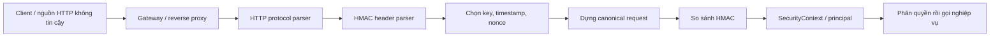

# Fuzz header parser — Kiểm thử độ bền và tính nhất quán của bộ phân tích header HMAC

## 1. Fuzz header parser dùng để kiểm tra điều gì?

Trong **HMAC request authentication**, client ký một *canonical request* theo thỏa thuận, thường gồm HTTP method, URI, những header đã chọn và có thể gồm body hoặc digest của body. Server phải đọc header, tìm đúng key, xác minh timestamp/nonce, dựng lại canonical request rồi so sánh HMAC.

**Fuzz header parser** là kỹ thuật đưa vào bộ phân tích header nhiều dữ liệu bất thường, được biến đổi có hệ thống hoặc tạo bán ngẫu nhiên, để kiểm tra rằng ứng dụng:

- Không crash, treo, tiêu thụ tài nguyên quá mức hay trả lỗi nội bộ khi gặp header malformed.
- Không nhầm những biểu diễn header khác nhau thành cùng một credential theo cách vi phạm hợp đồng ký.
- Không xác thực thành công một request chỉ vì proxy, HTTP library và application parser hiểu header khác nhau.
- Không bỏ qua duplicate, ký tự điều khiển, giá trị vượt giới hạn hay sai định dạng của `keyId`, timestamp, nonce và chữ ký.
- Không thực hiện tác vụ nghiệp vụ, ghi nhận quyền hay phát hành side effect cho request không thể xác thực.

Fuzzing không thay thế kiểm thử chữ ký đúng/sai, replay, key rotation hoặc phân quyền. Nó đánh vào **ranh giới chuyển từ dữ liệu HTTP không đáng tin cậy sang cấu trúc dùng để xác thực HMAC**. Phần kiểm thử ở đây nằm trong chương *Security testing* của module `SECURITY_AUTHENTICATION_HMAC_REQUEST_AUTHENTICATION`.

> Một kết quả `401` hoặc `400` tự nó chưa chứng minh parser hoạt động đúng. Cần biết request bị từ chối bởi **đúng lớp** (HTTP parser, HMAC header parser, kiểm tra timestamp, chữ ký hay replay), và khẳng định không phát sinh side effect. Tương tự, một biến thể tên header khác chữ hoa/thường đôi khi phải được chấp nhận vì tên HTTP field không phân biệt hoa thường.

## 2. Xác định hợp đồng parser trước khi fuzz

Không có một cú pháp header HMAC thống nhất cho mọi hệ thống. Đối với từng API, trước hết phải ghi rõ danh sách header, cách chọn giá trị, canonicalization, xử lý duplicate và ranh giới tài nguyên. Bài dùng **hợp đồng thử nghiệm minh họa** sau; khi áp dụng phải thay bằng hợp đồng thực tế của hệ thống.

| Header | Ý nghĩa trong bài | Quy tắc minh họa |
| --- | --- | --- |
| `X-Key-Id` | Chọn shared secret/phiên bản key | Một giá trị duy nhất; 1–64 ký tự ASCII chữ/số/`.`/`_`/`-` |
| `X-Timestamp` | Thời gian ký request | Một số nguyên dương epoch **seconds** viết bằng chữ số ASCII, không có dấu; phải nằm trong time window tại bước xác thực |
| `X-Nonce` | Giá trị duy nhất chống replay | Một giá trị 8–64 ký tự ASCII chữ/số/`.`/`_`/`-` |
| `X-Signature` | Chữ ký HMAC | Chính xác 64 ký tự hex **chữ thường** của HMAC-SHA256; không có prefix hoặc khoảng trắng |
| Tên field | HTTP field name | So khớp **không phân biệt hoa/thường** |
| Số lần xuất hiện | Bốn field ở trên | Mỗi field đúng một lần; duplicate dưới bất cứ kiểu hoa/thường nào đều bị từ chối |
| Whitespace trong giá trị | Giá trị credential | Không trim/normalize ngầm; khác chính tả quy định thì từ chối |
| Body | Thành phần của canonical request nếu hợp đồng ký yêu cầu | Dùng chính body bytes tại ranh giới ký đã thỏa thuận |

Các giới hạn này chỉ là **fixture có chủ đích**, không phải giá trị chuẩn áp đặt cho mọi API. Ví dụ hệ thống dùng chữ ký Base64, timestamp mili giây hoặc nhiều key ID sẽ có bộ ca thử khác. Timestamp parse hợp lệ về cú pháp vẫn cần được xác minh time window; nonce hợp lệ về cú pháp vẫn cần tra replay store; key ID hợp lệ về cú pháp vẫn cần ánh xạ key. **Parsing, authentication và authorization là ba bước khác nhau.**

### Ranh giới cần đặt dưới kiểm thử



Cần fuzz cả **header value parser ở tầng ứng dụng** lẫn đường đi thực tế qua gateway. Những giá trị chứa byte thô không hợp lệ có thể bị HTTP server loại bỏ trước khi được chuyển thành Java `String`; khi đó test ở tầng unit và tầng HTTP phải có kỳ vọng khác nhau nhưng cùng bảo đảm *không vượt qua xác thực*.

## 3. Phân loại đầu vào fuzz và oracle mong đợi

*Oracle* là tiêu chí cho biết kết quả nào đúng. Không nên mặc định mọi biến đổi đều cần trả lỗi: có biến đổi vẫn tương đương theo semantics của HTTP và hợp đồng ký.

| Nhóm dữ liệu | Biến thể tạo đầu vào | Oracle mong đợi |
| --- | --- | --- |
| Thiếu field | Thiếu `X-Signature`, thiếu nonce | Từ chối xác thực, không có principal |
| Duplicate | Hai `X-Key-Id`; `X-Nonce` và `x-nOnCe` | Từ chối theo hợp đồng **mỗi field đúng một lần** |
| Đổi hoa/thường **tên** | `X-Key-Id` → `x-kEy-iD` | Kết quả tương đương với tên gốc nếu value giữ nguyên |
| Whitespace value | Thêm dấu cách đầu/cuối, TAB, chuỗi rỗng | Từ chối theo hợp đồng minh họa, tránh trim ngầm |
| Ký tự điều khiển | NUL, CR, LF, DEL, chuỗi có CRLF gấp dòng (*obs-fold*) | HTTP stack hoặc parser từ chối; không 5xx, không có header injection |
| Giá trị Unicode | Ký tự có dấu, zero-width space, ký tự nhìn giống ASCII | Từ chối trong các credential bị ràng buộc ASCII |
| Header quá dài | `keyId`, nonce, signature dài hàng nghìn ký tự | Từ chối trong giới hạn cấu hình; không tăng bộ nhớ/CPU vô hạn |
| Quá nhiều header | Lặp lại field, gửi số lượng field vượt limit | HTTP stack hoặc ứng dụng từ chối có kiểm soát |
| Timestamp sai cú pháp | `-1`, `+1`, `1.0`, `1e9`, `0x10`, dấu cách | Parser từ chối; không parse linh hoạt thành giá trị ngoài hợp đồng |
| Timestamp overflow | Số chữ số lớn hơn sức chứa `long` | Từ chối, không ném `NumberFormatException` ra thành 500 |
| Timestamp đúng cú pháp nhưng cũ/tương lai | `1700000000` nếu ngoài time window | Parser có thể chấp nhận; tầng timestamp phải từ chối |
| Signature sai cú pháp | Hex lẻ ký tự, độ dài khác 64, ký tự ngoài `0-9a-f`, Base64 khi yêu cầu hex | Parser từ chối |
| Thay header đã ký | Thay một byte có ý nghĩa trong giá trị đã ký, giữ chữ ký cũ | HMAC không khớp, trừ khi hợp đồng cố ý chuẩn hóa hai biểu diễn đó |
| Unknown headers | Thêm `X-Trace-Id` hợp lệ không nằm trong hợp đồng ký | Có thể được chấp nhận; không tự cho là lỗi |
| Xung đột gateway | Duplicate bị nối dấu phẩy, thay đổi whitespace, HTTP/2 → HTTP/1.1 | Chính sách parse/canonical hóa nhất quán; không có request bypass |

Ví dụ không nên đánh đồng:

```http
X-Key-Id: client-a
x-key-id: client-b
```

Hai dòng là **cùng một tên field theo HTTP**, nên phải phát hiện duplicate ngay cả khi chữ hoa/thường khác nhau. Nếu proxy nối chúng thành `client-a, client-b`, tầng ứng dụng phải xử lý đúng theo policy duplicate của hệ thống; không tự chọn vế đầu hoặc vế cuối.

Tương tự, `X-Signature: abc...` và `X-Signature: ABC...` không đương nhiên tương đương: giá trị header có phân biệt hoa/thường trừ khi định dạng chữ ký và hợp đồng định nghĩa phép chuẩn hóa cụ thể.

## 4. Chia fuzzing thành bốn lớp

### 4.1. Fuzz cú pháp theo từng field

Tạo một **request mẫu hợp lệ** có timestamp trong time window, nonce mới, key đang active và chữ ký tính trên đúng canonical request. Sau đó thay **một field** ở mỗi ca để dễ phân tích nguyên nhân:

1. **Mutation có cấu trúc:** bỏ trường, thêm duplicate, đổi tên field, thay ký tự bất hợp lệ, chèn TAB/CRLF/NUL vào giá trị.
2. **Biên độ dài:** length `0`, `1`, `min-1`, `min`, `max`, `max+1` và rất lớn.
3. **Định dạng số:** số 0, leading zero, overflow, dấu cộng/trừ, decimal/exponent, ký tự ngoài ASCII digit.
4. **Encoding:** Unicode, dấu kết hợp, percent-encoded text, chuỗi trông giống Base64/hex nhưng không phù hợp.
5. **Biến thể signed fields:** giữ chữ ký cũ trong khi đổi thành phần đã ký; xác minh không có đường bỏ qua bước HMAC.

Với mỗi biến thể phải phân loại rõ: sai cú pháp → parser reject; đúng cú pháp nhưng sai timestamp/nonce/signature → tầng xác thực reject; biến thể được hợp đồng chấp nhận → kết quả có thể tương đương baseline.

### 4.2. Fuzz theo luồng xử lý HTTP

Tại ranh giới network/server, thử thêm các header trùng tên, name case mixing, header value có dấu phẩy, byte điều khiển, header quá dài, HTTP/1.1 và HTTP/2. Một số client library không cho tạo request invalid; có thể dùng HTTP test harness chuyên dụng trong **môi trường kiểm thử do mình kiểm soát** để gửi raw bytes. Không nên cố đưa CRLF vào đối số API Java vốn đã kiểm tra và loại bỏ chúng: khi đó đang test client library thay vì server.

Các kết quả có thể chấp nhận gồm HTTP 400 hoặc 431 ở tầng protocol và 400/401 ở tầng HMAC tùy contract. Kết quả **không chấp nhận** gồm 500, kết nối treo, parser crash, principal được tạo từ credential ambiguous hoặc business handler được gọi.

### 4.3. Differential fuzzing giữa các thành phần

Cùng một corpus cần được gửi qua những đường đi mà sản phẩm thực sự hỗ trợ:

- Gửi trực tiếp tới application trong test environment.
- Gửi qua reverse proxy/API gateway có cùng cấu hình production.
- Gửi dưới phiên bản HTTP và cơ chế chuyển tiếp giao thức được triển khai thực tế.

So sánh **cấu trúc header mà verifier nhìn thấy** và lý do từ chối ở từng đường. Chỉ chấp nhận sự khác nhau có chủ đích tại protocol boundary, không để gateway và service bất đồng về key ID, chữ ký hoặc canonical headers. Ví dụ: proxy gộp duplicate thành một field có dấu phẩy, còn app lại chọn phần đầu → rủi ro xử lý mơ hồ.

### 4.4. Property-based và mutation-based fuzzing

Sinh dữ liệu với seed cố định để tái lập. Ưu tiên các bất biến:

- **Safety:** bất kỳ input nào cũng không gây 5xx bất ngờ, ngoại lệ chưa bắt, timeouts hoặc side effect xác thực.
- **Parser uniqueness:** mỗi credential được parse thành tối đa một diễn giải; duplicate không được làm kết quả phụ thuộc thứ tự.
- **Case equivalence của field name:** chỉ đổi chữ hoa/thường **tên header** không làm thay đổi kết quả.
- **Signature integrity:** với thành phần đã ký, nếu giá trị có ý nghĩa canonical khác đi mà chữ ký cũ không thay, request không được xác thực.
- **Replay safety:** input sai cú pháp không thể khiến xác thực thành công hoặc chiếm quyền dùng credential khác. Kiểm thử replay riêng với nonce mới cho từng request được gửi.
- **Bounded resources:** header quá nhiều/quá dài bị giới hạn trước khi gây áp lực bộ nhớ, CPU hoặc log.

Không thể suy ra “tất cả request có dữ liệu thay đổi đều phải reject”. Đổi hoa/thường tên header là biến thể hợp lệ, và thêm một header không nằm trong hợp đồng ký có thể là thao tác vô hại.

## 5. Ví dụ JUnit 5: fuzz parser HMAC có grammar nghiêm ngặt

Ví dụ sau **tự chạy được với Java 17 và JUnit 5**, nhưng `parse()` là **reference parser tối giản phục vụ minh họa**, chỉ nhìn danh sách header đã được decode; nó không thay thế HTTP parser, verifier, key lookup hoặc replay store của sản phẩm. Khi đưa vào dự án, chuyển các assertion sang parser HMAC thật thông qua adapter của ứng dụng.

Hợp đồng minh họa chọn giới hạn tổng 64 field và 4096 ký tự cho mỗi value. Đây là giới hạn **của test fixture**; môi trường thật phải định nghĩa giới hạn ở server/gateway.

```java
import org.junit.jupiter.api.Test;

import java.util.ArrayList;
import java.util.HashMap;
import java.util.List;
import java.util.Locale;
import java.util.Map;
import java.util.Optional;
import java.util.Random;
import java.util.Set;

import static org.junit.jupiter.api.Assertions.assertDoesNotThrow;
import static org.junit.jupiter.api.Assertions.assertTrue;

class HmacHeaderParserFuzzTest {
    record Header(String name, String value) {}
    record Parsed(String keyId, long timestamp, String nonce, String signature) {}

    private static final Set<String> REQUIRED = Set.of(
            "x-key-id", "x-timestamp", "x-nonce", "x-signature");

    // Grammar mẫu dùng ASCII; không dùng regex backtracking trên chuỗi dài.
    private static boolean token(String value, int min, int max) {
        if (value == null || value.length() < min || value.length() > max) {
            return false;
        }
        for (int i = 0; i < value.length(); i++) {
            char c = value.charAt(i);
            if (!(c >= 'A' && c <= 'Z')
                    && !(c >= 'a' && c <= 'z')
                    && !(c >= '0' && c <= '9')
                    && c != '.' && c != '_' && c != '-') {
                return false;
            }
        }
        return true;
    }

    private static boolean headerName(String value) {
        if (value == null || value.isEmpty() || value.length() > 128) {
            return false;
        }
        // RFC HTTP field-name dùng token (tchar), không giới hạn ở tên X-*.
        String extra = "!#$%&'*+-.^_`|~";
        for (int i = 0; i < value.length(); i++) {
            char c = value.charAt(i);
            if (!(c >= 'A' && c <= 'Z')
                    && !(c >= 'a' && c <= 'z')
                    && !(c >= '0' && c <= '9')
                    && extra.indexOf(c) < 0) {
                return false;
            }
        }
        return true;
    }

    private static boolean hasControl(String value) {
        for (int i = 0; i < value.length(); i++) {
            char c = value.charAt(i);
            if (c < 0x20 || c == 0x7f) {
                return true; // cả CR, LF, TAB, NUL và DEL
            }
        }
        return false;
    }

    private static boolean signatureHex(String signature) {
        if (signature == null || signature.length() != 64) {
            return false;
        }
        for (int i = 0; i < signature.length(); i++) {
            char c = signature.charAt(i);
            if (!((c >= '0' && c <= '9') || (c >= 'a' && c <= 'f'))) {
                return false;
            }
        }
        return true;
    }

    private static Optional<Parsed> parse(List<Header> headers) {
        if (headers == null || headers.size() > 64) {
            return Optional.empty();
        }
        Map<String, String> seen = new HashMap<>();

        for (Header header : headers) {
            if (header == null || !headerName(header.name())
                    || header.value() == null || header.value().length() > 4096
                    || hasControl(header.value())) {
                return Optional.empty();
            }
            String name = header.name().toLowerCase(Locale.ROOT);
            if (REQUIRED.contains(name)
                    && seen.putIfAbsent(name, header.value()) != null) {
                return Optional.empty(); // duplicate, kể cả đổi case
            }
        }

        String keyId = seen.get("x-key-id");
        String timestamp = seen.get("x-timestamp");
        String nonce = seen.get("x-nonce");
        String signature = seen.get("x-signature");

        if (!token(keyId, 1, 64) || !token(nonce, 8, 64)
                || !signatureHex(signature) || timestamp == null
                || timestamp.isEmpty() || timestamp.length() > 19) {
            return Optional.empty();
        }
        for (int i = 0; i < timestamp.length(); i++) {
            char c = timestamp.charAt(i);
            if (c < '0' || c > '9') {
                return Optional.empty();
            }
        }

        try {
            long seconds = Long.parseLong(timestamp);
            if (seconds <= 0) {
                return Optional.empty();
            }
            return Optional.of(new Parsed(keyId, seconds, nonce, signature));
        } catch (NumberFormatException overflow) {
            return Optional.empty();
        }
    }

    private static List<Header> validHeaders() {
        return List.of(
                new Header("X-Key-Id", "client-test"),
                new Header("X-Timestamp", "1700000000"),
                new Header("X-Nonce", "nonce-12345678"),
                new Header("X-Signature", "a".repeat(64))
        );
    }

    private static List<Header> replaceValue(String target, String value) {
        List<Header> updated = new ArrayList<>();
        for (Header field : validHeaders()) {
            updated.add(new Header(field.name(),
                    field.name().equalsIgnoreCase(target) ? value : field.value()));
        }
        return updated;
    }

    @Test
    void validAndCaseInsensitiveFieldNames() {
        assertTrue(parse(validHeaders()).isPresent());
        List<Header> renamed = List.of(
                new Header("x-kEy-iD", "client-test"),
                new Header("X-TIMESTAMP", "1700000000"),
                new Header("x-nONCE", "nonce-12345678"),
                new Header("x-signature", "a".repeat(64))
        );
        assertTrue(parse(renamed).isPresent());
    }

    @Test
    void rejectDuplicateAndMalformedValues() {
        List<Header> duplicates = new ArrayList<>(validHeaders());
        duplicates.add(new Header("x-kEy-iD", "other-client"));
        assertTrue(parse(duplicates).isEmpty());

        assertTrue(parse(replaceValue("X-Key-Id", " client-test")).isEmpty());
        assertTrue(parse(replaceValue("X-Nonce", "nonce-123\r\nX-Key-Id: other")).isEmpty());
        assertTrue(parse(replaceValue("X-Nonce", "nónce-12345678")).isEmpty());
        assertTrue(parse(replaceValue("X-Timestamp", "+1700000000")).isEmpty());
        assertTrue(parse(replaceValue("X-Timestamp", "9223372036854775808")).isEmpty());
        assertTrue(parse(replaceValue("X-Signature", "a".repeat(63))).isEmpty());
        assertTrue(parse(replaceValue("X-Signature", "G".repeat(64))).isEmpty());
    }

    @Test
    void seededControlCharacterFuzzNeverParsesAsCredential() {
        Random random = new Random(0x5EED); // seed cố định cho CI
        for (int i = 0; i < 5000; i++) {
            char control = (char) random.nextInt(32);
            String mutatedNonce = "nonce-12345678" + control
                    + "a".repeat(random.nextInt(32));
            List<Header> mutated = replaceValue("X-Nonce", mutatedNonce);

            Optional<Parsed> result = assertDoesNotThrow(() -> parse(mutated));
            assertTrue(result.isEmpty(), "iteration=" + i);
        }
    }
}
```

Điều các test này thực sự chứng minh: với grammar minh họa, parser nhận input hợp lệ, xử lý tên field không phân biệt hoa/thường, từ chối duplicate/giá trị sai và không để control characters vượt qua. Vì mọi kiểm tra đều chạy trên **reference parser**, chúng **chưa chứng minh** request thực tế được bảo vệ. Muốn dùng trong ứng dụng, thay lời gọi `parse(...)` bằng adapter gọi bộ phân tích header thật và thêm kiểm chứng end-to-end.

Một parser có thể nhận `X-Signature` là chuỗi hex hợp lệ về cú pháp nhưng HMAC vẫn sai. Không được xem `parse(...).isPresent()` là đã xác thực thành công. Sau parser bắt buộc có bước chọn secret, kiểm tra timestamp/nonce, xây canonical request, giải mã chữ ký và so sánh HMAC theo thời gian ít phụ thuộc vào nội dung, rồi mới xây authenticated principal.

## 6. Integration test qua Spring Security và gateway

Trong ứng dụng Spring MVC có thể dùng `MockMvc` và trong Spring WebFlux có thể dùng `WebTestClient` để kiểm thử đường vào security filter. Nhưng các client này thường đã chuẩn hóa hoặc từ chối header bất hợp lệ trước khi gửi; với corpus chứa raw CR/LF, dùng test qua HTTP server/gateway phù hợp trong môi trường test.

Thiết kế một ca integration test như sau:

```text
given:
  valid method/URI/body theo hợp đồng ký HMAC
  keyId = key thử nghiệm đang active
  timestamp = thời gian hiện hành nằm trong cửa sổ chấp nhận
  nonce = mới và chưa có trong replay store
  validSignature = HMAC(secret, canonicalRequest)

positive control:
  gửi đầy đủ header và body hợp lệ
  assert authentication succeeds và principal đúng

negative test:
  tạo request khác với nonce mới, ký đúng trước khi mutate
  mutate 1 header theo corpus (ví dụ thêm duplicate X-Key-Id)
  gửi qua cùng filter chain và gateway production-like

then:
  reject ở protocol parser/HMAC header parser/authentication, đúng policy
  không có authenticated principal
  không gọi protected handler và không có side effects
  không xuất hiện uncaught exception hoặc HTTP 500
  reason trong test hook tương ứng với loại mutation
```

Nếu mutation là **đổi tên header thành chữ hoa/thường khác nhau**, hãy giữ nguyên tất cả giá trị/chữ ký và kỳ vọng xác thực tương đương baseline. Nếu mutation là **thay một signed header value**, giữ nguyên chữ ký đã được tính cho giá trị cũ; nếu grammar vẫn hợp lệ, bước HMAC phải reject do mismatch. Nếu thay timestamp thành giá trị hết hạn, phép thử đo riêng time-window validation, không lấy đó làm bằng chứng HMAC mismatch.

### Chống false positive khi bật replay protection

Không gửi negative case bằng **cùng nonce đã được positive case sử dụng**: nonce có thể đã được đánh dấu used, và server sẽ reject do replay trước khi tới parser/chữ ký. Muốn so sánh request positive/negative, tạo hai request với nonce riêng, mỗi request tự ký trước khi mutate. Quan sát mã lý do từ chối trong test hook hoặc metric đã ẩn thông tin nhạy cảm để bảo đảm xác thực đúng nhánh mong đợi.

### Chú ý đường đi proxy/gateway

Một số reverse proxy sẽ gộp nhiều field cùng tên thành chuỗi dấu phẩy, một số giữ danh sách value, một số từ chối toàn bộ request. Các hành vi này phải được quyết định trong hợp đồng và kiểm tra qua tuyến production-like. Nếu ứng dụng không còn nhận được cấu trúc duplicate ban đầu, cần chặn ambiguity ở điểm gần client nhất có đủ dữ liệu thay vì phỏng đoán trong application parser.

## 7. Corpus, mutation strategy và khả năng tái lập

Bộ fuzz có ích nên kết hợp:

1. **Golden corpus:** request hợp lệ, các giá trị min/max, giá trị biên timestamp và chữ ký đúng cú pháp.
2. **Invalid corpus:** trường thiếu, duplicate, value sai cú pháp, CRLF, Unicode, overflow, giá trị quá lớn.
3. **Mutation operators:** thêm/bớt một ký tự, hoán vị, lặp field, đổi case, thay loại encoding, chèn ký tự điều khiển, tăng đột biến độ dài.
4. **Seeded random generation:** dùng seed cố định trong CI; khi tìm được lỗi, lưu **input rút gọn**, seed và cách tái lập thành test hồi quy.
5. **Boundary runs:** một lượt ngắn cho pull request và lượt nặng hơn trong môi trường kiểm thử định kỳ; không gửi dữ liệu fuzz vào hệ thống production hoặc secret thật.

Điểm quan trọng: phân biệt **input bytes trên wire** với chuỗi `String` mà thư viện HTTP chuyển tới ứng dụng. Nếu sản phẩm chỉ fuzz `Map<String, String>` thì nhiều vấn đề do duplicate và parsing giữa proxy–framework sẽ bị bỏ sót.

Với input vượt giới hạn, xác định trước hard cap như tổng số header, độ dài từng field, tổng byte header và timeout parse. Giới hạn cần nhất quán giữa gateway và application để tránh một lớp chấp nhận đầu vào mà lớp khác không thể xử lý. Kiểm soát cả **log amplification**: các payload rất dài, chứa Unicode hoặc control characters không được ghi nguyên văn vào log.

## 8. Quan sát và đánh giá kết quả

| Chỉ báo | Ý nghĩa |
| --- | --- |
| Tỷ lệ corpus được xử lý | Các nhóm mutation thực sự chạy qua ranh giới mong muốn |
| Kết quả parse theo loại lỗi | Phân biệt malformed, duplicate, vượt giới hạn, timestamp sai, signature mismatch |
| Số phản hồi `5xx` bất ngờ | Phải bằng 0 với đầu vào fuzz hợp lệ đối với hạ tầng test |
| Thời gian xử lý/CPU/bộ nhớ | Theo dõi độ tăng khi header dài hoặc nhiều field; bảo đảm giới hạn |
| Authentication bypass | Không request malformed nào được gán principal |
| Business side effects | Không ghi dữ liệu, gửi message hoặc thực thi nghiệp vụ khi auth thất bại |
| Direct–gateway differences | Những khác biệt phải có giải thích được và không thay đổi quyết định bảo mật |
| Tái lập | Với cùng seed, corpus và cấu hình, tái tạo được ca lỗi |

Trong thực tế, lý do từ chối nên xuất hiện trong **telemetry nội bộ** dưới mã chung như `MALFORMED_AUTH_HEADER`, `DUPLICATE_AUTH_HEADER` hoặc `INVALID_SIGNATURE`; HTTP response công khai không cần tiết lộ key ID có tồn tại hay không, secret hoặc nội dung canonical request. Không đưa chữ ký hoàn chỉnh, token, nonce nhạy cảm hay body chứa dữ liệu cá nhân vào log.

## 9. Những lỗi thường gặp khi viết fuzz test

**Chỉ fuzz HTTP status.** Thấy 400/401 rồi kết luận an toàn sẽ bỏ qua crash ẩn, log bùng nổ, side effect hoặc sai thứ tự validation. Cần bổ sung assertion ở điểm xác thực và nghiệp vụ.

**Fuzz nhưng không có baseline hợp lệ.** Nếu mọi request đều bị từ chối vì key ID sai hoặc clock drift, bộ fuzz không kiểm tra được nhánh parser mong muốn. Phải chạy control dương qua security filter.

**Trộn nhiều mutation trong một test.** Một request vừa duplicate vừa timestamp hết hạn vừa signature malformed khiến lỗi bị che nhau. Trước hết kiểm thử từng mutation độc lập rồi mới phối hợp để tìm edge case.

**Coi mọi thay đổi là tấn công.** Tên field HTTP không phân biệt hoa/thường, nên chỉ đổi case là phép biến đổi tương đương. Ngược lại, dùng case-insensitive cho **giá trị** key ID/nonce/signature không có căn cứ sẽ có nguy cơ chọn sai key hoặc sai canonicalization.

**Giả định parser nhìn thấy toàn bộ raw HTTP.** Web server có thể từ chối CRLF hoặc nối field từ trước. Unit test parser và network test đo các ranh giới khác nhau; cần cả hai.

**Dùng parser tự viết làm nguồn sự thật duy nhất.** Oracle của bài là hợp đồng ký được công bố và đường đi xác thực thực tế. Reference parser trong ví dụ chỉ làm rõ cơ chế fuzz; khi test sản phẩm phải chạy trên parser thật.

## 10. Bài tập và tiêu chí hoàn thành

**Bài tập:** Mở rộng lớp JUnit 5 ở mục 5 bằng mutation giá trị dài 4.097 ký tự, timestamp có leading zero, signature hex chữ hoa và duplicate có cùng value. Với mỗi trường hợp, chỉ ra vì sao hợp đồng minh họa chấp nhận hay từ chối. Sau đó chuyển bộ corpus sang integration test của ứng dụng Spring Security, chạy trực tiếp và qua gateway, ghi nhận các khác biệt có ảnh hưởng bảo mật. Cuối cùng tạo một ca mà parser cho qua nhưng verifier từ chối HMAC sai, để chứng minh hai bước này độc lập.

Một bộ fuzz header parser đạt yêu cầu khi có **golden request hợp lệ**, có corpus bao phủ missing/duplicate/whitespace/control characters/encoding/length/overflow, giữ được seed và đầu vào lỗi để tái lập, chứng minh không có bypass hay side effect, và thống nhất giữa parser, gateway và quy tắc canonical request. Đây là lớp phòng thủ nền tảng để xác minh HMAC request đi đúng credential, đúng byte đã ký, chống replay bằng timestamp/nonce và chỉ chuyển sang **phân quyền** sau khi xác thực thành công.
