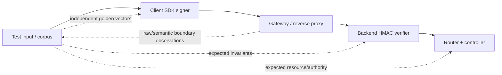
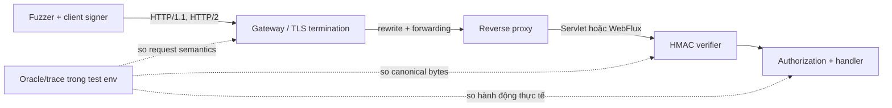

# Fuzz canonicalization trong xác thực HTTP request bằng HMAC

## 1. Bối cảnh: cùng một HTTP request, hai cách hiểu là một lỗ hổng

Trong module `SECURITY_AUTHENTICATION_HMAC_REQUEST_AUTHENTICATION`, client ký HTTP request bằng **HMAC** với shared secret và một **canonical request** theo hợp đồng. Canonical request có thể bao gồm method, URI/query, các header được chọn và hash của body. Server dựng lại cùng dãy byte để xác minh signature; sau đó kiểm tra timestamp/nonce chống replay, tình trạng key khi rotation và quyền của client.

Một phép thử “gửi request chuẩn, MAC khớp, trả `200`” chưa đủ bảo đảm an toàn. HTTP có nhiều cách biểu diễn cùng một trường hoặc nhiều cách phân tích một chuỗi bytes:

- `/orders/%2F` và `/orders//` có thể được các thành phần xử lý khác nhau.
- `?role=viewer&role=admin` có thể được lấy giá trị đầu, giá trị cuối hoặc giữ cả hai.
- Tên header `X-Key-Id` không phân biệt hoa/thường, nhưng **giá trị key ID** không mặc nhiên được lowercase.
- Header trùng, OWS, body encoding hoặc proxy rewrite có thể khiến signer và verifier hiểu hai request khác nhau.
- HTTP/1.1, HTTP/2 và HTTP/3 có các quy tắc framing/connection-specific fields khác nhau.

Nếu verifier chấp nhận chữ ký của **một cách hiểu**, còn router hoặc controller xử lý request theo **cách hiểu khác**, HMAC không còn bảo vệ đúng hành động mà client dự định ký. Đây là một lớp lỗi **canonicalization ambiguity/differential parsing**, có thể dẫn tới signature bypass, sai đối tượng hoặc cross-tenant access khi thiết kế không chặt chẽ.

Chương **Security testing** đặt ra đề bài **Fuzz canonicalization**: dùng input sinh tự động, biến đổi có kiểm soát, property-based testing và differential testing để phát hiện bất nhất thay vì chỉ kiểm tra vài request viết tay.

Sau bài học, người học có thể:

- Định nghĩa oracle và các **security invariants** cho canonical request HMAC.
- Tạo corpus và generator có chủ đích cho URI, query, header, body, Unicode và các biến đổi qua proxy.
- Phân biệt **biến đổi được hợp đồng cho phép** với biến đổi phải làm MAC sai hoặc request bị reject.
- Viết property-based tests bằng Java/JUnit/jqwik và test HTTP qua MockMvc, WebTestClient.
- Triangulate lỗi giữa client signer, gateway, HMAC verifier và business handler.
- Thiết kế fuzz có ngân sách, tái hiện bằng seed/shrinking và kiểm thử regression mà không lưu secret production.

## 2. Fuzzing không đồng nghĩa gửi chuỗi ngẫu nhiên tới API

**Fuzzing** cung cấp nhiều đầu vào có cấu trúc hoặc được biến đổi từ mẫu hợp lệ để tìm crash, exception, timeout, memory exhaustion hoặc một hành vi không đúng hợp đồng. **Property-based testing** sinh nhiều dữ liệu và kiểm tra bất biến thay vì chỉ một expected value. **Differential testing** gửi cùng dữ liệu tới nhiều implementation/đường đi để tìm sự khác biệt có ý nghĩa.

Với HMAC, ba cách thường kết hợp:

| Cách thử | Input | Oracle cần có |
| --- | --- | --- |
| Mutation fuzzing | Tạo request hợp lệ rồi sửa một thành phần | Biết thành phần ấy có nằm trong phạm vi ký hay không |
| Structure-aware fuzzing | Sinh URI/query/header/body theo một grammar | Validate hoặc reject đúng contract |
| Property-based testing | Sinh các biến thể qua generator có ràng buộc | Bất biến determinism, canonical equivalence, signature integrity |
| Differential testing | Cùng request qua SDK signer, backend verifier, gateway | Hai phía tạo canonical bytes giống nhau **nếu request được phép tương đương** |
| Stateful fuzzing | Chuỗi nhiều request, nonce/key state thay đổi | Không replay, không dùng key revoked, không có side effect sai |

Fuzzing không được dùng các HTTP request có khả năng làm thay đổi dữ liệu thật trên production. Tạo môi trường thử nghiệm cô lập, test secrets, fake/staging tenant, endpoint không gây thiệt hại, giới hạn rate/size và quan sát side effects.

## 3. Trước khi fuzz: khóa chặt hợp đồng ký

Fuzzer cần một **reference contract**, không thể tự quyết định rằng hai URI “trông giống nhau” là tương đương. Ví dụ hợp đồng ứng dụng **HMAC-V1 giả định**:

```text
CanonicalRequest = UTF8(joinWithLF(
  "HMAC-V1",
  UPPERCASE_METHOD,
  RAW_PATH_AND_QUERY,
  "x-key-id:" + KEY_ID,
  "x-nonce:" + NONCE,
  "x-timestamp:" + TIMESTAMP,
  "content-type:" + CONTENT_TYPE,
  "x-content-sha256:" + LOWERCASE_HEX_SHA256_RAW_BODY
))
```

Quy tắc v1 của ví dụ:

1. Dùng một ký tự **LF `0x0A`** giữa các dòng, không có LF ở cuối, toàn bộ text UTF-8.
2. Method được quy định theo contract; ký `POST` khác ký `PUT`.
3. `RAW_PATH_AND_QUERY` là request-target ở **điểm tin cậy đã công bố**. Không tự động decode percent-encoding, sort query, collapse dấu `/` hay normalize Unicode.
4. Header bắt buộc: `X-Key-Id`, `X-Nonce`, `X-Timestamp`, `Content-Type`, `X-Content-SHA256` và `X-Signature`, đúng một giá trị cho mỗi trường. `X-Signature` là output, **không** được đưa vào input của chính nó.
5. Tên signed header được biểu diễn lowercase; giá trị có cú pháp nghiêm ngặt, không chứa CR/LF; policy là do server cấu hình.
6. `X-Content-SHA256` phải khớp SHA-256 từ body bytes được bảo vệ. HMAC bảo vệ cả digest header; hash body đơn độc không chứng minh danh tính.
7. `X-Timestamp`/`X-Nonce` nằm trong MAC và phải được kiểm tra cửa sổ thời gian/tính duy nhất; key ID ánh xạ tới key version còn hiệu lực.

Đây **không phải chuẩn HMAC phổ quát**. Trong một API khác, authority, header list, query normalization hoặc body representation có thể được ký theo cách khác. Fuzz oracle phải đọc đúng contract **được chính ứng dụng công bố**, và phải ghi lại version của contract khi tạo regression vectors.

### 3.1. Sơ đồ các điểm so sánh



Nếu SDK và verifier dùng **cùng thư viện canonicalizer lỗi**, một integration test có thể vẫn xanh. Vì vậy cần **golden vector độc lập**, cũng như kiểm tra business handler thực sự xử lý đúng method/path/tenant/body đã được bảo vệ.

## 4. Bốn nhóm security invariants bắt buộc

### 4.1. Determinism

Với cùng input và contract version, canonicalization cho cùng kết quả byte:

```text
canonicalize(R, v1) == canonicalize(R, v1)
```

Không được phụ thuộc vào thứ tự duyệt `HashMap`, locale mặc định, timezone máy chạy, thời điểm hiện tại hay iteration order bất định.

### 4.2. Equivalence có điều kiện

Nếu contract nói tên header **case-insensitive**, đổi chỉ casing của **tên** `X-Key-Id` thành `x-key-id` (không đổi value, không tạo duplicate) không được đổi canonical bytes. Nếu contract cho phép một quy tắc OWS cụ thể, áp dụng đúng quy tắc ấy.

**Không** suy ra rằng đổi thứ tự query, decode `%2F`, đổi body JSON whitespace hoặc NFC/NFD Unicode là tương đương nếu contract chưa định nghĩa như vậy.

### 4.3. Integrity separation

Thay **một trường bắt buộc được ký** — method, protected URI, key ID, timestamp, nonce, signed header value hoặc body digest — mà **không tạo lại signature** thì request phải bị từ chối. Thay giá trị unsigned observability header như request ID có thể không đổi MAC nếu contract đã loại nó khỏi phạm vi ký, nhưng những giá trị ấy **không** được dùng làm quyết định authentication/authorization.

Với một thay đổi làm canonical bytes khác, phép HMAC chuẩn có xác suất va chạm cực nhỏ, nhưng test không nên diễn giải tính bất biến tuyệt đối cho mọi dãy byte tùy ý; nó kiểm tra các vector và điều kiện thực tế với thuật toán/độ dài MAC đã chọn.

### 4.4. Reject ambiguity

Một request malformed hoặc mơ hồ phải bị reject theo policy, không tự chọn cách diễn giải “dễ hợp lệ nhất”:

- Hai `X-Key-Id`, `X-Nonce` hoặc `X-Timestamp` với giá trị trùng/mâu thuẫn.
- Query duplicate keys ảnh hưởng routing/tenant mà contract không quy định.
- Percent encoding không hợp lệ, UTF-8 không hợp lệ, CR/LF trong header.
- URI normalization khác nhau ở gateway và backend.
- Framing/Content-Length/Transfer-Encoding mâu thuẫn ở đường HTTP thực.

**Từ chối request mơ hồ** thường an toàn hơn việc thử nhiều canonical variants rồi chấp nhận variant nào có MAC khớp. Mỗi “fallback normalization” mở rộng tập thông điệp được xác thực và gây khó kiểm toán.

## 5. Ma trận fuzz URI và query

| Nhóm | Các biến thể cần sinh | Oracle cần quan sát |
| --- | --- | --- |
| Case của path | `/Orders` vs `/orders` | Phân biệt nếu route/contract case-sensitive |
| Slash | `/orders/x`, `/orders//x`, `/orders/x/` | Giữ nguyên hoặc reject; không tự collapse mơ hồ |
| Dot segments | `/a/./b`, `/a/x/../b` | Gateway và backend không route sai so với bytes được ký |
| Encoded slash | `%2F`, `%2f`, dấu `/` thật | Không decode khác nhau giữa các tầng |
| Encoded dot | `%2e`, `%2E`, `.` | Kiểm tra path traversal/canonical mismatch theo contract |
| Percent invalid | `%`, `%G0`, ký tự percent thiếu hex | Reject hoặc xử lý theo HTTP stack đã quy định; không đoán |
| Query order | `?a=1&b=2` vs `?b=2&a=1` | Giữ nguyên nếu ký raw query; chỉ sort nếu contract quy định |
| Duplicate query | `?tenant=a&tenant=b` | Reject hoặc xử lý thống nhất signer/router/verifier |
| Empty vs absent | `?x=`, `?x`, không có `x` | Không tự coi giống nhau khi contract không cho phép |
| Plus vs space | `x=a+b` vs `x=a%20b` | Phân biệt form encoding với raw query |
| Fragment | `#part` trên URL client | Fragment không được gửi trong HTTP request-target; không dùng làm dữ liệu xác thực |
| Unicode | NFC vs NFD, ký tự đa byte, emoji | Dùng bytes đã định nghĩa; nếu normalize cần versioned rule |
| IPv6/authority | Host/`:authority`, port mặc định/khác | Nếu ký authority, phải định nghĩa nguồn tin cậy và syntax |
| Absolute-form | Request-target khi làm việc qua proxy | Chỉ chấp nhận form HTTP được endpoint/gateway hỗ trợ |

### 5.1. Ví dụ phân tích “cùng ngữ nghĩa” nguy hiểm

```text
Client ký: POST /api/orders?tenant=alice&tenant=bob
Gateway route theo: tenant đầu tiên -> alice
Backend handler lấy: tenant cuối cùng -> bob
```

Nếu HMAC chỉ bảo vệ một representation bị chuẩn hóa khác với representation được handler xử lý, dữ liệu tenant có thể vượt khỏi phạm vi signer dự định. Fuzzer phải kiểm tra **cả MAC outcome lẫn tenant/resource cuối cùng**. Không phải mọi duplicate query đều nguy hiểm; nguy hiểm xuất hiện khi các thành phần dùng **khác quy tắc** và giá trị ảnh hưởng tới quyền hoặc nghiệp vụ.

### 5.2. Fuzz giới hạn kích thước

Sinh path/query dài gần giới hạn: rất dài, nhiều tham số, tên khóa rỗng, liên tiếp dấu `&` hoặc `=`. Các phép thử phải có **timeout, giới hạn bytes, giới hạn số lượng trường và quota**; nếu input bị từ chối bằng `400`/`414`/`431` hoặc status được contract quy định thì đó có thể là kết quả đúng. Crash, uncontrolled allocation hoặc request được xử lý sai là lỗi cần điều tra.

## 6. Ma trận fuzz header

| Nhóm | Biến thể | Kết quả mong muốn |
| --- | --- | --- |
| Tên khác case | `X-Key-Id`, `x-key-id`, `X-KEY-ID` | Cùng tên HTTP field, canonical lowercase |
| Key ID value đổi case | `key-v2` vs `KEY-V2` | Theo opaque key ID policy; không tự lowercase |
| Leading/trailing OWS | SP/HTAB quanh field value | Chuẩn hóa đúng contract hoặc reject |
| Interior whitespace | Nhiều dấu cách trong `Content-Type`/custom signed header | Không âm thầm normalize trái hợp đồng |
| Duplicate | Hai `X-Timestamp` hoặc `X-Signature` | Reject vì field HMAC single-valued |
| Comma join | `X-Key-Id: a,b` | Reject nếu contract chỉ cho một ID |
| Empty/blank | `X-Nonce:` hoặc toàn spaces | Reject; không tạo nonce mặc định |
| Mixed encoding | Non-ASCII trong key ID/nonce, control bytes | Reject theo charset/HTTP parser |
| Timestamp syntax | Epoch vs ISO-8601, millis vs seconds, timezone khác | Chỉ chấp nhận format đã công bố |
| Content digest | Hex uppercase/lowercase, 63/64/65 ký tự | Chỉ chấp nhận encoding/length theo contract |
| Signature | Base64 invalid, base64url thay base64 chuẩn, MAC ngắn | Reject nếu không hỗ trợ |
| Signed header missing | `Content-Type`/`X-Key-Id`/`X-Nonce` bị xóa | Fail closed |
| Unsigned header thêm | `X-Request-Id`/`traceparent` | MAC không đổi nếu không dùng cho security decision |
| Hop-by-hop | `Connection`, `Transfer-Encoding`, `TE` | Không ký transport framing; test proxy stripping |

HTTP header names **không phân biệt hoa/thường**. Tuy nhiên, `getFirst("X-Key-Id")` trong Spring không đủ kiểm tra header single-valued nếu có nhiều giá trị. Với Servlet, có thể đọc `getHeaders(...)`; với WebFlux, đọc danh sách từ `HttpHeaders.get(...)`. Những kiểm tra này vẫn chưa thay thế fuzz tại edge: proxy/container có thể đã **gộp** duplicate fields hoặc reject request trước khi vào ứng dụng.

Với HTTP/1.1, `Connection: X-Signature` có thể khiến intermediary loại `X-Signature` ở hop sau. Backend bảo vệ bằng HMAC phải reject vì thiếu signature, không bỏ qua filter. Gateway do tổ chức kiểm soát nên reject ngay trường hợp client cố khai các header bảo mật thành connection option.

## 7. Ma trận fuzz body, digest và encoding

Body là bytes, không phải “JSON object tương đương” trừ khi hợp đồng ký có quy tắc chuẩn hóa JSON riêng.

```json
{"orderId":"O-17","amount":125000}
```

```json
{
  "amount": 125000,
  "orderId": "O-17"
}
```

Hai JSON trên có thể được parser hiểu tương đương, nhưng **raw bytes** khác nhau. Nếu HMAC ký SHA-256 của raw body, chữ ký của body thứ nhất không tự xác thực body thứ hai.

Các biến thể cần thử:

1. Body rỗng vs thiếu body vs JSON `null` vs `{}`.
2. Chỉ thay whitespace, newline CRLF/LF, thứ tự field hoặc escape Unicode.
3. UTF-8 đa byte, invalid UTF-8, BOM, charset `Content-Type` có/không có.
4. Duplicate JSON property names như `{"role":"user","role":"admin"}`; parser/validator phải áp dụng chính sách nhất quán, nhất là với field quyền.
5. Body hash header giữ nguyên nhưng body đổi byte; hoặc header digest đổi mà MAC không đổi.
6. Body nén bằng `Content-Encoding: gzip` và gateway giải nén; xác định **bytes trước hay sau transform** được ký.
7. HTTP/1.1 chunked transfer và HTTP/2 DATA frames chuyên chở cùng content bytes. Không ký `Transfer-Encoding` như end-to-end application metadata.
8. Multipart upload, boundary, filename hoặc streaming body nếu API hỗ trợ; cần hợp đồng ký riêng và giới hạn kích thước.
9. Body lớn gần/vượt giới hạn parser/cache; verifier không được tiêu thụ bộ nhớ không giới hạn.

Nếu filter Spring MVC đọc body để kiểm tra hash, controller `@RequestBody` phải đọc lại đúng bytes đã được kiểm tra. Với WebFlux, cần quản lý `Flux<DataBuffer>`, giới hạn tổng bytes, release khi lỗi và replay qua `ServerHttpRequestDecorator` nếu downstream cần body.

**Property bảo mật quan trọng:** dữ liệu mà business handler thực sự xử lý phải là **đúng dữ liệu đã được verifier xác nhận**, không phải một representation được decode lại thành nội dung khác mà hợp đồng chưa bảo vệ.

## 8. Fuzz qua gateway/proxy và các phiên bản HTTP



### 8.1. Chọn đúng trust boundary

- Nếu HMAC được **xác minh ở gateway trước rewrite**, fuzz trên request bên ngoài; backend chỉ được tin identity assertion nội bộ qua kênh bảo vệ.
- Nếu HMAC được **xác minh ở backend sau rewrite**, contract phải giải thích request-target/headers nào được ký và backend lấy chúng từ nguồn đáng tin nào. Không tin `X-Original-URI` hoặc `X-Forwarded-*` do client tự cung cấp.
- Không được tự thử nhiều path/host hoặc nhiều phiên bản canonical request cho đến khi MAC khớp, trừ khi đây là các version được công bố, phân biệt và kiểm soát theo policy.

### 8.2. Trường hợp chuyển đổi H1 → H2/H3

HTTP/2 và HTTP/3 không dùng các connection-specific fields của HTTP/1.1; `TE` chỉ có ngoại lệ hạn chế liên quan `trailers`. Một gateway hợp lệ có thể thay framing và casing của tên header. Nếu contract ký body bytes và signed header semantics ổn định, phép xác minh vẫn phải đúng.

Fuzz test cần phân biệt:

- **Biến đổi cho phép:** lowercase tên header; đổi framing; bổ sung tracing metadata unsigned.
- **Biến đổi không cho phép:** đổi giá trị `X-Nonce`, `X-Timestamp`, `X-Key-Id`, signed `Content-Type` hoặc body bytes khi verifier vẫn nhận cùng signature.
- **Input phải reject:** duplicate HMAC credentials mơ hồ, malformed framing, invalid HTTP syntax, hop-by-hop khai header chữ ký.

Đặc biệt, các thử nghiệm request smuggling/framing ambiguity chỉ nên chạy trong **môi trường kiểm thử được cấp phép**, có giới hạn lưu lượng và logger không chứa bí mật; đây là nhóm thử nghiệm ranh giới HTTP parser, không phải lý do nới lỏng HMAC.

## 9. Thiết kế corpus và mutation plan

Fuzzer hiệu quả thường bắt đầu từ **corpus hợp lệ**, sau đó áp dụng mutation có chủ đích:

| Seed | Dữ liệu mẫu | Mutation được áp dụng |
| --- | --- | --- |
| GET body rỗng | `GET /orders/O-17` | Slash, path case, query trùng |
| POST JSON ngắn | `POST /orders` + một JSON object | Whitespace, key order, đổi một byte body |
| Unicode path/query | URL chứa percent-encoded UTF-8 | NFC/NFD, percent hex case, malformed percent |
| Header HMAC hợp lệ | Key, timestamp, nonce, digest, MAC đúng | Duplicate, casing, OWS, missing header |
| Multi-tenant request | Tenant/resource đã biết | Thay tenant/query/header trong và ngoài phạm vi ký |
| Gateway contract | External path được rewrite | Query reorder, Host/authority, forwarded header |
| Key rotation | v1/v2 active/retiring/revoked | Trạng thái thay đổi giữa các request |
| Replay sequence | Hai HTTP attempts với nonce xác định | Gửi lại cùng chữ ký, thay request ID, concurrency |

Mỗi test record nên lưu:

```text
contractVersion
seed / iteration / mutationType
HTTP protocol + gateway route
raw request-target (hoặc byte fixture)
header entries theo thứ tự nhận, bao gồm duplicates
body fixture bytes hoặc file tham chiếu test
expected canonical bytes / expected outcome
expected application route + authorized principal/tenant
observed status, audit event, side effect
```

**Không lưu shared secret production** hoặc chữ ký thật có thể sử dụng lại vào corpus. Test dùng secret giả, tenant giả, cố định clock/nonce store; file regression cần được review trước khi đưa lên repository, vì fuzz có thể làm xuất hiện dữ liệu nhạy cảm trong logs/CI artifacts.

## 10. Java reference canonicalizer đơn giản, nghiêm ngặt

Để viết property tests, cần có một đối tượng canonicalization **không phụ thuộc vào HTTP container**. Đoạn Java sau là **mẫu thu gọn cho bài học**, dùng request đã parse thành cấu trúc rõ ràng và chính sách signed headers cố định. Nó không phải HTTP parser production, không tự xử lý percent-encoding, gateway trust hoặc nonce store.

```java
import java.nio.charset.StandardCharsets;
import java.security.MessageDigest;
import java.security.NoSuchAlgorithmException;
import java.util.ArrayList;
import java.util.HexFormat;
import java.util.List;
import java.util.Locale;
import java.util.Set;
import java.util.regex.Pattern;

public final class StrictHmacV1Canonicalizer {
    public record Header(String name, String value) {}

    public record RequestParts(
            String method,
            String rawTarget,
            List<Header> headers,
            byte[] body) {
        public RequestParts {
            headers = List.copyOf(headers);
            body = body.clone();
        }
        @Override
        public byte[] body() {
            return body.clone();
        }
    }

    private static final List<String> SIGNED_NAMES = List.of(
            "content-type", "x-key-id", "x-nonce", "x-timestamp");
    private static final Set<String> ALLOWED_METHODS =
            Set.of("GET", "POST");
    private static final Pattern TOKEN =
            Pattern.compile("[A-Za-z0-9._-]{1,64}");

    private StrictHmacV1Canonicalizer() {}

    private static String uniqueValue(
            List<Header> headers, String name) {
        List<String> values = new ArrayList<>();
        for (Header header : headers) {
            if (header.name().equalsIgnoreCase(name)) {
                values.add(header.value());
            }
        }
        if (values.size() != 1) {
            throw new IllegalArgumentException(
                    "Missing or duplicate signed header");
        }
        String value = values.get(0);
        if (value == null || value.indexOf('\r') >= 0
                || value.indexOf('\n') >= 0
                || !value.equals(value.strip()) || value.isBlank()) {
            throw new IllegalArgumentException("Invalid signed header");
        }
        return value;
    }

    public static byte[] canonicalBytes(RequestParts request) {
        if (!ALLOWED_METHODS.contains(request.method())) {
            throw new IllegalArgumentException("Unsupported method");
        }
        String target = request.rawTarget();
        if (target == null || !target.startsWith("/")
                || target.indexOf('\r') >= 0
                || target.indexOf('\n') >= 0) {
            throw new IllegalArgumentException("Invalid raw target");
        }

        List<String> lines = new ArrayList<>();
        lines.add("HMAC-V1");
        lines.add(request.method());
        lines.add(target);
        for (String name : SIGNED_NAMES) {
            String value = uniqueValue(request.headers(), name);
            if ((name.equals("x-key-id") || name.equals("x-nonce"))
                    && !TOKEN.matcher(value).matches()) {
                throw new IllegalArgumentException("Invalid identifier");
            }
            if (name.equals("content-type")
                    && !value.equals("application/json")) {
                throw new IllegalArgumentException("Unexpected media type");
            }
            lines.add(name + ":" + value);
        }
        byte[] bodyDigest;
        try {
            bodyDigest = MessageDigest.getInstance("SHA-256")
                    .digest(request.body());
        } catch (NoSuchAlgorithmException ex) {
            throw new IllegalStateException(
                    "SHA-256 provider unavailable", ex);
        }
        lines.add("x-body-sha256:" + HexFormat.of().formatHex(bodyDigest));
        return String.join("\n", lines)
                .getBytes(StandardCharsets.UTF_8);
    }
}
```

Trong ví dụ này, `RequestParts.headers` giữ được **nhiều occurrences và thứ tự** để phát hiện duplicate; không đặt header ngay vào một `Map<String,String>` vì như vậy có thể mất thông tin mơ hồ trước khi test.

Hàm `canonicalBytes` cố ý **không** decode hay normalize raw target. Một parser/gateway phải kiểm tra raw-target format theo contract riêng trước khi truyền tới đây; input path mơ hồ được xử lý tại boundary chứ không phải “sửa” trong canonicalizer. Những signed header khác, header version, timestamp syntax và body digest header có thể bổ sung theo hợp đồng production. Không dùng ví dụ thu gọn này như verifier đã hoàn chỉnh.

**Ghi chú về thứ tự:** `SIGNED_NAMES` được khai báo cố định; kết quả không phụ thuộc thứ tự xuất hiện của các **header hợp lệ duy nhất** trong request. Nếu ứng dụng chọn ký thứ tự header trên wire, oracle phải thay đổi theo contract tương ứng.

## 11. Property-based tests bằng jqwik

Thư viện **jqwik** tích hợp với JUnit Platform, hỗ trợ generator, property, seed và shrinking. Ví dụ sau kiểm tra một số invariants trên canonicalizer rút gọn. Đây là ví dụ minh họa; dự án thực cần khai báo jqwik dependency và cấu hình test runner thích hợp.

```java
import static org.junit.jupiter.api.Assertions.assertArrayEquals;
import static org.junit.jupiter.api.Assertions.assertFalse;
import static org.junit.jupiter.api.Assertions.assertThrows;
import java.nio.charset.StandardCharsets;
import java.util.ArrayList;
import java.util.Arrays;
import java.util.List;
import net.jqwik.api.ForAll;
import net.jqwik.api.Property;
import net.jqwik.api.constraints.AlphaChars;
import net.jqwik.api.constraints.StringLength;

class CanonicalizationProperties {
    private static final byte[] BODY =
            "{\"orderId\":\"O-17\"}".getBytes(StandardCharsets.UTF_8);

    private static StrictHmacV1Canonicalizer.RequestParts request(
            String nonce) {
        return new StrictHmacV1Canonicalizer.RequestParts(
                "POST",
                "/integrations/orders?source=partner",
                List.of(
                    new StrictHmacV1Canonicalizer.Header(
                            "Content-Type", "application/json"),
                    new StrictHmacV1Canonicalizer.Header(
                            "X-Key-Id", "fulfillment-v2"),
                    new StrictHmacV1Canonicalizer.Header(
                            "X-Nonce", nonce),
                    new StrictHmacV1Canonicalizer.Header(
                            "X-Timestamp", "2026-11-28T03:15:00Z")),
                BODY);
    }

    @Property(tries = 500)
    void sameInputHasSameCanonicalBytes(
            @ForAll @AlphaChars @StringLength(min = 1, max = 32)
                    String nonce) {
        var input = request(nonce);
        assertArrayEquals(
                StrictHmacV1Canonicalizer.canonicalBytes(input),
                StrictHmacV1Canonicalizer.canonicalBytes(input));
    }

    @Property(tries = 500)
    void changingOnlyHeaderNameCaseIsEquivalent(
            @ForAll @AlphaChars @StringLength(min = 1, max = 32)
                    String nonce) {
        var original = request(nonce);
        List<StrictHmacV1Canonicalizer.Header> changed = List.of(
                new StrictHmacV1Canonicalizer.Header(
                        "content-type", "application/json"),
                new StrictHmacV1Canonicalizer.Header(
                        "x-key-id", "fulfillment-v2"),
                new StrictHmacV1Canonicalizer.Header(
                        "x-nonce", nonce),
                new StrictHmacV1Canonicalizer.Header(
                        "x-timestamp", "2026-11-28T03:15:00Z"));
        var mutated = new StrictHmacV1Canonicalizer.RequestParts(
                "POST", original.rawTarget(), changed, original.body());
        assertArrayEquals(
                StrictHmacV1Canonicalizer.canonicalBytes(original),
                StrictHmacV1Canonicalizer.canonicalBytes(mutated));
    }

    @Property(tries = 500)
    void duplicateKeyIdIsRejected(
            @ForAll @AlphaChars @StringLength(min = 1, max = 32)
                    String nonce) {
        var original = request(nonce);
        var headers = new ArrayList<>(original.headers());
        headers.add(new StrictHmacV1Canonicalizer.Header(
                "x-KEY-id", "attacker-key"));
        var duplicated = new StrictHmacV1Canonicalizer.RequestParts(
                original.method(), original.rawTarget(),
                headers, original.body());
        assertThrows(IllegalArgumentException.class, () ->
                StrictHmacV1Canonicalizer.canonicalBytes(duplicated));
    }

    @Property(tries = 500)
    void changingSignedNonceChangesCanonicalBytes(
            @ForAll @AlphaChars @StringLength(min = 1, max = 32)
                    String nonce) {
        var original = request(nonce);
        var changed = request(nonce + "-other");
        assertFalse(Arrays.equals(
                StrictHmacV1Canonicalizer.canonicalBytes(original),
                StrictHmacV1Canonicalizer.canonicalBytes(changed)));
    }
}
```

Các `@AlphaChars`, `@StringLength` ở đây giới hạn domain để mẫu **luôn hợp lệ** với regex của canonicalizer, nhờ đó test thực sự đo được invariant thay vì phần lớn input bị reject ở parser. Test mutation invalid dùng generator riêng có ký tự Unicode, percent-encoding, duplicate fields, missing values, CR/LF và body size lớn.

**Lưu ý:** test trên `nonce + "-other"` không kiểm tra entropy nonce hoặc replay; nó chỉ kiểm tra việc thay signed nonce làm đổi canonical bytes. Thời gian và key status phải được test trong HMAC authentication provider.

### 11.1. Kiểm tra signed vs unsigned header

Nếu hợp đồng không ký `X-Request-Id`, thêm hoặc sửa **chỉ** header ấy không được làm đổi canonical bytes, nhưng cũng **không được** biến nó thành principal, tenant hay quyền.

```java
@Property(tries = 200)
void unsignedRequestIdDoesNotChangeMacInput(
        @ForAll @AlphaChars @StringLength(min = 1, max = 24)
                String externalRequestId) {
    var original = request("valid-nonce");
    var headers = new ArrayList<>(original.headers());
    headers.add(new StrictHmacV1Canonicalizer.Header(
            "X-Request-Id", externalRequestId));

    var withCorrelation = new StrictHmacV1Canonicalizer.RequestParts(
            original.method(), original.rawTarget(), headers, original.body());
    assertArrayEquals(
            StrictHmacV1Canonicalizer.canonicalBytes(original),
            StrictHmacV1Canonicalizer.canonicalBytes(withCorrelation));
}
```

Đây là một ví dụ **metamorphic property**: ta biết quan hệ mong đợi giữa input gốc và input đã biến đổi dù không có expected MAC hardcoded cho từng lần sinh.

## 12. Kiểm thử cryptographic integrity cùng phép biến đổi

Canonicalizer đúng chưa đủ. Phải chứng minh signature cũ **không** được verifier chấp nhận khi signed fields thay đổi.

Một helper đơn giản trong test (test secret giả):

```java
import java.security.MessageDigest;
import java.util.Base64;
import javax.crypto.Mac;
import javax.crypto.spec.SecretKeySpec;

static byte[] hmacSha256(byte[] testKey, byte[] canonicalBytes)
        throws Exception {
    Mac mac = Mac.getInstance("HmacSHA256");
    mac.init(new SecretKeySpec(testKey, "HmacSHA256"));
    return mac.doFinal(canonicalBytes);
}

static boolean verifies(
        byte[] testKey, byte[] canonicalBytes, byte[] receivedMac)
        throws Exception {
    if (receivedMac.length != 32) return false;
    return MessageDigest.isEqual(
            hmacSha256(testKey, canonicalBytes), receivedMac);
}
```

Ví dụ kiểm tra một byte body thay đổi:

```java
@Test
void modifiedBodyDoesNotVerifyWithOldSignature() throws Exception {
    var signedRequest = request("nonce-test-0001");
    byte[] testKey = "NOT-A-PRODUCTION-SECRET"
            .getBytes(StandardCharsets.UTF_8);
    byte[] signature = hmacSha256(
            testKey,
            StrictHmacV1Canonicalizer.canonicalBytes(signedRequest));

    byte[] modifiedBody = signedRequest.body();
    modifiedBody[0] ^= 0x01; // đổi một byte sau khi đã ký
    var mutated = new StrictHmacV1Canonicalizer.RequestParts(
            signedRequest.method(), signedRequest.rawTarget(),
            signedRequest.headers(), modifiedBody);

    assertFalse(verifies(
            testKey,
            StrictHmacV1Canonicalizer.canonicalBytes(mutated),
            signature));
}
```

Các snippet này là các mảnh test minh họa đặt trong cùng fixture có imports/JUnit, chưa bao gồm clock, registry, key rotation và nonce store. Với HMAC-SHA-256 đầy đủ, output là 32 byte trước khi encode Base64/hex. Production verifier cần decode signature chặt chẽ, kiểm tra key version còn hiệu lực, xử lý lỗi provider như lỗi hạ tầng và không tạo authenticated principal khi so MAC sai.

Nên có ít nhất một **golden vector độc lập** cho HMAC-SHA-256 (ví dụ bộ vector chuẩn thuật toán) và các vector HTTP riêng cho signer/verifier. Nếu mọi test đều gọi một hàm canonicalize ở cả hai phía, lỗi chung có thể bị bỏ qua.

## 13. Differential test: signer, verifier và HTTP parser

Một số bug chỉ xuất hiện khi hai stack xử lý input khác nhau:

- Java HTTP client serialize URI khác cách Java Servlet lấy `getRequestURI()`/`getQueryString()`.
- SDK bằng ngôn ngữ khác có quy tắc Unicode/percent-encoding khác.
- Gateway rewrite path/authority hoặc gộp duplicate headers.
- Servlet và WebFlux parse header nhiều giá trị theo API khác nhau.
- Controller dùng decoded path variable trong khi HMAC verifier ký raw request-target.

Các bước differential testing:

1. **Sinh request semantics** và phiên bản contract, ghi seed/iteration.
2. **SDK signer** cho ra canonical bytes, HMAC và HTTP request dự kiến.
3. **Test gateway** nhận request thật, quan sát representation đáng tin tại điểm xác minh (chỉ trong môi trường test).
4. **Backend verifier** xuất canonical bytes vào **test hook** bảo mật để so với signer/golden vector; không bật dump canonical chứa PII ở production.
5. **Business handler** test-only ghi operation, route template, tenant/resource được xử lý để chứng minh cùng phạm vi đã ký.
6. So sánh kết quả: **đúng byte và đúng action** cho các biến đổi được cho phép; reject có nguyên nhân cho input mơ hồ hoặc biến đổi ngoài contract.

Nếu client gửi `/public/orders` nhưng backend nhận `/internal/orders` sau rewrite, không tự quy kết test fail. Phải xác định contract ký **external path** và điểm verify ở gateway, hoặc cơ chế truyền external target có bảo vệ tới backend. Chỉ lúc đó mới có oracle đúng.

## 14. Integration test với Spring MVC và MockMvc

`MockMvc` phù hợp để kiểm tra Spring Security filter/AuthenticationProvider, status, principal và side effects nhưng **không giả lập đầy đủ reverse proxy hoặc HTTP/2 framing**.

Ví dụ ý tưởng với một request đã được ký hợp lệ bởi test helper, sau đó sửa URI/query hoặc header được ký:

```java
@SpringBootTest
@AutoConfigureMockMvc(addFilters = true)
class CanonicalizationMvcSecurityTest {
    @Autowired MockMvc mockMvc;
    @Autowired OrderCommandService orderService; // Spy/test double

    @Test
    void tamperedSignedQueryIsRejected() throws Exception {
        byte[] body = "{\"orderId\":\"O-17\"}"
                .getBytes(StandardCharsets.UTF_8);
        String originalTarget = "/integrations/orders?source=partner";
        String changedTarget = "/integrations/orders?source=attacker";
        String timestamp = "2026-11-28T03:15:00Z";
        String nonce = "unique-nonce-0001";

        // Signer dùng key test và đúng canonical contract v1.
        String signature = testSigner.sign(
                "POST", originalTarget, timestamp, nonce, body);

        mockMvc.perform(post(changedTarget)
                .header("X-Key-Id", "fulfillment-v2")
                .header("X-Timestamp", timestamp)
                .header("X-Nonce", nonce)
                .header("X-Signature", signature)
                .contentType(MediaType.APPLICATION_JSON)
                .content(body))
            .andExpect(status().isUnauthorized());

        // Assert thêm bằng spy/repository: không có order mới.
    }
}
```

Các kiểu `OrderCommandService`, `testSigner`, test key, routing và header phụ thuộc **fixture của ứng dụng**, không có sẵn trong Spring. Nếu contract cần `X-Hmac-Version` hoặc `X-Content-SHA256`, test phải cung cấp **đầy đủ** những header ấy; nếu không, `401` chỉ chứng minh thiếu credentials, không chứng minh tampered query bị phát hiện.

Để tránh false positive, cần một **positive control** gửi originalTarget với signature hợp lệ, timestamp theo `Clock.fixed`, nonce mới và client có `ORDER_CREATE`, rồi assert request được xác thực và handler thực sự chạy. Negative test dùng nonce độc lập/nonce store được reset; nếu không, `401` có thể do replay. Không dùng `@WithMockUser` để thay thế HMAC authentication.

### 14.1. Quan sát error semantics đúng

| Kết quả | HTTP thường dùng | Assert quan trọng |
| --- | --- | --- |
| Signature không khớp hoặc credential bị sửa | `401 Unauthorized` | Không authenticated principal, không side effect |
| Header malformed/thiếu theo HMAC credential contract | `401` hoặc parser `400` theo tầng lỗi | Reject theo hợp đồng, không fallback |
| HTTP request syntax/framing không hợp lệ | `400`/lỗi của gateway/container | Không đi vào controller |
| Body vượt giới hạn | `413 Content Too Large` | Không cấp phát bộ nhớ không giới hạn |
| HMAC đúng nhưng thiếu authority | `403 Forbidden` | Auth thành công, authz từ chối |
| Key/nonce store unavailable | Lỗi server phù hợp, thường `503` | Fail closed; không chấp nhận request |

Đối với endpoint HMAC-only, `401` nên có `WWW-Authenticate` đúng scheme được công bố; không gửi challenge `Bearer` nếu ứng dụng không hỗ trợ Bearer. Phản hồi công khai không nên nói “key ID có tồn tại”, “secret đúng” hoặc tiết lộ MAC phía server.

## 15. Integration test với Spring WebFlux và WebTestClient

Trong WebFlux, converter/filter phải xác minh request qua reactive chain và chuyển `Authentication` qua `ReactiveSecurityContextHolder`. Test `WebTestClient` có thể gửi nhiều biến thể của header và body, đồng thời kiểm tra client/tenant/authority khi positive.

Ví dụ một ca duplicate HMAC header:

```java
@SpringBootTest(webEnvironment = SpringBootTest.WebEnvironment.RANDOM_PORT)
@AutoConfigureWebTestClient
class CanonicalizationWebFluxSecurityTest {
    @Autowired WebTestClient webTestClient;

    @Test
    void duplicateKeyIdsMustFailClosed() {
        webTestClient.post()
            .uri("/integrations/orders")
            .header("X-Key-Id", "fulfillment-v2", "reporting-v1")
            .header("X-Timestamp", "2026-11-28T03:15:00Z")
            .header("X-Nonce", "unique-nonce-0002")
            .header("X-Signature", "invalid-test-signature")
            .contentType(MediaType.APPLICATION_JSON)
            .bodyValue("{\"orderId\":\"O-17\"}")
            .exchange()
            .expectStatus().isUnauthorized();
    }
}
```

Đây chỉ là **parser-negative fixture**. Để chứng minh duplicate header là nguyên nhân, phải có instrumentation/spy xác nhận parser reject **trước bước MAC**, hoặc sử dụng một signature **hợp lệ nếu chỉ có một key ID** rồi thêm header thứ hai. Nếu không, test trả `401` do chữ ký placeholder sai vẫn có thể xanh giả.

Các HTTP clients có thể gộp nhiều values thành một dòng hoặc tách thành nhiều lines. Để kiểm tra sự khác biệt wire-level của duplicate fields, dùng integration test server thực hoặc E2E qua gateway với công cụ HTTP được kiểm soát.

Trong HMAC WebFlux, cần giới hạn `Flux<DataBuffer>`, quản lý release/replay body và không gọi `block()`/`subscribe()` thủ công trong `WebFilter`. Một publisher chưa được compose đúng có thể cho controller chạy trước khi xác minh xong; test phải assert **không có side effect** khi signature fail.

## 16. Stateful fuzz: replay, key rotation và authorization

Fuzz canonicalization phải nối với các ràng buộc bảo mật còn lại, nhưng không được trộn nguyên nhân đến mức test mất giá trị.

### 16.1. Timestamp và nonce

Sinh timestamp hợp lệ theo injected `Clock` và nonce duy nhất cho mỗi test khi chỉ muốn kiểm tra canonicalization. Sau đó lập **nhóm test freshness riêng**:

- MAC đúng, timestamp cũ hơn allowed skew → `401`.
- MAC đúng, timestamp tương lai vượt allowed skew → `401`.
- Gửi cùng signed request hai lần, nonce giống nhau → tối đa một attempt thành công.
- Nhiều instance cùng claim nonce → atomic store bảo đảm không đồng thời chấp nhận request replay.
- MAC sai nhưng trùng nonce → không được tạo side effect hay bỏ qua signature; tránh “đốt” nonce của client bằng request chưa có MAC hợp lệ.

Nonce store phải có thao tác `insert-if-absent` nguyên tử và TTL bao phủ window theo thiết kế. `X-Request-Id` và `traceparent` không thể thay nonce store.

### 16.2. Key rotation và key confusion

Sinh bộ key test có:

```text
partner-reporting:
  reporting-v1: retiring
  reporting-v2: active

partner-fulfillment:
  fulfillment-v1: active
```

Các ca:

- Ký bằng key v2, khai `X-Key-Id: v1` mà không ký lại → phải reject.
- Key v1 còn hiệu lực trong overlap → chỉ chấp nhận khi ID và MAC đúng v1.
- Sau revocation effective time, request mới dùng v1 → reject dù MAC tính đúng bằng secret cũ.
- Key registry tạm unavailable → **fail closed**, không thử secret cache không được kiểm soát.
- Dù đổi key version, principal/tenant phải lấy từ registry sau MAC đúng; key ID tự khai không được nâng quyền.

### 16.3. Authentication khác authorization

Fuzzer có thể tìm hai loại lỗi rất khác:

```text
Request A:
  signature bị sửa -> Authentication FAIL -> 401

Request B:
  MAC hợp lệ của client B, nhưng target thuộc tenant A
  -> Authentication OK -> Authorization DENIED -> 403/404
```

Đừng coi mọi `403` là lỗi canonicalization hoặc mọi `401` là lỗi phân quyền. Với signed tenant/resource data, hãy test rằng client B **không thể** sửa tenant được ký để chiếm dữ liệu tenant A. Với unsigned header do gateway thêm, chỉ tin nó nếu có trust boundary bảo vệ và policy backend kiểm tra lại.

## 17. Oracle chính xác: không chỉ dựa vào HTTP status

Một fuzz case có thể “pass” vì proxy trả `400` trước khi verifier, hoặc vì timestamp quá hạn. Để đo đúng tính an toàn của canonicalization, cần các quan sát:

| Lớp | Quan sát có ích | Giới hạn |
| --- | --- | --- |
| Client SDK | Canonical bytes và signature ở test fixture | Có thể cùng bug với backend |
| Gateway | Request-target/headers/body semantics tại ingress và egress test env | Không ghi dữ liệu nhạy cảm production |
| Parser/Canonicalizer | Valid/reject và canonical bytes trong test hook | Chưa chứng minh MAC/key lifecycle |
| HMAC verifier | Outcome, reason code nội bộ, key version được tra | Không đưa key/secret vào log công khai |
| Replay layer | Nonce claim thành công/thất bại | Không thay thế MAC validity |
| Spring Security | Principal và authorities đã xác thực hoặc không | Cần bảo đảm chain HMAC được kích hoạt |
| Business service | Endpoint/tenant/resource thực sự xử lý, side effect | Phải dùng dữ liệu fixture cô lập |

Điểm mấu chốt: một input **không hợp lệ** có thể hợp lý bị reject ở gateway/container và không tới HMAC verifier; điều đó vẫn an toàn nếu không có side effect. Nhưng test **đích danh verifier** phải chứng minh nhánh verifier đã chạy, không chỉ nhìn status bên ngoài.

Đối với biến đổi được cho phép, test nên assert đồng thời canonical bytes giống nhau, chữ ký được xác minh, principal đúng và handler xử lý đúng target. Với input mơ hồ, assert reject, không gọi nghiệp vụ và không gán danh tính dựa vào header tự khai.

## 18. Shrinking, seed và tạo regression test

Khi fuzzer tìm ra lỗi trong một request có 50 headers và body dài 500 KiB, bước tiếp theo không phải chỉ giữ log lỗi khổng lồ. **Shrinking** tìm một input nhỏ hơn vẫn tái hiện lỗi.

Ví dụ phát hiện ban đầu:

```text
POST /api//orders/%2e%2e/other?tenant=A&tenant=B&x=... 
X-Key-Id: key-v2
x-key-id: key-v1
X-Timestamp: ...
X-Nonce: ...
Body: JSON rất dài
```

Sau shrinking có thể còn:

```text
GET /orders?tenant=A&tenant=B
```

**Chỉ giữ bản rút gọn nếu nó vẫn tái hiện **cùng lỗi bảo mật**.** Nếu bản gốc gây duplicate signed header ambiguity nhưng bản rút gọn chỉ còn duplicate query hợp lệ theo contract, đó không còn là cùng bug.

Một report tối thiểu nên gồm:

- Contract version, seed, lần chạy/iteration và mutation operator.
- Input đã shrink ở dạng bytes/hex khi có vấn đề encoding.
- Expected semantics, observed canonical bytes hash/test-only bytes, status và handler outcome.
- Có qua gateway hay không; HTTP protocol version và route.
- Commit/build version của signer, gateway, verifier, JDK và HTTP stack.
- Hành vi nonce/key registry tại thời điểm test.
- Trạng thái “reproducible” và test regression cụ thể.

Nếu framework hỗ trợ **replay seed**, lưu seed vào CI/test metadata. Seed không thay thế regression test với input tối thiểu; cả hai cùng cần để tránh bug tái xuất hiện.

## 19. CI strategy, ngân sách và metric an toàn

Không cần chạy hàng triệu fuzz cases trong mỗi pull request:

| Tầng | Khi chạy | Phạm vi |
| --- | --- | --- |
| Unit property tests | Mỗi commit/PR | 100–1.000 biến thể/generator có ràng buộc; tốc độ nhanh |
| Golden vectors | Mỗi PR và khi đổi contract | Bytes chính xác, signer/verifier độc lập |
| Integration fuzz | Nightly hoặc release candidate | Parser/Spring Security/body replay, nhiều client/nonce |
| Gateway E2E matrix | Khi đổi gateway/protocol hoặc nightly | H1/H2/H3 nếu hạ tầng hỗ trợ, rewrite, forwarded headers |
| Stateful/stress fuzz | Lịch riêng trong staging | Concurrent nonce, key revocation, load/body limits |

Các con số trên là **ngân sách minh họa**, phải điều chỉnh theo thời gian chạy, độ phức tạp và chất lượng phát hiện. CI cần timeout, rate limit, body-size cap, test tenant/keys riêng, log redaction và không truy cập production secrets.

Metrics hữu ích: số corpus seeds, cases/s, unique failures, shrink success, crash/hang rate, số contract regressions, thời gian xử lý. Tránh đưa raw path/query, nonce, signature, key ID hoặc request ID vào **Prometheus label** vì cardinality và rủi ro lộ thông tin; dùng reason enum, route template và test suite identifier.

Không xem test green là bằng chứng không thể có lỗ hổng. Fuzzing giúp mở rộng coverage, nhưng không thay thế threat modeling, code review, cryptographic test vectors và kiểm thử authorization.

## 20. Ma trận security fuzz cases tổng hợp

| # | Mutation/sequence | Kỳ vọng bảo mật |
| --- | --- | --- |
| 1 | Đổi casing tên `X-Key-Id`, giữ value duy nhất | Cùng canonical bytes nếu contract lowercase field name |
| 2 | Đổi value key ID sau ký | `401`; không đổi sang principal của key khác |
| 3 | Hai `X-Key-Id` cùng/different case | Reject single-valued ambiguity |
| 4 | Ký raw `?a=1&b=2` rồi đổi thành `?b=2&a=1` | Reject nếu contract ký raw query |
| 5 | Duplicate query `tenant=A&tenant=B` | Theo contract: reject hoặc xử lý nhất quán end-to-end |
| 6 | `%2F`, `%2f`, slash thật | Không route/canonicalize mâu thuẫn |
| 7 | Percent escape không hợp lệ | HTTP/parser reject; không crash |
| 8 | Unicode NFC/NFD trong path/query | Bytes/normalization đúng contract |
| 9 | Path dot segments và encoded dot | Không bypass route/tenant authorization |
| 10 | Header `Content-Type` được ký bị sửa | MAC sai; `401` |
| 11 | Thêm unsigned `X-Request-Id` | Không đổi MAC, không nâng quyền |
| 12 | Body JSON đổi whitespace/order sau ký | MAC sai nếu ký raw body digest |
| 13 | Body rỗng vs `{}` hoặc `null` | Digest khác, không nhầm representation |
| 14 | Đổi `X-Content-SHA256` giữ signature | Không xác thực |
| 15 | Header HMAC malformed/missing/empty | Fail closed theo parser/auth contract |
| 16 | HTTP/1.1 `Connection: X-Signature` | Gateway reject hoặc backend thiếu signature → `401` |
| 17 | HTTP/1.1 chunked → HTTP/2 DATA cùng content bytes | Signature vẫn đúng nếu không ký framing |
| 18 | Gateway rewrite signed URI | Verify đúng trust boundary hoặc reject |
| 19 | Proxy transform body bytes | Digest mismatch hoặc xử lý theo transform contract |
| 20 | Retry nguyên signed request/nonce | Tối đa một attempt thành công |
| 21 | Thay timestamp nhưng giữ chữ ký | `401`; timestamp phải được ký |
| 22 | Key v1 bị revoke dù MAC đúng | `401` sau hiệu lực thu hồi |
| 23 | Registry/nonce store outage | Lỗi server phù hợp; fail closed |
| 24 | HMAC đúng nhưng thiếu `ORDER_CREATE` | `403`, không có side effect |
| 25 | Client B ký đúng, truy cập tenant A | `403`/`404` theo policy |
| 26 | 2 requests cạnh tranh claim cùng nonce | Tối đa một request được chấp nhận |
| 27 | Body/header vượt giới hạn | Reject có kiểm soát, không OOM/timeouts vô hạn |
| 28 | Duplicate header bị proxy merge | Reject hoặc semantics đúng hợp đồng, không key confusion |

## 21. Bài thực hành từng bước

Xây API giả lập:

- `GET /integrations/orders/{id}` yêu cầu `ORDER_READ`.
- `POST /integrations/orders` yêu cầu `ORDER_CREATE`.
- `reporting-client` thuộc `tenant-a` có `ORDER_READ` và hai key trong overlap rotation.
- `fulfillment-client` thuộc `tenant-b` có `ORDER_READ` và `ORDER_CREATE`.

Các bước:

1. **Định nghĩa HMAC-V1 contract** gồm raw path/query, signed headers, body SHA-256, timestamp, nonce, key ID, encoding và newline chính xác; viết một positive golden vector độc lập.
2. **Tạo test canonicalizer** nhận `RequestParts` gồm method, rawTarget, danh sách header occurrences và body bytes; không dùng `Map` làm mất duplicate.
3. **Viết properties**: determinism; tên header case-insensitive; input signed mutation làm canonical khác; duplicate signed header bị reject; unsigned request ID không đổi MAC.
4. **Tạo generators/corpus** cho percent-encoding, query duplicates, Unicode, JSON formatting, header OWS/control characters và body size giới hạn.
5. **Viết test MAC thực** với test key, decode signature strict và `MessageDigest.isEqual`; sửa đúng một signed field mà không ký lại, assert failure.
6. **Tích hợp Spring Security** bằng `MockMvc` hoặc `WebTestClient`, fixed `Clock` và nonce store cô lập; test positive trước negative để tránh `401` giả.
7. **Kiểm tra side effects/authorization**: MAC sai không tạo `Authentication`; MAC đúng nhưng thiếu quyền/tenant khác bị `403/404`.
8. **Thực hiện differential E2E** qua gateway: ký external request-target hoặc verify trước rewrite theo contract, kiểm tra H1↔H2 nếu hạ tầng hỗ trợ.
9. **Thử stateful cases**: nonce replay, concurrent requests, key rotation và revocation, dependency unavailable.
10. **Thu nhỏ input lỗi** và lưu regression test có seed, raw bytes/hex, contract version, expected/actual outcome; không lưu secrets thật.

### Câu hỏi tự kiểm tra

**1. Có thể khẳng định `?a=1&b=2` và `?b=2&a=1` tương đương trong mọi API không?** Không. Một contract ký raw query phân biệt thứ tự; chỉ normalize khi hai phía có rule rõ ràng, kể cả duplicate keys.

**2. Header name viết hoa/thường khác nhau có phải làm MAC khác không?** Không nếu contract chuẩn hóa tên field thành lowercase; value của header vẫn phải xử lý theo chính sách riêng.

**3. Vì sao test signature sai có thể “xanh giả”?** Request có thể bị từ chối vì timestamp hết hạn, nonce trùng, thiếu header hoặc route chưa cấu hình; cần positive control và instrumentation đúng tầng.

**4. Fuzzing raw body có cần xét JSON semantic equivalence không?** Có để tìm bất nhất giữa business parser và HMAC verifier, nhưng nếu contract bảo vệ raw bytes, hai JSON semantic tương đương vẫn có thể tạo chữ ký khác và bị reject đúng.

**5. Có thể dùng trace ID thay nonce chống replay không?** Không. Trace ID phục vụ correlation; nonce được ký và phải được claim nguyên tử theo cửa sổ thời gian.

**6. Gateway rewrite path làm MAC mismatch thì nên thử mọi path cho đến khi đúng?** Không. Phải xác định trust boundary/canonical contract hoặc verify trước rewrite; không tạo fallback mơ hồ.

**7. Kết quả `401` và `403` khác nhau thế nào trong fuzz test?** `401` thường phản ánh authentication chưa hợp lệ; `403` phản ánh đã xác thực nhưng không đủ quyền. Cần kiểm tra principal và side effects.

**8. Vì sao cần shrinking và lưu seed?** Để tái hiện bug từ input ngẫu nhiên, thu nhỏ thành trường hợp có thể phân tích và giữ regression trong CI.

**9. Fuzzer có thể đảm bảo không còn lỗ hổng canonicalization không?** Không. Nó tăng khả năng phát hiện bất nhất nhưng vẫn cần đặc tả giao thức, review, test vector và đánh giá threat model.

## 22. Ghi nhớ

**Fuzz canonicalization không phải tìm càng nhiều request lạ càng tốt; nó là kiểm chứng cùng một hợp đồng bảo mật trên nhiều biểu diễn HTTP.** Bắt đầu bằng golden vectors và invariants đúng, sinh các biến đổi của URI/query/header/body, so canonical bytes giữa signer và verifier, rồi xác nhận chính handler đã xử lý đúng request đã được HMAC bảo vệ.

Một hệ thống an toàn cần **bất biến cho biến đổi được phép, từ chối ambiguity và phát hiện mọi sửa đổi dữ liệu đã ký**. Fuzz testing phải kiểm tra qua gateway/proxy, chạy cùng Spring Security, chống replay bằng nonce, loại key bị thu hồi và phân biệt `401` với `403`. Mọi thất bại cần được shrink, tái hiện và thêm vào regression suite; không nới lỏng canonical contract hoặc bỏ signature check để làm fuzz test dễ qua.
