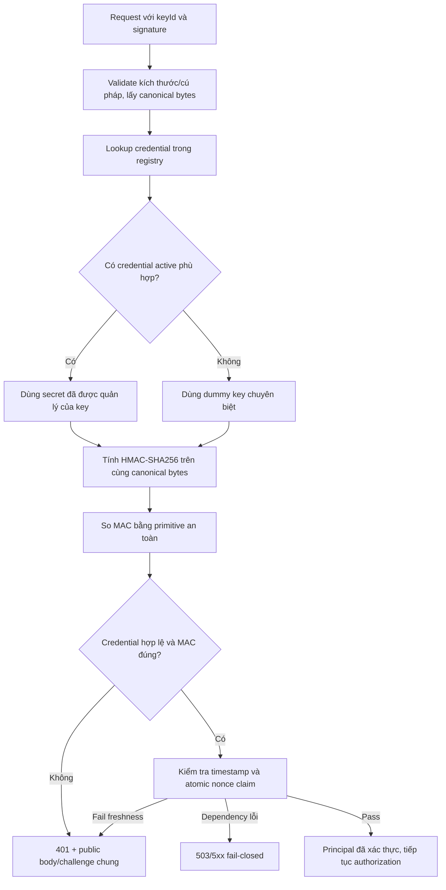
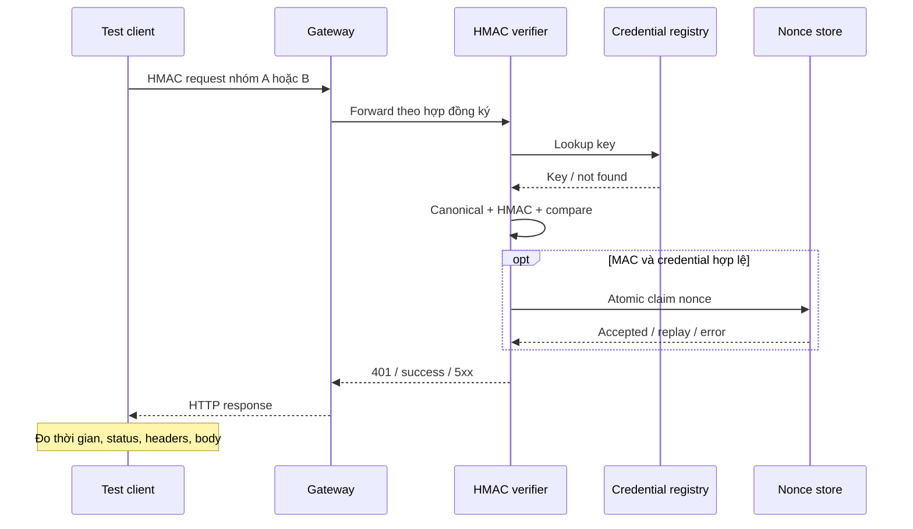
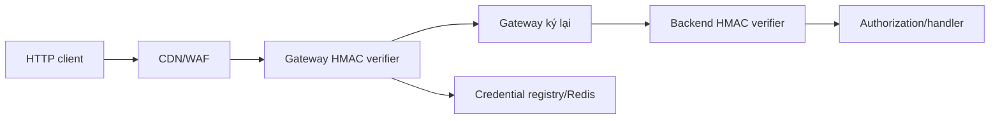

# Timing test: kiểm thử rò rỉ thông tin qua thời gian xác thực HMAC

## 1. Mục tiêu và phạm vi

Bài học **Timing test** thuộc chương **Security testing** của module **SECURITY_AUTHENTICATION_HMAC_REQUEST_AUTHENTICATION**. Module thiết kế xác thực HTTP request bằng **HMAC với shared secret** và một **canonical request** có thể chứa method, URI, header và/hoặc body theo hợp đồng ký. Người học cần xác minh chữ ký, chống replay bằng timestamp/nonce, quản lý key rotation, kiểm thử gateway/proxy và luôn phân biệt **authentication** với **authorization**.

Hệ thống có thể trả cùng HTTP `401 Unauthorized` và cùng JSON cho mọi chữ ký HMAC sai, nhưng kẻ gửi vẫn quan sát được thời gian phản hồi. Nếu thời gian xử lý phụ thuộc một cách có hệ thống vào việc key ID có tồn tại, key còn active hay vị trí byte sai trong MAC, **timing side channel** có thể tiết lộ thông tin mà response body cố ý che giấu.

**Timing test** là phép kiểm thử có kiểm soát nhằm tìm sự khác biệt thời gian không mong muốn giữa các trường hợp có đầu vào tương đương về chi phí nhưng khác một thuộc tính nhạy cảm. Nó kết hợp kiểm tra luồng mã, microbenchmark phép so sánh MAC, thử nghiệm HTTP qua mạng, phân tích số liệu thống kê và kiểm chứng không có trường hợp fail-open.

Sau bài học, người học có thể:

1. Phân biệt **constant-time MAC comparison** với **đường xác thực end-to-end có thời gian phản hồi gần tương đương**; không đánh đồng chúng.
2. Thiết kế mẫu thử `wrong-first-byte`, `wrong-last-byte`, `unknown-key`, `revoked-key`, `invalid-MAC` và các tình huống timestamp/nonce.
3. Viết phép thử thu thập thời gian có warm-up, thứ tự ngẫu nhiên, cùng kích thước request, timestamp/nonce hợp lệ và môi trường ít nhiễu.
4. Sử dụng JMH cho vi benchmark Java, công cụ HTTP test cho phép đo toàn luồng, và xem xét phân phối/độ bất định thay vì khẳng định dựa trên một lần đo.
5. Nhận diện side channel ở lookup key, cache hit/miss, trạng thái rotation/revocation, body handling, replay store và gateway.
6. Áp dụng nguyên tắc so sánh MAC an toàn, không xác thực theo connection, giới hạn input, generic public error và phân quyền riêng.
7. Tích hợp những test phù hợp vào CI, giữ phép đo thống kê chuyên sâu ở môi trường ổn định và tránh test flaky.

## 2. Timing side channel trong API HMAC là gì?

Giả sử hai request cùng method, URI, kích thước body và header; chúng khác nhau ở một byte của chữ ký:

```text
Request A: MAC sai ngay byte đầu tiên
Request B: MAC sai ở byte cuối cùng
```

Nếu code so sánh `expectedMac` với `receivedMac` bằng vòng lặp **dừng ở byte đầu tiên không khớp**, A có thể tốn ít thao tác hơn B. Lặp lại đủ nhiều lần trong một môi trường thuận lợi, chênh lệch này có thể trở thành tín hiệu suy ra mức trùng khớp của MAC. HMAC-SHA256 vẫn là thuật toán mật mã mạnh, nhưng **cách kiểm tra kết quả HMAC** có thể làm lộ thêm thông tin.

Một ví dụ khác:

```text
Key ID không tồn tại  → return 401 ngay
Key ID tồn tại         → gọi Mac.doFinal(...), rồi mới return 401
```

Dù body và status đều giống nhau, thời gian phản hồi có thể tiết lộ **sự tồn tại của key ID**. Trong hệ thống nhiều tenant, đó có thể là dữ liệu nhạy cảm. Kẻ tấn công cũng có thể quan sát cache hit/miss hoặc trạng thái key đang rotate/revoke nếu các nhánh có độ trễ đặc trưng.

### 2.1. Các loại tín hiệu cần phân biệt

| Nguồn thời gian | Ví dụ | Có phải rò rỉ không? |
|---|---|---|
| So sánh MAC | Dừng khi byte đầu tiên sai | Có nguy cơ rò mức prefix trùng khớp |
| Tra credential | Key không tồn tại trả ngay, key tồn tại tính HMAC | Có thể thành oracle về key existence |
| Cache/DB | Key cũ ở cache, key mới phải tra DB | Có thể tạo tín hiệu về trạng thái/luồng key, cần đánh giá |
| Freshness | Timestamp quá hạn được từ chối trước các bước khác | Không phải lúc nào cũng nhạy cảm; phụ thuộc dữ liệu bị lộ và threat model |
| Replay guard | Nonce đã dùng so với nonce mới cần ghi Redis | Khác biệt có thể có chủ đích nhưng vẫn cần phân tích thông tin rò |
| Payload | Body 100 KiB cần hash lâu hơn body rỗng | Khác biệt theo kích thước do client đã biết thường không phải secret |
| Authorization | Request HMAC hợp lệ nhưng scope khác nhau | Có thể tiết lộ tài nguyên nếu phản hồi/latency bị thiết kế sai |
| Network/proxy | Cache, TLS handshake, DNS, connection pool, retry | Thường là nhiễu cần kiểm soát trước khi quy kết |
| Resource contention | GC, thread pool, event loop, Redis bị tải cao | Có thể che hoặc phóng đại một side channel |

**Cần mô tả đúng điều gì là bí mật.** Kích thước body mà chính client gửi không phải thông tin kín đối với client đó. Ngược lại, việc một key ID được cấp cho tenant khác, đang bị revoke hay HMAC expected khớp bao nhiêu byte có thể là thông tin hệ thống không muốn công bố.

### 2.2. Ba cấp đo riêng biệt

- **Cấp mật mã:** thời gian so sánh hai MAC đã được tính và có cùng chiều dài. Ở đây bỏ nhiễu HTTP/Redis để tìm lỗi so sánh prefix.
- **Cấp verifier/service:** thời gian từ lúc bắt đầu xử lý credential/canonical đến kết quả authentication. Nó bao gồm lookup, hash body, MAC, timestamp và replay store theo luồng thực tế.
- **Cấp black-box HTTP:** thời gian client nhận response qua TCP/TLS, gateway, backend và network. Đây là điều một bên gửi từ xa có thể quan sát, nhưng thường nhiều nhiễu nhất.

Không dùng kết quả một cấp để tuyên bố các cấp còn lại an toàn. **JMH đo `MessageDigest.isEqual` ổn định không chứng minh key lookup hoặc gateway không tạo timing oracle**.

## 3. Xây dựng giả thuyết kiểm thử trước khi đo

Một bài timing test hữu ích bắt đầu bằng giả thuyết có thể bác bỏ, không bắt đầu bằng một vòng lặp gọi HTTP ngẫu nhiên.

| Mã | Giả thuyết | Hai nhóm cần so sánh | Tác động nếu có khác biệt |
|---|---|---|---|
| H1 | So sánh MAC không phụ thuộc vị trí byte sai đáng kể trong điều kiện kiểm thử | MAC sai ở byte 0 và byte cuối, cùng 32 byte | Lộ thông tin về prefix MAC |
| H2 | Không có key-existence oracle dễ quan sát | Unknown key vs known active key + MAC sai | Có thể dò key ID |
| H3 | Response không tiết lộ trạng thái revocation qua timing không mong muốn | Revoked key vs unknown/active-invalid key | Có thể suy ra lifecycle key |
| H4 | Chi phí invalid Base64 được xử lý theo policy, không gây DoS | Chuỗi hợp lệ về cú pháp vs malformed/oversized | Parser có thể bị lợi dụng hoặc trở thành oracle |
| H5 | Timestamp/nonce failure không gắn nhầm client chưa xác thực | Expired timestamp/replay vs invalid MAC | Rò thông tin về verifier/state hoặc gán identity sai |
| H6 | Gateway không làm mất biện pháp chống timing và không biến 5xx thành 401 | Gửi trực tiếp backend test vs qua gateway | Lỗi mapping hoặc nhiễu proxy |
| H7 | Độ trễ ở tải cao vẫn đáp ứng SLO, không làm mất kiểm tra HMAC | Throughput và concurrency khác nhau | Fail-open, timeout, queue saturation |

**H1–H3** là kiểm thử tìm tín hiệu nhạy cảm. **H4/H7** còn kiểm tra khả năng chống cạn kiệt tài nguyên; không nên ép mọi input (bao gồm chuỗi dài vô hạn) tốn CPU giống nhau. Những trường hợp thiếu header, quá kích thước hoặc HTTP framing sai có thể bị từ chối sớm theo chính sách giới hạn input, miễn không làm lộ dữ liệu bí mật không cần thiết.

### 3.1. Định nghĩa acceptance criteria thực tế

Không thể chứng minh từ vài nghìn phép đo rằng một chương trình Java “constant-time tuyệt đối” trong mọi CPU, JIT, GC, VM và mạng. Vì vậy nên có **hai loại tiêu chí**:

1. **Bất biến cấu trúc:** không dùng `Arrays.equals` hoặc vòng lặp dừng sớm để so MAC; không trả secret/expected MAC; không bỏ verify khi cache miss; nonce chỉ được claim sau khi MAC hợp lệ; lỗi dependency fail-closed.
2. **Bằng chứng thực nghiệm:** trong môi trường được kiểm soát, so sánh phân phối các nhóm phù hợp, ghi nhận độ chênh và khoảng tin cậy; nếu thấy chênh ổn định, có khả năng khai thác theo threat model, phải điều tra.

Một ngưỡng chênh lệch do nhóm dự án đặt ra cần được biện minh bằng **mức nhiễu, khả năng đo của đối tượng tấn công, số lần truy vấn được phép, rate limiting và mức nhạy cảm**. Không có một con số nanosecond/millisecond chung bảo đảm mọi API HMAC an toàn.

## 4. Chuẩn bị fixture đúng cho timing test HMAC

Hợp đồng ký dùng cho ví dụ:

```text
HMAC-V1
<METHOD>
<RAW_PATH>
<RAW_QUERY_OR_EMPTY>
<KEY_ID>
<TIMESTAMP_SECONDS>
<NONCE>
<HEX_SHA256_BODY>
```

- Mỗi dòng nối bằng ký tự LF, không thêm LF cuối.
- Method và raw URI là byte representation đã thống nhất giữa signer và verifier; gateway rewrite cần được xét riêng.
- Body hash tính trên byte thực tế ở điểm verify; không parse rồi serialize lại JSON.
- `TIMESTAMP_SECONDS`, `NONCE` và `KEY_ID` được ký cùng request.
- Chữ ký ví dụ là `Base64URL_noPadding(HMAC_SHA256(secret, UTF8(canonical)))`; MAC thô có 32 byte.

Đây là **hợp đồng minh họa**, không phải định dạng HMAC được Spring Security áp sẵn.

### 4.1. Cặp đầu vào có kiểm soát

Đối với H1, dùng **cùng một `expectedMac` 32 byte** và tạo hai `receivedMac` đều 32 byte:

```text
expected  = [32 bytes từ HMAC-SHA256 của request fixture]
wrongFirst = copy(expected); wrongFirst[0]  ^= 0x01
wrongLast  = copy(expected); wrongLast[31] ^= 0x01

So sánh:
  Compare(expected, wrongFirst) == false
  Compare(expected, wrongLast)  == false
```

Như vậy hai nhóm chỉ khác **vị trí byte sai**. Không tạo một chuỗi signature malformed cho nhóm A nhưng chuỗi Base64URL hợp lệ cho nhóm B, vì thời gian parser sẽ gây nhiễu phép so.

Đối với H2, dùng hai nhóm có:

- Cùng method, raw path/query, body bytes, kích thước header, timestamp hợp lệ và nonce mới.
- Nhóm A có **key ID không có trong registry**.
- Nhóm B có **key ID tồn tại, active**, nhưng chữ ký không khớp.
- Cả hai được trả public `401` thống nhất.
- Mọi thử nghiệm đều chạy trong **môi trường test được phép**, với key ID/secret giả, không dùng traffic production.

Không thể làm mọi thuộc tính giống hệt giữa nhóm unknown và known vì bản chất lookup khác nhau; đó chính là nhánh cần kiểm tra. Nhưng phải giữ đồng nhất những yếu tố khác trong khả năng.

### 4.2. Ma trận fixture

| Fixture | Trạng thái/key | Chữ ký | Timestamp/nonce | Kỳ vọng logic |
|---|---|---|---|---|
| `known_wrong_first` | Key ACTIVE | MAC đủ 32 byte, sai byte đầu | Hợp lệ, nonce mới | 401 `invalid_mac` |
| `known_wrong_last` | Cùng key ACTIVE | MAC đủ 32 byte, sai byte cuối | Hợp lệ, nonce mới | 401 `invalid_mac` |
| `unknown_key` | Key ID không tồn tại | Base64URL đủ chiều dài | Hợp lệ, nonce mới | 401 `unknown_key` nội bộ |
| `revoked_key` | Credential REVOKED | Chữ ký đúng theo secret cũ (nếu fixture có quyền truy cập) | Hợp lệ, nonce mới | 401 `credential_revoked` |
| `expired_timestamp` | Key ACTIVE | MAC đúng trên timestamp cũ | Ngoài cửa sổ, nonce mới | 401 `timestamp_window` |
| `replayed_nonce` | Key ACTIVE | MAC đúng | Nonce đã claim | 401 `nonce_replay` |
| `invalid_base64` | Key ACTIVE | Chữ ký không parse được | Hợp lệ | 401 theo policy malformed credential |
| `oversized_signature` | Key ACTIVE | Dài hơn giới hạn header/scheme | Hợp lệ | 400/401/431 theo điểm từ chối được tài liệu hóa |
| `valid_positive` | Key ACTIVE | MAC đúng | Hợp lệ, nonce mới | Authentication pass, còn xét authorization |
| `nonce_store_timeout` | Key ACTIVE | MAC đúng | Redis không xác định được claim | 503/5xx, **fail-closed** |

**Đừng so sánh thời gian của `valid_positive` và `invalid_mac` rồi yêu cầu tuyệt đối giống nhau.** Trường hợp MAC đúng có thể cần claim nonce, authorization và handler; đó là các công việc có ý nghĩa khác. Positive fixture cần để chứng minh verifier không từ chối mọi request, còn timing comparison phải đặt đúng ranh giới.

### 4.3. Cách tránh false positive do replay

Nếu dùng một request đã ký với nonce N, gửi trước một lần thành công rồi gửi lần hai, request thứ hai có thể bị từ chối vì **replay**. Khi đó không chứng minh được lỗi MAC hoặc side channel nào khác.

- Trong microbenchmark MAC, **không dùng** Redis/nonce store.
- Trong test HTTP của hai nhóm MAC sai, tạo timestamp/nonce mới, **ký lại request theo đúng field**, rồi thay một byte signature trước lần gửi đầu. Không nhận nonce ở request MAC sai.
- Trong test replay riêng, gửi request hợp lệ một lần để claim nonce, sau đó thử lại proof đó với kỳ vọng 401; không dùng thời gian của lượt replay như bằng chứng `invalid_mac`.
- Với test unknown/revoked key, chuẩn hóa request và đảm bảo không vô tình lệch timestamp hoặc body digest.
- Trong test concurrency, dùng fixture khác với phép đo timings để không lẫn cạnh tranh nonce ở các node.

## 5. Tìm hiểu lỗi so sánh MAC dừng sớm

Đoạn code sau là **antipattern**, chỉ dùng để hiểu loại lỗi phải phát hiện:

```java
// KHÔNG DÙNG TRONG PRODUCTION: trả false ngay khi byte đầu tiên sai.
static boolean insecureCompare(byte[] expected, byte[] actual) {
    if (expected.length != actual.length) {
        return false;
    }
    for (int i = 0; i < expected.length; i++) {
        if (expected[i] != actual[i]) {
            return false;
        }
    }
    return true;
}
```

Với HMAC-SHA256 có 32 byte, phép so kiểu này không thực hiện số thao tác như nhau khi byte đầu tiên khác và khi byte thứ 31 khác. Thời gian chênh lệch có thể rất nhỏ trên một JVM hiện đại và không phải lúc nào cũng đo được từ Internet, nhưng implementation **không nên tạo sự khác biệt phụ thuộc prefix** ngay từ đầu.

### 5.1. Dùng primitive so MAC thích hợp

Trong Java, `MessageDigest.isEqual(byte[], byte[])` là primitive để so sánh kết quả digest/MAC thay cho vòng lặp dừng sớm hoặc `String.equals`. Với dữ liệu HMAC-SHA256, ứng dụng còn phải kiểm tra:

- MAC expected thực sự dài **32 byte**, được tính bằng `Mac.getInstance("HmacSHA256")` với secret được quản lý đúng.
- Signature nhận từ client có **cú pháp và kích thước bị giới hạn**, không cho input nhiều MiB đi qua Base64 decoder.
- Sau decode, MAC phải dài 32 byte. Phép đo timing byte-first/byte-last phải dùng **cùng độ dài**.
- Không dùng so sánh string Base64 làm tiêu chí mật mã; không in expected MAC ra log.
- Các biến thể JDK/VM không đảm bảo cả parse, lookup, verify và HTTP response có thời gian cố định chỉ nhờ gọi `MessageDigest.isEqual`.

### 5.2. Mẫu Java xử lý signature theo giới hạn

Đoạn Java 17+ dưới đây minh họa việc **normalize chữ ký về byte array cố định** trước khi so expected HMAC. Mục đích là loại bỏ vòng lặp dừng sớm và giảm sai lệch ở nhánh so byte; **nó không phải chứng minh constant-time cho toàn hàm**, vì parser Base64 và kiểm tra độ dài có thể phụ thuộc input.

```java
import java.security.MessageDigest;
import java.util.Base64;
import java.util.Objects;

final class HmacSignatureComparator {
    private static final int HMAC_SHA256_BYTES = 32;
    private static final int MAX_ENCODED_CHARS = 48;

    private HmacSignatureComparator() {}

    static boolean matches(byte[] expectedMac, String encodedSignature) {
        Objects.requireNonNull(expectedMac, "expectedMac");
        if (expectedMac.length != HMAC_SHA256_BYTES) {
            throw new IllegalArgumentException("Expected MAC must be SHA-256 length");
        }

        byte[] candidate = new byte[HMAC_SHA256_BYTES];
        boolean validSyntaxAndLength = false;

        // Giới hạn trước khi decode để chống lạm dụng CPU/RAM.
        if (encodedSignature != null
                && encodedSignature.length() <= MAX_ENCODED_CHARS) {
            try {
                byte[] decoded = Base64.getUrlDecoder()
                        .decode(encodedSignature);
                if (decoded.length == HMAC_SHA256_BYTES) {
                    System.arraycopy(decoded, 0,
                            candidate, 0, HMAC_SHA256_BYTES);
                    validSyntaxAndLength = true;
                }
            } catch (IllegalArgumentException ignored) {
                // Dữ liệu client sai định dạng: caller trả lỗi công khai chung.
            }
        }

        // Hai mảng so sánh luôn là MAC 32 byte. Không dùng early-exit loop.
        boolean macEqual = MessageDigest.isEqual(expectedMac, candidate);

        // Dùng toán tử & cho hai boolean để luôn đánh giá cả hai toán hạng.
        return validSyntaxAndLength & macEqual;
    }
}
```

`MAX_ENCODED_CHARS=48` là giới hạn minh họa phù hợp với việc nhận một Base64URL-encoded HMAC-SHA256 thông thường; **production** cần quyết định chính xác padding/no-padding, ký tự hợp lệ và canonical encoding của signature theo contract. Hàm `Base64.getUrlDecoder()` có thể chấp nhận một số biểu diễn mà API không muốn; phải thêm validation canonical encoding khi cần. Không giải thích độ dài 43 ký tự là đủ để chứng minh signature an toàn.

**Quan trọng:** hàm này chỉ thay đổi cách so chữ ký. Để giảm key-existence oracle, verifier cũng cần kiểm tra lookup/secret processing và error semantics ở mục tiếp theo. Tránh thêm delay cố định bằng `Thread.sleep(...)` vào mỗi 401 như một “giải pháp constant-time”; delay làm tăng chi phí tài nguyên và thường vẫn để lại khác biệt phân phối do network/scheduler/cache.

## 6. Key-existence timing oracle: đường lookup rất quan trọng

Một verifier có thể có luồng:

```text
keyId không có trong DB → trả 401
keyId có trong DB → tính HMAC, so sánh MAC, kiểm tra freshness → 401 nếu sai
```

Ở đây MAC comparison có thể hoàn hảo nhưng thời gian tổng thể vẫn lộ một tín hiệu liên quan tới **credential existence**. Dữ liệu key ID không phải lúc nào cũng bí mật, nhưng ở hệ thống partner/tenant nhạy cảm, kiểm tra key tồn tại có thể hỗ trợ enumeration và trinh sát.

### 6.1. Minh họa thiết kế giảm khác biệt

Một mô hình có thể làm như sau:



**Dummy key** là một secret giả, được sinh an toàn, giữ nội bộ và có cùng kiểu/độ dài phù hợp với key thật. Khi key lookup thất bại, verifier vẫn tính HMAC và thực hiện đường so MAC trước khi từ chối, thay vì return sớm. Điều này **giảm một nguồn khác biệt** nhưng không đảm bảo thời gian end-to-end bằng nhau: DB hit/miss, cache, trạng thái key, sự kiện log và độ trễ network vẫn có thể khác.

Nếu key ID bị revoke, chính sách có thể không còn cung cấp secret thật cho việc xác minh. Hệ thống phải từ chối dù MAC với secret cũ sẽ đúng; có thể thực hiện một đường xác minh giả có kiểm soát để giảm khác biệt, nhưng tuyệt đối không dùng dummy-key path làm điều kiện `authenticated=true`. Mọi status/correlation/telemetry công khai phải tuân thủ hợp đồng bảo mật.

### 6.2. Những lỗi thường xuất hiện cùng dummy key

| Sai lầm | Hậu quả |
|---|---|
| Cho phép MAC từ dummy key tạo principal | Một key unknown có thể bị “xác thực” nếu thiết kế sai |
| Dùng một chuỗi dummy secret hard-coded công khai cho production | Mất ý nghĩa bảo vệ, gây rủi ro cấu hình |
| Bắt lỗi DB timeout như “key không tồn tại” | Lỗi hạ tầng bị biến thành 401 và có thể làm mờ incident |
| Cache unknown key khác biệt quá lớn so với known key | Timing oracle vẫn còn dù đã tính dummy MAC |
| Trả `"key not found"` cho unknown, `"invalid signature"` cho known | Rò trực tiếp qua body, không cần timing |
| Ghi raw key ID/signature vào response hoặc log công khai | Lộ metadata nhạy cảm và dữ liệu ký |
| Dùng timeout/delay giả để cố “bằng nhau” trong mọi hoàn cảnh | Không giải quyết gốc rễ; có thể trở thành DoS |

### 6.3. Tách lỗi hệ thống khỏi lỗi authentication

Nếu credential registry không phản hồi, verifier **không biết** key active hay revoked. Đó là **dependency failure**: nên fail-closed và trả HTTP 503/5xx theo contract, đồng thời ghi telemetry. Không thay mọi lỗi thành 401 chỉ để response đều nhau, vì client sẽ retry sai nguyên nhân và vận hành mất tín hiệu outage.

Tương tự, Redis nonce store timeout không có nghĩa “nonce chưa dùng” hoặc “nonce đã replay”. Một lệnh claim nonce có thể đã được ghi nhưng kết quả trả về bị mất. Hệ thống không được cho request qua khi freshness chưa được xác minh.

## 7. Microbenchmark phép so sánh MAC với JMH

Để đánh giá **lỗi phụ thuộc vị trí byte sai** ở cấp hàm, không nên đặt `System.nanoTime()` ngay trước và sau một biểu thức quá ngắn rồi xem từng kết quả là chính xác đến nanosecond. JIT compilation, dead-code elimination, branch prediction, CPU frequency scaling, GC và chi phí gọi đồng hồ có thể áp đảo phép đo.

Java Microbenchmark Harness (**JMH**) được thiết kế cho microbenchmark JVM với warm-up, iterations và forks. Dưới đây là ví dụ **mã mẫu**, cần có dependency JMH và annotation processor tương ứng nếu chạy thực tế.

```java
import java.util.Arrays;

import org.openjdk.jmh.annotations.Benchmark;
import org.openjdk.jmh.annotations.BenchmarkMode;
import org.openjdk.jmh.annotations.Mode;
import org.openjdk.jmh.annotations.OutputTimeUnit;
import org.openjdk.jmh.annotations.Param;
import org.openjdk.jmh.annotations.Scope;
import org.openjdk.jmh.annotations.Setup;
import org.openjdk.jmh.annotations.State;
import org.openjdk.jmh.annotations.Level;
import org.openjdk.jmh.infra.Blackhole;

import java.security.MessageDigest;
import java.util.concurrent.TimeUnit;

@State(Scope.Thread)
@BenchmarkMode(Mode.AverageTime)
@OutputTimeUnit(TimeUnit.NANOSECONDS)
public class HmacCompareBenchmark {

    @Param({"FIRST", "LAST", "EQUAL"})
    public String variant;

    private byte[] expected;
    private byte[] candidate;

    @Setup(Level.Trial)
    public void prepare() {
        expected = new byte[32];
        for (int i = 0; i < expected.length; i++) {
            expected[i] = (byte) (i * 17 + 3);
        }
        candidate = Arrays.copyOf(expected, expected.length);

        if ("FIRST".equals(variant)) {
            candidate[0] ^= 1;
        } else if ("LAST".equals(variant)) {
            candidate[31] ^= 1;
        }
    }

    @Benchmark
    public void compareMac(Blackhole blackhole) {
        blackhole.consume(MessageDigest.isEqual(expected, candidate));
    }
}
```

**Cách đọc kết quả:**

- `FIRST` và `LAST` phải đều trả `false`; `EQUAL` trả `true`, nhưng nhóm EQUAL không nhất thiết là phép so ngang chi phí với đường xử lý xác thực tổng thể.
- So thời gian trung bình giữa FIRST/LAST của cùng chiều dài 32 byte; xem thêm confidence interval và số iteration/fork.
- Chạy ở nhiều cấu hình JDK/CPU mà production dùng; microbenchmark dưới JIT có thể khác native-image hoặc một phiên bản JDK khác.
- Nếu FIRST/LAST có chênh ổn định, điều tra implementation và ảnh hưởng lên threat model. Nếu không thấy chênh, **không** tuyên bố “chứng minh constant-time”.
- Không chạy microbenchmark như một unit test kỳ vọng `latency < 100 ns` trên mọi máy CI; kết quả sẽ dễ flaky và không phản ánh mạng.

Có thể chạy đối chứng một implementation dừng sớm **chỉ trong môi trường test biệt lập** để xem công cụ đo có phân biệt được độ lệch dự kiến. Không mang mã đối chứng đó vào production.

## 8. Đo timing black-box qua HTTP

Một attacker từ xa thường chỉ thấy thời gian từ khi gửi request đến khi nhận response. Test qua HTTP cần mô phỏng điều đó, nhưng phải nhận ra nguồn nhiễu từ TCP/TLS, proxy, scheduling, GC và credential/Redis.

### 8.1. Kiến trúc phép đo



Mỗi nhóm A/B cần được trình tự **xen kẽ hoặc random hóa theo block**, không gửi toàn bộ nhóm A trước rồi nhóm B sau, vì CPU warm-up, autoscaling, GC, DNS, throttling hoặc load nền có thể thay đổi theo thời gian.

### 8.2. Phép đo mẫu bằng Java HttpClient

Đoạn code sau minh họa một **harness riêng** với `HttpClient` reuse connection. `FixtureFactory` là thành phần test phải hiện thực để sinh request chuẩn HMAC mỗi lần gọi; các nhóm `WRONG_FIRST` và `WRONG_LAST` phải có **đúng 32 byte MAC**, chỉ khác vị trí byte bị thay và giữ các field khác tương đương.

```java
import java.net.http.HttpClient;
import java.net.http.HttpRequest;
import java.net.http.HttpResponse;
import java.time.Duration;
import java.util.ArrayList;
import java.util.Collections;
import java.util.EnumMap;
import java.util.List;
import java.util.Map;
import java.util.Random;

enum TimingVariant { WRONG_FIRST, WRONG_LAST }

interface FixtureFactory {
    // Sinh nonce/timestamp mới, ký với key TEST và sửa đúng một byte MAC.
    // Độ dài body/header tương ứng giữa hai variant phải tương đương.
    HttpRequest invalidMacRequest(TimingVariant variant);
}

final class HmacHttpTimingProbe {

    static Map<TimingVariant, List<Long>> measure(
            HttpClient client,
            FixtureFactory fixtures,
            int warmupRounds,
            int measuredRounds) throws Exception {

        Map<TimingVariant, List<Long>> durations =
                new EnumMap<>(TimingVariant.class);
        for (TimingVariant variant : TimingVariant.values()) {
            durations.put(variant, new ArrayList<>());
        }

        Random orderRandom = new Random(12345L);

        for (int round = 0; round < warmupRounds + measuredRounds; round++) {
            List<TimingVariant> order = new ArrayList<>(
                    List.of(TimingVariant.WRONG_FIRST,
                            TimingVariant.WRONG_LAST));
            Collections.shuffle(order, orderRandom);

            for (TimingVariant variant : order) {
                HttpRequest request = fixtures.invalidMacRequest(variant);
                long start = System.nanoTime();
                HttpResponse<Void> response = client.send(
                        request, HttpResponse.BodyHandlers.discarding());
                long elapsed = System.nanoTime() - start;

                if (response.statusCode() != 401) {
                    throw new AssertionError(
                            "Expected 401, got " + response.statusCode());
                }

                if (round >= warmupRounds) {
                    durations.get(variant).add(elapsed);
                }
            }
        }

        return durations;
    }

    static HttpClient httpClient() {
        return HttpClient.newBuilder()
                .connectTimeout(Duration.ofSeconds(3))
                .version(HttpClient.Version.HTTP_2)
                .build();
    }
}
```

**Đặc điểm và giới hạn của harness:**

- Mẫu trên giả định server đang chạy ở địa chỉ test do `FixtureFactory` cung cấp và cả hai variant đều nhận **401**. Nó không chạy sẵn nếu chưa hiện thực fixture; không dùng secret production.
- `HttpClient.Version.HTTP_2` là **ưu tiên giao thức**, không bảo đảm server luôn thương lượng HTTP/2. Ghi nhận protocol thực tế khi benchmark; thử HTTP/1.1 riêng khi cần.
- `BodyHandlers.discarding()` đọc/loại bỏ response body để connection có thể tái sử dụng; thời gian đo thường bao gồm cả chuyển response body. Giữ JSON lỗi cùng kích thước/shape giữa các nhóm.
- Hàm `invalidMacRequest` phải tránh ký lại một cách làm thay đổi length/request composition giữa hai nhóm. Một fixture sai có thể tạo khác biệt do Base64 parsing chứ không phải vị trí byte.
- `Random(12345L)` dùng để tái lập **thứ tự phép đo**, không phải RNG để tạo cryptographic nonce. Nonce test phải duy nhất theo chính sách và không tái sử dụng trong cùng cửa sổ.
- Đo riêng **thời gian tạo signature/request** nếu đang tìm chi phí phía client, nhưng **không** đưa thời gian signer vào `elapsed` khi muốn đo server; ở đây request được tạo **trước** `start`.
- Không lấy một giá trị elapsed để kết luận: phân tích **phân phối** của hàng trăm/hàng nghìn mẫu (tùy độ nhiễu và ngân sách test), lặp lại nhiều đợt và giới hạn tần suất để không vô tình DoS hệ thống được kiểm thử.
- Test chạy qua mạng cần kiểm soát authorization và giới hạn scope. Không quét key ID của bên thứ ba hoặc gửi tải đo ngoài môi trường được phép.

### 8.3. Assert HTTP contract độc lập với thời gian

Mỗi request của hai nhóm có MAC sai phải:

```text
HTTP status = 401
WWW-Authenticate = challenge HMAC áp dụng cho route
Content-Type = application/problem+json (nếu API dùng Problem Details)
code = AUTHENTICATION_FAILED
body không có expected MAC, shared secret, key state, stack trace
handler nghiệp vụ không chạy
nonce của request MAC sai không được claim
```

Đây là **functional/security contract** có thể kiểm tra deterministically trong CI. Timing distribution là kiểm tra khác, không thay thế nội dung này.

## 9. Phân tích số liệu: tránh kết luận bằng một trung bình

Thời gian HTTP thường có **phân phối lệch, đuôi dài và outlier**. Phần lớn phép đo có thể rất gần nhau nhưng thỉnh thoảng tăng do GC, thread scheduling, network retransmission hoặc queue contention.

### 9.1. Thống kê cơ bản nên báo cáo

Với mỗi nhóm fixture, ghi:

- Số lượng mẫu sau warm-up, time window, JDK/OS/CPU, HTTP version, vị trí client và gateway release.
- Median (P50), P90/P95/P99, trung bình và độ phân tán; percentiles cần đủ mẫu.
- Chênh lệch median giữa hai nhóm và độ lệch theo từng block thời gian.
- Khoảng tin cậy (ví dụ bootstrap) cho một **effect size** được chọn trước.
- Tỷ lệ status 401 đúng, số timeouts, retry phát sinh và số mẫu bị loại cùng lý do.
- Nếu có, server-side durations của credential lookup, MAC compare và nonce operations ở cùng thời gian để hỗ trợ quy kết.

Ví dụ bảng kết quả **giả định**:

| Nhóm | Số mẫu | Median | P95 | Diễn giải ban đầu |
|---|---:|---:|---:|---|
| MAC sai byte đầu | 2.000 | 3,8 ms | 7,2 ms | Baseline |
| MAC sai byte cuối | 2.000 | 3,9 ms | 7,4 ms | Chênh 0,1 ms; chưa thể kết luận |
| Unknown key | 2.000 | 2,2 ms | 5,1 ms | Chênh lớn so với known-invalid; cần kiểm tra lookup |
| Known key, wrong MAC | 2.000 | 3,8 ms | 7,2 ms | Có thể cần xem dummy MAC/cache |

Các con số này **chỉ minh họa**, không phải kết quả benchmark thực tế hoặc tiêu chuẩn cho phép. Một chênh 0,1 ms có thể là nhiễu hoặc tín hiệu thật; còn chênh 1,6 ms có thể do return sớm, cache hoặc môi trường nhóm khác nhau. Phải lặp lại phép đo có kiểm soát và đọc code path trước khi kết luận.

### 9.2. Thống kê ý nghĩa và ý nghĩa bảo mật khác nhau

Một kiểm định thống kê có thể cho p-value thấp khi số mẫu lớn, dù chênh lệch thời gian rất nhỏ và khó khai thác trên mạng thực. Ngược lại, p-value cao với ít mẫu không chứng minh hai nhánh tương đương.

Do đó:

1. Định nghĩa từ đầu **hiệu ứng muốn đo**: ví dụ chênh median hoặc sự thay đổi theo vị trí byte sai.
2. Ước lượng **khoảng tin cậy** và độ nhiễu; lặp lại theo block ngẫu nhiên để giảm drift.
3. Nếu dự án đặt equivalence margin, chọn biên dựa trên threat model và sensitivity, không tùy tiện chọn sau khi xem dữ liệu.
4. Với kết quả đáng ngờ, xác minh bằng profiler/code review và đo ở cấp thấp hơn.
5. Tránh “tối ưu” test bằng loại outlier cho tới khi hai nhóm trông giống nhau; quy tắc loại mẫu phải xác định trước và minh bạch.

Một kết luận tốt có thể là:

> Trong môi trường thử nghiệm A, chưa quan sát được chênh lệch có ý nghĩa vận hành giữa hai vị trí byte MAC sai với số mẫu và độ nhiễu đã nêu. Kết quả **không chứng minh** hệ thống constant-time trong mọi điều kiện.

Nếu thấy chênh đáng kể, ghi rõ giả thuyết, biến được giữ cố định, kết quả, mức độ tin cậy và biện pháp tiếp theo thay vì tuyên bố đã có exploit khả dụng.

## 10. Các nguồn nhiễu cần cô lập

### 10.1. JIT, GC và CPU

JVM biên dịch/nâng cấp mã khi nóng, GC có thể tạm dừng chương trình, và CPU có thể thay đổi frequency theo tải/nhiệt. Vì vậy:

- Warm-up đủ cho code path đo trước khi lấy mẫu.
- Đo nhiều process/fork hoặc lượt độc lập khi cần.
- Không chạy benchmark song song với workload thay đổi liên tục nếu mục tiêu là so sánh rất nhỏ.
- Ghi nhận GC events, CPU saturation và background load.
- Tránh đặt benchmark dưới debugger/tracing quá chi tiết nếu nó làm méo timing.

### 10.2. Network/TLS, keep-alive và HTTP/2

Connection mới có chi phí TCP/TLS, DNS và handshake; connection đã mở có chi phí khác. Trong HTTP/2, nhiều stream trên cùng connection có thể tương tác qua flow control và queueing. Cần:

- Warm connection cho cả nhóm nếu đang đo verifier; hoặc chủ động đo riêng kịch bản cold connection.
- Giữ HTTP version/TLS settings tương đương.
- Không để nhóm A luôn dùng connection cũ và nhóm B luôn tạo connection mới.
- Kiểm tra timeout, retry tự động, redirect và connection reset; những điều đó có thể làm thay đổi method/URI hay latency.
- Theo dõi pool pending acquire và upstream latency khi test qua gateway.

**Không cache “authentication pass” theo TCP/TLS connection.** Một keep-alive hoặc HTTP/2 connection chứa nhiều request phải chạy HMAC verification riêng cho từng request; timing optimization không được bỏ bước kiểm tra nonce/key state cho request sau.

### 10.3. Body size và canonicalization

Nếu request A có body 1 KiB còn B có body 1 MiB, HMAC SHA-256/body digest khác chi phí là điều bình thường. Với cặp timing test, giữ **body bytes và raw method/URI/query giống nhau** (ngoại trừ biến thử), cùng Content-Encoding và proxy transform.

Một proxy thay path percent-encoding, query order, Content-Encoding hoặc body sẽ làm MAC fail vì **canonical mismatch**, không phải dấu hiệu timing oracle. Trước khi đo, xác minh positive control qua đúng gateway/proxy để chắc signer và verifier đồng thuận canonical contract.

## 11. Timestamp, nonce và cache: phép đo cần phân tầng

### 11.1. Timestamp hết hạn

Một verifier có thể kiểm tra timestamp trước HMAC để giảm chi phí với request quá cũ. Nếu timestamp là dữ liệu do client **tự gửi**, việc phản hồi nhanh với timestamp sai không nhất thiết tiết lộ một secret. Nhưng nếu kiểm tra timestamp diễn ra khác nhau tùy key tồn tại, thời gian vẫn có thể tiết lộ key state.

Test nên ghi rõ:

```text
Fixture A: known key, MAC hợp lệ, timestamp đúng, nonce mới
Fixture B: known key, MAC hợp lệ trên timestamp quá hạn, nonce mới
Fixture C: unknown key, timestamp quá hạn, signature tương đương về cú pháp
```

So sánh chỉ khi có một giả thuyết bảo mật rõ ràng. Đừng đòi A và B bằng thời gian vì A sẽ claim nonce và có thể chạy authorization; thay vào đó xem các nhánh thất bại có tiết lộ **thuộc tính đáng lẽ phải ẩn** hay không.

### 11.2. Nonce replay

Một request **MAC hợp lệ** nhưng nonce đã dùng phải bị từ chối theo policy. Redis `SET key 1 NX EX ttl` thành công khác thất bại; thời gian có thể khác. Điều này có thể cung cấp tín hiệu về replay state, nên phải đánh giá threat model và hạn chế query abuse.

Quan trọng hơn là:

1. Không claim nonce trước khi MAC được xác minh, tránh attacker “đốt nonce” của client hợp lệ.
2. Không dùng store cục bộ nếu multi-instance cần chống replay toàn cụm.
3. Không cho qua khi Redis timeout hoặc kết quả claim không xác định.
4. Không log raw nonce vào metrics labels; chỉ ghi reason hữu hạn.
5. Khi phân tích timing, không nhầm replay 401 với invalid MAC 401; phải quan sát reason nội bộ qua test fixture.

### 11.3. Credential cache và key rotation

Key mới thường có cache miss; key cũ có thể đang ở cache; key revoked có thể đã bị xóa cache. Các trạng thái có độ trễ khác nhau, ảnh hưởng H2/H3.

| Tình huống | Nguy cơ nhầm lẫn | Phép thử thích hợp |
|---|---|---|
| Key active luôn cache hit | Timing nhanh hơn unknown key | Kiểm tra lookup path với warm/cold control |
| Unknown key được negative-cache | Timing khác key known | Test có/không negative cache; tránh cache DoS |
| Key revoked bị xóa ngay khỏi cache | Độ trễ khác key active | Đo H3 và kiểm tra public 401 chung |
| Key mới trong rotation chưa warm cache | Client gặp latency tăng | Phân biệt performance regression với oracle |
| Cache stale vẫn báo ACTIVE sau revoke | Authentication bypass thực sự | Test chức năng revocation/freshness, ưu tiên cao hơn timing |

Nếu key revoked còn được **chấp nhận** vì cache stale, đó là lỗi security correctness nghiêm trọng hơn chênh latency. Chỉ tối ưu thời gian sau khi test chứng minh verifier dùng trạng thái credential đủ mới theo chính sách.

## 12. Tích hợp Spring Security và Java Web stacks

### 12.1. Servlet/Spring MVC

Trong Servlet stack, `AuthenticationFilter`/custom HMAC filter có thể tra key, tính canonical/MAC, kiểm tra nonce rồi tạo `Authentication`. `AuthenticationEntryPoint` chịu trách nhiệm trả public 401. `AccessDeniedHandler` xử lý 403 sau khi client đã xác thực nhưng thiếu quyền.

Các điểm timing test cần quan sát:

- Custom filter có branch return sớm khi key không tồn tại không?
- Credential cache miss có chạy blocking I/O trên request thread không?
- Exception mapping 401 có khác nhau giữa `unknown_key`/`invalid_mac` hay không?
- `SecurityContextHolder` có được tạo và xóa **theo request** không, đặc biệt với async processing?
- Authentication fail có gọi business controller không? Nếu có, đó là lỗi nghiêm trọng dù timing trông tương đương.

Không dựa `@RestControllerAdvice` để xử lý mọi exception trong security filter: filter thường nằm trước controller. Test thực tế cần đi qua đúng `SecurityFilterChain`, custom filter và entry point.

### 12.2. Spring WebFlux

Trong WebFlux, I/O blocking ở Netty event loop có thể làm độ trễ phụ thuộc số request concurrent và gây ra tín hiệu khó phân tích. Nếu credential/nonce store là blocking client, hãy dùng driver reactive hoặc tách sang scheduler riêng với giới hạn concurrency. Không gọi `block()` hoặc `subscribe()` thủ công trong filter.

Với body được ký, cách đọc stream, `DataBufferUtils.join` có giới hạn, digest và request decorator ảnh hưởng latency/bộ nhớ. Test timing trên WebFlux cần lưu ý:

- Có đọc đủ body trước khi MAC verify không; body-size limit hoạt động ra sao?
- Có rò `DataBuffer`/mất backpressure khi test nhiều request không?
- Trên đường lỗi và cancel, buffer được release và response không double-write không?
- Các request qua cùng HTTP/2 connection có lẫn principal, nonce hay Reactor Context không?
- Có `onErrorResume` gộp Redis timeout thành `BadCredentialsException` để trả 401 sai nguyên nhân không?

### 12.3. Đặt instrumentation đúng chỗ

Nên đo hai loại thời gian:

```text
http_response_duration
  = từ ingress nhận request tới khi response hoàn tất

hmac_verify_duration
  = từ lúc verifier bắt đầu xử lý request tới khi có quyết định HMAC/freshness
```

Đo chi tiết thêm:

- `credential_lookup_duration` theo result **có nhãn hữu hạn** (`hit/miss/error`) và hop.
- `canonicalize_body_duration` theo **bucket kích thước** thay vì raw body.
- `mac_compute_duration`, `mac_compare_duration` trong môi trường cho phép.
- `nonce_claim_duration` và `nonce_claim_result` (`new/replay/error`).
- `gateway_pool_acquire_duration`/`backend_latency` để tránh quy sai lỗi ở upstream.

Không dùng raw key ID, nonce, signature, URI có ID động hoặc request ID làm Prometheus label. Những dữ liệu cụ thể phục vụ điều tra phải vào structured log bảo mật với retention/RBAC, không trở thành time series cardinality vô hạn.

## 13. Gateway, proxy và timing test end-to-end

Một client có thể đi qua:



Cần xác định chính xác **điểm nào** đang được đo:

- **Ingress gateway:** HMAC của client Internet. Unknown key/invalid MAC có thể tạo timing oracle tại đây.
- **Gateway → backend:** gateway dùng key/nonce/audience nội bộ; backend từ chối có thể do key gateway sai, không liên quan client key.
- **Proxy transformation:** method/raw URI/query/body bị rewrite có thể khiến verifier fail vì chữ ký không khớp, làm nhiễu timing test.
- **Gateway error mapping:** 401 nội bộ không nên bị forward nguyên `WWW-Authenticate` chứa realm dành cho gateway; public errors phải theo contract.
- **Upstream connection pool:** chờ acquire/timeout làm latency tăng mà không liên quan HMAC.
- **Backend authorization:** 403 sau HMAC hợp lệ có semantics khác 401; không ép cùng thời gian.

### 13.1. So sánh theo hop

| Ca kiểm thử | Đo ở đâu? | Kỳ vọng |
|---|---|---|
| MAC sai byte đầu/cuối của client | Public ingress và verifier-level timing | 401 giống public contract; đánh giá khác biệt thời gian |
| Unknown key vs known-invalid | Public ingress | Không lộ key existence qua thông điệp; kiểm tra timing đáng ngờ |
| Body hash thay sau proxy | Backend verify hoặc gateway re-sign point | MAC fail đúng hop; không nhầm thành timing key |
| Gateway key revoked | Backend nội bộ, sau mapping public | Backend từ chối; client nhận 5xx theo public policy nếu lỗi tích hợp |
| Redis outage | Gateway/auth dependency | Fail-closed, 503/5xx, không gộp 401 |
| Client retry cùng nonce | Replay guard tại đúng hop | Request replay bị từ chối; metric không gán sai client |
| Key revoked khi connection keep-alive còn sống | Ingress verifier | Request mới bị từ chối, không cache auth theo connection |

### 13.2. Các bước kiểm soát proxy

1. Ghi rõ client ký **raw method/URI và bytes body nào**.
2. Test positive request qua gateway để chắc canonical của hai phía đồng nhất.
3. Dùng một route/HTTP method thống nhất giữa các timing groups; không để một nhóm bị 404/405 trước verifier.
4. Bật metadata correlation an toàn (request ID, hop, route template, reason hữu hạn) và giữ secret/expected MAC khỏi log.
5. Không để gateway auto-retry một nhóm nhiều hơn nhóm kia; nếu có retry, quan sát số outbound attempts.
6. Giữ HTTP version/TLS/connection reuse tương đương giữa groups.
7. So sánh server-side timing với client-observed timing để tách network/proxy khỏi verifier.

## 14. Các biện pháp giảm rò timing và giới hạn của chúng

| Biện pháp | Giải quyết gì | Giới hạn |
|---|---|---|
| Dùng `MessageDigest.isEqual` với MAC cùng chiều dài | Tránh vòng lặp so MAC tự viết dừng sớm | Không bảo đảm Base64 parser/lookup/HTTP constant-time |
| Signature length/format limit | Chống parser DoS, buộc đầu vào hợp đồng | Malformed input có thể bị từ chối sớm; cần threat model |
| Dummy-key MAC path cho unknown/revoked key | Giảm khác biệt do bỏ qua phép HMAC | DB/cache hit/miss và I/O vẫn có độ trễ khác |
| Generic 401/challenge/body | Không rò nguyên nhân qua status/body trực tiếp | Timing, headers, logging vẫn phải kiểm tra |
| Rate limit ở ingress và theo principal đã xác thực | Giảm cơ hội đo lặp/khai thác và cạn tài nguyên | Không thay thế code đúng; key ID khai báo chưa là principal |
| Cache có freshness/version policy | Giảm lookup latency nhưng vẫn kiểm soát revoke | Cache stale có thể cho qua revoked key |
| Async/non-blocking I/O có giới hạn | Tránh event-loop blocking và queue vô hạn | Không tự chữa key-existence oracle |
| Telemetry theo từng bước | Dễ khoanh vùng chênh lệch | Tránh log secret hoặc metric cardinality quá cao |
| Benchmark kiểm soát nhiều môi trường | Tìm regression theo JDK/gateway release | Không thể chứng minh an toàn tuyệt đối |

### 14.1. Vì sao cố làm mọi response “đúng 10 ms” không đủ?

Nếu triển khai:

```java
// KHÔNG PHẢI giải pháp side-channel đáng tin cậy.
Thread.sleep(10);
return unauthorized();
```

Độ trễ thực = công việc trước khi sleep + scheduling + I/O; thời gian tổng vẫn khác nhau, nhất là khi một nhánh tốn 1 ms và nhánh khác 20 ms. Dùng sleep còn chiếm thread ở Servlet hoặc scheduler và có thể tạo denial of service khi nhiều request sai. Trong WebFlux, blocking sleep trên event loop càng nguy hiểm.

Các cơ chế padding/jitter đôi khi xuất hiện trong thiết kế bảo mật chuyên biệt, nhưng phải được đánh giá kỹ bằng threat model, tính toán tài nguyên và thử nghiệm thực tế; **không** nên là bản vá duy nhất thay cho việc loại bỏ early-exit và rò nguyên nhân từ code path.

### 14.2. Không “sửa” timing bằng cách bỏ kiểm tra security

Các optimization **không chấp nhận**:

- Bỏ nonce lookup vì Redis chậm.
- Không kiểm tra trạng thái revoked khi credential còn trong cache.
- Cho qua MAC invalid khi server quá tải.
- Dùng key ID từ header chưa xác thực làm principal/quota identity.
- Coi TLS keep-alive connection đã được HMAC verify một lần là “authenticated session”.
- Không kiểm tra authorization để mọi request có tốc độ như nhau.
- Bỏ validate body hash/canonical method/URI vì body lớn.

Timing side-channel test phải nằm sau các bài kiểm tra chức năng security correctness. Một verifier “trả 401 nhanh bằng nhau cho tất cả” có thể không có timing oracle nhưng cũng có thể **vô dụng** nếu luôn từ chối request; cần positive control thật.

## 15. Test unit cho tính đúng của chữ ký trước khi đo timing

Bộ test chức năng tối thiểu:

```java
import static org.junit.jupiter.api.Assertions.*;

import java.security.MessageDigest;
import java.util.Arrays;
import java.util.Base64;
import org.junit.jupiter.api.Test;

class HmacSignatureComparatorTest {

    @Test
    void firstAndLastByteMutationsMustBothFail() {
        byte[] expected = new byte[32];
        for (int i = 0; i < expected.length; i++) {
            expected[i] = (byte) (i + 1);
        }

        byte[] first = Arrays.copyOf(expected, expected.length);
        byte[] last = Arrays.copyOf(expected, expected.length);
        first[0] ^= 1;
        last[31] ^= 1;

        String firstEncoded = Base64.getUrlEncoder()
                .withoutPadding().encodeToString(first);
        String lastEncoded = Base64.getUrlEncoder()
                .withoutPadding().encodeToString(last);
        String correctEncoded = Base64.getUrlEncoder()
                .withoutPadding().encodeToString(expected);

        assertFalse(HmacSignatureComparator.matches(expected, firstEncoded));
        assertFalse(HmacSignatureComparator.matches(expected, lastEncoded));
        assertTrue(HmacSignatureComparator.matches(expected, correctEncoded));

        // Đảm bảo hai biến thể khác nhau nhưng cùng kích thước MAC.
        assertEquals(first.length, last.length);
        assertFalse(MessageDigest.isEqual(first, last));
    }

    @Test
    void malformedOrWrongLengthSignatureMustFail() {
        byte[] expected = new byte[32];

        assertFalse(HmacSignatureComparator.matches(expected, "not base64!"));
        assertFalse(HmacSignatureComparator.matches(expected, ""));
        assertFalse(HmacSignatureComparator.matches(
                expected, "a".repeat(10000)));
    }

    @Test
    void wrongExpectedMacLengthIsProgrammingError() {
        assertThrows(IllegalArgumentException.class,
                () -> HmacSignatureComparator.matches(
                        new byte[8], "dummy"));
    }
}
```

Đây là unit test **functional** cho comparator, không có assertion “hai case phải chạy cùng nanosecond”. Nó giúp đảm bảo các fixture sử dụng khi timing benchmark thực sự có MAC sai và cùng chiều dài. Chỉ khi các bất biến chức năng pass mới tiến tới JMH/HTTP timing measurements.

## 16. Thiết kế security test matrix đầy đủ

| Test ID | Biến thao tác | Positive/negative control | Kết quả bắt buộc | Timing evidence |
|---|---|---|---|---|
| T01 | MAC sai byte đầu | MAC đúng cùng request | 401, không handler | JMH + HTTP tùy điều kiện |
| T02 | MAC sai byte cuối | MAC sai byte đầu | 401, không handler | Chênh lệch phân phối FIRST/LAST |
| T03 | Unknown key | Known key + MAC sai | 401 public giống nhau | Đo lookup/oracle |
| T04 | Revoked key | Unknown/known invalid key | 401 chung | Đo lifecycle oracle |
| T05 | Signature Base64 sai cú pháp | Signature đúng cú pháp nhưng MAC sai | Response contract đúng | Đo parser/DoS riêng |
| T06 | Timestamp ngoài cửa sổ | Timestamp hợp lệ với MAC đúng | 401, không claim nonce | Phân tầng nếu có giả thuyết |
| T07 | Nonce replay | First valid claim | Lần sau 401, handler không chạy lại | Redis timing theo reason |
| T08 | Body bị sửa một byte sau ký | Body nguyên và ký đúng | 401, không side effect | Kiểm tra body hash chứ không chỉ timing |
| T09 | Method/raw URI bị sửa sau ký | Method/URI nguyên | 401 tại verifier phù hợp | Kiểm tra proxy mapping |
| T10 | Key bị revoke trong keep-alive | Request với key còn active trước revoke | Request mới 401 | Không reuse auth theo connection |
| T11 | Credential store timeout | Store hoạt động | 503/5xx, fail-closed | Không gộp thành 401 |
| T12 | Redis timeout sau claim không chắc chắn | Redis hoạt động | 503/5xx, không cho qua | Không đo như nonce replay |
| T13 | Auth pass, authorization fail | Có đủ quyền | 403/404 theo policy | Không nhầm HMAC với authz |
| T14 | Gateway ký lại khác method/body | Backend nhận đúng outbound request | Phải verify MAC đúng hop | Đo riêng ingress/backend |
| T15 | Ingress có rate limit | Lưu lượng dưới ngưỡng | 429 theo policy | Không quy claimed key thành principal |
| T16 | HTTP/2 nhiều stream/principal | HTTP/1.1 single request | Không lẫn security context | Latency tùy concurrency |
| T17 | Header/body quá lớn | Input đúng giới hạn | 413/431 theo policy | Phát hiện parser DoS, không cố equalize |
| T18 | Positive HMAC mới với key active | Các negative cases | Xác thực thành công thật | Không yêu cầu bằng 401 timings |
| T19 | Known-invalid vs unknown key khi cache nóng/lạnh | Hai đợt cache control | Vẫn cùng public contract | Khoanh vùng lookup/cache |
| T20 | Đổi JDK/gateway release | Baseline trước thay đổi | Không làm yếu correctness | Theo dõi timing regression |

### 16.1. Assertions độc lập với thống kê

Bất kỳ thay đổi nào khiến một request sau đây thành công phải làm **security suite FAIL ngay**:

- MAC sai byte đầu hoặc cuối.
- Key unknown, revoked, expired theo policy.
- Timestamp không hợp lệ hoặc nonce replay.
- Body/method/URI bị sửa sau ký.
- Credential/nonce store bị lỗi nhưng verifier vẫn cấp principal.
- Principal chưa xác thực được vào authorization/handler.
- Response public tiết lộ expected MAC/shared secret hoặc trạng thái key nhạy cảm.

Không chấp nhận “timing ổn” như một lý do để bỏ qua lỗi correctness. Những trường hợp có thể có side effect phải dùng fixture dữ liệu test và kiểm tra DB/outbox/spy service không thực thi ngoài ý muốn.

## 17. Tích hợp vào CI và quy trình đánh giá security

### 17.1. Những test nên chặn build ngay

**Deterministic security tests** nên chạy thường xuyên trên mọi PR:

- So MAC đúng/sai, method/URI/body mutation, key state, timestamp và nonce.
- Không dùng early-exit loop trong comparator (code review/static checks).
- Public 401/403/503 status/headers/body đúng; không lộ secret.
- Dummy-key failure path không tạo principal.
- Unknown/revoked key không được pass; Redis/KMS unavailable phải fail-closed.
- Không claim nonce trước khi MAC hợp lệ.
- Gateway không forward internal challenge hoặc bỏ qua verify vì connection reuse.

Những test này có kết quả PASS/FAIL rõ ràng, không phụ thuộc nanosecond hay tải CI.

### 17.2. Timing regression suite chuyên biệt

Chạy JMH và HTTP timing suite trong môi trường ổn định hơn:

1. Ghi **baseline** theo cùng JDK, CPU, gateway config, network path, cache policy và deployment.
2. Chạy warm-up, interleave/randomize theo block và thu mẫu đủ, có rate limit theo môi trường test.
3. Tách **functional failures** khỏi **statistical findings**. Một difference bất thường mở investigation; không tự động sửa timing bằng cách bỏ kiểm tra HMAC.
4. Báo cáo effect size và khoảng tin cậy, không chỉ một p-value hoặc số nanosecond đẹp.
5. Nếu có thay đổi ở HMAC comparator, cache, proxy rewrite, Redis client hoặc JDK, ưu tiên chạy timing regression.
6. Theo dõi sự khác biệt giữa stage và production: stage ít tải có thể che các interaction khi tải cao; telemetry production không được log secret hoặc dùng actual partner key làm đối tượng test.
7. Lưu artifact test chỉ gồm thống kê, fixture IDs giả, commit/version và metadata môi trường; không đính kèm shared secret hoặc full signature.

### 17.3. Mẫu báo cáo timing test

```text
Module: SECURITY_AUTHENTICATION_HMAC_REQUEST_AUTHENTICATION
Test: T03 unknown_key vs known_active_with_invalid_mac
Environment: staging-isolated / Java 17 / gateway release test-42
Scope: HTTPS ingress, same raw route/body size, warm connections
Inputs: test-only credential IDs; fresh nonce and timestamp each attempt
Response contract: 401 / AUTHENTICATION_FAILED in both groups
Samples: N per group (after warm-up), interleaved in randomized blocks
Metrics: median, p95, median difference, CI, cache hit/miss, timeouts
Result: OBSERVATION / NO_DETECTABLE_DIFFERENCE / NEEDS_INVESTIGATION
Security invariants: no side effects, no secret leakage, fail-closed PASS
Limitations: specific runtime/load/path; not a proof of constant time
Next action: code review of credential lookup/cache or repeat controlled run
```

Các nhãn `NO_DETECTABLE_DIFFERENCE` hoặc `NEEDS_INVESTIGATION` là **kết luận trong phạm vi phép đo**, không phải chứng nhận một hệ thống hoàn toàn miễn nhiễm mọi side channel.

## 18. Bài thực hành

Một hệ thống mẫu có:

- Client ký `POST /partner/orders` bằng HMAC-SHA256 trên method, raw URI, timestamp, nonce và SHA-256 body.
- Gateway Spring Security/WebFlux xác minh chữ ký client, tra secret ở registry, claim nonce ở Redis; gateway có thể ký lại request tới backend.
- Hai client test có key active, một key test đã revoked và một key ID không tồn tại.
- API trả public `401 AUTHENTICATION_FAILED` chung cho lỗi credential, `403 ACCESS_DENIED` khi phân quyền thất bại, `503 SERVICE_UNAVAILABLE` khi dependency không sẵn sàng.

Thực hiện lần lượt:

1. **Thiết kế threat model:** đánh dấu thông tin bị che (key existence, key revocation, expected MAC, tenant ownership), thông tin client tự biết (request body, timestamp) và các điểm đo (comparator, verifier, public ingress).
2. **Viết comparator/test chức năng:** sinh MAC HMAC-SHA256 với key fixture; sửa byte đầu và byte cuối sau khi ký, đảm bảo cả hai đều thất bại. Không dùng vòng lặp so MAC dừng sớm.
3. **Chạy microbenchmark:** sử dụng JMH fixture FIRST/LAST/EQUAL, thực hiện warm-up/forks; ghi average, độ phân tán và JDK. Thảo luận vì sao không thể suy ra HTTP timing từ kết quả này.
4. **Tạo fixture HTTP:** mỗi attempt dùng timestamp hợp lệ và nonce mới; signature có cùng cú pháp/độ dài, route/body giống nhau giữa nhóm. Tạo known-invalid/unknown/revoked key và positive control.
5. **Đo qua gateway:** dùng HttpClient/harness tương đương, xen kẽ nhóm và thu duration; theo dõi request ID, status và server-side lookup timing ở kênh test có phân quyền.
6. **Phân tích kết quả:** báo cáo median/P95 và chênh có khoảng tin cậy; xác định liệu khác biệt bắt nguồn comparator, registry cache, Redis hay proxy. Không đặt ngưỡng “an toàn” tùy tiện sau khi thấy số liệu.
7. **Khắc phục giả lập:** thay code so sánh early-exit bằng primitive so MAC an toàn; xem xét dummy-key path cho unknown key; đảm bảo lỗi registry timeout vẫn là 503 và không tạo principal.
8. **Test key rotation/revocation:** key active và revoked có public 401 nhất quán khi MAC sai hoặc credential không active; kiểm tra không có request mới với revoked key được accept do cache stale.
9. **Test replay/authorization:** nonce replay 401, Redis timeout 503, HMAC đúng nhưng thiếu quyền 403. Giải thích vì sao không yêu cầu độ trễ của các nhánh có công việc khác nhau phải giống tuyệt đối.
10. **Tổng kết báo cáo:** ghi rõ môi trường, mẫu dữ liệu, biến kiểm soát, kết quả chức năng, bằng chứng timing, giới hạn và mức ưu tiên điều tra.

### Câu hỏi tự đánh giá

1. Vì sao HMAC-SHA256 mạnh không bảo đảm cách **so sánh MAC** không tạo timing side channel?
2. Tại sao `String.equals` hoặc vòng lặp trả false ngay có thể làm lộ vị trí byte đầu tiên không khớp?
3. `MessageDigest.isEqual` giải quyết phần nào, và phần nào của HTTP verifier vẫn có thể rò timing?
4. Vì sao unknown key trả 401 ngay trong khi known-invalid key phải tính HMAC có thể tạo oracle?
5. Dummy key dùng ở nhánh nào, và vì sao không được cho chữ ký với dummy key tạo authenticated principal?
6. Tại sao một request có MAC sai không được claim nonce?
7. Vì sao khi đo unknown vs known-invalid phải giữ body/method/URI/chiều dài signature tương đương?
8. Vì sao việc gửi lại một proof đã dùng nonce không thể dùng làm timing test invalid MAC?
9. Vì sao chênh 0,1 ms có p-value nhỏ chưa chắc chứng minh khả năng khai thác, còn p-value lớn chưa chứng minh an toàn?
10. Khi nào test JMH có ích hơn test HTTP, và khi nào test HTTP là bắt buộc?
11. Vì sao proxy rewrite hoặc HTTP/2 pooling có thể làm méo kết luận timing?
12. Nếu Redis timeout, vì sao không được trả “nonce replay” hoặc fail-open chỉ để response nhanh hơn?
13. Tại sao không nên thêm `Thread.sleep(10)` để cố làm mọi 401 bằng thời gian?
14. Vì sao một positive control hợp lệ phải đi kèm negative timing fixtures?
15. Khi cache stale cho phép key revoked đi qua, phải ưu tiên sửa lỗi gì trước?

**Kết quả mong đợi:** người học xây dựng được một **Timing test** có giả thuyết, fixture và đơn vị đo rõ ràng; kiểm tra so sánh MAC, key-existence/lifecycle oracle và các yếu tố timestamp/nonce/gateway; hiểu giá trị và giới hạn của JMH cũng như HTTP latency statistics; đồng thời duy trì HMAC verification, chống replay, key rotation và phân quyền đúng trên từng request mà không tiết lộ shared secret hoặc tạo đường fail-open.
