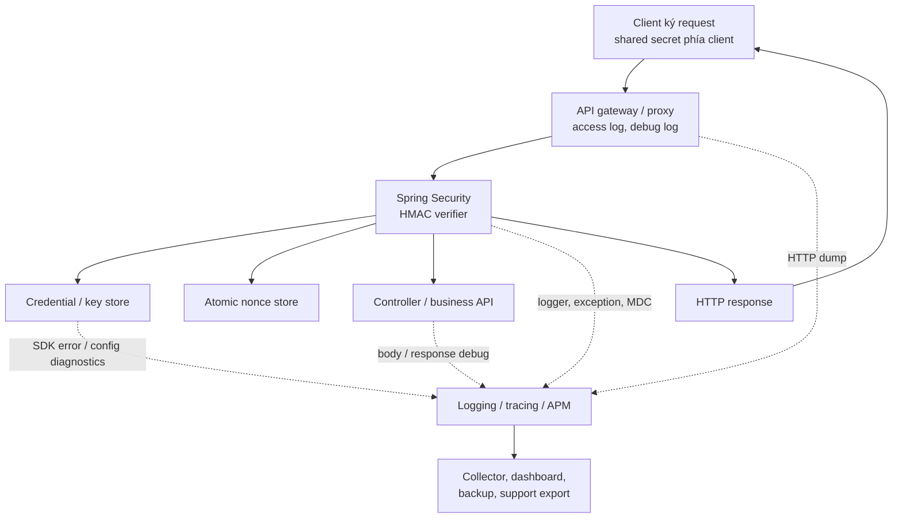
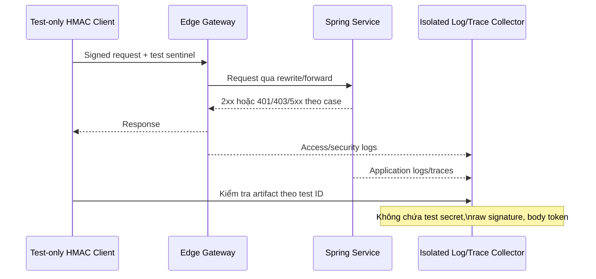

# Secret leakage test: kiểm thử không làm lộ bí mật trong hệ thống xác thực HMAC

## 1. Mục đích của Secret leakage test

Trong module `SECURITY_AUTHENTICATION_HMAC_REQUEST_AUTHENTICATION`, client và server dùng **shared secret** để tính và kiểm tra HMAC trên **canonical request** theo hợp đồng ký. Canonical request có thể gồm HTTP method, URI, các header được chọn và/hoặc SHA-256 của body. Một request chỉ được xác thực khi chữ ký khớp, timestamp còn trong cửa sổ, nonce chưa được dùng và key version đang được phép. Sau đó Spring Security mới xét quyền (authorization).

Một implementation có thể kiểm tra HMAC hoàn toàn đúng nhưng vẫn không an toàn nếu secret xuất hiện trong log, HTTP error response, trace, metrics, crash report hoặc gateway debug dump. Chỉ cần một nơi tiết lộ key material, bên nhận được secret có thể tạo chữ ký hợp lệ cho request giả mạo trong phạm vi credential đó.

**Secret leakage test** là nhóm kiểm thử chứng minh rằng các giá trị nhạy cảm **không xuất hiện tại những điểm xuất dữ liệu không được phép**, kể cả trong các nhánh lỗi bất thường. Nó là một phần của **Security testing**, khác với unit test kiểm tra HMAC-SHA256 trả digest đúng.

Bài học này trả lời những câu hỏi:

- Khi HMAC sai, ứng dụng có ghi cả `secret`, `Authorization` hoặc `expectedSignature` để debug không?
- Nếu key store, nonce store hoặc gateway gặp lỗi, stack trace/response có tiết lộ thông tin nhạy cảm không?
- Trong Spring MVC/WebFlux, filter log request có vô tình dump headers, body hoặc secret từ config không?
- Trace, metrics và Actuator có dùng raw credential làm attribute/tag không?
- Khi key rotation, secret phiên bản cũ có vô tình được in để so sánh với phiên bản mới không?
- Làm sao dùng **test-only secret/sentinel**, thu các output thực sự và tự động kiểm thử trên CI mà không đưa secret production vào test?

Kết quả mong đợi là một **bộ kiểm thử nhiều lớp**, có khả năng phát hiện regression và không tạo cảm giác an toàn giả chỉ vì một logger không in secret trong một happy path.

## 2. Threat model và ranh giới quan sát

Trong HMAC, shared secret thường tồn tại tại phía client ký và server verifier hoặc một hệ quản lý khóa; **không được gửi dưới dạng raw secret trong HTTP request**. HTTP request thường chứa key ID và client-supplied signature. Đừng nhầm chữ ký với secret: chữ ký không phải key material, nhưng có thể bị lạm dụng để phát lại khi freshness/anti-replay yếu và vẫn cần tránh ghi log.



**Đường rò rỉ** không chỉ là `log.info("secret={}", key)`. Secret có thể vào:

1. Message của exception từ một SDK/driver, sau đó được log nguyên `ex`.
2. `toString()` tự sinh của record/config class chứa secret.
3. Header capture của gateway/APM hoặc HTTP request logging filter.
4. Trace span attributes, baggage, event attributes và error monitoring.
5. Response body/header của exception handler hoặc debug endpoint.
6. Metric label hoặc tag xuất qua Prometheus/Actuator.
7. CI console, snapshot test, test failure output hoặc support ticket.
8. Heap dump, core dump, diagnostic bundle: không phải “log thông thường”, nhưng vẫn là artifact cần kiểm soát.

Vì secret phải xuất hiện trong bộ nhớ để tính HMAC, **không thể chứng minh “không có secret trong RAM” bằng cách quét log**. Bài tập trung vào việc **không phát tán secret sang những output quan sát được**; xử lý key material trong memory/heap dump cần một lớp kiểm soát riêng.

## 3. Phân loại dữ liệu cần bảo vệ

| Dữ liệu | Vai trò | Mức bảo vệ khi kiểm thử |
| --- | --- | --- |
| **HMAC shared secret** / raw `SecretKey` bytes | Tạo/chứng minh chữ ký | **Tuyệt đối không xuất ra log, response, trace, metrics, dump thông thường** |
| Secret cũ khi rotation hoặc secret vừa revoke | Vẫn là key material | Không log ngay cả khi không còn active |
| Khóa dùng tạo pseudonym, encryption key, DB password | Secret hạ tầng | Không log |
| `Authorization`/`X-Signature` value | Credential/signature do client gửi | Không ghi raw; có thể trở thành dữ liệu replay |
| **Expected signature** do server tính | HMAC từ shared secret và canonical bytes | Không đưa vào output |
| `keyId` do client gửi | Chỉ là định danh tra khóa **chưa xác minh** | Không gắn nhãn authenticated principal; tránh raw ID tùy ý |
| Stored key ID sau xác thực | Metadata server đã biết | Có thể dùng alias/pseudonym nội bộ có kiểm soát |
| Timestamp và nonce | Freshness/replay protection | Không log raw mặc định; dùng reason code/bucket |
| Full canonical request | Chứa path/query/header/body hash, có thể chứa dữ liệu nhạy cảm | Không dump trong production |
| Body/URL query/header ứng dụng | Có thể chứa token, PII và thông tin nghiệp vụ | Chỉ thu trường allowlist |
| Request ID, route template, reason code | Correlation/triage | Có thể log khi đã validate/giới hạn |

Một số API tự định nghĩa signature trong `Authorization: HMAC ...`, số khác dùng `X-Key-Id` và `X-Signature`. Contract của bài kiểm thử phải dựa trên scheme thật. **Test absence of secret** không đồng nghĩa tất cả header khác đều không nhạy cảm: kiểm thử nên có tập dữ liệu cần che rộng hơn key material.

### 3.1. Không dùng hash của secret làm dữ liệu audit

`SHA256(secret)`, Base64 của secret, hex của secret hoặc prefix/suffix của secret đều không phải thay thế mặc nhiên an toàn để log. Chúng tiết lộ fingerprint, có thể hỗ trợ thử từ điển nếu secret yếu và tạo liên kết giữa môi trường.

Nếu cần correlation theo credential, dùng **alias hoặc HMAC tag trên stored key ID** với một **khóa logging riêng**, chỉ sau khi HMAC/timestamp/nonce được kiểm chứng. Test phải bảo đảm tag đó không được tính từ raw attacker-supplied key ID rồi coi là identity.

## 4. Định nghĩa test oracle: thế nào là “không lộ secret”?

Một test có ý nghĩa cần xác định **dữ liệu đầu vào nhạy cảm**, **bề mặt đầu ra** và **điều kiện PASS**.

Ví dụ test dùng secret giả có tính nhận diện cao:

```text
TEST_ONLY_HMAC_SECRET_7mR4qZ2vP6s9N5x8E1B3
```

Giá trị trên là **sentinel minh họa, không phải secret dùng cho production**. Trong test thực tế, tạo dữ liệu riêng cho suite và bảo đảm credential test chỉ có quyền với môi trường cách ly.

Một bộ oracle gồm:

| Bề mặt | Nội dung thu thập | Điều kiện PASS |
| --- | --- | --- |
| HTTP response | Status, tất cả header và body | Không chứa sentinel, credential/raw signature, expected HMAC hoặc chi tiết nội bộ không cho phép |
| Application log | Các event phát ra từ bộ logger trong test | Không chứa secret hoặc biến thể encoding được kiểm tra |
| Gateway/access log | Output của ingress/proxy staging | Không dump auth headers, secret, body/token |
| Tracing/APM | Span attributes, baggage, event và exception | Không có key material hoặc raw credential |
| Metrics | Meter names, tag keys/values và exposition | Không có secret/nonce/ID tùy ý; labels có cardinality thấp |
| Exception/error reporter | Message, cause chain và report đã publish | Không chứa secret/raw config/expected signature |
| Build/CI artifacts | Console, snapshots, test report | Không in secret hoặc serialized fixture |
| Security behavior | HMAC accepted/rejected/replay/403 đúng | Không “giải quyết” leak bằng cách bypass xác thực |

**PASS có giới hạn phạm vi.** Một test không thấy sentinel trong Logback không chứng minh Fluent Bit, gateway hay một APM SDK khác cũng không lưu dữ liệu. Cần ghi rõ bề mặt đã đo và nơi chưa kiểm chứng.

### 4.1. Không test bằng secret production

Không lấy secret production rồi tìm nó trong CI log. Hành động đó tự đưa credential thật vào pipeline test và tăng bề mặt rò rỉ. Dùng **test-only key**/secret và dữ liệu nghiệp vụ giả; nếu một secret production từng xuất hiện trong log, áp dụng incident response và rotation chứ không đưa nó vào regression test.

### 4.2. Phát hiện nhiều biểu diễn

Đối với sentinel byte array trong test, có thể kiểm tra:

- Chuỗi UTF-8 raw.
- Base64 encoding của byte array.
- Hex encoding.
- URL encoding nếu trường thực tế có thể được encode.
- Một số dạng JSON-escaped liên quan đến output thực.

Đây là những biểu diễn cần test theo threat model, **không phải danh sách có thể bao phủ mọi phép biến đổi**. Một cơ chế redaction theo blacklist có thể bỏ sót substring, serialization mới hoặc hash không khóa. Vì vậy, **ưu tiên ngăn dữ liệu nhạy cảm đi vào logger** thay vì chỉ quét và che ở collector.

## 5. Thiết kế logging allowlist để test có ý nghĩa

Thay vì đưa toàn bộ request/verification context cho logger:

```java
// SAI: object có thể chứa secret, raw body hoặc signature.
log.debug("verifyContext={}", context);
log.error("Failed to verify request: {}", exception.getMessage());
log.trace("headers={} body={}", requestHeaders, bodyBytes);
```

Hãy thiết kế event bằng **trường được phép**:

```json
{
  "event": "hmac.authentication.rejected",
  "request_id": "req-test-042",
  "route_template": "/api/orders",
  "auth_outcome": "rejected",
  "reason_code": "invalid_signature",
  "signature_present": true,
  "http_status": 401
}
```

Đây là dữ liệu minh họa. `reason_code` là enum từ code, không lấy trực tiếp `ex.getMessage()`. `route_template` là route đã định nghĩa, không phải raw URI với token. `request_id` có charset/length được kiểm soát, không chấp nhận raw CR/LF do client đưa vào.

Ở nhánh HMAC accepted, có thể log `verified_key_tag` để hỗ trợ key rotation/correlation, nhưng chỉ khi credential registry đã xác minh khóa cùng timestamp/nonce. Một request chỉ mang `X-Key-Id: partner-A` không đủ để khẳng định partner A gửi request.

### 5.1. Code mẫu: API audit không nhận secret

```java
public enum HmacRejectReason {
    MISSING_CREDENTIAL,
    MALFORMED_CREDENTIAL,
    INVALID_SIGNATURE,
    TIMESTAMP_OUT_OF_WINDOW,
    REPLAY_DETECTED
}

public final class HmacSecurityAudit {

    private static final Logger LOG =
            LoggerFactory.getLogger("security.hmac.audit");

    public void rejected(
            String trustedRequestId,
            HmacRejectReason reason,
            boolean signaturePresent) {

        String requestId = trustedRequestId != null
                && trustedRequestId.matches("[A-Za-z0-9_-]{1,64}")
                        ? trustedRequestId
                        : "unavailable";

        LOG.warn(
                "event={} request_id={} reason_code={} signature_present={}",
                "hmac.authentication.rejected",
                requestId,
                reason.name().toLowerCase(Locale.ROOT),
                signaturePresent);
    }
}
```

Cần import `org.slf4j.Logger`, `LoggerFactory`, `java.util.Locale`. Code là cấu trúc minh họa, không phải framework cung cấp sẵn. Điều quan trọng là method audit **không nhận `SecretKey`, `byte[] secret`, raw `HttpServletRequest`, `Map` tùy ý hoặc canonical string**.

Placeholder `{}` của SLF4J **không tự che dữ liệu**. Nếu truyền secret làm argument, secret vẫn đi vào log. Điều kiện an toàn phải xuất phát từ **loại dữ liệu được phép truyền**.

## 6. Tạo test-only fixture có thể gắn sentinel

Một fixture tốt dựng một hệ xác thực HMAC đủ thật:

```text
Test credential:
  key_id       = test-client-v1
  shared_secret = TEST-ONLY data (not production)
  key_state    = active
  authorities  = orders:create

Signed request contract (minh họa):
  HMAC-v1
  POST
  /api/orders
  content-type:application/json
  base64(SHA256(exact_body_bytes))
  unix_epoch_seconds
  nonce
```

Fixture cần tạo chữ ký HMAC thực sự từ secret giả, không mock `Authentication` thành authenticated. Trong test response/log, đừng chỉ kiểm tra nhánh lỗi: nhiều ứng dụng log key material **khi lookup thành công** hoặc **khi rotation**.

### 6.1. Sinh test data không gây rò credential thật

Ví dụ JUnit fixture sử dụng test-only secret:

```java
static final String TEST_SECRET =
        "TEST_ONLY_HMAC_SECRET_7mR4qZ2vP6s9N5x8E1B3";
static final String TEST_BODY_TOKEN =
        "TEST_ONLY_BODY_TOKEN_8877";
static final String TEST_SIGNATURE_SENTINEL =
        "TEST_ONLY_FAKE_SIGNATURE_5566";

static byte[] testSecretBytes() {
    return TEST_SECRET.getBytes(StandardCharsets.UTF_8);
}
```

Đây là **mã giả lập dữ liệu thử**, không phải secret production. Giá trị `TEST_SIGNATURE_SENTINEL` không phải Base64 signature HMAC hợp lệ, nên dùng nó để test nhánh parser/error handling; test happy path phải tính chữ ký thật theo canonical contract.

Có thể đặt sentinel khác nhau cho từng nguồn dữ liệu (secret config, body, Authorization, client key ID), nhờ vậy khi test phát hiện một giá trị, ta biết bề mặt rò rỉ nào đã bị mở.

### 6.2. Test signer và server dùng cùng hợp đồng, không cùng bug

Nên xây signer test theo **golden vectors độc lập** của canonical request, không tái sử dụng trực tiếp private helper của server verifier. Nếu client fixture và verifier cùng dựa vào một hàm serialize sai, mọi test hợp lệ có thể xanh dù wire contract không đúng.

Trong regression suite, dùng ít nhất các request: body rỗng, JSON có Unicode, changed path, changed body, signed header mismatch, timestamp quá hạn và nonce lặp.

## 7. Test Logback với ListAppender trong Java

Một cách kiểm thử logging là gắn một test appender vào logger audit, kích hoạt event rồi kiểm tra chuỗi đã format.

Ví dụ JUnit 5 cùng Logback:

```java
import ch.qos.logback.classic.Logger;
import ch.qos.logback.classic.spi.ILoggingEvent;
import ch.qos.logback.core.read.ListAppender;
import org.junit.jupiter.api.Test;
import org.slf4j.LoggerFactory;

import java.util.stream.Collectors;

import static org.junit.jupiter.api.Assertions.*;

class HmacSecurityAuditTest {

    @Test
    void rejectedEventMustNeverContainSecrets() {
        Logger auditLogger = (Logger) LoggerFactory
                .getLogger("security.hmac.audit");

        ListAppender<ILoggingEvent> appender = new ListAppender<>();
        appender.start();
        auditLogger.addAppender(appender);

        try {
            new HmacSecurityAudit().rejected(
                    "req-test-01",
                    HmacRejectReason.INVALID_SIGNATURE,
                    true);

            String captured = appender.list.stream()
                    .map(ILoggingEvent::getFormattedMessage)
                    .collect(Collectors.joining("\n"));

            assertTrue(captured.contains("invalid_signature"));
            assertFalse(captured.contains(TEST_SECRET));
            assertFalse(captured.contains(TEST_BODY_TOKEN));
            assertFalse(captured.contains(TEST_SIGNATURE_SENTINEL));
        } finally {
            auditLogger.detachAppender(appender);
            appender.stop();
        }
    }
}
```

Trong code, `TEST_SECRET`, `TEST_BODY_TOKEN`, `TEST_SIGNATURE_SENTINEL` là những constant từ fixture của mục trước, cần import/đặt trong test class thực tế. Test này chứng minh **event `rejected` được gọi ở đây không in sentinel**; nó **không** chứng minh verifier, exception handler, gateway hay APM không log trong những nhánh khác.

Một lưu ý quan trọng: test logger global có thể nhận event của test song song. Dùng test logger riêng, test resource lock hoặc chạy integration suite tuần tự. **Luôn detach/stop appender trong `finally`**, tránh chồng nhiều appender và làm test sau đếm/log trùng.

### 7.1. Kiểm tra dữ liệu được đưa vào event, không chỉ text

Đối với structured logging, một field có thể chưa xuất hiện trong `getFormattedMessage()` nhưng vẫn nằm trong key-value pairs, arguments hoặc MDC, sau đó được JSON encoder xuất ra.

Vì vậy test nên kiểm tra thêm:

- `ILoggingEvent.getArgumentArray()` sau khi chọn dữ liệu cần quan sát, tránh stringify không kiểm soát.
- `getMDCPropertyMap()`.
- Structured arguments/key-value pairs nếu logger backend hỗ trợ.
- JSON output cuối cùng qua encoder/collector test, không chỉ text message.
- Exception proxy chain nếu appender thực tế serialize stack trace và causes.

**Đừng in captured log chứa sentinel ra console trong thông báo assertion failure.** Test báo fail với tên surface, event, field và test ID là đủ; nếu dump log để “debug leak”, chính test report có thể trở thành nơi chứa giá trị nhạy cảm.

## 8. Kiểm thử HTTP response và lỗi xác thực trong Spring MVC

Với Spring Boot 3/Spring Security 6, kiểm thử qua `MockMvc` có bật security filters để chặn request sai HMAC trước controller.

### 8.1. Response không chứa secret hoặc raw signature

Ví dụ request không có credential hoặc có signature sai:

```java
@Test
void badHmacReturns401WithoutLeakingSecret() throws Exception {
    MvcResult result = mockMvc.perform(
                    post("/api/orders")
                            .contentType(MediaType.APPLICATION_JSON)
                            .content("{\"quantity\":2}")
                            .header("X-Key-Id", "test-client-v1")
                            .header("X-Signature",
                                    TEST_SIGNATURE_SENTINEL))
            .andExpect(status().isUnauthorized())
            .andReturn();

    MockHttpServletResponse response = result.getResponse();

    String published = response.getContentAsString()
            + response.getHeaderNames().stream()
                .map(name -> name + ":" + response.getHeader(name))
                .collect(Collectors.joining("\n"));

    assertFalse(published.contains(TEST_SECRET));
    assertFalse(published.contains(TEST_SIGNATURE_SENTINEL));
    assertFalse(published.contains(TEST_BODY_TOKEN));
}
```

Giả định endpoint bảo vệ bằng HMAC và header signature giả bị reject theo contract. `mockMvc`/`TEST_*` đến từ test fixture. Một test quan trọng khác phải dùng **HMAC hợp lệ** với key test, không chỉ signature sai: một số đường leak chỉ chạy khi verifier tìm thấy secret và xác minh thành công.

Ngoài response body và headers, cần assert **controller/service không chạy** trong nhánh từ chối:

```java
verify(orderService, never()).create(any());
```

Đây là ví dụ Mockito: chữ ký/số tham số của `create` phải điều chỉnh theo service thật. Test bằng `@AutoConfigureMockMvc(addFilters = false)` không có giá trị cho ranh giới bảo mật vì bỏ qua security filters.

### 8.2. Bắt cả lỗi bất thường

Không chỉ kiểm thử `401`. Bổ sung các nhánh:

- Key ID không tồn tại, key bị revoke, key rotation overlap.
- Nonce replay, timestamp expired/future, chữ ký Base64 sai định dạng.
- Header quá dài, duplicate `Authorization`/`X-Signature`.
- Key store/nonce store ném timeout hoặc exception có message độc hại.
- Canonical URI/body mismatch do gateway.
- HMAC đúng nhưng thiếu authority → `403`.
- JSON lỗi sau HMAC hợp lệ → `400` hoặc status theo API.

Dùng một fake dependency **cố tình ném exception chứa test-only sentinel** để kiểm tra exception-to-response handler không echo message. Lưu ý fake exception này không chứa secret thật, và test phải kiểm tra cả log/trace chứ không chỉ response.

### 8.3. Không bắt `Exception` quá rộng rồi trả `401`

Key store mất kết nối hoặc nonce store không thể atomic reserve là **lỗi hạ tầng**. Nếu không thể xác minh an toàn, server phải *fail closed*, thường trả `503`/`5xx` phù hợp; không gọi controller và không phân loại mọi lỗi thành “invalid signature”. Test phải kiểm chứng không có secret trong response lỗi hạ tầng **và** semantics bảo mật còn đúng.

## 9. Spring WebFlux: kiểm thử response, reactive logging và context

WebFlux dùng `ServerWebExchange`, `AuthenticationWebFilter`, `ReactiveAuthenticationManager` và `SecurityWebFilterChain`. Test bằng `WebTestClient` qua chain thật:

```java
@Test
void invalidSignatureDoesNotAppearInReactiveResponse() {
    webTestClient.post()
            .uri("/api/orders")
            .contentType(MediaType.APPLICATION_JSON)
            .header("X-Key-Id", "test-client-v1")
            .header("X-Signature", TEST_SIGNATURE_SENTINEL)
            .bodyValue("{\"quantity\":2}")
            .exchange()
            .expectStatus().isUnauthorized()
            .expectBody(String.class)
            .value(body -> {
                assertFalse(body.contains(TEST_SECRET));
                assertFalse(body.contains(TEST_SIGNATURE_SENTINEL));
            });
}
```

Đây là kiểm tra **response body**; cần test riêng response headers, reactive log sink và tracing export. Một WebTestClient test kết nối mock controller mà không bật security WebFilters không chứng minh HMAC path an toàn.

### 9.1. Body `Flux<DataBuffer>` và nguy cơ leak

Nếu HMAC ký body, verifier có thể gom `Flux<DataBuffer>` rồi tính SHA-256. Một lỗi debug rất nguy hiểm là in toàn bộ `DataBuffer` hoặc `byte[]`; body có thể chứa token, PII hoặc dữ liệu nghiệp vụ. Đồng thời, việc cache body không giới hạn có thể gây memory exhaustion.

Yêu cầu:

1. Giới hạn kích thước body trước khi buffer.
2. Tính digest trên **exact bytes** theo hợp đồng ký.
3. Release pooled `DataBuffer` đúng lúc và phát lại body nếu downstream cần đọc.
4. Không ghi raw body hoặc canonical string đầy đủ ra logger/tracer.
5. Không gọi `block()`/tự `subscribe()` trong authentication filter.

### 9.2. Reactor Context không phải MDC thread-local

Principal reactive nằm trong Reactor Context. Nếu truyền `verified_key_tag` hoặc request ID đến logging pipeline, cần kiểm thử propagation qua scheduler và cancellation. Không đặt shared secret, raw header `Authorization` hay signature vào Reactor Context chỉ để tiện debug. Một MDC thread-local không được quản lý có thể gắn dữ liệu request trước sang request sau.

Đặt test chạy nhiều request đồng thời với sentinel khác nhau và bảo đảm **không có sự trao đổi request ID/key tag giữa hai luồng**. Test này bổ sung cho kiểm thử leak literal: kể cả log không chứa secret, ghi sai danh tính đã xác minh cũng là lỗi bảo mật.

## 10. Gateway, proxy và HTTP access log

Ngay cả khi code Java không log secret, reverse proxy/CDN/WAF có thể ghi full header/body khi bật debug.

Cần phân biệt:

- Shared secret không nên có trên wire trong HMAC design.
- Client-supplied HMAC signature là dữ liệu nhạy cảm; không dump `X-Signature` hoặc `Authorization`.
- Body và raw URI/query có thể mang token ứng dụng.
- `Forwarded` và `X-Forwarded-*` có thể chứa IP/host và bị giả mạo; không coi là danh tính HMAC.

### 10.1. Bài test qua gateway thật



Nếu contract ký public URI nhưng gateway rewrite sang internal URI, test phải xác minh chữ ký theo đúng đường đi: hoặc xác minh tại edge trước rewrite, hoặc service dùng metadata **do trusted ingress kiểm soát**. `Forwarded` theo RFC 7239 không chứa original path/query chuẩn; header tùy biến như `X-Original-URI` phải được ingress làm sạch/ghi đè.

Dùng request ID/test run ID để tìm log sau khi collector đã nhận đủ dữ liệu; tránh assert quá sớm khi pipeline log bất đồng bộ. Khi kiểm tra, **không in toàn bộ artifact nếu phát hiện leak**: chỉ xuất tên surface và mã testcase.

### 10.2. Cấu hình access log phải có allowlist

Test nên xác nhận format access log chỉ có những trường được phép, như method, route template/mapped route, status, latency và trusted request ID. Không dùng format chứa toàn bộ header map, `Authorization`, raw query hoặc body.

Nếu proxy thay `Host`/path/body, test contract chữ ký riêng phải phát hiện canonicalization mismatch. Không sửa lỗi bằng cách bỏ signed fields hoặc thử nhiều canonical targets cho đến khi signature khớp.

## 11. Tracing/APM: một nguồn lộ ít được chú ý

APM/tracing SDK có thể tự ghi:

- HTTP request/response headers hoặc URL đầy đủ.
- Query string trong `http.target`/custom attributes.
- Exception message, cause chain, stack variables.
- “Baggage” được chuyển qua các service.
- Raw object đã serialize trong span event.
- Request/response payload khi bật debug sampling.

**Kiểm thử phải kiểm tra dữ liệu sau khi export**, không chỉ kiểm tra Java logger. Trong môi trường test, cấu hình một in-memory span exporter hoặc collector cách ly và thu spans của request sentinel.

Bài test cần assert:

| Dữ liệu trong span | Kỳ vọng |
| --- | --- |
| Route template và method | Cho phép nếu đã loại bỏ raw ID/query nhạy cảm |
| HTTP status/security outcome | Cho phép |
| Trace/request ID | Cho phép khi đúng định dạng |
| `Authorization`/`X-Signature` | Không có raw value |
| HMAC shared secret/expected MAC | Không xuất hiện ở bất kỳ attribute/event |
| Exception message từ key SDK có sentinel | Được sanitize trước export |
| Raw body, nonce, URI có PII | Không được capture theo policy |
| `verified_key_tag` | Chỉ xuất hiện sau xác thực với quyền/retention phù hợp |

Không thêm raw secret vào MDC/trace “để đối chiếu” rồi hy vọng collector lọc. Tránh truyền thông tin nhạy cảm sang một exporter thứ ba khi có thể kiểm soát ở nguồn.

## 12. Metrics và Actuator: không biến label thành kho credential

Một lần test nên scrape meter registry trong test hoặc `/actuator/prometheus` (qua endpoint có quyền truy cập) và kiểm tra không chứa sentinel.

Ví dụ nhãn phù hợp:

```text
hmac_requests_rejected_total{
  stage="authentication",
  reason="invalid_signature",
  route="orders_create"
} 1
```

Ví dụ **không được dùng**:

```text
hmac_requests_rejected_total{
  key_id="client-provided-arbitrary-value",
  nonce="nonce-unique-001",
  signature="<raw-signature>"
} 1
```

Bởi vì `keyId`, nonce, raw URI và signature là dữ liệu không giới hạn từ client, chúng làm tăng cardinality, chi phí lưu trữ và rủi ro lộ thông tin. Test nên fuzz nhiều giá trị key ID/nonce/path rồi kiểm tra số label combination không tăng theo input tùy ý.

### 12.1. Health và info endpoints

`/actuator/health`, `/actuator/env`, `/actuator/configprops` hoặc các endpoint diagnostics khác có thể tiết lộ thông tin cấu hình nếu exposure/security sai. Không nên expose tất cả Actuator endpoints ra Internet chỉ để kiểm tra health.

Dù Spring Boot có cơ chế xử lý/sanitize một số giá trị, **không dựa duy nhất vào cấu hình mặc định** để chứng minh secret luôn được che trong mọi endpoint/custom contributor. Test phải đánh giá cấu hình production hoặc staging gần giống production; key material không nên được thêm vào health details.

## 13. Key rotation, credential caching và secret cũ

Đường rò rỉ dễ bị bỏ sót nằm ở code quản lý credential lifecycle:

```java
// SAI: vô tình log cả secret cũ và secret mới khi rotate.
log.info("Rotating HMAC key from {} to {}",
        previousSecret, nextSecret);
```

Một vài tình huống cần test:

| Tình huống | Leak test mong đợi |
| --- | --- |
| Khởi động service và nạp key cache | Không in secret trong startup log |
| Key store trả key active | Không log key bytes hoặc object `toString()` |
| Key cache miss/fetch timeout | Không log SDK request/response chứa secret |
| Rotation overlap old/new keys | Không log cả old/new secret |
| Key revoked | Không in secret cũ để giải thích `401` |
| Wrong key version | Không in các khóa đã thử hoặc expected HMAC |
| Unknown key ID | Không echo dữ liệu người dùng chưa xác minh |
| Nonce store outage | Không dump key/nonce namespace nhạy cảm |
| Key tag pseudonymization | Dùng secret log riêng; không lấy HMAC digest của signing key để log |

Key rotation có thể làm lộ secret từ object config tự sinh `toString()`, từ event “key loaded” hoặc debug log của secret manager client. Test phải chạy qua lifecycle giả lập, không chỉ gọi một method `verify()`.

### 13.1. Không biến leak test thành thử liệt kê key

Có thể phản hồi public cùng một lỗi authentication chung cho unknown/revoked/invalid signature. Test secret leakage cũng cần kiểm tra **key enumeration oracle**: message/response không nói key ID nào tồn tại hay trạng thái revoke. Đây là kiểm thử lộ thông tin khác với việc tìm raw secret, nhưng liên quan trực tiếp đến security testing.

## 14. Replay và canonical request: các ca lỗi cần bao phủ

Nếu HMAC ký URI/body, server có thể log full canonical string để giải thích signature mismatch. Một changed-path test, changed-header test hoặc changed-body test có thể vô tình kích hoạt đường debug đó.

Bộ kịch bản:

1. **Signature mismatch:** ký target A, đổi path/query/body đã ký rồi gửi chữ ký cũ với nonce **chưa dùng**.
2. **Timestamp expired:** dùng thời điểm ngoài cửa sổ; không log raw nonce hoặc full signed headers.
3. **Nonce replay:** gửi lại một request hợp lệ; lần sau bị reject và không log credential.
4. **Missing auth:** bỏ header bắt buộc; response `401` với challenge theo contract, không echo header khác.
5. **Malformed auth:** đưa giá trị quá dài/duplicate/sai Base64; không log nguyên input.
6. **Wrong authority:** HMAC thật sự hợp lệ nhưng không có quyền; response `403`, không dump principal secret.
7. **Proxy rewrite:** client ký public target nhưng service nhận upstream target; không log raw canonical request production khi mismatch.
8. **Dependency errors:** key store/nonce store exception có fake secret trong message; response và log theo allowlist, request fail closed.

**Quan trọng:** nếu test signature mismatch dùng lại nonce từ happy path, server có thể reject vì replay. Test vẫn thấy `401` nhưng không biết verifier có thực sự so sánh path/body hay không. Dùng nonce riêng cho từng case và positive control khi cần chứng minh nguyên nhân lỗi.

### 14.1. Lỗi 401 và 403 vẫn phải giữ đúng semantics

- `401`: thiếu/sai authentication credential HMAC hoặc freshness/replay theo contract; thường kèm `WWW-Authenticate` thích hợp với scheme được triển khai.
- `403`: đã xác thực nhưng thiếu quyền.
- `5xx` phù hợp, ví dụ `503`: không thể xác minh an toàn do key/nonce store outage.
- Không trả response chứa expected signature, shared secret, danh sách key ID hợp lệ hoặc full canonical bytes.

Nếu một thay đổi logging khiến ứng dụng catch mọi exception rồi tiếp tục `chain.doFilter()`, test có thể “không lộ secret” nhưng vẫn thất bại nghiêm trọng vì authentication bị bypass.

## 15. Fuzzing và kiểm thử log injection

Một attacker có thể gửi dữ liệu trông giống log record:

```text
X-Key-Id: fake-client%0A[INFO] authentication accepted for admin
```

Header HTTP thực có thể từ chối CR/LF trước khi tới ứng dụng; ví dụ trên mô tả dữ liệu **encoded** có thể bị decode ở một bước rồi ghi vào log. Kết quả mong muốn:

- Input sai định dạng bị từ chối hoặc được xử lý theo grammar rõ ràng.
- Không có dòng log giả, không thay đổi `event`/`reason_code` do client khai.
- Không dùng raw key ID, path/query, header hoặc exception message làm tên metric/tag.
- Logger encoder JSON escape các ký tự điều khiển đúng cách.
- Header quá dài không khiến logger dump nguyên chuỗi hoặc tiêu tốn memory không giới hạn.

Tạo fuzz cases cho key ID, signature, nonce, URI và body với ký tự điều khiển, Unicode, giá trị rất dài, duplicate fields, Base64/hex/URL encoding. **Không** đưa fuzz input trực tiếp vào `assertEquals` khiến failure message in hàng MB dữ liệu nhạy cảm. Báo lỗi bằng seed, case ID và tên surface.

Các test nên dùng rate limit và môi trường cách ly, tránh làm nghẽn collector/CI hoặc gây chi phí không kiểm soát.

## 16. CI/CD: kiểm thử nhiều lớp, có giới hạn rõ ràng

Một quy trình phù hợp cho dự án Spring Boot:

| Tầng | Tần suất | Bằng chứng |
| --- | --- | --- |
| Unit test HmacSecurityAudit/DTO | Mỗi commit | Audit API không nhận secret, event đúng allowlist |
| Unit test exception/response mapper | Mỗi commit | Không echo fake secret trong 401/403/503 |
| MVC/WebFlux integration | Mỗi PR | Security filters, body/header, nonce và log sink |
| Metrics/exporter test | Mỗi PR hoặc build định kỳ | Không có raw sensitive labels |
| APM/tracing exporter test | Khi đổi tracing config và định kỳ | Span attributes/events đã lọc |
| Gateway/proxy end-to-end | Staging và trước release | Access logs, rewrite path và forwarded header |
| Key rotation/lifecycle test | Khi đổi key management và định kỳ | Old/new secret không xuất vào log/artifacts |
| Canary/negative security suite | Định kỳ | Lộ dữ liệu không tái xuất hiện sau config change |
| Artifact/diagnostic policy review | Theo chu kỳ | Heap/crash dumps, support export được bảo vệ |

### 16.1. Tránh flakiness của log pipeline bất đồng bộ

Collector có thể nhận log sau khi HTTP response đã trả. Test phải có:

1. Request ID duy nhất và test-run ID.
2. Mechanism chờ/flush có timeout hợp lý trên **isolated test sink**.
3. Điều kiện “đã nhận đủ event mong đợi” trước khi kết luận không có secret.
4. Cleanup dữ liệu test và không để credential test tồn tại vô hạn.

Chỉ sleep cố định 100 ms rồi tìm chuỗi thường tạo **false negative** nếu collector chưa flush. Ngược lại, test không nên chờ vô hạn nếu hệ thống log mất kết nối.

### 16.2. Source scanning là lớp hỗ trợ, không thay runtime test

Static analysis/secret scanning có thể phát hiện câu lệnh log raw `secret` hoặc credential commit nhầm. Tuy nhiên, nó không luôn phát hiện dữ liệu đi qua `toString()`, SDK exception, configuration hoặc third-party agent. **Kết hợp static scan với runtime fixture**, không chỉ chọn một.

Các test run nên báo cáo bề mặt đã kiểm tra, contract version, code revision và chính sách log/trace đã bật. Một bài test chỉ chạy profile `test` không bảo đảm profile `production` không bật HTTP wiretap hoặc debug header capture.

## 17. Khi test phát hiện leak: xử lý thế nào?

Test báo phát hiện sentinel tại output không được phép là **một thất bại bảo mật**, không phải chỉ là lỗi format.

Quy trình xử lý trong môi trường test:

1. Báo **surface và event ID**, không in secret/value nhạy cảm trong CI console.
2. Xác minh nguồn: code logger, exception serialization, gateway config, APM SDK hay collector transform.
3. Ngăn dữ liệu nhạy cảm đi vào pipeline ngay từ nguồn; ưu tiên allowlist.
4. Bổ sung regression test đúng nhánh gây lỗi, bao gồm các encoding liên quan.
5. Kiểm tra cả response, log, trace, metrics và artifacts sau khi sửa.
6. Review môi trường production xem đường rò có tồn tại không.

Nếu dữ liệu thật đã xuất hiện trong log hoặc artifact:

- Cô lập truy cập và đánh giá phạm vi lan truyền (collector, backup, export, support ticket).
- Rotate/revoke secret có nguy cơ lộ theo quy trình credential lifecycle.
- Điều tra hoạt động bất thường bằng request ID, key tag đã xác minh và audit data được bảo vệ.
- Xử lý dữ liệu tồn dư và nghĩa vụ thông báo theo chính sách tổ chức.
- Không coi việc “xóa dòng log” là đủ; secret có thể đã được sao chép sang nhiều hệ thống.

Không tắt HMAC, anti-replay hoặc authorization chỉ để làm test qua; sửa đúng đường rò và giữ nguyên security invariants.

## 18. Bài thực hành: xây bộ Secret leakage test cho Signed Orders API

Giả sử API `POST /api/orders` dùng HMAC-SHA256. Canonical request gồm method, raw path/query, `Content-Type`, hash của JSON body, timestamp và nonce; key ID chọn version của shared secret. Server có Redis nonce store atomic, key rotation overlap, Spring Security authentication và authority `orders:create`, chạy sau một reverse proxy có path rewrite.

Hãy triển khai:

1. **Tạo isolated test credentials:** hai key version test-only, một key revoked, body chứa sentinel riêng, fake signature để test parser và timestamp/nonce có thể kiểm soát.
2. **Xác định output surfaces:** HTTP headers/body, Logback test sink, exception mapper, Micrometer registry, tracing exporter, gateway access log, CI artifacts.
3. **Thiết kế audit allowlist:** request ID đáng tin, route template, `auth_outcome`, `reason_code` và verified key tag khi thích hợp; tuyệt đối không nhận secret/raw request.
4. **Viết unit test logger:** dùng `ListAppender` hoặc structured event sink, assert không có secret ở message/arguments/MDC/JSON serialization.
5. **Viết integration test MVC/WebFlux:** HMAC hợp lệ, chữ ký sai, thiếu header, body bị sửa, nonce replay, timestamp out of window, authz denied; kiểm tra response và no-side-effect.
6. **Fault injection:** fake key store/nonce store ném exception chứa TEST_ONLY sentinel; response vẫn `5xx` thích hợp, không echo message và vẫn fail closed.
7. **Rotation test:** nạp key cũ/mới rồi revoke, xác minh không có key material trong startup/debug/security log hoặc trace.
8. **Gateway test:** gửi request qua edge có rewrite, kích hoạt header/body error paths và thu access log; kiểm tra không dump credential.
9. **Metrics/Actuator test:** fuzz raw key ID/nonce/URI và xác nhận metric label hữu hạn, health/info không rò thông tin cấu hình.
10. **CI policy:** chạy test với appender/collector cách ly, bảo vệ test artifacts, không sử dụng secret production, báo lỗi theo case ID thay vì in dữ liệu bị lộ.

### Tiêu chí hoàn thành

Một bộ Secret leakage test đạt yêu cầu khi:

- Không phát hiện **test-only HMAC secret**, các biểu diễn nhạy cảm đã chọn, raw signature/credential hoặc body token trên mọi surface **đã khai báo và thực sự đo**.
- Có kiểm thử cả success, authentication reject `401`, authorization deny `403`, outage `5xx`, replay và key rotation.
- Test logging kiểm tra event/arguments/MDC/structured output, không chỉ một formatted message.
- Proxy và APM được kiểm tra ở đường export thực tế, có cách chờ flush và correlation theo test ID.
- Không dùng raw attacker-controlled input làm principal, metric labels hoặc log structure.
- Mọi request HMAC sai vẫn bị từ chối trước nghiệp vụ; nonce store hỏng vẫn fail closed.
- Báo cáo rõ giới hạn bao phủ và không khẳng định một bài test chứng minh không còn bất kỳ đường rò nào.

**Kết luận:** Secret leakage test bảo vệ một thuộc tính sống còn của xác thực HMAC: shared secret phải chỉ được dùng ở những ranh giới ký và xác minh tin cậy, **không trở thành dữ liệu quan sát được qua log, response, trace, metric hay hệ thống vận hành**. Một test suite tốt phối hợp fixture giả có sentinel, logging allowlist, integration test nhiều nhánh và kiểm tra pipeline observability thực tế, đồng thời giữ nguyên chống replay, key rotation và phân quyền.
