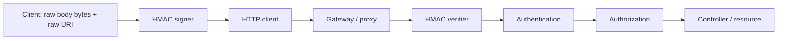

# Unicode test trong bảo mật xác thực HTTP request bằng HMAC

## 1. Vấn đề cần kiểm thử

Trong module `SECURITY_AUTHENTICATION_HMAC_REQUEST_AUTHENTICATION`, client ký HTTP request bằng HMAC trên một **canonical request** gồm method, URI, header và/hoặc body theo hợp đồng; server dựng lại chính xác dữ liệu được ký để xác thực. Vì thuật toán HMAC hoạt động trên **byte**, hai chuỗi trông giống nhau nhưng được mã hóa khác nhau có thể tạo chữ ký khác nhau. Với Unicode, khác biệt có thể nằm ở mã hóa UTF-8, dạng chuẩn hóa NFC/NFD, cách escape JSON, percent-encoding của URI, cách xử lý header hoặc biến đổi của proxy/gateway.

**Unicode test** trong chương **Security testing** nhằm kiểm tra cả hai tính chất:

1. **Tính toàn vẹn:** bất cứ thay đổi nào đối với phần *byte thực sự được hợp đồng ký ràng buộc* phải làm chữ ký HMAC cũ không còn hợp lệ, kể cả khi ứng dụng vẫn đọc được cùng ý nghĩa nghiệp vụ.
2. **Tính tương thích:** nếu hợp đồng quy định hai biểu diễn đầu vào được chuẩn hóa thành cùng canonical bytes, client và server phải xác minh chúng nhất quán; những biểu diễn không hợp lệ hoặc mơ hồ phải được từ chối có kiểm soát.

Unicode test không chỉ là kiểm tra màn hình hiển thị tiếng Việt. Kẻ tấn công có thể lợi dụng **hai thành phần trong hệ thống diễn giải cùng một request theo hai cách khác nhau**: gateway định tuyến theo đường dẫn đã decode, server ký raw URI; parser JSON tự chuẩn hóa chuỗi, bộ ký lại băm body khác; hoặc ứng dụng nhận dạng tenant theo một chuỗi Unicode trong khi verifier chọn khóa theo chuỗi khác. HMAC đúng về toán học vẫn có thể không bảo vệ đúng tài nguyên nếu **danh tính/tài nguyên mà ứng dụng sử dụng khác với dữ liệu mà bộ xác thực đã ràng buộc**.

Sau bài này, người học có thể tạo golden vectors ở mức byte; kiểm thử UTF-8, NFC/NFD, JSON escapes và URI percent-encoding; từ chối dữ liệu Unicode sai chuẩn; viết test bằng Java/JUnit 5 và mở rộng kiểm thử qua Spring Security, WebFlux, proxy/gateway. Các phép thử cần tách lỗi chữ ký với cơ chế timestamp/nonce chống replay, vòng đời khóa và phân quyền.

## 2. Các hiện tượng Unicode cần hiểu trước khi test

### 2.1. Chuỗi nhìn giống nhau nhưng byte khác nhau

Unicode hỗ trợ nhiều cách biểu diễn cùng một ký tự theo chuẩn tương đương. Ví dụ chữ **é** trong `café`:

| Biểu diễn | Chuỗi code point | Byte UTF-8 của `é` hoặc phần tương ứng | Ghi chú |
|---|---|---|---|
| NFC (*composed*) | `c a f U+00E9` | `63 61 66 C3 A9` | `é` là một code point. |
| NFD (*decomposed*) | `c a f e U+0301` | `63 61 66 65 CC 81` | `e` kết hợp dấu sắc; thường hiển thị gần như NFC. |
| JSON escape | `caf\u00e9` trong **byte JSON** | `63 61 66 5C 75 30 30 65 39` | Sau parse JSON, giá trị là code point `U+00E9`, nhưng byte body đã gửi khác. |

Hai biểu diễn NFC và NFD là **canonically equivalent** trong Unicode, nhưng **không bằng nhau về byte**. JSON chứa ký tự `é` trực tiếp và JSON chứa `\u00e9` tạo cùng dãy code point sau parse, nhưng byte HTTP body khác. Nếu hợp đồng ký **SHA-256 của raw body bytes**, ba body phải có body hash khác nhau.

Một lỗi phổ biến là client ký `JSON.stringify(object)` hoặc `ObjectMapper.writeValueAsBytes(object)` trong khi HTTP layer gửi lại body đã được serialize theo cách khác. Cần ký **cùng dãy byte thực sự được gửi**; test phải lưu được byte fixture bằng Base64 hoặc hex để tránh editor tự thay đổi Unicode.

### 2.2. Unicode trong URI là một bài toán riêng

Đường dẫn có `café` thường xuất hiện trên wire dưới dạng percent-encoded UTF-8:

```text
NFC: /v1/items/caf%C3%A9?name=caf%C3%A9
NFD: /v1/items/cafe%CC%81?name=cafe%CC%81
```

Ngay cả `%C3%A9` và `%c3%a9` cũng là **hai chuỗi raw request target khác nhau**, dù các octet đã percent-decode giống nhau. Nếu hợp đồng ký raw target *nguyên văn* thì chúng phải có HMAC khác nhau. Nếu một API chọn canonicalize percent hex về chữ hoa hoặc normalize Unicode trước khi ký, điều đó phải được **viết rõ trong hợp đồng** và áp dụng giống nhau ở client, gateway và verifier. Không tự động thêm normalization vào HMAC verifier sau khi test thất bại.

Các ca như `%2F` so với `/`, `%252F` (*double encoding*), `%20` so với `+` trong query và query parameter lặp còn nguy hiểm hơn: lớp routing, parser và authorization có thể nhìn thấy các path hoặc parameter khác nhau. Cần kiểm tra **cùng request target** được dùng để xác thực, định tuyến và kiểm tra quyền, hoặc phải từ chối biểu diễn nhập nhằng từ trước.

### 2.3. Header có quy tắc khác body

Tên HTTP header tuân theo cú pháp token ASCII và không phân biệt hoa/thường. `X-Client-Id` và `x-client-id` là cùng tên; các tên chứa ký tự Unicode như `X-İd` (chữ `İ`, U+0130) không phải phương án hợp lệ để biểu diễn tên header theo HTTP. Tuy nhiên, việc dùng `String.toLowerCase()` phụ thuộc locale trong Java có thể gây sai khác nếu áp dụng nhầm lên ký tự ngoài ASCII. **Xác thực tên header là ASCII token trước khi lowercase bằng `Locale.ROOT`/quy tắc ASCII.**

Giá trị header cũng không được tự coi là chuỗi Unicode UTF-8 tùy ý: HTTP stack và intermediary có thể có quy tắc octet, charset hoặc từ chối byte khác ASCII. Trong hợp đồng mẫu dưới đây, các **signed header values đều là ASCII**; nếu cần truyền tên người dùng/giá trị Unicode, hãy đặt ở body đã ký hoặc dùng biểu diễn ASCII được định nghĩa rõ (ví dụ Base64 hay cú pháp tham số được chuẩn hóa theo hợp đồng). Không sử dụng `trim()` tùy runtime như một bước chuẩn hóa mơ hồ: HTTP OWS là **SP (`0x20`) và HTAB (`0x09`)**, không bao gồm NBSP `U+00A0` hay zero-width space `U+200B`.

## 3. Hợp đồng HMAC mẫu để có kết quả tái lập

Để kiểm thử có căn cứ, bài này quy định **`HMAC-UNICODE-1`**, một hợp đồng *minh họa* cho API giả lập `POST /v1/items/...`. Đây không phải tiêu chuẩn chung của mọi hệ thống HMAC.

| Thành phần | Quy tắc của `HMAC-UNICODE-1` |
|---|---|
| Secret | Byte giải mã Base64 của chuỗi test `unicode-test-key-2026`; dùng cho fixture, không dùng production. |
| Method | `POST` dạng ASCII chữ hoa. |
| URI | Lấy **raw path và raw query đúng như trên wire**, không percent-decode, không re-encode, không sắp xếp query, không Unicode-normalize. |
| Signed headers | `content-type`, `x-client-id`, `x-nonce`, `x-timestamp`; bắt buộc có đúng một giá trị mỗi tên. |
| Header normalization | Tên lowercase ASCII rồi sort theo thứ tự trên; giá trị ASCII giữ nguyên nội dung, chỉ loại SP/HTAB hai đầu. Từ chối CR/LF, header tên sai cú pháp và duplicate. |
| Body | SHA-256 trên **raw body bytes** (không parse JSON, không NFC/NFD normalization), xuất hex chữ thường. |
| Canonical request | Các dòng nối bằng LF (`\n`), UTF-8 **không BOM**, không thêm LF cuối. |
| Chữ ký | HMAC-SHA256 trên canonical UTF-8 bytes, hex chữ thường; gửi trong `X-Signature: v1=<hex>`. |
| Replay | `X-Timestamp` và `X-Nonce` có mặt trong dữ liệu được ký. Kiểm tra freshness và nonce là một tầng độc lập, cần fake clock/store khi kiểm thử tích hợp. |

Canonical request có thứ tự chính xác:

```text
HMAC-UNICODE-1
POST
<raw-path-and-query>
content-type:application/json; charset=utf-8
x-client-id:tenant-a
x-nonce:nonce-unicode-001
x-timestamp:1735689600
body-sha256:<lowercase-sha256-of-raw-body-bytes>
```

Dấu `<...>` là ký hiệu mô tả, không phải byte của canonical request. Body được truyền dưới `Content-Type: application/json; charset=utf-8`. Ví dụ giả định request body có trường `label` và `amount`; nội dung JSON được server dùng sau khi HMAC được xác minh. Nếu server chọn secret hoặc tenant từ `x-client-id`, phải ràng buộc giá trị đó vào chữ ký đúng như hợp đồng. HMAC không thay thế bước kiểm tra quyền xem/sửa item của tenant sau khi xác thực.

## 4. Golden vectors: 5 trường hợp Unicode có kết quả HMAC cụ thể

Tất cả vector dưới đây dùng chung:

```text
algorithm        = HmacSHA256
secretBase64     = dW5pY29kZS10ZXN0LWtleS0yMDI2
method           = POST
content-type     = application/json; charset=utf-8
x-client-id      = tenant-a
x-nonce          = nonce-unicode-001
x-timestamp      = 1735689600
```

`1735689600` là **01/01/2025 00:00:00 UTC**, được giữ cố định nhằm tạo kết quả tái lập. Nó đã cũ so với thời gian hiện tại; khi chạy qua verifier có chống replay/freshness phải dùng **fake clock** và nonce store riêng, thay vì mong fixture cũ được một server production chấp nhận.

### 4.1. Vector gốc: NFC trong URI và body

Payload được ký là byte UTF-8 của `{"label":"café","amount":1}` với `é = U+00E9`. Để tránh phụ thuộc việc copy/paste ký tự `é`, fixture ghi nguyên byte bằng Base64:

```json
{
  "id": "unicode-nfc-001",
  "contract": "HMAC-UNICODE-1",
  "algorithm": "HmacSHA256",
  "secretBase64": "dW5pY29kZS10ZXN0LWtleS0yMDI2",
  "method": "POST",
  "rawRequestTarget": "/v1/items/caf%C3%A9?name=caf%C3%A9",
  "signedHeaders": [
    { "name": "Content-Type", "value": "application/json; charset=utf-8" },
    { "name": "X-Client-Id", "value": "tenant-a" },
    { "name": "X-Nonce", "value": "nonce-unicode-001" },
    { "name": "X-Timestamp", "value": "1735689600" }
  ],
  "bodyBase64": "eyJsYWJlbCI6ImNhZsOpIiwiYW1vdW50IjoxfQ==",
  "expected": {
    "bodyByteLength": 28,
    "bodySha256Hex": "1d78e1fc9a2684496013a62efaa81e712c86faa9859074fc30312cdb54d3d84c",
    "canonicalByteLength": 246,
    "canonicalSha256Hex": "4170a77e5d43d359d158a7517e235b56615df146bda3a111ae2c62e3819ee1b4",
    "signatureHex": "aa63d95e8ace2d0104780e920943cd868a4eaadbe5815cc39ee1fe898817b7ff"
  }
}
```

Canonical text thực của vector gốc (**không có newline ở cuối**):

```text
HMAC-UNICODE-1
POST
/v1/items/caf%C3%A9?name=caf%C3%A9
content-type:application/json; charset=utf-8
x-client-id:tenant-a
x-nonce:nonce-unicode-001
x-timestamp:1735689600
body-sha256:1d78e1fc9a2684496013a62efaa81e712c86faa9859074fc30312cdb54d3d84c
```

Mỗi implementation nên kiểm tra theo chuỗi: `Base64Decode(bodyBase64)` → số byte → SHA-256 body → canonical bytes → SHA-256 canonical → HMAC-SHA256. Khi có sai khác, biết chính xác bước hỏng thay vì chỉ thấy `401` hoặc `signature mismatch`.

### 4.2. Các vector thay đổi Unicode

Các biến thể giữ nguyên toàn bộ header, method và secret; chỉ thay đổi thành phần ghi tại cột thứ hai. **Mỗi biến thể là một request mới với HMAC riêng** dùng cho kiểm thử thuật toán; trong bài kiểm thử can thiệp dữ liệu, hãy **giữ chữ ký gốc** khi gửi request đã biến đổi để bảo đảm verifier từ chối.

| ID | Biến đổi so với NFC | `bodyBase64` | Số byte body / canonical |
|---|---|---|---|
| `NFC` | Gốc: body `café` (U+00E9), raw URI `%C3%A9`. | `eyJsYWJlbCI6ImNhZsOpIiwiYW1vdW50IjoxfQ==` | 28 / 246 |
| `NFD_BODY` | Body dùng `cafe` + U+0301; raw URI vẫn NFC. | `eyJsYWJlbCI6ImNhZmXMgSIsImFtb3VudCI6MX0=` | 29 / 246 |
| `ESCAPED_BODY` | Body JSON chứa 6 byte ASCII `\u00e9` thay cho UTF-8 của `é`. | `eyJsYWJlbCI6ImNhZlx1MDBlOSIsImFtb3VudCI6MX0=` | 32 / 246 |
| `NFD_URI` | Raw URI `/v1/items/cafe%CC%81?name=cafe%CC%81`; body NFC. | Như `NFC` | 28 / 248 |
| `LOWER_PCT_URI` | Raw URI `/v1/items/caf%c3%a9?name=caf%c3%a9`; body NFC. | Như `NFC` | 28 / 246 |

Giá trị SHA-256 và HMAC đầy đủ được xác định độc lập từ .NET SHA-256/HMAC-SHA256 để dùng làm **golden output** trong test Java và các ngôn ngữ khác:

| ID | Body SHA-256 (hex) | Canonical SHA-256 (hex) |
|---|---|---|
| `NFC` | `1d78e1fc9a2684496013a62efaa81e712c86faa9859074fc30312cdb54d3d84c` | `4170a77e5d43d359d158a7517e235b56615df146bda3a111ae2c62e3819ee1b4` |
| `NFD_BODY` | `ed1e0f93b473e6b5a9889bb1d764ae59790b523177bf75fc3808ef53e34c257b` | `e97918a0a70b27bb5b4752318f1e2805a3f0793ec93203666ea38b2f5ebb398d` |
| `ESCAPED_BODY` | `22169a0379ad169587c71648bb10bf4a8d85571506cb100043ce615ebf4d2d07` | `124e34afdfd10eedc384bf6a17ae898b722b232bffa28a1ef8a22fb084ea71fc` |
| `NFD_URI` | `1d78e1fc9a2684496013a62efaa81e712c86faa9859074fc30312cdb54d3d84c` | `e8cb226067e880c3fd67d20f86ce42da1e8f42e76e4509da0d5186827e303631` |
| `LOWER_PCT_URI` | `1d78e1fc9a2684496013a62efaa81e712c86faa9859074fc30312cdb54d3d84c` | `d6cd987476dfbf791e7bfa062e20354c37524135559766d164a5af1a7234244e` |

| ID | HMAC-SHA256 cuối cùng (hex) |
|---|---|
| `NFC` | `aa63d95e8ace2d0104780e920943cd868a4eaadbe5815cc39ee1fe898817b7ff` |
| `NFD_BODY` | `a18e5869b759798ee42d853c52eb70383bd215d3c97e0b7afb53ca4125157c04` |
| `ESCAPED_BODY` | `775de26709475a1e011f7328bc0395e51398ce0dd52ea4390b65ae5be912bffd` |
| `NFD_URI` | `561324bb660c115e8977847002bb48d0eeca461c105d0f0a098dbfa40209574e` |
| `LOWER_PCT_URI` | `a06812b7d9332c4dac5510cbe814812153be0efc6c126fc866f36a638b6f39b4` |

Chú ý: độ dài canonical của `NFD_BODY` và `ESCAPED_BODY` vẫn **246 byte** vì dòng body hash luôn có 64 ký tự hex, không đưa body text vào canonical. Trong `NFD_URI`, raw URI dài hơn hai byte ASCII nên canonical dài **248 byte**. Việc ba body cho dữ liệu có ý nghĩa tương đương mà cho chữ ký khác nhau **đúng** theo hợp đồng ký raw bytes, không phải lỗi HMAC.

## 5. Java/JUnit 5: kiểm thử byte, chuẩn hóa và chữ ký

Đoạn kiểm thử sau chạy bằng **JDK 17+ và JUnit Jupiter**. Nó không cần endpoint HTTP; chỉ kiểm tra hợp đồng mật mã với golden vectors. Để tái lập kết quả, chuỗi body được lấy từ Base64, tránh phải đoán Java source file dùng NFC hay NFD. Phần build canonical giữ đúng thứ tự và LF của hợp đồng `HMAC-UNICODE-1`.

```java
import org.junit.jupiter.api.Test;
import org.junit.jupiter.params.ParameterizedTest;
import org.junit.jupiter.params.provider.MethodSource;

import javax.crypto.Mac;
import javax.crypto.spec.SecretKeySpec;
import java.nio.ByteBuffer;
import java.nio.CharBuffer;
import java.nio.charset.CharacterCodingException;
import java.nio.charset.CodingErrorAction;
import java.nio.charset.StandardCharsets;
import java.security.MessageDigest;
import java.text.Normalizer;
import java.util.Arrays;
import java.util.Base64;
import java.util.HexFormat;
import java.util.stream.Stream;

import static org.junit.jupiter.api.Assertions.*;

class HmacUnicodeSecurityTest {
    static final String NFC_URI = "/v1/items/caf%C3%A9?name=caf%C3%A9";
    static final String NFD_URI = "/v1/items/cafe%CC%81?name=cafe%CC%81";
    static final String LOWER_PCT_URI = "/v1/items/caf%c3%a9?name=caf%c3%a9";
    static final byte[] KEY = Base64.getDecoder().decode(
            "dW5pY29kZS10ZXN0LWtleS0yMDI2");

    record Vector(String id, String uri, String bodyBase64, int bodyLength,
                  int canonicalLength, String expectedBodyHash,
                  String expectedCanonicalHash, String expectedSignature) { }

    static Stream<Vector> vectors() {
        return Stream.of(
            new Vector("NFC", NFC_URI,
                "eyJsYWJlbCI6ImNhZsOpIiwiYW1vdW50IjoxfQ==", 28, 246,
                "1d78e1fc9a2684496013a62efaa81e712c86faa9859074fc30312cdb54d3d84c",
                "4170a77e5d43d359d158a7517e235b56615df146bda3a111ae2c62e3819ee1b4",
                "aa63d95e8ace2d0104780e920943cd868a4eaadbe5815cc39ee1fe898817b7ff"),
            new Vector("NFD_BODY", NFC_URI,
                "eyJsYWJlbCI6ImNhZmXMgSIsImFtb3VudCI6MX0=", 29, 246,
                "ed1e0f93b473e6b5a9889bb1d764ae59790b523177bf75fc3808ef53e34c257b",
                "e97918a0a70b27bb5b4752318f1e2805a3f0793ec93203666ea38b2f5ebb398d",
                "a18e5869b759798ee42d853c52eb70383bd215d3c97e0b7afb53ca4125157c04"),
            new Vector("ESCAPED_BODY", NFC_URI,
                "eyJsYWJlbCI6ImNhZlx1MDBlOSIsImFtb3VudCI6MX0=", 32, 246,
                "22169a0379ad169587c71648bb10bf4a8d85571506cb100043ce615ebf4d2d07",
                "124e34afdfd10eedc384bf6a17ae898b722b232bffa28a1ef8a22fb084ea71fc",
                "775de26709475a1e011f7328bc0395e51398ce0dd52ea4390b65ae5be912bffd"),
            new Vector("NFD_URI", NFD_URI,
                "eyJsYWJlbCI6ImNhZsOpIiwiYW1vdW50IjoxfQ==", 28, 248,
                "1d78e1fc9a2684496013a62efaa81e712c86faa9859074fc30312cdb54d3d84c",
                "e8cb226067e880c3fd67d20f86ce42da1e8f42e76e4509da0d5186827e303631",
                "561324bb660c115e8977847002bb48d0eeca461c105d0f0a098dbfa40209574e"),
            new Vector("LOWER_PCT_URI", LOWER_PCT_URI,
                "eyJsYWJlbCI6ImNhZsOpIiwiYW1vdW50IjoxfQ==", 28, 246,
                "1d78e1fc9a2684496013a62efaa81e712c86faa9859074fc30312cdb54d3d84c",
                "d6cd987476dfbf791e7bfa062e20354c37524135559766d164a5af1a7234244e",
                "a06812b7d9332c4dac5510cbe814812153be0efc6c126fc866f36a638b6f39b4")
        );
    }

    static String hex(byte[] bytes) {
        return HexFormat.of().formatHex(bytes);
    }

    static String sha256(byte[] bytes) throws Exception {
        return hex(MessageDigest.getInstance("SHA-256").digest(bytes));
    }

    static byte[] canonical(byte[] rawBody, String rawTarget) throws Exception {
        // Đây là hợp đồng mẫu. Production phải xác minh header thật,
        // không được tin các giá trị hardcode trong test.
        String data = String.join("\n",
            "HMAC-UNICODE-1",
            "POST",
            rawTarget,
            "content-type:application/json; charset=utf-8",
            "x-client-id:tenant-a",
            "x-nonce:nonce-unicode-001",
            "x-timestamp:1735689600",
            "body-sha256:" + sha256(rawBody));
        return data.getBytes(StandardCharsets.UTF_8);
    }

    static String hmac(byte[] canonicalBytes) throws Exception {
        Mac mac = Mac.getInstance("HmacSHA256");
        mac.init(new SecretKeySpec(KEY, "HmacSHA256"));
        return hex(mac.doFinal(canonicalBytes));
    }

    @ParameterizedTest(name = "Golden vector {0}")
    @MethodSource("vectors")
    void matchesAllUnicodeVectors(Vector vector) throws Exception {
        byte[] rawBody = Base64.getDecoder().decode(vector.bodyBase64());
        byte[] canonicalBytes = canonical(rawBody, vector.uri());

        assertEquals(vector.bodyLength(), rawBody.length);
        assertEquals(vector.expectedBodyHash(), sha256(rawBody));
        assertEquals(vector.canonicalLength(), canonicalBytes.length);
        assertEquals(vector.expectedCanonicalHash(), sha256(canonicalBytes));
        assertEquals(vector.expectedSignature(), hmac(canonicalBytes));
    }

    @Test
    void canonicallyEquivalentUnicodeIsNotEqualByBytes() {
        String nfc = "caf\u00e9";
        String nfd = "cafe\u0301";
        assertEquals(nfc, Normalizer.normalize(nfd, Normalizer.Form.NFC));
        assertFalse(Arrays.equals(nfc.getBytes(StandardCharsets.UTF_8),
                nfd.getBytes(StandardCharsets.UTF_8)));
    }

    @Test
    void rejectMalformedUtf8InsteadOfSilentlyReplacing() {
        byte[] overlongSlash = {(byte) 0xC0, (byte) 0xAF};
        var decoder = StandardCharsets.UTF_8.newDecoder()
                .onMalformedInput(CodingErrorAction.REPORT)
                .onUnmappableCharacter(CodingErrorAction.REPORT);
        assertThrows(CharacterCodingException.class,
                () -> decoder.decode(ByteBuffer.wrap(overlongSlash)));
    }

    @Test
    void rejectLoneSurrogateWhenEncodingStrings() {
        var encoder = StandardCharsets.UTF_8.newEncoder()
                .onMalformedInput(CodingErrorAction.REPORT)
                .onUnmappableCharacter(CodingErrorAction.REPORT);
        assertThrows(CharacterCodingException.class,
                () -> encoder.encode(CharBuffer.wrap(new char[] {'\uD800'})));
    }

    @Test
    void signatureFromOriginalNfcMustNotValidateChangedBytes()
            throws Exception {
        byte[] bodyNfc = Base64.getDecoder().decode(
                "eyJsYWJlbCI6ImNhZsOpIiwiYW1vdW50IjoxfQ==");
        byte[] bodyNfd = Base64.getDecoder().decode(
                "eyJsYWJlbCI6ImNhZmXMgSIsImFtb3VudCI6MX0=");
        byte[] originalMac = HexFormat.of().parseHex(
                hmac(canonical(bodyNfc, NFC_URI)));
        byte[] changedBodyMac = HexFormat.of().parseHex(
                hmac(canonical(bodyNfd, NFC_URI)));
        byte[] changedUriMac = HexFormat.of().parseHex(
                hmac(canonical(bodyNfc, NFD_URI)));
        assertFalse(MessageDigest.isEqual(originalMac, changedBodyMac));
        assertFalse(MessageDigest.isEqual(originalMac, changedUriMac));
    }
}
```

Trong kiểm thử này, HMAC mới được tính cho vector đã thay đổi để **chứng minh expected output khác**. Trong **negative HTTP test**, server phải nhận body/URI sau biến đổi nhưng vẫn mang **chữ ký của `NFC`**, và phải từ chối. Không dùng `String.getBytes()` mặc định charset hoặc `Normalizer.normalize(...)` ngầm trong pipeline ký; nếu hợp đồng muốn chuẩn hóa thì quy tắc đó cần được version hóa và test độc lập.

Đối với chữ ký do client gửi lên, verifier nên kiểm tra version/định dạng, decode hex/Base64 một cách nhất quán, kiểm tra độ dài, sau đó so sánh byte MAC bằng hàm phù hợp như `MessageDigest.isEqual(...)` (với input có kích thước đã kiểm soát). Trong test golden vector, `assertEquals` chỉ so sánh **giá trị công khai** để chẩn đoán, không phải cơ chế so sánh chữ ký khi xác thực production.

## 6. Ma trận security test cần có ngoài golden vectors

| Nhóm | Đầu vào / phép biến đổi | Kết quả và điều cần xác minh |
|---|---|---|
| Normalization | Ký body NFC rồi gửi body NFD giữ chữ ký gốc | HMAC mismatch theo hợp đồng raw bytes; không tạo/sửa item. |
| JSON escaping | Ký body có UTF-8 `é`, gửi JSON dùng `\u00e9` | HMAC mismatch dù JSON parse ra cùng code point. |
| URI Unicode | Ký path NFC `%C3%A9`, gửi NFD `%65%CC%81` hoặc `e%CC%81` theo raw target mới | HMAC mismatch; xác minh routing không xử lý request theo tài nguyên khác trước bước xác thực. |
| Percent case | Ký `%C3%A9`, gửi `%c3%a9` | HMAC mismatch nếu hợp đồng ký raw URI nguyên văn. |
| Query/route ambiguity | `%2F` so với `/`, `%252F`, `+` so với `%20`, lặp query key | Kiểm tra canonical bytes và tài nguyên/permission được dùng là cùng request; từ chối cách diễn giải nhập nhằng. |
| Invalid UTF-8 | Overlong `C0 AF`, byte continuation đơn `80`, `E2 82` bị cắt, `C3 28` | Nếu API yêu cầu UTF-8 hợp lệ thì trả lỗi đầu vào; không dùng replacement character `U+FFFD` để ký khác với byte đã nhận. |
| Unicode BOM | Body có tiền tố `EF BB BF` trước JSON | Body hash khác; hoặc từ chối theo chính sách JSON/UTF-8 đã công bố. Không tự bỏ BOM trước khi xác minh chữ ký raw body. |
| Unicode controls | Chuỗi chứa zero-width `U+200B`, Bidi override `U+202E`, NBSP `U+00A0` | Byte đã ký phải được giữ nguyên; validation danh tính/tài nguyên và log phải phản ánh chính sách chống nhầm lẫn. |
| Confusable identifiers | `payments` với chữ `a` Latin so với `pаyments` chứa Cyrillic `а` (`U+0430`) | Dữ liệu khác phải có HMAC khác; tenant/resource ID phải được ràng buộc vào danh tính và có quy tắc identifier rõ ràng. |
| Header name | `X-Client-Id` ↔ `x-client-id` | Giữ canonical bytes và chữ ký; phải phát hiện duplicate khác casing. |
| Header Unicode | Tên `X-İd`, giá trị có Unicode trực tiếp ngoài hợp đồng ASCII | Từ chối dữ liệu không được hợp đồng cho phép; không locale-case-fold hoặc âm thầm mã hóa lại. |
| Whitespace | OWS SP/HTAB hai đầu value; thử NBSP/ZWSP thay thế | SP/HTAB được trim theo hợp đồng; NBSP/ZWSP **không** được xem là OWS. |
| Proxy/gateway | Reverse proxy percent-decode, normalize path hoặc biến đổi body | Đối chiếu byte/URI mà client ký và verifier thấy; nếu biến đổi signed data thì request phải bị từ chối hoặc được xử lý theo canonicalization có hợp đồng. |
| Payload parser | JSON trùng key, surrogate escape không hợp lệ, khác thứ tự key/whitespace | Chặn đầu vào vi phạm chính sách; không để parser nghiệp vụ diễn giải khác với dữ liệu đã xác minh. |

**Không đồng nhất “HMAC không khớp” với “Unicode không hợp lệ”.** Với dữ liệu UTF-8 sai cú pháp, HTTP parser hoặc verifier có thể trả `400 Bad Request` trước khi tính HMAC; với Unicode hợp lệ nhưng bị thay đổi sau khi ký, một hệ thống có thể trả `401 Unauthorized` hoặc mã tương ứng. Trong cả hai trường hợp phải đảm bảo **controller không được thực thi nghiệp vụ**. Mã HTTP là chính sách của API; bằng chứng kiểm thử nên gồm cả nguyên nhân từ chối ở phía verifier/test spy, đã che dữ liệu nhạy cảm.

## 7. Kiểm thử luồng qua gateway, xác thực và phân quyền

Unicode có thể được xử lý ở nhiều tầng khác nhau, nên unit test của HMAC chưa đủ:



**Bước kiểm thử chuẩn:** tạo một request UTF-8 hợp lệ, ký đúng byte sẽ gửi, cấp test client có đủ quyền và quan sát request **được xác thực thành công**. Với từng ca âm, dùng một nonce mới và timestamp hợp lệ, **ký dữ liệu gốc, thay đúng một thành phần trên đường truyền, giữ nguyên chữ ký**. Nếu gửi request gốc trước và dùng lại nonce trong request biến đổi, có thể bị chặn bởi replay và che mất lỗi chữ ký; do đó mỗi ca nên có fixture riêng hoặc reset nonce store có kiểm soát. Không dùng đồng hồ thật cho golden vectors có timestamp cố định năm 2025.

Khi test bằng **Spring Security servlet**, có thể dùng `MockMvc` cho bộ lọc và `WebTestClient` cho **Spring WebFlux**. Tuy nhiên, `MockMvc` không mô phỏng đầy đủ wire-level HTTP và các biến đổi của reverse proxy. Để kiểm tra raw URI, `%2F`, duplicate header, percent-encoding và body byte qua gateway, nên bổ sung test HTTP thực ở môi trường mô phỏng triển khai. Cần biết dữ liệu nào đã tới verifier (raw request target trước/đã normalize, header sau gateway, raw body hash), không suy đoán chỉ từ URL mà framework cung cấp.

Trong Spring, cần đặc biệt giữ **thứ tự xử lý**: nếu body bị đọc/deserialize hoặc URI bị normalize *trước* khi xác minh và đồng thời định tuyến/áp dụng quyền theo dữ liệu khác, hệ thống có thể rơi vào lỗi canonicalization. HMAC phải ràng buộc đúng method, URI, header/body được ứng dụng sử dụng để quyết định request; với gateway bắt buộc rewrite, hợp đồng phải quy định ranh giới và dạng canonical được xác minh rõ ràng. Cơ chế kiểm tra **tenant, resource owner, role/scope** vẫn phải thực hiện riêng ở tầng authorization.

Các lỗi cần phân biệt:

| Kết quả | Dấu hiệu test | Lớp kiểm tra |
|---|---|---|
| Dữ liệu đã ký bị đổi, ký tự vẫn hợp lệ | Canonical/body hash đổi, HMAC cũ không khớp | **Integrity/authentication** |
| Body không phải UTF-8 hợp lệ hoặc URI invalid theo hợp đồng | Parser hoặc validator từ chối | **Input validation/canonicalization** |
| Timestamp đã hết hạn dù signature hợp lệ | Có thể đúng HMAC nhưng nằm ngoài allowed skew | **Freshness** |
| Nonce đã được sử dụng | Chữ ký có thể đúng nhưng request bị lặp | **Replay protection** |
| Key version cũ đã bị thu hồi | HMAC đúng với secret cũ nhưng không còn được tin cậy | **Key lifecycle** |
| HMAC hợp lệ nhưng client không có quyền thao tác | Authentication pass, authorization trả `403` theo API | **Authorization** |

Trong thời gian key rotation, cần chạy các Unicode golden vectors bằng key hiện hành và key đang trong grace period (nếu chính sách cho phép), đồng thời chắc chắn **key id/client id** được kiểm soát và ràng buộc. Một request ký đúng bằng secret của client A không được xác thực thành tenant B chỉ vì hai tên hiển thị giống nhau sau Unicode-normalization hoặc confusable mapping.

## 8. Nguyên tắc phòng ngừa sai lệch Unicode

1. **Định nghĩa byte-level contract.** Chốt rõ raw target hay URI canonicalized, UTF-8, Unicode-normalization (nếu có), percent-encoding, charset, body hash, thứ tự header, LF và OWS. Version hóa hợp đồng khi thay đổi bất kỳ quy tắc nào ảnh hưởng chữ ký.
2. **Không tự sửa nội dung trước khi ký.** Nếu ký raw body bytes, lưu và ký đúng byte được HTTP client gửi; không parse/serialize hoặc NFC-normalize sau khi ký. Nếu phải chuẩn hóa dữ liệu nghiệp vụ, chuẩn hóa và kiểm tra **trước** khi tạo payload cuối cùng, rồi ký byte payload đó.
3. **Parse nghiêm ngặt.** Với API yêu cầu UTF-8, dùng decoder `REPORT` thay vì tự thay byte lỗi bằng `U+FFFD`; chặn malformed UTF-8, URI percent escapes sai và header không hợp lệ theo chính sách đã công bố.
4. **Thống nhất định danh.** Nếu tenant/resource ID cho phép Unicode, áp dụng chính sách mã định danh rõ ràng (normalization, whitelist và kiểm tra confusable khi cần), đồng thời ràng buộc ID thực vào chữ ký và phân quyền. Không so sánh định danh chỉ bằng chữ hiển thị.
5. **Cấm ambiguity qua các tầng.** Gateway, security filter, router và controller phải cùng hiểu tài nguyên/parameter được ký. Đặc biệt kiểm tra double decoding, path segment encoding, duplicate query, duplicate signed headers và route normalization.
6. **Không rò rỉ bí mật khi debug.** Trong test có thể in hex của payload giả lập. Với request thật, chỉ log loại lỗi, contract version, correlation ID, độ dài byte và fingerprint an toàn đã được cho phép; không log shared secret, toàn bộ chữ ký hoặc body chứa dữ liệu nhạy cảm.
7. **Duy trì corpus dùng chung.** Lưu golden vectors NFC/NFD, JSON escape, URI percent-case, malformed UTF-8 và proxy compatibility làm tài nguyên test chung cho mọi SDK. Mỗi khi nâng cấp runtime, JSON serializer, gateway hoặc Spring stack, chạy lại corpus đó.

## 9. Bài tập thực hành và tiêu chí đạt

**Bài tập A — Golden vectors:** từ cùng secret test, tạo đủ năm vector ở phần 4 bằng Java. Kiểm tra riêng `bodyByteLength`, body SHA-256, `canonicalByteLength`, canonical SHA-256 và HMAC. Giải thích vì sao `NFC`, `NFD_BODY` và `ESCAPED_BODY` có nội dung người dùng gần như giống nhau mà chữ ký khác nhau; vì sao URI NFC và URI NFD có canonical byte length khác nhau.

**Bài tập B — Tampering:** tạo HTTP request `NFC` hợp lệ rồi tạo request mới có **body NFD nhưng chữ ký NFC cũ**, timestamp/nonce mới được ràng buộc trong chính chữ ký của từng ca trước khi biến đổi. Xác minh verifier chặn do mismatch, không thêm item. Lặp lại với URI `%c3%a9`, JSON escape và prefix UTF-8 BOM. Mỗi lần chỉ thay một thành phần thuộc hợp đồng ký.

**Bài tập C — Ranh giới bảo mật:** đi qua API gateway và thực hiện kiểm thử raw URI `%2F`, `%252F`, `%C3%A9`/`%c3%a9`, duplicate query và header khác casing. So sánh request target mà client ký với tài nguyên mà authorization kiểm tra. Bổ sung một ca client có HMAC hợp lệ nhưng thiếu quyền, bảo đảm kết quả là lỗi phân quyền thay vì lỗi chữ ký.

Một bài Unicode security testing được coi là có bằng chứng tốt khi **tất cả golden vectors khớp chính xác ở mức byte**, các phép thay đổi signed data **không thể tái sử dụng chữ ký cũ**, dữ liệu malformed/mơ hồ bị từ chối có kiểm soát, proxy không tạo hai cách hiểu khác nhau về tài nguyên và không có xử lý nghiệp vụ khi xác thực thất bại. Đây là nền tảng để xác thực HMAC hoạt động ổn định và an toàn giữa các ngôn ngữ, HTTP stack và gateway.
