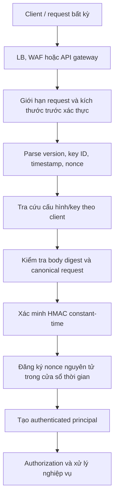

# Load abuse test cho HMAC Request Authentication

## 1. Bài toán: cơ chế xác thực có đứng vững khi bị lạm dụng tải?

Một API sử dụng **HMAC request authentication** yêu cầu client và server chia sẻ secret, thống nhất cách tạo **canonical request** từ phương thức HTTP, URI, query, header và/hoặc body, sau đó kiểm tra MAC trước khi coi request là đã xác thực. Hệ thống còn cần kiểm tra **timestamp**, **nonce** để ngăn replay, quản lý **key rotation**, hoạt động đúng sau **proxy/gateway** và kiểm tra **phân quyền** sau xác thực.

Các kiểm thử chức năng thông thường chỉ chứng minh một request hợp lệ được nhận và một request có chữ ký sai bị từ chối. Chúng chưa trả lời được tình huống quan trọng hơn: điều gì xảy ra khi hàng nghìn request ký sai, nonce mới, key ID lạ hoặc body rất lớn cùng đến trong thời gian ngắn? Một hệ thống vẫn trả về `401` chính xác cho từng request có thể đã tiêu tốn quá nhiều CPU để tính MAC, giữ quá nhiều body trong bộ nhớ, làm nghẽn Redis lưu nonce hoặc khiến request hợp lệ của khách hàng khác bị chậm theo.

**Load abuse test** là bài kiểm thử có kiểm soát, cố ý tạo các mẫu tải bất lợi nhằm xác nhận rằng tuyến xác thực tiếp tục **từ chối sai, chấp nhận đúng, không bypass khi quá tải và không làm cạn tài nguyên không giới hạn**. Đây là nội dung thuộc chương *Security testing* của module `SECURITY_AUTHENTICATION_HMAC_REQUEST_AUTHENTICATION`. Các ví dụ chỉ chạy trên **môi trường test/staging đã được phép**, với dữ liệu và secret riêng, giới hạn tốc độ được thống nhất; không gửi tải thử vào dịch vụ bên thứ ba hay production không được phê duyệt.

### Load test thông thường và abuse test khác nhau thế nào?

| Phép thử | Lưu lượng chính | Câu hỏi cần trả lời |
| --- | --- | --- |
| Normal load | Nhiều request hợp lệ, key và nonce đúng | Tuyến ký/xác minh đáp ứng mục tiêu thông lượng và độ trễ không? |
| Spike/stress | Tải hợp lệ tăng nhanh hoặc vượt công suất đã xác định | Hệ thống áp dụng backpressure, quota, giới hạn hàng đợi ra sao? |
| **Load abuse** | Chữ ký lỗi, key ID không tồn tại, timestamp sai, nonce bị replay, body to hoặc request định dạng xấu; thường pha trộn với lưu lượng hợp lệ | Request không đáng tin có gây quá tải/bypass, làm nghẽn khách hàng hợp lệ, làm phình bộ nhớ hoặc nonce store không? |
| Soak test | Tải được giữ ổn định qua thời gian đủ dài | Có rò rỉ bộ nhớ, tăng cardinality cache/metrics, nonce tồn dư hay thoái hóa hiệu năng? |

Một phép thử đạt kết quả phải khẳng định **cả tính đúng về bảo mật lẫn tính bền vững về tài nguyên**. Chỉ báo cáo requests/second (RPS) cao mà không theo dõi tỷ lệ xác thực sai được chấp nhận, race replay, độ trễ của request hợp lệ và tiêu thụ tài nguyên là chưa đủ.

## 2. Xác định mô hình tuyến xác thực và nơi có thể bị khuếch đại chi phí

Ví dụ hệ thống có luồng xử lý:



Thứ tự cụ thể có thể khác theo thiết kế, nhưng mọi lối đi phải giữ các tính chất sau:

- **Chặn sớm những lỗi có thể phát hiện rẻ:** giới hạn kích thước URL/header/body, số lượng header, version không hỗ trợ, timestamp ngoài cửa sổ và encoding không hợp lệ. Nếu kiểm tra này phụ thuộc vào danh tính thì phải thiết kế rõ điểm chấp nhận danh tính trước khi dùng.
- **Không truy cập bộ nhớ đệm/secret store vô hạn theo input tùy ý:** key ID dài, key ID ngẫu nhiên hoặc version lạ không được tạo lượng entry cache, object cấp phát hay truy vấn đắt tiền tăng tuyến tính không có quota.
- **Tính MAC trên byte được định nghĩa bởi hợp đồng:** canonicalization, percent-encoding và byte body phải nhất quán trước/sau proxy. Không parse rồi serialize lại JSON theo kiểu khác nhau giữa client và server.
- **Chỉ ghi nonce sau khi xác minh tính xác thực:** một MAC sai không được ghi nhận nonce như đã sử dụng, vì điều đó cho phép request giả làm cạn nonce store hoặc chiếm nonce của request thật. Việc ghi nonce sau MAC cần nguyên tử để hai bản replay song song không cùng được nhận.
- **Không bypass dưới lỗi hạ tầng:** nếu nonce store hoặc key store cần thiết bị lỗi, ứng dụng phải thực hiện chính sách fail-closed đã định nghĩa, không cho request đi qua vì “không kiểm tra được”.
- **Phân quyền riêng:** HMAC đúng xác thực chủ thể sở hữu secret; quyền truy cập tenant/resource vẫn phải được kiểm tra và chịu tải kiểm thử độc lập.

### Các nguồn chi phí đáng chú ý

| Input gây áp lực | Thành phần dễ chịu tác động | Biểu hiện có thể đo |
| --- | --- | --- |
| Body lớn hoặc nén/giải nén phức tạp | HTTP body buffering, SHA-256, bộ nhớ heap/direct memory | Bytes cấp phát/request, GC, RSS, latency, tỷ lệ từ chối quá kích thước. |
| Key ID ngẫu nhiên liên tục | Key lookup, negative cache, secret store/DB | Cache miss, QPS vào DB, số entry cache, thread/pool chờ. |
| Nonce mới với MAC sai | Replay store nếu thứ tự kiểm tra lỗi | Số bản ghi nonce tăng bất thường dù không có request xác thực. |
| Nonce giống nhau được gửi song song | Khóa/transaction/atomic insert trên replay store | Số lần được chấp nhận, conflict, độ trễ Redis/DB. |
| Chữ ký sai hàng loạt | CPU canonicalization/HMAC, metric/log pipeline | CPU/auth attempt, log rate, request 5xx, request hợp lệ bị đói tài nguyên. |
| Query/header cực dài hoặc nhiều phần tử | Parser, sorting canonical query, bộ nhớ tạm | Thời gian canonicalization, phân bổ bộ nhớ, 4xx do giới hạn. |
| Version lạ hoặc bị hạ cấp | Version dispatcher và chính sách cho phép version | Không có request nào được chấp nhận bằng fallback ngoài hợp đồng. |
| Gateway rewrite path/host/encoding | Hợp đồng ký giữa client và verifier | Mức khác biệt 401 khi qua gateway so với gọi trực tiếp; không nới canonicalization tùy tiện. |

Đặc biệt với query canonicalization có sắp xếp, số lượng cặp tham số rất lớn có thể làm tăng chi phí xử lý; chỉ kiểm tra tổng độ dài query mà bỏ số phần tử có thể chưa đủ. Với body, cần thống nhất giới hạn theo byte nhận trên mạng và byte sau giải nén (nếu cho phép compression), để tránh payload nhỏ khi truyền nhưng phình rất lớn khi xử lý.

## 3. Thiết kế workload và tiêu chí thành công trước khi chạy

Không có ngưỡng RPS “chuẩn” cho mọi hệ thống. Trước khi chạy, đội vận hành phải chốt endpoint được thử, kích thước request, số client/key, profile phần cứng, số replica, loại Redis/DB, giới hạn tại gateway, cửa sổ timestamp, quota và mục tiêu SLO của dịch vụ. Kết quả chỉ có ý nghĩa khi đi cùng cấu hình đó.

Ví dụ **kịch bản minh họa, không phải mức tải khuyến nghị chung**:

| Giai đoạn | Cấu hình thử nghiệm | Mục tiêu |
| --- | --- | --- |
| Baseline | 30 giây warm-up, sau đó 2 phút ở 20 request hợp lệ/giây | Có số đo latency/resource khi không bị abuse. |
| Mixed load | 2 phút với 20 request hợp lệ/giây và thêm 10 request MAC sai/giây | Xem lưu lượng hợp lệ có bị suy giảm khi thêm abuse không. |
| Short burst | 20 giây tăng lượng request sai theo nấc 10 → 20 → 40 request/giây, trong giới hạn đã phê duyệt | Quan sát điểm bật rate limit, saturation và backpressure. |
| Replay race | 32 request **giống hệt nhau** đến gần đồng thời trên nhiều replica | Kiểm tra nonce registration chỉ có một winner. |
| Recovery | Trở lại baseline 2 phút sau burst | Đo recovery, queue drain, heap/caches và nonce store ổn định. |

Với bài kiểm tra tải, nên dùng **arrival rate** để kiểm soát lưu lượng đầu vào. Mô hình chạy vòng lặp theo số virtual user có thể tự giảm RPS khi hệ thống chậm, khiến vùng quá tải bị che khuất. Hãy ghi lại cả **RPS mục tiêu, RPS thực sự đạt và số request bị generator bỏ do không đủ virtual user**. Generator cũng phải được giám sát CPU/network để không nhầm tình trạng bão hòa phía client thành giới hạn server.

### Điều kiện pass/fail cần kết hợp

1. **Đúng bảo mật:** không request có MAC sai nào được coi là authenticated; request hết hạn hoặc replay không được chấp nhận; không có downgrade ngoài policy; MAC đúng nhưng thiếu quyền không được vào nghiệp vụ.
2. **Giữ dịch vụ:** p95/p99 của request hợp lệ và tỷ lệ thành công vẫn trong ngân sách SLO đã định, có thể tính thêm độ trễ so với baseline. Đo riêng latency của từng loại request và theo từng tenant/key-class, tránh trung bình hóa che giấu starvation.
3. **Giới hạn tài nguyên:** CPU, heap/RSS, số goroutine/thread, pool kết nối, key cache, nonce store và backlog không tăng vô hạn; hệ thống có điểm giới hạn/thu hồi rõ ràng.
4. **Hành vi overload dự đoán được:** các yêu cầu vượt quota bị từ chối bằng status đã thỏa thuận (thường `429`; dùng `Retry-After` khi phù hợp), request không hợp lệ vẫn là từ chối xác thực; không trả `2xx` do fail-open. Lỗi `5xx` phải được giải thích và đối chiếu với chính sách, không bị tính là “từ chối thành công”.
5. **Phục hồi:** sau burst, queue, latency, memory, cache và nonce store trở về mức ổn định trong khoảng thời gian đặt trước; không cần restart để xử lý lại lưu lượng hợp lệ.

Ví dụ mục tiêu *chỉ để tập định nghĩa SLO*: khi pha 10 request sai/giây vào baseline, p99 của request hợp lệ tăng dưới 20% so với baseline; tỷ lệ request MAC sai được chấp nhận luôn bằng 0; số entry nonce tạo do MAC sai bằng 0. Các ngưỡng này phải được thay bằng ngân sách được chủ sở hữu dịch vụ phê duyệt trước khi chạy.

## 4. Ma trận load abuse test theo đặc tính HMAC

| Case | Tạo request | Xác nhận bắt buộc |
| --- | --- | --- |
| A01 — valid load | Mỗi request dùng key test được cấp, timestamp hiện hành, nonce mới và MAC đúng | Xác thực ổn định theo SLO; chỉ xử lý business nếu principal có quyền. |
| A02 — invalid MAC | Request đúng định dạng, key ID **có tồn tại** nhưng MAC đã cố ý sửa | Từ chối authentication; đo chi phí đến bước HMAC; không cấp principal và không lưu nonce. |
| A03 — malformed signature | MAC thiếu/sai Base64url, sai độ dài; header trùng lặp/CRLF | Từ chối trước khi tạo tác vụ đắt hoặc cấp phát lớn. |
| A04 — unknown key ID churn | Mỗi request dùng key ID mới/không thuộc tenant, có giới hạn độ dài | Không vô hạn hóa negative cache/DB queries; không phân biệt rõ key tồn tại qua phản hồi công khai. |
| A05 — timestamp abuse | Timestamp quá cũ/quá xa tương lai, dạng số sai hoặc tại biên clock skew | Từ chối đúng policy, chi phí thấp; dùng fixed clock để test biên chính xác. |
| A06 — repeated replay | Gửi lại **nguyên request đã ký thành công** nhiều lần | Bản đầu có thể thành công, tất cả bản sau trong replay window bị chặn; không chạy business lặp. |
| A07 — concurrent replay | Bắn cùng signed request lên nhiều replica cùng lúc | Chỉ một lần reserve nonce thành công toàn cụm; có metric về conflict/race. |
| A08 — valid unique nonce flood | Nhiều request đều được ký đúng, nonce luôn mới | Replay store bị giới hạn theo client, TTL và budget; quota xác thực/nghiệp vụ vẫn có tác dụng. |
| A09 — body digest mismatch | MAC tính đúng trên digest trong header, nhưng byte body bị sửa | Verifier phát hiện digest không khớp body; không cấp principal hoặc ghi nonce. |
| A10 — oversized/chunked body | Body, request header hoặc query vượt ngưỡng; có cả chunked transfer/compression nếu được hỗ trợ | Từ chối sớm theo hợp đồng (ví dụ `413` cho payload quá lớn), không buffer vô hạn. |
| A11 — canonicalization edge | Query lặp, `%2F`, `%20`, `+`, slash cuối, path rewrite và header case | Chữ ký được kiểm tra theo đúng byte/normalization đã ký; không tự “sửa” request cho hợp lệ. |
| A12 — version downgrade | Version không hỗ trợ, v2-only client gửi MAC v1 hợp lệ, thay version trong signed request | Từ chối đúng policy, không fallback v1 khi v2 fail. |
| A13 — key rotation under load | Key cũ/mới cùng active hoặc key bị revoke trong lúc tải tăng | Chỉ key hợp lệ theo thời điểm/policy được xác thực; cache key không tiếp tục cho phép revoked key vô hạn. |
| A14 — gateway stress | Gửi cùng lớp request qua LB/gateway và đến verifier trong phạm vi mạng test | Không bất đồng URI/body/header dẫn đến bypass; áp dụng giới hạn tại đúng điểm. |
| A15 — authorization isolation | MAC hợp lệ cho principal A nhưng không có quyền tenant/resource B | Authentication đúng nhưng authorization từ chối, kể cả khi hệ thống đang chịu tải. |
| A16 — dependency degraded | Mô phỏng Redis nonce store hoặc key provider chậm/lỗi trong staging | Fail-closed, timeout/circuit breaker có giới hạn, không trả 2xx vì bỏ qua bước xác thực. |
| A17 — logging/metrics flood | Tạo nhiều request lỗi và nonce/key ID khác nhau | Không ghi secret/MAC/body nhạy cảm, không phát sinh label theo nonce hoặc raw key ID, log rate có giới hạn. |

Các case có chữ ký **hợp lệ** phải được tạo bằng signer độc lập hoặc fixture đã xác minh bằng golden vector. Nếu dùng MAC giả cho test A06/A07, server có thể loại từ vòng kiểm tra MAC và không bao giờ chạy tới nonce store: kết quả “replay bị chặn” khi đó là **false positive** về kiểm thử replay. Tương tự, test A09 phải bảo đảm MAC hợp lệ đối với canonical request chứa digest đã khai báo; chỉ phần body thực gửi bị sửa, để bài test thực sự chạm bộ kiểm tra digest.

## 5. Ví dụ chạy invalid-MAC load bằng k6 trong staging

Kịch bản bên dưới cố tình tạo request có **hình dạng header hợp lệ**, key ID đã cấu hình trong staging và signature gồm 32 byte zero ở dạng Base64url (không phải MAC đúng). Mục tiêu là tải vào nhánh xác minh HMAC, không đo lẫn với lỗi parse chữ ký. Request có body rỗng nên có digest SHA-256 xác định; các request được giới hạn **10 RPS trong 1 phút**, dùng URL loopback mặc định.

```javascript
// security-abuse.k6.js — chạy trên môi trường staging được cho phép.
import http from 'k6/http';
import { Rate } from 'k6/metrics';

const rejectedAsExpected = new Rate('rejected_as_expected');
const BASE_URL = __ENV.BASE_URL || 'http://127.0.0.1:8080';
const SIGNED_PATH = __ENV.SIGNED_PATH || '/v1/orders';
const KEY_ID = __ENV.TEST_KEY_ID || 'staging-load-key';

export const options = {
  discardResponseBodies: true,
  scenarios: {
    invalid_mac: {
      executor: 'constant-arrival-rate',
      rate: 10,
      timeUnit: '1s',
      duration: '1m',
      preAllocatedVUs: 5,
      maxVUs: 10,
    },
  },
  thresholds: {
    rejected_as_expected: ['rate==1'],
    'http_req_duration{scenario:invalid_mac}': ['p(95)<500'], // Ví dụ; theo SLO thực tế.
  },
};

export default function () {
  const timestamp = Math.floor(Date.now() / 1000).toString();
  const nonce = `invalid-${__VU}-${__ITER}-${Date.now()}`;

  const response = http.get(`${BASE_URL}${SIGNED_PATH}`, {
    headers: {
      'X-HMAC-Version': 'hmac-v1',
      'X-HMAC-Key-Id': KEY_ID,
      'X-HMAC-Timestamp': timestamp,
      'X-HMAC-Nonce': nonce,
      'X-Content-SHA256':
        'e3b0c44298fc1c149afbf4c8996fb92427ae41e4649b934ca495991b7852b855',
      'X-HMAC-Signature': 'AAAAAAAAAAAAAAAAAAAAAAAAAAAAAAAAAAAAAAAAAAA',
    },
    timeout: '3s',
    tags: { test_case: 'invalid_mac' },
  });

  // Đổi tập status theo hợp đồng API/gateway; 2xx là lỗi bảo mật ở case này.
  rejectedAsExpected.add(response.status === 401 || response.status === 429);
}
```

Ví dụ chạy khi endpoint thực tế yêu cầu HMAC và staging cho phép:

```bash
BASE_URL=http://127.0.0.1:8080 \
SIGNED_PATH=/v1/orders \
TEST_KEY_ID=staging-load-key \
k6 run security-abuse.k6.js
```

`401` và `429` là mã minh họa theo contract giả định; nếu hệ thống quy định mã khác thì phải chốt kỳ vọng trước khi chạy. Một số load tool tính 4xx vào metric lỗi HTTP tổng quát, vì vậy **không dùng riêng `http_req_failed` để kết luận security test thất bại**; phải có metric kiểm tra riêng xem request sai có bị từ chối như kỳ vọng và có bị trả `2xx`/`5xx` bất thường không. Nếu `dropped_iterations` tăng hoặc generator saturate, thông lượng thực thấp hơn cấu hình: không được báo là server đã chịu đủ mức tải.

Để đo **valid traffic** và **mixed load**, bổ sung scenario riêng dùng SDK signer của dự án hoặc một thư viện signer đã đối chiếu golden vector. Mỗi iteration cần sinh timestamp trong cửa sổ cho phép, **nonce mới với đủ entropy**, canonicalize chính xác request và tính HMAC với **test secret** lấy từ cơ chế secret management của staging. Tránh hard-code secret trong script hoặc commit fixture có secret production. Không dùng lại chữ ký cố định trong vòng lặp valid-load: sau lần đầu nó chỉ đo tốc độ từ chối replay.

### Chạy từng kịch bản thay vì trộn lẫn không phân loại

Nên tạo scenario và tag hữu hạn theo `test_case` (`valid`, `invalid_mac`, `unknown_key`, `replay`...), theo `signature_version` (`hmac-v1`, `hmac-v2`), theo môi trường và vùng gateway. Điều này cho phép so sánh latency, CPU và response giữa request hợp lệ và request bị từ chối. **Không** dùng nonce, full key ID, raw URL có token, signature hoặc client secret làm nhãn Prometheus: các nhãn này có cardinality lớn và có thể rò rỉ dữ liệu.

## 6. Replay storm: một trường hợp cần kiểm chứng riêng

Để kiểm tra chống replay thật, cố định một request đã có **MAC hợp lệ** trong thời gian hiệu lực timestamp. Cho 32 worker/thread bắt đầu gần như đồng thời, có thể phân phối đến hai hoặc nhiều replica API, và kiểm tra:

```text
given:
  same authenticated client/key scope
  same timestamp + nonce
  same method, URI, signed headers, body bytes, valid MAC
  nonce chưa từng được dùng trong replay store

when:
  32 verifier xử lý request gần như đồng thời

expect:
  authenticated_accept_count == 1
  replay_reject_count == 31
  business_side_effect_count <= 1
  nonce_store là một bản ghi có TTL hữu hạn
```

Trong một số hệ thống, request đầu có thể bị từ chối do chính sách hoặc downstream; khi đó không nên tự suy rằng replay test đã pass. Cần tạo một fixture đã biết có quyền và clock phù hợp, tách rõ quyết định authentication khỏi kết quả nghiệp vụ.

Replay guard dùng thao tác **nguyên tử** như `SET key value NX EX ttl` trên Redis (hoặc unique constraint trong DB) thay vì:

```text
if (!exists(nonce)) {
    save(nonce); // Có race: hai luồng cùng thấy 'chưa tồn tại'.
}
```

Khóa replay nên có namespace theo principal/key scope và nonce, với chính sách rõ về rotation và version để một nonce không thể được dùng lại qua profile khác trong cùng phạm vi đã định. TTL phải bao phủ **toàn bộ cửa sổ nhận timestamp** cộng phần dự phòng cho jitter và lệch clock: ví dụ nếu chấp nhận timestamp trong ±300 giây, một nonce có timestamp sát biên tương lai vẫn có thể đến trong khoảng dài hơn 300 giây sau lần nhận đầu. Thiết kế TTL cố định 300 giây tính từ lần dùng đầu có thể không đủ. Trong trường hợp dùng TTL theo thời điểm ký, cần xác định TTL đến mốc hết hạn chấp nhận của chính timestamp. Test dùng clock điều khiển được để xác nhận cả biên đầu và biên cuối.

**Thất bại cần bắt được:** hai replica cùng chấp nhận nonce, request có MAC sai tiêu tốn nonce, TTL quá ngắn cho phép replay vào cuối cửa sổ, hoặc cache nonce chỉ ở local node khiến replay sang node khác được nhận. Ngoài correctness, đo số thao tác store/second, latency p99, eviction, retry và memory dưới valid unique-nonce load. Khi store lỗi, quyết định phải phù hợp policy fail-closed đã công bố.

## 7. Phân tích chi phí và khả năng cô lập tải

### 7.1. Ưu tiên giới hạn theo thứ tự xử lý

Ở lớp gateway trước xác thực, có thể áp dụng giới hạn kích thước request, tần suất per-IP/per-route, số kết nối đồng thời và quota cho endpoint nhạy cảm. Sau khi kiểm tra key/client một cách an toàn, thêm quota theo principal/tenant và bảo vệ backend dùng chung. **Không dùng `X-HMAC-Key-Id` chưa xác minh làm nguồn danh tính đáng tin duy nhất cho rate limit**: attacker có thể giả key ID của khách hàng khác để làm cạn quota hoặc xoay key ID để né giới hạn. Nếu cần rate limit dựa trên key ID trước xác minh, phải phối hợp với giới hạn theo nguồn/truy cập, có luật chống spoofing và phân tích tác động đến khách hàng hợp lệ.

Các lỗi sớm phải có chi phí tương đối rẻ và giới hạn. Ví dụ: giới hạn chiều dài key ID, số query parameter, số header, tổng byte header/body và thời gian đọc body; từ chối không hợp lệ trước các bước parse lớn. Để tránh **request smuggling/canonicalization disagreement**, gateway và server phải thống nhất hành vi với URI đã được normalize, transfer encoding và header trùng. Mọi quyết định bỏ header hay rewrite path phải có contract tương ứng; không cố làm verifier “linh hoạt” chấp nhận nhiều cách ký mơ hồ.

### 7.2. Đo tốn tài nguyên theo một đơn vị công việc

Ngoài tỷ lệ thành công, thu ít nhất các nhóm metric:

| Nhóm metric | Ví dụ | Cách diễn giải |
| --- | --- | --- |
| Lưu lượng | `auth_attempts_total`, admitted/rejected RPS, `rate_limited_total` | Phân biệt request đến, được xử lý, bị chặn sớm. |
| Kết quả bảo mật | `auth_reject_total{reason="bad_mac|replay|expired|unknown_key|malformed"}` | Tập `reason` có giới hạn, theo dõi chính xác nhánh rejection. |
| Độ trễ | `auth_verify_duration_seconds`, `http_server_duration_seconds` p50/p95/p99 theo case | Tách thời gian xác thực khỏi thời gian business và gateway. |
| Tài nguyên máy | CPU, heap/RSS, allocation rate, GC pause, thread/event-loop lag, connection pool | Nhận biết saturation/queueing và memory pressure. |
| Key provider | Key lookup QPS, hit/miss, negative-cache size, timeout | Phát hiện key ID churn và backend amplification. |
| Replay store | `nonce_setnx_total`, conflict, timeout, Redis ops/sec, TTL/memory | Phát hiện race, resource growth và fail-closed. |
| Chất lượng phục vụ | 2xx/4xx/429/5xx theo class, valid-request p99, timeout, in-flight | Phát hiện starvation của request hợp lệ. |
| Load generator | Sent RPS, achieved RPS, `dropped_iterations`, client CPU | Đảm bảo chính xác mức tải đưa vào hệ thống. |

Ví dụ sử dụng `cost_per_authenticated_request` = CPU time dành cho xác thực / số request được xử lý, nhưng cần báo cáo **theo từng loại request**: một request sai header thường rẻ hơn request có header đúng, key hợp lệ nhưng MAC sai; gộp hai loại có thể làm đẹp số liệu giả tạo. Dùng histogram giới hạn nhãn thay vì log raw nonce hoặc MAC để tránh tạo thêm áp lực trên logging/observability.

### 7.3. Servlet và WebFlux có điểm nghẽn khác nhau

- **Spring Security Servlet:** kiểm thử filter HMAC với `OncePerRequestFilter`/`AuthenticationFilter` phù hợp; bảo đảm request body được đọc hoặc cache theo giới hạn và được downstream đọc lại đúng cách. Một `ContentCachingRequestWrapper` chỉ cache byte đã được đọc, vì vậy cần xác minh đường đi thực tế thay vì giả định wrapper tự nạp toàn bộ body. Đo thread pool, request queue và thời gian chờ backend.
- **Spring Security WebFlux:** body là `Flux<DataBuffer>` có thể chỉ được tiêu thụ một lần; thiết kế verify trước khi forward phải xử lý luồng body và release buffer đúng cách, giới hạn số byte được giữ trong bộ nhớ. Không dùng `.collectList()` hay `.cache()` vô hạn với untrusted body; theo dõi event-loop lag, memory/direct buffer và blocking call đến key/nonce store.
- **API gateway / reverse proxy:** thử cả endpoint public đi qua tầng TLS termination và gateway, so sánh body bytes/request-target/header được ký tại điểm client với những gì verifier thực sự nhận. Kiểm tra các limit ngoài gateway có thật sự ngăn được request trước khi tiêu tốn tài nguyên ứng dụng không.

## 8. Những anti-pattern khiến kết quả kiểm thử sai lệch

1. **Dùng chữ ký sai để “test replay”:** verifier đã trả về `401` trước khi chạm nonce store, nên không kiểm tra được atomic nonce.
2. **Sinh cùng nonce trong load test hợp lệ:** traffic vô tình chuyển thành replay workload, p99 và throughput của nhánh valid bị đo sai.
3. **Đo chỉ trên một replica:** bỏ sót race condition khi nonce local hoặc hai node truy cập chung store.
4. **Chạy chỉ ở mức VU cố định:** generator tự chậm lại khi server chậm; số request tới không đạt workload mong muốn.
5. **Xem mọi `401`, `429`, `500` là như nhau:** `500` có thể là lỗi backend, còn `2xx` cho invalid MAC là lỗi nghiêm trọng; phải phân loại đúng.
6. **Tăng giới hạn body/header để test “cho đủ tải”:** loại bỏ guard đã triển khai, khiến phép thử không phản ánh môi trường cần bảo vệ.
7. **Không giữ tải hợp lệ làm control group:** không thể biết abuse có làm tenant khác bị starvation hay không.
8. **Kiểm thử trực tiếp trong unit method ký:** bỏ qua gateway, filter ordering, cache body, distributed nonce store và phân quyền.
9. **Dùng chung implementation canonicalization cho client/server trong mọi fixture:** cùng một lỗi có thể khiến test xanh dù hai phía vi phạm hợp đồng chính thức; cần vector độc lập.
10. **Bỏ qua khâu recovery:** test kết thúc khi hết burst nhưng cache, heap, nonce store, thread pool còn tiếp tục tăng hoặc chưa phục hồi.

## 9. Quy trình thực hành và đọc kết quả

### Bước 1 — Chuẩn bị môi trường có thể lặp lại

Khóa cấu hình HMAC contract version, key set, cửa sổ timestamp, TTL nonce, cấu hình gateway, số replica và giới hạn body/query/header. Chuẩn bị secret test, một tenant hợp lệ và một tenant không được cấp quyền. Bật dashboard CPU, memory, key lookup, nonce store, security failures và gateway status; đồng bộ clock hoặc tiêm test clock khi test biên thời gian. Cô lập traffic dữ liệu test để có thể đối chiếu metrics.

### Bước 2 — Chạy kiểm tra đúng/sai trước khi bơm tải

Xác nhận một request có chữ ký hợp lệ, timestamp hiện tại và nonce chưa dùng được authenticated. Gửi MAC sai từ cùng key và dữ liệu đúng định dạng: phải bị từ chối. Gửi lại request hợp lệ: phải bị chặn replay. Gửi request hợp lệ tới resource bị cấm: phải được xác thực nhưng authorization từ chối. Nếu các điều kiện chức năng này chưa đạt, chưa có cơ sở để diễn giải test hiệu năng.

### Bước 3 — Chạy baseline, mixed, burst rồi recovery

Gắn `run_id` hữu hạn (không mang secret), ghi lại thời điểm từng phase và tỷ lệ mix. Giữ tải hợp lệ ổn định trong khi thêm từng loại abuse để định lượng tác động riêng. Tăng tải theo nấc cho phép; dừng theo guardrails đã chốt trước nếu xuất hiện vượt ngân sách, dữ liệu sai, backend failure hoặc ảnh hưởng vượt vùng test.

### Bước 4 — Kiểm chứng invariant và tìm đúng bottleneck

Đối chiếu số request gửi/nhận/giới hạn, tỷ lệ MAC sai được authenticated, số nonce ghi do MAC sai, đúng một winner trong replay-race, latency p99 của valid traffic, CPU, GC, key provider và nonce store. Ví dụ nếu unknown-key surge làm tăng secret-provider QPS mạnh nhưng CPU HMAC thấp, bottleneck là **key lookup**, không phải SHA-256. Nếu body lớn làm RSS tăng nhanh trong WebFlux, kiểm tra buffering/retention, payload cap và backpressure. Nếu chỉ một tenant bị ảnh hưởng dù quota per-IP vẫn ổn, cần xem quota theo principal và scheduling fairness.

### Bước 5 — Lưu báo cáo có thể tái hiện

Một báo cáo load abuse test nên ghi: commit/build server, hợp đồng version, môi trường, cấu hình replica/gateway/Redis, đường đi request, phân bố kích thước payload, tỉ lệ loại case, time window, target/achieved RPS, dropped iterations, bảng p95/p99 theo class, tài nguyên và security invariant. Kèm ví dụ request **đã che secret/chữ ký nhạy cảm**, đồ thị trước–trong–sau burst, nguyên nhân của từng ngưỡng fail, quyết định remediation và test hồi quy. Phân biệt lỗi của generator với lỗi server.

## 10. Bài tập ứng dụng

Giả sử một API xác thực HMAC chấp nhận timestamp lệch tối đa 5 phút, bắt buộc nonce duy nhất và lưu replay state trên Redis dùng chung. Có ba replica, gateway giới hạn body ở 1 MiB, và các key được ánh xạ theo client. Thiết kế một buổi test 15 phút trên staging với các yêu cầu:

1. Tạo 100 request có MAC hợp lệ, mỗi request có nonce mới; xác nhận đường xác thực và phân quyền cơ bản.
2. Chạy script invalid-MAC có giới hạn ở mục 5; đo phần tăng CPU, key lookup và latency của một nhóm valid traffic chạy đồng thời. Chứng minh không có request sai nào trở thành authenticated.
3. Gửi một valid signed request trùng nonce 32 lần đồng thời qua ba replica; chứng minh đúng một request được authenticated và không có hai side effect nghiệp vụ.
4. Tạo 1.000 key ID ngẫu nhiên, mỗi key trong giới hạn độ dài, với RPS đã được chủ hệ thống phê duyệt; chứng minh secret-store lookup và negative cache có giới hạn.
5. Chọn một request có MAC đúng nhưng sai quyền tenant, rồi tăng tải: không được coi `403` phân quyền là lỗi xác minh HMAC.
6. Mô phỏng lỗi Redis trong cửa sổ thử nghiệm và đối chiếu policy fail-closed; sau khi phục hồi, kiểm tra lại request hợp lệ và nguy cơ phát lại nonce.

**Câu hỏi đánh giá:** nếu 50.000 request có MAC sai làm số nonce trong Redis tăng 50.000, bạn nghi ngờ bước nào trong pipeline? Nếu replay được nhận khi chuyển từ replica A sang B, test nào sẽ xác nhận nguyên nhân? Nếu p99 của request hợp lệ tăng trong khi tổng CPU thấp, bạn sẽ kiểm tra connection pool, key store, nonce store và hàng đợi như thế nào?

## 11. Checklist để kết thúc load abuse test

- [ ] Có giới hạn tải, thời gian, nguồn, điểm đến và điều kiện dừng được phê duyệt cho staging.
- [ ] Đã đối chiếu chữ ký hợp lệ bằng golden vector; negative case thực sự chạm đúng nhánh muốn kiểm thử.
- [ ] Đã đo riêng valid traffic và từng nhóm invalid/replay/unknown-key/oversized/version-mismatch.
- [ ] Không request MAC sai, timestamp lỗi, replay hoặc version bị cấm nào được authenticated.
- [ ] Không có nonce write từ MAC sai; replay song song có tối đa một winner trên toàn cụm.
- [ ] Không có bypass authentication/authorization khi key store hay nonce store chậm hoặc lỗi.
- [ ] Key/cache/body buffering, CPU, heap, Redis, gateway và logging đều có giới hạn đo được.
- [ ] RPS đạt được, dropped iterations và p95/p99 theo nhóm tải đã được ghi đầy đủ.
- [ ] Sau khi dừng burst, hệ thống phục hồi và tiếp tục phục vụ request hợp lệ trong SLO.
- [ ] Báo cáo gắn kết quả với phiên bản contract HMAC và cấu hình hệ thống để có thể chạy lại.

Load abuse test hoàn thành khi những khẳng định trên được chứng minh bằng **traffic, telemetry và kết quả xác thực có thể tái lập**. Mục tiêu cuối cùng là bảo đảm HMAC vẫn bảo vệ đúng byte theo contract, chống replay và kiểm soát key như thiết kế ngay cả khi input cố tình làm tiêu tốn tài nguyên của hệ thống.
