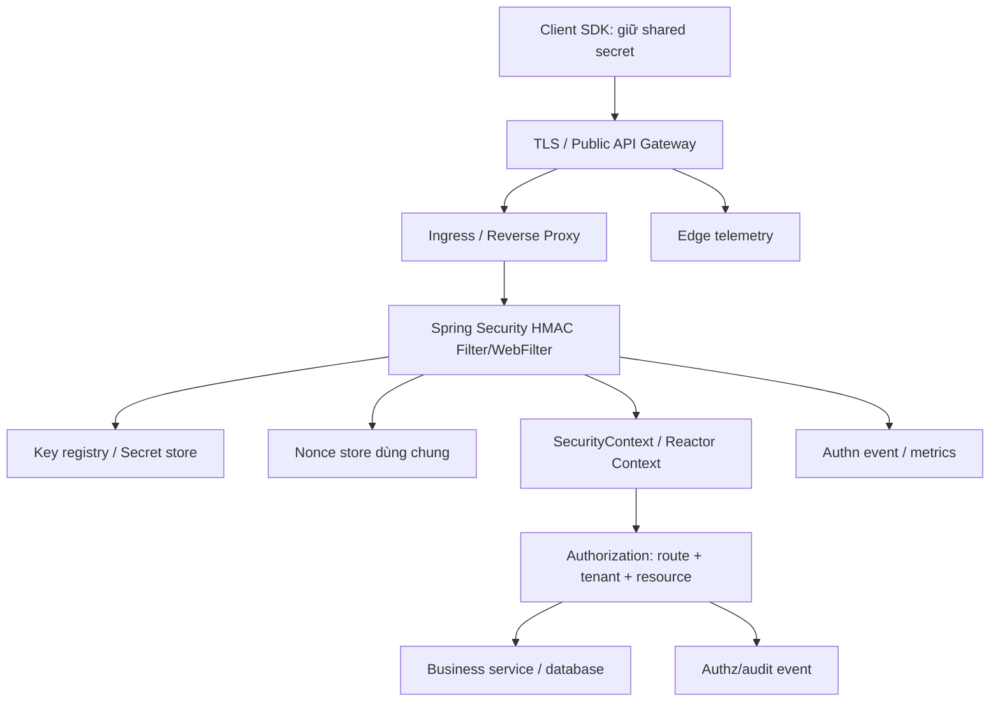
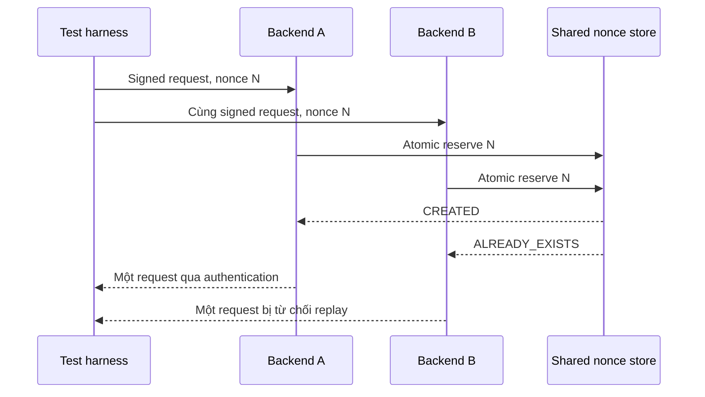
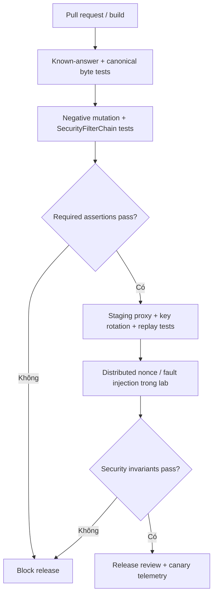

# Penetration test cho HMAC Request Authentication: kiểm thử xâm nhập theo ranh giới tin cậy

## 1. Tại sao API xác thực HMAC cần penetration test?

Trong module `SECURITY_AUTHENTICATION_HMAC_REQUEST_AUTHENTICATION`, client ký HTTP request bằng **HMAC với shared secret**. Hai bên phải thống nhất **canonical request** gồm phương thức, URI/query, header và/hoặc body theo hợp đồng ký. Phía server xác minh signature, kiểm tra timestamp/nonce chống replay, quản lý key rotation, xử lý tác động của proxy/gateway và cuối cùng đưa danh tính đã xác thực cho tầng **authorization**.

Unit test có thể chứng minh `Mac.doFinal(...)` tạo ra chữ ký đúng. Integration test có thể chứng minh một request hợp lệ nhận 200/201. Tuy nhiên, hai loại test đó **chưa đủ** để trả lời những câu hỏi về an toàn hệ thống:

- Điều gì xảy ra nếu client gửi hai header key ID hoặc hai timestamp?
- Gateway và backend có hiểu cùng một URI/query/header/body hay không?
- Server có chấp nhận cùng signed request hai lần trong cửa sổ freshness?
- Hai instance có cùng chấp nhận một nonce trong một cuộc đua?
- Key đã revoke còn được chấp nhận qua cache cũ hoặc tại một gateway chưa cập nhật?
- Một service có chữ ký HMAC hợp lệ có thể đọc dữ liệu tenant khác hay không?
- Bộ lọc của Spring Security có bỏ qua một route hoặc một HTTP method ngoài dự kiến?
- Response và log có tiết lộ secret, chữ ký kỳ vọng, key tồn tại hay quyền của tenant?

**Penetration test** ở đây là kiểm thử bảo mật có **ủy quyền**, lấy góc nhìn đối kháng nhưng dùng dữ liệu, tài khoản, secret và phạm vi thử nghiệm được kiểm soát. Mục tiêu là tìm đường vượt qua xác thực hoặc phân quyền, tạo replay, làm sai lệch canonicalization, lợi dụng chênh lệch giữa gateway và backend, hoặc phát hiện fail-open khi dependency gặp sự cố.

Đây là bài **“Penetration test”** thuộc chương **Security testing**. Sau bài học, người học có thể:

1. Xác lập phạm vi và điều kiện an toàn cho một đợt pentest API HMAC.
2. Lập threat model, đánh dấu trust boundaries và giả thuyết cần kiểm.
3. Tạo bộ request hợp lệ/không hợp lệ bằng test key và các mutation có kiểm soát.
4. Kiểm signature parsing, canonicalization, anti-replay, key lifecycle, proxy và authorization theo ma trận rủi ro.
5. Tích hợp phép thử vào Spring MVC/WebFlux, test environment và CI mà không đánh đồng test pass với việc đã bảo mật hoàn toàn.
6. Thu thập evidence và lập báo cáo lỗ hổng có thể tái hiện, không làm lộ secret hoặc dữ liệu nhạy cảm.

> **Giới hạn triển khai:** Chỉ thực hiện thử nghiệm trên môi trường/tài nguyên đã được chủ sở hữu cho phép, theo *rules of engagement*. Ví dụ dùng test secret và endpoint giả, không chứa bí quyết xâm nhập vào hệ thống người khác. HMAC request authentication **không đồng nhất** với OAuth Bearer, Basic authentication hoặc HTTP Message Signatures; phải lấy hợp đồng thực tế của API làm nguồn sự thật.

## 2. Khác biệt giữa pentest, functional test và contract test

| Loại kiểm thử | Câu hỏi chính | Ví dụ cho HMAC |
| --- | --- | --- |
| Unit/known-answer test | Thuật toán cho kết quả đúng khi input cố định? | Test vectors HMAC-SHA256, canonical bytes cố định |
| Contract test | Client/server/gateway cùng hiểu giao thức ký? | URI, signed headers, body digest và version thống nhất |
| Integration test | Chuỗi thành phần làm việc khi cấu hình đúng? | HMAC filter → SecurityContext → AuthorizationFilter |
| Load/performance test | Hệ thống chịu tải đúng giới hạn? | Latency verify, key lookup, nonce store |
| **Penetration test** | Có đường đi không mong muốn vượt hoặc làm yếu một security invariant? | Duplicate header, replay race, stale revoke, tenant bypass |
| Audit/security review | Bằng chứng và cấu hình có đáp ứng policy? | Key rotation approval, log redaction, fail-closed |

Pentest **không thay thế** những bài test nền tảng. Một request bị từ chối sau khi đã hết hạn timestamp không chứng minh verifier có kiểm MAC hoặc chống replay đúng; một request nhận 401 do gateway chặn cũng không chứng minh backend HMAC an toàn.

Mỗi ca pentest nên xác định:

1. **Precondition:** Request gốc, key state, clock, nonce store, route và danh tính được phép.
2. **Mutation hoặc tình huống lỗi:** Chỉ thay một thuộc tính cần kiểm trong mỗi ca khi có thể.
3. **Expected security invariant:** Bất biến nào phải được giữ?
4. **Oracle/evidence:** Ngoài HTTP status, kiểm event/reason nội bộ và business side effect.
5. **Impact:** Nếu server chấp nhận sai, kẻ có điều kiện nào có thể được lợi?

Không kết luận “không tồn tại lỗ hổng” chỉ vì bộ ca thử đã hoàn thành. Kết luận phù hợp hơn là **không phát hiện vi phạm với phạm vi, phiên bản và điều kiện đã kiểm**.

## 3. Rules of engagement và thiết kế lab an toàn

### 3.1. Chốt phạm vi trước khi thử

Một kế hoạch kiểm thử xâm nhập cần mô tả:

| Nội dung | Ví dụ phạm vi được ủy quyền |
| --- | --- |
| Tài sản | `api.staging.example.test`, gateway staging và backend test |
| Endpoint | `POST /internal/orders`, `GET /internal/orders/{id}` |
| Identity | `client-alpha` và `client-beta`, quyền/tenant được tạo riêng |
| Secret | Test-only HMAC key, không sao chép key production |
| Điều kiện | Cửa sổ thời gian, giới hạn tốc độ và số request đồng thời |
| Dữ liệu | Order giả, tenant giả, response đã loại thông tin nhạy cảm |
| Dependency | Nonce store, key registry, proxy test có thể reset an toàn |
| Cấm trong scope | Không sửa production secret, không gây lỗi dịch vụ thật, không truy cập dữ liệu khách hàng |
| Ứng phó | Người liên hệ, stop condition, cách phục hồi và audit trail |

Các kiểm thử cần tạo nhiều request song song, làm chậm secret store hoặc kiểm fault injection **chỉ nên chạy trong môi trường cô lập** với giới hạn cụ thể. Không dùng đoán key hàng loạt, request flooding hay làm mất availability của production như một phương pháp thử mặc định.

### 3.2. Xây fixture có thể tái hiện

Lab nên có:

- Một **HMAC contract version cố định**, gồm signed fields và canonicalization bytes.
- Hai verified clients: A thuộc tenant A, B thuộc tenant B; authorities khác nhau.
- Key A1 ACTIVE, A2 STAGED hoặc ACTIVE tùy ca, key A0 REVOKED.
- `Clock` được inject để kiểm freshness và rotation windows.
- Nonce store dùng chung giữa hai backend test instances.
- Một ingress/proxy có thể bật/tắt rewrite profile để so sánh.
- Test event sink chỉ ghi reason code/opaque identity, không ghi raw key, nonce hoặc body nhạy cảm.
- Dữ liệu nghiệp vụ giả có khả năng kiểm tra side effect trước/sau thử nghiệm.

Giữ **baseline request đã ký hợp lệ** và xác nhận nó thực sự thành công trước mỗi nhóm mutation. Khi baseline không qua, không thể kết luận ca mutation bị từ chối là do lớp bảo vệ cần kiểm.

### 3.3. Không để artifact của pentest trở thành nguồn rò rỉ

Đừng đưa shared secret thật, raw `Authorization`, full canonical request production, request body có PII hay signature đang còn hiệu lực vào issue tracker, screenshot hoặc CI artifacts. Nếu cần evidence, dùng test vectors giả, mã lỗi nội bộ đã redacted và correlation ID đáng tin. Với dữ liệu nhạy cảm, có thể ghi fingerprint/opaque reference được tạo bằng hệ thống audit riêng.

## 4. Threat model và trust boundaries



Những **ranh giới tin cậy** cần kiểm:

1. **Internet → Gateway:** Client được phép tự chọn method, raw path/query, header occurrences và body. HTTP parser và gateway không được tin các header nhận diện client do internet gửi.
2. **Gateway → Backend:** Sau rewrite, backend có đang xác minh **cùng canonical representation** mà client đã ký không? Có header nào được gateway xác thực trước khi truyền không?
3. **Backend → Key registry:** Key ID chưa xác thực chỉ là selector. Registry phải trả metadata/secret đúng scope, trạng thái và policy revision.
4. **Backend → Nonce store:** Kiểm tra nonce uniqueness phải nguyên tử trong phạm vi tất cả verifier instances có thể chấp nhận cùng client.
5. **Authentication → Authorization:** Danh tính HMAC hợp lệ chưa đồng nghĩa được đọc/ghi mọi tài nguyên; roles phải có nguồn phía server.
6. **Security → Telemetry:** Dữ liệu nào đi vào log/traces/metrics và ai có quyền xem chúng?

### 4.1. Một attacker trong mô hình HMAC có thể có những khả năng khác nhau

| Mô hình | Attacker giả định có thể làm gì? | Bất biến cần giữ |
| --- | --- | --- |
| Anonymous caller | Tự tạo request/header/key ID, không biết secret | Không có Authentication nếu signature không hợp lệ |
| Caller có request hợp lệ đã quan sát được | Phát lại **cùng signed request** | Timestamp/nonce ngăn sử dụng lại |
| Client hợp lệ quyền thấp | Biết secret của chính mình, tự ký request mới | Không vượt qua route/tenant/resource authorization |
| Client có key cũ đã revoke | Tạo MAC đúng bằng secret cũ | Lifecycle policy từ chối key bị thu hồi |
| Gateway/backend cấu hình khác nhau | Thay/normalize URI/header/body khác contract | Không xảy ra parser differential hay bỏ ký security-sensitive field |
| Dependency lỗi | Key/nonce store timeout, cache stale, failover | Không được fail-open |

Điều kiện tiên quyết phải được ghi trong báo cáo. **Chữ ký HMAC đúng của client có quyền thấp không phải giả mạo danh tính**, nhưng có thể bộc lộ **lỗ hổng phân quyền** nếu hệ thống cho phép thao tác của client khác.

## 5. Kiểm chữ ký và parser: trước hết phải từ chối input mơ hồ

### 5.1. Các thuộc tính của signature cần kiểm

Với hợp đồng minh họa HMAC-SHA256 có chữ ký lowercase hex:

| Input | Expected |
| --- | --- |
| 64 ký tự `[0-9a-f]` đúng MAC | Đi tiếp đến freshness/nonce |
| 63/65 ký tự | Reject |
| Ký tự không phải hex | Reject |
| Header signature thiếu | Reject |
| Hai header signature khác nhau | Reject theo chính sách field đơn trị |
| Chữ hoa/lowercase ngoài contract | Reject hoặc normalize đúng quy tắc **đã công bố** |
| Chuỗi có whitespace đầu/cuối | Reject nếu contract không cho phép trim |
| Body đổi một byte nhưng giữ signature cũ | Reject |
| Key ID đổi nhưng giữ signature cũ | Reject |

Không tự rút ngắn MAC để “hỗ trợ client cũ” nếu giao thức quy định 32 bytes. **MAC truncation**, nếu có, phải là một phiên bản giao thức có giới hạn và phân tích bảo mật riêng, không phải behavior tùy tiện của parser.

Đối với code Java:

```java
import java.security.MessageDigest;
import java.util.HexFormat;

static boolean matchesHmacSha256Hex(
    String signatureHex, byte[] expectedMac
) {
    if (signatureHex == null ||
        !signatureHex.matches("[0-9a-f]{64}") ||
        expectedMac == null || expectedMac.length != 32) {
        return false;
    }

    byte[] supplied = HexFormat.of().parseHex(signatureHex);
    return MessageDigest.isEqual(expectedMac, supplied);
}
```

Ví dụ là helper minh họa, không phải toàn bộ verifier. MAC kỳ vọng phải tính từ key/canonical bytes đáng tin; `MessageDigest.isEqual` giúp tránh vòng lặp so sánh byte-by-byte dừng sớm, nhưng không làm toàn pipeline constant-time. Không đưa `expectedMac` hay `signatureHex` vào log lỗi.

### 5.2. Kiểm việc xử lý malformed headers

Security headers như `X-Hmac-Key-Id`, `X-Hmac-Timestamp`, `X-Hmac-Nonce`, `X-Hmac-Signature` hoặc `X-Hmac-Version` cần **hợp đồng single-value**. Test cả:

- Hai occurrences với cùng giá trị và với giá trị khác nhau.
- Một field chứa dấu phẩy dù giao thức không định nghĩa danh sách.
- Key ID/nonce rỗng, rất dài, có control characters hoặc format lạ trong lab.
- Sự khác nhau giữa header name casing trên HTTP/1.1 và HTTP/2.
- Header không được ký nhưng lại ảnh hưởng identity, authority hoặc tenant.

Nếu edge ghép hai header thành một mà backend chọn phần tử đầu hoặc cuối, có thể có **parser differential**. Kết luận an toàn thường là **reject ambiguous security headers tại biên và tại verifier**, không âm thầm chọn một giá trị.

### 5.3. Oracle phải độc lập với chính verifier

Không dùng `serverSigner.sign(request)` để tạo expected rồi dùng `serverVerifier.verify(request)` chung canonicalizer như bằng chứng đầy đủ. Hãy có **known-answer vectors** với key bytes, expected canonical bytes và expected MAC được tính/duyệt độc lập.

Tại lớp security pentest, mọi mutation cần bắt đầu từ một baseline có chữ ký đã biết đúng; nếu không, hệ thống sẽ từ chối mọi request do fixture sai và tạo “test xanh giả”.

## 6. Canonicalization: nơi client, gateway và backend dễ bất đồng

### 6.1. Ma trận mutation byte-level

| Trường bị thay | Ca thử cô lập | Bất biến cần giữ |
| --- | --- | --- |
| Method | `POST` → `PUT`, giữ MAC cũ | Method được ký thì phải reject |
| Raw path | `/internal/orders` → `/internal/orders/` | Không coi hai bytes giống nhau nếu contract ký raw target |
| Query order | `?a=1&b=2` ↔ `?b=2&a=1` | Accept/reject theo query canonicalization version đã công bố |
| Percent encoding | `%2F`, `%2f`, `/` | Không có client/backend interpretation mismatch |
| Query duplicate | `?scope=read&scope=write` | Không làm mất một value khi canonicalize |
| Whitespace | Space/tab quanh signed header value | Không trim/collapse ngoài contract |
| Header case | `X-Hmac-Nonce` ↔ `x-hmac-nonce` | Tên field được normalize đúng rule |
| Content-Type | `application/json` ↔ `application/json; charset=UTF-8` | Nếu signed value đổi, phải verify theo contract |
| Body JSON | Đổi field order hoặc thêm space | Khi ký raw-body digest, MAC cũ phải sai |
| Unicode | UTF-8, NFC/NFD theo fixture | Không tự normalize payload ngoài hợp đồng |
| Empty body | 0 bytes, không phải text `"null"` | Digest trống phải được quy định rõ |
| Body encoding | Compressed vs decompressed bytes | Ký representation nào phải thống nhất |

Không có một canonicalization “tự nhiên” duy nhất cho HTTP. Bản thân HTTP intermediary có thể thay đổi cách truyền mà vẫn giữ ý nghĩa ứng dụng; hợp đồng ký phải định nghĩa **biểu diễn logic/bytes** được ký và điểm verify chính xác.

### 6.2. Tình huống gateway rewrite

Giả sử client ký:

```http
POST /public/orders?tenant=t1 HTTP/1.1
Content-Type: application/json
X-Hmac-Key-Id: test-key-01
X-Hmac-Timestamp: 2026-11-28T08:00:00Z
X-Hmac-Nonce: nonce-lab-001
X-Hmac-Signature: <test-signature>

{"orderId":"LAB-1"}
```

Gateway route nội bộ tới `/internal/orders?tenant=t1`. Nếu backend lấy `request.getRequestURI()` sau rewrite để tính HMAC nhưng client đã ký **external path**, signature sẽ không khớp. Đây có thể là lỗi tương thích/availability chứ chưa chứng minh bypass; pentest phải kiểm liệu có nhánh fallback **bỏ ký path** để “sửa” lỗi hay không.

Có hai cách kiến trúc hợp lệ nếu triển khai cẩn thận:

1. Verify HMAC tại edge **trước** khi rewrite; backend chỉ nhận identity assertion qua kênh đã xác thực gateway → backend.
2. Backend verify theo **trusted external target** được gateway truyền một cách có kiểm soát, sau khi gateway loại bỏ header do client giả mạo và đặt lại metadata; signed target vẫn phải được ràng buộc với request thật.

Không tin raw `X-Original-URI` hoặc `X-Forwarded-*` từ internet làm canonical source khi gateway chưa strip/rewrite; không chỉ vì test đi qua proxy thành công mà xem trust boundary đã được bảo đảm.

### 6.3. HTTP request desynchronization có liên quan thế nào?

Khi các hop diễn giải độ dài hoặc ranh giới request khác nhau, gateway có thể kiểm một message trong khi backend xử lý message khác. Đó là một lớp rủi ro **HTTP parsing/request desynchronization**, liên quan mật thiết đến bảo vệ các bytes được ký.

Trong pentest được ủy quyền, chỉ kiểm các sai lệch parsing **trong lab cô lập** bằng bộ kiểm thử parser có giới hạn; không gửi payload desynchronization hoặc flooding qua hạ tầng chung/prod. Mục tiêu quan sát là:

- Edge và backend thống nhất ranh giới một HTTP request.
- Không có trường hợp gateway verify request A nhưng backend execute request B.
- Ambiguous framing/duplicate security fields bị từ chối ở ranh giới phù hợp.
- Raw signed body mà backend xác minh cũng là body controller sử dụng.

Đội vận hành phải áp các bản vá và cấu hình HTTP server/proxy theo khuyến nghị nhà cung cấp; HMAC không thay thế khả năng parse HTTP an toàn.

## 7. Replay và nonce: chữ ký đúng vẫn phải không thể tái sử dụng

### 7.1. Test tuần tự cơ bản

Một phép thử có giá trị:

1. Dùng `Clock.fixed(...)` và test key ACTIVE, sinh một signed request với timestamp còn trong cửa sổ, nonce N chưa dùng.
2. Gửi lần đầu, xác minh authn PASS và business side effect theo expected.
3. Gửi **chính xác cùng signed request** lần thứ hai trước khi timestamp hết hạn.
4. Xác minh lần hai bị từ chối bởi **NONCE_REPLAY**, không phải do key sai, MAC sai hoặc timestamp cũ.
5. Kiểm controller/service không tạo thêm side effect.

Một phép thử chỉ nhận 401 hai lần không chứng minh replay protection; có thể baseline MAC đã sai. Cần quan sát **lần đầu được chấp nhận, lần sau bị chặn** và reason code nội bộ đúng.

### 7.2. Test concurrency trong một JVM và nhiều instance

Anti-replay cần một thao tác **atomic reserve-if-absent-with-expiry**, ví dụ Redis `SET key value NX PX ttl` trong một miền nhất quán được xác định. “Kiểm tồn tại rồi insert” qua hai lời gọi là lỗi race.



Test **ít nhất hai backend processes/instances** trỏ vào store dùng chung. Test chỉ dùng hai object nhưng cùng một in-memory map không tái hiện đủ rủi ro multi-instance.

Các tình huống bắt buộc:

| Tình huống | Expected |
| --- | --- |
| Hai request cùng nonce đến đồng thời | Tối đa một lần reserve thành công |
| Client A và B dùng cùng nonce | Độc lập nếu scope đã định nghĩa theo verified client |
| Client A dùng key v1/v2 trong overlap với cùng nonce | Bị chặn nếu nonce scope theo client, không theo key version |
| Nonce store timeout | Fail closed, không tạo Authentication |
| Cache/store eviction quá sớm | Không được làm request còn fresh replay thành công |
| Store failover hoặc cross-region | Bảo đảm thực tế phải phù hợp consistency policy đã công bố |
| Client disconnect sau reserve | Không tự xóa nonce để cho phép bản sao tiếp theo |

### 7.3. Timestamp window, TTL và clock skew

Giả sử verifier cho phép `signedAt` trong khoảng:

\[
\text{serverNow}-5m \leq \text{signedAt} \leq \text{serverNow}+2m
\]

Test cả **đúng hai biên** và **vượt biên 1 ms**. Nonce record phải tồn tại đủ lâu để không có khoảng request còn fresh mà nonce đã biến mất. Một cách tính mang tính policy:

```text
expiresAt = signedAt + maxPast + safetyMargin
ttl = expiresAt - trustedServerNow
```

Khi nhận signedAt ở biên tương lai, thời gian nonce cần giữ có thể gần bằng `maxFuture + maxPast + safetyMargin`, không chỉ `maxPast` tính từ lần reserve. Không dùng `Thread.sleep(300000)` trong CI; dùng clock giả cho unit test và TTL test riêng trong store test.

### 7.4. Không reserve nonce trước khi kiểm signature hợp lệ

Nếu một request **MAC sai** nhưng nonce N được reserve trước, kẻ ngoài có thể chiếm nonce mà client hợp lệ định sử dụng (khi có khả năng biết/đoán nonce), gây từ chối dịch vụ. Test:

1. Gửi request MAC sai mang nonce N.
2. Gửi request MAC **đúng**, cùng nonce N nhưng được ký hợp lệ.
3. Request đúng phải có thể được chấp nhận nếu N chưa bị sử dụng bởi request hợp lệ khác.

Thứ tự hiệu năng có thể kiểm **format** và giới hạn timestamp sớm, nhưng **nonce uniqueness consumption** phải được thiết kế sao cho request chưa xác thực không chiếm chỗ của client thật.

### 7.5. Replay protection khác idempotency

Một client hợp lệ có thể gửi **hai request mới**, nonce khác, signature khác nhưng cùng một lệnh chuyển tiền. Replay guard sẽ xem cả hai là fresh. Để tránh side effect trùng, API ghi dữ liệu cần **business idempotency key** được ký hoặc ràng buộc một cách an toàn và xử lý tại tầng nghiệp vụ/transaction.

Không “sửa retry” bằng cách xóa nonce sau lỗi 400/403/500 hoặc cho phép gateway gửi lại nguyên signed request. Kết quả nghiệp vụ không thay đổi việc request có credential đã được sử dụng.

## 8. Key lookup, key rotation và secret lifecycle

### 8.1. Những giả thuyết cần kiểm

| Giả thuyết tấn công/sai cấu hình | Ca thử | Expected |
| --- | --- | --- |
| Key ID chưa tồn tại được coi là anonymous rồi vẫn gọi API | Unknown key ID + signature giả | Không tạo Authentication |
| Key ID case normalization làm trỏ nhầm secret | Hai ID chỉ khác casing | Chỉ behavior đúng registry contract |
| Key vừa revoke vẫn còn ACTIVE trong local cache | Revoke ở control plane, thử mọi verifier nodes | Không accept ngoài revocation freshness guarantee |
| Key STAGED được dùng trước effective time | MAC hợp lệ bằng test key mới | Reject |
| Key RETIRING được chấp nhận sau `acceptUntil` | Clock sau deadline | Reject dù MAC đúng |
| Backend timeout key registry rồi dùng secret mặc định | Fault injection trong lab | Fail closed |
| Key ở tenant A được dùng như tenant B | Key A ký request tenant B | Reject theo identity/scope/authorization policy |
| Key rotation làm reset nonce store | Gửi lại nonce của client trong overlap | Reject nếu còn fresh |
| Thử mọi shared secrets để tìm MAC khớp | Gửi unknown key ID | Không brute-force tất cả key thay cho chọn version có hợp đồng |

### 8.2. Không nhầm key status với quyền

Key bị thu hồi hoặc không còn hiệu lực không phải credential được chấp nhận: lỗi **authentication**, thường được map **401** trong hợp đồng HMAC. Nhưng client có key ACTIVE và chữ ký đúng mà thiếu quyền `PAYMENT_CREATE` phải nhận **403 Forbidden** khi authorization từ chối. Pentest cần test **cả hai**, tránh báo “bypass HMAC” khi thực tế là lỗi phân quyền.

### 8.3. Timing và key enumeration

Độ trễ và thông báo khác nhau giữa **unknown key**, **key đã revoke** và **signature sai** có thể tiết lộ sự tồn tại/trạng thái của key. Các ca thử có thể đo phân phối độ trễ trong lab ở mức tải thấp và đủ lặp để loại nhiễu mạng. Không khẳng định có timing leak chỉ từ một vài số đo đơn lẻ.

Biện pháp thiết kế:

- Response authentication failure dùng thông điệp an toàn nhất quán, không phơi ra “key này tồn tại nhưng đã revoke”.
- Hạn chế key ID format, rate limit lookup và negative/positive cache có policy.
- Tránh branching so MAC byte-by-byte dừng sớm và log expected signature.
- Không thêm sleep cố định bừa bãi để “giấu” timing: nó có thể tăng DoS và không xóa được mọi nguồn sai lệch.
- Phân loại nguyên nhân chi tiết **trong telemetry nội bộ** có kiểm soát quyền, không nhất thiết trả cho caller.

## 9. Gateway, trusted headers và khả năng vượt ranh giới

### 9.1. Test “header xác thực nội bộ” không thể tự khai báo

Giả sử gateway kiểm HMAC và forward một assertion nội bộ `X-Verified-Client`. Backend **không được** tin header cùng tên do caller internet tự gửi. Test với lab:

1. Gửi request trực tiếp đến public gateway có `X-Verified-Client: privileged-client` nhưng **không có HMAC hợp lệ**.
2. Gateway phải strip hoặc overwrite header, rồi từ chối request hoặc không cấp identity.
3. Thử đường backend trực tiếp **chỉ trong mạng test** để xác minh backend không chấp nhận assertion nếu không có danh tính gateway/mTLS/policy phù hợp.

Trong kiến trúc gateway-authenticated, backend có thể không xác minh lại HMAC nhưng **phải xác minh trust boundary của assertion**. Ngược lại, trong kiến trúc backend-authenticated, gateway phải forward signed bytes/metadata phù hợp; đừng vô tình bỏ kiểm tại cả hai nơi.

### 9.2. Đường bypass theo route/method

Một số sai sót có thể xảy ra do `securityMatcher`, `requestMatchers` hoặc chain ordering:

- Route `/internal/**` được bảo vệ nhưng alias hoặc rewritten route không khớp matcher.
- `GET` được bảo vệ nhưng `HEAD`, `OPTIONS` hoặc phương thức khác có behavior không mong muốn.
- Một `SecurityFilterChain` có `permitAll()` rộng hơn vô tình bắt request trước chain HMAC.
- Filter custom được đăng ký thành servlet filter ngoài Spring Security, chạy sai thứ tự hoặc hai lần.
- Gateway bảo vệ external path nhưng backend có route tương đương khác không qua gateway.

Kiểm mỗi route/method trong **danh sách được phép**, đặc biệt khi API có route alias, trailing slash, encoded path và gateway rewrite. Không suy ra một endpoint bảo vệ đúng thì tất cả endpoint lân cận đều bảo vệ đúng.

### 9.3. Retry và double reservation

Nếu gateway đã reserve nonce rồi backend lại reserve **cùng namespace** cho cùng request, backend có thể báo replay cho mọi request hợp lệ. Cần có **một điểm có thẩm quyền tiêu thụ nonce** hoặc mô hình ký/nonce riêng từng hop được bảo vệ. Nếu gateway retry một signed POST đã được backend reserve, lần retry sẽ bị từ chối; business idempotency xử lý kết quả không chắc chắn, không bypass replay guard.

## 10. Authorization, tenant isolation và lỗ hổng BOLA/IDOR

**HMAC hợp lệ chỉ xác minh client biết shared secret** tương ứng với các bytes được ký. Nó **không cấp phép** truy cập mọi resource. Một client quyền thấp vẫn có thể ký request hợp lệ tới resource của client khác; đó là nơi cần kiểm thử **broken object-level authorization (BOLA/IDOR)**.

### 10.1. Ma trận phân quyền tối thiểu

Giả sử:

```text
client-A -> tenant-A, authorities: [ORDER_READ]
client-B -> tenant-B, authorities: [ORDER_READ, ORDER_CREATE]
order-A  -> thuộc tenant-A
order-B  -> thuộc tenant-B
```

| Request | HMAC | Authorization | Expected |
| --- | --- | --- | --- |
| A đọc order-A | Hợp lệ với key A | Được phép | 2xx theo nghiệp vụ |
| A đọc order-B | Hợp lệ với key A | **Từ chối chéo tenant** | 403 hoặc 404 theo policy che giấu |
| A tạo order-A | Hợp lệ với key A | Thiếu `ORDER_CREATE` | 403 |
| B tạo order-B | Hợp lệ với key B | Được phép | 2xx/201 |
| Unknown key gọi bất kỳ order | Không hợp lệ | Chưa xét quyền | 401 theo contract |

Với tenant/object identifiers, chỉ dùng **dữ liệu giả do lab sở hữu**. Không thử enumeration tài nguyên thật ngoài phạm vi. Khi kiểm BOLA, hãy assert **không có side effect** và không rò dữ liệu dù response cuối là 403 hoặc 404.

### 10.2. Trường quyền do client tự gửi không phải nguồn authority

Một request có `X-Role: ADMIN` được ký **không có nghĩa server được phép tin role đó**: client giữ shared secret có thể tự chọn giá trị header rồi ký. `GrantedAuthority` phải đến từ key registry/policy tin cậy; signed user claims chỉ có ý nghĩa khi có một hợp đồng riêng quy định ai được quyền cấp claims đó.

Trong Spring Security:

```java
// Chỉ là một fragment về authorization, giả định filter HMAC đã
// tạo Authentication từ trusted key registry.
http.authorizeHttpRequests(auth -> auth
    .requestMatchers(HttpMethod.GET, "/internal/orders/**")
        .hasAuthority("ORDER_READ")
    .requestMatchers(HttpMethod.POST, "/internal/orders")
        .hasAuthority("ORDER_CREATE")
    .anyRequest().denyAll()
);
```

`hasAuthority` ở mức route vẫn chưa kiểm ownership của từng order; service hoặc method security cần xác minh tenant/resource dựa trên dữ liệu tin cậy.

## 11. Spring MVC: pentest harness chạy qua SecurityFilterChain

### 11.1. Nguyên tắc fixture

Một harness có thể dùng `MockMvc` để chạy Spring Security filters thực và kiểm controlled mutations. Các helper sau là **API giả của test project**, không phải API Spring có sẵn:

```java
record SignedRequestFixture(
    String method,
    String rawTarget,
    byte[] body,
    String keyId,
    String timestamp,
    String nonce,
    String signatureHex
) {}

interface HmacTestSigner {
    SignedRequestFixture sign(
        String method, String rawTarget, byte[] body,
        String keyId, String timestamp, String nonce
    );
}
```

`HmacTestSigner` dùng test secret và canonicalization contract cố định; **phải có golden vector độc lập** để kiểm nó không cùng sai với server. Không nên dùng test fixture chỉ sinh một response 401 rồi cho rằng tất cả parser/security check đều đúng.

### 11.2. Ví dụ negative test có một mutation

```java
import static org.junit.jupiter.api.Assertions.assertEquals;
import static org.springframework.test.web.servlet.request.MockMvcRequestBuilders.post;
import static org.springframework.test.web.servlet.result.MockMvcResultMatchers.status;
import java.nio.charset.StandardCharsets;
import org.junit.jupiter.api.Test;

class HmacPenetrationContractTest {

    @Test
    void alteredBodyWithOriginalSignatureIsRejected() throws Exception {
        byte[] original =
            "{\"orderId\":\"LAB-1\",\"amount\":100}"
                .getBytes(StandardCharsets.UTF_8);
        byte[] modified =
            "{\"orderId\":\"LAB-1\",\"amount\":101}"
                .getBytes(StandardCharsets.UTF_8);

        SignedRequestFixture valid = signer.sign(
            "POST", "/internal/orders", original,
            "test-key-01", "2026-11-28T08:00:00Z", "nonce-lab-001"
        );

        mockMvc.perform(post("/internal/orders")
                .header("X-Hmac-Key-Id", valid.keyId())
                .header("X-Hmac-Timestamp", valid.timestamp())
                .header("X-Hmac-Nonce", valid.nonce())
                .header("X-Hmac-Signature", valid.signatureHex())
                .contentType("application/json")
                .content(modified))
            .andExpect(status().isUnauthorized());

        assertEquals(0, orderRepository.countByOrderId("LAB-1"));
    }
}
```

Đây là **đoạn thuộc test class** giả định có `signer`, `mockMvc`, `orderRepository` và Spring test context cấu hình verifier thật, frozen `Clock` và nonce store cách ly. Timestamp phải nằm trong cửa sổ test, nếu không 401 có thể đến từ freshness chứ không phải body tampering. Cần thêm assertion reason nội bộ `SIGNATURE_INVALID` hoặc spy/test hook an toàn.

### 11.3. Test duplicate header và protected route

```java
@Test
void duplicateSecurityHeaderIsRejected() throws Exception {
    SignedRequestFixture valid = fixtures.freshValidSignedOrder();

    mockMvc.perform(post("/internal/orders")
            .header("X-Hmac-Key-Id", "test-key-01", "test-key-02")
            .header("X-Hmac-Timestamp", valid.timestamp())
            .header("X-Hmac-Nonce", valid.nonce())
            .header("X-Hmac-Signature", valid.signatureHex())
            .contentType("application/json")
            .content(valid.body()))
        .andExpect(status().isUnauthorized());
}
```

Trong một số test servlet container, việc thêm nhiều giá trị vào `MockHttpServletRequest` không hoàn toàn tái hiện **hai header occurrences trên wire**. Bởi vậy test cần được lặp lại qua HTTP client/proxy thật trong lab. Đừng tin `getHeader(...)` trả một giá trị là bằng chứng rằng không có header thứ hai.

### 11.4. Dấu hiệu filter chain bị bypass

Khi test request thiếu/sai signature, không chỉ assert status. Kiểm:

- `Authentication` không có verified client.
- Controller/service không chạy và repository không đổi.
- Security event ghi `AUTHN_REJECTED` hoặc reason tương đương.
- Không có nhánh `permitAll` được chọn ngoài ý muốn.
- Không gọi authorization với một principal sinh từ header chưa xác thực.

Nếu endpoint test chủ đích trả 404/405 trước authentication, phải phân biệt routing behavior với lỗi bảo vệ thực tế. Test thêm một request **đúng method/path** để chứng minh route cần bảo vệ chắc chắn đi qua HMAC chain.

## 12. Spring WebFlux: reactive security và body lifecycle

Trong Spring WebFlux, `SecurityWebFilterChain` và `ReactiveSecurityContextHolder` khác Servlet filter và `SecurityContextHolder` dựa trên ThreadLocal. Với request HMAC có ký body, một lỗi phổ biến là **verifier đọc `Flux<DataBuffer>` rồi downstream handler không còn body**, hoặc subscribe hai lần dẫn đến một lần tính MAC trên bytes khác.

### 12.1. Những phép thử dành riêng cho WebFlux

1. Body đúng + signature đúng: verifier chấp nhận và handler nhận **chính xác bytes** đã ký.
2. Body đổi một byte + signature cũ: bị từ chối trước business handler.
3. Body lớn vượt giới hạn có cấu hình: trả lỗi kích thước phù hợp, không allocate vô hạn.
4. Hai subscriber/`retry` trong pipeline không vô tình reserve nonce hai lần cho một request hợp lệ.
5. Client cancel trong lúc key lookup/nonce reserve: downstream không chạy khi verification chưa hoàn tất.
6. Không gọi blocking Redis/secret SDK trên Netty event loop nếu chưa được cô lập phù hợp.
7. `ReactiveSecurityContextHolder` chứa đúng verified identity trong service; không mang identity từ request trước.
8. Gateway HTTP/2 tới Netty xử lý signed headers và raw target nhất quán theo contract.

Một đoạn tích hợp minh họa:

```java
// Pseudocode: verifier đã đọc/buffer body có giới hạn và
// tạo exchange/request decorator để downstream đọc lại an toàn.
return reactiveVerifier.verify(exchange)
    .flatMap(verified -> replayGuard
        .reserve(verified.clientRef(), verified.nonce())
        .thenReturn(verified))
    .flatMap(verified ->
        chain.filter(verified.replayableExchange())
            .contextWrite(
                ReactiveSecurityContextHolder.withAuthentication(
                    verified.authentication()
                )
            )
    );
```

Không gọi `subscribe()` thủ công để chạy replay guard rồi cho chain đi tiếp; phải **compose publisher** để quyền truy cập chỉ được mở sau xác minh thành công. Khi dùng `DataBuffer`, test release/replay đúng vòng đời; tránh retain quá lâu gây memory exhaustion.

### 12.2. HMAC đủ quyền không đồng nghĩa mọi reactive call có quyền

Spring Security phải truyền `Authentication` qua Reactor Context vào downstream; một service dùng `Mono.deferContextual(...)` hoặc method security cần đọc đúng context. Chỉ test controller trả 200 chưa chứng minh context không bị mất ở thread hop hoặc `flatMap` bất đồng bộ. Tạo test theo principal A/B để phát hiện context leakage giữa các reactive subscriptions.

## 13. Fault injection: key store, nonce store, cache và log sink

Kiểm lỗi hạ tầng theo một ma trận **môi trường staging/lab**, không gây gián đoạn production:

| Fault được tiêm | Bất biến cần chứng minh | HTTP/telemetry theo policy |
| --- | --- | --- |
| Key registry timeout | Không tự chấp nhận unknown key | 5xx/fail-closed; `KEY_STORE_UNAVAILABLE` nội bộ |
| Key cache stale sau revoke | Không chấp nhận key quá revocation freshness guarantee | Reject; cảnh báo revision lag |
| Nonce store mất kết nối | Không bỏ qua replay check | 5xx/fail-closed; `NONCE_STORE_UNAVAILABLE` |
| Nonce insert không durable khi failover | Không chấp nhận lại request còn fresh ngoài guarantee | Cần consistency test và remediation |
| Log sink unavailable | Không rò secret, xử lý theo audit policy | Metric delivery failure; điều khiển key có policy nghiêm hơn authn request |
| Gateway thêm/sửa signed header | Không bypass HMAC khi MAC mismatch | 401 theo contract hoặc lỗi gateway |
| Secret provider trả nhầm key family | Không xác thực sai principal | Reject, không lấy authority từ header |

**Không nhầm fail closed với trả 401 cho mọi lỗi.** Khi verifier không thể kết luận do dependency outage, dùng 5xx phù hợp có thể giúp client retry/backoff an toàn. Tuy nhiên, ngay cả khi HTTP status khác nhau, **không trường hợp nào được tạo Authentication** khi chưa xác minh đủ điều kiện.

### 13.1. Kiểm rate limit và resource exhaustion có kiểm soát

HMAC verification tốn CPU, body buffering tốn memory, key lookup và nonce reservation tốn connection/store operations. Pentest có thể kiểm ở mức **giới hạn tải được cấp phép**:

- Thiếu signature hoặc key ID sai format phải bị chặn sớm.
- Request body vượt giới hạn phải được dừng trước khi allocate quá lớn.
- Nonce/key ID có format/length bị giới hạn để giảm parser/cache abuse.
- Registry có timeout/concurrency limit phù hợp.
- Metrics có nhãn bounded, không sinh time series cho mỗi random key ID/nonce.
- Log mỗi lỗi chữ ký không dump stack trace/raw body gây bão log.

Không dùng pentest như một cuộc thử DoS không giới hạn. Kết quả cần báo **request rate/size cụ thể của lab**, ngưỡng policy và tác động quan sát, không giả định ngưỡng production từ một benchmark khác.

## 14. Matrix kiểm thử xâm nhập có thể dùng làm test plan

| ID | Precondition | Mutation/thao tác thử trong lab | Kỳ vọng |
| --- | --- | --- | --- |
| HMAC-01 | Key ACTIVE, canonical vector đúng | Request gốc | Authentication PASS |
| HMAC-02 | Như HMAC-01 | Sai một ký tự hex signature | Authentication FAIL |
| HMAC-03 | Như HMAC-01 | Đổi method, giữ MAC | FAIL |
| HMAC-04 | Như HMAC-01 | Đổi raw query/path, giữ MAC | FAIL theo contract |
| HMAC-05 | Như HMAC-01 | Thêm whitespace vào signed body | FAIL nếu ký raw body |
| HMAC-06 | Như HMAC-01 | Duplicate security header | FAIL theo single-value contract |
| HMAC-07 | Thiếu key/signature | Gọi protected endpoint đúng route | 401/chặn trước handler |
| HMAC-08 | Unknown key ID | Signature giả | FAIL, không lộ key existence |
| HMAC-09 | Key vừa revoke | Request ký bằng test key bị revoke | FAIL theo freshness guarantee |
| HMAC-10 | Key STAGED hoặc RETIRING quá hạn | MAC đúng | FAIL do policy |
| HMAC-11 | HMAC hợp lệ, nonce mới | Gửi lại nguyên request | Lần hai `NONCE_REPLAY` |
| HMAC-12 | HMAC hợp lệ, nonce mới | Hai requests đồng thời cùng nonce | Tối đa một reserve PASS |
| HMAC-13 | Hai backend nodes | Cùng nonce qua hai nodes | Tối đa một PASS trong consistency domain |
| HMAC-14 | Signed timestamp hợp lệ | Vượt biên past/future 1 ms | FAIL |
| HMAC-15 | Nonce store unavailable | Verify request MAC đúng | Fail closed |
| HMAC-16 | Key registry unavailable | Verify request chưa được cấp key | Fail closed |
| HMAC-17 | Gateway rewrite | Thay signed target/body trong transit | Không accept sai canonical |
| HMAC-18 | Gateway identity assertion | Caller tự gửi header nội bộ giả | Không bypass authn |
| HMAC-19 | Client A, tenant A | A gọi order tenant B bằng MAC hợp lệ | 403/404, không rò dữ liệu |
| HMAC-20 | Client A chỉ có READ | A ký POST tạo order | 403, không tạo resource |
| HMAC-21 | Client có secret hợp lệ | Client tự khai `X-Role: ADMIN` | Không được nâng quyền |
| HMAC-22 | Hai protocol versions | Sửa version giữ signature | FAIL, không downgrade |
| HMAC-23 | Key rotation overlap | Replay nonce cùng client qua hai keys | FAIL nếu scope theo client |
| HMAC-24 | Signed POST đã xử lý | Gateway retry cùng signed request | Không thực thi nghiệp vụ hai lần |
| HMAC-25 | Log/trace test sink | Đưa sentinel secret/nonce vào fixture | Không xuất dữ liệu nhạy cảm |

**Mỗi dòng là một ca kiểm thử có điều kiện**, không phải tự động chạy cả 25 ca trên production. Đối với lỗi parser/proxy hoặc concurrency, thực hiện trong lab có giới hạn và quan sát được. Đối với chữ ký/nonce, dùng test-only key và dữ liệu giả.

## 15. Thu thập evidence không làm lộ bí mật

### 15.1. Những thông tin nên lưu

Một finding tái hiện được nên lưu:

- ID ca kiểm thử, phiên bản client SDK/verifier/gateway.
- Endpoint dạng **route template**, method và canonicalization version.
- Điều kiện test: key state (không phải secret), frozen clock, nonce store scope, môi trường.
- Mô tả mutation **ở mức field/byte difference**, không bắt buộc ghi full request có credential.
- HTTP status, reason code nội bộ, request ID/trace ID đáng tin.
- Số lần business side effect được tạo và expected side effect.
- Bằng chứng các node/gateway dùng key-policy revision nào.
- Ảnh hưởng thực tế trong lab và các điều kiện cần để khai thác.

Không nên lưu full HMAC signature hay secret trong báo cáo nếu có thể dùng **test vector giả**. Khi tài liệu cần một request mẫu, thay giá trị bằng `<test-signature>` và đảm bảo người đọc vẫn hiểu cách tái hiện.

### 15.2. Structured logging cho pentest

Các event nội bộ có thể phân biệt:

```text
HMAC_AUTHN_REJECTED  reason=SIGNATURE_INVALID
HMAC_AUTHN_REJECTED  reason=NONCE_REPLAY
HMAC_AUTHN_REJECTED  reason=KEY_NOT_ACCEPTED
HMAC_AUTHN_ERROR     reason=NONCE_STORE_UNAVAILABLE
HMAC_AUTHN_SUCCEEDED reason=VERIFIED
AUTHZ_DENIED        reason=TENANT_ACCESS_DENIED
EDGE_POLICY_DENIED  reason=GATEWAY_REJECTED
```

Đây là **mã sự kiện minh họa**. Một 403 tại gateway không phải bằng chứng verifier đã authenticate thành công. Tránh đưa raw URI, key ID, nonce, signature hoặc exception message chứa secret vào metric label/log text. Nếu cần grouping theo client đã xác minh, dùng opaque reference do registry cấp và giới hạn quyền truy cập.

### 15.3. Đánh giá severity dựa trên điều kiện khai thác

Không gắn mức **Critical** chỉ vì một HTTP 401 thay đổi thành 403. Phân tích:

1. Để tái hiện có cần biết shared secret hợp lệ không?
2. Có bypass authn/authorization hoặc chỉ là lỗi tương thích gây false reject?
3. Phạm vi là một tenant, nhiều tenant hay toàn hệ thống?
4. Có tạo side effect trái phép, replay payment, hoặc truy cập dữ liệu không?
5. Có thể phát hiện/giới hạn bằng controls khác không?
6. Điều kiện truy cập qua internet hay chỉ khi chiếm được internal gateway?
7. Tác động availability và tính bền vững của lỗi?

Severity/CVSS (nếu tổ chức dùng) phải dựa trên bằng chứng và threat model, không đoán số điểm từ tên finding.

## 16. Ví dụ mẫu báo cáo lỗ hổng

```text
Finding ID       : HMAC-PT-012
Title            : Nonce reservation không nguyên tử giữa hai verifier
Environment      : Staging / test-only tenants
Affected route   : POST /internal/orders
Precondition     : HMAC hợp lệ, nonce mới, hai backend instances
Expected         : Tối đa một request qua replay guard
Observed         : Hai request được xử lý trong bài test đồng thời
Evidence         : request IDs và business side-effect counters của lab
Root-cause hint  : Check-then-insert không có primitive atomic
Security impact  : Có khả năng duplicate state-changing operation trong cửa sổ freshness
Remediation      : Atomic reserve-if-absent-with-TTL trong shared consistency domain
Regression test  : 2-instance concurrent replay test, assert exactly one reserve
Scope/limits     : Chỉ xác nhận trong staging, chưa kết luận tác động production
```

Đây là **finding giả định để minh họa format**, không phải tuyên bố dự án hiện có lỗ hổng. Nếu kết quả thực là “hai request đều bị từ chối”, trước tiên cần kiểm baseline có chữ ký/freshness hợp lệ; nếu không, việc cả hai bị chặn chưa chứng minh atomicity.

### 16.1. Remediation có thể kiểm lại

Mỗi finding nên có:

| Thành phần | Câu hỏi bắt buộc |
| --- | --- |
| Root cause | Parser, key policy, nonce store, gateway, SecurityFilterChain hay authorization? |
| Fix invariant | Bảo đảm nào sẽ đúng sau thay đổi? |
| Negative regression | Input vi phạm còn bị reject không? |
| Positive regression | Request hợp lệ còn được accept không? |
| Distributed test | Fix có đúng khi chạy nhiều instance/gateway không? |
| Observability | Có sự kiện/metric để nhận diện lỗi tái diễn? |
| Migration | Thay đổi có phá contract với SDK đang hỗ trợ không? |

Không “fix” bypass bằng cách chặn một request mẫu duy nhất; phải sửa quy tắc parse, ký, verify hoặc policy ở nguồn, rồi test các biến thể cùng lớp lỗi.

## 17. Tự động hóa kiểm thử bảo mật và chuẩn bị phát hành

### 17.1. Chia bộ ca theo chi phí và độ rủi ro



Một pipeline thực tế:

| Nhóm kiểm thử | Tần suất gợi ý | Gate |
| --- | --- | --- |
| RFC/known signature vectors, canonical bytes | Mọi thay đổi signer/verifier | Bắt buộc |
| Malformed signature/duplicate header/route authn | Mọi PR liên quan security | Bắt buộc |
| Role/tenant authorization matrix | Mọi PR sửa rule/resource API | Bắt buộc |
| Replay serial/frozen clock | Mọi PR liên quan verifier | Bắt buộc |
| Multi-instance nonce/Redis failover | Trước release và khi đổi replay store | Theo chính sách rủi ro |
| Gateway HTTP/1.1/HTTP/2/path rewrite | Trước release khi thay proxy/canonical | Theo hợp đồng ký |
| Key rotation/revoke propagation | Trước release, trong staging | Bắt buộc khi đổi lifecycle |
| Manual threat-led pentest | Theo release lớn/thay đổi security boundary | Có phạm vi và phê duyệt riêng |

### 17.2. Fuzzing cần giữ giới hạn

Fuzzing có thể tìm parser khác biệt ở key ID/nonce/URL/header, nhưng test nên được cấu hình:

- Input generator chỉ dùng **endpoint và host trong lab**.
- Bounded request count, input size, concurrency, timeout và stop condition.
- Không tải/publish secrets hoặc dữ liệu tenant thật.
- Có corpus gồm **valid baseline** và mutation được giải thích.
- Có oracle để phân biệt 400/401/403, 5xx, crash và side effects.
- Lưu minimized reproduction với test key, không lưu raw production credentials.

Một fuzzer tạo 100.000 request sai rồi thấy server trả 401 không đồng nghĩa đã kiểm xong authentication. Hữu ích hơn là tìm **một khác biệt cụ thể** giữa representation được ký và representation thực thi, hoặc một nhánh chưa xác thực được phép đi vào handler.

### 17.3. Canary và monitoring

Sau remediation, theo dõi ở môi trường triển khai:

- `hmac_authn_total{outcome,reason_code,route_id}` với nhãn hữu hạn.
- `nonce_reserve_errors_total`, replay detections và latency.
- Key policy revision lag giữa nodes/gateway.
- Tỷ lệ signature failures sau thay đổi proxy/canonical version.
- `authz_denied_total` tách khỏi authentication failures.
- Audit/log delivery và redaction health.

Đừng giải quyết tăng 401 sau deploy bằng cách tắt HMAC verification hoặc nới key policy không có phê duyệt. Nếu chỉ có false reject do contract mismatch, sửa canonicalization/rollout một cách có version, không cho phép request thiếu integrity qua hệ thống.

## 18. Checklist penetration test cho HMAC Request Authentication

1. **Có ủy quyền và lab an toàn:** Scope, test keys/tenants, rate limit, stop condition, rollback và người liên hệ.
2. **Có baseline hợp lệ:** Golden canonical bytes, MAC độc lập, clock/nonce/key state cố định.
3. **Threat model rõ:** Anonymous, signed request observer, client quyền thấp, revoked key và gateway/backend mismatch.
4. **Kiểm parser nghiêm ngặt:** Signature encoding/length, duplicate security headers, empty/oversized inputs, version selector.
5. **Kiểm canonicalization:** Method, path, raw query, percent encoding, signed headers, raw body, Unicode và HTTP versions.
6. **Kiểm không downgrade:** Không thử protocol/secret khác khi MAC sai, không bỏ signed security fields.
7. **Kiểm timestamp/nonce:** Exact boundaries, replay serial, atomic multi-instance reserve, TTL/failover và fail-closed.
8. **Kiểm key lifecycle:** STAGED/ACTIVE/RETIRING/REVOKED, cache freshness, key selection và secret-store outages.
9. **Kiểm gateway trust:** Forwarded headers, verified-client assertion, route rewriting, body transform và điểm verify.
10. **Kiểm Spring Security chain:** Matcher/filter order, Servlet/WebFlux, SecurityContext propagation, method-level authorization.
11. **Kiểm tenant/resource quyền thấp:** HMAC đúng không cho quyền sai; 401/403/404 đúng policy.
12. **Kiểm business idempotency:** Replay của credential và duplicate logical command không bị đánh đồng.
13. **Kiểm bảo vệ tài nguyên:** Body size, timeout, key lookup pressure và metric cardinality theo limits đã duyệt.
14. **Kiểm privacy/telemetry:** Không rò secret/signature/nonce/raw body; có reason codes và request IDs đáng tin.
15. **Ghi finding có thể tái hiện:** Preconditions, mutation, expected/observed, impact, evidence, root cause và regression test.
16. **Đưa fix thành security regression:** Chạy lại cùng môi trường và qua proxy/multi-instance trước khi đóng finding.

**Điểm cần nhớ:** Penetration test của một API HMAC không phải tìm cách làm cho `Mac.doFinal(...)` trả kết quả sai; nó phải chứng minh **không có con đường hợp lệ để request chưa xác thực, request replay, key bị thu hồi hoặc client thiếu quyền vượt qua ranh giới bảo mật**. Bài test tốt luôn bắt đầu từ hợp đồng ký và baseline có thể tái hiện, thử từng giả thuyết trong phạm vi được ủy quyền, kiểm cả HTTP outcome lẫn side effects, rồi biến phát hiện thành regression test bền vững.
