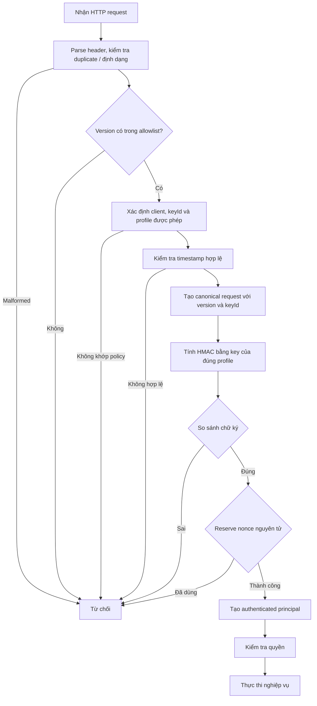
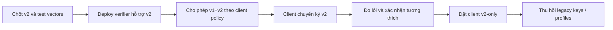

# Version algorithm — Thiết kế phiên bản thuật toán trong HMAC request authentication

## 1. Vì sao giao thức HMAC cần version algorithm?

Trong module **SECURITY_AUTHENTICATION_HMAC_REQUEST_AUTHENTICATION**, client và server chia sẻ một secret để ký và xác minh HTTP request. Chữ ký thường bao phủ một **canonical request** gồm phương thức, URI, các header đã quy định và body hoặc body digest. HMAC giúp xác thực bên nắm secret và phát hiện thay đổi trên những thành phần thực sự được ký; timestamp/nonce giúp chống replay, còn bước phân quyền quyết định principal đã xác thực được làm gì.

Một giao thức triển khai lâu dài có thể phải thay đổi thuật toán HMAC, cách mã hóa chữ ký, hàm băm body hoặc quy tắc tạo canonical request. Nếu các lựa chọn này bị ngầm định trong code, server rất khó hỗ trợ client cũ và mới song song, và việc thay đổi dễ gây lỗi xác thực hàng loạt.

**Version algorithm** nghĩa là đặt tên rõ ràng cho một **hồ sơ ký (signature profile)**. Mỗi version ánh xạ đến một bộ quy tắc cố định, được server quản lý và kiểm thử. Client công bố version mà mình dùng; server chỉ xác minh bằng profile được phép cho client đó.

Ví dụ: `v1` chọn `HmacSHA256`, `v2` chọn `HmacSHA512`. Đây là **ví dụ về khả năng thay đổi**, không có nghĩa HMAC-SHA256 mặc nhiên yếu hoặc mọi hệ thống nên nâng lên SHA-512. Quyết định đổi thuật toán phải dựa trên yêu cầu bảo mật, khả năng tương tác và chi phí vận hành thực tế.

### Kết quả học tập

Sau bài này, người học có thể:

- Mô tả một hợp đồng version cụ thể, đủ để hai phía tạo cùng chữ ký.
- Phân biệt **algorithm version**, **canonicalization version**, **key ID/key rotation** và **protocol/API version**.
- Thiết kế bộ xác minh có allowlist, chặn unknown version, algorithm confusion và downgrade.
- Viết test xác minh chữ ký đúng từng version, chữ ký sai version, chính sách ngừng hỗ trợ version cũ và chống replay.
- Lập kế hoạch migration có giai đoạn, đo lường, rollback và đồng bộ proxy/gateway.

## 2. Những thứ phải version hóa và những thứ không nên trộn lẫn

Một tên version chỉ hữu ích khi có một hợp đồng bất biến, rõ byte và rõ thuật toán. Ví dụ một profile cần chỉ ra:

| Thành phần | Cần ghi trong hợp đồng |
| --- | --- |
| Version trên wire | Tên chính xác như `v1`, `v2`, phân biệt chữ hoa/thường hay không |
| HMAC | `HmacSHA256` hay `HmacSHA512`, khóa nào được phép sử dụng |
| Canonical request | Thứ tự field, ký tự phân cách, ký hiệu xuống dòng, cách mã hóa |
| Method và URI | Chuẩn hóa method, path, query, percent-encoding, xử lý qua proxy |
| Header được ký | Tên field, giá trị, duplicate, whitespace và thứ tự canonical |
| Body | Ký raw body bytes, digest body hay một dạng canonical JSON |
| Body digest | Thuật toán digest và cách biểu diễn hex/Base64 |
| Chữ ký trên wire | Base64url/hex, padding, độ dài, quy tắc parse |
| Timestamp và nonce | Định dạng, đơn vị thời gian, giới hạn clock skew, replay policy |
| Key lookup | Quan hệ giữa client/tenant, `keyId`, version và key material |
| Loại lỗi | Quy tắc từ chối input sai version, malformed hoặc không đủ quyền |

**Không đồng nhất các khái niệm:**

- **Algorithm version:** profile xác định cách tạo và xác minh chữ ký. Một thay đổi về canonicalization cũng có thể yêu cầu version mới, dù HMAC algorithm vẫn giữ nguyên.
- **Key ID:** mã tham chiếu đến một secret cụ thể. Có thể rotate secret trong cùng `v2` bằng `keyId` khác mà không tạo `v3`.
- **API version:** phiên bản endpoint, payload hoặc contract nghiệp vụ (ví dụ `/v2/payments`). API version và signature profile có thể thay đổi độc lập.
- **Credential lifecycle:** cấp, thu hồi, hết hạn, rotate khóa và chính sách client được dùng profile nào. Đây là cấu hình phía server, không được quyết định chỉ bằng chuỗi do client gửi.

Ví dụ trong giai đoạn chuyển đổi, một client có thể có `key-2026-a` cho `v1` và `key-2026-b` cho `v2`. Server có thể chấp nhận cả hai trong cửa sổ migration; sau hạn chót chỉ chấp nhận `v2` cho client đó. Việc khóa cũ còn trong key store **không** có nghĩa profile cũ vẫn được phép dùng.

## 3. Hợp đồng minh họa v1/v2

Để ví dụ có kết quả kiểm thử xác định, giả sử client gửi năm header sau:

```http
POST /v1/payments?currency=VND HTTP/1.1
X-HMAC-Version: v2
X-Key-Id: key-2026-b
X-Timestamp: 1795820000
X-Nonce: c9f23d78ab4e4a0f
X-Signature: <base64url-no-padding>

{"amount":100,"currency":"VND"}
```

Giá trị timestamp chỉ minh họa; integration test phải dùng thời gian thực theo hợp đồng, trong cửa sổ chấp nhận. `X-Signature` là placeholder, **không phải chữ ký có thể gửi trực tiếp**.

Hợp đồng mẫu của bài:

| Quy tắc | Profile `v1` | Profile `v2` |
| --- | --- | --- |
| Header version | `X-HMAC-Version: v1` | `X-HMAC-Version: v2` |
| MAC algorithm | HMAC-SHA-256 (`HmacSHA256`) | HMAC-SHA-512 (`HmacSHA512`) |
| Body digest | SHA-256 trên body bytes thực nhận | SHA-256 trên body bytes thực nhận |
| Canonical schema | `HMAC-REQUEST` + 7 trường, mỗi phần trên một dòng | Cùng schema, nhưng dòng version là `v2` |
| Chữ ký | Base64url không padding của 32 byte MAC | Base64url không padding của 64 byte MAC |
| Key | Secret được đăng ký cho `(client, keyId, v1)` | Secret được đăng ký cho `(client, keyId, v2)` |
| Chính sách chấp nhận | Chỉ khi client vẫn được phép `v1` | Chỉ khi client được phép `v2` |

Cụ thể, canonical request là byte UTF-8 của chuỗi sau, **dùng LF (`\n`) giữa các dòng và không thêm LF cuối**:

```text
HMAC-REQUEST
v2
key-2026-b
POST
/v1/payments?currency=VND
1795820000
c9f23d78ab4e4a0f
<lowercase-hex-SHA256-of-body-bytes>
```

Chuỗi `HMAC-REQUEST` đóng vai trò **domain separator**: giúp tránh nhầm một chữ ký dùng cho request authentication với chữ ký của giao thức khác đang vô tình tái sử dụng cùng secret. Trong thực tế, giải pháp ưu tiên vẫn là **khóa riêng cho từng mục đích và từng profile**.

**Điều kiện bắt buộc:** trước khi tính chữ ký, hai phía phải thống nhất byte của method, URI có query, timestamp, nonce và body digest. Ví dụ không ký `Content-Type`; nếu API cần bảo vệ header này, phải đưa vào schema ký và cập nhật version tương ứng. Không tự coi mọi header đều được HMAC bảo vệ.

### Vì sao phải ký cả version?

Giả sử client ký theo `v2` nhưng kẻ tấn công thay `X-HMAC-Version` thành `v1`, giữ nguyên chữ ký. Nếu version là một trường của canonical request, server xác minh `v1` trên chuỗi chứa `v1` và không thể thu được chữ ký `v2`. Bộ xác minh cũng sử dụng đúng key/profile được đăng ký và kiểm tra độ dài chữ ký.

Ngược lại, nếu version chỉ quyết định một nhánh code bên ngoài dữ liệu ký, việc triển khai rất dễ vô tình cho phép diễn giải cùng credential theo nhiều cách. **Ký version là ràng buộc mật mã; chính sách chặn version cũ là ràng buộc vận hành. Phải có cả hai.**

## 4. Quy trình xác minh an toàn



Các bước cần giữ rõ ranh giới:

1. **Đọc credential không mơ hồ.** Phát hiện header thiếu, trùng, tên khác hoa/thường, giá trị có dấu phẩy do proxy gộp, chuỗi vượt giới hạn hoặc định dạng sai. Nếu không có policy rõ ràng về duplicate, nên từ chối.
2. **Parse version theo allowlist đóng.** Chỉ những giá trị literal đã công bố như `v1`/`v2` được chấp nhận. Không lấy chuỗi header làm tên thuật toán JCA tự do và không cho client tự yêu cầu `none` hoặc một thuật toán yếu khác.
3. **Áp chính sách trên danh tính credential.** Tra cứu `keyId` trong phạm vi client/tenant; xác minh rằng khóa này gắn với đúng profile và profile còn được cho phép. Nếu chỉ có `keyId` mà chưa xác định được principal, cần key registry ánh xạ an toàn đến chủ thể của credential.
4. **Đảm bảo timestamp hợp lệ.** Parse đơn vị epoch và giới hạn độ lệch đồng hồ; input quá lớn hoặc ngoài cửa sổ phải bị từ chối có kiểm soát.
5. **Dựng canonical bytes.** Bao gồm domain separator, version, key ID và mọi thành phần được hợp đồng ký bảo vệ; body bytes phải được đọc nhất quán với downstream handler.
6. **Xác minh chữ ký.** Chọn đúng thuật toán và secret, giải mã signature đúng định dạng/độ dài, so sánh bằng primitive phù hợp như `MessageDigest.isEqual`.
7. **Chống replay.** Sau khi HMAC hợp lệ, reserve nonce một cách nguyên tử trong replay store, trước khi xử lý nghiệp vụ. Dùng khóa nonce theo chủ thể đã xác thực và phạm vi hợp đồng quy định, tránh vô tình cho tái sử dụng cùng nonce chỉ vì chuyển version/key ID.
8. **Phân quyền.** Chỉ sau khi xác thực thành công mới gán principal và áp quy tắc authorization cho hành động/đối tượng cụ thể.

Tùy kiến trúc, một số bước giới hạn tài nguyên hoặc kiểm tra thời gian có thể xảy ra sớm hơn để bảo vệ hệ thống. Tuy vậy, **không được hoàn tất hành động nghiệp vụ hoặc đánh dấu request đã xác thực trước khi chữ ký và anti-replay đều thành công**.

### Không cho phép fallback ngầm

Một mẫu thiết kế sai là:

```text
if verifyAsV2(request) fails:
    try verifyAsV1(request)
```

Nhánh này khiến client có thể được chấp nhận dưới profile khác với profile đã khai báo, làm mờ lý do lỗi và nới rộng bề mặt downgrade. Quy tắc đúng là: **mỗi request chọn đúng một profile đã được phép; thất bại ở profile đó thì từ chối**. Hỗ trợ cả hai version là hai nhánh xác minh tường minh theo `X-HMAC-Version`, không phải danh sách thuật toán được thử lần lượt.

## 5. Ví dụ Java 17: profile registry và chữ ký có ràng buộc version

Ví dụ dưới đây triển khai phần cốt lõi của **algorithm dispatch và cryptographic verification** với Java 17. Các khóa trong test chỉ là fixture giả; hệ thống thật cần secret ngẫu nhiên đủ mạnh từ hệ thống quản lý khóa. Hàm nhận method, request-target, timestamp, nonce và body bytes **đã được xác định theo hợp đồng canonicalization**. Lớp HTTP parser, timeout, replay store và Spring Security filter được kiểm thử riêng.

```java
import javax.crypto.Mac;
import javax.crypto.spec.SecretKeySpec;
import java.nio.charset.StandardCharsets;
import java.security.GeneralSecurityException;
import java.security.MessageDigest;
import java.util.Base64;
import java.util.HexFormat;
import java.util.Map;
import java.util.Set;

public final class VersionedHmac {
    private VersionedHmac() {}

    public enum Profile {
        V1("v1", "HmacSHA256", 32),
        V2("v2", "HmacSHA512", 64);

        final String wire;
        final String jcaAlgorithm;
        final int signatureBytes;

        Profile(String wire, String jcaAlgorithm, int signatureBytes) {
            this.wire = wire;
            this.jcaAlgorithm = jcaAlgorithm;
            this.signatureBytes = signatureBytes;
        }

        static Profile fromWire(String value) {
            for (Profile p : values()) {
                if (p.wire.equals(value)) {
                    return p;
                }
            }
            return null; // Không mặc định dùng V1 khi thiếu/sai version.
        }
    }

    // Production registry phải thêm scope client/tenant và vòng đời của key.
    public record KeyRef(String keyId, Profile profile) {}

    private static byte[] utf8(String s) {
        return s.getBytes(StandardCharsets.UTF_8);
    }

    private static String canonical(
            Profile profile,
            String keyId,
            String method,
            String requestTarget,
            String timestamp,
            String nonce,
            byte[] body
    ) throws GeneralSecurityException {
        String bodyHash = HexFormat.of().formatHex(
                MessageDigest.getInstance("SHA-256").digest(body));
        return String.join("\n",
                "HMAC-REQUEST",
                profile.wire,
                keyId,
                method,
                requestTarget,
                timestamp,
                nonce,
                bodyHash);
    }

    private static byte[] mac(
            Profile profile,
            byte[] secret,
            String keyId,
            String method,
            String requestTarget,
            String timestamp,
            String nonce,
            byte[] body
    ) throws GeneralSecurityException {
        Mac hmac = Mac.getInstance(profile.jcaAlgorithm);
        hmac.init(new SecretKeySpec(secret, profile.jcaAlgorithm));
        return hmac.doFinal(utf8(canonical(
                profile, keyId, method, requestTarget, timestamp, nonce, body)));
    }

    public static String sign(
            Profile profile,
            byte[] secret,
            String keyId,
            String method,
            String requestTarget,
            String timestamp,
            String nonce,
            byte[] body
    ) throws GeneralSecurityException {
        byte[] signature = mac(profile, secret, keyId, method,
                requestTarget, timestamp, nonce, body);
        return Base64.getUrlEncoder().withoutPadding()
                .encodeToString(signature);
    }

    public static boolean verify(
            String wireVersion,
            String keyId,
            String method,
            String requestTarget,
            String timestamp,
            String nonce,
            byte[] body,
            String wireSignature,
            Map<KeyRef, byte[]> keyRegistry,
            Set<Profile> allowedProfiles
    ) throws GeneralSecurityException {
        Profile profile = Profile.fromWire(wireVersion);
        if (profile == null || keyId == null
                || method == null || requestTarget == null
                || timestamp == null || nonce == null || body == null
                || wireSignature == null || keyRegistry == null
                || allowedProfiles == null || !allowedProfiles.contains(profile)) {
            return false;
        }

        byte[] secret = keyRegistry.get(new KeyRef(keyId, profile));
        if (secret == null || secret.length == 0) {
            return false;
        }

        final byte[] supplied;
        try {
            supplied = Base64.getUrlDecoder().decode(wireSignature);
        } catch (IllegalArgumentException malformed) {
            return false;
        }
        if (supplied.length != profile.signatureBytes
                || !Base64.getUrlEncoder().withoutPadding()
                        .encodeToString(supplied).equals(wireSignature)) {
            return false; // Từ chối padding/biểu diễn Base64url không chuẩn.
        }

        byte[] expected = mac(profile, secret, keyId, method,
                requestTarget, timestamp, nonce, body);
        return MessageDigest.isEqual(expected, supplied);
    }
}
```

Đặc điểm quan trọng của ví dụ:

- `Profile.fromWire()` là **allowlist tĩnh**. Không thực thi `Mac.getInstance(request.getHeader("X-Algorithm"))`.
- `KeyRef(keyId, profile)` ràng buộc key với profile. Trong production cần thêm client/tenant và trạng thái `ACTIVE`/`VERIFY_ONLY`/`REVOKED`.
- `allowedProfiles` phải do **server policy** trả về cho chủ thể tương ứng, không lấy từ tham số client tự chọn.
- Chữ ký được kiểm tra Base64url không padding và có độ dài cố định theo profile. Không chấp nhận MAC rút gọn tùy tiện nếu contract không quy định.
- `canonical()` ký cả version và key ID; attacker thay một trong hai mà không có secret hợp lệ sẽ không thể dùng lại chữ ký cũ.

**Giới hạn của snippet:** hàm `verify()` ở đây chỉ kiểm tra phần chữ ký mật mã và allowlist đã truyền vào. Nó chưa validate grammar header, độ dài input, canonical URI, freshness timestamp, nonce/replay, key expiry hay authorization. Đừng trực tiếp dùng nó làm trọn bộ HTTP authentication filter. Production nên dùng parser nghiêm ngặt, giới hạn kích thước trước khi decode và tham chiếu secret qua hệ thống quản lý credential an toàn.

## 6. JUnit 5: kiểm thử profile hợp lệ, tamper và policy downgrade

Đây là các test minh họa chạy với lớp `VersionedHmac` ở mục trước. Timestamp cố định chỉ dành cho **unit test mật mã**, không dùng để vượt qua kiểm tra time-window ở HTTP integration test. Các chuỗi key là dữ liệu test giả, không được triển khai thực tế.

```java
import org.junit.jupiter.api.Test;

import java.nio.charset.StandardCharsets;
import java.security.GeneralSecurityException;
import java.util.Map;
import java.util.Set;

import static org.junit.jupiter.api.Assertions.assertFalse;
import static org.junit.jupiter.api.Assertions.assertTrue;

class VersionedHmacTest {
    private static final String KEY_ID = "partner-key-a";
    private static final String METHOD = "POST";
    private static final String TARGET = "/v1/payments?currency=VND";
    private static final String TS = "1700000000";
    private static final String NONCE = "unit-test-nonce-001";

    private static byte[] bytes(String input) {
        return input.getBytes(StandardCharsets.UTF_8);
    }

    private static final byte[] BODY = bytes(
            "{\"amount\":100,\"currency\":\"VND\"}");
    private static final byte[] KEY_V1 = bytes(
            "test-only-v1-secret-long-enough-for-demo");
    private static final byte[] KEY_V2 = bytes(
            "test-only-v2-secret-long-enough-for-demo");

    private static final Map<VersionedHmac.KeyRef, byte[]> KEYS =
            Map.of(
                    new VersionedHmac.KeyRef(
                            KEY_ID, VersionedHmac.Profile.V1), KEY_V1,
                    new VersionedHmac.KeyRef(
                            KEY_ID, VersionedHmac.Profile.V2), KEY_V2);

    private static String signature(
            VersionedHmac.Profile version, byte[] secret)
            throws GeneralSecurityException {
        return VersionedHmac.sign(
                version, secret, KEY_ID, METHOD, TARGET, TS, NONCE, BODY);
    }

    private static boolean verify(
            String wireVersion, byte[] body, String wireSignature,
            Set<VersionedHmac.Profile> allowlist)
            throws GeneralSecurityException {
        return VersionedHmac.verify(
                wireVersion, KEY_ID, METHOD, TARGET, TS, NONCE,
                body, wireSignature, KEYS, allowlist);
    }

    @Test
    void acceptsEachDeclaredProfileWhileBothAreAllowed()
            throws GeneralSecurityException {
        Set<VersionedHmac.Profile> both = Set.of(
                VersionedHmac.Profile.V1, VersionedHmac.Profile.V2);

        assertTrue(verify("v1", BODY,
                signature(VersionedHmac.Profile.V1, KEY_V1), both));
        assertTrue(verify("v2", BODY,
                signature(VersionedHmac.Profile.V2, KEY_V2), both));
    }

    @Test
    void changingVersionCannotReuseExistingSignature()
            throws GeneralSecurityException {
        String signedAsV2 = signature(VersionedHmac.Profile.V2, KEY_V2);
        assertFalse(verify("v1", BODY, signedAsV2,
                Set.of(VersionedHmac.Profile.V1, VersionedHmac.Profile.V2)));
    }

    @Test
    void disablingOldProfileEnforcesMigrationCutoff()
            throws GeneralSecurityException {
        String validV1Signature = signature(
                VersionedHmac.Profile.V1, KEY_V1);
        assertFalse(verify("v1", BODY, validV1Signature,
                Set.of(VersionedHmac.Profile.V2)));
    }

    @Test
    void rejectsUnknownVersionChangedBodyAndMalformedSignature()
            throws GeneralSecurityException {
        String validV2Signature = signature(
                VersionedHmac.Profile.V2, KEY_V2);
        Set<VersionedHmac.Profile> v2Only =
                Set.of(VersionedHmac.Profile.V2);

        assertFalse(verify("v999", BODY, validV2Signature, v2Only));
        assertFalse(verify("V2", BODY, validV2Signature, v2Only));
        assertFalse(verify("v2", bytes(
                "{\"amount\":900,\"currency\":\"VND\"}"),
                validV2Signature, v2Only));
        assertFalse(verify("v2", BODY, validV2Signature + "=", v2Only));
        assertFalse(verify("v2", BODY, "not-a-signature", v2Only));
    }
}
```

Cần bổ sung integration test để kiểm tra các nhánh không nằm trong snippet: duplicate `X-HMAC-Version`, thiếu version, key ID không thuộc client, timestamp hết hạn, nonce đã dùng, signature đổi do proxy, và request đã xác thực nhưng **không được phân quyền** cho tài nguyên. Đảm bảo HTTP client gửi đúng byte mà signer đã dùng, đặc biệt với body JSON có thay đổi whitespace hoặc encoding.

## 7. Algorithm confusion và downgrade: hai nhóm lỗi khác nhau

### 7.1. Algorithm confusion

**Algorithm confusion** xuất hiện khi cùng dữ liệu xác thực có thể được diễn giải dưới hai thuật toán, quy tắc khóa hoặc profile khác nhau.

Các biểu hiện:

- Client truyền `X-Algorithm: HmacSHA1` và server dùng thẳng tên này trong JCA mà không kiểm tra allowlist.
- Server lấy secret của `keyId` nhưng không kiểm tra secret đó được cấp cho profile nào.
- Cùng một version trỏ đến canonical schema khác nhau ở các instance hoặc giữa gateway và application.
- Chữ ký Base64/hex được decode lỏng lẻo, dẫn tới nhiều biểu diễn của cùng signature và khác biệt giữa các tầng.
- Một node dùng body bytes trước giải nén, node khác dùng bytes sau giải nén.

**Phòng tránh:** map version đến profile bất biến, key binding theo profile, canonical request có version/domain separator, parsing chặt và contract test qua mọi thành phần.

### 7.2. Downgrade

**Downgrade** là việc kết nối hay request bị đưa về một profile cũ hơn chính sách bảo mật dự kiến, đặc biệt khi server vẫn hỗ trợ legacy.

Ký version ngăn attacker đổi `v2` thành `v1` trên **một request đã ký** mà vẫn dùng lại chữ ký. Tuy nhiên, **ký version không tự cấm một client có secret v1 gửi một request mới được ký v1**. Vì vậy, bảo vệ downgrade còn cần:

- Chính sách `allowedProfiles` theo chủ thể/key/tenant và mốc thời gian.
- Không fallback về v1 khi xác minh v2 thất bại.
- Quy trình ngừng v1 thật sự sau migration: chặn trước khi tạo principal.
- Thu hồi secret/profile cũ theo chính sách credential; không để key cũ âm thầm vẫn có quyền xác thực.
- Metric về số request theo version và các lý do từ chối, để biết client nào còn dùng legacy.

Một phần tử `minVersion` chỉ có ý nghĩa khi version có thứ tự công bố rõ ràng. Với tên profile không có quan hệ tuyến tính (ví dụ `hmac-sha256-raw-v1` và `hmac-sha256-json-v1`), dùng **tập profile được phép** rõ ràng thường an toàn hơn phép so sánh chuỗi.

## 8. Version algorithm và key rotation vận hành cùng nhau

Key rotation thay đổi secret; algorithm migration có thể thay đổi MAC, canonicalization và cách trao đổi dữ liệu. Có thể thực hiện độc lập nhưng khi phối hợp cần quản lý rõ trạng thái.

| Trạng thái key/profile | Client ký mới | Server xác minh | Ý nghĩa |
| --- | --- | --- | --- |
| `ACTIVE` | Có thể | Có thể | Profile/key đang sử dụng |
| `VERIFY_ONLY` | Không phát hành chữ ký mới | Có thể trong cửa sổ chuyển đổi | Cho phép request cũ hợp lệ hoàn thành |
| `DISABLED`/`REVOKED` | Không | Không | Khóa hoặc profile đã ngừng chấp nhận |

Trong **request authentication**, client là bên ký, nên “verify only” thực chất là chính sách phía server **chỉ tạm chấp nhận** các credential cũ còn nằm trong cửa sổ; server không kiểm soát được việc client có tiếp tục tạo chữ ký mới hay không. Sau hạn cutoff phải từ chối.

Mỗi profile nên có secret độc lập, có key ID có thể tra được và metadata như owner/tenant, thuật toán, ngày kích hoạt/hết hạn, trạng thái, khả năng thu hồi. Khi bản ghi key được rotate, server có thể xác minh một thời gian cả key ID cũ và mới **trong cùng profile**, tùy policy. Nhưng không được suy đoán profile bằng cách “thử tất cả secret và thuật toán cho đến khi khớp”.

### Nonce dùng chung qua nhiều profile

Giả sử cùng một partner có thể ký request với cả v1 và v2. Nếu replay store chỉ khóa theo `(profile, nonce)`, partner đó có thể tái sử dụng cùng nonce dưới profile còn lại. Để đảm bảo nonce biểu diễn một request mới theo logic của hệ thống, cân nhắc khóa replay theo **(principal/tenant, nonce)** trong cùng phạm vi thời gian và API đã định nghĩa; không mặc định thêm version hoặc key ID vào replay key. Nếu hệ thống yêu cầu các namespace riêng, cần phân tích rõ khả năng lặp giao dịch giữa các profile.

Anti-replay không thể ngăn client có credential hợp lệ **chủ ý gửi một request mới với nonce khác** để lặp tác vụ. Với thanh toán hoặc các nghiệp vụ thay đổi trạng thái, vẫn cần **idempotency key**, quyền truy cập và kiểm tra nghiệp vụ độc lập.

## 9. Quy trình migration có kiểm soát

**Giai đoạn 1 — Chuẩn bị.** Chốt profile v2, test vectors, rule canonicalization, cách truyền signature, key registry, lỗi và khả năng tương thích proxy/gateway. Đảm bảo tất cả instance trong cluster nhận biết v2 trước khi client bắt đầu gửi.

**Giai đoạn 2 — Dual verification.** Server tạm chấp nhận v1 và v2 **theo policy của từng client**, nhưng mỗi request chỉ xác minh theo một version. Cấp key/credential v2, cho client dùng v2 trong môi trường test rồi production theo từng nhóm.

**Giai đoạn 3 — Di chuyển client.** Theo dõi tỉ lệ xác thực thành công, signature mismatch, clock skew, replay rejection, unknown version và số client còn gửi v1. Thực hiện canary theo client/tenant, tránh đổi đồng loạt trong giờ cao điểm.

**Giai đoạn 4 — Cắt phiên bản cũ.** Cập nhật chính sách từng client sang v2-only, sau đó khóa v1 và thu hồi key cũ khi phù hợp. Phân biệt “đã không còn thấy request v1” với “server thật sự từ chối v1”.

**Giai đoạn 5 — Thu dọn.** Loại bỏ logic và test compatibility dành riêng cho legacy khi đã đủ điều kiện. Duy trì **negative test** bảo đảm v1 vẫn bị từ chối sau cutoff, không bị hồi sinh bởi thay đổi cấu hình.

**Rollback:** Nếu phải khôi phục khả năng chấp nhận v1 sau sự cố, đó là **quyết định thay đổi chính sách bảo mật có kiểm soát**, có phạm vi client, hạn chót và giám sát rõ. Không tự bật lại fallback trong code khi thấy nhiều signature mismatch.



## 10. Ma trận kiểm thử cần có trước khi phát hành

| Tình huống | Kỳ vọng |
| --- | --- |
| Request v1 ký đúng, client còn được phép v1 | Bước HMAC thành công |
| Request v2 ký đúng, client được phép v2 | Bước HMAC thành công |
| Giữ chữ ký v2 nhưng sửa header thành v1 | Từ chối |
| Giữ chữ ký v1 nhưng sửa header thành v2 | Từ chối |
| v1 ký đúng nhưng client đã v2-only | Từ chối theo policy |
| Header version thiếu/trùng/không biết | Từ chối, không fallback |
| Version có chữ hoa khác hợp đồng (`V2`) | Từ chối nếu hợp đồng phân biệt hoa/thường |
| Chữ ký sai định dạng hoặc độ dài | Từ chối, không gọi business handler |
| Key ID đúng cú pháp nhưng không thuộc version/client | Từ chối |
| Key cũ đã revoked dù chữ ký đúng | Từ chối |
| Sửa method, URI/query, signed header hoặc body sau khi ký | HMAC mismatch theo contract |
| Timestamp hết hạn hoặc quá xa tương lai | Từ chối do time window, không lấy làm chứng cứ HMAC mismatch |
| Nonce dùng lại qua key ID/profile khác của cùng principal | Replay bị chặn nếu nonce namespace của contract dùng chung |
| Request chữ ký hợp lệ nhưng thiếu quyền nghiệp vụ | Xác thực có thể thành công, phân quyền từ chối |
| Proxy rewrite URI/header có liên quan đến canonicalization | Kết quả thống nhất theo test vector đã chốt |
| Mix client cũ/mới với server cluster đang rolling deploy | Không có node xác minh profile sai hoặc tự fallback |
| Request malformed rất lớn, nhiều header | Từ chối có kiểm soát, tránh 5xx/DoS |

Khi test qua Spring MVC `OncePerRequestFilter` hay WebFlux `WebFilter`, cần kiểm tra rằng logic từ chối nằm ở filter chain phù hợp, **không tạo authenticated principal** và không gọi handler gây side effect. Tốt nhất có một bộ **test vectors độc lập** chứa: version, method, canonical URI, bytes của body, timestamp, nonce, key ID, digest, canonical string và expected signature. Cùng vector phải cho kết quả nhất quán ở client SDK, gateway (nếu có verify) và backend.

Đối với timestamp/nonce, tránh dùng lại nonce đã được positive test gửi trước đó trong negative test, vì bị từ chối replay có thể che giấu lỗi kiểm tra algorithm version. Mỗi request gửi qua replay store nên có nonce riêng, và cần quan sát mã lý do từ chối tại test hook nội bộ.

## 11. Câu hỏi tình huống và bài tập

**Tình huống 1 — Đổi thuật toán nhưng không đổi canonicalization.** Server đã có profile v1 ký HmacSHA256 và muốn thêm HmacSHA512. Hãy thiết kế `v2` rõ thuật toán, signature encoding, tag length, key policy, test vectors; giải thích vì sao vẫn phải ký version trong canonical request.

**Tình huống 2 — Đổi canonicalization nhưng giữ HmacSHA256.** Hệ thống bổ sung query string và header `Content-Type` vào phần ký. Dù primitive HMAC không đổi, client và server đang ký **hai loại thông điệp khác nhau**. Hãy đặt một profile mới, chỉ rõ canonical schema, tương thích proxy và test thay URI/header sau khi ký.

**Tình huống 3 — Client legacy sau cutoff.** Một partner vẫn gửi v1 và chữ ký hợp lệ sau khi được cấu hình v2-only. Server phải làm gì? Phân tích vì sao không thể dùng “chữ ký v1 đúng” để vượt policy và tại sao rollback phải được phê duyệt như thay đổi bảo mật.

**Bài tập thực hành:** Mở rộng `VersionedHmacTest` để thay `keyId` nhưng giữ chữ ký, để thử ký v1 bằng secret của v2, và để kiểm thử profile `v3` chưa được khai báo. Sau đó bổ sung HTTP integration test qua gateway kiểm tra duplicate `X-HMAC-Version`, phiên bản không hợp lệ, clock skew và nonce dùng lại. Xác minh mọi request bị từ chối không tạo side effect; đồng thời phân biệt lỗi **xác thực** với lỗi **phân quyền** sau khi request hợp lệ.

Một cơ chế algorithm agility hoàn chỉnh cho HMAC không dừng ở việc đổi `HmacSHA256` thành `HmacSHA512`. Nó đòi hỏi **profile bất biến, version được ràng buộc vào chữ ký, key registry có scope, allowlist theo client, anti-replay nhất quán và lộ trình loại bỏ legacy có thể kiểm chứng**. Những điều này cho phép thay đổi thuật toán và canonical request theo thời gian mà vẫn duy trì ý nghĩa xác thực cho từng HTTP request.
