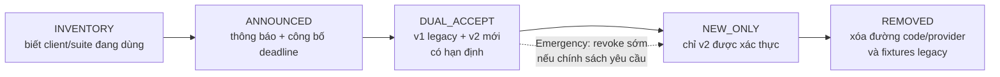
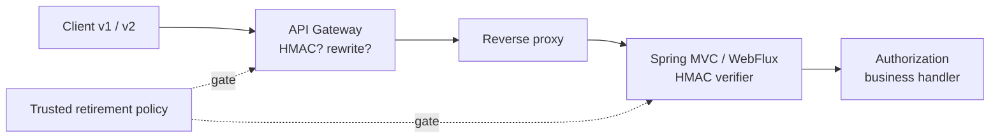

# Ngừng thuật toán cũ trong xác thực HTTP request bằng HMAC

## 1. Vấn đề: ngừng thuật toán là thay đổi giao thức bảo mật

Trong module `SECURITY_AUTHENTICATION_HMAC_REQUEST_AUTHENTICATION`, client sử dụng **shared secret** để ký HTTP request bằng HMAC trên một **canonical request** theo hợp đồng. Canonical request có thể bảo vệ method, URI/query, các header bắt buộc và body hoặc body digest. Server kiểm tra chữ ký, timestamp/nonce chống replay, key rotation, sau đó mới xác định client và quyết định **authorization**.

Giả sử API đã phục vụ các đối tác nhiều năm với `HmacSHA1`. Nhóm bảo mật muốn chuyển sang `HmacSHA256` và **ngừng chấp nhận HmacSHA1**. Nếu chỉ thêm dòng `Mac.getInstance("HmacSHA256")`, những client chưa nâng cấp sẽ nhận lỗi; nếu để server “thử SHA-256 trước rồi thử SHA-1”, attacker có thể khai thác cơ chế fallback và không ai biết thuật toán cũ đã thực sự bị tắt hay chưa.

Chủ đề **Ngừng thuật toán cũ** thuộc chương **Algorithm agility**: khả năng thay đổi bộ thuật toán mật mã theo một chính sách có kiểm soát, không phá vỡ vô tình hợp đồng ký và không tạo đường hạ cấp bảo mật.

Sau bài học, người học có thể:

- Phân biệt **ngừng thuật toán MAC**, **xoay shared secret**, **nâng phiên bản canonical contract** và **thu hồi danh tính client**.
- Xây lộ trình inventory → thông báo → dual-accept có giới hạn → cutoff → removal, có điều kiện rollback an toàn.
- Ràng buộc `algorithm suite`, phiên bản hợp đồng, key ID và secret vào đúng request; tránh `algorithm confusion` và `downgrade`.
- Thiết kế verifier Java/Spring Security **allowlist-first**, không fallback thử mọi thuật toán hoặc secret.
- Giữ chống replay, phân quyền, proxy/gateway contract và error semantics nhất quán trong thời gian chuyển đổi.
- Viết kiểm thử positive/negative, contract, concurrency và giám sát để chứng minh thuật toán cũ đã ngừng thật.

> **Nguyên tắc xuyên suốt:** thuật toán mà verifier chấp nhận phải đến từ **chính sách phía server**, không phải quyền lựa chọn vô điều kiện từ header của client.

## 2. Vì sao ngừng thuật toán cũ, và không nên đơn giản hóa rủi ro?

Một thuật toán có thể bị ngừng hỗ trợ do yêu cầu tiêu chuẩn bảo mật, chính sách nội bộ, mức bảo đảm muốn nâng cao, vấn đề triển khai/provider, khả năng kiểm toán hoặc kế hoạch đồng bộ SDK.

Ví dụ `SHA-1` không còn phù hợp cho nhiều trường hợp **chữ ký số hoặc hash chống va chạm**. Tuy nhiên, phải phân biệt **collision attack trên SHA-1 hash thuần** với **độ an toàn của HMAC-SHA1**: sự tồn tại của va chạm SHA-1 **không tự động** đồng nghĩa attacker đã có cách giả mạo HMAC-SHA1 khi không biết secret. Dù vậy, một hệ thống có thể và thường nên chuyển sang HMAC-SHA-256 vì yêu cầu assurance, chính sách hoặc tuổi thọ hệ thống. Tương tự, các mối lo về MD5 hash thuần không được diễn giải máy móc thành một bản mô tả chính xác về mọi biến thể HMAC-MD5.

Không nên tuyên bố một thuật toán “an toàn tuyệt đối” hay “đã bị phá hoàn toàn” nếu không có bối cảnh, phiên bản, key length và threat model rõ ràng. Trong tài liệu này, `HmacSHA1` được dùng như **thuật toán legacy giả định cần loại bỏ theo policy**, còn `HmacSHA256` là thuật toán mục tiêu; quyết định thực tế phải tuân thủ yêu cầu mật mã hiện hành của tổ chức.

Ngừng thuật toán còn giúp giảm **attack surface**: bớt parser, bớt đường kiểm chứng MAC và bớt tổ hợp cấu hình cần kiểm thử. Tuy nhiên, đây là một thay đổi có khả năng gây gián đoạn cho client lâu năm, nên phải có kế hoạch chuyển đổi và quan sát.

## 3. Bốn thứ dễ bị gọi nhầm là “version”

| Khái niệm | Ví dụ | Mục đích | Có tự kéo theo thay đổi thuật toán? |
| --- | --- | --- | --- |
| **Algorithm suite ID** | `hmac-sha256-v2` | Quy định chính xác thuật toán MAC và các tham số được hỗ trợ | Có, vì định nghĩa suite |
| **Canonical contract version** | `HMAC-REQ-V2` | Quy định bytes được ký: method, URI, headers, body, newline, encoding | Không nhất thiết |
| **Key ID / key version** | `partner-a-key-2026b` | Chọn đúng secret đang có hiệu lực cho một client | Không nhất thiết, nhưng có thể ràng buộc với suite |
| **API version** | `/api/v2/orders` | Thay đổi hợp đồng nghiệp vụ hoặc routing | Không mặc định |

Hai request cùng dùng `HmacSHA256` vẫn tạo MAC khác nếu một bên ký raw path và bên kia ký path sau gateway rewrite. Ngược lại, client có thể xoay từ key A sang key B mà giữ nguyên `HMAC-REQ-V2`. Vì vậy, **algorithm migration**, **key rotation** và **canonicalization migration** phải được theo dõi thành những thay đổi riêng, ngay cả khi được rollout cùng một đợt.

Một cấu hình có thể ràng buộc key ID với suite:

```text
client: partner-reporting
  key_id: reporting-old      suite: hmac-sha1-v1    status: RETIRING
  key_id: reporting-current  suite: hmac-sha256-v2  status: ACTIVE

client: partner-fulfillment
  key_id: fulfillment-v2     suite: hmac-sha256-v2  status: ACTIVE
```

**Không dùng tên `key ID` để tự suy ra thuật toán bằng cách cắt chuỗi**. Cả suite, trạng thái key, client/tenant mapping và giới hạn hiệu lực phải đến từ registry/policy đáng tin cậy.

## 4. Threat model: downgrade và algorithm confusion

### 4.1. Downgrade bằng header tự khai

Client có thể gửi:

```http
X-Hmac-Suite: hmac-sha1-v1
X-Key-Id: reporting-old
X-Timestamp: 2026-11-28T03:15:00Z
X-Nonce: n-0000000000000001
X-Signature: <legacy-signature>
```

Những header này là **input chưa đáng tin**. Nếu server tin rằng `X-Hmac-Suite` có thể chọn bất kỳ thuật toán nào nhà cung cấp hỗ trợ, attacker có thể ép verifier sử dụng đường mật mã yếu hoặc đường kiểm tra chưa được kiểm soát. Giá trị chỉ được dùng như **candidate selector**, sau đó phải được kiểm tra qua allowlist, giai đoạn migration, chính sách theo client/key và binding của canonical request.

Sau ngày cutoff, request khai suite cũ phải bị từ chối ngay cả khi secret cũ vẫn nằm trong kho phục vụ audit hoặc rollback được phê duyệt. “Key còn lưu” **không đồng nghĩa** “thuật toán còn được phép xác thực”.

### 4.2. Algorithm confusion

Các lỗi thường gặp:

- Chấp nhận những chuỗi tùy ý như `alg=none` hoặc định dạng không có trong allowlist.
- Chọn thuật toán theo **độ dài chữ ký** thay vì suite ID và key policy.
- Đổi `X-Hmac-Suite` sau khi request được ký mà verifier không kiểm tra suite nằm trong phạm vi bảo vệ.
- Dùng key version thuộc HMAC-SHA-256 nhưng verify bằng HMAC-SHA-1 vì header yêu cầu.
- Chấp nhận cùng một request bởi nhiều đường verify có canonicalization khác nhau.
- Một instance dùng provider/alias thuật toán khác instance khác, tạo kết quả không thống nhất trong cụm.

**Điều kiện an toàn:** bộ suite được chấp nhận phải hữu hạn, xác định bởi policy server và có ràng buộc tường minh với key version/canonical version. Nếu suite không khớp key đã đăng ký, **không thử suite khác**.

### 4.3. Không fallback khi MAC sai

Đoạn mã sau thể hiện cách **không được** làm:

```java
// SAI: đối với một hợp đồng có suite và key ID tường minh.
if (!verifyWithSha256(request)) {
    if (verifyWithSha1(request)) {
        accept(request);
    }
}
```

Vì sao sai? Client khai v2 nhưng MAC sai có thể được chấp nhận nhờ v1; log không chỉ ra chính xác credential nào đã xác thực, policy cutoff bị vô hiệu hóa, key rotation và replay store có thể bị chia tách theo phiên bản. **Một request → một suite đã được cho phép → một key version → một canonical contract → một kết quả.**

## 5. Thiết kế canonical request có domain separation

Một v2 minh họa có thể đưa tên suite và contract version vào phần đầu:

```text
HMAC-REQ-V2
suite:hmac-sha256-v2
POST
/integrations/orders?source=partner
x-key-id:reporting-current
x-nonce:n-0000000000000001
x-timestamp:2026-11-28T03:15:00Z
content-type:application/json
x-content-sha256:<lowercase-hex-sha256-of-body>
```

Các dòng được nối bằng **LF (0x0A)** theo hợp đồng, không có LF cuối và được encode UTF-8; signed header names/cách sắp thứ tự, path/query và raw body representation phải được xác định chính xác. V2 ký hoặc **ràng buộc mật mã** các thông tin chọn suite, key ID và timestamp/nonce. `X-Signature` là output của HMAC nên không nằm trong input.

Khi attacker chỉ đổi:

```text
X-Hmac-Suite: hmac-sha256-v2
→ X-Hmac-Suite: hmac-sha1-v1
```

thì policy và key-suite binding phải reject. Kể cả khi suite cũ còn trong grace period, canonical bytes/suite/key của request phải đúng theo **một** contract được chọn, không được sửa để “đoán” cách ký.

Đưa một tiền tố khác nhau vào canonical message tạo **domain separation** giữa phiên bản giao thức, giúp tránh reuse nhầm cùng bytes cho các miền ký khác nhau. Nhưng **không tự thêm tiền tố cho các client v1 đã triển khai nếu v1 trước đó không ký prefix này**; cần giữ đúng contract v1 trong thời gian được phép, phát hành v2 với hợp đồng mới và loại v1 đúng thời điểm.

Trong HTTP, `Host`/`:authority`, raw URI/query, percent-encoding, duplicate parameters, HTTP/1.1 ↔ HTTP/2/3 và signed headers có thể thay đổi qua proxy. Contract v2 phải xác định rõ **điểm xác minh**: tại gateway trước rewrite hoặc backend với representation đáng tin. Ngừng thuật toán cũ không thay thế việc bảo đảm canonical request đúng.

## 6. Máy trạng thái của chính sách ngừng thuật toán

Để tránh “dual accept vô thời hạn”, nên định nghĩa trạng thái migration ở mức server:



| Giai đoạn | Hành vi với legacy | Hành vi với new suite | Điều kiện chuyển |
| --- | --- | --- | --- |
| **Inventory** | Theo chính sách hiện hành; đo baseline | Có thể chưa phát hành | Xác định client/SDK, nơi verify và điểm proxy |
| **Announced** | Có thể tiếp tục trong cửa sổ hỗ trợ | Cung cấp test vectors/SDK mới | Thông báo deadline và đường hỗ trợ |
| **Dual accept** | Chỉ cho client/key nằm trong allowlist grace period | Ưu tiên v2, cấp key mới | Canary, giám sát thành công/lỗi và tỷ lệ chuyển đổi |
| **New only** | **Reject** mọi request legacy ngoài exception được phê duyệt | Chấp nhận v2 hợp lệ | Policy cutoff đã có hiệu lực ở mọi node |
| **Removed** | Không còn code path xác minh v1 | Chỉ v2 theo policy | Đã chứng minh không có traffic hợp lệ cần v1 |

Không nên coi **đã thông báo** là **đã ngừng hỗ trợ**. Ngày cutoff là thời điểm **server từ chối xác thực** với suite cũ, không phải thời điểm chỉ ngừng cấp secret mới. Ngày removal sau đó có thể trễ hơn để cho phép rollback code có kiểm soát, nhưng policy vẫn phải giữ chặn v1.

### 6.1. Deadline và clock

Server kiểm tra cutoff bằng **clock đáng tin của server** tại điểm xác thực, không dùng `X-Timestamp` do client gửi để “được hưởng” chính sách trước cutoff. Nếu request được ký trước deadline nhưng đến sau deadline, hệ thống phải có quy định rõ ràng: thông thường bị từ chối theo policy hiện hành; nếu có ngoại lệ in-flight, phải giới hạn và mô tả rõ.

Timestamp hợp lệ theo HMAC freshness **không chứng minh** thuật toán đó vẫn được policy cho phép.

### 6.2. Canary và exception có kiểm soát

Trong grace period, một số đối tác có thể cần thời gian chuyển đổi. Có thể dùng allowlist theo **client đã đăng ký và key cụ thể**, có hết hạn, người duyệt và audit. Đừng cho client tự mở rộng quyền dùng thuật toán cũ chỉ bằng `X-Client-Id` tự khai.

Nếu rủi ro mới xuất hiện, đội bảo mật có thể đưa cutoff sớm hơn. Quy trình này cần **kill switch phía server** có kiểm soát thay đổi, test và monitoring; kill switch không có nghĩa bật chế độ “skip HMAC”.

## 7. Kế hoạch migration thực tế cho client và server

### Bước 1 — Inventory trước khi đổi chính sách

Liệt kê các **điểm xác minh thật**: gateway, Spring MVC `OncePerRequestFilter`, Spring WebFlux `AuthenticationWebFilter`, batch adapters, webhook endpoints và các instance còn hỗ trợ v1. Đánh giá mỗi điểm có dùng cùng policy/configuration hay không.

Từ telemetry đã được phép thu thập, phân loại số attempts theo suite, route, environment, outcome và những client **đã xác thực**. Với request thất bại, không suy verified client từ key ID tự khai.

### Bước 2 — Chọn thuật toán, key và contract mục tiêu

Ở ví dụ này, mục tiêu `HmacSHA256` là một algorithm JCA rõ ràng, không phải chuỗi tùy ý. Sinh **secret mới bằng nguồn ngẫu nhiên phù hợp**, quản lý trong vault/KMS/secret manager và cấp **key ID mới**. Nên dùng key độc lập giữa suite cũ và suite mới để giảm nguy cơ reuse sai credential và dễ thu hồi chính xác.

Với HMAC-SHA-256, một shared secret ngẫu nhiên có entropy đủ mạnh, chẳng hạn 256 bit, là lựa chọn phổ biến; độ dài key thực tế phải theo chính sách tổ chức. Không dùng mật khẩu con người dễ đoán làm HMAC key, không gửi secret qua log hoặc công cụ hỗ trợ.

### Bước 3 — Phát hành v2 với test vectors

Client SDK và server verifier phải thống nhất:

- Suite/version identifier và cách bind vào canonical message.
- Byte-level method, raw URI/query, signed headers, body digest, charset, LF/CRLF.
- Signature encoding: ví dụ Base64 chuẩn của MAC HMAC-SHA-256 **đầy đủ 32 byte**.
- Key ID → key version → allowed suite → client/tenant mapping.
- Timestamp/nonce format, allowed skew và nonce TTL.
- HTTP 401/403/503 contract, `WWW-Authenticate` challenge phù hợp.

Golden vector phải được tạo và xác nhận **độc lập** cho signer/verifier, không chỉ dùng một hàm chung rồi kết luận cả hai đúng.

### Bước 4 — Dual accept có giới hạn

Trong khoảng migration, server có thể chấp nhận **hai contract khác nhau**, nhưng chỉ khi header suite đã được parse chặt, suite được allowlist và key registry khẳng định key đó được phép dùng suite ấy. Không gọi v1 chỉ vì v2 MAC sai.

Mỗi lần xác thực vẫn phải kiểm tra body integrity, timestamp, nonce, key status, client mapping và quyền truy cập. Đừng “mở rộng cửa sổ timestamp” hoặc tắt anti-replay để giảm lỗi triển khai.

### Bước 5 — Cutoff và khóa đường legacy

Đúng thời điểm đã công bố (hoặc mốc sớm hơn theo quyết định an ninh), đổi policy thành **new-only** trên tất cả instance. Kiểm tra rằng request v1 bị từ chối **trước khi đi vào nghiệp vụ**, bao gồm key cũ còn nằm trong registry.

Khi có sự cố, ưu tiên sửa client, phát hành key mới hoặc rollback lỗi canonicalization của v2. **Không tự bật lại thuật toán đã bị ngừng** nếu không có đánh giá rủi ro và phê duyệt rõ ràng.

### Bước 6 — Removal và giảm attack surface

Sau khi chứng minh v1 không còn được chấp nhận và không còn client hợp lệ phụ thuộc, loại code path verifier v1, các alias cấu hình legacy, key cũ khỏi online credential store theo retention policy, tài liệu SDK cũ và exception hết hạn. Có thể giữ test regression xác nhận v1 **bị từ chối**, thay vì xóa hết test phủ định.

## 8. Mô hình policy: server quyết định suite nào được phép

Một mô hình tối thiểu trong Java:

```java
import java.time.Instant;
import java.util.Set;

public enum HmacSuite {
    LEGACY_SHA1("hmac-sha1-v1", "HmacSHA1", 20),
    CURRENT_SHA256("hmac-sha256-v2", "HmacSHA256", 32);

    private final String wireId;
    private final String jcaName;
    private final int macBytes;

    HmacSuite(String wireId, String jcaName, int macBytes) {
        this.wireId = wireId;
        this.jcaName = jcaName;
        this.macBytes = macBytes;
    }
    public String wireId() { return wireId; }
    public String jcaName() { return jcaName; }
    public int macBytes() { return macBytes; }

    public static HmacSuite parseStrict(String wireId) {
        for (HmacSuite suite : values()) {
            if (suite.wireId.equals(wireId)) return suite;
        }
        throw new InvalidHmacCredentials("Invalid HMAC credentials");
    }
}

public record SuitePolicy(
        Set<HmacSuite> globallyAllowed,
        Instant legacyCutoff) {

    public boolean allows(HmacSuite suite, Instant now) {
        if (!globallyAllowed.contains(suite)) return false;
        if (suite == HmacSuite.LEGACY_SHA1
                && !now.isBefore(legacyCutoff)) return false;
        return true;
    }
}
```

Đây là **mô hình minh họa**: `InvalidHmacCredentials` là exception ứng dụng cần tự định nghĩa hoặc thay bằng `BadCredentialsException` của Spring Security. `SuitePolicy` phải được dựng từ cấu hình tin cậy (policy snapshot đã validate). `globallyAllowed` phải được copy/đóng băng trong implementation production nếu dùng trong nhiều threads; không nhận `Set` mutable do request gửi.

Sau ngày cutoff, `LEGACY_SHA1` không được chấp nhận **dù key v1 còn active theo registry**. Chính sách theo client/key có thể hạn chế thêm trong grace period, nhưng không được nới rộng global cutoff một cách ngầm định.

Ví dụ cấu hình minh họa sau cutoff:

```yaml
hmacAuthentication:
  policyVersion: "retirement-2026-11"
  globallyAllowedSuites:
    - hmac-sha256-v2
  legacySuite:
    name: hmac-sha1-v1
    acceptance: disabled
  requireExplicitSuite: true
  rejectUnknownSuite: true
  rejectFallbackVerification: true
  nonceStore:
    mode: atomic-shared
```

YAML trên **không phải cấu hình mặc định của Spring Security**. Ứng dụng cần tự triển khai lớp policy, loader có validate, rollout đồng bộ giữa gateway/backend và test config. Không lưu shared secret trong YAML công khai.

## 9. Java verifier: chọn đúng một suite và key

Phần sau tập trung vào **quy tắc lựa chọn thuật toán**. Những interface `SignedHmacRequest`, `KeyRegistry`, `CanonicalRequestEncoder`, `NonceStore` là abstraction phải do ứng dụng hiện thực hóa, không phải API dựng sẵn của Spring Security:

```java
import java.security.GeneralSecurityException;
import java.security.MessageDigest;
import java.time.Clock;
import java.time.Instant;
import java.util.Base64;
import javax.crypto.Mac;
import javax.crypto.SecretKey;
import org.springframework.security.authentication.BadCredentialsException;

public final class StrictHmacVerifier {
    private final SuitePolicy policy;
    private final KeyRegistry keys;
    private final CanonicalRequestEncoder encoder;
    private final NonceStore nonces;
    private final Clock clock;

    public StrictHmacVerifier(
            SuitePolicy policy,
            KeyRegistry keys,
            CanonicalRequestEncoder encoder,
            NonceStore nonces,
            Clock clock) {
        this.policy = policy;
        this.keys = keys;
        this.encoder = encoder;
        this.nonces = nonces;
        this.clock = clock;
    }

    public VerifiedClient verify(SignedHmacRequest request) {
        // Parser phải reject duplicate/malformed suite, keyId,
        // timestamp, nonce, signature trước khi tới method này.
        HmacSuite suite = HmacSuite.parseStrict(request.suiteId());
        Instant now = clock.instant();
        if (!policy.allows(suite, now)) {
            throw new BadCredentialsException("Invalid HMAC credentials");
        }

        // Registry phải fail closed nếu lookup hạ tầng không thực hiện được.
        ClientHmacKey key = keys.findUsable(request.keyId())
                .orElseThrow(() ->
                        new BadCredentialsException("Invalid HMAC credentials"));

        if (key.suite() != suite || !key.allowedForClientNow(now)) {
            throw new BadCredentialsException("Invalid HMAC credentials");
        }

        byte[] received;
        try {
            received = Base64.getDecoder()
                    .decode(request.signatureBase64());
        } catch (IllegalArgumentException ex) {
            throw new BadCredentialsException("Invalid HMAC credentials");
        }
        if (received.length != suite.macBytes()) {
            throw new BadCredentialsException("Invalid HMAC credentials");
        }

        // Encoder lấy method/URI/headers/body từ request thật,
        // bind suite+keyId+timestamp+nonce đúng contract.
        byte[] canonicalBytes = encoder.encode(request, suite);
        byte[] expected;
        try {
            Mac mac = Mac.getInstance(suite.jcaName());
            mac.init(key.secretKey());
            expected = mac.doFinal(canonicalBytes);
        } catch (GeneralSecurityException ex) {
            throw new HmacInfrastructureException(
                    "HMAC provider unavailable", ex);
        }
        if (!MessageDigest.isEqual(expected, received)) {
            throw new BadCredentialsException("Invalid HMAC credentials");
        }

        // Freshness check và nonce claim phải thực thi fail closed,
        // trước khi gọi nghiệp vụ. Timestamp và nonce đều đã được ký.
        if (!nonces.timestampWithinWindow(request.timestamp(), now)) {
            throw new BadCredentialsException("Invalid HMAC credentials");
        }
        if (!nonces.claimAtomically(
                key.clientId(), request.nonce(), request.timestamp())) {
            throw new BadCredentialsException("Invalid HMAC credentials");
        }

        return new VerifiedClient(key.clientId(), key.tenantId());
    }
}
```

Đoạn code cố ý **không** mô tả toàn bộ HTTP parser, giới hạn body size, duplicate header handling, key-cache invalidation, authorization hoặc credential hygiene. Những phần này là trách nhiệm của các component đi kèm. `ClientHmacKey` cần trả `suite`, `clientId`, `tenantId` và `SecretKey` từ kho bảo mật, với trạng thái và thời hạn đúng policy. Với key nằm trong HSM/non-exportable provider, lớp crypto cần hỗ trợ provider đó thay vì giả định lúc nào cũng đọc được bytes key.

**Điểm cần đọc kỹ trong code:**

- `suite.jcaName()` đến từ enum nội bộ **sau allowlist**, không phải `Mac.getInstance(request.getHeader("X-Algorithm"))`.
- `key.suite() != suite` từ chối khai thuật toán khác với metadata key. Không thử key/suite thứ hai khi MAC sai.
- `encoder.encode(...)` phải bảo vệ suite ID/key ID và các trường freshness; không nhận một chuỗi canonical do client gửi.
- `MessageDigest.isEqual(...)` so MAC bytes; độ dài signature phải đúng theo suite. Không cắt MAC tùy ý để “tương thích”.
- `nonces.claimAtomically(...)` phải dùng kho dùng chung với tính nguyên tử và TTL thích hợp, không lấy kết quả “đã thấy nonce” từ log.
- Nếu key store/nonce store hoặc crypto provider lỗi, fail closed và trả lỗi server phù hợp; không chuyển sang legacy hoặc coi request hợp lệ.

### 9.1. Lưu ý về exception và security context

Ví dụ `HmacInfrastructureException` là runtime exception ứng dụng. Không map lỗi hạ tầng thành credential failure trong mọi trường hợp, vì điều đó có thể khiến client vô ích thử ký lại và che mất outage. Trong Spring MVC, `AuthenticationProvider` có thể ném `AuthenticationException` khi credentials sai; filter hoặc entry point phải trả `401`, không đặt `SecurityContextHolder` là authenticated.

Trong WebFlux, `ReactiveAuthenticationManager` trả `Mono<Authentication>` sau khi toàn bộ kiểm tra hoàn tất hoặc `Mono.error(...)` khi thất bại; không gọi `block()` trong event-loop để tra registry/nonce store và không `subscribe()` thủ công để cho downstream chạy trước kết quả.

`Authentication` đã xác thực phải chứa client/tenant lấy từ registry, rồi tải authorities từ policy server. HMAC đúng **không** tự cấp mọi quyền: thiếu `ORDER_CREATE` là vấn đề `403`, không phải do thuật toán SHA-256 thất bại.

## 10. Chống replay xuyên thuật toán và phiên bản

Một lỗi migration tinh vi là dùng **hai nonce stores độc lập**:

```text
nonce-store-v1: (client=A, nonce=N) → chưa thấy
nonce-store-v2: (client=A, nonce=N) → chưa thấy
```

Nếu client hoặc attacker có khả năng tạo request hợp lệ theo cả hai suite trong grace period, cùng nonce có thể được dùng ở hai đường xác thực khác nhau, trái với mục tiêu replay policy nếu contract mong **mỗi nonce chỉ dùng một lần trên toàn bộ client**.

Hãy xác định **replay scope** theo hợp đồng. Khi cùng client cần một nonce duy nhất trên mọi phiên bản, key chống replay nên gắn `verifiedClientId + nonce` (có namespace theo API khi cần), **không vô tình chia theo algorithm suite**. Cơ chế claim phải nguyên tử qua mọi instance và thời hạn TTL phải bao phủ cửa sổ timestamp hợp lệ.

Nếu các version có namespace nonce riêng vì một lý do chính đáng, hãy mô tả điều đó trong threat model; không tự xem “store riêng” là vô hại. Đối với retry, **idempotency key** phục vụ lặp nghiệp vụ được phép, khác với nonce chống tái sử dụng signed request.

Một request v1 bị từ chối theo cutoff **không nên được đưa tới bước nonce claim** chỉ để lưu vào store. Khi MAC không hợp lệ, việc ghi nonce có thể cho phép một attacker không có secret “đốt” nonce của client hợp lệ. Thứ tự kiểm tra MAC, timestamp, nonce và lựa chọn key phải được thiết kế và test nhất quán.

## 11. Key rotation và ngừng thuật toán: chạy song song nhưng không đồng nhất

Trong migration, có thể tồn tại:

```text
Partner A
  key-v1: HMAC-SHA-1,  RETIRING
  key-v2: HMAC-SHA-256, ACTIVE

Partner B
  key-v2: HMAC-SHA-256, ACTIVE
```

**Hai cấp chính sách phải cùng đạt:**

1. Suite nằm trong allowlist và chưa quá cutoff.
2. Key ID cụ thể còn được dùng, đúng suite, đúng client và chưa bị thu hồi.

Không cho phép một key v1 đã bị revoked quay lại chỉ vì `dual-accept` đang bật. Không xem key v2 tự động thay key v1 nếu request vẫn gửi key ID cũ: v2 phải được client lựa chọn và ký đúng contract.

Trong giai đoạn chuyển đổi, giữ audit về **suite đã thực sự xác minh** và key reference đã được phép lưu. Những request sai signature hoặc key ID không tồn tại chỉ có thể gắn `client_ref=unknown`; không lấy `X-Client-Id` tự khai làm client đã xác thực.

Nếu việc ngừng thuật toán là phản ứng với một vấn đề khẩn cấp, có thể phải thu hồi ngay những key/credential phụ thuộc thuật toán đó, thay vì cho phép overlap lâu. Quyết định thuộc policy/threat model và phải có kiểm soát thay đổi.

## 12. Phân biệt lỗi authentication, authorization và availability

| Tình huống | HTTP thường dùng | Ý nghĩa và việc không được làm |
| --- | --- | --- |
| Client khai suite không hỗ trợ | `401 Unauthorized` theo credential contract | Không thử suite gần giống |
| Legacy suite sau cutoff | `401` | Không cho qua dù key cũ còn lưu |
| Signature sai với suite đúng | `401` | Không fallback sang thuật toán cũ |
| Key ID không tồn tại, revoked hoặc sai suite binding | `401` | Không tiết lộ key nào đang tồn tại |
| Timestamp quá hạn hoặc nonce đã dùng | `401` | Không tắt freshness để tăng tỷ lệ success |
| HTTP header syntax/framing không hợp lệ | `400 Bad Request` ở parser/gateway | Không để request mơ hồ vào verifier |
| HMAC hợp lệ nhưng thiếu authority | `403 Forbidden` | Không gán quyền chỉ dựa vào chữ ký |
| HMAC hợp lệ nhưng truy cập chéo tenant | `403` hoặc `404` theo policy | Không trả dữ liệu tenant khác |
| Key registry, nonce store hoặc crypto provider không khả dụng | Lỗi server phù hợp, thường `503 Service Unavailable` | Fail closed; không cho rằng MAC hợp lệ |
| Rate limit do cố thử suite/key nhiều lần | `429 Too Many Requests` | Không biến thành oracle tiết lộ trạng thái key |

Đối với endpoint bắt buộc HMAC, `401` cần challenge `WWW-Authenticate` phù hợp với authentication scheme đã được công bố. Nếu API tự định nghĩa `HMAC` là một scheme, phải tài liệu hóa cú pháp challenge; không trả `WWW-Authenticate: Bearer` cho endpoint không hỗ trợ Bearer.

Phản hồi công khai cho unsupported suite, known key + bad MAC và unknown key nên **đồng nhất trong phạm vi thông tin cần tiết lộ**, ví dụ:

```http
HTTP/1.1 401 Unauthorized
Content-Type: application/problem+json
Cache-Control: no-store
WWW-Authenticate: HMAC realm="integrations"

{
  "type": "about:blank",
  "title": "Unauthorized",
  "status": 401,
  "code": "INVALID_REQUEST_AUTHENTICATION",
  "requestId": "req-6af1"
}
```

`HMAC` ở đây là tên scheme giả định của ứng dụng. Không gửi danh sách secret, key ID hợp lệ, thuật toán fallback hoặc expected signature cho bên gọi. Thông tin migration nên nằm trong **tài liệu tích hợp được xác thực** hoặc thông báo chủ động tới đối tác, không dùng lỗi authentication làm nơi khám phá toàn bộ policy nội bộ.

## 13. Giám sát migration mà không tạo kênh rò rỉ

Các tín hiệu vận hành hữu ích:

| Tín hiệu | Thuộc tính nên dùng | Giúp trả lời |
| --- | --- | --- |
| `hmac_auth_attempts_total` | `suite`, `outcome`, `route`, `environment` | Lưu lượng v1/v2 còn bao nhiêu? |
| `hmac_auth_failures_total` | `reason` hữu hạn: `suite_disabled`, `mac_mismatch`, `key_unusable`... | Lỗi do policy hay signer? |
| `hmac_auth_dependency_errors_total` | `dependency`, `service` | Có outage ở key/nonce store? |
| `hmac_auth_verification_seconds` | `suite`, `outcome` | v2 có tăng đáng kể latency không? |
| Security audit events | `request_id`, `trace_id`, `verified_client_ref`, policy version | Client nào đã xác thực và bởi suite nào? |
| Deployment markers | `build`, `policy_version`, thời điểm triển khai | Cảnh báo có trùng với cutoff/canary? |

Prometheus labels nên sử dụng **tập suite hữu hạn** như `hmac-sha1-v1` và `hmac-sha256-v2`; không đưa raw `X-Key-Id`, client ID của mọi đối tác, nonce, signature hoặc raw URI vào label. Label suite từ header chưa xác minh chỉ được thống kê như **claimed suite** đã qua validation, không đồng nghĩa “đã dùng suite đó xác thực thành công”.

Một số chỉ số nên tách:

- **Legacy authenticated traffic**: request v1 có MAC hợp lệ và được policy cho phép trong grace period.
- **Legacy rejection after cutoff**: attempt khai v1 nhưng bị policy từ chối.
- **v2 signature mismatch**: lỗi canonicalization, key/version hoặc SDK.
- **Infrastructure error**: không thể verify vì dependency unavailable; không gộp vào lỗi client.

Sau cutoff, chỉ thấy metric v1 “gần 0” là chưa đủ. Cần **test chủ động** xác minh rằng mọi gateway instance/backend deployment đều từ chối v1. Một instance bị bỏ quên sau load balancer có thể tạo lỗ hổng dù dashboard tổng hợp có ít lưu lượng.

## 14. Contract testing trong quá trình ngừng thuật toán

Một migration an toàn cần **hai bộ golden vectors độc lập**:

```text
Legacy contract v1:
  testKeyId
  testSharedSecret
  canonicalBytesV1 (hex)
  expectedHmacSha1Bytes (20 bytes)
  expectedSignatureEncoding

Current contract v2:
  testKeyId
  testSharedSecret
  canonicalBytesV2 (hex)
  expectedHmacSha256Bytes (32 bytes)
  expectedSignatureEncoding
```

Không dùng secret production trong vectors. Khi v1 còn được phép, positive tests v1 phải thành công theo đúng key/policy; sau cutoff, **cùng vector vẫn phải thất bại tại policy gate**, dù phép MAC của bản thân thuật toán vẫn có thể tính đúng.

### 14.1. Ma trận quyết định bắt buộc

| Case | Trong dual-accept cho key v1 hợp lệ | Sau cutoff/new-only |
| --- | --- | --- |
| v1 + key v1 + MAC v1 đúng + nonce mới | Có thể xác thực nếu policy cho phép | **401** |
| v2 + key v2 + MAC v2 đúng + nonce mới | Xác thực | Xác thực |
| Khai v2 nhưng gửi MAC do v1 tính | 401 | 401 |
| Khai v1 nhưng gửi MAC do v2 tính | 401 | 401 |
| v2 dùng key ID chỉ gắn với v1 | 401 | 401 |
| v1 dùng key ID chỉ gắn với v2 | 401 | 401 |
| Suite `none`/chuỗi không biết | 401 | 401 |
| Missing/duplicate suite header | Reject | Reject |
| v1 key đã revoked, MAC đúng | 401 | 401 |
| v2 MAC đúng, timestamp hết hạn | 401 | 401 |
| v2 MAC đúng, nonce đã dùng | 401 | 401 |
| v2 MAC đúng, client thiếu `ORDER_CREATE` | 403 | 403 |
| Registry/nonce store unavailable | Lỗi server và fail closed | Lỗi server và fail closed |

Mỗi negative test phải có **positive control** với timestamp còn hạn, nonce mới và endpoint thực sự yêu cầu HMAC. Nếu mọi test đều ra `401` vì clock test sai, không thể kết luận verifier từ chối suite cũ đúng chính sách.

### 14.2. Test không có silent fallback

Trong unit test, dùng spy/mock để khẳng định:

```java
// Pseudocode minh họa cho suite v2 đã được chọn hợp lệ:
verify(algorithmResolver, times(1))
        .resolve(HmacSuite.CURRENT_SHA256);
verify(algorithmResolver, never())
        .resolve(HmacSuite.LEGACY_SHA1);

// Và khi suite đã bị tắt:
verifyNoInteractions(cryptoVerifier); // Policy gate reject trước MAC.
```

Những assertion này chỉ đúng nếu ứng dụng thật có `algorithmResolver`/`cryptoVerifier` là các dependency tách biệt và đường verify gọi chúng theo thứ tự mô tả. Test có thể thay bằng counter/audit instrumentation để kiểm tra **một suite được phép cho một attempt**, không cần áp đặt kiến trúc mock nếu production code không có resolver.

### 14.3. JUnit ví dụ cho policy cutoff

```java
import static org.junit.jupiter.api.Assertions.assertFalse;
import static org.junit.jupiter.api.Assertions.assertTrue;
import java.time.Instant;
import java.util.EnumSet;
import org.junit.jupiter.api.Test;

class HmacRetirementPolicyTest {
    static final Instant CUTOFF =
            Instant.parse("2026-12-01T00:00:00Z");

    SuitePolicy policy = new SuitePolicy(
            EnumSet.of(
                    HmacSuite.LEGACY_SHA1,
                    HmacSuite.CURRENT_SHA256),
            CUTOFF);

    @Test
    void legacyAllowedBeforeCutoffOnlyWhenPolicyListsIt() {
        assertTrue(policy.allows(
                HmacSuite.LEGACY_SHA1, CUTOFF.minusSeconds(1)));
        assertFalse(policy.allows(
                HmacSuite.LEGACY_SHA1, CUTOFF));
        assertFalse(policy.allows(
                HmacSuite.LEGACY_SHA1, CUTOFF.plusSeconds(1)));
    }

    @Test
    void currentSuiteRemainsAllowedAcrossCutoff() {
        assertTrue(policy.allows(
                HmacSuite.CURRENT_SHA256, CUTOFF.minusSeconds(1)));
        assertTrue(policy.allows(
                HmacSuite.CURRENT_SHA256, CUTOFF.plusSeconds(1)));
    }

    @Test
    void disablingLegacyInAllowlistRejectsItEvenBeforeCutoff() {
        SuitePolicy strict = new SuitePolicy(
                EnumSet.of(HmacSuite.CURRENT_SHA256), CUTOFF);
        assertFalse(strict.allows(
                HmacSuite.LEGACY_SHA1, CUTOFF.minusSeconds(10)));
    }
}
```

Test này kiểm tra **logic policy thuần**, chưa kiểm tra HTTP, canonicalization, key registry hay nonce store. Ngày `2026-12-01` là **fixture giả định**, không phải lịch ngừng thuật toán thực tế của module.

### 14.4. MockMvc và WebTestClient

Spring MVC:

```java
@SpringBootTest
@AutoConfigureMockMvc(addFilters = true)
class RetiredSuiteMvcTest {
    @Autowired MockMvc mockMvc;

    @Test
    void retiredLegacySuiteCannotAccessBusinessEndpoint()
            throws Exception {
        // Test fixture: policy đã qua cutoff;
        // các header/body, key và MAC v1 đều đúng legacy contract.
        var signedLegacy = legacyTestSigner.validPost(
                "/integrations/orders", "nonce-after-cutoff");

        mockMvc.perform(post("/integrations/orders")
                .headers(signedLegacy.headers())
                .content(signedLegacy.body()))
            .andExpect(status().isUnauthorized());

        // Spy/repository: assert không tạo đơn hàng, không authenticated principal.
    }
}
```

`legacyTestSigner` và cấu trúc `signedLegacy` là **test helpers do ứng dụng tự định nghĩa**. Cần fixed `Clock`, registry key test v1 có thể vẫn lưu, nonce store tách biệt và signer tạo MAC **thực sự đúng v1**; không dùng signature placeholder. Nếu legacy request tự sai MAC, status `401` không chứng minh policy retirement.

Với WebFlux, dùng `WebTestClient` chạy `SecurityWebFilterChain` và test body/header y hệt, đồng thời assert reactive authentication manager không tạo `Authentication` khi suite bị tắt. Trong cả MVC/WebFlux, test thêm key v2/nonce mới để xác nhận **positive control vẫn thành công**.

## 15. Gateway/proxy: mọi điểm xác minh phải cùng policy



Rủi ro phổ biến là gateway đã chặn v1, nhưng một endpoint nội bộ có thể gọi trực tiếp backend và được legacy filter khác xác thực. Ngược lại, backend ngừng v1 nhưng gateway vẫn verify và truyền một header “verified client” mà backend tin vô điều kiện.

Để tránh lỗi:

1. **Inventory trust boundaries**: nơi nào xác minh chữ ký và nơi nào chỉ nhận assertion từ gateway.
2. **Chỉ tin verified identity từ gateway qua kênh bảo vệ** (ví dụ mTLS hoặc signed internal assertion); gateway phải loại mọi header identity do Internet tự khai.
3. **Đồng bộ policy cutoff** cho mọi điểm xác thực, bao gồm route đặc biệt, canary instance và failover region.
4. **Không để proxy sửa signed fields**: method, URI/query, key ID, suite, timestamp/nonce, signed headers và body digest theo contract.
5. **Kiểm thử H1/H2/H3**: tên header lowercase, hop-by-hop stripping, `Connection` token, body framing; không ký `Transfer-Encoding`/`Connection`.
6. **Ngăn bypass qua đường trực tiếp**: backend không public để client tự bỏ qua gateway nếu mô hình bắt buộc verify tại edge.

Nếu thay đổi canonicalization cùng lúc với thuật toán, chia bài test theo từng trục: v1/v2 algorithm, raw/external/internal path, có/không proxy, old/new key. Khi test thất bại, nhóm phát triển mới khoanh vùng được lỗi do suite policy hay request bytes.

## 16. Rollback và kill switch không được trở thành cửa hậu

Một migration thực tế có thể phát hiện lỗi v2 sau khi bật new-only: client SDK ký nhầm Base64 URL-safe, gateway rewrite query hoặc key registry cập nhật chậm. Cách phản ứng **không nên** là “bật lại SHA-1 trên toàn cụm” chỉ để traffic xanh trở lại.

Lựa chọn ưu tiên:

- Sửa canonicalizer/SDK/gateway và phát hành hotfix.
- Cấp secret/key ID đúng suite mới, thu hồi key sai trạng thái.
- Điều chỉnh rollout canary trước deadline nếu điều kiện an ninh cho phép.
- Khôi phục bản code cũ nhưng **giữ policy cấm legacy**, nếu implementation có thể tách code và policy.
- Chỉ mở exception legacy **được phê duyệt và hết hạn** khi risk assessment cho phép; có audit, monitoring và kế hoạch đóng lại.

Nếu nguyên nhân ngừng thuật toán là lỗ hổng nghiêm trọng, **không có quyền mặc định rollback**. Một toggle “allow-legacy=true” phải là thay đổi được bảo vệ và kiểm toán, không phải feature flag public để client bật qua header.

Rollback phải đi kèm test rằng timestamp/nonce, quyền và key revocation vẫn hoạt động. Khôi phục tính sẵn sàng không được đồng nghĩa bỏ qua kiểm chứng chữ ký.

## 17. Checklist trước và sau ngày ngừng thuật toán

| Mốc | Kiểm tra | Tiêu chí đạt |
| --- | --- | --- |
| Trước migration | Danh sách các điểm verify, SDK/đối tác | Không bỏ sót đường backend/gateway |
| Trước phát hành v2 | Suite và canonical version đã đặc tả | Golden vectors độc lập PASS |
| Trước cấp key | Key material sinh an toàn, registry binding | Không chia sẻ secret ngoài policy |
| Trước dual accept | Header suite/key single-valued và allowlist | Reject unknown, duplicate, `none` |
| Trong grace | v1 chỉ cho key/client được phép | Không fallback từ v2 MAC sai |
| Trong grace | v2 positive và tampering negative | MAC/body/nonce tests PASS |
| Trước cutoff | Đồng hồ, policy rollout, region/instance | Cùng một cutoff semantics |
| Tại cutoff | V1 MAC **đúng** vẫn bị reject | `401`, không có principal/side effect |
| Sau cutoff | V2 đúng vẫn hoạt động | Auth success và authorization đúng |
| Sau cutoff | Replay qua v1/v2 paths | Không tái sử dụng nonce trái policy |
| Sau cutoff | Logs, metrics, audit và alert | Thấy `suite_disabled`, không leak key/secret |
| Trước removal | Regression suite v1-rejected | PASS trên tất cả ingress paths |
| Sau removal | Code/config legacy không còn | Không bypass qua cấu hình cũ |

**Đừng lấy “không thấy request SHA-1 trong log” làm bằng chứng đã chặn SHA-1.** Có thể đơn giản là không có traffic. Phải có test chủ động với chữ ký legacy đúng, đi qua tất cả ingress hợp lệ và xác minh request bị từ chối.

## 18. Bài thực hành: retire HmacSHA1 mà không gián đoạn HmacSHA256

Giả sử:

- `POST /integrations/orders` cần `ORDER_CREATE`.
- `GET /integrations/orders/{id}` cần `ORDER_READ`.
- `partner-reporting` thuộc `tenant-a`, có `ORDER_READ` và cả key v1/v2 trong migration.
- `partner-fulfillment` thuộc `tenant-b`, có `ORDER_READ` và `ORDER_CREATE`, chỉ dùng v2.

Các bước:

1. **Lập bảng inventory**: client, key ID, suite, canonical contract, endpoint, gateway, thời điểm cuối cùng xác thực thành công và chủ sở hữu.
2. **Thiết kế header contract** với `X-Hmac-Suite`, `X-Key-Id`, `X-Timestamp`, `X-Nonce`, `X-Signature` và body digest; xác định single-value, format và canonical bytes.
3. **Viết suite enum và policy gate** dùng clock server, allowlist cùng cutoff; không gọi raw `Mac.getInstance` với header do client gửi.
4. **Cấp hai bộ key test riêng** cho v1/v2; không dùng secret production. Thực hiện golden vectors độc lập và test signer/verifier.
5. **Trong dual accept**, xác minh v1 và v2 có thể thành công chỉ với đúng key/suite/policy; khai v2 với MAC v1 phải `401`, không fallback.
6. **Kiểm thử anti-replay** qua hai suite, đảm bảo nonce scope và TTL thống nhất, khi cần dùng cùng client/nonce cross-version thì reject theo contract.
7. **Kiểm thử authorization**: client reporting ký đúng v2 nhưng gọi POST vẫn `403`; client fulfillment ký đúng và có quyền tạo đơn.
8. **Mô phỏng cutoff** bằng `Clock.fixed`: cùng request v1 có MAC hợp lệ được chấp nhận trước cutoff, bị `401` tại/sau cutoff; request v2 đúng vẫn được xử lý.
9. **Chạy E2E qua gateway** gồm URI rewrite, HTTP/1.1 và HTTP/2 nếu hỗ trợ, kiểm tra signed headers không bị bỏ/đổi.
10. **Đặt dashboard/alert** cho suite-disabled, mismatch v2, dependency errors, rotation; bổ sung runbook và kế hoạch removal.

### Câu hỏi tự kiểm tra

**1. Có phải va chạm SHA-1 hash thuần chứng minh ngay rằng HMAC-SHA1 bị giả mạo?** Không. Đây là hai cấu trúc mật mã khác nhau. Dù vậy, vẫn có thể cần retire HMAC-SHA1 theo yêu cầu assurance, policy hoặc kế hoạch nâng cấp.

**2. Vì sao không để client gửi bất kỳ `X-Algorithm` rồi gọi `Mac.getInstance(...)`?** Vì input chưa tin cậy không được quyết định thuật toán được chấp nhận. Phải parse theo allowlist và kiểm tra policy cùng key binding.

**3. Nếu header khai v2 nhưng MAC v2 không khớp, có nên thử v1?** Không. Điều đó tạo silent downgrade và có thể chấp nhận request sai contract.

**4. `X-Key-Id` mới có tự bảo đảm dùng SHA-256 không?** Không. Registry phải ràng buộc key ID với suite được phép; code phải kiểm tra mapping trước MAC.

**5. Tại cutoff, request v1 ký trước deadline nhưng gửi sau deadline có được chấp nhận?** Theo policy điển hình, không; server dùng thời điểm xác thực và cutoff hiệu lực, không để timestamp do client tự khai quyết định chính sách. Nếu có ngoại lệ, phải định nghĩa tường minh.

**6. Tại sao không dùng hai nonce stores tách theo v1/v2 mà không xem xét?** Có thể khiến cùng client dùng lại một nonce xuyên phiên bản nếu hợp đồng chống replay yêu cầu nonce duy nhất trên toàn client.

**7. Khi v1 bị tắt, request ký đúng v2 nhưng thiếu `ORDER_CREATE` phải trả gì?** `403` theo chính sách phân quyền; MAC hợp lệ không tự cấp authority.

**8. Khi kho key không sẵn sàng, có thể cho request legacy qua để giữ SLA không?** Không. Hệ thống phải fail closed và ghi nhận lỗi hạ tầng phù hợp.

**9. Đã không có request v1 trong 7 ngày, có đủ để gỡ code v1 chưa?** Chưa. Cần kiểm tra tất cả ingress routes/regions, hợp đồng với client và thử chủ động rằng v1 đã bị từ chối theo policy.

**10. Có thể giữ mã v1 trong code sau cutoff không?** Có thể tạm giữ trong giai đoạn vận hành có kiểm soát, nhưng policy phải chặn v1; giai đoạn removal sau đó loại đường code cũ để giảm attack surface.

## 19. Ghi nhớ

**Ngừng thuật toán cũ là thay đổi chính sách chấp nhận xác thực, không chỉ đổi tên thuật toán trong code.** Một hệ thống HMAC linh hoạt phải kiểm soát suite bằng allowlist phía server, ràng buộc suite với key version và canonical contract, có cutoff theo clock đáng tin và **không fallback** khi chữ ký sai. Key rotation, protocol version và algorithm suite cần được quản lý riêng để tránh nhầm trạng thái.

Trong thời gian dual-accept, vẫn phải xác minh đúng method/URI/signed headers/body, timestamp/nonce chống replay, key revocation và phân quyền theo principal/tenant đã xác thực. Sau cutoff, một MAC legacy **đúng về mặt toán học** vẫn phải bị từ chối vì **policy không còn cho phép**. Cần chứng minh điều đó bằng golden vectors, HTTP/Spring Security integration tests, E2E qua gateway và telemetry, rồi loại bỏ đường hỗ trợ legacy theo kế hoạch đã được phê duyệt.
