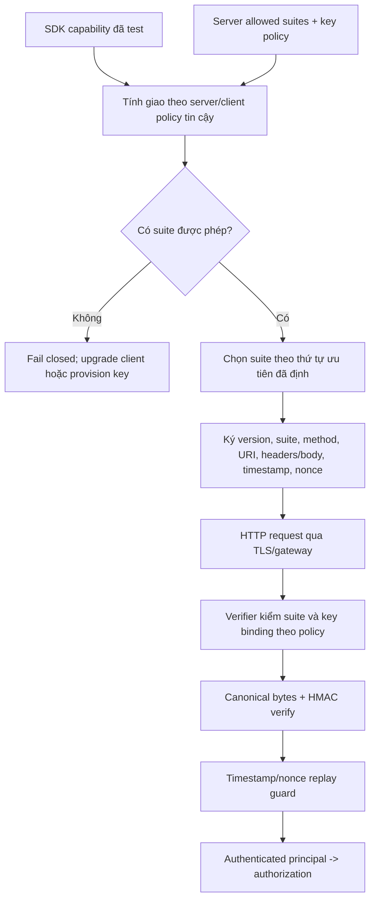
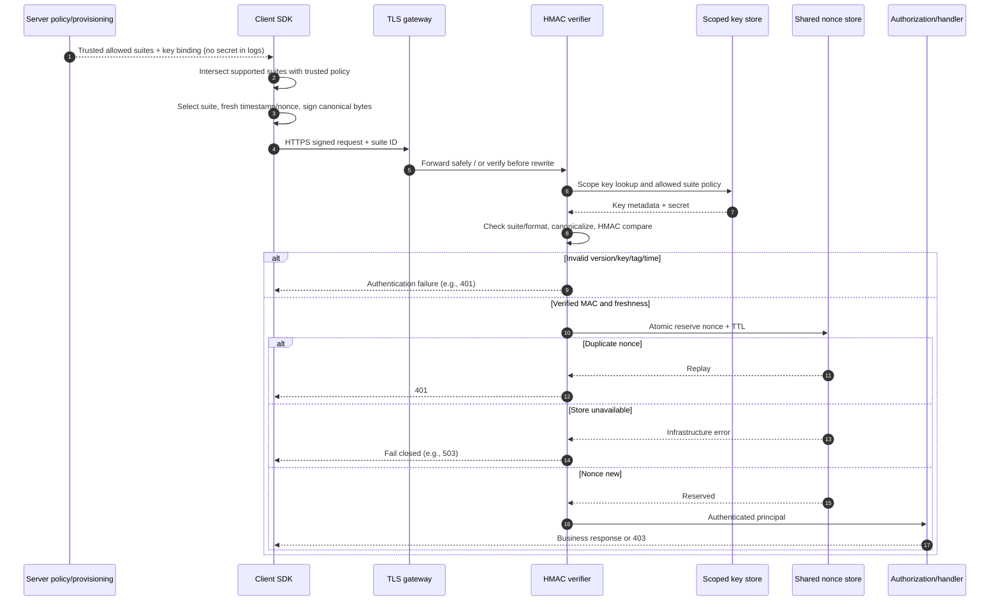

# Client capability trong Algorithm agility cho xác thực HTTP request bằng HMAC

## 1. Bối cảnh và mục tiêu

Trong chương **Algorithm agility**, bài **Client capability** giải thích cách client và server nhận biết những bộ thuật toán/chế độ ký mà mỗi phía **có thể triển khai**, lựa chọn một bộ phù hợp theo **chính sách của server**, rồi thay đổi bộ ký an toàn qua nhiều phiên bản mà không làm gián đoạn các client còn được hỗ trợ.

Đây là nội dung của mô-đun `SECURITY_AUTHENTICATION_HMAC_REQUEST_AUTHENTICATION`: xác thực HTTP request bằng **HMAC với shared secret**; xây dựng **canonical request** từ method, URI, header và/hoặc body; kiểm chữ ký, chống replay qua timestamp/nonce, quản lý key rotation, thử qua proxy/gateway và phân biệt **authentication** với **authorization**.

Một nhu cầu thường gặp: API ban đầu sử dụng HMAC-SHA256; sau đó nhóm phát triển muốn hỗ trợ thêm HMAC-SHA512, thay đổi quy tắc canonicalization, hoặc dừng một phiên bản cũ. Client Java, mobile SDK, đối tác và các máy chạy lâu có thể không nâng cấp cùng lúc. Nếu server chỉ đổi thuật toán mà không có hợp đồng tương thích, request hợp lệ bắt đầu nhận 401. Ngược lại, nếu server “thử mọi thuật toán/khóa đến khi khớp”, hệ thống có thể tạo **downgrade path**, parser ambiguity và chi phí xác minh không kiểm soát.

**Mục tiêu học tập:**

- Phân biệt **capability** (client thực hiện được gì), **preference** (client muốn gì), **server policy** (server cho phép gì) và **negotiated/selected suite** (request cụ thể thực tế dùng gì).
- Thiết kế một tập **suite ID có phiên bản**, ràng buộc thuật toán, định dạng tag, canonical request, secret/key scope và chính sách chấp nhận.
- Tìm cách công bố khả năng hỗ trợ qua tài liệu SDK, cấu hình/provisioning hoặc capability discovery mà không trao quyền lựa chọn bảo mật cho header chưa xác thực.
- Ngăn thuật toán `none`, SHA-1 yếu theo policy, “thử tất cả”, fallback âm thầm và signature confusion.
- Hiểu khi nào thay thuật toán cần **key rotation** riêng, khi nào cần version mới của canonical contract và cách chuyển dần theo từng client.
- Triển khai ví dụ Java/JCA kiểm suite theo allowlist, kiểm MAC theo byte, xử lý timestamp/nonce và tích hợp Spring Security.
- Viết contract tests, compatibility matrix, gateway tests, rollback/runbook và metrics không lộ shared secret.

Trong bài, **capability không đồng nghĩa bằng chứng danh tính**: header client tự khai “tôi hỗ trợ HMAC-SHA512” chưa chứng minh client biết key. Chỉ một chữ ký được xác minh với **đúng suite, đúng key, đúng thông điệp** mới cung cấp bằng chứng mật mã cho request.

## 2. Thuật ngữ: capability khác chính sách chấp nhận

Giả sử hệ thống có hai phiên bản:

- `HMAC-V1`: canonical contract V1 + HMAC-SHA256, tag đầy đủ 32 byte.
- `HMAC-V2`: canonical contract V2 + HMAC-SHA512, tag đầy đủ 64 byte.

Tên này chỉ là **quy ước minh họa của API**, không phải suite ID chuẩn do Java/Spring Security tự công bố. HMAC-SHA512 không tự động làm toàn bộ hệ thống an toàn hơn nếu secret yếu, ký thiếu trường hoặc nonce guard bị bỏ. Việc thay thuật toán phải dựa trên threat model và yêu cầu tương thích.

| Khái niệm | Do ai quyết định? | Ví dụ | Ý nghĩa bảo mật |
| --- | --- | --- | --- |
| Client capability | SDK/runtime và cấu hình client | `supports=["HMAC-V1","HMAC-V2"]` | Chỉ nói client **có thể** thực hiện, chưa nói request hiện tại dùng gì. |
| Client preference | Client trong phạm vi được phép | `preferred="HMAC-V2"` | Có thể giúp chọn phương án, nhưng không vượt server policy. |
| Server-supported suites | Server implementation và deployment | `implemented={"HMAC-V1","HMAC-V2"}` | Tập mã verifier có khả năng xử lý. |
| Server-allowed suites | Security policy theo API/client/key/time | `allowed={"HMAC-V2"}` sau mốc sunset | **Giới hạn bắt buộc**, không để client tự mở rộng. |
| Credential binding | Credential store tin cậy | Key `k-22` chỉ dùng `HMAC-V2` | Ngăn một key bị diễn giải dưới suite không hợp lệ. |
| Selected suite | Chỉ định rõ trên từng request | `X-Hmac-Version: HMAC-V2` | Phải được kiểm với policy và **được đưa vào dữ liệu ký**. |
| Deployment readiness | Trạng thái các backend/gateway/node | 100% verifier hỗ trợ V2 | Bảo đảm rollout không gây 401 ngẫu nhiên. |
| Authorization | Policy quyền sau authentication | `orders:write` | Không thể suy ra từ capability hay thuật toán mạnh hơn. |

Một bộ lựa chọn có thể được mô hình hóa:

```text
clientImplemented = {HMAC-V1, HMAC-V2}
serverAllowedForCredential = {HMAC-V2}
endpointAllowed = {HMAC-V2}
usable = intersection(clientImplemented,
                      serverAllowedForCredential,
                      endpointAllowed)

selected = HMAC-V2   # nếu nằm trong usable
```

Giao của các tập là phép tính cấu hình, **không phải một thủ tục thương lượng mật mã tự động an toàn**. Bất kỳ tập server-allowed nào cũng phải xuất phát từ cấu hình/credential state tin cậy, không từ một `X-Client-Capabilities` do bên chưa xác thực tự gửi.

## 3. Client capability bao gồm nhiều thứ hơn tên hash

Một client “hỗ trợ HMAC-SHA512” chưa chắc tương tác được với server V2. Capability phải phản ánh toàn bộ bộ quy tắc cần tương thích:

| Chiều capability | Câu hỏi cần trả lời | Hậu quả nếu bỏ qua |
| --- | --- | --- |
| HMAC algorithm | Java `HmacSHA256` hay `HmacSHA512`; crypto provider nào? | Client không tạo được MAC hoặc chọn sai thuật toán. |
| Secret/key representation | Key được cấp dưới dạng byte, UTF-8, Base64-decoded hay hex-decoded? | Cùng text cấu hình nhưng key bytes khác nhau. |
| Signature encoding | Tag 32/64 byte, Base64 chuẩn có padding hay hex? | Verifier reject hoặc giải mã nhập nhằng. |
| Canonical request version | Thứ tự dòng, LF cuối, URI percent encoding, signed header grammar? | MAC khác dù thuật toán đúng. |
| Body support | Raw body, `SHA-256(body)`, content-encoding identity, streaming/chunk signing? | Lỗi trên upload, JSON serializer, gzip. |
| Timestamp | UTC giây nguyên, milliseconds, độ lệch clock cho phép? | Request bị expired/future, replay window sai. |
| Nonce | Format, uniqueness, header vị trí, replay namespace? | Cửa sổ phát lại hoặc 401 do nonce collision. |
| TLS/gateway | Public URI/authority, header forwarding, điểm verify trước/sau rewrite? | Chữ ký chỉ đúng khi bỏ gateway. |
| Key lifecycle | Active/verify-only/revoked, key ID và thời gian hiệu lực? | Client chọn key hết hạn hoặc sai scope. |
| Platform support | JDK/provider, thiết bị cũ, firmware và rollout constraint? | Một nhóm client không thể lên V2 đúng hạn. |

Vì thế nên dùng **suite ID gắn với một contract có phiên bản** thay vì truyền một chuỗi thuật toán trần rồi hy vọng mọi thành phần hiểu giống nhau.

Ví dụ `HMAC-V2` có thể định nghĩa duy nhất: `HmacSHA512`, tag 64 byte Base64 chuẩn, canonical format 10 dòng không có LF cuối, timestamp UTC giây nguyên, nonce bắt buộc và body digest SHA-256 của byte body. Dùng SHA-256 để hash body trong một suite có HMAC-SHA512 **không phải lỗi kỹ thuật**, nhưng phải được định nghĩa và review riêng; không tùy tiện suy từ tên HMAC để chọn thuật toán hash body.

## 4. Từ capability đến selected suite mà không bị downgrade

### 4.1. Một quy trình chọn suite an toàn

Trong thiết kế minh họa:

1. SDK có danh sách capability **đã được build/test**, ví dụ hỗ trợ V1 và V2.
2. Client biết **chính sách tối thiểu** từ provisioning/cấu hình tin cậy: đối tác này tối thiểu V2 từ ngày cutover, không dùng V1 sau đó.
3. Server công bố hoặc provision các suite đang được phép dùng, có version/thời gian hiệu lực. Client kiểm **nguồn đáng tin và thời hạn** của metadata.
4. Client chọn suite mạnh nhất **trong giao của tập client-implemented và server-allowed**, theo quy tắc ưu tiên đã công bố.
5. Client lấy đúng key ID/secret dành cho suite, dựng canonical request đúng phiên bản, ký **version và suite identity** cùng các trường còn lại.
6. Server đọc suite ID như dữ liệu *chưa tin cậy*, kiểm allowlist theo endpoint/client/key và kiểm tag, timestamp, nonce. Chỉ khi toàn bộ PASS mới tạo authenticated principal.
7. Nếu không có suite giao nhau, client **fail closed / báo không tương thích**, không tự hạ xuống phiên bản cũ chưa được policy cho phép.



Thứ tự ưu tiên là phần của policy, không phải một phép so sánh chung “tag dài hơn luôn tốt hơn”. HMAC-SHA256 với key đủ entropy vẫn có thể đáp ứng policy hiện tại; HMAC-SHA512 có output dài hơn nhưng tăng kích thước tag và có thể ảnh hưởng performance/interoperability. Điều quan trọng là **lựa chọn có chủ đích và được cố định ở từng request**.

### 4.2. Client không được hạ cấp vì gặp 401

Một anti-pattern:

```text
Client sends HMAC-V2
Server returns 401 / timeout
Client retries HMAC-V1
Server accepts V1
```

Vấn đề: 401 có thể do MAC sai, timestamp, key revoked, nonce replay hoặc proxy; timeout có thể là hạ tầng. Nếu tự downgrade theo bất kỳ lỗi nào, client có thể bị dẫn dắt sang legacy suite khi server vẫn có thể xử lý V2.

**Quy tắc:** không đổi suite chỉ vì 401, 403, 429 hay 5xx. Khi có migration chính thức, client chỉ thay suite sau khi lấy được metadata chính sách từ nguồn đã được tin cậy, kiểm hạn sử dụng, version policy và mức bảo mật tối thiểu. Nếu một proxy hoặc bên thứ ba chỉnh giá trị `X-Hmac-Version`, MAC phải thất bại vì suite/version được ký.

### 4.3. Downgrade có thể xảy ra ngay cả khi version được ký

Việc ký suite ID ngăn sửa phiên bản của **một request đã ký** mà vẫn giữ tag hợp lệ. Nhưng nó **không tự cấm** client đang nắm shared secret tạo một request V1 mới nếu server vẫn cho phép V1. Do đó không thể ngăn downgrade chỉ bằng cách “đưa algorithm vào MAC”.

Cần cả ba lớp:

- **Integrity:** version/suite được ràng buộc trong canonical request.
- **Authorization of suite:** server policy theo credential/endpoint/client/time quy định suite nào còn được phép.
- **Client minimum policy:** client không tự dùng suite dưới mức cấu hình/provisioning tin cậy cho phép, ngay cả khi server hỗ trợ legacy cho client khác.

Một capability header chưa ký và chưa xác thực chỉ là input để chẩn đoán, **không** là lý do để server nới allowlist.

## 5. Nơi lưu và cách công bố capability

Không có một cơ chế chung bắt buộc cho mọi HMAC API. Tùy môi trường, có thể kết hợp:

### 5.1. Capability được build vào SDK

Một thư viện Java công bố danh sách suite nó đã kiểm thử (ví dụ `HMAC-V1` và `HMAC-V2`), kèm contract version và điều kiện tương thích JDK/crypto provider.

**Ưu điểm:** không cần network discovery tại mỗi request; dễ phân phối golden vectors và tối thiểu hóa parser ambiguity. **Giới hạn:** khả năng chạy thuật toán không đồng nghĩa client đã có key V2 hoặc server đang cho phép; cần phối hợp vòng đời credential.

### 5.2. Provisioning theo client/tenant

Khi tạo credential, server có thể cấp metadata:

```json
{
  "client_id": "partner-a",
  "credential_id": "key-v2-2026-12",
  "signature_suite": "HMAC-V2",
  "status": "ACTIVE",
  "not_before": "2026-12-01T00:00:00Z",
  "not_after": "2027-03-01T00:00:00Z"
}
```

Đây là **metadata minh họa**; **không** đặt secret vào response/log công khai. Secret phải được provision qua kênh bảo mật riêng, có kiểm soát truy cập và quy trình rotation. Các mốc thời gian chỉ làm ví dụ, không phản ánh môi trường thật.

Key binding theo suite làm cho verifier có thể từ chối request dùng sai algorithm **ngay cả khi client gửi một header chứa suite ID hợp lệ**. Nếu một key được phép dùng cả hai suite trong giai đoạn chuyển tiếp, khoảng cho phép đó phải nằm trong policy, có hạn và được giám sát.

### 5.3. Discovery endpoint được bảo vệ

Server có thể công bố một tài liệu chính sách không chứa secret:

```json
{
  "schema_version": 1,
  "policy_id": "partners-2026-12",
  "preferred_suite": "HMAC-V2",
  "accepted_suites": ["HMAC-V2", "HMAC-V1"],
  "sunset": {
    "HMAC-V1": "2027-02-01T00:00:00Z"
  },
  "expires_at": "2026-12-15T00:00:00Z"
}
```

Response này phải được lấy qua **TLS với kiểm chứng chứng chỉ/hostname**, đúng endpoint tin cậy. Khi metadata cần sử dụng offline, đi qua nhiều bên trung gian hoặc tồn tại lâu trong cache, có thể cần **chữ ký của server trên metadata** và chính sách chống rollback/replay riêng. Client không nên tin một response bị thay đổi từ một host tùy ý hoặc DNS/URL chưa xác thực.

**Thời điểm quan trọng:** discovery không nên nằm trên critical path của mỗi HTTP request; dùng cache có thời hạn và một kế hoạch refresh/expiry. Nhưng cache policy hết hạn cũng không được biến thành lý do dùng V1 không còn được phép. Khi không lấy được policy mới và policy cũ hết hiệu lực, **fail closed** hoặc dùng cấu hình tối thiểu tin cậy theo thiết kế rõ ràng; không lặng lẽ chuyển sang suite yếu hơn.

### 5.4. Không để client tự bổ nhiệm chính sách server

Một request có thể có header `X-Client-Capabilities: HMAC-V1,HMAC-V2`, nhưng nó **không phải** một bằng chứng xác thực. Nếu phải dùng để phục vụ telemetry/negotiation, hãy xem nó là dữ liệu không tin cậy, giới hạn chiều dài, grammar và số giá trị; không lấy nó làm nguồn cho `allowedSuites`. Tránh tạo các metric label từ nguyên chuỗi client tự gửi.

## 6. Thiết kế một signature contract có agility

Bài dùng **hai suite minh họa**:

| Thuộc tính | HMAC-V1 | HMAC-V2 |
| --- | --- | --- |
| JCA algorithm | `HmacSHA256` | `HmacSHA512` |
| Wire algorithm ID | `HMAC-SHA-256` | `HMAC-SHA-512` |
| Tag | 32 byte, Base64 chuẩn | 64 byte, Base64 chuẩn |
| Canonical version line | `HMAC-V1` | `HMAC-V2` |
| Content to sign | Method, raw target, authority, signed headers, body digest, timestamp/nonce | Cùng phạm vi dữ liệu trong demo, nhưng **version ID khác** để domain-separate. |
| Body digest | SHA-256(raw body bytes) lowercase hex | SHA-256(raw body bytes) lowercase hex |
| Timestamp | UTC giây nguyên | UTC giây nguyên |
| Nonce | Bắt buộc, ký cùng request | Bắt buộc, ký cùng request |
| Key | Scope tenant/client/key ID và policy riêng | Scope tenant/client/key ID và policy riêng |
| Server policy | Legacy trong thời hạn đã công bố | Preferred khi client/key đã sẵn sàng |

**Đây chỉ là cách minh họa sự thay đổi thuật toán.** Khi một V2 thật sự đổi thêm cách canonicalize, spec phải ghi đầy đủ và có golden vectors khác. Việc V1/V2 cùng cấu trúc dòng nhưng khác version/algorithm không biến chúng thành cùng một hợp đồng.

### 6.1. HTTP request ví dụ

```http
POST /api/v1/orders?source=partner HTTP/1.1
Host: api.example.test
Content-Type: application/json
X-Hmac-Version: HMAC-V2
X-Hmac-Algorithm: HMAC-SHA-512
X-Client-Id: partner-a
X-Key-Id: key-v2-2026-12
X-Timestamp: 2026-12-02T03:00:00Z
X-Nonce: d53291e2-804c-4f68-a0d8-a2f5a40914bc
X-Signature: <Base64 tag 64 byte>

{"orderId":"O-100","amount":1000}
```

Đoạn này là request fixture; nội dung `<Base64 ...>` là placeholder, không phải chữ ký đã được tính. Trong production phải cấp signature có thể kiểm, dùng secret test khi tạo golden vector.

### 6.2. Canonical bytes minh họa

V2 có **11 dòng**, nối bằng LF `0x0A`, **không có LF cuối**:

```text
HMAC-V2
algorithm:HMAC-SHA-512
POST
/api/v1/orders?source=partner
authority:api.example.test
content-type:application/json
x-client-id:partner-a
x-key-id:key-v2-2026-12
x-timestamp:2026-12-02T03:00:00Z
x-nonce:d53291e2-804c-4f68-a0d8-a2f5a40914bc
body-sha256:<lowercase 64-char hex SHA-256 of exact body bytes>
```

V1 có cùng số dòng và thứ tự trong ví dụ demo nhưng dùng `HMAC-V1` và `algorithm:HMAC-SHA-256`, cùng tag 32 byte.

- `X-Hmac-Version` phải **khớp** dòng version và được server map thành suite allowlist.
- `X-Hmac-Algorithm` phải **khớp** ID thuật toán thuộc suite. Client không được yêu cầu `HMAC-V2` nhưng gửi `HMAC-SHA-256`.
- Method là ASCII uppercase và request-target lấy theo **public target đã được hợp đồng xác định**. Không tự sort query hoặc decode/encode ngoài contract.
- `authority` dùng public authority từ điểm tin cậy; khi proxy rewrite Host hoặc prefix, cần rõ verifier làm việc tại gateway trước rewrite hay backend dùng metadata đã được bảo vệ.
- Signed header names là lowercase ASCII cố định và giá trị đúng grammar. Reject header trùng/CRLF/sai format; không chấp nhận parser khác nhau ở mỗi hop.
- Body digest là SHA-256 của **byte HTTP entity sẽ được gửi**, không phải hash của object JSON được serialize lần khác. Nếu content-encoding có thể thay byte, hợp đồng phải quy định rõ; demo dùng identity encoding.
- Base64 là định dạng wire **duy nhất**; decode phải từ chối variant/whitespace và kiểm tag length đúng suite.
- Client ID, key ID, timestamp, nonce và version đều nằm trong MAC; signature header **không** ký chính nó.

**Vì sao ký cả version lẫn algorithm ID?** Để ràng buộc ý nghĩa các byte được xác minh với đúng suite. Tuy nhiên, đó chỉ là bảo vệ tính toàn vẹn của **request đã ký**, không thay thế server policy cấm V1 sau sunset.

### 6.3. Chọn key theo suite

Việc tra credential thường cần `X-Client-Id` và `X-Key-Id` trước khi MAC được chứng minh. Khi đó chúng là **lookup hints chưa đáng tin**, không tạo principal hay authority. Server phải:

1. Giới hạn format/length, từ chối key ID/header trùng hoặc giá trị có CR/LF.
2. Tra trong phạm vi client/tenant được cấu hình, không dùng key ID toàn cục để lấy secret của tenant khác.
3. Kiểm trạng thái credential và allowed suites **từ server-side record**.
4. Dựng canonical bytes trên đúng version/algorithm yêu cầu và dữ liệu HTTP theo contract.
5. So sánh MAC bằng primitive thích hợp, kiểm timestamp và reserve nonce nguyên tử.
6. Chỉ sau đó thiết lập authenticated principal để authorization.

Nếu key bị revoke, dù client dùng suite được hỗ trợ và tính MAC đúng, request vẫn phải bị từ chối. Key rotation và algorithm migration là **hai lifecycle độc lập** nhưng cần phối hợp.

## 7. Vị trí client capability trong luồng xác thực



Đây là sơ đồ về **quyền quyết định chính sách**: client biết capability, nhưng server không tin capability chưa được chứng minh để cấp quyền. Nếu proxy/gateway xác minh HMAC ở edge, các bước key/replay có thể nằm ở gateway; backend chỉ tin assertion danh tính khi gateway được xác thực riêng và đường direct-backend bypass bị chặn.

## 8. Java: biểu diễn suite bằng kiểu dữ liệu cố định

Java JCA dùng tên thuật toán như `HmacSHA256`/`HmacSHA512`. Trên wire, API có thể chọn ID khác cho phù hợp hợp đồng; phải có **mapping một-một rõ ràng**.

```java
import java.util.Arrays;

enum HmacSuite {
    V1("HMAC-V1", "HMAC-SHA-256", "HmacSHA256", 32),
    V2("HMAC-V2", "HMAC-SHA-512", "HmacSHA512", 64);

    final String version;
    final String wireAlgorithm;
    final String jcaAlgorithm;
    final int tagLength;

    HmacSuite(String version,
              String wireAlgorithm,
              String jcaAlgorithm,
              int tagLength) {
        this.version = version;
        this.wireAlgorithm = wireAlgorithm;
        this.jcaAlgorithm = jcaAlgorithm;
        this.tagLength = tagLength;
    }

    static HmacSuite parseExact(String version, String algorithm) {
        return Arrays.stream(values())
            .filter(s -> s.version.equals(version)
                      && s.wireAlgorithm.equals(algorithm))
            .findFirst()
            .orElseThrow(() ->
                new IllegalArgumentException("Unsupported HMAC suite"));
    }
}
```

**Điểm cần chú ý:**

- Không dùng `Mac.getInstance(headerValue)` với chuỗi thuật toán bất kỳ đến từ HTTP. Chỉ dùng tên JCA **hard-coded** từ enum allowlist.
- Không có phần tử `NONE`, `NULL`, raw `SHA-1` hoặc chấp nhận đồng nghĩa không được công bố. Mọi thay đổi suite cần review security policy và golden vectors.
- `tagLength` phải được kiểm theo suite. Không thử Base64 URL-safe/hex nếu protocol chỉ cho phép Base64 chuẩn.
- `HMAC-V1` và `HMAC-V2` được map từ **cả version và algorithm**; không cho gửi version V2 nhưng thuật toán V1.
- Không quyết định `allowedSuites` chỉ từ enum này: đây là tập được implementation hỗ trợ, còn permission của credential/endpoint được lấy từ server policy.

Một client SDK có thể khai báo khả năng hỗ trợ tĩnh:

```java
import java.util.EnumSet;
import java.util.Set;

final class ClientCapabilities {
    static Set<HmacSuite> supportedByThisSdk() {
        return Set.copyOf(EnumSet.of(
            HmacSuite.V1, HmacSuite.V2));
    }
}
```

Đối với platform cũ hoặc môi trường bị hạn chế crypto provider, **phải kiểm thật** khả năng khởi tạo `Mac` và chạy known-answer vectors khi build/release SDK; enum có V2 không đảm bảo runtime thật hỗ trợ nó. Nếu không hỗ trợ, loại suite khỏi capability thay vì chờ request production thất bại.

## 9. Java: chọn suite theo chính sách đáng tin cậy

Ví dụ chỉ mô tả bước **client chọn suite** trước khi ký. `ServerPolicy` ở đây là dữ liệu đã được lấy qua nguồn tin cậy, kiểm hạn, và được gắn với đúng API/client, **không phải** `X-Client-Capabilities` từ một request lạ.

```java
import java.util.List;
import java.util.Set;

record ServerPolicy(
    Set<HmacSuite> allowedForClient,
    HmacSuite preferred,
    boolean metadataTrusted,
    boolean notExpired) {}

final class SuiteSelector {

    HmacSuite select(
            Set<HmacSuite> clientImplemented,
            ServerPolicy policy) {

        if (!policy.metadataTrusted() || !policy.notExpired()) {
            throw new IllegalStateException(
                "Trusted HMAC policy unavailable");
        }

        if (clientImplemented.contains(policy.preferred())
                && policy.allowedForClient().contains(
                    policy.preferred())) {
            return policy.preferred();
        }

        // Không tự chọn legacy suite khi preferred không có.
        // Nếu phép chuyển đổi được policy cho phép, cần một
        // rule rõ ràng khác và minimum suite đã provision.
        throw new IllegalStateException(
            "No approved compatible HMAC suite");
    }
}
```

Mẫu cố ý **không fallback** sang phần tử đầu tiên trong `allowedForClient`. Với môi trường cần hỗ trợ client V1 trong cửa sổ chuyển tiếp, provisioning có thể quy định **preferredPerClient=V1** cho client đó, hoặc có một ordered allowlist cùng mức bảo mật tối thiểu rõ ràng. Không cài đặt “nếu V2 401 thì cứ thử V1” vào SDK.

### 9.1. Capability mismatch không phải lỗi chữ ký

Nếu client chỉ có `HMAC-V1` nhưng policy bắt buộc V2, việc không thể tạo request là một **lỗi tương thích/cấu hình client-side**. Không nên phát một request V1 “cho server quyết định” nếu client minimum policy đã cấm nó.

Nếu client đã gửi V2 và server trả 401, đó là **authentication failure**, có thể do timestamp, key, MAC hoặc nonce; không được tự coi là “server không hỗ trợ V2” rồi downgrade.

## 10. Java: xác minh chữ ký theo suite và key binding

Code sau tập trung vào phần **chọn thuật toán từ allowlist, kiểm key binding và so sánh MAC**. Nó là lõi minh họa, không phải một HMAC filter hoàn chỉnh: validation format HTTP, canonicalization, key lookup, timestamp, nonce, exception mapping và authorization còn cần thực hiện ở các thành phần tương ứng.

```java
import java.nio.charset.StandardCharsets;
import java.security.GeneralSecurityException;
import java.security.MessageDigest;
import java.util.Base64;
import java.util.Set;
import javax.crypto.Mac;
import javax.crypto.spec.SecretKeySpec;

record VerificationKey(
    byte[] secretBytes,
    Set<HmacSuite> allowedSuites,
    boolean activeOrVerifyOnly) {}

final class HmacSuiteVerifier {

    boolean matches(
            String declaredVersion,
            String declaredAlgorithm,
            byte[] canonicalBytes,
            String signatureBase64,
            VerificationKey key)
            throws GeneralSecurityException {

        HmacSuite suite = HmacSuite.parseExact(
            declaredVersion, declaredAlgorithm);

        // Policy do server giữ, không từ HTTP capability header.
        if (!key.activeOrVerifyOnly()
                || !key.allowedSuites().contains(suite)) {
            return false;
        }

        // Trong implementation hoàn chỉnh, canonicalBytes
        // phải được xây từ chính version, algorithm, method,
        // URI, signed headers/body, timestamp và nonce,
        // theo đúng grammar của suite (không phải byte
        // do client gửi sẵn làm dữ liệu tin cậy).
        byte[] receivedTag;
        try {
            receivedTag = Base64.getDecoder()
                .decode(signatureBase64);
        } catch (IllegalArgumentException ex) {
            return false;
        }

        if (receivedTag.length != suite.tagLength) {
            return false;
        }

        Mac mac = Mac.getInstance(suite.jcaAlgorithm);
        mac.init(new SecretKeySpec(
            key.secretBytes(), suite.jcaAlgorithm));

        byte[] expectedTag = mac.doFinal(canonicalBytes);

        return MessageDigest.isEqual(
            expectedTag, receivedTag);
    }
}
```

**Các ràng buộc khi tích hợp:**

- Hàm `matches` không tự xác nhận `canonicalBytes` đúng hợp đồng. **Caller tin cậy** phải tạo canonical bytes từ HTTP request đã kiểm grammar và đưa **suite/version đã khai** vào bytes đó; test positive/negative bắt buộc xác minh điều này.
- `VerificationKey` không chứa principal/authority cho tới khi tag đã được xác minh. Nếu record secret là byte array mutable, production nên dùng secret container/lifecycle thích hợp; không tự in record bằng `toString()` hoặc log `secretBytes`.
- Khóa phải được tra theo client/tenant/key ID server-side. Header clientId/keyId chưa kiểm MAC chỉ là lookup hint, không cấp authority.
- Sau MAC match vẫn cần freshness, nonce atomic reserve trên shared store, key state/time policy và authorization. Việc check `activeOrVerifyOnly` trong mẫu **không thay thế** các cửa sổ hiệu lực và revoke metadata thật.
- Parser strict phải giới hạn độ dài header/tag và đảm bảo Base64 **đúng wire grammar** (ví dụ padding bắt buộc nếu đã quy định). `Base64.getDecoder()` không tự thực thi toàn bộ yêu cầu padding/canonical representation do API đặt ra; kiểm regex/round-trip chuẩn hóa hoặc parser phù hợp trước decode.
- Dùng `Mac` riêng cho mỗi phép tính hoặc lifecycle concurrency-safe; không dùng một `static Mac` chung nhiều request. Secret rotation không được để một cache `Mac` giữ khóa cũ vô hạn.
- `MessageDigest.isEqual` thích hợp để so sánh byte tag nhưng không tự bảo đảm toàn bộ đường xử lý có thời gian tuyệt đối giống nhau. Tránh rò rỉ qua response riêng biệt cho key tồn tại/không tồn tại, giới hạn input và rate limit.

### 10.1. Ràng buộc thuật toán trong canonical bytes

Một cách dựng canonical bytes V2 ở lớp tin cậy:

```java
String canonical = String.join("\n",
    "HMAC-V2",
    "algorithm:HMAC-SHA-512",
    "POST",
    "/api/v1/orders?source=partner",
    "authority:api.example.test",
    "content-type:application/json",
    "x-client-id:partner-a",
    "x-key-id:key-v2-2026-12",
    "x-timestamp:2026-12-02T03:00:00Z",
    "x-nonce:d53291e2-804c-4f68-a0d8-a2f5a40914bc",
    "body-sha256:" + bodySha256Hex);

byte[] canonicalBytes =
    canonical.getBytes(StandardCharsets.UTF_8);
```

`bodySha256Hex` cần được tính từ **exact raw HTTP body bytes** theo hợp đồng và phải là 64 ký tự hex lowercase. Đây là demo với giá trị cố định; production **không** hard-code method, URI, header hay timestamp của request thật. `String.join` không thêm LF cuối nên kết quả đúng quy tắc V2 trong bài.

Test nên so **toàn bộ canonical bytes** ở dạng hex và HMAC tag với golden vectors được tạo **độc lập**, không chỉ kiểm status 200 khi signer và verifier cùng gọi một phương thức canonicalization.

## 11. Spring Security: capability không được cấp principal

Trong Spring Security MVC, custom filter/provider có thể xử lý flow:

```text
Header/size/format validation
  -> suite lookup and server-side allowlist
  -> scoped credential/key lookup
  -> canonical request on trusted bytes
  -> HMAC compare
  -> timestamp / nonce / replay guard
  -> create authenticated Authentication
  -> AuthorizationFilter / method authorization
  -> controller
```

Một header `X-Hmac-Algorithm: HMAC-SHA-512` **không phải authority** như `ROLE_ADMIN`. Sau khi MAC hợp lệ, hệ thống lấy quyền từ credential/principal store phía server; không gán quyền cao hơn chỉ vì client dùng suite mới.

Với Spring MVC/Servlet, vị trí `OncePerRequestFilter` và `ExceptionTranslationFilter` ảnh hưởng cách xử lý `AuthenticationException`. Nếu custom filter ném lỗi bên ngoài vùng filter được `ExceptionTranslationFilter` bao quanh, cần failure handler/`AuthenticationEntryPoint` thích hợp. Tránh đăng ký cùng HMAC filter cả ở Servlet container và `SecurityFilterChain` làm verify hai lần, gây lỗi nonce replay.

Với Spring WebFlux, dùng `AuthenticationWebFilter`/`ReactiveAuthenticationManager` hoặc `WebFilter` có thiết kế phù hợp, gắn danh tính vào `ReactiveSecurityContextHolder`/Reactor Context; không dùng ThreadLocal Servlet `SecurityContextHolder` làm nguồn danh tính trong pipeline reactive. Nếu canonical request ký body, xử lý `Flux<DataBuffer>` có giới hạn, replay/decorate cho handler, không `block()` trên event loop và quản lý pooled buffers khi cancel/error.

### Lỗi HTTP khi client không tương thích

| Tình huống | Tầng xử lý | Response mẫu |
| --- | --- | --- |
| Version/algorithm không được triển khai hoặc không được policy chấp nhận | Authentication verifier | 401 theo scheme HMAC minh họa; có thể 400 nếu API đặc tả malformed version như request syntax error. |
| Key không được phép dùng suite đã khai | Authentication | 401, không tiết lộ key existence/allowed-suite state chi tiết. |
| MAC mismatch hoặc malformed tag | Authentication | 401 (hoặc syntax response đã định) và không cấp principal. |
| Timestamp expired/future, nonce replay | Authentication | 401 và handler không chạy. |
| Replay/credential store không sẵn sàng | Security infrastructure | Fail closed; có thể 503 theo API contract. |
| HMAC hợp lệ, principal thiếu quyền endpoint | Authorization | 403 Forbidden. |
| Client chỉ hỗ trợ V1 nhưng cấu hình đòi V2 | Trước khi gửi request | Fail local/config error; không tự downgrade. |

HTTP 401 có semantics về challenge (`WWW-Authenticate`) theo HTTP authentication. Nếu API chỉ dùng các header `X-*` custom, cần công bố cơ chế authentication/challenge phù hợp và không tùy ý tuyên bố một scheme chuẩn chưa được định nghĩa. **Không phân biệt key ID tồn tại và không tồn tại trong public error** chỉ để giúp client chọn suite.

## 12. Migration từ V1 sang V2 theo hai giai đoạn policy

Một cách rollout an toàn có thể dùng **suite pinning** và **credential versioning** để tránh ảnh hưởng mọi client cùng lúc.

### Pha A — Chuẩn bị tương thích

- Định nghĩa V2 chính xác: canonical bytes, tag length, JCA algorithm, encoding, timestamp/nonce, credential binding.
- Tạo golden vectors V1 và V2 từ hai implementation độc lập.
- Triển khai verifier hỗ trợ V2 ở **tất cả** gateway/backend được phép verify, nhưng **chưa** yêu cầu client chuyển ngay.
- Provision key/credential V2 và chính sách preferred theo từng client; không cấp secret sản xuất qua log hoặc tài liệu công khai.
- Kiểm Spring MVC/WebFlux/security chain, proxy TLS/Host/URI rewrite, multi-node nonce store và error semantics.
- Công bố timeline cho SDK/đối tác: thời gian hỗ trợ V1, thời điểm chuyển preferred, thời điểm dừng nhận V1.

### Pha B — Chuyển dần và chốt chính sách

- Chuyển một nhóm client có V2 capability, với key binding và client minimum policy phù hợp.
- Theo dõi tỷ lệ V1/V2, lỗi key/suite/timestamp, signature mismatch, replay, 401/403 và latency; không dùng raw client ID hoặc key ID làm metric labels có cardinality lớn.
- Nếu lỗi V2 tăng, phân tích signer/canonicalization/proxy/key state bằng test vectors. **Không** tự hạ cấp request về V1 sau 401.
- Khi đủ bằng chứng tương thích, nâng `minimum suite` của nhóm khách hàng đó lên V2 trong server policy, khóa V1 cho đúng client/credential.
- Sau thời hạn chuyển tiếp đã công bố, ngừng chấp nhận V1 ở phạm vi liên quan và thu hồi key V1 theo credential lifecycle.
- Giữ khả năng rollback **trong ranh giới an toàn**: rollback software không được vô tình mở lại một suite/key đã cấm vì sự cố bảo mật.

Một kế hoạch migration không chỉ ghi “server hỗ trợ cả V1/V2”. Nó phải mô tả **ai được dùng suite nào, đến khi nào, qua đường xác minh nào**, và khi nào policy thay đổi.

### 12.1. Version của thuật toán khác version của key

| Sự kiện | Thay gì? | Có bắt buộc đổi canonical contract? |
| --- | --- | --- |
| Rotate shared secret HMAC-SHA256 | Secret bytes, key ID, key state | Không, nếu signature protocol vẫn là V1. |
| Chuyển `HmacSHA256` sang `HmacSHA512` | Thuật toán/tag length/suite | Cần suite ID và contract/version được mô tả rõ; demo dùng V2. |
| Thay thứ tự signed headers | Canonical bytes | Có, thường phải version hóa contract. |
| Thay cách hash body từ raw bytes sang normalized JSON | Input ký | Có, cần threat model và vectors mới. |
| Thay thời hạn timestamp/replay TTL | Freshness/security policy | Cần review và contract tests; không nhất thiết đổi thuật toán. |
| Thu hồi key do lộ trong log | Credential state | Không cần đổi thuật toán, nhưng phải revoke nhanh và kiểm cache. |

Nếu bắt buộc vừa rotate key vừa đổi suite, cần thiết kế matrix test cho cả hai biến. Nếu mọi thứ thay cùng một lần, rất khó biết request 401 do secret sai, chưa hỗ trợ suite, hay canonical mismatch.

## 13. Chống downgrade trong nhiều điểm kiểm HMAC

Một hệ thống có thể xác minh HMAC ở gateway, backend hoặc cả hai. Rủi ro:

- Gateway mới yêu cầu V2 nhưng backend cũ vẫn chấp nhận V1 qua **đường direct-backend** không bị chặn.
- Backend A đã từ chối V1 nhưng backend B trong rolling deployment vẫn chấp nhận, dẫn đến policy không nhất quán.
- Gateway strip `X-Hmac-Version` rồi backend mặc định “nếu thiếu version thì V1”; attacker lợi dụng fallback.
- Proxy sửa `Host`/URI hoặc signed headers khiến V2 thất bại; nhóm vận hành bật lại V1 vĩnh viễn để giảm 401.
- Client tự gửi `X-Authenticated-Client` và backend tin nó như assertion do gateway đã verify.

Giải pháp:

1. **Một policy authoritative** theo endpoint/client/key, được triển khai đồng nhất tới mọi điểm verify.
2. **Không có mặc định legacy** khi thiếu version/algorithm; malformed hoặc unsupported suite bị từ chối theo contract.
3. Nếu gateway verify trước rewrite, backend chỉ tin assertion được bảo vệ qua mTLS/service authentication; từ chối direct bypass hoặc vẫn kiểm một cơ chế độc lập.
4. Version/suite được ký. Forwarding metadata do proxy tạo phải được strip/overwrite ở edge và xác thực nguồn.
5. Chạy integration test qua gateway thực, theo từng suite và đường routing, không chỉ `MockMvc` trực tiếp backend.
6. Xác nhận nonce shared store và key state được áp dụng nhất quán cả khi V1/V2 đồng tồn tại.

**TLS termination không thay HMAC:** HTTPS mã hóa đường truyền, nhưng không quyết định suite, phạm vi canonical bytes hoặc cấp authority. Proxy sau TLS termination có thể thấy plaintext HTTP, nên logging/tracing cũng phải che signature, secret, nonce và body.

## 14. Test khả năng hỗ trợ của client: đừng chỉ kiểm Java enum

Để tuyên bố SDK hỗ trợ `HMAC-V2`, cần **chứng minh bằng test** ở runtime mục tiêu:

- `Mac.getInstance("HmacSHA512")` có provider khả dụng.
- HMAC primitive trả expected tag trong known-answer test độc lập.
- Signer V2 tạo đúng canonical bytes và tag Base64 theo golden vectors.
- Ký body UTF-8, body rỗng và signed header/URI với percent encoding đúng.
- Tag dài đúng 64 byte sau decode; V1 tag 32 byte; không chấp nhận ký thiếu/mở rộng tag ngoài contract.
- Timestamp/nonce generation đúng grammar, uniqueness khi đa luồng và nhiều device instance.
- Key provenance/encoding được xử lý đúng theo provisioning, không lấy key V1 để mặc định ký V2 khi policy không cho phép.
- Không tự fallback về V1 do timeout/401/5xx.
- Nếu capability discovery có cache, phải kiểm policy expiry, trusted origin và hành vi khi mất mạng.
- Khi SDK nâng cấp, các client còn giữ V1 trong thời hạn hỗ trợ vẫn tạo request V1 đúng.

Một ví dụ test primitive trong Java:

```java
import static org.junit.jupiter.api.Assertions.assertEquals;
import java.nio.charset.StandardCharsets;
import java.util.Arrays;
import java.util.HexFormat;
import javax.crypto.Mac;
import javax.crypto.spec.SecretKeySpec;
import org.junit.jupiter.api.Test;

class HmacClientCapabilityTest {
    @Test
    void hmacSha256PrimitiveKnownAnswer() throws Exception {
        byte[] key = new byte[20];
        Arrays.fill(key, (byte) 0x0b);

        Mac mac = Mac.getInstance("HmacSHA256");
        mac.init(new SecretKeySpec(key, "HmacSHA256"));

        byte[] actual = mac.doFinal(
            "Hi There".getBytes(StandardCharsets.US_ASCII));

        assertEquals(
            "b0344c61d8db38535ca8afceaf0bf12b" +
            "881dc200c9833da726e9376c2e32cff7",
            HexFormat.of().formatHex(actual));
    }
}
```

Vector này kiểm **primitive HMAC-SHA256**, không phải V2; để chứng minh V2 cần thêm vector HMAC-SHA512 đã đối chiếu độc lập và test đầy đủ request canonical V2. Một suite chỉ “có Mac provider” mà không pass full integration không nên được công bố là supported.

### 14.1. Ma trận client/server contract tests

| Client capability | Client selected suite | Server policy/key | Expected |
| --- | --- | --- | --- |
| Chỉ V1 | V1 | V1 còn được cho phép, key V1 active | Pass nếu MAC/time/nonce/quyền hợp lệ. |
| V1 + V2 | V2 | V2 allowed, key V2 active | Pass. |
| V1 + V2 | V1 | Minimum suite của client đã là V2 | Reject dù MAC V1 hợp lệ. |
| Chỉ V1 | Không chọn được | V2-only | Fail local theo policy tin cậy; không gửi request legacy. |
| V1 + V2 | V2 | Key chỉ bind V1 | Reject, không tính MAC bằng key tùy tiện. |
| V1 + V2 | V2 | Version V2 + algorithm header SHA256 | Reject vì suite mismatch. |
| V1 + V2 | V2 | Signature Base64 giải mã 32 byte | Reject sai tag length V2. |
| V1 + V2 | V2 | Key bị revoke | Reject dù tag tính đúng. |
| V1 + V2 | V2 | Key scope tenant khác | Reject; không cấp principal từ header. |
| V1 + V2 | V2 | Timestamp quá hạn nhưng MAC đúng | Reject do freshness. |
| V1 + V2 | V2 | Nonce đã được dùng | Reject replay; không có side effect. |
| V1 + V2 | V2 | Replay store lỗi | Fail closed; infrastructure error. |
| V1 + V2 | V2 | MAC đúng, thiếu quyền `orders:write` | 403 authorization, không phải signature failure. |
| V1 + V2 | V2 | Proxy rewrite signed URI/body | Theo verify point/contract; không tự bỏ trường ký. |
| V1 + V2 | V2 | Unsupported algorithm `none` hoặc `HMAC-SHA-1` | Reject; không fallback/downgrade. |
| V1 + V2 | V2 | Server A có V2, server B chỉ V1 | Release blocker cho V2 rollout; phải đồng nhất readiness. |

Khi test authenticated success trên hai node có replay store chung, cần dùng **nonce mới riêng cho từng positive request**; nếu gửi lại cùng signed request qua node B, 401 có thể là replay protection **đúng**, không phải failure của capability.

## 15. Negative tests chống thuật toán bị nhầm lẫn

Không chỉ thử happy path. Những test dưới đây khóa các đường bypass nguy hiểm:

1. **Missing algorithm:** bỏ `X-Hmac-Algorithm`; không mặc định V1, không tự đoán theo tag length.
2. **Unknown algorithm:** `HMAC-SHA-999`, `none`, giá trị chứa CR/LF hoặc quá dài; từ chối ở parser allowlist.
3. **Mismatch version/algorithm:** `HMAC-V2` cùng `HMAC-SHA-256`; từ chối trước khi cấp principal.
4. **Header mutation:** ký V2, đổi `X-Hmac-Version` thành V1 nhưng giữ tag; phải từ chối.
5. **Duplicate algorithm header:** hai `X-Hmac-Algorithm` khác nhau; không chọn “giá trị đầu” hay “giá trị cuối”.
6. **Truncated MAC:** V2 tag chỉ còn 16/32 byte; không chấp nhận như một suite mới không được công bố.
7. **Key confusion:** cùng key ID text ở hai tenant; không lấy secret tenant B khi request claim tenant A.
8. **Key bound to V2 only:** gửi V1 MAC tính với cùng key bytes; policy vẫn từ chối.
9. **Removed signed body:** ký body A rồi gửi body B; request không được pass chỉ vì có suite V2.
10. **Legacy policy sunset:** V1 request có MAC đúng nhưng ở ngoài giai đoạn hỗ trợ phải bị từ chối.
11. **Discovery rollback:** client đã pin tối thiểu V2, nhận metadata cũ đề xuất V1; không downgrade.
12. **Retry after 401:** client không tự gửi lại bằng suite cũ; nếu retry cùng nghiệp vụ cần ký lại trên timestamp/nonce mới theo đúng suite và idempotency policy.
13. **Gateway rewrite:** public URI/authority thay đổi; test V1/V2 qua edge, không dùng untrusted forwarding header.
14. **Concurrent replay:** hai request y hệt qua hai verifier; nhiều nhất một nonce reservation hợp lệ.
15. **Untrusted identity header:** client tự thêm `X-Authenticated-Client`, backend không bypass HMAC.
16. **Authorization:** MAC hợp lệ nhưng thiếu authority trả 403, không lẫn với algorithm unsupported.

### 15.1. Test gateway phải có signer độc lập

Nếu signer test và backend đều dùng chung một canonicalizer lỗi, test trả 200 vẫn có thể “xanh giả”. Nên dùng golden vectors đã được review/đối chiếu bởi triển khai độc lập, gửi request với **exact raw body bytes** qua TLS gateway thực, kiểm cả target/public authority, percent-encoding, duplicate signed headers và biến đổi body.

### 15.2. Không lạm dụng HTTP 401 làm oracle

Một request bị từ chối 401 không chứng minh nguyên nhân là algorithm policy; nó có thể do signature lỗi, timestamp expired, key revoked hoặc nonce đã dùng. Khi kiểm thử internal contract, dùng **reason enum/test probe** bên trong để xác định đúng bước fail; response công khai vẫn nên tránh tiết lộ trạng thái key/suite nhạy cảm.

## 16. Performance và chi phí algorithm agility

Mở nhiều bộ thuật toán có thể ảnh hưởng hiệu năng:

| Nguồn chi phí | Rủi ro | Cách quản lý |
| --- | --- | --- |
| Tag HMAC-SHA512 dài hơn HMAC-SHA256 | Tăng kích thước header, decode và truyền mạng một lượng nhỏ. | Đo với workload thật; không tự cắt tag để giảm byte. |
| Thử nhiều algorithm trên mỗi request | CPU tăng tuyến tính theo số suite, dễ bị abuse. | Chọn **một** suite từ allowlist rồi verify đúng một lần. |
| Version-dependent canonicalization | Nhiều nhánh parsing, nguy cơ divergence và allocation. | Spec/version rõ, golden vectors, giữ số suite được hỗ trợ hữu hạn. |
| Credential lookup theo client/key/suite | Cache miss, DB/KMS latency, nguy cơ enumeration. | Bounded cache theo scope, revocation consistency, rate limits. |
| Body hash/buffering | CPU, heap/direct memory, GC với body lớn. | Body-size limits, streaming/spool theo contract và đo allocation. |
| Nonce store theo key/suite | Network RTT, số key Redis tăng trong migration. | Shared atomic store, TTL đủ thời gian, capacity planning. |
| Capability discovery | Network/refresh/cache TTL. | Không discovery trên mỗi request; dùng trusted cache và expiry. |
| Multi-version observability | Nhiều label/timeseries nếu gắn client ID. | Version/algorithm là tập hữu hạn; không dùng key/nonce/signature. |

HMAC-SHA512 không bảo đảm nhanh hoặc chậm hơn HMAC-SHA256 trên mọi CPU/JDK/provider. Nếu cần lựa chọn vì performance, dùng JMH cho primitive và HTTP load test qua gateway, key cache, body hash và nonce store. Không so chỉ `Mac.doFinal()` rồi suy ra toàn API.

Thay suite cũng không phải lý do bỏ nonce. Nếu shared replay store timeout, API cần chống replay phải **fail closed**; tăng throughput bằng cách tắt replay làm sai điều kiện an toàn.

## 17. Quan sát migration mà không ghi secret

Metric và log an toàn nên giúp trả lời:

- Những suite/version nào đang được sử dụng và tỷ lệ còn lại của V1 trước sunset?
- Bao nhiêu request từ chối vì `UNSUPPORTED_SUITE` hoặc `KEY_SUITE_MISMATCH`, phân biệt với `SIGNATURE_INVALID`?
- Tỷ lệ `TIMESTAMP_INVALID`, `NONCE_REPLAY`, `REPLAY_STORE_UNAVAILABLE`, 401/403 có tăng sau cutover không?
- Mismatch có tập trung ở một route hoặc điểm verify (gateway/backend) không?
- Độ trễ authentication theo suite có khác biệt sau nâng cấp không?

Ví dụ counters minh họa:

```text
hmac_auth_requests_total{suite="HMAC-V2",route="orders_create",outcome="accepted"} 3500
hmac_auth_requests_total{suite="HMAC-V1",route="orders_create",outcome="accepted"} 120
hmac_auth_requests_total{suite="HMAC-V2",route="orders_create",outcome="rejected",reason="signature_invalid"} 15
hmac_auth_requests_total{suite="unsupported",route="orders_create",outcome="rejected",reason="unsupported_suite"} 8
```

Các giá trị chỉ là **dữ liệu giả**. `suite` phải được map qua allowlist enum do server định nghĩa, không copy raw header do client gửi. Tên `unsupported` là nhóm chung cho giá trị lạ. `route` lấy từ route ID/template của server, không từ raw URI/query.

Không log shared secret, full signature, expected tag, raw nonce, full canonical request, raw body hoặc header credentials. Muốn debug, dùng test vectors với khóa giả; nếu secret đã lọt log cần xử lý như sự cố lộ credential, rotation/revoke và kiểm tra bản sao ở sinks/backups.

## 18. Case study: nâng V2 nhưng một gateway còn V1

### Tình huống

Hệ thống có hai edge gateways. Gateway A hỗ trợ V2; gateway B chưa nâng cấp. Client đã được provision key V2 và bắt đầu ký `HMAC-V2 / HMAC-SHA-512`. Qua A request thành công, qua B trả 401. Một đề xuất vận hành là “client cứ fallback xuống V1 cho ổn”.

**Vì sao đề xuất này nguy hiểm?** Nó làm mất mục tiêu migration, che lỗi readiness và có thể yêu cầu dùng lại credential/key V1 khi policy đã dự định ngừng. Nếu V1 đang được server cho phép cho một số client khác, đó vẫn **không có nghĩa** client này được phép downgrade.

### Hướng xử lý

1. Đánh dấu client V2 migration là **chưa sẵn sàng** cho tới khi tất cả điểm verify hỗ trợ V2.
2. Duy trì traffic theo policy đã được cấp phép; nếu chưa chuyển thì tiếp tục V1 trong giai đoạn chuyển tiếp chính thức. Không có fallback ad hoc theo HTTP status.
3. Deploy V2 verifier trước ở mọi gateway/backend; chạy test suite V1 và V2, signed URI/body, timestamp/nonce và key scope.
4. Xác nhận key provision, nonce shared store, log/metrics và cache policy được triển khai đồng nhất.
5. Chuyển client sang V2 theo cohort, giám sát 401/403, signature mismatch và replay.
6. Sau khi ổn định, pin minimum suite V2 cho cohort và dần ngừng V1 theo lịch đã công bố.

### Bài học

Capability deployment là một **tính chất của cả đường xác minh**, không chỉ của thư viện Java chạy ở một node. Một đơn vị client có thể hỗ trợ V2, một backend có thể hỗ trợ V2, nhưng request vẫn thất bại nếu một hop quan trọng chưa hiểu hoặc rewrite sai V2.

## 19. Case study: header capability bị sửa bởi proxy

### Tình huống

Client gửi header:

```http
X-Hmac-Version: HMAC-V2
X-Hmac-Algorithm: HMAC-SHA-512
```

Proxy ngoài ý muốn đổi `X-Hmac-Algorithm` thành `HMAC-SHA-256`. Verifier nhận version V2 nhưng algorithm header V1.

**Kết quả đúng:** request bị từ chối bởi grammar suite mapping và/hoặc MAC binding. Server không được tự giải thích tag theo thuật toán còn lại hoặc thử V1 “cho tiện”.

**Kiểm thử:** gửi request V2 có chữ ký hợp lệ qua gateway, assert pass; mutation chỉ đổi algorithm header sau khi ký, assert reject và handler không chạy. Nếu 401 tăng sau gateway deploy, kiểm cấu hình forwarding bằng request giả và golden vector; không bật log full signature/canonical text của request khách hàng.

### Mở rộng sang header danh tính

Nếu gateway còn truyền `X-Authenticated-Client` về backend, backend phải biết header đó do **gateway đã xác thực** đưa vào qua kênh có bảo vệ, không phải giá trị client tự đặt. Thuật toán V2 không thể sửa lỗi trust boundary khi backend tin header giả.

## 20. Checklist thiết kế và phát hành Client capability

- [ ] Tập suite được mô tả bằng ID có phiên bản, gồm thuật toán JCA, wire ID, tag length, Base64 grammar và canonical bytes.
- [ ] Client capability phản ánh code/runtime đã được test, không chỉ tên algorithm trong tài liệu.
- [ ] Có server policy theo endpoint/client/credential/time và **không** lấy allowed suites từ header client chưa xác thực.
- [ ] Key ID và secret được ràng buộc đúng tenant/client, key state và allowed suites; revoked key không được dùng.
- [ ] Client minimum suite được provision từ nguồn tin cậy; không downgrade tự động khi 401/timeout.
- [ ] Suite/version/algorithm cùng clientId/keyId/timestamp/nonce nằm trong dữ liệu ký; body/method/URI/header có đúng phạm vi signed fields.
- [ ] Verifier dùng hard-coded allowlist mapping, không chuyển trực tiếp raw algorithm header vào `Mac.getInstance`.
- [ ] Không chấp nhận `none`, tag bị cắt hoặc fallback thử nhiều suite/key một cách không giới hạn.
- [ ] Capability discovery qua TLS có certificate validation, cache expiry và chống rollback phù hợp threat model.
- [ ] Client/gateway/backend compatibility matrix rõ, kể cả rolling deployment nhiều node và direct-backend bypass.
- [ ] HMAC đúng mới kiểm/ghi nonce nguyên tử; timestamp freshness, replay TTL, key rotation và fail-closed không bị bỏ qua.
- [ ] Authentication và authorization tách riêng; suite mạnh không tự cấp quyền cao.
- [ ] Có golden vectors độc lập V1/V2, JCA known-answer tests và mutation tests algorithm/version/body/URI/header.
- [ ] Có test HTTP qua proxy TLS, Host/authority, query encoding, forwarded headers và body transform.
- [ ] Có rollout cohort, ngày sunset, kế hoạch key provisioning, rollback không mở lại suite đã cấm, runbook 401.
- [ ] Log/metrics chỉ dùng route, version/suite enum, reason/outcome hữu hạn; không ghi secret, nonce, signature hoặc canonical bytes chứa dữ liệu thật.

## 21. Câu hỏi tự đánh giá

1. Sự khác nhau giữa “client có thể dùng HMAC-V2” và “server cho client đó dùng HMAC-V2” là gì?
2. Vì sao header `X-Client-Capabilities` không thể tự chứng minh danh tính hoặc quyền chọn suite?
3. Một suite ID có cần cố định cả canonical request, signature encoding và tag length hay chỉ tên hash?
4. Tại sao dùng `Mac.getInstance(request.getHeader("X-Hmac-Algorithm"))` trực tiếp là thiết kế rủi ro?
5. Ký `X-Hmac-Version` có tự ngăn một client còn biết khóa cũ tạo request V1 khi server vẫn cho phép V1 không?
6. Trong migration, vì sao 401 của V2 không phải tín hiệu để thử V1 tự động?
7. Nếu client chỉ hỗ trợ V1 còn minimum policy đã là V2, client nên làm gì?
8. Vì sao secret `aabbcc` dưới dạng UTF-8 khác với byte secret giải mã từ hex `AA BB CC`?
9. HMAC-V2 dùng `HmacSHA512` có bắt buộc đổi body digest sang SHA-512 không?
10. Hai version cùng được triển khai, nhưng key V2-only bị dùng để ký V1: server nên xử lý thế nào?
11. Vì sao không nên thử mọi secret của mọi tenant để tìm một MAC khớp?
12. Khi gateway rewrite Host/path, vị trí nào có thể verify canonical public target đúng?
13. Một hệ thống có gateway A hỗ trợ V2 nhưng gateway B chỉ V1 nên làm gì trước khi chuyển cohort client?
14. Tag của HMAC-SHA512 đầy đủ dài bao nhiêu byte, và điều gì xảy ra nếu API chỉ nhận tag 32 byte ở V2?
15. MAC đúng nhưng nonce đã dùng hoặc timestamp expired có đủ để tạo authenticated principal không?
16. Vì sao suite algorithm mới không thể thay việc kiểm authorization `orders:write`?
17. Capability discovery có thể chịu downgrade hoặc replay metadata như thế nào nếu không kiểm nguồn/thời hạn?
18. Cần test những input nào để phát hiện header duplicate, algorithm mismatch và body tampering?
19. Vì sao cần có golden vectors độc lập chứ không chỉ test signer và verifier dùng chung một canonicalizer?
20. Sự khác nhau giữa rotation shared secret và migration canonical/algorithm suite là gì?
21. Sau sunset V1, rollback phần mềm có nên tự động mở lại V1 không?
22. Metric nào giúp phân biệt lỗi unsupported suite, key/suite mismatch, signature invalid và replay store unavailable?
23. Khi client retry request có side effect, vì sao nonce mới không thay thế idempotency key nghiệp vụ?
24. Điều kiện nào chứng minh một client SDK thực sự hỗ trợ HMAC-V2 trên mọi runtime mục tiêu?

**Ghi nhớ:** **Client capability** là khả năng kỹ thuật của client, **không phải quyền tự quyết thuật toán xác thực**. Algorithm agility an toàn đòi hỏi **suite/version rõ ràng, policy server-side theo credential, lựa chọn từ nguồn tin cậy, ràng buộc suite vào canonical bytes, không fallback âm thầm**, và kiểm thử tương thích xuyên client/gateway/server. Dù dùng HMAC-SHA256 hay HMAC-SHA512, request chỉ được xác thực khi MAC đúng, key còn hiệu lực, timestamp/nonce chống replay đạt yêu cầu; quyền nghiệp vụ vẫn phải được kiểm riêng.
