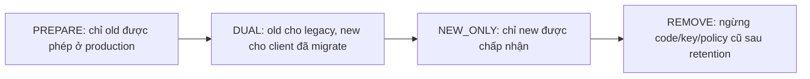
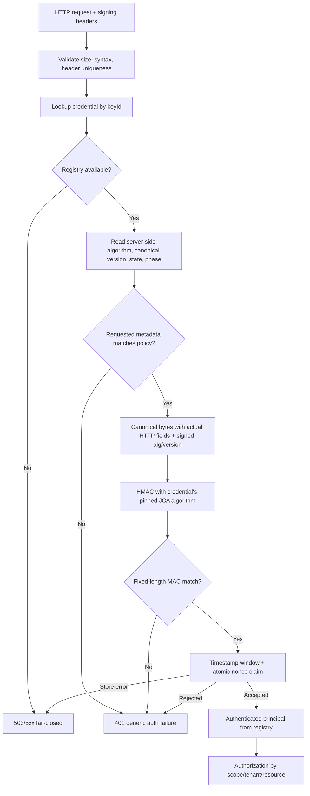
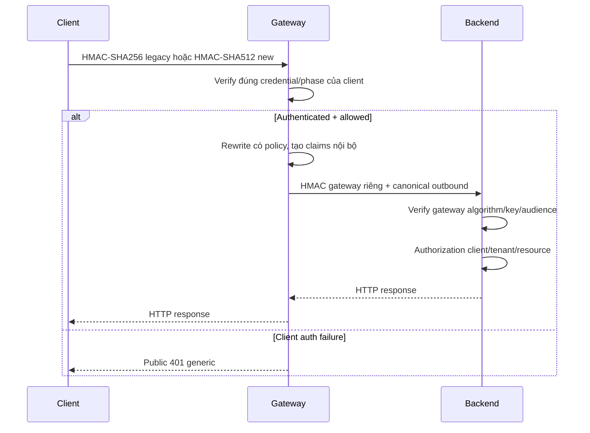

# Dual algorithm period: vận hành hai thuật toán HMAC trong giai đoạn chuyển đổi

## 1. Mục tiêu và bối cảnh

Bài **Dual algorithm period** thuộc chương **Algorithm agility** của module **SECURITY_AUTHENTICATION_HMAC_REQUEST_AUTHENTICATION**. Module dạy thiết kế xác thực HTTP request bằng **HMAC với shared secret** trên một **canonical request** có hợp đồng ký rõ về phương thức HTTP, URI, header và/hoặc body. Bên cạnh kiểm tra MAC, hệ thống phải xử lý timestamp/nonce chống replay, quản lý key rotation, kiểm thử gateway/proxy và phân biệt **authentication** với **authorization**.

**Algorithm agility** là khả năng thay đổi thuật toán mật mã theo chính sách và vòng đời hệ thống mà không làm gãy tất cả client cùng một lúc. **Dual algorithm period** là khoảng thời gian chuyển tiếp mà server **có chủ đích** chấp nhận hai thuật toán ký đã được phê duyệt, trong khi từng credential/client vẫn bị ràng buộc bởi chính sách thuật toán, trạng thái khóa, thời hạn và điều kiện xác thực.

Ví dụ minh họa: hệ thống đang hỗ trợ `HMAC-SHA256`, muốn bổ sung `HMAC-SHA512` cho một số client và cuối cùng không nhận thuật toán cũ trên API mới. **Đây chỉ là ví dụ về migration**; HMAC-SHA256 vẫn là thuật toán mạnh và được dùng rộng rãi khi triển khai đúng. Không mặc nhiên kết luận nó không an toàn chỉ vì SHA-512 có output dài hơn. Lý do đổi có thể là chính sách tổ chức, tuân thủ, chuẩn hóa hệ thống hoặc nhu cầu thiết kế mới.

Sau bài học, người học có thể:

1. Phân biệt **MAC algorithm**, **canonicalization version**, **credential/key rotation**, **signature encoding** và **HTTP/TLS transport**.
2. Thiết kế hợp đồng yêu cầu ghi rõ thuật toán, phiên bản và key ID; ngăn **algorithm confusion** và **downgrade** do cơ chế thương lượng thiếu bảo vệ.
3. Định nghĩa server-side policy cho **từng credential/client** thay vì thử mọi thuật toán cho tới khi một chữ ký khớp.
4. Vận hành giai đoạn song song có hạn cuối, kiểm soát key active/revoked, timestamp/nonce và rollback.
5. Viết verifier Java/JCA với allowlist thuật toán và so MAC an toàn; không dùng chuỗi thuật toán do client cung cấp đưa thẳng vào `Mac.getInstance(...)`.
6. Viết test vector, unit/contract/integration tests và theo dõi tiến độ chuyển đổi qua gateway/backend.
7. Biết khi nào **không được** mở dual period: thuật toán hoặc shared secret cũ đã mất tính tin cậy.

## 2. Dual algorithm period thực chất chấp nhận điều gì?

Một HMAC request gồm ít nhất ba lớp độc lập:

```text
HTTP request bytes
  └─ canonicalization contract/version
       └─ MAC algorithm + secret thuộc credential
            └─ signature encoding trên wire
```

Hãy xem xét bảng:

| Thuộc tính | Giá trị cũ | Giá trị mới | Có buộc phải đổi cùng lúc? |
|---|---|---|---|
| MAC algorithm | `HMAC-SHA256` | `HMAC-SHA512` | Không, nhưng phải ràng buộc với credential và policy |
| Thuật toán hash body | `SHA-256` | Có thể vẫn `SHA-256` | Không. Body digest khác MAC algorithm |
| Canonical format | `HMAC-REQ-1` | `HMAC-REQ-2` khi cần thay hợp đồng | Không. Có thể giữ một canonical version chung |
| Secret/key ID | `partner-a-old` | `partner-a-new` | Nên dùng khóa độc lập khi đổi thuật toán |
| Signature encoding | Base64URL không padding | Có thể giữ nguyên encoding | Không. Độ dài output thay đổi theo MAC |
| Transport | HTTP/1.1 + TLS | HTTP/2 + TLS | Không liên quan trực tiếp tới MAC algorithm |
| Client authorization | Scope/tenant/resource | Giữ theo principal và policy | Không tự tăng quyền chỉ vì dùng algorithm mới |

Một API hoàn toàn có thể dùng **body digest SHA-256** trong cả hai hợp đồng nhưng tạo MAC ngoài bằng HMAC-SHA256 hoặc HMAC-SHA512. Không được nhầm `SHA-256(body)` với `HMAC(secret, canonical)`; SHA-256 body **không có khóa** và chỉ được bảo vệ về integrity vì digest đó nằm trong canonical request đã ký.

**Mục tiêu dual period không phải** “cứ thử cả SHA-256 và SHA-512 rồi tin kết quả khớp”. Mục tiêu là **hai cấu hình đã định danh được hỗ trợ cùng lúc** và mỗi request chỉ được xét theo **một cấu hình đã ràng buộc**.

### 2.1. Ba trạng thái vận hành khác nhau



Ở **PREPARE**, server có thể đã deploy code hiểu thuật toán mới nhưng chưa bật cho client thực. Ở **DUAL**, old và new đều có thể được chấp nhận **trong phạm vi policy**. Ở **NEW_ONLY**, mọi credential cũ đã hết hạn hoặc revoked; không được thử old làm fallback. Ở **REMOVE**, dọn key/token cũ, nhánh code legacy và chính sách/metric còn dư sau khi đã giữ đủ audit cần thiết.

Nếu thuật toán cũ bị phá vỡ theo threat model hoặc secret cũ đã bị lộ, **không nên chấp nhận old trong grace period** chỉ vì muốn giữ tương thích. Phải ưu tiên thu hồi, phát hành credential mới và có kế hoạch gián đoạn/khôi phục an toàn.

## 3. Mối đe dọa khi hai thuật toán cùng tồn tại

### 3.1. Downgrade không có kiểm soát

Giả sử client đã chuyển sang HMAC-SHA512 nhưng một thành phần nhận lỗi rồi tự động “thử lại bằng HMAC-SHA256”. Nếu phản hồi gợi ý thuật toán hoặc endpoint thương lượng không được xác thực, attacker ở vị trí có khả năng thay đổi thông tin thương lượng có thể khiến client **ký bằng cơ chế cũ** nếu client vẫn giữ old secret.

```text
Client muốn gửi NEW
  → nhận thông điệp "server không hỗ trợ NEW"
  → SDK tự fallback OLD, dùng old secret vẫn còn lưu
  → request cũ được server DUAL chấp nhận
```

Không tự động downgrade vì 401, 403 hoặc 5xx. Client nên **pin** cấu hình ký theo tài khoản/endpoint/credential đã được cấp phát; thay đổi thuật toán là **quyết định cấu hình được ủy quyền**, không do một request Internet bất kỳ quyết định.

Một khi client/credential được đánh dấu **NEW_ONLY**, server phải từ chối old ngay cả khi old key vẫn còn tồn tại ở kho bí mật vì lý do audit/khôi phục. Không dùng cờ toàn cục `acceptOld=true` để lách policy per-client.

### 3.2. Algorithm confusion

Một request khai báo `X-HMAC-Algorithm: HMAC-SHA512` nhưng verifier lại chọn thuật toán dựa vào tên header khác, độ dài signature hoặc kết quả thử lần lượt. Những nhánh không thống nhất có thể dẫn tới **algorithm confusion**. Các biến thể khác:

- Dùng `"SHA256"`, `"HmacSHA256"`, `"HS256"`, `"hmac-sha256"` làm alias ở các hop mà không có contract.
- Chấp nhận `alg=none`, chuỗi rỗng, thuật toán không thuộc allowlist hoặc `Mac.getInstance(algFromHeader)`.
- Nhận hai header `X-HMAC-Algorithm` trùng nhau, gateway dùng giá trị đầu còn backend dùng giá trị cuối.
- Cho một key ID chọn tùy ý nhiều thuật toán và bí mật không ràng buộc.
- Tự chuyển sang old khi signature new kiểm tra sai.
- Tin thuật toán trong JWT/metadata từ nguồn không tin cậy như thể đó là policy server.

**Không có sự bảo vệ chỉ bằng việc nhét chuỗi thuật toán vào một header.** Header phải nằm trong phần được MAC bảo vệ (hoặc được ràng buộc ở tầng tương đương), đồng thời server phải tra chính sách từ nguồn đáng tin.

### 3.3. Nhầm key rotation với algorithm migration

Key rotation và đổi thuật toán có thể diễn ra cùng lúc, nhưng khác bản chất:

- **Key rotation:** đổi shared secret/key ID, có thể vẫn dùng HMAC-SHA256.
- **Algorithm migration:** đổi `HmacSHA256` sang `HmacSHA512`, cần thống nhất canonical contract/signature length/policy.
- **Revocation:** một credential không còn được phép dùng dù MAC có thể tính đúng.
- **Authorization:** xác định principal đã xác thực có quyền gọi method/resource/tenant hay không.

Nếu dùng cùng secret cho cả old và new, ranh giới vận hành/thu hồi khó kiểm toán và có thể tăng rủi ro cross-protocol. **Khuyến nghị dùng secret và key ID độc lập cho mỗi credential/algorithm**, được tạo bằng CSPRNG và lưu ở secret store. Không tái sử dụng secret từ môi trường production ở test vectors.

## 4. Hợp đồng ký minh họa: thuật toán là thành phần được ràng buộc

Một giao thức nên chọn **tên thuật toán trên wire hữu hạn** và ánh xạ nội bộ rõ ràng:

| Wire algorithm | JCA name | MAC raw bytes | Base64URL không padding |
|---|---|---:|---:|
| `HMAC-SHA256` | `HmacSHA256` | 32 | 43 ký tự |
| `HMAC-SHA512` | `HmacSHA512` | 64 | 86 ký tự |

Các độ dài ở đây áp dụng cho output HMAC-SHA256/HMAC-SHA512 đầy đủ. Nếu hợp đồng hỗ trợ truncation, phải định nghĩa rõ độ dài tối thiểu, quy trình tạo và kiểm tra; **không tự chấp nhận chữ ký cắt ngắn**.

Một hợp đồng **HMAC-REQ-2** để dạy kiến trúc có thể là:

```text
HMAC-REQ-2
<ALGORITHM>
<METHOD>
<RAW_PATH>
<RAW_QUERY_OR_EMPTY>
<KEY_ID>
<TIMESTAMP_SECONDS>
<NONCE>
<LOWER_HEX_SHA256_BODY>
```

Quy tắc bắt buộc:

1. Ghép các dòng bằng một byte LF (`\n`), encode UTF-8, không thêm newline cuối.
2. `ALGORITHM` đúng một trong `HMAC-SHA256` và `HMAC-SHA512`. **Không** dùng thuật toán khác từ request mà không có phiên bản/policy mới.
3. `METHOD` lấy từ method thực sự ở điểm verify, đúng case theo hợp đồng; không dựa vào `X-Original-Method` chưa xác thực.
4. `RAW_PATH` và `RAW_QUERY` được định nghĩa tại **đúng ranh giới** ký/verify. Gateway rewrite phải verify ingress trước, sau đó nếu ký lại thì tạo canonical outbound mới.
5. `KEY_ID` trỏ tới credential trong registry. Một credential có `algorithm` cố định, secret độc lập, trạng thái `ACTIVE/REVOKED`, owner, audience, hiệu lực.
6. `TIMESTAMP_SECONDS` và `NONCE` thuộc nội dung được ký; server kiểm tra clock skew và claim nonce nguyên tử.
7. `LOWER_HEX_SHA256_BODY` dùng trên byte body **thực nhận** (sau khi bỏ HTTP framing, trước khi tự parse/re-serialize nội dung theo contract).
8. Nếu header khác (Content-Type/Content-Encoding/Host/tenant claim...) ảnh hưởng tới cách backend xử lý, phải ràng buộc bằng signed headers hoặc bằng chính sách cố định và kiểm thử.
9. Giới hạn kích thước method/path/header/signature/body và validate ký tự LF/CR trong metadata, tránh ambiguity giữa các dòng canonical.

Ví dụ request POST body `{"amount":100}` có các header:

```http
POST /v2/payments?mode=fast HTTP/1.1
Host: api.example.test
X-HMAC-Version: HMAC-REQ-2
X-HMAC-Algorithm: HMAC-SHA512
X-Key-Id: partner-a-new
X-Timestamp: 1795800000
X-Nonce: n-unique-42
X-Signature: <BASE64URL_HMAC_SHA512_SIGNATURE>
Content-Type: application/json
```

Canonical minh họa:

```text
HMAC-REQ-2
HMAC-SHA512
POST
/v2/payments
mode=fast
partner-a-new
1795800000
n-unique-42
<LOWER_HEX_SHA256_OF_EXACT_BODY_BYTES>
```

Đặt version/algorithm trong canonical ngăn một kẻ tấn công **chỉ thay header thuật toán mà giữ signature cũ** khiến server hiểu đó là hợp đồng khác. Tuy vậy, chống downgrade còn đòi hỏi **chính sách ở server và cấu hình pin ở client**: khi chính client thực sự ký old bằng old secret trong DUAL period, đó vẫn là chữ ký hợp lệ nếu policy còn cho phép.

### 4.1. Một signature hay hai signature trên cùng request?

Thiết kế đơn giản trong bài này: **mỗi request có đúng một thuật toán, một key ID, một signature**. Khi migration, client gửi old hoặc new tùy cấu hình đã được cấp; server không tự so cả hai.

Một số hệ thống muốn **dual-signature** (một request mang cả HMAC old và HMAC new) để xác nhận readiness hoặc chuyển tiếp rủi ro cao. Đó là **giao thức khác**, phải định nghĩa rõ hai signature có cùng canonical bytes không, metadata được bảo vệ ra sao, yêu cầu verify `AND` hay `OR`, audience, anti-replay, kích thước header và rollback. Nếu server cho `OR` vô điều kiện, chỉ một chữ ký old hợp lệ cũng có thể phá mục tiêu bắt buộc NEW.

Không tự thêm hai header chữ ký để “tăng bảo mật” khi không có contract; nó tạo ambiguity ở proxy/parser.

### 4.2. Legacy canonical không có trường thuật toán thì sao?

Nhiều API HMAC cũ chỉ ký:

```text
<METHOD>
<RAW_URI>
<TIMESTAMP>
<NONCE>
<BODY_DIGEST>
```

Không thể giả định thuật toán/version đã được ký nếu không tồn tại trong canonical legacy. Cách chuyển tiếp có thể chấp nhận:

- Giữ **parser/validator legacy riêng**, chọn duy nhất `HMAC-SHA256` dựa trên key ID **cũ**, endpoint hoặc policy trusted, không dựa vào client-controlled `alg`.
- Dùng **key ID khác** cho hợp đồng HMAC-REQ-2 mới; policy server ràng buộc new key với HMAC-SHA512 và canonical V2.
- Không “thử cả canonical V1/V2 cho cùng chữ ký”. Một kết quả fallback pass có thể tạo downgrade hoặc che lỗi hợp đồng.
- Khi key/client chuyển NEW_ONLY, từ chối V1 dù có secret cũ trong vault.
- Có kế hoạch gỡ code legacy sau hạn cuối và test mọi route/gateway node thực sự đã áp policy.

Đây là ranh giới **protocol migration**, không chỉ chuyển tham số tên thuật toán của thư viện Java.

## 5. Credential policy: nguồn quyết định đặt tại server

Một mô hình registry:

| Trường | Ví dụ | Tính chất |
|---|---|---|
| `credentialId` | `cred-17` | ID nội bộ bất biến |
| `keyId` | `partner-a-new` | ID gửi trong request, lookup theo registry |
| `ownerClientId` | `partner-a` | Lấy từ registry, không lấy trực tiếp từ header client |
| `tenantId` | `tenant-a` | Ràng buộc quyền truy cập và chống cross-tenant |
| `algorithm` | `HMAC-SHA512` | **Server-defined**, cố định cho credential |
| `canonicalVersion` | `HMAC-REQ-2` | Chỉ chấp nhận hợp đồng đúng |
| `secretRef` | `vault://...` | Locator có kiểm soát, không bao giờ đưa ra log/client |
| `state` | `ACTIVE` hoặc `REVOKED` | Tính hợp lệ credential độc lập với MAC |
| `notBefore`/`expiresAt` | Mốc UTC | Không cho dùng key ngoài thời hạn |
| `audience`/`allowedRoutes` | `partner-payments` | Chống dùng credential sai đích |
| `policyRevision` | `42` | Dùng audit và phát hiện cache stale |
| `migrationPhase` (theo client) | `DUAL` hoặc `NEW_ONLY` | Chính sách cho phép old/new thực tế |

**Chọn thuật toán theo policy**, không phải:

```java
// SAI: không truyền chuỗi chưa kiểm soát từ Internet vào JCA.
Mac mac = Mac.getInstance(request.getHeader("X-HMAC-Algorithm"));
```

Ngay cả khi JCA không cho `none`, cách này vẫn biến request không tin cậy thành lựa chọn algorithm/provider và khiến policy migration bị bỏ qua.

Một sơ đồ quyết định an toàn:



Để giảm timing oracle về key tồn tại/revoked, có thể dùng **dummy-key work path** khi lookup trả not found theo threat model, nhưng nó **không được** cấp principal. Vấn đề timing và fake MAC độc lập với việc dual period hỗ trợ những thuật toán nào: cần kiểm soát khác biệt lookup/cache và public response.

## 6. Thiết kế key riêng cho old và new

Một trạng thái DUAL thường có:

```text
Client: partner-a
  cred-old-17:
    keyId=partner-a-2025
    algorithm=HMAC-SHA256
    canonicalVersion=HMAC-REQ-1
    secretRef=vault/partner-a/old
    state=ACTIVE until migration deadline

  cred-new-31:
    keyId=partner-a-2026
    algorithm=HMAC-SHA512
    canonicalVersion=HMAC-REQ-2
    secretRef=vault/partner-a/new
    state=ACTIVE, notBefore=<cutover plan>
```

Key cũ và mới là **hai credential có khả năng kiểm toán riêng**. Registry cho phép:

- Thu hồi old mà không làm new ngừng hoạt động.
- Đo mức sử dụng old/new theo **credential thực sự đã xác thực**, không dựa vào `X-Key-Id` tự khai.
- Đặt deadline khác nhau cho từng client/tenant/audience.
- Tăng policy revision và invalidation cache khi chuyển NEW_ONLY.
- Truy nguyên event request sử dụng thuật toán cũ, khi nó còn được chấp nhận.

### 6.1. Tại sao không tái dùng cùng secret?

HMAC có thể tính với cùng secret trên những algorithm khác, nhưng **tách khóa** thuận lợi cho hạn chế rủi ro:

1. Có thể revoke riêng key cũ ngay sau khi client chuyển xong.
2. Secret exposure trên một hệ thống legacy không tự cho quyền sử dụng credential mới.
3. Dễ kiểm soát access và audit theo key ID/algorithm/audience.
4. Tránh tình huống một gateway tự chọn thuật toán bằng cùng secret do metadata request bị biến đổi.
5. Dễ ngừng cấp phát old key và xóa secure storage sau thời gian giữ cần thiết.

Nếu vì ràng buộc hạ tầng phải dùng cùng root material, cần thiết kế **key derivation có domain separation** và policy cryptographic được review, không đơn giản nối tên thuật toán vào secret tùy ý. Với bài thực hành, **tạo secret ngẫu nhiên độc lập** là hướng dễ kiểm thử và dễ vận hành hơn.

### 6.2. Vẫn cần bảo vệ nonce giữa hai thuật toán

Giả sử mỗi credential có replay namespace riêng:

```text
nonce:cred-old-17:N100
nonce:cred-new-31:N100
```

Một client còn giữ hai secret có thể ký **hai request nghiệp vụ giống nhau**, dùng cùng nonce N100 cho old và new mà cả hai qua replay guard riêng. Đây chưa chắc là tấn công: hai chữ ký là hai request hợp lệ. Nhưng nếu yêu cầu chống phát lại ở **mức client/audience** xuyên suốt dual period, nên cân nhắc namespace chung:

```text
nonce:<tenantId>:<verifiedClientId>:<audience>:<nonce>
```

Chỉ dùng `verifiedClientId` từ credential registry/trạng thái đã đủ tin cậy, không lấy từ header tự khai. Cần thống nhất contract cho client: nonce phải **duy nhất xuyên mọi credential active** nếu dùng namespace chung. Dùng thao tác atomic và TTL tương ứng cửa sổ timestamp + clock skew; xử lý namespace dài/nonce bất thường bằng hash có kiểm soát để tránh lạm dụng Redis keys.

**Giới hạn:** nonce chỉ ngăn **sử dụng lặp lại cùng nonce theo namespace**. Nó không ngăn tạo hai request mới cùng nghiệp vụ với **nonce khác nhau**; thanh toán/đặt hàng cần thêm idempotency key ở tầng business. Ngoài ra, không claim nonce trước khi MAC hợp lệ; nếu store không chắc chắn do timeout thì **fail-closed**.

## 7. Java 17: định nghĩa thuật toán và chính sách rõ ràng

Mã sau minh họa một **verifier core**: kiểm tra algorithm/version từ registry, tính MAC bằng JCA cho từng credential và so signature. Nó không thay thế HTTP parser, credential store, timestamp/nonce, authorization hoặc policy lifecycle; các lớp đó phải bao bọc bên ngoài.

### 7.1. Enum thuật toán, credential và input

```java
import java.nio.charset.StandardCharsets;
import java.security.GeneralSecurityException;
import java.security.MessageDigest;
import java.util.Base64;
import java.util.HexFormat;
import java.util.Objects;
import java.util.Set;

import javax.crypto.Mac;
import javax.crypto.spec.SecretKeySpec;

enum HmacAlgorithm {
    HMAC_SHA256("HMAC-SHA256", "HmacSHA256", 32),
    HMAC_SHA512("HMAC-SHA512", "HmacSHA512", 64);

    private final String wire;
    private final String jca;
    private final int macBytes;

    HmacAlgorithm(String wire, String jca, int macBytes) {
        this.wire = wire;
        this.jca = jca;
        this.macBytes = macBytes;
    }

    String wire() { return wire; }
    String jca() { return jca; }
    int macBytes() { return macBytes; }

    static HmacAlgorithm parseExactWire(String candidate) {
        for (HmacAlgorithm item : values()) {
            if (item.wire.equals(candidate)) {
                return item;
            }
        }
        throw new IllegalArgumentException("Unsupported HMAC algorithm");
    }
}

enum CredentialState { ACTIVE, REVOKED }

record HmacCredential(
        String keyId,
        String ownerClientId,
        String tenantId,
        HmacAlgorithm algorithm,
        String canonicalVersion,
        CredentialState state,
        byte[] secret) {
}

record IncomingSignedRequest(
        String method,
        String rawPath,
        String rawQuery,
        byte[] body,
        String versionHeader,
        String algorithmHeader,
        String keyId,
        String timestamp,
        String nonce,
        String signature) {
}
```

Ở production, không giữ secret trong một `record` mutable byte array rồi in `toString()`: record sẽ tự tạo `toString` và các accessor khiến secret có thể bị lộ qua debug hoặc chia sẻ tham chiếu. **Mã trên chỉ nhằm minh họa kiểu dữ liệu và JCA;** mã production nên dùng credential descriptor chỉ chứa ID/policy và một secret-handle an toàn, tránh tự tạo DTO có secret trong log/cache không kiểm soát. Nếu ứng dụng vẫn buộc dùng `byte[]` trong RAM, cần hạn chế vòng đời, quyền truy cập, copy có kiểm soát và xử lý disposal theo secret store.

### 7.2. Canonicalization và HMAC

```java
final class HmacV2Crypto {
    private static final String VERSION = "HMAC-REQ-2";
    private static final Set<String> METHODS = Set.of(
            "GET", "HEAD", "POST", "PUT", "PATCH", "DELETE");

    static String canonical(
            IncomingSignedRequest req,
            HmacAlgorithm algorithm) {

        if (!VERSION.equals(req.versionHeader())) {
            throw new IllegalArgumentException("Wrong canonical version");
        }
        if (!METHODS.contains(req.method())) {
            throw new IllegalArgumentException("Unsupported method");
        }

        String path = Objects.requireNonNull(req.rawPath());
        String query = req.rawQuery() == null ? "" : req.rawQuery();
        requireSignedField(req.keyId());
        requireSignedField(req.timestamp());
        requireSignedField(req.nonce());

        if (!path.startsWith("/")) {
            throw new IllegalArgumentException("Invalid raw path");
        }
        requireNoNewline(path);
        requireNoNewline(query);

        byte[] bodyBytes = Objects.requireNonNull(req.body());
        byte[] digest;
        try {
            digest = MessageDigest.getInstance("SHA-256")
                    .digest(bodyBytes);
        } catch (GeneralSecurityException failure) {
            throw new IllegalStateException(failure);
        }

        return String.join("\n",
                VERSION,
                algorithm.wire(),
                req.method(),
                path,
                query,
                req.keyId(),
                req.timestamp(),
                req.nonce(),
                HexFormat.of().formatHex(digest));
    }

    static byte[] compute(
            HmacAlgorithm algorithm, byte[] secret, String canonical) {
        Objects.requireNonNull(secret);
        try {
            // Algorithm là enum đã allowlist, KHÔNG lấy string tự do
            // từ HTTP header truyền thẳng vào Mac.getInstance.
            Mac mac = Mac.getInstance(algorithm.jca());
            mac.init(new SecretKeySpec(secret, algorithm.jca()));
            return mac.doFinal(canonical.getBytes(StandardCharsets.UTF_8));
        } catch (GeneralSecurityException failure) {
            throw new IllegalStateException(
                    "Approved MAC algorithm/provider unavailable", failure);
        }
    }

    static String sign(
            HmacAlgorithm algorithm, byte[] secret, String canonical) {
        return Base64.getUrlEncoder().withoutPadding()
                .encodeToString(compute(algorithm, secret, canonical));
    }

    private static void requireSignedField(String value) {
        if (value == null || !value.matches("[A-Za-z0-9._-]{1,128}")) {
            throw new IllegalArgumentException("Bad signing field");
        }
    }

    private static void requireNoNewline(String value) {
        if (value.indexOf('\r') >= 0 || value.indexOf('\n') >= 0) {
            throw new IllegalArgumentException("Ambiguous canonical field");
        }
    }
}
```

**Quan trọng:** đây là một format contract minh họa. Production nên có schema canonical rõ ràng cho URI absolute/relative, query trống, duplicate signed headers, `Content-Encoding`, đường đi đã decode/percent-encode, body size, raw HTTP method và các trường ảnh hưởng authorization. `requireSignedField` là validation tối giản cho ví dụ, không thay thế HTTP parser/hardening.

### 7.3. Kiểm tra MAC theo chính sách đã pin

```java
final class HmacV2VerifierCore {
    private HmacV2VerifierCore() {}

    static boolean verify(
            IncomingSignedRequest req,
            HmacCredential credential,
            boolean ownerAllowsAlgorithm) {

        // Metadata đã được parse từ HTTP header độc nhất và đã giới hạn size.
        if (credential == null || !ownerAllowsAlgorithm) {
            return false;
        }
        if (credential.state() != CredentialState.ACTIVE) {
            return false;
        }
        if (!credential.keyId().equals(req.keyId())) {
            return false;
        }
        if (!"HMAC-REQ-2".equals(credential.canonicalVersion())
                || !credential.canonicalVersion()
                    .equals(req.versionHeader())) {
            return false;
        }

        HmacAlgorithm requested;
        try {
            requested = HmacAlgorithm.parseExactWire(
                    req.algorithmHeader());
        } catch (IllegalArgumentException unsupported) {
            return false;
        }
        if (requested != credential.algorithm()) {
            // Không thử HMAC-SHA256 hoặc HMAC-SHA512 làm fallback.
            return false;
        }

        String canonical;
        try {
            canonical = HmacV2Crypto.canonical(req, requested);
        } catch (IllegalArgumentException malformed) {
            return false;
        }

        byte[] expected = HmacV2Crypto.compute(
                credential.algorithm(), credential.secret(), canonical);

        byte[] received;
        try {
            String value = Objects.requireNonNull(req.signature());
            int expectedChars = requested == HmacAlgorithm.HMAC_SHA256
                    ? 43 : 86;

            // Hợp đồng này dùng Base64URL KHÔNG padding và encode chuẩn.
            if (value.length() != expectedChars) {
                return false;
            }
            received = Base64.getUrlDecoder().decode(value);
            if (received.length != requested.macBytes()) {
                return false;
            }
            if (!Base64.getUrlEncoder().withoutPadding()
                    .encodeToString(received).equals(value)) {
                return false;
            }
        } catch (IllegalArgumentException | NullPointerException failure) {
            return false;
        }

        return MessageDigest.isEqual(expected, received);
    }
}
```

**Giới hạn bảo mật và triển khai cần biết:**

- `ownerAllowsAlgorithm` chỉ là đại diện cho một **kết quả policy tin cậy** (đã xét tenant/client, audience, migration phase, route và thời gian). Không được truyền boolean lấy từ header client.
- `verify` phải dùng credential được lookup bằng key ID từ registry tin cậy; chỉ tạo principal/identity **sau khi** xác minh MAC và freshness, không dựa vào key ID client tự khai.
- Hàm trả boolean cho dễ unit test; **ứng dụng thật** phải phân biệt lỗi 401 và 503 (lỗi kho secret/replay store) và không coi provider/JCA failure là bad signature của client.
- Mã ví dụ không bảo đảm constant-time cho **toàn verifier**: parsing, lookup, state check và format validation có nhánh khác nhau. `MessageDigest.isEqual` giúp tránh vòng lặp so MAC dừng sớm; cần thiết kế chống timing oracle riêng khi threat model đòi hỏi.
- Nếu secret cho HMAC-SHA512 là khóa ngẫu nhiên riêng, không yêu cầu secret có đúng 64 byte bằng độ dài output; độ dài secret phải tuân theo policy an toàn, thường sinh từ CSPRNG với entropy cao (ví dụ ít nhất 256 bit).
- `MessageDigest.isEqual` chỉ nhận hai mảng bytes đã decode. Không so `String.equals` trên Base64 signature làm quyết định mật mã cuối cùng.
- Verifier core **chưa kiểm tra timestamp, nonce, expiry, audience, scope, key rotation, body limit và authorization**; không đưa lớp này vào production như một authentication filter hoàn chỉnh.

### 7.4. Lớp điều phối xác thực

Ứng dụng nên xử lý theo luồng khái quát:

```text
HTTP parser / trusted proxy boundary
  → validate signing header uniqueness, size, syntax
  → lookup credential + owner policy (fail-closed nếu store unavailable)
  → check credential state, policy revision, allowed algorithm/canonical version
  → canonicalize actual method/raw URI/body bytes
  → compute HMAC theo credential.algorithm, compare signature
  → validate signed timestamp / bounded clock skew
  → atomic claim nonce (Redis SET NX EX hoặc tương đương)
  → tạo authenticated principal từ registry
  → authorization theo scope, tenant, method/resource
  → handler; log/metric an toàn
```

Tùy threat model, kiểm tra timestamp sớm có thể được dùng để giảm tài nguyên nhưng sẽ ảnh hưởng timing/attribution. **Không claim nonce trước khi MAC hợp lệ**, tránh attacker tiêu thụ nonce bằng request sai. Bất kể thứ tự, một request thiếu trạng thái credential đáng tin hoặc không xác minh được nonce **không được phép đi qua**.

## 8. Chuyển đổi từng client: tránh “flag bật toàn cục”

Một kế hoạch dual period an toàn cần có **mốc vận hành đo được**. Ví dụ hoàn toàn giả định:

| Giai đoạn | Server | Client | Điều kiện kết thúc |
|---|---|---|---|
| 0. Inventory | Thống kê algorithm/version/credential hiện có | Xác định SDK và owners | Biết client nào đang dùng old |
| 1. Prepare | Deploy parser/allowlist new, test gateway + rollback | Cấp key mới, SDK hiểu new | Test contract và load đạt |
| 2. Opt-in DUAL | Chấp nhận old đối với legacy và new đối với credential mới | Từng client pin new để canary | Đủ request hợp lệ bằng new, không lỗi ký |
| 3. Enforce per-client NEW_ONLY | Thu hồi khả năng old cho client đã migrate | Không fallback | Không còn old verified traffic cho client đó |
| 4. Global cutover | Chặn old ở mọi node/route; revoke credential old | Chỉ dùng new | Không còn client hợp lệ phụ thuộc old |
| 5. Remove | Gỡ code old, xóa secret khi tới hạn, giữ audit cần thiết | Cập nhật tài liệu | Security review và cleanup hoàn tất |

Không có một ngày migration tự động phù hợp mọi hệ thống. Phải thống nhất deadline với đối tác, rủi ro, SLA và chính sách hỗ trợ. **Sau deadline**, dùng key old đúng chữ ký cũng phải bị từ chối. Nếu old algorithm bị phát hiện yếu/không còn được phép dùng, cần rút ngắn hoặc bỏ DUAL theo risk decision.

### 8.1. Chính sách per-client và pinning

Ví dụ registry policy:

```json
{
  "clientId": "partner-a",
  "audience": "partner-payments",
  "phase": "DUAL",
  "policyRevision": 42,
  "legacyCredentials": ["cred-old-17"],
  "newCredentials": ["cred-new-31"],
  "newAlgorithm": "HMAC-SHA512",
  "legacyAcceptUntil": "2026-12-31T00:00:00Z"
}
```

Đây là **dữ liệu minh họa**, không phải chính sách thực tế. Nếu client đã được chuyển sang `NEW_ONLY`, server không được cho `cred-old-17` qua vì flag global còn bật; state + phase + deadline ở nguồn đáng tin quyết định cuối.

**Quy tắc pin trên SDK:** SDK lưu lựa chọn `HMAC-REQ-2/HMAC-SHA512/keyId-new` theo cấu hình được xác thực/triển khai có kiểm soát. Khi nhận `401`, SDK **không** tự ký lại bằng old key. Khi nhận `503`, SDK có thể retry với backoff/idempotency policy, nhưng không đổi thuật toán để “thử may”.

### 8.2. Race khi cập nhật policy và cache

Giả sử lúc 10:00 registry đổi partner-a từ DUAL sang NEW_ONLY nhưng gateway B dùng cache cũ tới 10:05. Trong khoảng stale, gateway B có thể tiếp tục chấp nhận old signature. Do đó cần:

- Cập nhật policy revision/version và trạng thái credential trong nguồn authoritative.
- Invalidate caches/đẩy event tới mọi verifier; theo dõi ack, propagation lag và node không nhận event.
- Với yêu cầu cắt old tức thời, dùng freshness check/epoch hoặc truy vấn authoritative đủ mạnh, fail-closed khi không chứng minh được độ mới.
- Định nghĩa **thời điểm có hiệu lực** và **cửa sổ eventual consistency** nếu được phép; đừng cam kết “tức thời” chỉ bằng publish event.
- Test request mới bằng old key trên keep-alive/HTTP/2 connection sau cutover. Không reuse kết quả authenticated từ request trước.

Khi một request được verify **trước** cutover nhưng đang chạy nghiệp vụ khi cutover xảy ra, cần chính sách riêng: chỉ áp dụng cho authentication decisions mới hay còn phải kiểm tra lại trước khi commit nghiệp vụ nhạy cảm.

### 8.3. Rollback có giới hạn

Rollback kỹ thuật có thể cần khi SDK new lỗi ở một nhóm client. Nhưng “đổi flag về DUAL” có thể **mở lại downgrade** cho client đã NEW_ONLY. Quy trình rollback phải có approval, phạm vi client/tenant/audience, hạn kết thúc, reason và audit, không làm hồi sinh key revoked tùy tiện.

Nếu rollback đòi dùng lại key old từng nghi bị lộ, **không được** vì lợi ích availability mà chấp nhận nó; cần phát hành credential mới theo thuật toán/policy còn an toàn hoặc dùng phương án khôi phục được phê duyệt.

## 9. Downgrade resistance và những gì dual period không thể bảo đảm

Một nguyên tắc logic cần nắm:

> **Khi server vẫn chủ ý chấp nhận một chữ ký old hợp lệ, không thể tuyên bố đã loại bỏ hoàn toàn khả năng sử dụng old algorithm.**

Các cơ chế giảm rủi ro:

1. Để **owner policy** quyết định algorithm nào hợp lệ, không để client yêu cầu bật lại old.
2. Client sau khi migrate **pin new**; không dựa thông báo lỗi công khai để lựa chọn fallback.
3. Cấp secret/key ID mới độc lập; old chỉ dành cho credential chưa migrate.
4. Version/algorithm nằm trong canonical mới; legacy format có parser/version riêng.
5. Không thử nhiều thuật toán hoặc nhiều canonical format rồi lấy cái đầu tiên pass.
6. Chặn alg không hỗ trợ, duplicate metadata headers, algorithm aliases không được ký.
7. Có deadline/metric/alert cho last verified old usage và các node stale.
8. Cuối giai đoạn **revoke old credential**, không chỉ ẩn UI hoặc ngừng tài liệu hóa old.
9. Cấu hình backup/DR, canary, region phụ cũng phải áp NEW_ONLY; một node cũ có thể là đường bypass.

Nếu attacker **đã biết secret old và old vẫn ACTIVE**, họ có thể tạo request old hợp lệ trong DUAL period. Không có cơ chế kiểm tra algorithm mới nào phía server sửa được rủi ro đó. Chỉ thu hồi/chặn old key và giới hạn scope/permission mới cắt được đường này.

### 9.1. Đừng quảng cáo old algorithm trong lỗi 401

Ví dụ response không nên là:

```json
{
  "error": "HMAC-SHA512 invalid; retry with HMAC-SHA256",
  "knownKeyId": true,
  "legacyAllowedUntil": "2026-12-31T00:00:00Z"
}
```

Nó giúp client tự động downgrade và có thể lộ key existence, cấu hình migration. Nên dùng public error chung theo contract, còn hành trình nâng cấp được hướng dẫn qua **control-plane đã xác thực**, tài liệu/versioned SDK và kênh hỗ trợ có quyền.

## 10. Mapping lỗi trong dual period

Dù server chấp nhận hai thuật toán, response lỗi nên giữ cùng semantics cho client:

| Trường hợp | Public HTTP | Lý do nội bộ có kiểm soát |
|---|---|---|
| Unknown key ID, revoked key, MAC sai, algorithm không được credential cho phép | **401** | `unknown_key` / `revoked_key` / `invalid_mac` / `algorithm_not_allowed` |
| Legacy credential bị chặn vì client NEW_ONLY | **401** | `legacy_algorithm_disabled` |
| Timestamp ngoài cửa sổ / nonce replay | **401** | `timestamp_window` / `nonce_replay` |
| HMAC đúng nhưng thiếu quyền route/tenant/resource | **403** (hoặc 404 theo policy) | `authorization_denied` |
| Header HTTP sai cú pháp ở parser | **400/431** theo parser | `malformed_http` / `header_too_large` |
| Body vượt giới hạn | **413** | `payload_too_large` |
| Rate limit/quota vượt ngưỡng | **429** | `rate_limited` |
| Credential registry, KMS/vault, nonce store không sẵn sàng | **503/5xx**, fail-closed | `credential_store_unavailable` / `nonce_store_unavailable` |
| Gateway–backend ký sai theo key nội bộ | Internal 401, public **5xx** tùy gateway policy | `internal_gateway_auth_error` |
| Upstream timeout | **504** | `upstream_timeout` |

Public 401 minh họa:

```http
HTTP/1.1 401 Unauthorized
WWW-Authenticate: HMAC realm="partner-api"
Content-Type: application/problem+json
Cache-Control: no-store
X-Request-Id: req-9f12

{
  "type": "about:blank",
  "title": "Unauthorized",
  "status": 401,
  "detail": "Authentication is required or invalid.",
  "code": "AUTHENTICATION_FAILED",
  "requestId": "req-9f12"
}
```

`HMAC` ở `WWW-Authenticate` là scheme **được API định nghĩa**, không phải một scheme bắt buộc có sẵn trong mọi client. Lỗi 401 phải có challenge thích hợp cho tài nguyên theo HTTP semantics, nhưng **không** đưa trạng thái allowed algorithms per credential ra response. Thay thuật toán thành công không thay đổi authorization: principal/tenant/scope được lấy từ registry, không từ header client tự khai.

## 11. Kiểm thử đơn vị: pin algorithm và phát hiện downgrade

Mẫu JUnit 5 dưới dùng code Java ở mục 7. Vì `HmacV2VerifierCore` chỉ verify MAC nên các test này **chưa thay thế** test timestamp, nonce, key state từ registry và Spring Security.

```java
import static org.junit.jupiter.api.Assertions.*;

import java.nio.charset.StandardCharsets;
import org.junit.jupiter.api.Test;

class DualAlgorithmVerifierTest {

    private static final byte[] OLD_SECRET =
            "old-secret-32-bytes-for-tests!!!"
                    .getBytes(StandardCharsets.UTF_8);

    private static final byte[] NEW_SECRET =
            "new-secret-32-bytes-for-tests!!!"
                    .getBytes(StandardCharsets.UTF_8);

    private static HmacCredential credential(
            String keyId, HmacAlgorithm algorithm, byte[] secret) {
        return new HmacCredential(
                keyId, "partner-a", "tenant-a", algorithm,
                "HMAC-REQ-2", CredentialState.ACTIVE, secret);
    }

    private static IncomingSignedRequest unsigned(
            String keyId, String algorithm, String nonce) {
        return new IncomingSignedRequest(
                "POST", "/v2/payments", "mode=fast",
                "{\"amount\":100}".getBytes(StandardCharsets.UTF_8),
                "HMAC-REQ-2", algorithm, keyId,
                "1795800000", nonce, "");
    }

    private static IncomingSignedRequest signed(
            IncomingSignedRequest base,
            HmacAlgorithm algorithm,
            byte[] secret) {
        String canonical = HmacV2Crypto.canonical(base, algorithm);
        String signature = HmacV2Crypto.sign(algorithm, secret, canonical);
        return new IncomingSignedRequest(
                base.method(), base.rawPath(), base.rawQuery(),
                base.body(), base.versionHeader(), base.algorithmHeader(),
                base.keyId(), base.timestamp(), base.nonce(), signature);
    }

    @Test
    void bothApprovedAlgorithmsCanWorkDuringDualPhase() {
        HmacCredential old = credential(
                "partner-a-old", HmacAlgorithm.HMAC_SHA256, OLD_SECRET);
        HmacCredential fresh = credential(
                "partner-a-new", HmacAlgorithm.HMAC_SHA512, NEW_SECRET);

        IncomingSignedRequest oldReq = signed(
                unsigned(old.keyId(), "HMAC-SHA256", "nonce-old-1"),
                old.algorithm(), old.secret());
        IncomingSignedRequest newReq = signed(
                unsigned(fresh.keyId(), "HMAC-SHA512", "nonce-new-1"),
                fresh.algorithm(), fresh.secret());

        assertTrue(HmacV2VerifierCore.verify(oldReq, old, true));
        assertTrue(HmacV2VerifierCore.verify(newReq, fresh, true));
        // true đại diện policy DUAL được tính từ trusted registry.
    }

    @Test
    void newOnlyClientRejectsOldEvenWithValidMac() {
        HmacCredential old = credential(
                "partner-a-old", HmacAlgorithm.HMAC_SHA256, OLD_SECRET);
        IncomingSignedRequest oldReq = signed(
                unsigned(old.keyId(), "HMAC-SHA256", "nonce-old-2"),
                old.algorithm(), old.secret());

        assertFalse(HmacV2VerifierCore.verify(oldReq, old, false));
        // false đại diện policy NEW_ONLY: tuyệt đối không fallback.
    }

    @Test
    void changedAlgorithmHeaderCannotReuseSignature() {
        HmacCredential fresh = credential(
                "partner-a-new", HmacAlgorithm.HMAC_SHA512, NEW_SECRET);
        IncomingSignedRequest correct = signed(
                unsigned(fresh.keyId(), "HMAC-SHA512", "nonce-new-2"),
                fresh.algorithm(), fresh.secret());

        IncomingSignedRequest tampered = new IncomingSignedRequest(
                correct.method(), correct.rawPath(), correct.rawQuery(),
                correct.body(), correct.versionHeader(), "HMAC-SHA256",
                correct.keyId(), correct.timestamp(), correct.nonce(),
                correct.signature());

        assertFalse(HmacV2VerifierCore.verify(tampered, fresh, true));
    }

    @Test
    void noFallbackFromSha512ToSha256ForSameCredential() {
        HmacCredential fresh = credential(
                "partner-a-new", HmacAlgorithm.HMAC_SHA512, NEW_SECRET);
        IncomingSignedRequest base = unsigned(
                fresh.keyId(), "HMAC-SHA256", "nonce-new-3");
        // Giả lập client ký SHA256 bằng secret bị dùng sai chính sách.
        IncomingSignedRequest wrong = signed(
                base, HmacAlgorithm.HMAC_SHA256, NEW_SECRET);

        assertFalse(HmacV2VerifierCore.verify(wrong, fresh, true));
    }

    @Test
    void revokedCredentialNeverAuthenticatesEvenWithMatchingMac() {
        HmacCredential active = credential(
                "partner-a-new", HmacAlgorithm.HMAC_SHA512, NEW_SECRET);
        HmacCredential revoked = new HmacCredential(
                active.keyId(), active.ownerClientId(), active.tenantId(),
                active.algorithm(), active.canonicalVersion(),
                CredentialState.REVOKED, active.secret());

        IncomingSignedRequest req = signed(
                unsigned(active.keyId(), "HMAC-SHA512", "nonce-new-4"),
                active.algorithm(), active.secret());

        assertFalse(HmacV2VerifierCore.verify(req, revoked, true));
    }

    @Test
    void unsupportedAlgorithmIsNotAccepted() {
        HmacCredential fresh = credential(
                "partner-a-new", HmacAlgorithm.HMAC_SHA512, NEW_SECRET);
        IncomingSignedRequest bad = unsigned(
                fresh.keyId(), "none", "nonce-new-5");

        assertFalse(HmacV2VerifierCore.verify(bad, fresh, true));
    }
}
```

**Giới hạn của ví dụ:** cả `old` lẫn `new` ở test dùng canonical `HMAC-REQ-2` để cô lập tác động của **thuật toán**. Nếu production có legacy `HMAC-REQ-1`, cần bộ canonicalizer và tests V1 riêng, gắn policy/trạng thái rõ ràng; không lấy test này làm bằng chứng V1 đã tương thích.

Các secret trong ví dụ là **test-only fixtures**, không đủ để đưa vào production. Trong ứng dụng thật cần sinh ngẫu nhiên an toàn, lưu qua vault/KMS, không in trong log hoặc commit secret thật.

### 11.1. Test phải có positive control

Nếu verifier luôn trả false, mọi negative test ở trên vẫn xanh. Vì vậy cần positive controls:

- Credential old được cho phép trong DUAL + MAC old đúng → auth pass.
- Credential new được cho phép + MAC new đúng → auth pass.
- New key được pin NEW_ONLY + MAC new đúng → auth pass.
- HMAC đúng nhưng principal không có quyền nghiệp vụ → authentication pass, authorization **403**.

Đối với test end-to-end, phải xác minh handler chỉ được gọi khi toàn bộ authentication và authorization đã pass.

## 12. Test vectors và tương thích SDK đa ngôn ngữ

Client SDK Java/Node.js/Python/Go cần đồng nhất **bytes của canonical** và signature encoding. Nếu cả signer/server Java cùng dùng một hàm có lỗi, positive test nội bộ vẫn pass. Cần có vectors độc lập với kết quả kỳ vọng được review.

Mẫu tài liệu test vector:

```json
{
  "contractVersion": "HMAC-REQ-2",
  "macAlgorithm": "HMAC-SHA512",
  "keyId": "partner-a-new",
  "secretBase64Url": "<TEST_ONLY_32_BYTE_SECRET>",
  "httpMethod": "POST",
  "rawPath": "/v2/payments",
  "rawQuery": "mode=fast",
  "timestampSeconds": "1795800000",
  "nonce": "nonce-fixture-01",
  "bodyUtf8": "{\"amount\":100}",
  "bodySha256Hex": "<CALCULATED_TEST_VALUE>",
  "canonicalUtf8": "<EXACT_CANONICAL_BYTES>",
  "signatureBase64UrlNoPadding": "<CALCULATED_EXPECTED_MAC>",
  "expectedMacBytes": 64,
  "expectedAuthenticationWhenPolicyAllows": true
}
```

Các placeholder trên **chưa phải bộ vector đã tính**. CI cần vector thực với secret test, canonical UTF-8 bytes và expected signature do implementation tham chiếu độc lập tính, có review; không dùng secret production. Nên xuất bản song song vector `HMAC-SHA256` và `HMAC-SHA512`, cùng các mutation:

- Đổi `X-HMAC-Algorithm` nhưng giữ signature.
- Đổi `keyId`, canonical version, method, raw path/query hoặc body.
- Đổi một byte signature, Base64URL padding hoặc chiều dài.
- Lặp header thuật toán, duplicate key ID, alias/case không có trong contract.
- Thay secret của old sang new hoặc ngược lại.
- Gửi request ký đúng nhưng credential revoked/NEW_ONLY policy không cho phép.

Một phép thử **không nên** là “nếu server không chấp nhận SHA512 thì SDK tự thử SHA256”: đó chính là downgrade behavior cần cấm.

## 13. Contract testing qua Spring Security

Các layer của Spring cần thống nhất lỗi và chính sách, không chỉ so MAC:

**Spring MVC/Servlet:**

- Custom HMAC authentication filter lấy actual method/URI/body, tra credential/policy, verify HMAC rồi tạo `Authentication`.
- Authentication failure đi qua `AuthenticationEntryPoint` và trả 401 chung.
- Sau đó `AccessDeniedHandler` xử lý 403 nếu principal không đủ quyền.
- Nếu filter ở trước `ExceptionTranslationFilter`, phải bảo đảm đường exception handler đúng; không ngẫu nhiên rơi vào HTML 500.
- Không cache `SecurityContextHolder` theo TCP connection hoặc reuse authentication giữa request.

**Spring WebFlux:**

- `AuthenticationWebFilter` hoặc custom `WebFilter` dùng reactive security context theo request.
- Đọc body có giới hạn và backpressure nếu body nằm trong canonical; không gọi `block()`/`subscribe()` trong event loop.
- Tra key/nonce qua reactive client hoặc cô lập blocking I/O trên scheduler có giới hạn; fail-closed khi dependency lỗi.
- Dùng `ServerAuthenticationEntryPoint`/`ServerAccessDeniedHandler` cho response schema thống nhất.
- Với HTTP/2 multiplexing, mỗi stream/request phải xác minh credential và policy riêng; không dùng kết quả xác thực từ connection trước.

Một test contract ở HTTP boundary có thể mô tả:

```text
Given:
  - client partner-a, phase=NEW_ONLY
  - credential old HMAC-SHA256 vẫn còn trong vault
  - request old được ký đúng trên raw bytes
When:
  - POST /v2/payments dùng old key qua gateway
Then:
  - HTTP 401 với generic AUTHENTICATION_FAILED
  - Không forward tới backend/handler
  - Không tạo principal đã xác thực
  - Không được gọi fallback verifier
  - Internal event reason=legacy_algorithm_disabled
  - Không lộ policy revision hoặc old secret trong response
```

Khi đổi alg/header trên request new mà giữ signature new, cũng phải nhận auth failure ở **điểm verifier**, không chỉ 404/405 vì route không tồn tại. Dùng fake clock và nonce mới để tránh false positive do expiration/replay.

## 14. Gateway/proxy: ai xác minh thuật toán nào?

Trong nhiều hệ thống, gateway là điểm kết thúc TLS, xác minh HMAC client và ký lại request tới backend bằng **credential gateway**. Phải xác định **hai phạm vi trust**:



**Không nhầm:**

- Client HMAC-SHA256 old → gateway xác minh old; gateway **ký lại bằng HMAC-SHA512 nội bộ**. Điều đó **không chứng minh client đã migrate**; phía client vẫn dùng old.
- Gateway key cũng có algorithm migration và revocation riêng. Backend phải bind key ID của gateway với algorithm/audience, không tin metadata `X-Verified-Client` từ Internet.
- Khi gateway rewrite raw path/query/body, nó phải verify chữ ký ingress **trước khi** transform; sau đó ký outbound trên method/URI/body **thực gửi**. Không giữ nguyên signature client sau khi thay dữ liệu đã ký.
- Nếu backend trả 401 do gateway key sai, gateway không được forward `WWW-Authenticate: HMAC realm="internal-gateway"` hoặc báo client Internet đổi secret; đây là lỗi tích hợp nội bộ, cần ánh xạ 5xx phù hợp và alert.
- Proxy/CDN/WAF có thể normalize duplicate headers, query hoặc method case khác nhau giữa hop. Contract tests phải xác nhận parser không dùng `alg` đầu ở gateway nhưng `alg` cuối ở backend.

### 14.1. Checklist negative cases qua gateway

| Fixture | Gateway ingress | Backend | Kỳ vọng |
|---|---|---|---|
| Client old hợp lệ, DUAL, chính sách cho phép | Verify old pass | Verify gateway internal pass | Request đi tiếp nếu đủ quyền |
| Client new hợp lệ, DUAL | Verify new pass | Verify gateway internal pass | Request đi tiếp nếu đủ quyền |
| Client old hợp lệ, NEW_ONLY | Reject | Không nhận request | 401 public chung |
| Client new signature, header alg bị đổi old | Reject | Không nhận request | Không có fallback |
| Client gửi duplicate alg headers | Reject trước/sau validate hợp đồng | Không nhận request | 400/401 theo policy |
| Client key ID không tồn tại | Reject | Không nhận request | 401 không dò được key |
| Gateway key revoked, client new hợp lệ | Ingress pass | Reject gateway MAC | Public 5xx theo policy, không 401 client |
| Gateway re-sign nhưng backend thấy method bị rewrite lần nữa | Ingress pass | MAC mismatch | Chẩn đoán canonical mismatch nội bộ |
| Redis nonce store timeout | Fail-closed | Không nhận request | 503/5xx; không tự bỏ nonce |
| Credential registry unavailable | Fail-closed | Không nhận request | 503/5xx; không giả unknown key |

Test thật qua gateway phải dùng proxy route gần production, không chỉ gọi thẳng service. Khi gateway/backend đều cache policy, cần kiểm thử **mọi instance** áp version NEW_ONLY mới nhất.

## 15. Giám sát sử dụng thuật toán và thu hồi legacy

Một kế hoạch migration không thể hoàn tất chỉ bằng thông báo “SDK đã cập nhật”. Phải đo actual verified traffic theo **credential và algorithm thực sự được xác thực**.

| Metric/Event | Ý nghĩa | Dùng để quyết định gì? |
|---|---|---|
| `hmac_auth_decisions_total{algorithm,version,outcome,hop}` | Phân bố xác thực theo thuật toán đã được server chọn | Theo dõi tỷ lệ old/new, phát hiện lỗi |
| `hmac_verified_old_requests_total` | Lượt HMAC old **đã verify và được policy cho phép** | Tìm client chưa migrate |
| `hmac_verified_new_requests_total` | Lượt HMAC new thành công | Kiểm tra readiness |
| `hmac_legacy_rejections_total{reason}` | Request old bị policy mới từ chối | Phát hiện client chưa cập nhật sau cutover |
| `hmac_algorithm_mismatch_total` | Metadata alg không khớp credential | Phát hiện SDK lỗi, tampering hoặc abuse |
| `hmac_policy_propagation_seconds` | Commit policy → verifier nhận version | Đo cache freshness |
| `hmac_unknown_algorithm_total` | Thuật toán ngoài allowlist | Phát hiện cấu hình sai/dò thuật toán |
| `hmac_nonce_claim_errors_total` | Replay store unavailable | Không nhầm downtime với alg migration |

**Cardinality:** `algorithm` và `canonicalVersion` là enum nhỏ, phù hợp metric labels. **Không dùng** key ID/nonce/signature/raw URI/request ID hay tenant tự do làm labels. Phân tích per-client nên dùng security event store bảo vệ quyền truy cập, nơi `verifiedClientId` chỉ có giá trị **sau khi authentication thành công**. Với MAC sai/unknown key, algorithm/key ID do header khai báo **không phải danh tính đã chứng minh**.

### 15.1. Tỷ lệ chuyển đổi đáng tin cậy

Ví dụ:

```text
new_share =
  successful ingress HMAC verifications by approved NEW credentials
  / (successful ingress HMAC verifications by approved OLD + NEW credentials)
```

Mẫu số phải tách **client→gateway ingress** khỏi **gateway→backend**, nếu không lượng new traffic do gateway re-sign sẽ khiến dashboard báo migration giả thành công. Cần giới hạn time window, tenant/client cohort và thể hiện số mẫu; một client ít lưu lượng có new_share=100% từ đúng một request chưa đủ chứng minh đã cập nhật mọi service của họ.

**Dùng last verified old use** để phát hiện client còn dùng key cũ, nhưng phải kết hợp:

- Client owner xác nhận signer/SDK mới đã triển khai trên mọi job/region.
- Không còn old traffic trong một cửa sổ quan sát thích hợp.
- Canary và negative test new key chạy thành công.
- Policy deadline/approval rõ ràng.
- Có kênh hỗ trợ khi lệnh revoke làm client bị gián đoạn.

## 16. Security testing: ma trận chấp nhận

| Test ID | Đầu vào / trạng thái | Kết quả mong đợi |
|---|---|---|
| A01 | Key old ACTIVE, DUAL, MAC SHA256 đúng | Auth pass, nếu freshness/policy còn hợp lệ |
| A02 | Key new ACTIVE, DUAL, MAC SHA512 đúng | Auth pass |
| A03 | NEW_ONLY, key new đúng | Auth pass |
| A04 | NEW_ONLY, key old vẫn tính MAC đúng | **401**, không fallback |
| A05 | Key new khai `HMAC-SHA256` nhưng ký SHA256 | **401**, vì key pin SHA512 |
| A06 | Key new khai `HMAC-SHA512` nhưng signature SHA256 | **401**, length/MAC mismatch |
| A07 | Key old khai `HMAC-SHA512` nhưng ký SHA256 | **401**, không đổi thuật toán theo header |
| A08 | Header alg đổi sau ký, giữ MAC cũ | **401**, không accept |
| A09 | `alg=none`, alias không hợp lệ, chuỗi rỗng | Reject theo contract, không có unsigned mode |
| A10 | Duplicate `X-HMAC-Algorithm` hoặc `X-Key-Id` | Reject; không parser confusion qua proxy |
| A11 | Đổi method/raw URI/body/timestamp/nonce sau ký | MAC fail hoặc freshness fail phù hợp, không handler |
| A12 | Key revoked dù MAC SHA256/SHA512 đúng | **401**, không hồi active |
| A13 | Key expired/not-yet-valid | **401**, không cấp principal |
| A14 | Unknown key ID | **401** public generic, không lộ key existence |
| A15 | Credential registry timeout | **503/5xx**, fail-closed |
| A16 | Nonce store timeout sau MAC đúng | **503/5xx**, không cho qua |
| A17 | Gửi cùng nonce trên hai node | Tối đa một accepted claim theo namespace/contract |
| A18 | Gửi cùng logical operation với nonce khác và hai key | Business idempotency bảo vệ side effect nếu API cần |
| A19 | HMAC đúng nhưng client thiếu quyền DELETE/payment | Auth pass, authorization **403** |
| A20 | Client old qua gateway nhưng gateway ký new nội bộ | Không tăng sai “client migrated” metric |
| A21 | Gateway key revoked | Backend reject; public 5xx theo boundary policy |
| A22 | Một node cache phase DUAL sau khi NEW_ONLY | Test phát hiện stale acceptance và cảnh báo |
| A23 | HTTP/2 nhiều client trên cùng connection | Không reuse authentication/policy theo connection |
| A24 | SDK nhận 401 | Không tự downgrade từ new sang old |
| A25 | Secret old bị lộ trong giai đoạn dual | Revoke old, không giữ grace period một cách vô điều kiện |
| A26 | JCA provider không hỗ trợ thuật toán được duyệt | Lỗi cấu hình/server, không fallback sang old |
| A27 | Invalid Base64/padding/độ dài MAC | Reject; không crash/log secret |
| A28 | Test vector Java và SDK ngôn ngữ khác | Canonical bytes/signature giống nhau theo thuật toán |
| A29 | Route CORS preflight `OPTIONS` | Theo security policy riêng; không nhầm thành unsigned business request |
| A30 | Body quá lớn, malformed HTTP header | 413/400/431 theo điểm từ chối, không buffer vô hạn |

### 16.1. False positive thường gặp trong migration tests

Một request old bị 401 **không tự chứng minh** policy NEW_ONLY hoạt động: có thể timestamp hết hạn, nonce đã dùng, route không tồn tại hoặc MAC sai. Negative test phải:

1. Sinh signature **old hợp lệ** từ secret test và canonical old.
2. Dùng timestamp gần fake clock, nonce chưa claim, credential còn tồn tại trong registry.
3. Xác nhận fixture tương tự pass trong policy DUAL.
4. Chỉ đổi policy sang NEW_ONLY, giữ các điều kiện còn lại.
5. Assert internal reason `legacy_algorithm_disabled`, public 401 và không có side effect.

Ngược lại, request new có MAC đúng nhưng bị 403 vì thiếu quyền không chứng minh migration thất bại: authentication đã pass, authorization tách riêng.

### 16.2. Acceptance khi cutover

Một đợt cutover chỉ nên được xác nhận hoàn thành khi:

- Tất cả verifier/gateway/region báo policy revision mới hoặc truy vấn authoritative đủ mạnh.
- Không còn **authentication success** bằng old credential sau mốc hiệu lực theo SLO/consistency đã công bố.
- Client đã NEW_ONLY không tự fallback theo HTTP 401.
- Old key thực sự revoked/expired ở registry và không thể dùng ở route/canonical legacy phụ.
- Các lỗi dependency vẫn fail-closed và không bị gộp thành invalid signature.
- Các test gateway rewrite, HTTP/2, duplicate headers, nonce replay và authorization vẫn pass.
- Secret/audit/log được xử lý theo chính sách retention; không xóa bằng chứng audit chỉ để “dọn sạch”.

## 17. Bài thực hành: di chuyển một đối tác từ SHA-256 sang SHA-512

Hệ thống giả định:

- `partner-a` đang ký `POST /v2/payments` với secret cũ `key-a-2025`, thuật toán HMAC-SHA256.
- Gateway Spring Security có kho credential/phase trong DB, cache version, Redis chống replay và quyền theo tenant.
- Credential mới `key-a-2026` dùng HMAC-SHA512 và secret độc lập; body SHA-256 digest/canonical đã được hợp đồng hóa.
- Gateway sau khi verify client ký lại request tới backend bằng **gateway key riêng**, không dùng chung secret partner.
- API cần đảm bảo payment idempotency bằng business idempotency key, không phụ thuộc nonce.

### Nhiệm vụ

1. **Định nghĩa hợp đồng:** viết bảng mapping wire algorithm ↔ JCA name ↔ output bytes ↔ encoding; chọn canonical version và trường được ký. Nếu legacy chưa có alg trong canonical, nêu cách tách V1/V2.
2. **Thiết kế registry/policy:** tạo hai credential cùng owner/tenant nhưng secret riêng, algorithm pin riêng, state/expiry/audience rõ. Định nghĩa phase DUAL và NEW_ONLY theo client.
3. **Viết signer/verifier Java:** dùng enum allowlist, MAC bằng JCA và `MessageDigest.isEqual`; reject unknown alg/duplicate headers và key–algorithm mismatch. Không tự fallback.
4. **Tạo vector độc lập:** tính canonical UTF-8 và signature cho mỗi algorithm bằng key test. Đổi algorithm header hoặc method sau ký, xác minh failure.
5. **Kiểm thử chống replay:** dùng nonce mới cho từng attempt và atomic claim; chọn namespace phù hợp nếu muốn nonce uniqueness xuyên old/new key. Gây Redis outage để xác minh fail-closed.
6. **Chạy contract tests:** dùng MockMvc/WebTestClient cho 401/403/503, không lộ alg policy/key state trong response công khai, không có side effect khi MAC sai.
7. **Thử qua gateway:** old client được phép DUAL, new client được phép DUAL, sau đó chuyển NEW_ONLY. Đối chiếu actual algorithm **ở ingress** và gateway re-sign; backend phải xác minh đúng internal algorithm riêng.
8. **Thử cache stale:** chuyển NEW_ONLY trong DB nhưng một gateway chưa refresh. Đo propagation lag và xác minh policy freshness đáp ứng cam kết.
9. **Giả lập rollback:** yêu cầu quay lại old sau khi old credential bị revoke. Viết lý do vì sao không thể lặng lẽ kích hoạt lại, đề xuất credential mới hoặc phương án đã approval.
10. **Định nghĩa exit criteria:** số lượng client đã migrate, last verified old usage, SLO, thời điểm revoke và trách nhiệm team support/security.

### Câu hỏi tự đánh giá

1. Dual algorithm period là chấp nhận **hai cấu hình đã ràng buộc** hay tự thử nhiều thuật toán cho tới khi MAC khớp?
2. Vì sao thuật toán khai trong header không đủ làm bằng chứng server cho phép thuật toán đó?
3. Cơ chế `alg=none` hoặc dynamic `Mac.getInstance(header)` gây rủi ro gì?
4. Vì sao HMAC-SHA512 có 64 byte MAC nhưng SHA-256(body) vẫn có thể giữ nguyên?
5. Vì sao migration algorithm khác key rotation, key revocation và authorization?
6. Vì sao nên cấp **secret riêng** cho key old/new?
7. Khi client đã NEW_ONLY, tại sao request HMAC-SHA256 đúng mật mã vẫn phải 401?
8. Nếu legacy canonical không có thuật toán được ký, làm sao tránh parser thử V1/V2 mơ hồ?
9. Vì sao fallback từ SHA512 sang SHA256 khi gặp 401 là nguy hiểm?
10. Vì sao nonce per-key không luôn bảo vệ cross-key replay trong dual period?
11. Vì sao gateway re-sign bằng thuật toán mới không chứng minh client Internet đã đổi thuật toán?
12. Khi gateway cache policy cũ, vì sao event publish chưa chứng minh revoke/cutover đã có hiệu lực ở mọi node?
13. Có thể kết luận old algorithm hoàn toàn không còn được dùng khi server vẫn chấp nhận old signature hợp lệ không?
14. Vì sao lỗi Redis/credential store không nên trả 401 như “algorithm mismatch”?
15. Đâu là khác biệt giữa “new MAC đã verify đúng” và “client được phép thực thi payment”?

**Kết quả cần đạt:** người học xây dựng được **dual algorithm period** cho HMAC request authentication có allowlist và pinning theo credential/client, canonical được ràng buộc thuật toán/version, key/nonce lifecycle rõ ràng, chuyển đổi DUAL → NEW_ONLY có deadline và audit, chống fallback/downgrade, thử nghiệm gateway/proxy cùng ma trận contract/security tests, và đo được thời điểm thực sự có thể thu hồi hoàn toàn cấu hình legacy mà không đánh đổi xác thực hoặc phân quyền.
