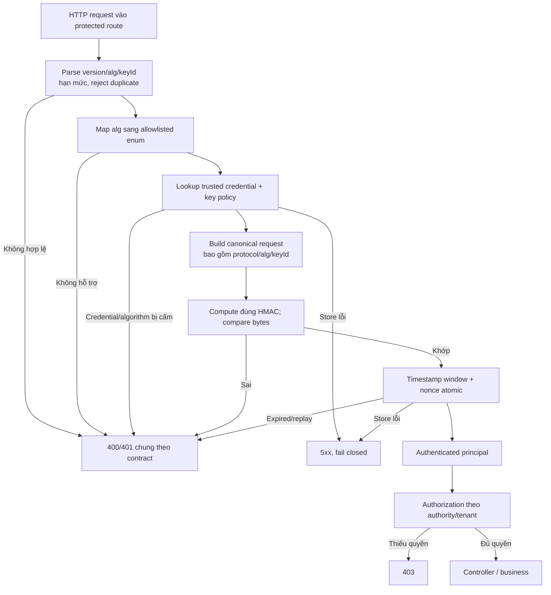
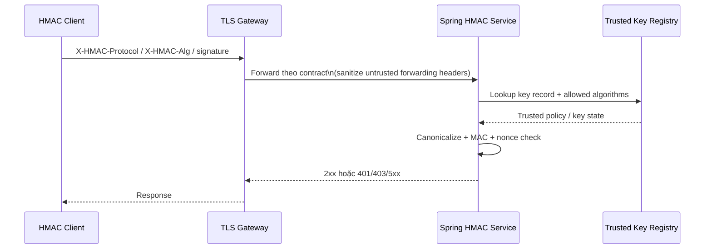

# Algorithm negotiation: đàm phán thuật toán an toàn trong xác thực HMAC HTTP request

## 1. Bối cảnh và mục tiêu

Trong module `SECURITY_AUTHENTICATION_HMAC_REQUEST_AUTHENTICATION`, hai phía dùng **shared secret** để tạo/xác minh chữ ký HMAC của HTTP request. Dữ liệu ký là một **canonical request** được xác định bởi hợp đồng: phương thức HTTP, URI/path/query, những header được chọn và/hoặc hash của body. Server kiểm tra chữ ký, timestamp/nonce chống replay, quản lý key rotation rồi tạo principal; **authorization** vẫn là một bước riêng.

Khi API tồn tại lâu, yêu cầu mật mã và môi trường triển khai thay đổi: một số client đang ký bằng HMAC-SHA256, phiên bản mới cần HMAC-SHA512, thuật toán cũ phải ngừng hỗ trợ, thư viện JCA/provider được nâng cấp hoặc từng đối tác cần thời gian chuyển đổi. Không thể chỉ thay `Mac.getInstance("HmacSHA256")` thành `"HmacSHA512"` và hy vọng mọi client đồng loạt tương thích.

**Algorithm negotiation** là quy trình client và server xác lập một thuật toán ký được **cả hai hỗ trợ và chính sách bảo mật cho phép**, đồng thời bảo đảm lựa chọn này không bị kẻ tấn công điều khiển để giảm an toàn hoặc thay đổi ý nghĩa request.

Vấn đề khó nhất không phải là lựa chọn chuỗi `HMAC-SHA256` hay `HMAC-SHA512`, mà là **ai có quyền quyết định**, **cách chứng thực lựa chọn**, **cách ràng buộc lựa chọn vào MAC**, **cách chuyển tiếp qua gateway** và **cách ngừng thuật toán cũ**.

Sau bài học, người học có thể:

1. Phân biệt algorithm negotiation, algorithm agility, protocol version và key rotation.
2. Thiết kế allowlist thuật toán theo API/credential thay vì tin raw header của client.
3. Chống downgrade, algorithm confusion, `alg=none` và fallback không kiểm soát.
4. Ràng buộc algorithm ID vào canonical bytes và cùng lúc xác minh đúng HMAC algorithm.
5. Xây cơ chế discovery/migration được xác thực, có thời hạn chấm dứt thuật toán cũ.
6. Cài đặt phần lựa chọn/xác minh HMAC trong Java/Spring Security và giữ đúng anti-replay, authorization.
7. Kiểm thử request đi qua gateway/proxy, key rotation và các trường hợp giả mạo thuật toán.

**Phạm vi:** Bài dùng HMAC-SHA256 và HMAC-SHA512 làm ví dụ. Chúng chỉ là hai lựa chọn của **cùng họ HMAC**; không coi đây là hướng dẫn thương lượng thuật toán TLS, JWT/JWS hoặc HTTP Message Signatures. Mỗi giao thức đó có đặc tả riêng và không thể sao chép header `alg` mà không xét trust model.

## 2. Algorithm agility không đồng nghĩa “cho client chọn mọi thuật toán”

**Algorithm agility** là khả năng nâng cấp/chấm dứt thuật toán một cách chủ động. **Negotiation** là một cơ chế triển khai agility khi hai đầu có nhiều khả năng hỗ trợ. Tuy nhiên, một cơ chế negotiation sai có thể biến khả năng chuyển đổi thành bề mặt tấn công.

Ví dụ nguy hiểm:

```http
POST /api/orders HTTP/1.1
Host: api.example.test
X-HMAC-Alg: MD5
X-Key-Id: partner-a
X-HMAC-Signature: ...
```

Nếu verifier làm:

```java
// SAI: client tự điều khiển tên provider algorithm.
Mac mac = Mac.getInstance(request.getHeader("X-HMAC-Alg"));
mac.init(secret);
```

thì hệ thống đang để dữ liệu chưa xác thực điều khiển một primitive mật mã. Thậm chí nếu JCA từ chối nhiều tên, code vẫn có thể chọn thuật toán ngoài chính sách, kích hoạt xử lý tốn kém/ngoại lệ, hoặc mở đường chấp nhận thuật toán cũ khi đáng lẽ đã bị tắt.

Một mô hình đúng hơn:

```text
Client đưa algorithm identifier thuộc hợp đồng
                    |
                    v
Server parse với grammar và kích thước giới hạn
                    |
                    v
Server ánh xạ identifier vào enum allowlist
                    |
                    v
Kiểm tra API policy + credential policy + key version
                    |
                    v
Dựng canonical bytes có algorithm ID / protocol version
                    |
                    v
Xác minh HMAC bằng thuật toán vừa được cho phép
                    |
                    v
Freshness + nonce atomic + principal + authorization
```

Client có thể **đề xuất** thuật toán, nhưng server có quyền **từ chối**. Không có bước “client đã gửi algorithm hợp lệ nên coi như authenticated”: mọi header client trước HMAC đều là dữ liệu chưa được tin cậy.

## 3. Phân biệt bốn khái niệm thường bị trộn lẫn

| Khái niệm | Ví dụ | Trả lời câu hỏi |
| --- | --- | --- |
| **Algorithm ID** | `HMAC-SHA256`, `HMAC-SHA512` | Dùng hàm MAC nào để tính chữ ký? |
| **Signing protocol/canonical version** | `HMAC-REQ-V1`, `HMAC-REQ-V2` | Method, URI, header/body được nối/normalize ra sao? |
| **Key ID và key version** | `partner-a-key-v4` | Shared secret nào và trạng thái lifecycle nào được sử dụng? |
| **Credential/client identity** | `partner-a` sau khi xác thực | Ứng dụng hoặc đối tác nào đã được chứng thực? |

Một key version **không tự quyết định** canonicalization version. Một canonical request version **không tự quyết định** thuật toán HMAC. Và algorithm ID **không phải** bằng chứng principal có quyền ghi đơn hàng.

Ví dụ:

```text
Protocol:   HMAC-REQ-V2
Algorithm:  HMAC-SHA512
Key ID:     partner-a-key-v4
Client:     partner-a  (chỉ có sau xác thực)
Authority:  orders:create (server-side policy)
```

Ở giai đoạn chuyển tiếp, có thể cho phép cùng protocol `V2` với hai thuật toán **nếu contract và security policy nói rõ**. Hoặc server quyết định mỗi key ID chỉ thuộc một thuật toán, để loại bỏ negotiation trên mỗi request. Cách thứ hai thường đơn giản và ít mơ hồ hơn.

**Nguyên tắc thiết kế:** Chỉ cho phép nhiều lựa chọn trong đúng khoảng thời gian hoặc tập credential thực sự cần; không xây cơ chế negotiation phức tạp nếu một thuật toán cố định đáp ứng yêu cầu.

## 4. Threat model: downgrade, confusion và protocol substitution

### 4.1. Downgrade attack

Giả sử client và server đều hỗ trợ thuật toán mới, nhưng server vẫn giữ thuật toán cũ trong giai đoạn migration. Kẻ tấn công sửa metadata negotiation để khiến một đầu tin rằng chỉ có thuật toán cũ.

Một thiết kế dễ bị downgrade:

```text
Client: "Tôi hỗ trợ NEW và OLD"
             |
         MITM xóa NEW
             v
Server: "Chỉ có OLD, chọn OLD"
             |
        Client chấp nhận
```

Nếu danh sách đề xuất, lựa chọn của server hoặc thông điệp xác nhận **không được bảo vệ toàn vẹn**, attacker có thể thay đổi kết quả. TLS bảo vệ metadata trong kênh TLS đúng cấu hình, nhưng không tự giải quyết trường hợp thông điệp bị biến đổi bởi một thành phần nội bộ có quyền chấm dứt TLS hoặc thông tin negotiation bị copy ra ngoài kênh.

### 4.2. Algorithm confusion

Ví dụ server parse `X-HMAC-Alg: HMAC-SHA512` nhưng lại dùng digest 32 byte, hoặc một nhánh xử lý coi `HMAC-SHA256` là SHA-256 **không có khóa**. Lúc này algorithm ID và implementation không còn đồng nhất.

Một biến thể nguy hiểm là nhận một signature theo cả Base64 và hex bằng fallback tùy ý mà không có version. Một biến thể khác là dùng algorithm ID chưa xác thực để tìm một verification routine khác có semantics yếu hơn.

### 4.3. `alg=none` và bypass

Một số giao thức có khái niệm chữ ký vắng mặt, nhưng **API HMAC-only không được nhận `none`**. Nếu client gửi:

```http
X-HMAC-Alg: none
X-HMAC-Signature:
```

server phải từ chối theo hợp đồng, không “bỏ qua kiểm tra vì thuật toán none”. Không có nhánh “nếu thuật toán lạ thì `permitAll`”.

### 4.4. Cross-protocol substitution

Ngay cả khi cùng HMAC-SHA256, hai protocol có thể có canonical bytes khác nhau. Nếu dùng chung secret và message không có dấu nhận diện giao thức, một chữ ký được tạo trong luồng A có thể bị diễn giải trong luồng B khi input tình cờ trùng.

Dùng **domain separation** rõ ràng trong canonical bytes, ví dụ dòng đầu `HMAC-REQ-V2`, và tốt hơn là key separation theo protocol/purpose khi khả thi. Algorithm negotiation không được vô tình xóa dòng phân biệt giao thức hoặc chấp nhận nhiều cách diễn giải một message.

### 4.5. Fallback oracle

Một verifier làm “thử HMAC-SHA512, nếu sai thử HMAC-SHA256, nếu sai thử canonical v1, v2...” sẽ mở rộng tập request được chấp nhận, tăng chi phí xử lý và gây khó khăn khi kết thúc migration. Đặc biệt khi có key rotation, thử mọi key × mọi algorithm × mọi canonical version là một thiết kế nguy hiểm.

Thay bằng **một lựa chọn minh bạch, giới hạn và được kiểm soát** theo key ID, protocol version và server policy.

## 5. Ba kiến trúc lựa chọn thuật toán

Không phải mọi API đều cần negotiation động ở mỗi request.

| Kiến trúc | Cách chọn | Ưu điểm | Đánh đổi |
| --- | --- | --- | --- |
| **Cố định theo API version** | `/v1` dùng thuật toán A; `/v2` dùng B | Đơn giản, ít ambiguity | Client phải nâng version API |
| **Cố định theo credential/key ID** | Registry lưu algorithm được phép cho key | Mỗi credential một lựa chọn, không cần offer list | Rotation/upgrade key cần quản lý chặt |
| **Negotiation có xác thực** | Client gửi capabilities, server chọn và xác nhận có integrity | Hỗ trợ nhiều client/version | Phức tạp hơn, cần chống downgrade và replay |

Đối với API server-to-server dùng HMAC, mô hình **cố định theo credential** thường là điểm khởi đầu tốt: key record đã quy định algorithm, client biết điều đó từ quá trình provisioning đáng tin cậy. Một header `X-HMAC-Alg` có thể vẫn được gửi để ghi rõ contract và được ký, nhưng không được override policy.

Mô hình negotiation động chỉ nên dùng khi lợi ích thực sự lớn hơn chi phí thiết kế và kiểm thử. **Agility không bắt buộc phải là “mỗi request tự thương lượng”.**

### 5.1. Capability discovery được xác thực

Một luồng discovery có thể là:

1. Client đã được provisioning trên kênh quản trị đáng tin cậy: biết service identity, endpoint, algorithm tối thiểu hoặc bộ policy được pin.
2. Client hỏi capability endpoint qua TLS đã xác minh danh tính server, hoặc nhận metadata cấu hình có chữ ký từ hệ tin cậy.
3. Server trả tập thuật toán **hiện đang cho phép đối với client/credential** và protocol version hỗ trợ.
4. Client chọn một thuật toán nằm trong giao của policy local và server, ưu tiên theo thứ tự đã được công bố.
5. Request HMAC mang algorithm ID và protocol version; **cả hai được ràng buộc vào canonical bytes**.
6. Server xác minh lại lựa chọn từ policy hiện hành, không tin “client nói server đã chọn”.

Capability endpoint chỉ được cung cấp metadata cần thiết; không tiết lộ secret, chi tiết credential inventory hoặc trạng thái key bị revoke cho bên chưa được phép. Nếu discovery timeout, client **không tự chuyển xuống thuật toán yếu hơn** ngoài mức tối thiểu đã pin.

### 5.2. Negotiation tại bootstrap

Một vấn đề thực tế: trước khi có credential HMAC hợp lệ, làm sao bảo vệ negotiation? Có thể dùng provisioning ngoài băng, mTLS, một kênh TLS có xác thực server và policy cục bộ, hoặc token/metadata ký bằng một trust anchor đã thiết lập. Không thể dựa vào “HMAC của thuật toán vừa được quyết định từ thông điệp chưa xác thực” như nguồn tin cậy duy nhất nếu khả năng downgrade chưa được xử lý.

Trong một số triển khai, server có thể công bố capabilities chung công khai nhưng client vẫn phải **pin minimum policy** và server phải kiểm lại credential allowlist. Public discovery không tự chứng minh phép chọn an toàn.

## 6. Đặc tả algorithm negotiation trong HMAC request

Một hợp đồng minh họa phiên bản 2:

```http
POST /api/orders?region=vn HTTP/1.1
Host: api.example.test
Content-Type: application/json
X-HMAC-Protocol: HMAC-REQ-V2
X-HMAC-Alg: HMAC-SHA256
X-Key-Id: partner-a-key-v4
X-Request-Timestamp: 1795834800
X-Request-Nonce: n-test-20261128-001
X-HMAC-Signature: BASE64_MAC_BYTES

{"sku":"A-12","quantity":2}
```

Các header và grammar ở đây là **hợp đồng tự định nghĩa cho ví dụ**, không phải chuẩn HTTP authentication chung. Chính sách server quy định `partner-a-key-v4` cho phép `HMAC-SHA256` và có thể tạm thời cả `HMAC-SHA512` nếu migration cần thiết. Nhưng client gửi `X-HMAC-Alg: HMAC-SHA512` không đồng nghĩa server phải chấp nhận.

### 6.1. Canonical string phải ràng buộc lựa chọn

Ví dụ canonical bytes UTF-8, các dòng phân tách bằng LF (`0x0A`):

```text
HMAC-REQ-V2
alg:HMAC-SHA256
kid:partner-a-key-v4
method:POST
target:/api/orders?region=vn
content-type:application/json
body-sha256:BASE64_SHA256_OF_EXACT_BODY_BYTES
timestamp:1795834800
nonce:n-test-20261128-001
```

Dòng `body-sha256` phải chứa Base64 digest **tính thật** của raw bytes, không phải chữ literal `BASE64_SHA256_OF_EXACT_BODY_BYTES`. Đây là ví dụ một contract line-oriented, không phải đặc tả chính thức áp đặt lên mọi API.

Các bất biến:

- `alg`/`protocol` và `kid` được đưa vào **dữ liệu có MAC**.
- MAC thực sự được tính bằng algorithm `alg` **sau khi** kiểm tra server allowlist và key policy.
- `method`, `target`, signed header values và body hash phải được dựng từ **request mà service thực nhận tại trust boundary**, không từ một “canonical string” do client tự gửi trong header.
- Encoding, case, whitespace, query order, duplicate headers, Unicode, path percent encoding và newline phải được quy định chính xác.
- Timestamp/nonce được ký và phải được kiểm tra freshness/anti-replay sau bước xác minh chữ ký thích hợp.

**Lý do ràng buộc `alg`:** Nếu client ký `HMAC-SHA256` mà kẻ tấn công đổi header thành `HMAC-SHA512`, canonical bytes cũng đổi; server không được nhận lại chữ ký cũ dưới một diễn giải khác. Chỉ MAC-binding **chưa đủ** nếu server vẫn cho phép thuật toán yếu hoặc có fallback; cần cả policy phía server.

### 6.2. Hash body không tự đổi theo MAC algorithm

Trong contract trên, trường `body-sha256` luôn dùng SHA-256 để tóm tắt exact body bytes, **kể cả khi HMAC algorithm chuyển sang HMAC-SHA512**, nếu đó là điều protocol v2 quy định.

Nếu muốn đổi body hash từ SHA-256 sang SHA-512, phải thay đổi **signing protocol/canonical version** hoặc công bố rõ quy tắc tương thích. Đừng viết code lấy `SHA-256` hay `SHA-512` từ tên `X-HMAC-Alg` rồi ngầm thay canonical fields.

### 6.3. HMAC digest length và encoding

HMAC-SHA256 tạo 32 byte; HMAC-SHA512 tạo 64 byte trước khi encode. Base64 chuẩn với padding có độ dài tương ứng, nhưng parser nên:

1. Giới hạn độ dài raw header theo policy.
2. Decode đúng Base64 alphabet/grammar đã công bố.
3. Kiểm tra độ dài **decoded signature** đúng algorithm được phép.
4. So sánh byte arrays với phương thức phù hợp giảm rò thời gian.
5. Không chấp nhận signature bị cắt ngắn trừ khi protocol **chủ động đặc tả truncation** với đánh giá an toàn riêng.

Không nhận `HMAC-SHA512-256` như một alias tùy ý cho `HMAC-SHA512` cắt 32 byte; chúng không nhất thiết cùng primitive/encoding. Mỗi tên algorithm phải ánh xạ tới **một** implementation xác định.

## 7. Policy engine: client đề xuất, server quyết định

Bộ dữ liệu policy có thể gồm:

```yaml
# Ví dụ mô hình nghiệp vụ, không phải định dạng config bắt buộc.
hmac:
  protocol: HMAC-REQ-V2
  algorithms:
    allowed-globally: [HMAC-SHA256, HMAC-SHA512]
    default-for-new-credentials: HMAC-SHA512
  credentials:
    partner-a-key-v4:
      allowed: [HMAC-SHA256, HMAC-SHA512]
      state: rotation-overlap
    partner-b-key-v2:
      allowed: [HMAC-SHA512]
      state: active
```

**Không lưu shared secret trong YAML cấu hình minh họa này.** Thực tế credential registry/secret manager cần cung cấp key material an toàn và policy có nguồn tin cậy; runtime không dựa vào header client để sửa allowlist.

Một bảng kết quả:

| Client gửi | Credential policy | Kết quả |
| --- | --- | --- |
| `HMAC-SHA512` | Chỉ `HMAC-SHA512` | Tiếp tục xác minh |
| `HMAC-SHA256` | `SHA256` và `SHA512` overlap | Tiếp tục nếu server chưa kết thúc overlap |
| `HMAC-SHA256` | Chỉ `HMAC-SHA512` | Từ chối, **không** tự xuống thấp hơn |
| `HMAC-SHA512` | Chỉ `HMAC-SHA256` | Từ chối hoặc migration theo kênh provisioning, không tự thử algorithm khác |
| `MD5`, `none`, giá trị không biết | Bất kỳ | Từ chối ngay sau parse/policy |
| Thiếu `X-HMAC-Alg` | v2 yêu cầu trường này | Từ chối, không tự mặc định một thuật toán yếu |
| Duplicate `X-HMAC-Alg` | Bất kỳ | Từ chối ambiguity, không lấy giá trị đầu/cuối |
| Header tên khác casing | Bất kỳ | Nhận diện đúng theo semantics header không phân biệt case |

Từ chối vì algorithm không được phép thường có thể biểu diễn bằng `401` trong HMAC authentication contract; malformed HTTP metadata có thể là `400` theo API. HTTP error công khai **không nên tiết lộ** key ID nào đang tồn tại hoặc thuật toán nào đang được cho riêng credential bí mật.

### 7.1. Thứ tự validate an toàn

Có thể dùng luồng:



Không cần đọc body để tính MAC khi header `alg` không thuộc allowlist; từ chối rẻ giúp hạn chế DoS. Nhưng khi đã vào verify, signed body phải được hash trên **exact bytes** theo contract, có body-size limit. Không phản hồi một thông tin timing/chi tiết public dễ bị dùng để liệt kê key IDs.

## 8. Java 17: enum thuật toán với ánh xạ cố định

Không truyền chuỗi `X-HMAC-Alg` trực tiếp vào `Mac.getInstance(...)`. Dùng enum có wire ID, tên JCA và độ dài digest rõ ràng:

```java
import java.util.Arrays;
import java.util.Optional;

public enum HmacAlgorithm {
    HMAC_SHA256("HMAC-SHA256", "HmacSHA256", 32),
    HMAC_SHA512("HMAC-SHA512", "HmacSHA512", 64);

    private final String wireId;
    private final String jcaName;
    private final int outputBytes;

    HmacAlgorithm(String wireId, String jcaName, int outputBytes) {
        this.wireId = wireId;
        this.jcaName = jcaName;
        this.outputBytes = outputBytes;
    }

    public String wireId() {
        return wireId;
    }

    public String jcaName() {
        return jcaName;
    }

    public int outputBytes() {
        return outputBytes;
    }

    public static Optional<HmacAlgorithm> fromWire(String input) {
        return Arrays.stream(values())
                .filter(v -> v.wireId.equals(input))
                .findFirst();
    }
}
```

Việc dùng `equals` phân biệt case là **quyết định của hợp đồng ví dụ** cho **header value**. HTTP header *name* không phân biệt hoa/thường, nhưng value `HMAC-SHA256` không tự mặc nhiên bằng `hmac-sha256`. Nếu API chọn case-insensitive value, cần định nghĩa canonical form rõ ràng rồi ký biểu diễn đó, tránh nhiều alias được ngầm chấp nhận.

Không tự đăng ký thuật toán vào allowlist bằng cách hỏi provider “có hỗ trợ tên này không?” tại runtime request. JCA hỗ trợ một thuật toán **không có nghĩa** API được phép dùng thuật toán đó.

## 9. Java: xác minh đúng thuật toán, đúng key, đúng message

Ví dụ verifier lõi (lược adapter Servlet/WebFlux) dùng:

- `CredentialRegistry` trả record tin cậy theo key ID.
- `CanonicalRequestBuilder` dựng bytes từ **request thực tế** và algorithm ID đã parse.
- `FreshnessPolicy`/`NonceStore` kiểm tra replay theo credential.
- Exception từ verifier là lỗi authentication đã sanitize hoặc lỗi hạ tầng riêng.

```java
public final class HmacNegotiatedVerifier {

    private final CredentialRegistry credentials;
    private final CanonicalRequestBuilder canonicalizer;
    private final FreshnessPolicy freshness;
    private final NonceStore nonceStore;

    public VerifiedIdentity verify(HmacEvidence evidence) {
        HmacAlgorithm algorithm = HmacAlgorithm
                .fromWire(evidence.algorithmId())
                .orElseThrow(this::invalidCredential);

        if (!"HMAC-REQ-V2".equals(evidence.protocolVersion())) {
            throw invalidCredential();
        }

        CredentialRecord stored =
                credentials.findActiveForVerification(evidence.keyId())
                        .orElseThrow(this::invalidCredential);

        if (!stored.allowedAlgorithms().contains(algorithm)) {
            throw invalidCredential();
        }

        if (evidence.signatureHeaderTooLong()) {
            throw invalidCredential();
        }

        byte[] signature;
        try {
            signature = Base64.getDecoder()
                    .decode(evidence.signatureBase64());
        } catch (IllegalArgumentException ex) {
            throw invalidCredential();
        }

        if (signature.length != algorithm.outputBytes()) {
            throw invalidCredential();
        }

        byte[] canonical = canonicalizer.build(
                evidence.requestForVerification(),
                evidence.protocolVersion(),
                algorithm.wireId(),
                stored.canonicalKeyId(),
                evidence.timestamp(),
                evidence.nonce());

        byte[] expected = computeMac(
                algorithm, stored.secretKeyBytes(), canonical);

        if (!MessageDigest.isEqual(expected, signature)) {
            throw invalidCredential();
        }

        if (!freshness.withinWindow(evidence.timestamp())) {
            throw invalidCredential();
        }

        // Atomic reserve bắt buộc; lỗi store phải fail closed.
        if (!nonceStore.reserveOnce(
                stored.credentialScope(), evidence.nonce())) {
            throw invalidCredential();
        }

        return new VerifiedIdentity(
                stored.clientId(), stored.authorities());
    }

    private byte[] computeMac(
            HmacAlgorithm algorithm, byte[] key, byte[] message) {
        try {
            Mac mac = Mac.getInstance(algorithm.jcaName());
            mac.init(new SecretKeySpec(key, algorithm.jcaName()));
            return mac.doFinal(message);
        } catch (GeneralSecurityException ex) {
            throw new HmacConfigurationException(
                    "Allowed HMAC algorithm unavailable");
        }
    }

    private AuthenticationException invalidCredential() {
        return new BadCredentialsException("Invalid HMAC credential");
    }
}
```

**Đây là pseudocode Java có cấu trúc thực tế**, không phải class có thể biên dịch ngay: `HmacEvidence`, `CredentialRegistry`, `CredentialRecord`, `CanonicalRequestBuilder`, `FreshnessPolicy`, `NonceStore`, `VerifiedIdentity` và `HmacConfigurationException` do ứng dụng định nghĩa; cần import JCA/Base64/Spring Security tương ứng.

Các ràng buộc implementation:

- `findActiveForVerification` phải áp dụng **key state**, phiên bản và chính sách lifecycle thực, không chấp nhận revoked key.
- `stored.secretKeyBytes()` là vùng dữ liệu nhạy cảm; quản lý vòng đời/copy/zeroization theo credential store. **Không log key bytes, expected MAC, supplied signature hay canonical string.**
- `canonicalizer.build(...)` phải **tự tạo bytes từ request**, không tin một canonical string do client khai. Nếu body được đọc, wrapper/phát lại body cho downstream phải bảo toàn exact bytes.
- `NonceStore.reserveOnce` là **atomic** ở hệ phân tán; duplicate nonce và dependency outage phải phân biệt. Ví dụ `false` biểu thị nonce đã tồn tại; exception timeout/unknown-result cần được chuyển thành `5xx` thích hợp, không chấp nhận request.
- `MessageDigest.isEqual` nên được dùng trên byte arrays đã validate chiều dài; đây là thao tác so sánh phù hợp giảm phụ thuộc thời gian vào dữ liệu, không phải lời hứa toàn hệ thống chống mọi side channel.
- `HmacConfigurationException` biểu diễn sự cố cấu hình/provider; không biến mọi lỗi hạ tầng thành `401`/`invalid_signature`.
- Có thể thêm kiểm tra timestamp cú pháp/cửa sổ sớm để tiết kiệm tài nguyên, nhưng **không** dựa vào thông tin này để cho phép request không có MAC hợp lệ.

### 9.1. Không dùng một `Mac` singleton cho mọi request

`javax.crypto.Mac` có state và không an toàn khi chia sẻ đồng thời không đồng bộ. Mỗi phép xác minh cần một instance/strategy có kiểm soát, đặc biệt khi nhiều key và algorithm cùng tồn tại. Không giữ trạng thái `Mac` với key cũ rồi dùng cho một request `HMAC-SHA512` chỉ vì tối ưu performance.

### 9.2. Tách key theo algorithm/protocol khi có thể

Một thiết kế mạnh có thể provisioning **key material riêng cho từng thuật toán/purpose**, hoặc dùng KDF phù hợp với domain separation khi contract và key management cho phép. Việc dùng cùng secret qua HMAC-SHA256 và HMAC-SHA512 trong overlap cần được đánh giá về vận hành/khả năng tương tác; đừng để một chuỗi `keyId` vô tình map sang nhiều key khác nhau mà verifier thử từng cái.

Khi tách key, `keyId` trong request phải xác định một key record rõ ràng, với algorithm/policy liên quan. Không để attacker đổi header algorithm và khiến server thử các secret khác nhau rồi trả thông tin chi tiết giúp liệt kê key.

## 10. Client signer: chọn từ policy đã tin, không retry downgrade

Client nên biết `minAllowedAlgorithm`/allowed set từ provisioning hoặc discovery được xác thực. Ví dụ mô hình:

```java
public record HmacClientPolicy(
        String protocolVersion,
        Set<HmacAlgorithm> permitted,
        HmacAlgorithm preferred) {

    public HmacClientPolicy {
        if (!permitted.contains(preferred)) {
            throw new IllegalArgumentException(
                    "Preferred algorithm must be permitted");
        }
    }

    public HmacAlgorithm choose(
            Set<HmacAlgorithm> authenticatedServerCapabilities) {

        if (authenticatedServerCapabilities.contains(preferred)) {
            return preferred;
        }

        // Không tự động chọn thuật toán khác chỉ vì một HTTP 401.
        throw new IllegalStateException(
                "No acceptable negotiated HMAC algorithm");
    }
}
```

Đây là ví dụ **fail closed** đơn giản; không phải mọi client chỉ có thể dùng preferred. Nếu phải hỗ trợ một tập chuyển tiếp, thuật toán thay thế phải nằm trong **chính sách đã được cấp trước, có thứ tự/tối thiểu và được chứng thực**. Client không chấp nhận một “server supports only old algorithm” lấy từ error body chưa được xác minh.

Một client có thể được provisioning:

```text
protocol = HMAC-REQ-V2
allowed  = { HMAC-SHA256, HMAC-SHA512 }  # Migration overlap
preferred= HMAC-SHA512
minPolicy= never accept HMAC-SHA1/MD5/none
deadline = ngày ngừng HMAC-SHA256 được công bố trước
```

Các giá trị là ví dụ chính sách. Khi đã hết deadline và server chỉ còn `HMAC-SHA512`, client phải nâng cấp hoặc nhận lỗi; **không tiếp tục dùng SHA-256 vô hạn** để duy trì tương thích.

### 10.1. Không tự re-sign sau khi gặp 401

Một luồng nguy hiểm:

```text
POST request với HMAC-SHA512 -> 401
Client suy đoán: server không hỗ trợ SHA512
Client ký lại cùng nghiệp vụ bằng SHA256 -> retry
```

`401` có thể do signature sai, timestamp quá hạn, nonce bị replay, key revoked, gateway rewrite hoặc client thiếu quyền ở một scheme khác. Nó **không chứng minh** server đang yêu cầu thuật toán thấp hơn.

Nếu re-sign để retry sau khi sửa một lỗi hợp lệ, phải dùng timestamp/nonce mới theo contract và quản lý **idempotency** cho request ghi. Nonce chống replay không tự bảo đảm hai request khác nonce không gây tác động nghiệp vụ hai lần.

### 10.2. Chống downgrade ở lần giao tiếp đầu tiên

Pin policy tối thiểu trong SDK/config/client enrollment; xác thực TLS và metadata discovery; hạn chế thời hạn cache capabilities và không chấp nhận cache bị giả mạo. Nếu trust anchor không có, một challenge từ nguồn không xác thực không thể “thuyết phục” client dùng thuật toán an toàn chỉ bằng tên gọi.

## 11. Spring Security MVC: ranh giới chọn thuật toán

Trong Spring Boot Servlet stack, HMAC filter (thường kế thừa `OncePerRequestFilter`) kiểm tra credential trước controller. Khi API chỉ cho phép HMAC, nó cần:

1. Chỉ chạy trên route protected, không chặn health/public route do matcher sai.
2. Đọc `X-HMAC-Alg` qua `request.getHeaders(...)` để phát hiện duplicate, không chỉ lấy value đầu tiên.
3. Giới hạn chuỗi/grammar trước parse.
4. Ánh xạ enum allowlist, sau đó gọi verifier và policy repository.
5. Khi authentication exception: gọi `AuthenticationEntryPoint`, ghi reason code allowlist và **return**.
6. Khi success: gắn principal vào `SecurityContext` để authorization tiếp tục.
7. Khi dependency outage: fail closed và báo lỗi hạ tầng thích hợp, không gán nhầm `invalid_signature`.

Ví dụ khung filter:

```java
public final class HmacAlgorithmFilter extends OncePerRequestFilter {

    private final HmacHttpAuthenticator authenticator;
    private final AuthenticationEntryPoint entryPoint;

    @Override
    protected void doFilterInternal(
            HttpServletRequest request,
            HttpServletResponse response,
            FilterChain chain) throws ServletException, IOException {

        List<String> algorithms = Collections.list(
                request.getHeaders("X-HMAC-Alg"));

        if (algorithms.size() != 1
                || algorithms.get(0).length() > 32
                || HmacAlgorithm.fromWire(algorithms.get(0)).isEmpty()) {
            entryPoint.commence(request, response,
                    new BadCredentialsException(
                            "Invalid HMAC authentication"));
            return;
        }

        final Authentication verified;
        try {
            verified = authenticator.authenticate(request);
        } catch (AuthenticationException ex) {
            SecurityContextHolder.clearContext();
            entryPoint.commence(request, response, ex);
            return;
        }

        if (verified == null || !verified.isAuthenticated()) {
            throw new ServletException("Invalid authenticator result");
        }

        SecurityContext context = SecurityContextHolder.createEmptyContext();
        context.setAuthentication(verified);
        SecurityContextHolder.setContext(context);

        chain.doFilter(request, response);
    }
}
```

Đoạn này chỉ minh họa phần **algorithm header**: constructor/import, request matchers, key/nonce verifier, error handler và body wrapper phải do dự án hoàn thiện. Nếu `authenticator` đã đọc body, `chain.doFilter(request, response)` cần thay bằng request wrapper có thể phát lại **đúng bytes đã ký**. Đừng cố dùng `ContentCachingRequestWrapper` như cơ chế rewind mặc định.

**Không đặt `chain.doFilter(...)` bên trong `catch (AuthenticationException)` của verifier.** Exception từ authorization/handler phía sau thuộc tầng khác, nếu bắt nhầm sẽ gây `401` giả hoặc double response.

### 11.1. 401 khác 403

- `401`: request thiếu/sai HMAC credential, thuật toán bị cấm, signature không khớp, timestamp/nonce không hợp lệ theo contract.
- `403`: HMAC đã được xác minh thành công, nhưng principal không có authority/tenant ownership phù hợp.
- `503` hoặc `5xx` thích hợp: key store/nonce store không khả dụng khiến không thể xác minh an toàn; phải fail closed.

Từ chối algorithm negotiation **không** đồng nghĩa client đã được xác thực. Một header `alg` hợp lệ chỉ cho phép bước verification tiếp tục.

## 12. Spring WebFlux: algorithm negotiation trong reactive authentication

Trong WebFlux, bộ lọc có thể dùng `AuthenticationWebFilter`, `ServerAuthenticationConverter` và `ReactiveAuthenticationManager`. Không dùng `block()` để tra key store/nonce store trên Netty event loop.

Ví dụ converter kiểm tra metadata sớm:

```java
public final class HmacAlgorithmConverter
        implements ServerAuthenticationConverter {

    @Override
    public Mono<Authentication> convert(ServerWebExchange exchange) {
        List<String> ids = exchange.getRequest()
                .getHeaders()
                .getOrEmpty("X-HMAC-Alg");

        if (ids.size() != 1
                || HmacAlgorithm.fromWire(ids.get(0)).isEmpty()) {
            return Mono.error(new BadCredentialsException(
                    "Invalid HMAC credential"));
        }

        Authentication candidate =
                UsernamePasswordAuthenticationToken.unauthenticated(
                        exchange, null);

        // Candidate chưa xác thực; manager phải verify HMAC thật.
        return Mono.just(candidate);
    }
}
```

Đây là **mẫu minh họa ý tưởng**; lưu `ServerWebExchange` trực tiếp trong principal như code trên có thể giữ tham chiếu tới request/body quá lâu nếu manager lưu token, vì vậy production nên tạo một `HmacAuthenticationCandidate` riêng chỉ mang dữ liệu thực sự cần cho verification và gắn exchange/request ở phạm vi pipeline ngắn. Mặc định `UsernamePasswordAuthenticationToken` không hiểu HMAC; phải dùng `ReactiveAuthenticationManager` chuyên biệt.

Manager cần:

- Tra credential bằng driver reactive có timeout và bounded concurrency.
- Áp allowlist algorithm theo key policy từ store đáng tin.
- Dựng canonical bytes gồm algorithm ID/protocol version.
- Xác minh MAC, timestamp, nonce atomic; không tự `subscribe()` hay `block()`.
- Trả `Authentication` đã xác minh cùng authorities từ server registry.
- Định tuyến `AuthenticationException` qua `ServerAuthenticationEntryPointFailureHandler` về `401`; outage qua xử lý `5xx` phù hợp.

Khi body nằm trong signed fields, verifier phải đọc `Flux<DataBuffer>` có **size limit**, release buffer phù hợp và phát lại exact bytes cho handler. Một request `alg` không thuộc allowlist có thể bị reject trước body buffering, nhưng không được dùng metadata đó làm bypass.

## 13. Gateway/proxy: ai chịu trách nhiệm bảo vệ negotiation?

Một request có thể đi qua:



Các rủi ro:

- Gateway strip hoặc rewrite `X-HMAC-Alg` mà không được contract cho phép.
- Gateway đổi path/query/host/body sau khi client ký, khiến signature mismatch.
- Client tự gắn `X-Original-URI`, `Forwarded` hoặc `X-Forwarded-Host` để tác động tới canonical target.
- Edge nhận algorithm A nhưng service ghi log/chọn algorithm B vì parse/header normalization khác.
- Gateway công bố capabilities chung không có bảo vệ, client dùng làm lý do tự downgrade.

Nếu service tự xác minh HMAC, edge cần **forward nguyên các signed fields theo hợp đồng**, hoặc chuyển sang một kiến trúc verify-at-edge đã được thiết kế riêng. Không chấp nhận header identity do client tự khai thay cho verification.

### 13.1. Forwarded metadata không phải negotiation credential

`Forwarded` theo RFC 7239 có các tham số như `for`, `by`, `host`, `proto`, **không tiêu chuẩn hóa original path/query**. Dù proxy tạo metadata đáng tin, nó cũng không biến algorithm do client gửi thành algorithm được server cho phép.

Nếu canonical contract ký public URI, verifier sau proxy cần một cách tin cậy để biết đúng public path/query; không “thử public/internal URI tới khi HMAC khớp”. Việc ký algorithm ID không sửa được bug canonicalization path.

### 13.2. Contract tests qua gateway

Một bộ test nên có:

1. Client ký với algorithm được phép qua gateway → accepted.
2. Đổi `X-HMAC-Alg` sau khi ký, giữ signature cũ → reject.
3. Proxy thêm/xóa `X-HMAC-Alg` → reject hoặc bị phát hiện vi phạm contract.
4. Client gửi duplicate `X-HMAC-Alg` → reject ambiguity.
5. Client giả mạo `X-Original-URI`, `X-Forwarded-Host` → ingress sanitize; không đổi canonical target.
6. Gateway rewrite public path hợp lệ → verification đúng representation theo hợp đồng.
7. Endpoint khác security chain không được mặc nhiên chấp nhận cùng HMAC signature.
8. Mọi test bảo đảm không có business side effects khi HMAC bị từ chối.

## 14. Migration từ thuật toán cũ sang mới

Một quy trình migration cần có **deadline, owner, telemetry và rollback policy**, chứ không chỉ thêm một lựa chọn enum.

### Giai đoạn 1 — Đánh giá và chuẩn bị

- Kiểm kê contract version/credential policy; xác định chính xác thuật toán nào được chấp nhận hiện tại.
- Xác định nguyên nhân thay đổi (policy tổ chức, provider, yêu cầu đối tác, nâng cấp độ an toàn).
- Chốt thuật toán đích được phép và signer support trong các SDK.
- Viết golden vectors độc lập, including method/path/query/header/body, unicode, key versions.
- Định nghĩa event/metric theo **algorithm class hữu hạn**, không dùng raw key ID làm metric label.

### Giai đoạn 2 — Triển khai server hỗ trợ thuật toán mới

- Server nhận algorithm ID mới **nhưng chỉ khi allowlist và credential policy đồng ý**.
- Giữ algorithm cũ theo key/credential và thời hạn migration cụ thể, không mở global fallback.
- Canonical contract cần bind algorithm ID, protocol version và key ID.
- Key rotation hoặc key separation khi phù hợp; không vô tình gắn key cũ với algorithm mới.
- Đảm bảo lỗi 401/403/5xx và nonce atomic hoạt động giống nhau giữa các nhánh.

### Giai đoạn 3 — Client chuyển đổi có xác thực

- Cập nhật SDK và golden vectors.
- Provisioning/discovery qua kênh tin cậy, pin minimum policy; không lấy 401 làm tín hiệu downgrade.
- Cấp key mới nếu rotation/key separation cần thiết.
- Bật canary và staged rollout theo nhóm client đã đăng ký.
- Theo dõi accepted request theo algorithm class/key version class từ metadata đã xác minh.

### Giai đoạn 4 — Kết thúc thuật toán cũ

- Công bố cutoff.
- Server loại thuật toán cũ khỏi credential policy, kể cả client không nâng cấp đúng hạn.
- Thu hồi key cũ theo lifecycle; xóa code fallback và test cũ nếu không còn cần.
- Test rằng gửi thuật toán cũ **không còn thành công**, bao gồm qua gateway và từ cache cũ.
- Cập nhật runbook, audit retention và quy trình sự cố.

### 14.1. Rollback không có nghĩa tự động downgrade

Nếu thuật toán mới gây lỗi tương thích, rollback cần quyết định có phê duyệt và đánh giá rủi ro. **Không bật lại thuật toán đã bị cấm vì lý do bảo mật** chỉ để giảm `401`. Có thể rollback SDK/canonicalization bug hoặc sửa configuration mà vẫn giữ minimum algorithm policy.

### 14.2. Xử lý request đang bay và nonce

Giai đoạn chuyển tiếp có thể có request được ký bằng algorithm A trước thời điểm cutoff và đến server sau cutoff. Hợp đồng cần ghi rõ grace period/chính sách timestamp. Không bỏ kiểm tra nonce và không thử lại với algorithm khác trên cùng request để “cứu” request đang bay.

Một client retry với algorithm hợp lệ mới phải ký lại canonical bytes và dùng timestamp/nonce mới; request ghi cần idempotency key riêng để tránh double side effects.

## 15. Metrics, audit và alert mà không làm lộ secret

Để quan sát migration/negotiation, có thể đo:

| Tín hiệu | Nhãn/giá trị an toàn | Không nên làm |
| --- | --- | --- |
| Auth accepted by algorithm | `algorithm=sha256/sha512` từ verified policy | Gán raw header client thành verified algorithm |
| Auth rejected | `reason=unsupported_algorithm/invalid_signature` | Ghi key ID hoặc signature làm label |
| Key rotation overlap | `key_class=current/previous_allowed` sau xác minh | Dump secret/key bytes |
| Protocol version | `contract=v1/v2` allowlist | Cho client khai version lạ làm cardinality vô hạn |
| Replay | `reason=replay_detected` | Dùng nonce làm label |
| Dependency outage | `dependency=key_store/nonce_store` | Gộp lỗi store thành 401 |
| Authorization denied | `stage=authorization`, route template | Coi 403 là signature mismatch |
| Gateway failures | `gateway_group` từ trusted configuration | Raw `Forwarded`/host/query untrusted |

Không log shared secret, old/new key material, supplied/expected HMAC, canonical request đầy đủ hoặc body nhạy cảm. Một event ví dụ:

```json
{
  "event": "hmac.authentication.accepted",
  "request_id": "req-4217",
  "algorithm": "sha512",
  "contract_version": "HMAC-REQ-V2",
  "verified_key_tag": "kt2:7b3a2f4d",
  "auth_outcome": "accepted"
}
```

`verified_key_tag` ở ví dụ là pseudonym minh họa, không phải key ID thật. Chỉ ghi sau khi signature, timestamp, nonce và key state đều hợp lệ. Đối với request thất bại, có thể log nhóm reason code và `algorithm_requested_class` theo enum đã parse, nhưng không gắn danh tính client đã được chứng thực.

### 15.1. Alert migration

Có thể cảnh báo:

- Accepted traffic với algorithm cũ còn xuất hiện gần deadline.
- Tỷ lệ `unsupported_algorithm`/`invalid_signature` tăng sau deploy gateway hoặc SDK.
- Key/nonce store outage gây `5xx`, không nhầm với credential sai.
- Key đã revoked lại xuất hiện trong accepted events: sự cố bảo mật nghiêm trọng.
- Client nhận quá nhiều `401` nhưng SDK đang retry nhiều algorithms: dấu hiệu fallback không kiểm soát.

Ngưỡng phải dựa volume/baseline thực, không dùng số lượng request sai làm bằng chứng cần bật lại thuật toán bị cấm.

## 16. Test matrix: chứng minh negotiation không bị tấn công

Một test suite cần xác minh **lựa chọn thuật toán** và **toàn bộ security flow**.

| Ca thử | Setup | Kết quả mong đợi |
| --- | --- | --- |
| Thuật toán được phép, MAC đúng | Key active, timestamp/nonce mới | Authentication accepted |
| Cùng request ký bằng SHA256/SHA512 | Credential cho phép cả hai | Mỗi signature verify theo **đúng** algorithm tương ứng |
| Thuật toán không nằm trong allowlist | Key chỉ cho SHA512, client gửi SHA256 | Từ chối; không fallback |
| `none`/MD5/tên lạ | Raw algorithm header bị thay | Từ chối sớm, không bypass |
| Thiếu thuật toán bắt buộc | Header không có | Từ chối theo contract |
| Duplicate algorithm header | Hai header hoặc giá trị gộp mơ hồ | Từ chối, không chọn giá trị ngẫu nhiên |
| Đổi algorithm ID sau khi ký | Giữ MAC của algorithm gốc | Từ chối vì binding/policy |
| Đổi protocol version sau khi ký | Giữ MAC cũ | Từ chối, không thử v1/v2 |
| Đổi key ID sau khi ký | Giữ algorithm/signature | Từ chối; không dùng key khác |
| Digest length sai | SHA512 nhưng 32-byte digest | Từ chối, không chấp nhận truncation ngầm |
| Chữ ký Base64 sai | Malformed input | Từ chối, không 500 không kiểm soát |
| Changed path/query/header/body | Ký A, gửi B và giữ signature | Signature mismatch trước controller |
| Timestamp expired/future | Chữ ký đúng nhưng out-of-window | Từ chối |
| Nonce replay | Gửi lại request signed hợp lệ | Từ chối lần phát lại |
| Two-node same nonce | Hai request song song qua hai pod | Tối đa một accepted |
| Key rotation overlap | Previous/current allowed | Chỉ key/version/algorithm được policy cho phép được nhận |
| Key revoked | Chữ ký đúng theo secret cũ | Từ chối |
| Store outage | Không thể lookup/reserve | Fail closed, `5xx` thích hợp |
| HMAC đúng nhưng thiếu quyền | Principal thiếu `orders:create` | `403`, không phải 401 |
| Client bị ép downgrade bằng metadata giả | Discovery/challenge bị sửa | Client từ chối do pinned policy |
| Gateway đổi algorithm header | Signed request qua proxy | Từ chối hoặc phát hiện vi phạm contract |
| Public route không dùng HMAC | Endpoint chính sách `permitAll` | Không tự buộc thuật toán HMAC |
| API có nhiều scheme | Bearer và HMAC được phép trên routes riêng | Không để HMAC filter chặn nhầm scheme khác |

**Điểm quan trọng trong test negative:** mỗi request thử thay algorithm/path cần **nonce mới chưa sử dụng** nếu muốn kết luận thất bại do signature/algorithm, không phải do replay. Positive control ký đúng target/algorithm mới phải thực sự thành công khi policy cho phép, tránh test xanh giả vì 404/403.

## 17. Java test và contract vectors độc lập

### 17.1. Unit test ánh xạ algorithm ID

```java
@Test
void algorithmIdUsesStrictAllowlist() {
    assertEquals(
            HmacAlgorithm.HMAC_SHA256,
            HmacAlgorithm.fromWire("HMAC-SHA256").orElseThrow());

    assertTrue(HmacAlgorithm.fromWire("none").isEmpty());
    assertTrue(HmacAlgorithm.fromWire("HMAC-MD5").isEmpty());
    assertTrue(HmacAlgorithm.fromWire("hmac-sha256").isEmpty());
}
```

Test này chỉ chứng minh parser; **chưa** chứng minh MAC được tính theo đúng canonical bytes và key.

### 17.2. Known-answer tests

Test HMAC primitive bằng test vectors độc lập (ví dụ bộ vector HMAC-SHA256/HMAC-SHA512 công bố công khai) và golden vectors HTTP có:

- `HMAC-REQ-V2` + alg + key ID + timestamp/nonce.
- Body rỗng và JSON raw body chứa Unicode.
- Raw path/query với percent encoding, duplicate query parameters theo contract.
- Signed header có whitespace/casing đúng quy ước.
- SHA256 và SHA512 với **cùng signing contract** nhưng MAC bytes/length khác.
- Key versions khác nhau theo policy.
- Client signer từ ngôn ngữ khác để tránh lặp bug canonicalizer.

Không để verifier tự tạo expected vector rồi dùng kết quả đó làm “oracle độc lập”; nếu signer và verifier copy chung bug, test có thể luôn pass.

### 17.3. Integration test HMAC algorithm tampering (MockMvc)

Ví dụ giả sử có test signer `signWith(algorithm, ...)` tạo đúng canonical bytes và header theo contract:

```java
@Test
void changingAlgorithmHeaderAfterSigningIsRejected()
        throws Exception {

    SignedHmacRequest signed = signer.signWith(
            HmacAlgorithm.HMAC_SHA256,
            "POST",
            "/api/orders",
            "{\"sku\":\"A\"}".getBytes(StandardCharsets.UTF_8),
            freshTimestamp(),
            freshNonce());

    mockMvc.perform(post("/api/orders")
            .contentType("application/json")
            .content(signed.bodyBytes())
            .header("X-HMAC-Protocol", "HMAC-REQ-V2")
            .header("X-HMAC-Alg", "HMAC-SHA512") // MUTATED
            .header("X-Key-Id", signed.keyId())
            .header("X-Request-Timestamp", signed.timestamp())
            .header("X-Request-Nonce", signed.nonce())
            .header("X-HMAC-Signature", signed.signature()))
            .andExpect(status().isUnauthorized());

    verify(orderService, never()).create(any());
}
```

Đây là **fixture/test pseudocode**; `SignedHmacRequest`, `signer`, `freshTimestamp`, `freshNonce`, `orderService` do test cung cấp, và `verify(...)` theo signature thực tế. Để tránh case bị chặn **chỉ vì policy cấm SHA512**, hãy tạo một test credential mà cả SHA256 và SHA512 đều được cho phép trong migration overlap. Khi đó, đổi `X-HMAC-Alg` nhưng không re-sign phải thất bại vì MAC/canonical binding; sau đó ký lại SHA512 với nonce mới làm positive control và xác minh thành công.

### 17.4. WebFlux và gateway tests

Trong WebFlux, dùng `WebTestClient` qua `SecurityWebFilterChain`; cần kiểm tra `ServerAuthenticationConverter` không bypass HMAC khi algorithm header thiếu/duplicate, ReactiveAuthenticationManager không blocking, body được phát lại đúng bytes. Chạy thêm end-to-end qua gateway để kiểm tra không bị rewrite algorithm/signed path và không tin `X-Original-URI` do client tự cung cấp.

Nếu client hỗ trợ HTTP/2, kiểm tra `:authority`/`:path` khi protocol có ký host/request target; mock transport có thể không bộc lộ các biến đổi wire-level.

## 18. Những lỗi triển khai thường gặp

| Anti-pattern | Hậu quả | Cách xử lý |
| --- | --- | --- |
| Truyền raw header vào `Mac.getInstance` | Client điều khiển primitive | Map enum allowlist |
| Server chấp nhận `alg=none` | Authentication bypass | Từ chối trên HMAC-only endpoints |
| Chọn thuật toán trước khi kiểm tra credential policy | Downgrade/algorithm confusion | Validate global + per-credential allowlist |
| Không ký algorithm ID | Metadata thuật toán không được bind | Thêm algorithm/protocol/key ID vào canonical bytes |
| Ký algorithm ID nhưng server vẫn fallback | Nhiều diễn giải được chấp nhận | Một lựa chọn duy nhất theo policy |
| Dùng một key ID cho vô số secret/algorithm tùy trial | Credential confusion và timing oracle | Key record rõ ràng, key separation |
| Dùng `401` làm “hãy thử thuật toán thấp hơn” | Downgrade qua lỗi auth bất kỳ | Discovery được xác thực, pinned min policy |
| Khi retry dùng lại nonce | Replay rejection không liên quan algorithm | Fresh nonce và idempotency |
| Bỏ nonce check khi key/nonce store timeout | Replay có thể qua | Fail closed, `5xx` thích hợp |
| Đổi body-hash cùng MAC algorithm một cách ngầm định | Client/server canonical mismatch | Version hóa signing protocol |
| Chấp nhận digest bị cắt ngắn tùy ý | Giảm bảo đảm MAC | Định nghĩa length/truncation rõ hoặc reject |
| Bắt mọi exception thành `401` | Che outage và bug | Tách authn failure với dependency/config errors |
| Log secret/expected MAC để debug | Rò credential | Reason code, request ID, test vectors |
| Metric tag dùng raw `alg`/keyId | Cardinality cao, dữ liệu chưa tin cậy | Enum low-cardinality |
| Coi `403` là thuật toán không tương thích | Sai tầng bảo mật | Authn accepted trước authz policy |
| Gateway tự thay algorithm ID | Signature mismatch, trust confusion | Bảo toàn signed headers, contract test |
| Không đặt cutoff cho thuật toán cũ | Legacy tồn tại vô hạn | Phased rollout + deadline + revoke |
| Kiểm thử chỉ happy path mới | Bỏ sót downgrade và confusion | Mutation, outage, multi-version tests |

## 19. Bài thực hành: negotiation HMAC-SHA256 → HMAC-SHA512

Cho ứng dụng Spring Boot bảo vệ `POST /api/orders` bằng HMAC. Client ký method, public URI/path/query, `Content-Type`, SHA-256 raw body hash, timestamp và nonce. Service đặt sau một gateway rewrite path, có credential registry và Redis nonce store atomic. Trong giai đoạn migration, một số credential có thể dùng HMAC-SHA256 và HMAC-SHA512, nhưng sau cutoff chỉ còn HMAC-SHA512. `POST /api/orders` yêu cầu authority `orders:create`.

Hãy thực hiện:

1. **Định nghĩa `HMAC-REQ-V2`:** thuật toán và key ID là signed fields; quy định newline, canonical raw target, body hash, header normalization, Base64 encoding và signature byte length.
2. **Xây registry policy:** mỗi key/version có allowlist thuật toán và trạng thái lifecycle; không lưu secret trong cấu hình public.
3. **Viết enum algorithm:** chỉ có HMAC-SHA256 và HMAC-SHA512, parse strict, không nhận alias/`none`/MD5.
4. **Viết client fixture:** ký mỗi request theo thuật toán đã được provisioning, dùng test-only secret, timestamp/nonce mới, không fallback theo lỗi `401`.
5. **Viết verifier Java:** kiểm tra algorithm global/per-key policy, tạo canonical request có algorithm ID, tính MAC đúng JCA provider, kiểm tra signature length, timestamp và nonce atomically, rồi tạo principal.
6. **Tách lỗi:** authn reject trả `401`, authz deny trả `403`, key/nonce store outage trả `5xx` phù hợp và fail closed.
7. **Thêm tests:** thay algorithm ID nhưng giữ signature, algorithm bị cấm, duplicate/missing header, malformed Base64, signature truncated, replay/rotation và key revoke.
8. **Dùng golden vectors:** signer Java và một reference implementation độc lập tạo cùng canonical bytes/chữ ký với dữ liệu giả.
9. **Test proxy:** gửi request signed public path qua rewrite; nếu gateway đổi algorithm header hoặc client spoof original URI, verifier phải reject.
10. **Migration plan:** canary rollout, accepted metrics theo algorithm class, cutoff legacy, chính sách rollback không vi phạm minimum algorithm.
11. **Đảm bảo an toàn dữ liệu:** không log shared secret, supplied/expected signature, raw request body; không đưa key ID/nonce/raw alg header vào metric labels.

### Câu hỏi tự kiểm tra

- Tại sao server không được dùng `Mac.getInstance(request.getHeader("X-HMAC-Alg"))` dù provider hỗ trợ thuật toán đó?
- Nếu client thay `X-HMAC-Alg` từ SHA256 sang SHA512 nhưng giữ signature, đâu là hai cơ chế độc lập giúp từ chối?
- Vì sao `HMAC-SHA512` không tự có nghĩa `body-sha512`?
- Tại sao việc thử mọi algorithm × mọi key × mọi canonical version đến khi khớp là nguy hiểm?
- Một request có HMAC hợp lệ nhưng thiếu authority nên nhận `401` hay `403`?
- Khi Redis nonce store mất kết nối, có nên bỏ reserve nonce để tránh downtime không?
- Vì sao khả năng discovery qua HTTPS vẫn nên đi cùng pinned minimum policy?
- Làm thế nào kết thúc thuật toán legacy mà không làm lộ secret và không gây accepted request sau cutoff?

**Tiêu chí hoàn thành:** Người học thiết kế được một cơ chế chọn HMAC algorithm có **allowlist do server quản lý, metadata được ràng buộc vào chữ ký, không fallback/downgrade ngoài policy**, phân biệt protocol version và key version, hỗ trợ migration có cutoff, giữ nguyên timestamp/nonce chống replay, key rotation, proxy canonicalization và authorization. Test phải chứng minh thuật toán lạ/bị cấm không bao giờ được chấp nhận, algorithm tampering bị từ chối, dependency outage fail closed và secret không xuất hiện trong log hay metric.
