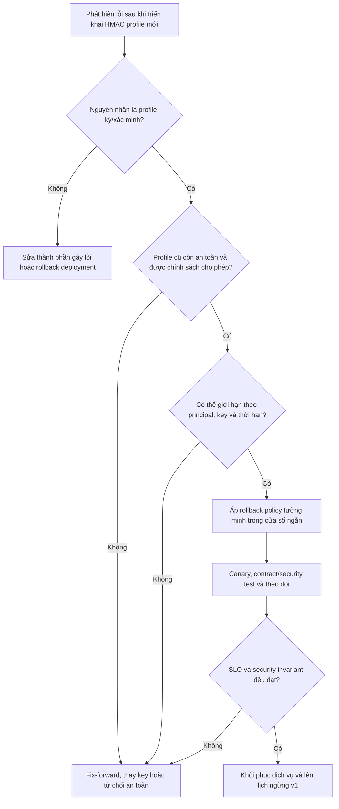

# Rollback algorithm trong HMAC Request Authentication

## 1. Vì sao thuật toán xác thực cần một phương án rollback?

Trong module **SECURITY_AUTHENTICATION_HMAC_REQUEST_AUTHENTICATION**, client dùng một **shared secret** để ký các byte của HTTP request đã được canonicalize; server tính lại HMAC để xác minh bên gửi và tính toàn vẹn của những trường được ký. Contract có thể bao gồm HTTP method, URI/query, header, body digest, timestamp và nonce. Sau xác thực, server mới quyết định principal đó có quyền truy cập tài nguyên hay không.

Giả sử một API đang dùng HMAC-SHA-256 và triển khai profile mới sử dụng HMAC-SHA-512. Khi chạy canary, một số client báo lỗi xác thực do SDK tạo sai canonical path sau khi qua reverse proxy. Nếu rollback thiếu kiểm soát, server có thể tự thử thuật toán cũ mỗi khi chữ ký mới thất bại; một tác nhân có khả năng gửi request tùy ý sẽ lợi dụng nhánh này để ép hệ thống chấp nhận cơ chế yếu hoặc hợp đồng ký không còn bảo vệ đầy đủ header quan trọng.

**Rollback algorithm** là hành động vận hành có chủ đích đưa một nhóm client hoặc dịch vụ từ profile ký/xác minh mới về **một profile cũ đã được xét duyệt và vẫn đủ an toàn**, trong phạm vi, thời hạn và chính sách được kiểm soát. Mục tiêu là khôi phục khả năng tương tác khi triển khai lỗi mà không làm mất các ràng buộc mật mã, chống replay, nhận dạng key và phân quyền.

Rollback là một thao tác **điều khiển từ cấu hình/chính sách đáng tin**; nó không phải quyền để request chưa xác thực tự chọn một thuật toán bất kỳ.

## 2. Phân biệt rollback với fallback, downgrade và key rotation

| Thuật ngữ | Diễn giải | Tình huống HMAC |
| --- | --- | --- |
| **Algorithm rollback** | Chủ hệ thống chủ động cho một principal quay về profile cũ còn được phép dùng. | Tạm chấp nhận profile `hmac-v1` cho partner A sau lỗi rollout `hmac-v2`. |
| **Automatic fallback** | Verifier âm thầm thử thuật toán/profile khác khi kiểm tra ban đầu thất bại. | Nhận `hmac-v2`, kiểm tra HMAC-SHA-512 sai rồi tự thử HMAC-SHA-256. **Không được làm**. |
| **Downgrade attack** | Kẻ tấn công khiến hai phía chấp nhận cơ chế yếu hơn mức chính sách quy định. | Client chỉ được dùng v2 nhưng request bị sửa version để server nhận theo v1. |
| **Key rotation** | Thay key ID/shared secret nhưng có thể giữ nguyên thuật toán và canonical contract. | Chuyển từ `key-2026-a` sang `key-2026-b` cùng `HmacSHA256`. |
| **Application rollback** | Quay về phiên bản phần mềm cũ; có thể hoặc không thay đổi signature profile được phép. | Triển khai lại server build trước nhưng phải giữ policy chống downgrade. |
| **Protocol/contract rollback** | Quay về cách canonicalize hoặc tập trường được ký của version cũ. | Profile cũ chưa ký `X-Tenant-Id`, nên rủi ro khác với chỉ đổi HmacSHA512 thành HmacSHA256. |

Một hệ thống có thể gặp lỗi ở SDK, cấu hình proxy, thứ tự canonicalization, service tra cứu key hoặc rollout phần mềm, dù thuật toán HMAC không hỏng. Vì vậy phải xác định **lớp gây lỗi** trước khi lựa chọn rollback: quay lại code, cấu hình gateway, profile ký hay key có tác động an toàn khác nhau.

> Nguyên tắc không thỏa hiệp: **không rollback về thuật toán/profile đã bị đánh dấu không an toàn hoặc không còn đáp ứng chính sách bảo mật, pháp lý của hệ thống**. Nếu profile cũ đã bị vô hiệu hóa do lộ key, thiếu ràng buộc trường phân quyền hoặc có lỗ hổng canonicalization, cần sửa tiếp trên profile mới (*fix-forward*), thay key hoặc tạm từ chối request; không mở lại profile cũ để giảm lỗi 401.

## 3. Định nghĩa profile để rollback không phụ thuộc vào suy đoán

Một **profile** phải cố định không chỉ tên thuật toán HMAC mà còn toàn bộ cách ký. Ví dụ minh họa trong bài, không phải một chuẩn giao thức HMAC mặc định:

| Thuộc tính | `hmac-v1` | `hmac-v2` |
| --- | --- | --- |
| MAC primitive | `HmacSHA256` (32 byte) | `HmacSHA512` (64 byte) |
| Wire signature | Base64url không padding của MAC | Base64url không padding của MAC |
| Body digest | SHA-256 trên byte body gốc theo hợp đồng | SHA-256 trên byte body gốc theo hợp đồng |
| Dữ liệu canonical | Profile ID, algorithm ID, method, path, query, signed headers, body digest, key ID, timestamp, nonce | Cùng nhóm trường, nhưng version và algorithm ID khác |
| Encoding | UTF-8; LF giữa các dòng; path/query normalization theo hợp đồng version | Cố định theo specification v2 đã phát hành |
| Key scope | Key ID liên kết với một principal, secret/version đã cấp phép | Key ID/principal và secret/version đã cấp phép riêng |
| Policy | Chỉ principal được phép v1 mới được xác minh | Chỉ principal được phép v2 mới được xác minh |

**Quan trọng:** ví dụ trên chỉ thể hiện cấu trúc cần mô tả. Một profile triển khai thực phải công bố đầy đủ thứ tự dòng canonical, cách mã hóa query (kể cả duplicate và `%2F`), quy tắc header trùng, cách xử lý body qua gateway và **golden vector** chứa canonical bytes/MAC đúng cho từng version. Không thể triển khai chỉ từ bảng tóm tắt.

### 3.1. Ràng buộc version và algorithm vào dữ liệu được ký

Với profile minh họa, client gửi:

```http
POST /v1/orders?tenant=alpha HTTP/1.1
X-HMAC-Version: hmac-v2
X-HMAC-Algorithm: hmac-sha-512
X-HMAC-Key-Id: alpha-v2-01
X-HMAC-Timestamp: 1795851000
X-HMAC-Nonce: 3ce015b8b90c4be2b8df61fb3194e164
X-Content-SHA256: <64-char-lowercase-hex-body-digest>
X-HMAC-Signature: <base64url-of-64-byte-mac>
```

Các trường **version, algorithm ID, key ID, timestamp, nonce, HTTP method, canonical URI, các header ràng buộc ngữ nghĩa và body digest** đều phải được đưa vào canonical bytes theo đúng profile. Giá trị `<...>` là placeholder giải thích định dạng, không phải một request ký hợp lệ để gửi đi. Header chữ ký tự nó không nằm trong dữ liệu cần ký. Nếu signature format dùng một scheme duy nhất để định danh profile và thuật toán, có thể không cần header thuật toán riêng, miễn là mọi lựa chọn đều được quy định và được MAC ràng buộc.

Profile ID phải ánh xạ **một-một** tới một đặc tả bất biến và thuật toán đã kiểm thử. Chẳng hạn, `hmac-v2` luôn ánh xạ tới `HmacSHA512`; không để request yêu cầu `hmac-v2` nhưng lại nêu `hmac-sha-256`. Giá trị thuật toán được đưa vào header **không được** truyền trực tiếp cho `Mac.getInstance()` nếu chưa qua allowlist và kiểm tra policy. Từ chối header trùng, thiếu hoặc có encoding mơ hồ trước khi chọn profile.

### 3.2. Những invariant phải giữ qua mọi lần rollback

1. **Một request chỉ được xác minh theo một profile đã khai báo và được chính sách cho phép**; MAC sai thì từ chối, không thử profile khác.
2. **Profile và thuật toán được bảo vệ bởi chính MAC đó**, nên sửa version/algorithm mà giữ chữ ký cũ phải khiến xác minh thất bại.
3. **Version policy gắn với principal/key thực**, không dựa hoàn toàn vào một client ID chưa xác thực do request tự nhập.
4. **Shared secret không bị suy ra từ request**. Nếu duy trì cả hai profile, ưu tiên key khác nhau cho từng profile hoặc tạo key có tách biệt ngữ cảnh được thiết kế và phê duyệt; lưu secret trong key store, không log secret.
5. **Timestamp và nonce vẫn bắt buộc**, kể cả trong thời gian rollback. Replay state cần ngăn cùng nonce được dùng lại trong phạm vi principal đã định ngay cả khi request được ký ở profile khác.
6. **Phân quyền không thay đổi:** HMAC đúng chỉ chứng minh nguồn sở hữu secret và tính toàn vẹn của trường đã ký; không tự cấp quyền tenant/resource.
7. **Canonicalization không được “nới lỏng” cho hợp với cả hai profile**. URI, query, header và body chỉ được xử lý theo profile đã cố định.

## 4. Khi nào được rollback, khi nào phải fix-forward?

### Bảng quyết định

| Tình huống phát hiện | Có thể rollback algorithm? | Cách xử lý ưu tiên |
| --- | --- | --- |
| SDK v2 ký sai thứ tự query, v1 vẫn bảo vệ đủ trường và còn được phê duyệt | **Có điều kiện** | Tạm cho nhóm client bị ảnh hưởng dùng v1; phát hành SDK v2 đã sửa. |
| Proxy mới rewrite path khiến v2 canonical request lệch | **Có điều kiện** | Xem xét rollback cấu hình gateway trước; chỉ mở v1 nếu v1 không chứa chính lỗi tương tự. |
| Lỗi cấu hình thuật toán trên một replica, v1 còn an toàn | **Có điều kiện** | Sửa triển khai/roll back deployment; giới hạn policy v1 theo client nếu thật sự cần. |
| Client không có key v2 do provisioning chưa xong | **Có điều kiện** | Hoàn tất cấp key hoặc tạm giữ v1 cho client đó; không dùng key lạ/bỏ qua MAC. |
| Secret của profile v1 bị lộ hoặc bị revoke | **Không** | Giữ v1 bị chặn, rotate/revoke key, phục hồi bằng profile/key an toàn. |
| v1 không ký `X-Tenant-Id` nhưng routing/authorization tin vào header này | **Không**, nếu có thể gây thay đổi quyền/tenant | Sửa hợp đồng ký, ràng buộc tenant; không mở lại đường bỏ qua kiểm tra tính toàn vẹn. |
| Thuật toán cũ bị policy cấm, thiếu yêu cầu tuân thủ hoặc có kết luận mật mã không đủ an toàn | **Không** | Fix-forward hoặc tạm chặn; đánh giá rủi ro chính thức trước khi thiết kế một phương án khác. |
| Nonce store/Redis không khả dụng | **Không phải lỗi thuật toán** | Fail-closed cho request cần replay protection; phục hồi dependency. |
| Verifier từ chối sai do timestamp drift | Thường **không cần** | Đồng bộ clock và kiểm thử biên cửa sổ thời gian; không tắt timestamp check. |

Điều kiện cốt lõi là **trạng thái bảo mật của profile cũ tại thời điểm rollback**, không phải việc nó “đã từng chạy tốt”. HMAC-SHA-256 và HMAC-SHA-512 đều là những primitive có thể được dùng an toàn khi thiết kế đúng; việc chọn một loại không tự chứng minh phiên bản còn lại yếu. Rủi ro thường nằm ở key strength, tập trường được ký, canonicalization, chính sách client và vận hành replay store. Không phân loại độ an toàn chỉ từ tên gọi “v1/v2”.



## 5. Mô hình điều khiển rollback theo policy

### 5.1. Không đồng nghĩa dual support với downgrade tự do

Để chuyển version an toàn, server có thể hỗ trợ code xác minh cả hai profile trong một thời gian, nhưng policy phải phân biệt chính xác nhóm nào được phép sử dụng version nào:

| Principal / key scope | Trước sự cố | Trong rollback có kiểm soát | Sau khắc phục |
| --- | --- | --- | --- |
| Partner A, `key-a-v1` | Đang chuyển lên v2; v1 tạm còn được phép | Cho phép **v1 chỉ với key và principal A** đến mốc hết hạn | Chặn v1 sau khi A chuyển thành công. |
| Partner A, `key-a-v2` | Chỉ v2 | Tiếp tục chấp nhận v2 nếu đã hoạt động đúng | Chỉ v2. |
| Partner B, v2-only | Chỉ v2 | **Vẫn chỉ v2** | Chỉ v2. |
| Client mới | Chỉ v2 | **Vẫn chỉ v2** | Chỉ v2. |

Sự tồn tại của code `HmacSHA256` trong server không có nghĩa mọi caller được phép dùng nó. Một client bị cấu hình `v2-only` mà gửi **MAC v1 đúng** vẫn phải bị từ chối. Ngay cả trong rollback, việc tạo ra v1 signed request là lựa chọn từ **cấu hình signer được triển khai tin cậy** cho đối tác A, không phải phản ứng tự động khi nhận `401`.

### 5.2. Ví dụ cấu hình rollback (minh họa)

```yaml
hmac:
  profiles:
    hmac-v1:
      macJcaName: HmacSHA256
      tagBytes: 32
      state: verify-only
    hmac-v2:
      macJcaName: HmacSHA512
      tagBytes: 64
      state: active
  policies:
    partner-a:
      allowedKeyProfiles:
        key-a-v1: [hmac-v1]
        key-a-v2: [hmac-v2]
    partner-b:
      allowedKeyProfiles:
        key-b-v2: [hmac-v2]
  temporaryRollback:
    enabledFor: [partner-a]
    reason: "INC-EXAMPLE: canonical path mismatch in v2 SDK"
    expiresAtUtc: "2027-01-15T12:00:00Z"
```

Đây chỉ là **mô hình cấu hình**, không phải tên property Spring Security có sẵn. Một hệ thống thực cần xác định cách bind key ID với principal, quyền chỉnh chính sách, cấu hình được ký/kiểm toán, cách phân phối xuống các replica, hết hạn tự động và trạng thái khi cập nhật thất bại. `verify-only` nghĩa là server chấp nhận xác minh request v1 cho nhóm được phép; các client mới không được tự động phát hành v1. Mốc ngày ở trên chỉ để minh họa một trường cấu hình, không phải thời hạn khuyến nghị chung.

Để tránh tình trạng một replica đã chặn v1 nhưng replica khác vẫn chấp nhận, policy nên có version nội bộ và cơ chế cập nhật nhất quán. Khi policy hết hạn, server phải từ chối profile cũ kể cả khi cấu hình cục bộ hoặc cache key chưa làm mới; nếu làm mới lỗi, chọn hành vi fail-closed theo thiết kế. Không để kill switch mở v1 toàn cục theo biến môi trường không được kiểm soát.

### 5.3. Luồng xác minh theo đúng một thuật toán

Pseudocode minh họa **ràng buộc policy và chọn thuật toán** (các hàm như `canonicalize`, `checkTimestamp`, `verifyBodyDigest`, `recordNonceAtomically` phải được hiện thực và kiểm thử riêng):

```java
VerificationResult verify(HttpRequest request) {
    // Không chấp nhận header bắt buộc trùng, sai encoding, sai độ dài.
    SignatureEnvelope e = parseStrictly(request);

    // Profile ID chỉ được dùng như selector ban đầu, chưa được tin cậy.
    HmacProfile p = approvedProfiles.get(e.version());
    if (p == null || !p.algorithmId().equals(e.algorithmId())) {
        return reject("unsupported_profile");
    }

    // Key ID trỏ tới record gắn với principal, trạng thái key và profile.
    // Tra cứu phải có giới hạn độ dài input, timeout và quota phù hợp.
    KeyRecord key = keyStore.findBounded(e.keyId());
    if (key == null || !policy.allows(key.principal(), key.id(), p.id())) {
        return reject("profile_not_allowed");
    }
    if (!checkTimestamp(e.timestamp(), trustedClock)) {
        return reject("expired_or_future");
    }

    byte[] canonical = canonicalizeStrictly(request, p);
    // Canonical bytes bao gồm version, algorithm ID, key ID, timestamp,
    // nonce, method, URI, signed headers và body digest theo profile.
    if (!verifyBodyDigest(request, e.digest())) {
        return reject("body_digest_mismatch");
    }

    byte[] supplied = strictBase64urlDecode(e.signature());
    if (supplied.length != p.tagLength()) {
        return reject("invalid_tag_length");
    }
    byte[] expected = macWithFixedAlgorithm(p.jcaMacName(), key.secret(), canonical);
    if (!java.security.MessageDigest.isEqual(expected, supplied)) {
        return reject("bad_mac"); // Tuyệt đối không thử profile khác.
    }

    // Dùng namespace replay đủ bao trùm các version theo policy;
    // ghi nonce nguyên tử với TTL phủ toàn bộ cửa sổ chấp nhận timestamp.
    if (!replayStore.recordNonceAtomically(key.principal(), e.nonce(), e.timestamp())) {
        return reject("replay_or_replay_store_unavailable");
    }
    return authenticated(key.principal()); // Sau đó kiểm tra authorization.
}
```

Mã trên thể hiện **flow**, chưa phải implementation copy/paste an toàn: phải chốt cách lấy raw body từ Servlet/WebFlux, size limit, kiểm tra key đã revoke, xử lý lỗi store fail-closed, format canonical chính xác, đối chiếu tag có độ dài cố định và giới hạn logging. Quan trọng nhất là **không có nhánh `if HMAC v2 fails, try v1`**. Profile được chọn trước từ định danh công khai, nhưng chỉ trở thành đáng tin sau khi chữ ký đúng và policy key/principal đã được xác minh.

## 6. Runbook triển khai rollback có kiểm soát

### Giai đoạn A — Đánh giá sự cố và khóa phạm vi

1. **Xác định triệu chứng:** tăng `401`, MAC mismatch, latency key provider, lỗi timestamp hay replay; tách nhóm theo principal, signature version, key state và đường qua proxy. Không log shared secret, raw body nhạy cảm hoặc chữ ký của khách hàng.
2. **Phân loại nguyên nhân:** so sánh canonical bytes trên fixture đã được làm sạch, body digest, method/path/query/header ở điểm ký và điểm verify. Nếu lỗi do gateway rewrite, có thể cần rollback gateway thay vì algorithm.
3. **Kiểm tra profile cũ có còn được phép không:** xem key compromise, tập trường đã ký, chính sách tuân thủ và mốc vô hiệu hóa trước đây. Nếu bị cấm, chuyển sang fix-forward.
4. **Đóng băng mở rộng rollout mới:** dừng đưa thêm client vào profile lỗi; giữ client đã chạy v2 ổn định trên v2.

### Giai đoạn B — Áp policy và kiểm chứng

5. **Chọn scope nhỏ nhất:** đúng principal + key ID + profile + region/endpoint nếu cần. Tạo incident ID, người chịu trách nhiệm, mốc hết hạn, điều kiện thu hồi và lịch kiểm tra lại; kích hoạt qua hệ thống cấu hình có phân quyền và audit log.
6. **Triển khai ở server trước khi đổi client:** bảo đảm chỉ key/profile được whitelist mới được nhận, các replica đồng bộ policy và bộ kiểm tra replay dùng chung vẫn hoạt động. Khi cần rollback signer phía client, chọn profile bằng cấu hình phiên bản đáng tin, không tự thử lại với version cũ khi nhận lỗi.
7. **Chạy canary có golden vectors:** gửi request ký hợp lệ theo profile cũ cho client trong scope; thử client v2-only với chữ ký cũ **đúng** để chứng minh bị từ chối; thử request sửa version/algorithm nhưng giữ MAC để chứng minh ràng buộc chữ ký.
8. **Theo dõi tối thiểu:** tỷ lệ authentication theo version/principal, `401`/`429`/`5xx`, p95/p99, tỷ lệ replay reject, cache/key lookup, số request vượt policy và hiệu lực cấu hình giữa các replica.

### Giai đoạn C — Khôi phục và đóng rollback

9. **Sửa gốc lỗi và phát hành v2 đã khắc phục:** xác nhận canonical request, proxy rewrite, body handling và signed headers bằng contract test qua gateway thực.
10. **Di chuyển client về version mục tiêu:** dùng canary và quota theo client; khi v2 ổn định, ngừng phát request v1. Không tái sử dụng nonce đã ký khi đổi profile.
11. **Hết hạn policy rollback:** tự động chặn v1 theo mốc đã cấu hình; thử lại bằng **MAC v1 hợp lệ** để bảo đảm thực sự bị từ chối. Đánh giá revoke key cũ và gỡ profile code khi không còn khách hàng phụ thuộc.
12. **Lưu dấu vết:** ghi nguyên nhân, phạm vi, thời gian, quyết định chấp nhận rủi ro, kết quả kiểm thử, metric trước/sau và người phê duyệt. Đưa case phát sinh thành contract/security regression test.

Phương án khôi phục cần được thử trước sự cố: nếu tool quản trị không cập nhật policy kịp hoặc cache không đồng nhất, ưu tiên giảm rollout, chuyển traffic về phiên bản server ổn định hoặc từ chối an toàn theo kế hoạch. Không “khôi phục dịch vụ” bằng cách bỏ qua MAC, tắt timestamp/nonce hoặc bỏ authorization.

## 7. Giữ đúng replay protection, key rotation và phân quyền khi rollback

### 7.1. Replay không được “reset” theo algorithm

Với HMAC request authentication, một request hợp lệ thường chứa `timestamp` và `nonce` được ký. Replay store có thể dùng khóa logic dựa trên **principal và nonce** trong phạm vi đã định, thay vì chỉ dựa trên `(profile, nonce)`; nếu tách cache theo profile mà không có cơ chế liên kết, cùng nonce có thể được nhận một lần ở v1 và một lần ở v2 khi caller ký lại cùng tác vụ.

```text
Ví dụ (cùng principal và cùng nonce N):
  Request A: HMAC v2, nonce N -> ACCEPT, ghi (principal, N)
  Request B: HMAC v1, nonce N -> REJECT replay

Thiết kế thiếu liên kết:
  Cache key (principal, hmac-v2, N) != (principal, hmac-v1, N)
  -> Có nguy cơ cùng một nonce đi qua hai profile.
```

Thiết kế chính xác phải cân nhắc namespace nonce, key rotation, principal scope và nghiệp vụ. TTL cần phủ **đến mốc timestamp hết hạn có thể được server chấp nhận**, kể cả khi đồng hồ lệch; `SET NX` với TTL (hoặc unique constraint tương đương) phải nguyên tử trên cụm node. Chỉ ghi nonce **sau khi xác minh MAC và body digest đúng**; MAC sai không được chiếm nonce của request hợp lệ. Nếu replay store cần thiết bị lỗi, fail-closed theo policy.

### 7.2. Key cũ và thuật toán cũ là hai quyết định riêng

- Nếu rollback phải dùng lại `key-a-v1`, kiểm tra trạng thái active, expiry, principal binding và lý do từng bị revoke. Key bị lộ hoặc đã revoke không thể được hồi sinh chỉ bằng cách mở lại thuật toán.
- Nếu cả v1 và v2 cùng tồn tại, nên cấp secret riêng hoặc dùng KDF/tách ngữ cảnh có thiết kế rõ; việc dùng cùng byte secret cho hai profile cần đánh giá rủi ro và ràng buộc domain/version vào message được ký.
- Trong thời gian key rotation, signer chọn một key ID/profile được cấp phép; verifier không thử một danh sách key cũ mới cho tới khi một MAC trùng. Key lookup nên theo key ID đã giới hạn và kiểm tra binding, có timeout/quota chống key ID churn.
- Khi tắt rollback, revoke hoặc ngừng chấp nhận key chỉ dành cho v1 theo quy trình quản lý credential, thay vì xóa bừa key đang dùng ở profile khác.

### 7.3. Authentication không phải authorization

Server có thể xác thực HMAC v1 thành công nhưng vẫn phải từ chối `403` nếu principal không được phép gọi API hoặc thao tác trên tenant/resource. Nếu profile v1 không ký một header ảnh hưởng đến quyết định phân quyền như `X-Tenant-Id` hoặc `Host`, việc mở lại v1 có thể là lỗi thiết kế nghiêm trọng ngay cả khi HMAC-SHA-256 còn an toàn về mặt mật mã. Trong trường hợp đó, phải sửa profile hoặc siết cách xác định tenant từ danh tính đã xác thực; không coi chữ ký đúng là bằng chứng rằng header chưa ký không bị sửa.

## 8. Contract testing và security testing cho rollback

Mọi thay đổi algorithm agility phải có **golden vectors độc lập** cho từng profile, bao gồm byte canonical (có version/algorithm ID), body digest và MAC. Client SDK và server/gateway phải kiểm tra được cùng fixture nhưng không phụ thuộc vào một implementation canonicalization dùng chung có thể sai theo cùng một cách.

| Case | Input / điều kiện | Kỳ vọng |
| --- | --- | --- |
| R01 — v2 active | Key được phép v2, request ký đúng v2, timestamp/nonce hợp lệ | Authenticated; authorization xử lý độc lập. |
| R02 — rollback v1 cho A | Principal A được whitelist tạm, key v1 active, MAC v1 hợp lệ | Authenticated trong cửa sổ rollback. |
| R03 — v1 đúng nhưng ngoài scope | Principal B là v2-only; gửi MAC v1 **đúng** với key/test identity tương ứng | Từ chối vì profile không được phép. |
| R04 — unknown profile | Header version/algorithm lạ, bị thiếu, lặp hoặc không khớp nhau | Từ chối; không gọi `Mac.getInstance()` theo chuỗi tùy ý. |
| R05 — downgrade tampering | Đổi `hmac-v2` thành `hmac-v1` trong header nhưng giữ MAC v2 | Từ chối; không fallback. |
| R06 — bad MAC | Key ID hợp lệ, profile cho phép nhưng sửa một byte body, URI/query/header đã ký hoặc MAC | Từ chối; không thử thuật toán thứ hai. |
| R07 — rollback expiry | Clock test chuyển qua mốc `expiresAtUtc` | V1 bị từ chối ngay cả khi MAC v1 đúng. |
| R08 — profile removed | Profile cũ bị policy cấm hoặc key revoke | Từ chối bất kể rollback flag còn bật. |
| R09 — key binding | Dùng key ID của principal khác, hoặc key dùng không đúng profile | Từ chối, không ánh xạ sang principal do request tự khai. |
| R10 — replay đa profile | Cùng principal + nonce ký hợp lệ lần lượt theo v2 rồi v1 | Lần sau bị chặn theo replay policy đã công bố. |
| R11 — concurrent replay | Nhiều request hợp lệ cùng nonce đến các replica đồng thời | Tối đa một lần được authenticated/ghi nonce. |
| R12 — timestamp skew | Timestamp cũ, tương lai và đúng hai biên cửa sổ | Xử lý đúng policy của profile; rollback không nới cửa sổ. |
| R13 — dependency outage | Key store hoặc nonce store lỗi khi rollback bật | Fail-closed, không trả kết quả authenticated do bypass. |
| R14 — proxy compatibility | Same signed request đi qua gateway rewrite path/host/query/body | Canonical bytes đúng contract hoặc request bị từ chối; không tự nới normalization. |
| R15 — authorization | HMAC v1 hợp lệ nhưng resource/tenant không được phép | Authentication đúng; authorization từ chối, không có side effect trái quyền. |
| R16 — cross-replica policy | Một replica nhận policy mới, replica còn stale cache hoặc kết nối rollout bị ngắt | Không có node tiếp tục chấp nhận version đã hết hạn ngoài chính sách đã công bố. |
| R17 — observation | Canary rollback và việc chặn sau khi hết hạn | Metric/log thể hiện version, principal đã được kiểm soát, kết quả; không rò secret, MAC/nonce thô. |

### Một kiểm thử Java minh họa: policy chặn fallback

Đoạn JUnit 5 dưới đây kiểm tra riêng **hàm lựa chọn profile theo policy**; đây là unit test của selector, **không thay thế** test ký/xác minh HMAC, canonical byte, replay store và Spring Security filter thực tế.

```java
import static org.junit.jupiter.api.Assertions.*;

import java.util.Map;
import java.util.Set;
import org.junit.jupiter.api.Test;

class RollbackProfilePolicyTest {
    record Profile(String id, String jcaAlgorithm) {}

    static final Map<String, Profile> PROFILES = Map.of(
        "hmac-v1", new Profile("hmac-v1", "HmacSHA256"),
        "hmac-v2", new Profile("hmac-v2", "HmacSHA512")
    );

    static Profile choose(String claimedVersion, Set<String> allowedVersions) {
        Profile requested = PROFILES.get(claimedVersion);
        if (requested == null || !allowedVersions.contains(claimedVersion)) {
            throw new SecurityException("signature profile denied");
        }
        return requested;
    }

    @Test
    void v2OnlyClientCannotUseValidV1() {
        assertThrows(SecurityException.class,
            () -> choose("hmac-v1", Set.of("hmac-v2")));
    }

    @Test
    void rollbackAllowsOnlyExplicitClientScope() {
        Set<String> partnerA = Set.of("hmac-v1", "hmac-v2");
        Set<String> partnerB = Set.of("hmac-v2");
        assertEquals("HmacSHA256", choose("hmac-v1", partnerA).jcaAlgorithm());
        assertThrows(SecurityException.class,
            () -> choose("hmac-v1", partnerB));
    }

    @Test
    void unsupportedProfileIsNeverGuessed() {
        assertThrows(SecurityException.class,
            () -> choose("HmacSHA1", Set.of("hmac-v1", "hmac-v2")));
    }
}
```

Trong production, tập `allowedVersions` phải lấy từ **policy gắn với key record/principal đã được xác minh**, có trạng thái key, phạm vi và thời hạn; không lấy nguyên từ request. Phép thử quyết định nhất là **một chữ ký v1 hợp lệ** bị từ chối với client v2-only: chỉ thử MAC giả sai không thể chứng minh server đã chống downgrade.

### Kiểm thử qua Spring Security và gateway

Với ứng dụng Servlet, dùng `MockMvc` hoặc integration test qua HTTP thực đi qua filter HMAC rồi Spring Security authorization; với WebFlux, dùng `WebTestClient` qua authentication `WebFilter` thực. Kiểm tra cache/stream body đúng byte, filter ordering, principal chỉ được tạo sau khi MAC và nonce hợp lệ. Tiến hành thêm test end-to-end qua load balancer/reverse proxy để phát hiện rewrite URI, percent-encoding, forwarded host và content encoding làm sai canonical request. Có thể chạy compatibility matrix giữa client v1/v2 và policy trước/trong/sau rollback theo contract đã chốt.

## 9. Quan sát trong thời gian rollback và điều kiện đóng sự cố

Một rollback thành công phải vừa khôi phục khả năng tương tác vừa **không nới phạm vi chấp nhận chữ ký**. Dashboard cần theo dõi ít nhất:

- Số request theo `signature_profile`, `decision` (`accepted`, `bad_mac`, `profile_denied`, `replay`, `expired`, `key_revoked`) và nhóm principal đã phân loại, có cardinality kiểm soát.
- Tỷ lệ MAC mismatch, 401/403/429/5xx, p95/p99 của request hợp lệ; so sánh canary rollback với nhóm v2 không bị ảnh hưởng.
- Số key lookup lỗi, cache stale, độ trễ nonce store, tỷ lệ replay reject và chênh lệch policy version trên các replica.
- Tỷ lệ client còn gửi v1, số lần request v1 ngoài allowlist bị chặn và thời gian còn lại tới `expiresAtUtc`.
- Audit trail của mỗi lần bật/tắt rollback, người phê duyệt, incident ID, lý do, phạm vi và thời điểm hết hạn.

Tránh log shared secret, raw signature, đầy đủ nonce, body nhạy cảm hoặc key ID chưa được kiểm soát. Ghi mã lỗi đã phân loại, request/correlation ID an toàn và thông tin version vừa đủ để điều tra. Khi mốc kết thúc được áp dụng, kiểm thử lại bằng request v1 có **MAC đúng** và đối chiếu toàn bộ replica; “không còn thấy traffic v1” chưa chứng minh server đã từ chối v1.

## 10. Tình huống thực hành: SDK v2 lỗi canonical path sau proxy

**Bối cảnh:** API đặt sau gateway. Phiên bản cũ `hmac-v1` dùng HmacSHA256, phiên bản mới `hmac-v2` dùng HmacSHA512; cả hai có shared-secret/key ID và ràng buộc timestamp/nonce. Đội triển khai phát hành SDK v2 cho 10% đối tác. Một nhóm request có path chứa `%2F` bị SDK canonicalize khác với verifier sau gateway nên bị từ chối `401`.

**Quyết định:** trước tiên xác nhận lỗi nằm ở cách canonicalize/path rewrite, không ở tính chất mật mã của SHA-512. Nếu v1 **vẫn có cùng đầy đủ trường cần ký, còn an toàn và được policy cho phép**, có thể mở rollback ngắn hạn cho các key v1 của nhóm đối tác bị ảnh hưởng. Giữ các đối tác v2 đã hoạt động bình thường trên v2. Nếu v1 từng bỏ qua đường dẫn sau gateway hoặc header định tuyến làm thay đổi tenant, không mở v1; sửa SDK/gateway và triển khai lại v2.

**Các bằng chứng cần có:** fixture độc lập chứng minh input `%2F` tạo canonical bytes kỳ vọng; request v1 hợp lệ của đối tác được whitelist được xác thực; request v1 hợp lệ của đối tác v2-only bị từ chối; sửa header version mà giữ MAC không hợp lệ; replay cùng nonce trên các replica bị chặn; request authenticated vẫn qua authorization bình thường. Sau khi SDK mới được triển khai, quan sát tỷ lệ 401 trở lại baseline, hết hạn rollback, bảo đảm không replica nào còn nhận v1 ngoài policy.

**Câu hỏi kiểm tra:**

1. Vì sao giảm yêu cầu từ HmacSHA512 xuống HmacSHA256 **không tự động** có nghĩa là kém an toàn, nhưng quay về một profile bỏ qua tenant header lại nguy hiểm?
2. Vì sao verifier thử HmacSHA256 sau khi HmacSHA512 thất bại là một đường downgrade, trong khi một allowlist rollback do operator cấu hình có thể chấp nhận được?
3. Nếu Redis nonce store mất kết nối khi rollback đang bật, có thể “tạm bỏ qua replay” để phục hồi tỷ lệ thành công không? Hệ quả bảo mật là gì?
4. Một client gửi request có MAC v1 đúng sau thời điểm hết hạn rollback phải nhận kết quả nào? Test ở lớp nào chứng minh điều này trên toàn cụm?
5. Khi rollback, bạn cần kiểm tra đồng thời trường nào được ký, key ID/principal, timestamp/nonce, path gateway và quyền truy cập để kết luận không có bypass?

## 11. Checklist trước khi tuyên bố rollback an toàn

- [ ] Đã phân loại nguyên nhân sự cố và xác nhận rollback đúng **profile** cần khôi phục.
- [ ] Profile cũ vẫn được phê duyệt về thuật toán, canonicalization, signed fields, key state và yêu cầu tuân thủ.
- [ ] Chỉ principal/key được chỉ định mới được phép dùng version cũ; có thời hạn, owner, incident ID và audit log.
- [ ] Version/algorithm/key ID được MAC ràng buộc; verifier chọn đúng **một** profile và không fallback khi MAC sai.
- [ ] Client v2-only bị từ chối ngay cả khi gửi MAC v1 hợp lệ; không có nhánh downgrade tự động.
- [ ] Body digest, timestamp, nonce và distributed replay guard vẫn hoạt động; lỗi dependency không làm fail-open.
- [ ] Key bị revoke/compromised vẫn bị chặn; key rotation và algorithm rollback được quản lý riêng.
- [ ] HTTP method, URI/query/header/body qua gateway được xác minh theo đúng canonical contract, không hợp thức hóa dữ liệu mơ hồ.
- [ ] Authentication và authorization được kiểm tra riêng; tenant/resource không thể bị đổi qua trường chưa ký.
- [ ] Có golden vectors, contract tests, replay/concurrency tests, kiểm thử hết hạn policy và quan sát giữa các replica.
- [ ] Đã có kế hoạch sửa gốc lỗi, ngừng rollback và xác minh hệ thống từ chối chữ ký v1 đúng sau khi kết thúc.

**Kết luận:** Algorithm agility chỉ phát huy giá trị khi hệ thống có thể chuyển profile HMAC theo một hợp đồng rõ ràng và một chính sách được kiểm soát. Rollback an toàn là một thay đổi tạm thời, có phạm vi và có khả năng kiểm chứng; bất kể đang dùng profile nào, server vẫn phải xác minh đúng canonical request, chữ ký, timestamp/nonce, key/principal và phân quyền.
