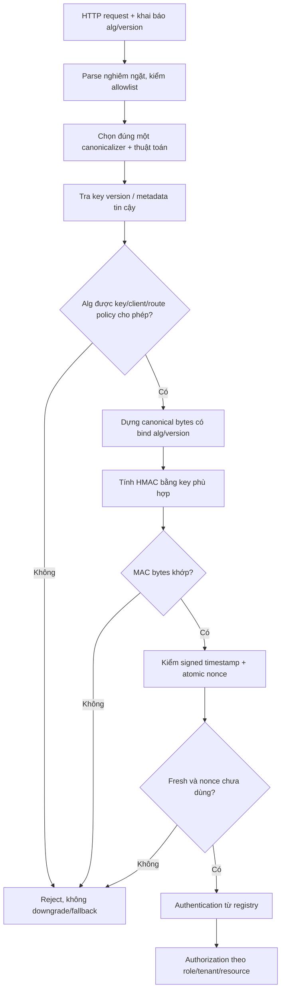
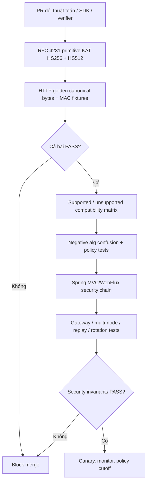

# Kiểm thử tương thích khi chuyển thuật toán HMAC: an toàn qua nhiều phiên bản

## 1. Bối cảnh và mục tiêu của bài học

Trong module `SECURITY_AUTHENTICATION_HMAC_REQUEST_AUTHENTICATION`, client và server sử dụng **shared secret** để tính chữ ký HMAC cho HTTP request. Dữ liệu ký được xây dựng thành **canonical request** theo một hợp đồng gồm HTTP method, URI/query, các header được ký và/hoặc body digest. Verifier phải kiểm chữ ký, chống replay bằng timestamp/nonce, quản lý vòng đời key/rotation, xử lý proxy/gateway và cuối cùng tách **authentication** khỏi **authorization**.

Ban đầu, một hệ thống có thể chỉ hỗ trợ HMAC-SHA256. Về sau, nhóm phát triển muốn bổ sung HMAC-SHA512, thay đổi provider mật mã hoặc bỏ một thuật toán cũ. Nhu cầu này thuộc **algorithm agility**: khả năng lựa chọn, thay thế và loại bỏ thuật toán theo **chính sách có kiểm soát**, không phải khả năng để bất kỳ request nào tự quyết định thuật toán mà server phải tin.

Thách thức của giai đoạn chuyển đổi:

- Client cũ chỉ ký `HS256`, client mới đã hỗ trợ `HS512`.
- Một số instance backend nhận biết `HS512`, số khác chưa được cập nhật.
- Gateway giữ nguyên signature nhưng sửa header thuật toán hoặc canonical target.
- Key registry có key ACTIVE nhưng policy của key hoặc endpoint chưa cho phép thuật toán mới.
- Client nhận `401` rồi thử một thuật toán yếu hơn, dẫn tới **downgrade** không mong muốn.
- Nonce đã dùng với thuật toán cũ lại được chấp nhận khi chuyển sang thuật toán mới.
- Hai bên cùng dùng thuật toán đúng nhưng khác output encoding, signed headers hoặc canonical bytes.

**Kiểm thử tương thích trong Algorithm agility** phải chứng minh hai điều đồng thời: **tổ hợp thuật toán/phiên bản được hỗ trợ hoạt động đúng** và **tổ hợp không được phép luôn bị từ chối an toàn**. Chỉ thấy một request trả 200 không đủ; phải có bằng chứng HMAC, timestamp/nonce, key policy và authorization đều được thực hiện.

Mục tiêu học tập:

1. Phân biệt các trục thay đổi: thuật toán HMAC, canonicalization version, key version và policy revision.
2. Định nghĩa allowlist, mã thuật toán, cách bind thuật toán vào chữ ký và nguyên tắc **không fallback**.
3. Xây ma trận consumer–provider và **known-answer vectors** độc lập cho HMAC-SHA256/HMAC-SHA512.
4. Viết Java/JUnit kiểm thuật toán, canonical bytes, độ dài MAC, encoding và sai lệch chỉ một byte.
5. Kiểm migration, key rotation, replay, multi-instance, proxy/gateway, Spring MVC/WebFlux và 401/403.
6. Thiết kế CI/CD gates, telemetry và quy trình loại bỏ thuật toán cũ có thời hạn.

> **Phạm vi:** Bài minh họa một hợp đồng HMAC nội bộ với `HS256` và `HS512` làm hai mã thuật toán trong allowlist. Các mã trùng cách viết thường thấy ở JWS, nhưng đây **không phải** lời khẳng định ứng dụng đang triển khai JWS/JWT hay kế thừa toàn bộ quy tắc của JWS. Mọi chi tiết canonical request và định dạng header phải do giao thức HTTP HMAC của dự án quy định.

## 2. Algorithm agility là gì, và không phải là gì?

**Algorithm agility** là năng lực quản lý vòng đời thuật toán mật mã mà không phải viết lại toàn bộ hệ thống, thông qua một lớp chính sách và giao thức rõ ràng:



Một hệ thống **không agile** có thể hardcode `Mac.getInstance("HmacSHA256")` ở nhiều nơi, không có policy version, không có test vectors, và phải sửa toàn bộ client khi thay thuật toán.

Một hệ thống **agile nhưng không an toàn** có thể tin trực tiếp `X-Hmac-Alg` rồi cho client chọn `none`, algorithm name tùy ý hoặc một thuật toán bị cấm. Đó **không phải** kết quả mong muốn.

### 2.1. Bốn trục thay đổi độc lập

| Trục | Ví dụ | Quyết định gì? |
| --- | --- | --- |
| **MAC algorithm** | `HS256` → `HS512` | Primitive HMAC và độ dài MAC |
| **Canonicalization version** | `HMAC-ALG-V1` → `HMAC-ALG-V2` | Bytes nào được ký, thứ tự/encoding các trường |
| **Key version** | `client-A-key-3` → `client-A-key-4` | Shared secret nào được tra và trạng thái ACTIVE/REVOKED |
| **Policy/config revision** | `revision 117` → `118` | Client/endpoint nào được phép dùng algorithm/key/version tại thời điểm xác minh |

Đổi thuật toán **không nhất thiết** phải đổi format canonical nếu contract đã có signed algorithm identifier. Đổi key cũng **không tự động** đồng nghĩa đổi thuật toán. Ngược lại, nếu format v1 vốn không bind algorithm và policy không thể cưỡng chế an toàn, một phiên bản giao thức mới **có thể bắt buộc** khi bổ sung agility.

### 2.2. Các bất biến không được mất khi nâng cấp

Một request được chấp nhận chỉ khi:

1. Parser đã xác định đúng **một** algorithm identifier thuộc allowlist.
2. Algorithm identifier và protocol version được **ràng buộc trong dữ liệu ký** hoặc có cơ chế binding có hiệu lực tương đương, được kiểm thử.
3. Key version đang có hiệu lực, đúng client/tenant/scope và **được policy cho phép dùng thuật toán đó**.
4. Client và server canonicalize đúng cùng bytes; chữ ký có đúng độ dài/encoding theo thuật toán.
5. So MAC dựa trên **byte arrays** theo phương pháp an toàn, không dùng so chuỗi rút gọn/tự viết với early exit.
6. Timestamp/nonce được ký và chống replay nguyên tử.
7. `Authentication` được tạo từ metadata đã được xác minh; `Authorization` vẫn kiểm quyền độc lập.

Nếu bất kỳ điều kiện nào không rõ do dependency outage hoặc metadata stale vượt policy, không được **fail open** bằng cách cho qua một thuật toán khác.

## 3. Định nghĩa hợp đồng thuật toán HMAC rõ ràng

### 3.1. Allowlist cụ thể và mapping tới JCA

Một registry thuật toán minh họa:

| Mã trên HTTP | JCA algorithm | Digest/MAC đầy đủ | Output hex lowercase | Trạng thái ví dụ |
| --- | --- | --- | --- | --- |
| `HS256` | `HmacSHA256` | 32 bytes | 64 ký tự | ACTIVE |
| `HS512` | `HmacSHA512` | 64 bytes | 128 ký tự | ACTIVE hoặc PREPARING |
| `none`, chuỗi bất kỳ, algorithm không rõ | Không có | Không xác định | Không chấp nhận | **REJECT** |

`HmacSHA256` và `HmacSHA512` là các tên chuẩn thường được JCA provider trong Java hỗ trợ. Phải kiểm provider thực tế của runtime và policy của deployment; không tạo algorithm name từ raw HTTP header rồi truyền thẳng vào `Mac.getInstance(...)`.

**HMAC-SHA512 không tự động cải thiện bảo mật của mọi hệ thống** nếu shared secret yếu, canonicalization sai, nonce store không nguyên tử hoặc quyền bị cấp quá rộng. Chọn thuật toán phải dựa trên security policy và hiệu năng đã đo, không dựa vào việc tên “512” trông mạnh hơn.

### 3.2. Khóa HMAC là bytes, không phải tên thuật toán

Các giá trị sau khác nhau:

```text
key bytes (hex) : 0b0b0b0b...
key text (UTF-8): "0b0b0b0b..."
```

Trong test vectors RFC 4231, `0b` là **một byte 0x0b** được lặp lại, không phải hai ký tự `'0'` và `'b'`. Tương tự, Base64 của secret là **cách truyền/biểu diễn**, không phải bytes của secret nếu chưa decode.

Trong production, shared secret nên được tạo bằng CSPRNG với entropy phù hợp, được quản lý trong secret store/vault, cấp đúng client/scope và bảo vệ ở mọi nơi có quyền tính MAC. Không coi secret ngắn do người dùng chọn là an toàn chỉ vì thuật toán dùng SHA-512.

### 3.3. Không tự ý rút ngắn MAC

Một số giao thức HMAC có thể quy định MAC dạng truncated. Tuy nhiên:

- Chỉ chấp nhận truncation nếu **protocol version, length và security policy** đã định nghĩa rõ.
- Không tự cắt 32 bytes thành 16 bytes chỉ để hỗ trợ client cũ.
- Không chấp nhận nhiều length khác nhau bằng cách so prefix.
- Không cho một signature `HS256` dạng 32 bytes đi qua nhánh `HS512` vốn yêu cầu 64 bytes.

Trong bài này, contract chọn **full-length HMAC**, tức `HS256 = 32 bytes` và `HS512 = 64 bytes`. Nếu input truyền bằng hex lowercase, decoder phải yêu cầu đúng **64/128 ký tự** tương ứng.

### 3.4. Body digest là thành phần riêng với HMAC algorithm

Một HMAC request có thể dùng:

```text
bodyDigest = SHA-256(rawBodyBytes)
canonical = method + URI + signed headers + bodyDigest
signature = HMAC-SHA512(sharedSecret, UTF8(canonical))
```

Điều này **không mâu thuẫn**: SHA-256 của body là digest thường dùng để đưa raw body vào canonical bytes, còn HMAC-SHA512 là thuật toán MAC cuối cùng. Nếu muốn đổi cả body digest sang SHA-512, đó là **thêm một trục thay đổi hợp đồng**, phải version hóa/test riêng, không tự suy ra từ `HS512`.

## 4. Bind thuật toán vào chữ ký: không cho tráo thuật toán

### 4.1. Header thuật toán chỉ là một selector chưa đáng tin

Một request trong giao thức minh họa:

```http
POST /internal/orders?include=items&tenant=t1 HTTP/1.1
Content-Type: application/json
X-Hmac-Alg: HS256
X-Hmac-Key-Id: test-key-01
X-Hmac-Timestamp: 2026-11-28T00:00:00Z
X-Hmac-Nonce: nonce-algo-001
X-Hmac-Signature: <hex-mac>

{"orderId":"ORD-1","amount":100}
```

`X-Hmac-Alg` tới từ client, nên **chưa được tin** trước khi MAC khớp. Nó chỉ được dùng để chọn **một algorithm implementation đã allowlist**. Nếu header có hai occurrences, sai format, `HS1024` hoặc `none`, verifier phải từ chối; không dùng giá trị đầu tiên hay fallback về default.

### 4.2. Algorithm identifier phải nằm trong canonical bytes

Ví dụ format `HMAC-ALG-V1` có các dòng:

```text
HMAC-ALG-V1
POST
/internal/orders?include=items&tenant=t1
content-type:application/json
x-hmac-alg:HS256
x-hmac-key-id:test-key-01
x-hmac-nonce:nonce-algo-001
x-hmac-timestamp:2026-11-28T00:00:00Z
<sha256-of-raw-body-hex>
```

Trong phiên bản này, thay `x-hmac-alg:HS256` thành `x-hmac-alg:HS512` **làm thay đổi canonical message**. Khi kết hợp với policy key và MAC length, server không thể chấp nhận một HMAC-SHA256 đã ký trước đó bằng cách thay nhãn alg rồi chuyển sang HMAC-SHA512.

Ở mức khái niệm, prefix `HMAC-ALG-V1` là **domain separator** cho phiên bản ký. Nó giúp tránh vô tình dùng cùng chuỗi bytes như một message của protocol khác; không thay thế việc kiểm đầy đủ nội dung được ký.

**Không ký `X-Hmac-Signature` bằng chính chữ ký của nó**, vì nó là kết quả MAC. Server phải biết signed-header set đã định nghĩa; danh sách header không được lấy từ input tùy ý rồi dùng để bỏ qua các trường bảo mật bắt buộc.

### 4.3. Vì sao không “thử mọi algorithm cho đến khi đúng”?

Thiết kế nguy hiểm:

```java
// KHÔNG DÙNG:
for (String candidate : List.of("HmacSHA512", "HmacSHA256")) {
    if (verifyWith(candidate, request)) {
        return authenticatedPrincipal;
    }
}
```

Việc thử tuần tự các thuật toán không tôn trọng algorithm policy và có thể tạo đường downgrade, timing leaks hoặc chấp nhận request thiếu algorithm binding. Thứ tự đúng là:

1. Parse selector **một lần** theo allowlist và version contract.
2. Chọn **một** implementation có mapping bất biến.
3. Tra metadata key bằng selector key ID, kiểm algorithm được phép đối với key/client/route.
4. Xác minh MAC trên canonical bytes **đã bind alg/version**.
5. Chữ ký sai thì **reject**, không thử thuật toán/secret/version khác.

Nếu giao thức legacy **không có header thuật toán**, chỉ cho phép một lựa chọn **được định nghĩa trước theo endpoint/client policy** trong cửa sổ migration; không suy đoán thuật toán từ độ dài signature do attacker kiểm soát.

## 5. Compatibility matrix: consumer, provider và security policy

### 5.1. Định nghĩa các bên trong một migration

Giả sử:

- **C1**: SDK cũ chỉ ký `HS256` và chưa gửi `X-Hmac-Alg`.
- **C2**: SDK mới gửi `X-Hmac-Alg`, mặc định `HS512`, có thể ký `HS256` khi policy rõ ràng cho phép.
- **S1**: verifier cũ chỉ hiểu format legacy đã triển khai.
- **S2**: verifier mới hiểu format mới, có allowlist và policy theo route/client/key, đồng thời hỗ trợ legacy trong phạm vi được định nghĩa.
- **G0**: gateway giữ đúng các trường/target/body của hợp đồng ký.
- **G1**: gateway làm thay đổi signed target/header/body hoặc bỏ header alg.

Đây là mô hình **tương thích triển khai**, không phải mặc định mọi client cũ có thể gửi request vào endpoint mới.

### 5.2. Ma trận kỳ vọng

| Client | Verifier | Gateway/Policy | Kỳ vọng |
| --- | --- | --- | --- |
| C1 legacy HS256 | S1 | G0 và key ACTIVE | PASS nếu mọi điều kiện HMAC/freshness/nonce/authorization hợp lệ |
| C1 legacy HS256 | S2 | Legacy route còn trong migration window | Có thể PASS theo policy đã phê duyệt |
| C1 legacy HS256 | S2 | Legacy cutoff đã qua | **REJECT** |
| C2 HS512 | S2 | Alg/key/route đều cho phép HS512, G0 | PASS khi MAC, freshness, nonce, quyền hợp lệ |
| C2 HS512 | S1 | Chưa hỗ trợ HS512 | **REJECT**; không ép server cũ đoán alg |
| C2 explicit HS256 | S2 | Route/client cho phép HS256 | Có thể PASS; **không phải fallback từ 401** |
| C2 HS512 | S2 | Alg HS512 đang `PREPARING` hoặc bị cấm | **REJECT** dù MAC đúng |
| C2 HS512 | S2 | G1 xóa `X-Hmac-Alg` | **REJECT**, không default |
| C2 HS512 | S2 | G1 sửa raw body/path trái contract | **REJECT** signature |
| C2 HS512 | S2 | Key REVOKED hoặc sai tenant/scope | **REJECT**, không bỏ key policy |
| Bất kỳ | S2 | Alg `none`/unknown/duplicate | **REJECT** trước khi tạo Authentication |

Ở S2, **legacy HS256** và **new explicit HS256** có thể có canonical representation khác nhau (ví dụ legacy không có `x-hmac-alg`, new format có). Đừng coi hai dạng “đều dùng SHA-256” nên chữ ký sẽ giống nhau. Protocol format và algorithm phải được test như hai trục độc lập.

### 5.3. Một ma trận nhiều chiều không cần chạy mù mọi tổ hợp

Tập biến có thể gồm:

```text
client SDK version
× verifier version
× algorithm identifier
× canonicalization version
× key version + lifecycle state
× gateway profile
× timestamp/nonce state
× route/tenant/authority
```

Không nên tạo một bộ test khổng lồ không thể duy trì. Ưu tiên:

1. **Golden vectors** của từng thuật toán/phiên bản được hỗ trợ.
2. **Positive pairs** và **unsupported pairs** đã công bố trong compatibility contract.
3. **Security negative tests** (alg mismatch, downgrade, truncation, duplicate header).
4. **Boundary cases** (thời điểm cutoff, rotation overlap, timestamp window).
5. **Representative gateway/HTTP profiles** với các phép biến đổi signed bytes.
6. **Multi-instance tests** cho nonce store và propagation key/algorithm policy.

## 6. Known-answer vectors độc lập cho HMAC-SHA256 và HMAC-SHA512

### 6.1. Kiểm primitive trước khi kiểm HTTP

Bộ test vector HMAC trong **RFC 4231** có các ví dụ cho HMAC-SHA-256 và HMAC-SHA-512. Test case 1 sử dụng:

```text
Key bytes (20 bytes) : 0b0b0b0b0b0b0b0b0b0b0b0b0b0b0b0b0b0b0b0b
Message bytes (UTF-8 / ASCII): Hi There
Message hex         : 4869205468657265
```

Expected MAC của case này:

```text
HMAC-SHA256:
b0344c61d8db38535ca8afceaf0bf12b881dc200c9833da726e9376c2e32cff7

HMAC-SHA512:
87aa7cdea5ef619d4ff0b4241a1d6cb02379f4e2ce4ec2787ad0b30545e17cdedaa833b7d6b8a702038b274eaea3f4e4be9d914eeb61f1702e696c203a126854
```

Đây là **expected literals cố định** từ bộ vector chuẩn; không được tính expected bằng chính hàm signer đang test. Chúng cho biết JCA provider, key bytes và thuật toán đã chạy đúng đối với input cơ sở, nhưng **chưa chứng minh canonicalization HTTP đúng**.

### 6.2. Test JUnit 5 cho cả hai thuật toán

```java
import static org.junit.jupiter.api.Assertions.assertEquals;
import java.nio.charset.StandardCharsets;
import java.util.Arrays;
import java.util.HexFormat;
import javax.crypto.Mac;
import javax.crypto.spec.SecretKeySpec;
import org.junit.jupiter.api.Test;

class HmacAlgorithmKnownAnswerTest {

    private static byte[] sign(
        String jcaAlgorithm, byte[] key, byte[] message
    ) throws Exception {
        Mac mac = Mac.getInstance(jcaAlgorithm);
        mac.init(new SecretKeySpec(key, jcaAlgorithm));
        return mac.doFinal(message);
    }

    @Test
    void rfc4231Case1_SHA256() throws Exception {
        byte[] key = new byte[20];
        Arrays.fill(key, (byte) 0x0b);
        byte[] data = "Hi There".getBytes(StandardCharsets.US_ASCII);
        assertEquals(
            "b0344c61d8db38535ca8afceaf0bf12b881dc200c9833da726e9376c2e32cff7",
            HexFormat.of().formatHex(sign("HmacSHA256", key, data))
        );
    }

    @Test
    void rfc4231Case1_SHA512() throws Exception {
        byte[] key = new byte[20];
        Arrays.fill(key, (byte) 0x0b);
        byte[] data = "Hi There".getBytes(StandardCharsets.US_ASCII);
        assertEquals(
            "87aa7cdea5ef619d4ff0b4241a1d6cb02379f4e2ce4ec2787ad0b30545e17cdedaa833b7d6b8a702038b274eaea3f4e4be9d914eeb61f1702e696c203a126854",
            HexFormat.of().formatHex(sign("HmacSHA512", key, data))
        );
    }
}
```

`Mac` là mutable cryptographic object; không chia sẻ một instance không thread-safe qua các HTTP requests. Mỗi phép verify nên tạo/lấy đối tượng một cách an toàn theo hướng dẫn provider. Không dùng `new String(macBytes)` để biểu diễn MAC nhị phân.

### 6.3. Test các cách encode/chuyển bytes

Sau khi case 1 PASS, thêm các trường hợp:

| Input/biểu diễn | Lỗi cần bắt |
| --- | --- |
| Key ở dạng hex vs UTF-8 text | `"0b"` text khác byte `0x0b` |
| Base64URL vs Base64 tiêu chuẩn | Khác alphabet/padding |
| Hex upper/lowercase | Parser behavior phải thuộc contract, không đoán |
| Ký tự Unicode/UTF-8 | Không dùng default platform charset |
| LF vs CRLF, trailing LF | Canonical bytes thay đổi |
| Bytes có `0x00` | Không coi message là C-style string |
| Byte array 32/64 bytes | Không chấp nhận length khác contract |

HMAC primitive PASS với ASCII là bước đầu, chưa đủ để kết luận client JavaScript/Go/Java cùng tạo bytes từ một HTTP request có Unicode/query phức tạp.

## 7. Một HTTP golden fixture cho hai thuật toán

Để phân biệt **lỗi thuật toán** và **lỗi canonical HTTP representation**, ta dùng một fixture nội bộ có **cùng body, method, URI và key**, nhưng alg header khác. Hai expected MAC được tính độc lập bằng HMAC-SHA256 và HMAC-SHA512, không lấy output của ứng dụng Java dưới test.

### 7.1. Bộ dữ liệu cố định

| Thành phần | Giá trị chính xác |
| --- | --- |
| Contract | `HMAC-ALG-V1` |
| Key text | `test-only-alg-agility-shared-secret-v1` (UTF-8) |
| Key ID | `test-key-01` |
| Method | `POST` |
| Raw target | `/internal/orders?include=items&tenant=t1` |
| Content-Type | `application/json` |
| Nonce | `nonce-algo-001` |
| Timestamp | `2026-11-28T00:00:00Z` |
| Body UTF-8 | `{"orderId":"ORD-1","amount":100}` |
| Body length | **32 bytes**, không BOM/trailing newline |
| Body digest | SHA-256 raw bytes, hex lowercase |
| Canonical separator | `LF` (byte `0A`), không trailing LF |
| Signature encoding | Hex lowercase, full MAC |

Expected SHA-256 body digest:

```text
24b3a5af42846c4025baec29f9ed62eb269ee8ed1ac6be97402162add7712bd5
```

### 7.2. Canonical bytes cho HS256

Chính xác **9 dòng**, nối bằng 8 LF và không có ký tự LF cuối:

```text
HMAC-ALG-V1
POST
/internal/orders?include=items&tenant=t1
content-type:application/json
x-hmac-alg:HS256
x-hmac-key-id:test-key-01
x-hmac-nonce:nonce-algo-001
x-hmac-timestamp:2026-11-28T00:00:00Z
24b3a5af42846c4025baec29f9ed62eb269ee8ed1ac6be97402162add7712bd5
```

Với UTF-8, canonical message có **262 bytes**, expected full HMAC-SHA256:

```text
9156eafe0d25883d5f8ffd70a1da950b034523e5ca13ed9e38d336b3613a8193
```

### 7.3. Canonical bytes cho HS512

Canonical message vẫn có **262 bytes**, nhưng dòng `x-hmac-alg:HS256` được thay **đúng thành** `x-hmac-alg:HS512`; các dòng khác giữ nguyên. Expected full HMAC-SHA512:

```text
69aca205e03e88941f2aaaddaf353d74b60759d52fbe39ec628d42d4bfe3d891635bb8a22c594b5740c8cdc7b55253f45a00de89e588cfbc57a962335c2c32d4
```

**Giới hạn của fixture:** Dùng cùng test secret cho hai thuật toán chỉ để **đối chiếu hành vi trong bài học**. Trong production, khi policy yêu cầu tách key material cho từng thuật toán/key version, mỗi key có secret riêng và golden vector mới. Không nhúng shared secret thật vào test resources.

### 7.4. Test canonical bytes và HMAC trong Java

```java
import static org.junit.jupiter.api.Assertions.assertEquals;
import java.nio.charset.StandardCharsets;
import java.security.MessageDigest;
import java.util.HexFormat;
import javax.crypto.Mac;
import javax.crypto.spec.SecretKeySpec;
import org.junit.jupiter.api.Test;

class HttpAlgorithmCompatibilityVectorTest {

    private static final String KEY =
        "test-only-alg-agility-shared-secret-v1";
    private static final String RAW_BODY =
        "{\"orderId\":\"ORD-1\",\"amount\":100}";
    private static final String BODY_SHA256 =
        "24b3a5af42846c4025baec29f9ed62eb269ee8ed1ac6be97402162add7712bd5";

    private static String canonical(String alg) {
        return String.join("\n",
            "HMAC-ALG-V1",
            "POST",
            "/internal/orders?include=items&tenant=t1",
            "content-type:application/json",
            "x-hmac-alg:" + alg,
            "x-hmac-key-id:test-key-01",
            "x-hmac-nonce:nonce-algo-001",
            "x-hmac-timestamp:2026-11-28T00:00:00Z",
            BODY_SHA256
        );
    }

    private static String signHex(String alg, byte[] canonical)
        throws Exception {
        String jcaName = switch (alg) {
            case "HS256" -> "HmacSHA256";
            case "HS512" -> "HmacSHA512";
            default -> throw new IllegalArgumentException("Unsupported");
        };
        Mac mac = Mac.getInstance(jcaName);
        mac.init(new SecretKeySpec(
            KEY.getBytes(StandardCharsets.UTF_8), jcaName
        ));
        return HexFormat.of().formatHex(mac.doFinal(canonical));
    }

    @Test
    void bodyDigestIsIndependentOfMacAlgorithm() throws Exception {
        byte[] body = RAW_BODY.getBytes(StandardCharsets.UTF_8);
        assertEquals(32, body.length);
        String actual = HexFormat.of().formatHex(
            MessageDigest.getInstance("SHA-256").digest(body)
        );
        assertEquals(BODY_SHA256, actual);
    }

    @Test
    void hs256CanonicalAndMacMatchKnownVector() throws Exception {
        byte[] bytes = canonical("HS256")
            .getBytes(StandardCharsets.UTF_8);
        assertEquals(262, bytes.length);
        assertEquals(
            "9156eafe0d25883d5f8ffd70a1da950b034523e5ca13ed9e38d336b3613a8193",
            signHex("HS256", bytes)
        );
    }

    @Test
    void hs512CanonicalAndMacMatchKnownVector() throws Exception {
        byte[] bytes = canonical("HS512")
            .getBytes(StandardCharsets.UTF_8);
        assertEquals(262, bytes.length);
        assertEquals(
            "69aca205e03e88941f2aaaddaf353d74b60759d52fbe39ec628d42d4bfe3d891635bb8a22c594b5740c8cdc7b55253f45a00de89e588cfbc57a962335c2c32d4",
            signHex("HS512", bytes)
        );
    }
}
```

Đây là một **fixture để hiểu và đối chiếu contract**. Trong dự án thật, test quan trọng nhất còn phải **gọi canonicalizer của ứng dụng** rồi `assertArrayEquals(expectedCanonicalBytes, actualCanonicalBytes)`. Nếu test chỉ chạy hàm `canonical(...)` viết riêng trong bài, nó chưa chứng minh implementation production đang serialize signed headers/query/body đúng.

### 7.5. Một thay đổi có thể làm KAT sai

Kiểm riêng những mutation:

- `x-hmac-alg:HS256` thành `x-hmac-alg:HS512` nhưng giữ signature HS256.
- Thêm khoảng trắng sau `content-type:`.
- Đổi query order `include=items&tenant=t1` thành `tenant=t1&include=items` khi contract ký raw query.
- Thêm newline vào raw JSON body hoặc đổi field order.
- Đổi `nonce-algo-001` hoặc timestamp nhưng giữ MAC cũ.

Nếu trường bị sửa thuộc signed bytes, verifier phải từ chối. Nếu một header **không được ký** mà vẫn được dùng để quyết định tenant/authority, đó là lỗi thiết kế hợp đồng cần xử lý, không phải lý do “test tương thích nên chấp nhận”.

## 8. Java: triển khai algorithm policy bằng allowlist bất biến

### 8.1. Enum quản lý algorithm thay vì chuỗi request

```java
import java.util.Arrays;
import java.util.Optional;

public enum HmacAlgorithm {
    HS256("HmacSHA256", 32),
    HS512("HmacSHA512", 64);

    private final String jcaName;
    private final int macLengthBytes;

    HmacAlgorithm(String jcaName, int macLengthBytes) {
        this.jcaName = jcaName;
        this.macLengthBytes = macLengthBytes;
    }

    public String jcaName() { return jcaName; }
    public int macLengthBytes() { return macLengthBytes; }

    public static Optional<HmacAlgorithm> fromWire(String raw) {
        return Arrays.stream(values())
            .filter(alg -> alg.name().equals(raw))
            .findFirst();
    }
}
```

Trong ví dụ này `HS256` và `HS512` phải đúng **case-sensitive token**. Không chấp nhận `hs256` hoặc `HS256,HS512` trừ khi hợp đồng **có định nghĩa khác**. Trước khi gọi `fromWire`, lớp HTTP parser phải reject duplicate algorithm headers và độ dài/format bất thường.

### 8.2. Verification primitive có kiểm soát độ dài

```java
import java.security.MessageDigest;
import java.util.HexFormat;
import javax.crypto.Mac;
import javax.crypto.spec.SecretKeySpec;

final class HmacMacVerifier {

    boolean matches(
        HmacAlgorithm algorithm,
        byte[] sharedSecret,
        byte[] canonicalBytes,
        String signatureHex
    ) throws Exception {
        if (algorithm == null || sharedSecret == null ||
            sharedSecret.length == 0 || canonicalBytes == null ||
            signatureHex == null) {
            return false;
        }

        int expectedCharacters = algorithm.macLengthBytes() * 2;
        if (signatureHex.length() != expectedCharacters ||
            !signatureHex.matches("[0-9a-f]+")) {
            return false;
        }

        byte[] supplied = HexFormat.of().parseHex(signatureHex);
        Mac mac = Mac.getInstance(algorithm.jcaName());
        mac.init(new SecretKeySpec(
            sharedSecret, algorithm.jcaName()
        ));
        byte[] computed = mac.doFinal(canonicalBytes);
        return MessageDigest.isEqual(computed, supplied);
    }
}
```

Hàm trên chỉ thể hiện **MAC verification** và định dạng; ứng dụng vẫn phải kiểm policy của key/algorithm, method/route, timestamp, nonce, canonicalization và permissions. Đừng biến mọi `Exception` từ JCA/key-store thành `BadCredentialsException` rồi trả 401: provider misconfiguration hoặc registry unavailable là lỗi kỹ thuật phải được phân loại và **fail closed**.

`MessageDigest.isEqual` được dùng để giảm rủi ro so MAC bytes bằng vòng lặp tự viết có early exit. Việc reject sai độ dài trước khi so được phép theo contract; điều đó **không bảo đảm** thời gian xử lý của cả verifier không làm lộ thông tin về key/algorithm.

### 8.3. Selector và policy dựa trên key metadata tin cậy

```java
// Pseudocode trong HMAC authentication service; không phải API
// có sẵn của Spring Security.
HmacAlgorithm algorithm = HmacAlgorithm
    .fromWire(request.singleAlgorithmHeader())
    .orElseThrow(() -> invalidCredentials());

KeyMetadata key = keyRegistry.findByCandidateId(
    request.singleKeyIdHeader()
);
// Key ID trên request là selector, chưa là client identity.
keyPolicy.requireActive(key);
keyPolicy.requireAlgorithmAllowed(key, algorithm, routePolicy);
keyPolicy.requireClientAndTenantScope(key, routePolicy);

byte[] canonical = canonicalBuilder
    .forProtocolVersion(request.protocolVersion())
    .buildWithSignedAlgorithm(request, algorithm.name());

boolean ok = macVerifier.matches(
    algorithm, key.secretBytes(), canonical,
    request.singleSignatureHeader()
);
if (!ok) {
    throw invalidCredentials();
}

freshnessPolicy.verifySignedTimestamp(request.timestamp());
nonceStore.reserveAtomicallyOrReject(
    key.trustedClientRef(), request.nonce()
);
Authentication authenticated = principalFactory.fromRegistry(key);
// AuthorizationFilter/method security sẽ kiểm authorities sau đó.
```

Trong production, key version có thể mang **một tập algorithm được phép** hoặc đúng một algorithm. Nếu một key chỉ được phép `HS256`, request khai `HS512` phải bị từ chối **ngay cả khi** client biết secret và tự tạo MAC-SHA512 hợp lệ. Phép kiểm này là **security policy**, không chỉ chuyện cryptographic correctness.

Nếu backend nhận request legacy không có `X-Hmac-Alg`, phải có nhánh legacy **riêng**, có route/client policy và deadline rõ; không đưa `null` qua `orElse(HS256)` trên mọi endpoint.

## 9. Negative tests: algorithm confusion và downgrade

### 9.1. Ma trận mutation

| ID | Input/cấu hình test | Bất biến và expected |
| --- | --- | --- |
| ALG-01 | `HS256` đúng format/MAC, policy cho phép | PASS đến freshness/nonce |
| ALG-02 | `HS512` đúng format/MAC, policy cho phép | PASS đến freshness/nonce |
| ALG-03 | `HS512` được nhận diện nhưng route chỉ cho `HS256` | **REJECT** dù MAC đúng |
| ALG-04 | `HS256` bị disabled trên route mới | **REJECT** theo policy |
| ALG-05 | `X-Hmac-Alg: none` | **REJECT**, không có unsigned mode |
| ALG-06 | `X-Hmac-Alg: HmacSHA1` ngoài allowlist | **REJECT**, không cho caller chọn JCA name |
| ALG-07 | `X-Hmac-Alg` thiếu trên route chỉ hỗ trợ format mới | **REJECT**, không default |
| ALG-08 | Header alg xuất hiện hai lần, kể cả cùng giá trị | **REJECT** theo single-value contract |
| ALG-09 | `HS256` bị đổi thành `HS512` nhưng giữ MAC HS256 | **REJECT** do length/alg binding |
| ALG-10 | MAC HS512 chỉ lấy 32 bytes đầu | **REJECT** vì length không bằng 64 |
| ALG-11 | MAC HS256 ở dạng hex 63/65 ký tự | **REJECT** |
| ALG-12 | MAC đúng nhưng key policy không cho algorithm | **REJECT** |
| ALG-13 | MAC đúng nhưng key REVOKED | **REJECT** |
| ALG-14 | Signature sai, server thử thuật toán khác | **Không bao giờ fallback** |
| ALG-15 | Alg selector có chữ hoa/thường ngoài quy tắc hoặc control chars | **REJECT** hoặc normalize *chỉ* theo contract được xác định |
| ALG-16 | Đổi signed method/path/header/body, giữ MAC cũ | **REJECT** |
| ALG-17 | Alg đúng, nonce cũ đã dùng bằng thuật toán khác cùng client | **REJECT** nếu nonce scope theo client |
| ALG-18 | Alg đúng, HMAC hợp lệ, thiếu authority | **403**, không là alg mismatch |
| ALG-19 | MAC đúng, provider/key registry lỗi trước kết luận | **FAIL CLOSED**, phân loại 5xx theo policy |
| ALG-20 | Gateway xóa/ghi đè alg header | **REJECT** hoặc bị chặn tại edge |

Một negative test cần kiểm **cả HTTP status và nguyên nhân nội bộ**. Một `401` do timestamp hết hạn không chứng minh thuật toán không được phép đã bị từ chối vì policy.

### 9.2. Không dựa vào signature length để suy thuật toán

Ví dụ sai:

```java
// KHÔNG DÙNG:
HmacAlgorithm alg = signatureHex.length() == 128
    ? HmacAlgorithm.HS512
    : HmacAlgorithm.HS256;
```

Signature string là input chưa đáng tin. Attacker có thể thay độ dài để làm server chọn nhánh khác. Chọn thuật toán từ **selector và policy đã đặc tả**, sau đó **kiểm độ dài signature tương ứng**.

### 9.3. Algorithm substitution dù có shared secret hợp lệ

Một client có shared secret **không tự có quyền** chọn mọi thuật toán. Ví dụ endpoint mới yêu cầu HS512 và ràng buộc tenant qua version mới; client biết secret có thể tính HMAC-SHA256 đúng với canonical khác nhưng không được dùng nó để bỏ quy tắc đó.

Test:

1. Dùng test secret và key registry metadata chỉ cho phép HS512.
2. Gửi HS512 request hợp lệ: PASS nếu freshness và quyền phù hợp.
3. Gửi HS256 request được **ký đúng bằng cùng test secret**: REJECT vì algorithm policy, không phải vì MAC sai.
4. Gửi HS512 signature sai: REJECT và **không** thử HS256.
5. Gửi signature HS512 nhưng sửa header thành HS256: REJECT vì binding/length.

Nếu chỉ test số 4, còn thiếu trường hợp một MAC cryptographically correct nhưng **không được policy cho phép**.

## 10. Key rotation và algorithm migration là hai workflow riêng

### 10.1. Lập kế hoạch key/algorithm theo trạng thái

Một bảng registry có thể chứa:

| Key version | Lifecycle | Allowed alg(s) | Client scope | Ví dụ sử dụng |
| --- | --- | --- | --- | --- |
| `key-A1` | RETIRING | `HS256` | Client A | Client legacy trong overlap |
| `key-A2` | ACTIVE | `HS512` | Client A | SDK mới |
| `key-A3` | STAGED | `HS512` | Client A | Chưa đến effective time |
| `key-A0` | REVOKED | `HS256` | Client A | Không được dùng |

Đây là một mô hình minh họa. Một hệ thống có thể chọn tách key theo algorithm để giảm nhầm lẫn và dễ thu hồi; một số hệ thống có thể dùng cùng key bytes trong một overlap ngắn theo policy đã review. **Việc có cùng secret không cho phép bỏ kiểm allowed algorithm**, trạng thái key hoặc client scope.

### 10.2. Hai đồng hồ cắt hỗ trợ không nhất thiết trùng nhau

```text
T0: Server bắt đầu support HS512
T1: Client được phát key mới và SDK mới
T2: Client A chuyển mặc định sang HS512
T3: Ngừng chấp nhận HS256 trên route mục tiêu
T4: Thu hồi key A1 theo key lifecycle policy
```

Các thời điểm trên không nhất thiết cùng ngày; cần nêu rõ:

- `algorithm_cutoff`: sau mốc này endpoint/client không còn được dùng thuật toán cũ.
- `key_accept_until`: sau mốc này key cũ không được chấp nhận, kể cả khi thuật toán của nó còn được hỗ trợ ở route khác.
- `canonicalization_cutoff`: khi version tạo bytes cũ bị loại bỏ.
- `policy_revision`: revision của chính sách hiện đã được gateway/verifier node áp dụng.

Không được làm sống lại một key REVOKED chỉ vì rollback thuật toán. Cũng không được tạm mở HS256 vô hạn khi một client chưa migrate mà không có đánh giá rủi ro và phê duyệt cụ thể.

### 10.3. Key cache và provider cache có thể lạc hậu

Trong giai đoạn rollout:

- Cache key metadata có thể vẫn ghi `allowedAlg=HS256` dù control plane đã chuyển policy.
- Một số verifier instance có allowlist HS512, node khác chưa cập nhật.
- Gateway có thể tự verify HMAC nhưng thuật toán ở backend/policy lại khác.

Compatibility test cần chạy **trên từng nhóm instance/gateway profile**, xác nhận chúng áp đúng policy revision và không chấp nhận key/algorithm bị cấm **ngoài freshness guarantee**. TTL cache không phải bảo đảm thu hồi tức thời. Nếu policy yêu cầu độ mới bắt buộc nhưng registry không truy cập được, fail closed.

## 11. Replay protection phải liên tục qua hai thuật toán

### 11.1. MAC khác không đồng nghĩa request mới

Một client có thể lấy cùng một logical request, giữ nguyên nonce N nhưng ký:

```text
Request A: HS256, nonce=N, MAC256
Request B: HS512, nonce=N, MAC512
```

Hai MAC khác nhau vì thuật toán và dòng `x-hmac-alg` khác nhau. Nếu nonce store được chia riêng theo `(client, algorithm, nonce)`, request B có thể được coi là “mới” dù cùng nonce đã được sử dụng.

Với policy nonce scope theo **verified client**:

```text
nonce namespace = (trustedClientRef, nonce)
```

thì cả hai request phải cùng tranh một reservation; sau khi A được chấp nhận, B phải bị từ chối `NONCE_REPLAY` nếu vẫn trong freshness window. Nếu kiến trúc cố ý scope theo key/algorithm, đó phải là quyết định threat model được tài liệu hóa và test idempotency độc lập; không để hành vi đó xuất hiện vô tình khi rollout.

### 11.2. Không làm yếu thứ tự verification

Quy trình:

1. Parse và validate thuật toán, key ID, timestamp, nonce.
2. Key lookup và kiểm policy algorithm/key.
3. Tính MAC trên canonical bytes có bind alg/version.
4. So chữ ký và kiểm freshness.
5. **Atomic reserve nonce** theo trusted scope trong shared consistency domain.
6. Chỉ sau kết luận thành công mới tạo `Authentication`.

**Không reserve nonce từ một request MAC sai** nếu điều đó cho phép attacker chiếm nonce của client thật. **Không xóa nonce sau 403 hoặc lỗi nghiệp vụ** để “cho retry dễ hơn”: request đã sử dụng credential vẫn là request cũ. Business idempotency phải giải quyết những lệnh mới hợp lệ có nonce mới nhưng cùng hiệu ứng nghiệp vụ.

### 11.3. Replay test trên nhiều instance

| Ca thử | Kỳ vọng |
| --- | --- |
| HS256, nonce N được chấp nhận lần đầu | PASS nếu policy cho phép |
| Gửi lại nguyên request HS256 | Reject `NONCE_REPLAY` |
| HS512 ký mới, cùng client/nonce N | Reject theo client-scoped nonce policy |
| HS512, nonce N2 và key/alg phù hợp | Có thể PASS |
| Cùng nonce N3 đồng thời tới hai backend | Tối đa một atomic reservation thành công |
| Nonce store timeout/failover không bảo đảm consistency | Fail closed hoặc theo guarantee đã công bố; không bypass |
| Key rotation giữa hai requests | Không reset nonce cache trái policy |

Kiểm bằng store chia sẻ thực (chẳng hạn Redis `SET ... NX PX` với expiry nguyên tử) hoặc primitive có consistency tương đương; hai object cùng một `ConcurrentHashMap` trong một JVM **không chứng minh** chống replay đa instance.

## 12. Spring Security Servlet và WebFlux: test cả security chain

### 12.1. Vì sao không thể chỉ kiểm `Mac.doFinal`?

Một primitive unit test vẫn PASS nếu:

- `SecurityFilterChain` bỏ qua route cần HMAC.
- Authentication filter tạo `Authentication` ngay sau key lookup mà chưa kiểm MAC.
- `AuthorizationFilter` cấp quyền dựa trên `X-Role` do client tự khai.
- Gateway đã verify một request nhưng backend xử lý body khác.
- Nonce store không dùng chung giữa nodes.

Vì vậy integration test phải chạy **filter chain thực**, không chỉ tự dựng user giả trong test.

### 12.2. Ma trận test Spring MVC với MockMvc

Giả sử project có các helper `fixtures`, `testClock`, `testKeyRegistry`, `mockMvc` và `auditSink`. Đây là **pseudocode contract test**:

```java
@Test
void hs512AcceptedAfterAlgorithmActivation() throws Exception {
    testKeyRegistry.allow("client-a", "HS512");
    SignedRequest req = fixtures.freshHs512Order();

    mockMvc.perform(req.toMockMvcRequest())
        .andExpect(status().isCreated());

    assertThat(auditSink.outcomeFor(req.requestId()))
        .isEqualTo("SUCCEEDED");
}

@Test
void validHs256MacRejectedByHs512OnlyPolicy() throws Exception {
    testKeyRegistry.allowOnly("client-a", "HS512");
    SignedRequest req = fixtures.freshHs256OrderWithCorrectMac();

    mockMvc.perform(req.toMockMvcRequest())
        .andExpect(status().isUnauthorized());

    assertThat(orderRepository.countForRequest(req.requestId()))
        .isZero();
}

@Test
void invalidHs512MustNotFallBackToHs256() throws Exception {
    SignedRequest req = fixtures.invalidHs512WithHs256Candidate();

    mockMvc.perform(req.toMockMvcRequest())
        .andExpect(status().isUnauthorized());

    assertThat(auditSink.reasonFor(req.requestId()))
        .isIn("SIGNATURE_INVALID", "ALGORITHM_NOT_ALLOWED");
}
```

`SignedRequest` và các helper trong đoạn trên **không phải Spring API có sẵn**; phải triển khai chúng từ golden fixture đã review, dùng test secret/clock/nonce store đúng scope. Test cuối chỉ cho phép một trong hai reason nếu **thứ tự kiểm algorithm policy và MAC** được hợp đồng cho phép; dự án cần cố định reason cụ thể khi đã định nghĩa thứ tự.

Một test chỉ thấy 401 không chứng minh algorithm reject đúng; request có thể bị từ chối vì timestamp quá hạn. Dùng `Clock.fixed` và nonce mới, kiểm reason nội bộ có allowlist.

### 12.3. Tách 401 và 403

| Tình huống | Authentication | Authorization | HTTP thường dùng |
| --- | --- | --- | --- |
| Thuật toán unknown/không được policy cho phép | FAIL | Không xét | 401 theo contract hoặc 400 nếu header malformed |
| MAC sai hoặc length sai | FAIL | Không xét | 401 |
| Key REVOKED hoặc timestamp/nonce fail | FAIL | Không xét | 401 |
| Key registry/nonce store unavailable | Không thể kết luận | Không xét | 503/5xx; **fail closed** |
| HMAC, algorithm, key và replay đều hợp lệ; thiếu authority | PASS | DENIED | **403** |
| Xác thực/phân quyền hợp lệ | PASS | GRANTED | Business response |

Không gắn `ALGORITHM_DOWNGRADE` vào mọi 403; thiếu authority là **authorization failure** độc lập, cần audit/metrics riêng.

### 12.4. Spring WebFlux: pipeline reactive và body lifecycle

Với WebFlux:

- `SecurityWebFilterChain` chịu trách nhiệm đường đi bảo vệ, `ReactiveSecurityContextHolder` truyền principal qua Reactor Context.
- Non-blocking key lookup và nonce reservation cần được compose trong reactive stream; **không `block()` trên Netty event loop**.
- `Flux<DataBuffer>` ký body phải được xử lý theo contract và cung cấp lại cho handler sau xác thực nếu cần, có giới hạn kích thước và giải phóng buffer.
- Không `subscribe()` một publisher phụ để “thử HS256 rồi HS512” hoặc reserve nonce độc lập.
- Test client cancellation/retry, đảm bảo không tạo `Authentication` trước khi verifier/nonce kết luận.

Đoạn minh họa:

```java
// Pseudocode tại ranh giới reactive filter.
return versionedHmacVerifier.verifyExactlyOneAllowedAlgorithm(exchange)
    .flatMap(verified -> reactiveNonceGuard
        .reserveAfterMacAndFreshness(verified)
        .thenReturn(verified))
    .flatMap(verified ->
        chain.filter(verified.replayableExchange())
            .contextWrite(
                ReactiveSecurityContextHolder.withAuthentication(
                    verified.authentication()
                )
            )
    );
```

Chỉ khi `verifyExactlyOneAllowedAlgorithm(...)` đã kiểm cả algorithm policy và HMAC thành công mới cho xuống nonce guard. Các helper là thành phần do dự án định nghĩa; ví dụ không tuyên bố chúng là method có sẵn của Spring Security.

### 12.5. Test provider/JCA interoperability

Một thuật toán có thể được JCA hỗ trợ trong JDK đang phát triển nhưng **không được kích hoạt** ở một provider hoặc một môi trường deployment khác. Bài test cần chạy:

- Trên các **runtime/JDK/providers thực tế** được sử dụng.
- Với known-answer vectors và HTTP vectors giống nhau giữa Java, Go, JavaScript, v.v.
- Dưới policy cấu hình thực tế (ví dụ bộ algorithm được cho phép theo yêu cầu compliance).
- Với concurrency (đảm bảo không chia sẻ `Mac` mutable sai cách).

Lỗi `NoSuchAlgorithmException` hoặc provider misconfiguration không phải bằng chứng credentials sai; phải phát hiện trước deploy/canary và trả lỗi kỹ thuật fail-closed nếu xảy ra runtime.

## 13. Gateway và HTTP/1.1–HTTP/2 compatibility

### 13.1. Những thay đổi qua proxy cần test

| Thay đổi | Rủi ro với HMAC algorithm agility | Test |
| --- | --- | --- |
| Gateway bỏ `X-Hmac-Alg` | Backend có thể fallback thành HS256 | Phải reject ở format mới |
| Gateway gộp hai `X-Hmac-Alg` | Parser chọn first/last khác nhau | Reject ambiguity |
| Gateway rewrite URI public→internal | Canonical target không khớp | Ký public hay internal theo contract |
| Header names lowercase qua HTTP/2 | Parser sai vì case-sensitive | Canonical names lowercase theo spec |
| Thêm `charset` vào `Content-Type` | Signed header value bị đổi | Preserve hoặc canonicalize đúng version |
| Body được decompress/JSON reserialize | Raw body digest sai | Verify trước transform hoặc dùng hợp đồng riêng |
| Gateway verify HS256, backend tin `X-Verified-Client` | Header assertion có thể bị giả mạo | Strip/overwrite, xác thực gateway→backend |
| Gateway HS512-ready nhưng backend policy stale | Node không đồng nhất | Kiểm policy revision và cutover |

Không yêu cầu HTTP/1.1 và HTTP/2 giữ nguyên **mọi wire bytes**; field names, framing và pseudo-headers khác nhau. Điều cần bất biến là **canonical representation đúng hợp đồng** tại điểm verify.

### 13.2. Kiểm “alg stripping” và version confusion

Trong lab có gateway thật:

1. Gửi request HS512 hợp lệ, lấy baseline PASS.
2. Gửi cùng request nhưng thiếu header alg, signature giữ nguyên: phải reject.
3. Gửi duplicate `X-Hmac-Alg: HS256` và `X-Hmac-Alg: HS512`: phải reject.
4. Gửi header alg HS256 nhưng giữ MAC HS512: phải reject.
5. Gửi HS512 với signed body thay đổi sau gateway: phải reject.

Từng ca phải dùng request mới có nonce/timestamp hợp lệ (hoặc reset/isolate nonce store test) để tránh nhầm replay với lỗi algorithm.

### 13.3. Hai điểm verify không được cấp hai cơ chế danh tính mâu thuẫn

Một ứng dụng có thể verify HMAC ở gateway hoặc backend. Nếu cả hai cùng verify, phải xác định:

- Có dùng hai bộ credential/hop-specific signatures không?
- Cơ chế nonce reservation có bị thực hiện hai lần trên cùng namespace không?
- Metadata verified identity từ gateway được truyền qua kết nối tin cậy và backend có xác thực gateway không?
- Khi gateway/edge hỗ trợ HS512 nhưng backend chưa, request được từ chối ở đâu, theo lý do gì?

Không tin raw `X-Verified-Client` do internet client tự gửi như một `Authentication` hợp lệ. Một đường bỏ qua gateway trực tiếp vào backend (nếu tồn tại) phải có policy bảo vệ riêng.

## 14. Migration an toàn: expand → migrate → contract

### 14.1. Giai đoạn Expand

1. Định nghĩa policy mục tiêu, allowed algorithms và canonicalization binding.
2. Tạo golden vectors HS256/HS512 và negative downgrade tests.
3. Deploy verifier S2 hiểu cả hai thuật toán **nhưng giữ policy legacy có phạm vi**.
4. Kiểm JCA/provider availability tại mọi runtime.
5. Kiểm gateway/ingress giữ header alg, path/query và body theo contract.
6. Đảm bảo nonce store và key registry có thể phục vụ cả hai loại requests.

Server có khả năng **parse HS512** không đồng nghĩa mọi client được phép **sử dụng HS512**: policy có thể chờ approval hoặc key mới ACTIVE trước ngày hiệu lực.

### 14.2. Giai đoạn Migrate

1. Phát key mới và SDK mới qua kênh an toàn; không đưa secret vào logs/CI artifacts.
2. Dùng canary client/test tenant trước, theo dõi algorithm acceptance/rejection.
3. Sau khi policy đã cho phép, client chuyển sang HS512 theo cấu hình/capability đã được kiểm soát.
4. Giữ HS256 chỉ trong **scope và deadline** cần hỗ trợ legacy.
5. Khi nhận 401, SDK **không tự động thử lại HS256** vì 401 có thể do MAC, timestamp, nonce, key hoặc authority policy.
6. Kiểm multi-instance nonce và key-revision propagation trong các vùng.

### 14.3. Giai đoạn Contract

1. Thông báo cutoff HS256 theo route/client group đã phê duyệt.
2. Từ chối HS256 sau cutoff, **kể cả MAC hợp lệ**.
3. Đánh dấu key cũ RETIRING/REVOKED theo key lifecycle; không đồng nhất cutoff algorithm với revoke.
4. Loại legacy parser nếu không còn consumer hỗ trợ, giữ regression tests về unsupported pairs.
5. Audit thay đổi algorithm policy và theo dõi sự cố giả/đúng trong giờ canary.

### 14.4. Rollback không được tạo downgrade

Nếu rollout HS512 gặp lỗi, rollback chỉ được thực hiện khi **invariants vẫn được giữ**. Không tự bật lại một thuật toán/key đã bị cấm chỉ để giảm 401. Một lựa chọn an toàn có thể là tạm **không phục vụ endpoint** theo policy, điều tra provider/canonicalization và sửa bản mới thay vì chấp nhận request với integrity yếu hơn.

Khi key bị nghi lộ, emergency revoke có thể yêu cầu kết thúc overlap ngay; không kéo dài legacy window mà thiếu phê duyệt và ghi audit rõ.

## 15. Observability và performance trong giai đoạn nhiều thuật toán

### 15.1. Tách metrics theo mục đích

| Metric minh họa | Dùng để trả lời | Labels phù hợp |
| --- | --- | --- |
| `hmac_verification_total` | Bao nhiêu request được verify/reject? | `algorithm=HS256/HS512`, `outcome`, `reason_code` |
| `hmac_verification_duration_seconds` | HMAC CPU/verification latency | `algorithm`, `outcome`, route template cố định |
| `hmac_algorithm_not_allowed_total` | Client dùng thuật toán bị policy từ chối | `algorithm` thuộc allowlist hoặc `unknown` |
| `hmac_key_lookup_total` | Key registry/cache found/not_found/error | `stage`, `outcome` |
| `hmac_nonce_replay_total` | Replay trong overlap và các API | `algorithm`, `route_id` hữu hạn |
| `hmac_key_policy_revision_applied` | Gateway/verifier đang áp revision nào | `region`, `component` |
| `hmac_authorization_denied_total` | HMAC đã thành công nhưng thiếu quyền | `policy_id`, `route_id` |

Đây là **metric names được đề xuất**, không phải tên mặc định của Micrometer hoặc Spring Security. Không dùng raw algorithm string từ HTTP như Prometheus label: normalize thành enum hoặc `unknown`, tránh attacker gửi vô hạn tên thuật toán gây bùng cardinality. Không gắn key ID, nonce, signature, raw URI hoặc shared secret vào metrics/logs.

### 15.2. So latency bằng dữ liệu đúng

HS256 và HS512 có chi phí CPU/độ dài MAC khác nhau, nhưng thời gian xác thực HTTP còn gồm:

```text
T_authn =
  T_parse_and_canonicalize
  + T_key_lookup
  + T_HMAC
  + T_timestamp
  + T_nonce_reservation
  + T_context_setup
```

Nếu key lookup 10 ms và HMAC CPU chỉ chiếm một phần nhỏ, benchmark mỗi `Mac.doFinal` có thể không phản ánh p95 end-to-end. Cần đo trên payload sizes, mức concurrency, JDK/provider và gateway profile giống thực tế, đồng thời **không nới chính sách bảo mật** chỉ để đạt benchmark.

### 15.3. Alert quan trọng

- HS256 vẫn được authenticate **sau cutoff**.
- HS512 signature failures tăng sau gateway/SDK deployment.
- Một region chưa áp policy revision cần thiết.
- `unknown_algorithm` tăng đột biến, có thể là client lỗi hoặc probing.
- `KEY_NOT_ACCEPTED` tăng khi key rotation.
- `NONCE_REPLAY` tăng bất thường khi chuyển thuật toán.
- HMAC success vẫn cao nhưng `AUTHZ_DENIED` tăng do mapping authorities/tenant lỗi.

Alert không được coi mọi 401 là “HMAC-SHA512 không tương thích”. Kiểm reason code nội bộ và so timeline của deploy/gateway/key/algorithm policy.

## 16. Bộ kiểm thử compatibility trong CI/CD

### 16.1. Các tầng và gates



| Nhóm test | Khi chạy | Bằng chứng bắt buộc |
| --- | --- | --- |
| RFC HMAC KAT (SHA256/SHA512) | Mọi PR thay crypto/provider | Expected bytes cố định |
| Canonical HTTP golden fixtures | Mọi PR signer/parser | Raw bytes và expected MAC khớp |
| Algorithm allowlist/downgrade/length | Mọi PR security | Unsupported alg không được accept |
| Key metadata allowed algorithm + lifecycle | Mọi PR key registry/policy | Key/alg sai không tạo Authentication |
| Replay cross-algorithm | Mọi PR verifier/nonce | Cùng verified client+nonce không dùng lại |
| Spring MVC/WebFlux filters/authorization | Mọi PR security flow | 401/403 đúng, không bypass controller |
| HTTP/1.1/HTTP/2 + gateway rewrite | Trước release thay gateway/canonical | Signed representation nhất quán |
| JDK/provider matrix | Khi đổi runtime/provider | KAT PASS, disabled alg fail closed |
| Multi-instance rotation & cache stale | Trước release đổi key/policy | Policy cutoff áp toàn cụm |
| Canary telemetry/audit | Khi deploy | Không accept algorithm bị cấm |

### 16.2. Fixture nên được quản lý ra sao?

Một manifest minh họa:

```yaml
testCaseId: hmac-alg-agility-v1-hs512-001
protocolVersion: HMAC-ALG-V1
algorithm: HS512
key:
  encoding: utf8
  testValue: test-only-alg-agility-shared-secret-v1
request:
  method: POST
  rawTarget: /internal/orders?include=items&tenant=t1
  contentType: application/json
  keyId: test-key-01
  timestamp: '2026-11-28T00:00:00Z'
  nonce: nonce-algo-001
  bodyUtf8: '{"orderId":"ORD-1","amount":100}'
canonical:
  encoding: utf8
  lineEnding: LF
  trailingNewline: false
  byteLength: 262
expected:
  rawBodySha256Hex: 24b3a5af42846c4025baec29f9ed62eb269ee8ed1ac6be97402162add7712bd5
  fullMacHex: 69aca205e03e88941f2aaaddaf353d74b60759d52fbe39ec628d42d4bfe3d891635bb8a22c594b5740c8cdc7b55253f45a00de89e588cfbc57a962335c2c32d4
policy:
  allowedAlgorithms: [HS512]
  keyState: ACTIVE
  expectedAuthn: SUCCESS_IF_FRESH_AND_NONCE_UNUSED
```

Manifest chỉ là một cách biểu diễn fixture; để kiểm **canonical bytes** thật, test phải so raw canonical byte array với oracle đã review, không chỉ dựa vào byteLength hoặc dựng lại expected bằng chính canonicalizer production. Khi sử dụng YAML/JSON, cần bảo đảm không bị formatter đổi newline, Unicode, body spacing hoặc encoding.

Không tự động update expected MAC sau mỗi lần sửa code để “làm CI xanh”. Nếu giao thức thật sự đổi, tạo version mới, review vector độc lập, định nghĩa migration window và negative tests cho format cũ.

### 16.3. Có cần chạy tất cả test trên mọi pull request?

Không cần chạy kiểm multi-region chaos/failover nặng trên mọi PR. Nhưng unit KAT, canonical fixtures, allowlist, no-downgrade và SecurityFilterChain tests nên là **gate sớm**. Gateway real-network, distributed nonce/key lifecycle tests có thể nằm ở release pipeline có kiểm soát — đặc biệt khi chính thay đổi liên quan đến HTTP proxy, algorithm policy hoặc replay.

## 17. Những lỗi dễ dẫn tới “tương thích giả”

### 17.1. “Cả HS256 và HS512 đều tính ra MAC nên migration đã xong”

Primitive KAT chỉ kiểm thuật toán. Nó không kiểm signed algorithm header, key owner, timestamp/nonce, endpoint rule hay gateway rewrite. Phải có HTTP/gateway integration và policy negative tests.

### 17.2. “HS512 dài hơn nên mọi vấn đề bảo mật được giải quyết”

Sai. Key yếu, duplicate signed headers, canonical request mơ hồ, thiếu nonce hay 403 authorization sai đều có thể tồn tại với HMAC-SHA512.

### 17.3. “Khi chữ ký sai, cứ thử HS256 để không làm gãy client cũ”

Sai. Đây là fallback/downgrade nguy hiểm. Legacy mode phải được chọn **theo hợp đồng/route policy trước verification**, không sau một MAC mismatch.

### 17.4. “Header alg không cần ký vì server dùng nó để chọn thuật toán”

Sai. Server có thể dùng alg header như **untrusted selector trước verify**; nhưng identifier phải được **ràng buộc vào signed bytes/policy** để ngăn tráo thuật toán.

### 17.5. “Cùng key và cùng body thì HS256/HS512 signature chỉ khác độ dài”

Sai. HMAC-SHA256/HMAC-SHA512 là các hàm khác nhau; output không đơn giản là một prefix. Trong fixture của bài, **chính canonical bytes cũng khác** vì dòng signed algorithm khác nhau.

### 17.6. “Signature dài 64 ký tự thì chắc chắn là HS256”

Sai. Length là property để **validate sau khi đã chọn algorithm**, không phải cơ chế negotiation. Không suy luận algorithm bằng length hoặc từ header không được ràng buộc.

### 17.7. “Key ACTIVE nghĩa là được dùng mọi algorithm”

Sai. Key lifecycle state và allowed algorithm là hai điều kiện riêng. Ngay cả MAC đúng vẫn phải bị từ chối khi policy chỉ cho một algorithm khác.

### 17.8. “Nonce store theo alg là đương nhiên đúng”

Không nhất thiết. Nếu policy yêu cầu nonce duy nhất theo verified client, tách namespace HS256/HS512 có thể mở lại nonce trong migration.

### 17.9. “Một 401 chứng minh algorithm downgrade đã bị chặn”

Sai. Request có thể bị từ chối vì nonce cũ, timestamp hết hạn, key không tồn tại hoặc proxy đã thay body. Freeze clock, dùng nonce mới và kiểm reason code nội bộ.

### 17.10. “Gateway trả 200 nghĩa là backend đã verify đủ”

Sai nếu gateway/bypass/forwarded assertion trust không đúng. Phải assert verified principal đến từ đúng trust boundary và authorization kiểm resource/tenant; status 200 không tự chứng minh HMAC đã chạy.

## 18. Checklist kiểm thử tương thích Algorithm agility

1. **Định nghĩa rõ mục tiêu chuyển đổi:** Thuật toán HS256→HS512, canonical version, key lifecycle và policy revision — không gộp làm một flag.
2. **Khóa algorithm allowlist:** Mapping `HS256→HmacSHA256` và `HS512→HmacSHA512`; không nhận raw JCA names/`none` từ client.
3. **Bind alg/version vào MAC:** Signed header/domain separation, parser single-value, canonical bytes thống nhất.
4. **Không có downgrade fallback:** Signature sai là reject, không thử thuật toán khác; legacy mode có scope/deadline riêng.
5. **Kiểm full MAC lengths:** 32/64 bytes cho contract này; reject length khác và không tự truncate.
6. **Dùng independent oracles:** RFC 4231 primitive vectors và HTTP golden canonical/MAC fixtures cho hai thuật toán.
7. **Kiểm signed fields:** Method, raw URI/query, Content-Type, body digest, timestamp, nonce, key ID, algorithm selector.
8. **Kiểm key/policy:** Algorithm được phép theo key/client/route, lifecycle ACTIVE/RETIRING/REVOKED và effective times.
9. **Giữ replay xuyên migration:** Nonce scope có thẩm quyền, atomic store, TTL/freshness, không reset khi đổi algorithm/key.
10. **Chạy MVC/WebFlux security chain thật:** Không dùng `@WithMockUser` như bằng chứng đã verify signature; 401/403 phân biệt.
11. **Chạy gateway/proxy real-network tests:** HTTP/1.1–HTTP/2, duplicate headers, public path rewrite, body preservation và trusted identity assertion.
12. **Kiểm JCA/provider/runtime:** KAT, concurrency, unsupported provider behavior, thuật toán disabled theo deployment policy.
13. **Giữ telemetry kín và ít nhãn:** Alg/outcome enum, không secret, signature, nonce, key ID hay raw URI.
14. **Migrate có kiểm soát:** Expand → migrate → contract, audit cutoff, canary và khả năng rollback không downgrade.
15. **Gates có negative assertions:** Unsupported/disabled algorithms phải **không tạo Authentication** và không có business side effects.
16. **Không nhầm kết quả kỹ thuật với chứng nhận an toàn:** PASS chỉ có nghĩa các phiên bản, boundary và test fixtures được kiểm đã giữ bất biến đã công bố.

**Điểm cần nhớ:** **Kiểm thử tương thích trong algorithm agility** không chỉ chứng minh HMAC-SHA256 và HMAC-SHA512 đều tính đúng MAC. Nó phải chứng minh **đúng thuật toán được chọn, đúng key/policy, đúng canonical bytes, đúng freshness/nonce và đúng quyền**, trong khi mọi nhánh không hỗ trợ, không được phép hoặc có nguy cơ downgrade **bị từ chối an toàn**. Golden vectors, test ma trận consumer–provider, gateway integration và rollout có deadline là những công cụ giúp nâng cấp thuật toán HMAC mà không để lại lỗ hổng xác thực.
