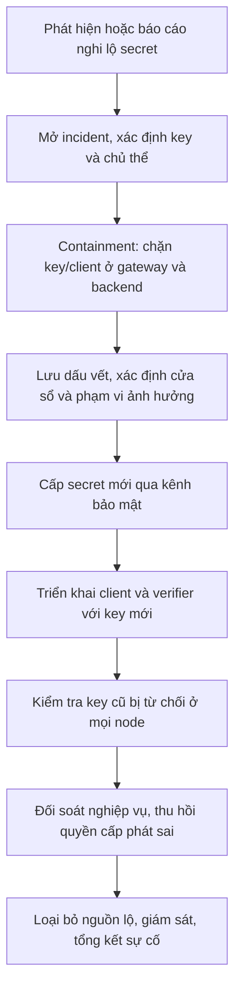

# Secret compromise — Ứng phó sự cố lộ shared secret trong HMAC request authentication

## 1. Tình huống và mục tiêu

Trong cơ chế **HMAC request authentication**, client và server dùng một **shared secret** để tính và xác minh chữ ký trên *canonical request*. Hợp đồng ký có thể bao gồm HTTP method, URI, các header được chọn, timestamp, nonce và body hoặc body digest. Chữ ký giúp server kiểm tra rằng request đến từ bên có khả năng sử dụng secret và các thành phần đã ký không bị sửa đổi trong quá trình truyền.

**Secret compromise** xảy ra khi shared secret có thể đã bị một chủ thể không được phép đọc, sao chép hoặc sử dụng. Ví dụ: secret bị đưa lên repository công khai, xuất hiện trong log, bị đọc từ CI/CD, backup, biến môi trường, file cấu hình, container image hoặc thiết bị của đối tác. Có trường hợp secret thực sự bị sử dụng để tạo request giả mạo; có trường hợp mới chỉ có dấu hiệu truy cập trái phép và chưa xác định được việc sao chép.

Khi biết secret, kẻ tấn công **có thể tự tạo chữ ký HMAC hợp lệ cho request mới** trong phạm vi mà credential đó được phép sử dụng. Timestamp và nonce chỉ chống việc **phát lại một request đã ký**, không ngăn người biết secret chọn timestamp và nonce mới rồi ký một request khác. HTTPS, việc ký body hay thuật toán HMAC-SHA256/HMAC-SHA512 không khắc phục được tình trạng secret đã bị lộ.

Mục tiêu ứng phó:

1. Chặn khả năng dùng credential bị nghi lộ để xác thực request mới càng sớm càng tốt.
2. Giới hạn phạm vi ảnh hưởng theo client, tenant, key ID, phiên bản thuật toán, endpoint và quyền của principal tương ứng.
3. Giữ bằng chứng đủ tin cậy để điều tra thời điểm lộ, request đáng ngờ và tác động nghiệp vụ.
4. Cấp và triển khai secret thay thế qua kênh bảo mật, xác nhận khóa cũ thực sự bị vô hiệu trên **mọi** điểm xác minh.
5. Khôi phục dịch vụ có kiểm soát, kiểm tra các thay đổi nghiệp vụ đã xảy ra và xử lý nguyên nhân gốc.
6. Biến kết quả điều tra thành kiểm thử, cảnh báo và cải tiến vận hành có thể xác minh.

Bài thuộc chương **Incident response** của module `SECURITY_AUTHENTICATION_HMAC_REQUEST_AUTHENTICATION`. Trọng tâm là quy trình dành riêng cho HMAC request authentication, bao gồm tương tác với key rotation, timestamp/nonce, proxy/gateway và ranh giới giữa xác thực với phân quyền.

> **Nguyên tắc cốt lõi:** Với secret đã bị lộ hoặc có bằng chứng đáng tin cậy cho thấy đã bị truy cập trái phép, chỉ thay đổi thuật toán, đổi key ID, rút ngắn cửa sổ timestamp hoặc làm mới replay store đều **không** thu hồi quyền ký của người nắm secret cũ. Phải làm secret cũ không còn được chấp nhận, đồng thời xác minh việc thực thi chính sách trên toàn hệ thống.

## 2. Nhận diện và đánh giá ban đầu

Nguồn phát hiện có thể là hệ thống quét secret, báo cáo từ client, cảnh báo truy cập vault/CI, log ở proxy/gateway, sự kiện sử dụng credential bất thường hoặc sự cố đã được bên thứ ba thông báo. Không nên suy diễn mọi request HMAC thất bại là lộ secret: lỗi đồng hồ, canonicalization hoặc deployment cũng có thể tạo nhiều `signature mismatch`.

### Tín hiệu đáng chú ý

| Dấu hiệu | Ý nghĩa có thể có | Hành động xác minh |
| --- | --- | --- |
| Chuỗi secret xuất hiện trong commit, log hoặc artifact có người ngoài truy cập | Khả năng đọc hoặc sao chép secret | Xác định secret thuộc key nào, phạm vi truy cập và thời gian xuất hiện |
| Truy cập vault/secret store khác thường | Có thể đã bị đọc bởi tài khoản hoặc workload không được phép | Kiểm tra audit event, identity, thời gian và kết quả truy cập |
| Request ký hợp lệ từ vị trí hoặc workload khác hành vi đã biết | Có thể đang dùng credential ngoài kênh dự kiến | Đối chiếu principal, key ID, chính sách mạng và dữ liệu nghiệp vụ |
| Tăng đột biến request có chữ ký hợp lệ nhưng thao tác lạ | Nguy cơ lạm dụng credential hợp lệ | Kiểm tra endpoint, quyền, đối tượng bị tác động và lịch sử thay đổi |
| Thử key ID hàng loạt, signature mismatch, timestamp sai | Có thể dò quét hoặc lỗi client | Phân biệt request bị từ chối với request thực sự xác thực thành công |
| Nhiều request cùng nonce | Có thể replay hoặc bug retry | Xem replay store, atomic reservation và mốc thời gian |

Một HMAC hợp lệ chỉ chứng minh request đã được tính bằng **một secret được server chấp nhận**, không chứng minh con người hay máy chủ hợp pháp nào đã tạo nó. Vì secret được chia sẻ, sau sự cố thường **không thể dùng riêng chữ ký để quy kết** một request cho client hợp pháp hay kẻ tấn công.

### Bốn câu hỏi phải trả lời sớm

- **Secret nào?** Key ID, phiên bản profile, chủ thể sở hữu, secret đang active hay chỉ còn dùng để verify legacy; kiểm tra cả alias, bản sao và key cũ.
- **Ai bị ảnh hưởng?** Một client riêng, nhiều tenant, một gateway, một webhook consumer, hay cùng secret được tái sử dụng trên nhiều dịch vụ?
- **Có thể làm gì bằng secret này?** Các endpoint, method, resource và quyền mà principal gắn với key được phép truy cập; phần nào trong method/URI/header/body thực sự được ký?
- **Mức độ khẩn cấp?** Có bằng chứng secret đã lộ công khai, đã được truy cập trái phép, hay đã xuất hiện request không giải thích được? Có tác vụ chuyển tiền, xuất dữ liệu, thay quyền hoặc hệ quả khó đảo ngược không?

Không cần chờ hoàn tất điều tra mới triển khai containment khi nguy cơ giả mạo hiện hữu. Đồng thời phải ghi lại quyết định, thời điểm và ảnh hưởng đến các client hợp lệ.

## 3. Quy trình ứng phó theo các giai đoạn



### Giai đoạn A — Kích hoạt incident và cô lập

Tạo một mã incident, ghi lại nguồn phát hiện, thời điểm phát hiện, hệ thống liên quan và người chịu trách nhiệm điều phối. Đánh dấu credential là **`SUSPECTED_COMPROMISED`** hoặc **`REVOKED`** theo chính sách; điều quan trọng là trạng thái cần dẫn tới **từ chối xác thực** ở mọi verifier còn phục vụ request.

Nếu có khả năng thực thi an toàn, thực hiện các biện pháp theo mức tác động:

1. **Vô hiệu key ID/credential cụ thể** ở authorization registry hoặc secret registry phía server; đảm bảo quyết định revoke áp dụng trước khi tạo authenticated principal.
2. **Chặn tại gateway lẫn backend** nếu cả hai có đường verify độc lập. Với rủi ro lớn, dùng denylist hoặc kill switch riêng cho principal/tenant bị ảnh hưởng để chặn ngay cả khi backend còn cache cũ.
3. Nếu shared secret được dùng cho **nhiều client**, không thể coi mỗi client đã tách biệt: cân nhắc vô hiệu toàn bộ principal dùng chung và lập kế hoạch khôi phục theo từng bên.
4. Với endpoint nhạy cảm, cân nhắc tạm khóa thao tác thay đổi trạng thái đối với principal bị ảnh hưởng, hàng đợi đang xử lý hoặc các lệnh bất thường. Không chỉ chặn đăng nhập mới mà bỏ qua các request đã được accept và đang chạy.
5. Bảo đảm các node, region, worker và môi trường standby không tiếp tục dùng secret cũ do cấu hình hoặc cache chưa đồng bộ.

**Không sử dụng “verify-only” để duy trì nhận chữ ký từ secret đã lộ.** Trong rotation thông thường, `VERIFY_ONLY` có thể hữu ích để chấp nhận request đang chuyển tiếp từ client cũ. Với compromised secret, việc tiếp tục verify cũng có nghĩa **kẻ tấn công tiếp tục có thể ký request mới**. Nếu buộc phải giữ một ngoại lệ ngắn do yêu cầu nghiệp vụ, phải ghi nhận rõ rủi ro, giới hạn phạm vi và dùng biện pháp xác thực/bảo vệ độc lập; không gọi đó là đã thu hồi secret.

### Giai đoạn B — Bảo toàn bằng chứng và phạm vi

Trong khi chặn credential, lưu snapshot metadata và log liên quan theo quy trình bảo quản bằng chứng của tổ chức. Giới hạn người được truy cập, ghi nguồn và mốc thời gian, đảm bảo tính toàn vẹn của dữ liệu điều tra. **Không chép secret bị lộ vào ticket, chat, báo cáo hoặc kho bằng chứng không kiểm soát**; tham chiếu qua key ID, đường dẫn vault có quyền truy cập hoặc dấu nhận dạng không lộ secret.

Các nguồn thường cần đối chiếu:

- Audit log truy cập secret store, CI/CD, repository và deploy; ai truy cập và khi nào.
- Log xác thực từ gateway/backend có timestamp, route, key ID, principal, profile, kết quả và mã lý do từ chối.
- Log thay đổi cấu hình key registry: cấp key, enable/disable, sửa allowed profiles, thu hồi và cache propagation.
- Security event và hệ thống nghiệp vụ: tạo giao dịch, cập nhật dữ liệu, đọc hàng loạt, thay quyền, publish message.
- Sự kiện replay store: duplicate nonce, TTL, trạng thái storage và race giữa nhiều node.
- Những request đáng ngờ xảy ra trong khoảng thời gian secret **có thể đã bị lộ**, không chỉ sau lúc hệ thống phát hiện.

Cửa sổ điều tra thường bắt đầu từ **thời điểm sớm nhất có khả năng secret bị truy cập trái phép**, có thể phải mở rộng nếu thời gian này chưa rõ. Chỉ dùng thời điểm cảnh báo đầu tiên làm điểm bắt đầu sẽ bỏ sót tác động trước đó.

### Giai đoạn C — Thu hồi, tạo secret thay thế và khôi phục

Quy trình khôi phục cần phân biệt **khóa mới đã được cấp** với **khóa cũ đã bị chặn**. Hai sự kiện này không tương đương.

1. Tạo secret mới bằng nguồn ngẫu nhiên mật mã phù hợp; sử dụng kho bí mật có kiểm soát quyền. Tránh sinh secret từ timestamp, mã client, UUID thường hoặc mật khẩu dễ đoán.
2. Đăng ký **key ID mới** gắn với đúng client/tenant và signature profile được phép. Không coi việc đổi chuỗi key ID mà giữ nguyên shared secret là rotation.
3. Truyền secret mới tới client hợp lệ qua kênh quản lý credential bảo mật; không gửi secret nguyên văn trong email, chat hay log HTTP.
4. Đảm bảo client chọn key ID mới và ký đúng canonical request; server tra key mới và kiểm tra đúng `HmacSHA256`/profile, body digest và header contract.
5. Nếu còn node verify trực tiếp ở gateway, sidecar hoặc service phụ trợ, cập nhật chính sách thu hồi **đồng bộ**. Cache key cũ phải được invalidated hoặc có thời hạn chặn cứng; TTL cache không được trở thành cửa sổ xác thực credential đã thu hồi ngoài ý muốn.
6. Kiểm tra positive path với key mới; kiểm tra negative path với key cũ trên từng tuyến phục vụ thực tế.
7. Sau khi xác minh không còn consumer hợp lệ cần secret cũ và chính sách revoke có hiệu lực, xóa hoặc khóa các bản sao secret cũ theo quy trình quản lý bằng chứng/retention; tránh xóa dấu vết điều tra trước khi lưu trữ an toàn.

**Lưu ý về availability:** Việc thu hồi ngay có thể khiến client hợp lệ tạm không thể gửi request. Đối với incident có bằng chứng compromise, thời gian gián đoạn thường cần được xử lý bằng cấp lại credential và cơ chế retry/idempotency có kiểm soát, **không** bằng cách bí mật bật lại khóa cũ.

### Giai đoạn D — Đối soát và xử lý hậu quả

Không chỉ đánh giá số request bị từ chối. Hãy điều tra các request **đã được chấp nhận** khi secret có khả năng bị lộ. Tìm thao tác vượt hành vi bình thường của chủ thể: giao dịch lạ, xuất dữ liệu, thay đổi webhook destination, thêm quyền, tạo key mới, sửa cấu hình hoặc tạo job chạy nền.

Phản ứng có thể bao gồm: khóa các credential phụ phát sinh từ request đáng ngờ, hủy job chưa chạy, tạm ngừng xử lý một lệnh rủi ro, đối soát database/event ledger, hoàn tác theo nghiệp vụ khi còn an toàn, và thông báo đúng bên chịu trách nhiệm. **Không tự xóa record hoặc đảo giao dịch** nếu điều đó có thể làm mất dấu vết hoặc tạo sai lệch dữ liệu; các bước phục hồi phải có owner và quy trình kiểm soát.

## 4. Vì sao timestamp, nonce và chữ ký hợp lệ không đủ để ngăn giả mạo?

Một request hợp lệ có dạng minh họa:

```http
POST /v1/payments HTTP/1.1
X-Key-Id: partner-42-key-7
X-Timestamp: 1795820000
X-Nonce: 03d18e9aa41146c1
X-Signature: <signature-for-canonical-request>
Content-Type: application/json

{"amount":100,"currency":"VND"}
```

Trong hợp đồng ký có `timestamp` và `nonce`, replay của **cùng** request sẽ bị chặn nếu nonce đã được reserve thành công. Nhưng nếu secret `partner-42-key-7` bị lộ, đối tượng nắm secret có thể tạo request khác với amount, timestamp và nonce mới rồi tính HMAC hợp lệ.

| Cơ chế | Ngăn được điều gì? | Không giải quyết được gì khi secret đã lộ? |
| --- | --- | --- |
| HMAC trên method/URI/header/body | Sửa nội dung đã ký nếu không có secret | Người nắm secret có thể ký thông điệp mới |
| Timestamp + nonce | Replay request cũ trong phạm vi/chính sách chống replay | Giả mạo request mới với timestamp/nonce mới |
| TLS | Nghe lén hoặc sửa request trên kết nối nếu được cấu hình đúng | Secret bị lộ từ repo, log, vault hoặc client endpoint |
| Key ID | Chọn và quản lý secret được tra cứu | Key ID tự nó không phải secret và không chứng minh ai nắm key |
| Key rotation | Thay secret đã cấp, giảm tuổi thọ credential | Không bảo vệ nếu vẫn cho phép verify bằng secret đã compromise |
| Authorization | Giới hạn hành động của principal đã xác thực | Không nhận biết client thật hay kẻ tấn công khi họ dùng cùng secret |
| Idempotency key | Hạn chế lặp nghiệp vụ với cùng khóa idempotency | Kẻ tấn công có thể chọn khóa idempotency mới nếu có quyền gửi lệnh |

Giữ **quyền tối thiểu** cho principal vẫn quan trọng: secret bị lộ không nên tự động có quyền mọi tenant hay mọi API. Tuy nhiên, phạm vi principal được cấp quyền phải được coi là **blast radius tối đa tiềm năng** cho tới khi phân tích thực tế chứng minh hẹp hơn.

HMAC bằng shared secret cũng không cung cấp **non-repudiation** giữa hai bên cùng biết key. Sau sự cố, signature không đủ để chứng minh phía client hay server đã tạo một request cụ thể.

## 5. Thiết kế key registry hỗ trợ thu hồi khẩn cấp

Dịch vụ có thể xác minh chữ ký qua registry có metadata thay vì map `keyId -> secret` không có trạng thái.

```text
CredentialRecord
  tenantId / clientId
  keyId
  secretRef              # Tham chiếu vault/KMS, không chứa secret trong log
  signatureProfile       # Ví dụ hmac-sha256-v1
  status                 # ACTIVE | SUSPENDED | REVOKED
  activatedAt
  expiresAt
  revokedAt
  revocationReasonCode
  policyRevision
```

Một số quy tắc triển khai:

- **Quyền revoke đặt phía server:** header `X-Key-Id` do client gửi chỉ giúp tìm bản ghi; client không tự quyết định trạng thái key hoặc allowed profile.
- **Mỗi credential có scope rõ:** tenant, client, endpoint hoặc quyền ứng dụng cần được gắn chính xác. Không tra cứu `keyId` toàn cục nếu key ID có thể trùng giữa tenant.
- **Trạng thái chặn là nguồn sự thật:** `SUSPENDED`/`REVOKED` phải không thể xác thực request mới ngay cả khi signature đúng.
- **Policy revision có thể quan sát:** ghi nhận node nào đang dùng bản cấu hình nào, tránh một node vẫn chấp nhận key do cache cũ.
- **Không fallback key cũ:** nếu chữ ký không khớp với key mới, không thử secret cũ để “tương thích” sau sự cố.
- **Giới hạn request đang chạy:** một request đã qua filter trước thời điểm revoke có thể vẫn đang xử lý. Với hành động nhạy cảm, cần xem xét thêm guard ở bước thực thi nghiệp vụ hoặc tạm dừng hàng đợi trong phạm vi ảnh hưởng.

### Ví dụ Java 17 — Chặn secret bị thu hồi trước khi chấp nhận HMAC

Ví dụ sau là **lõi xác minh rút gọn dùng trong unit test**, không phải filter HTTP hoàn chỉnh. Đầu vào `canonicalBytes` phải được xây đúng từ method, URI, header, timestamp, nonce và body theo hợp đồng ký; phần đó thuộc bộ canonicalizer của ứng dụng. Secret trong ví dụ không phải credential production.

```java
import javax.crypto.Mac;
import javax.crypto.spec.SecretKeySpec;
import java.security.GeneralSecurityException;
import java.security.MessageDigest;
import java.util.Base64;
import java.util.Map;

public final class RevocationAwareHmacVerifier {
    private RevocationAwareHmacVerifier() {}

    public enum Status { ACTIVE, SUSPENDED, REVOKED }
    public enum Result {
        VERIFIED, UNKNOWN_KEY, KEY_NOT_ACTIVE, BAD_SIGNATURE
    }

    public record Credential(
            String tenantId, String keyId, byte[] secret, Status status) {}

    // Ví dụ chỉ hỗ trợ HMAC-SHA256 với chữ ký Base64url không padding.
    public static byte[] computeHmac(byte[] secret, byte[] canonicalBytes)
            throws GeneralSecurityException {
        Mac mac = Mac.getInstance("HmacSHA256");
        mac.init(new SecretKeySpec(secret, "HmacSHA256"));
        return mac.doFinal(canonicalBytes);
    }

    public static Result verify(
            String tenantId, String keyId,
            byte[] canonicalBytes, String signature,
            Map<String, Credential> registry)
            throws GeneralSecurityException {
        if (tenantId == null || keyId == null
                || canonicalBytes == null || signature == null
                || registry == null) {
            return Result.BAD_SIGNATURE;
        }

        // keyId chỉ có ý nghĩa trong scope tenant.
        Credential record = registry.get(tenantId + ":" + keyId);
        if (record == null || !record.tenantId().equals(tenantId)
                || !record.keyId().equals(keyId)) {
            return Result.UNKNOWN_KEY;
        }
        // Thu hồi luôn có hiệu lực trước khi xét signature.
        if (record.status() != Status.ACTIVE) {
            return Result.KEY_NOT_ACTIVE;
        }

        // Decode đúng dạng base64url không padding, đúng 32-byte tag.
        final byte[] supplied;
        try {
            supplied = Base64.getUrlDecoder().decode(signature);
        } catch (IllegalArgumentException malformed) {
            return Result.BAD_SIGNATURE;
        }
        if (supplied.length != 32
                || !Base64.getUrlEncoder().withoutPadding()
                        .encodeToString(supplied).equals(signature)) {
            return Result.BAD_SIGNATURE;
        }

        byte[] expected = computeHmac(record.secret(), canonicalBytes);
        return MessageDigest.isEqual(expected, supplied)
                ? Result.VERIFIED : Result.BAD_SIGNATURE;
    }
}
```

Trong ứng dụng thật, `registry` phải là dịch vụ hoặc snapshot chính sách được cập nhật an toàn, có kiểm soát việc cache invalidation; không trao thẳng bản đồ secret cho tầng business. Sau khi `Result.VERIFIED`, filter **vẫn phải** kiểm tra freshness timestamp và reserve nonce nguyên tử trước khi gán principal. Các mã lý do chi tiết chỉ nên dùng trong audit/telemetry nội bộ; phản hồi công khai không cần tiết lộ key có tồn tại hay đã bị thu hồi.

### Unit test quan trọng nhất: secret cũ phải bị từ chối dù signature đúng

```java
import org.junit.jupiter.api.Test;

import java.nio.charset.StandardCharsets;
import java.security.GeneralSecurityException;
import java.util.Base64;
import java.util.Map;

import static org.junit.jupiter.api.Assertions.assertEquals;

class SecretCompromiseTest {
    private static byte[] bytes(String value) {
        return value.getBytes(StandardCharsets.UTF_8);
    }

    private static String sign(byte[] secret, byte[] canonical)
            throws GeneralSecurityException {
        return Base64.getUrlEncoder().withoutPadding().encodeToString(
                RevocationAwareHmacVerifier.computeHmac(secret, canonical));
    }

    @Test
    void compromisedCredentialIsRejectedEvenWithCorrectHmac()
            throws GeneralSecurityException {
        byte[] oldSecret = bytes("test-only-old-secret-not-for-production");
        byte[] newSecret = bytes("test-only-new-secret-not-for-production");
        byte[] canonical = bytes(
                "HMAC-REQUEST\nPOST\n/v1/payments\nnonce-001\n<digest>");
        String oldSignature = sign(oldSecret, canonical);
        String newSignature = sign(newSecret, canonical);

        Map<String, RevocationAwareHmacVerifier.Credential> registry =
                Map.of(
                    "tenant-a:old-key",
                    new RevocationAwareHmacVerifier.Credential(
                        "tenant-a", "old-key", oldSecret,
                        RevocationAwareHmacVerifier.Status.REVOKED),
                    "tenant-a:new-key",
                    new RevocationAwareHmacVerifier.Credential(
                        "tenant-a", "new-key", newSecret,
                        RevocationAwareHmacVerifier.Status.ACTIVE)
                );

        assertEquals(
                RevocationAwareHmacVerifier.Result.KEY_NOT_ACTIVE,
                RevocationAwareHmacVerifier.verify(
                    "tenant-a", "old-key", canonical,
                    oldSignature, registry));

        assertEquals(
                RevocationAwareHmacVerifier.Result.VERIFIED,
                RevocationAwareHmacVerifier.verify(
                    "tenant-a", "new-key", canonical,
                    newSignature, registry));

        // Không tự thử oldSecret nếu client khai báo new-key.
        assertEquals(
                RevocationAwareHmacVerifier.Result.BAD_SIGNATURE,
                RevocationAwareHmacVerifier.verify(
                    "tenant-a", "new-key", canonical,
                    oldSignature, registry));
    }
}
```

**Phạm vi của code:** `canonical` trong fixture chỉ tượng trưng cho bytes đã được phía ký và phía verify thống nhất. Mã không chứng minh khả năng canonicalize HTTP đúng, không xử lý timestamp/nonce, không phân biệt các phiên bản thuật toán và không tự bảo vệ tình huống key store bị sửa trái phép. Kết quả `VERIFIED` chỉ là bước kiểm tra chữ ký trong ví dụ. Các bước còn lại cần được xây và test ở security filter/HTTP stack của dịch vụ.

Trong production, tránh để đồng thời tồn tại nhiều đối tượng `Credential` khác nhau cùng key ID nhưng trạng thái mâu thuẫn giữa các node. Với cache phân tán, cần giao thức cập nhật policy monotonic hoặc khóa theo revision để không vô tình hồi sinh trạng thái `ACTIVE` sau khi đã nhận `REVOKED`.

## 6. Ma trận kiểm thử ứng phó và điều kiện chấp nhận

Bộ test sau vừa bảo vệ tính đúng đắn của xác thực, vừa xác nhận containment thực sự hoạt động.

| Test | Đầu vào | Kỳ vọng |
| --- | --- | --- |
| Positive control | Key mới ACTIVE, signature đúng, timestamp hợp lệ, nonce mới | Xác thực thành công, sau đó mới kiểm tra quyền |
| Old key denial | Key cũ REVOKED, signature HMAC tính **đúng bằng secret cũ** | Bị từ chối ở key policy; không có principal |
| Key ID bị sửa | Giữ chữ ký cũ, đổi `X-Key-Id` thành key mới | Chữ ký không khớp; không fallback |
| Suspended credential | Key `SUSPENDED` còn tồn tại trong kho | Bị từ chối dù HMAC đúng |
| Gateway stale cache | Gateway còn cache `ACTIVE` nhưng registry đã `REVOKED` | Không còn tuyến nào cho request được xác thực; nếu có, incident chưa contained |
| Backend bypass | Gửi qua backend bỏ qua gateway | Backend cũng từ chối key cũ hoặc không cho phép đường đi đó |
| Multi-region/rolling deploy | Gửi tới các node/region khác nhau | Chính sách revoke nhất quán và đo được thời gian áp dụng |
| Malformed signature | Signature thiếu, sai encoding, quá dài | Từ chối có kiểm soát, không rò secret |
| Anti-replay | Request ký đúng bằng key mới nhưng nonce đã dùng | Replay bị chặn trước business handler |
| Signed body tampering | Ký body gốc bằng key mới, gửi body bị thay | HMAC không khớp theo contract |
| Principal authorization | Key mới ký đúng nhưng gọi endpoint ngoài quyền | Xác thực có thể đúng, nhưng phân quyền từ chối |
| In-flight request | Request ký bằng key cũ đã qua auth trước revoke | Quan sát/hạn chế side effect theo chính sách incident |
| Cache rollback | Reapply cấu hình cũ / node restart | Key `REVOKED` không trở lại `ACTIVE` |
| Secret leakage regression | Luồng log, exception, CI artifacts sau sửa | Không còn xuất hiện raw secret |

**Không chỉ assert `401`.** Một request có thể bị từ chối do timestamp hết hạn hay nonce đã sử dụng, khiến bài test vô tình che mất việc verifier vẫn chấp nhận secret đã lộ. Phải dùng **timestamp hiện hành và nonce mới** cho negative test khóa cũ, kiểm tra mã lý do nội bộ hoặc spy chính sách key và khẳng định nghiệp vụ không chạy.

Với `MockMvc`, `WebTestClient` hoặc HTTP client đi qua gateway, nên dùng fixture tách biệt: request positive bằng key mới, request negative bằng key cũ nhưng có chữ ký HMAC **thực sự đúng**. Nếu gửi một chữ ký sai ngẫu nhiên với key cũ, bài test chưa chứng minh revoke có hiệu lực.

## 7. Kịch bản điều phối: một partner bị lộ key qua CI log

Giả sử một đối tác `partner-a` dùng HMAC để gọi `POST /v1/payments`. Secret của `key-17` vô tình được ghi vào log build có người dùng ngoài nhóm vận hành xem được. Sự cố được phát hiện vào thời điểm `T_detect`; log đã tồn tại từ `T_exposure` nhưng chưa biết có ai thực sự tải xuống hay không.

Quy trình minh họa:

| Thời điểm tương đối | Quyết định / hành động | Bằng chứng hoàn thành |
| --- | --- | --- |
| `T_detect` | Mở incident, xác minh log chứa **secret thực** và ánh xạ đến `partner-a/key-17` | Incident ID, key ID, scope, dấu nhận dạng không lộ secret |
| Ngay sau triage | Đặt `key-17` thành `REVOKED`, chặn ở gateway/backend | Audit policy revision, kiểm tra key cũ bị từ chối ở các tuyến |
| Song song | Thu hồi quyền xem log, hạn chế các bản sao còn công khai; giữ bản chứng cứ được kiểm soát | Log access audit, record retention an toàn |
| Sau containment | Tạo `key-18` và cấp qua kênh credential an toàn | Key ID mới, chủ thể nhận, thời điểm kích hoạt |
| Khi client sẵn sàng | Client ký request bằng key mới, server xác minh qua cùng canonical contract | Positive test key mới, no regression về body/URI |
| Trước khi tuyên bố khôi phục | Thử request **ký đúng bằng key-17** với nonce mới qua mọi region | Negative test đều bị từ chối do policy |
| Sau khôi phục | Đối soát request và tác động từ `T_exposure`, tìm nguồn lộ và kiểm tra ngăn tái diễn | Evidence trail, incident timeline, action owner |

Đây là chuỗi hành động, không phải khuyến nghị số phút xử lý chung cho mọi hệ thống. Mốc cần tuân theo mức độ nghiêm trọng, cam kết vận hành và yêu cầu pháp lý/hợp đồng áp dụng cho tổ chức.

Trong ví dụ, không thể kết luận “không có giả mạo” chỉ vì không tìm thấy signature mismatch: request do kẻ tấn công tạo bằng secret đã lộ vẫn có thể **xác minh thành công**. Cần đối chiếu hành vi, nguồn request, audit nghiệp vụ và bằng chứng truy cập secret, đồng thời chấp nhận rằng có trường hợp không thể quy kết chắc chắn.

## 8. Những sai lầm đặc biệt nguy hiểm

### 8.1. Chỉ rotate nhưng vẫn giữ secret cũ ở chế độ verify

Điều này hữu ích cho kế hoạch rotation bình thường nhưng **không xử lý triệt để compromise**. Sau khi secret đã lộ, mỗi request ký bằng secret cũ đều có nguy cơ là request giả mạo. Cần ưu tiên revoke, khôi phục client hợp lệ bằng credential mới và chỉ dùng ngoại lệ có kiểm soát nếu buộc phải giảm gián đoạn.

### 8.2. Chỉ thay `X-Key-Id` hoặc đổi version algorithm

`keyId` không bí mật. Chọn một nhãn khác mà vẫn sử dụng cùng secret không loại bỏ khả năng ký của người đã biết secret. Thêm `v2` với `HmacSHA512` nhưng tái sử dụng secret lộ cũng không loại bỏ người nắm key nếu phiên bản mới vẫn dùng secret đó. Sự thay đổi phải bao gồm **secret mới thực sự** và chính sách cấm dùng credential bị lộ.

### 8.3. Xóa log ngay khi tìm thấy secret

Cần hạn chế phân phối secret trên log, artifact và nơi không an toàn, nhưng xóa mọi bản ghi không kiểm soát có thể làm mất dấu vết chứng minh ai đã xem secret, thời điểm và các request bị ảnh hưởng. Phải giữ **bằng chứng được cô lập** theo quy trình incident trước khi xóa bản lộ công khai.

### 8.4. Chỉ sửa phía client

Hệ thống cấp secret mới cho đối tác nhưng verifier vẫn chấp nhận secret cũ. Kẻ tấn công vẫn ký được request mới. Tiêu chí khôi phục phải được chứng minh **trên phía xác minh**, gồm gateway, service, region, môi trường standby và mọi đường gọi trực tiếp.

### 8.5. Dựa riêng vào HMAC để điều tra danh tính

HMAC là xác thực dựa trên bí mật chia sẻ. Nếu secret đã lộ, chữ ký đúng không thể phân biệt client hợp pháp và kẻ tấn công. Điều tra cần telemetry khác: audit truy cập credential, thay đổi cấu hình, request metadata và lịch sử nghiệp vụ.

### 8.6. Chặn request mới nhưng bỏ qua side effect đang chạy

Thời điểm đổi trạng thái key không tự dừng request đã được chấp nhận trước đó. Nên có quy trình xác định command, job, hàng đợi và giao dịch đang chạy; cân nhắc tạm dừng/hủy theo yêu cầu nghiệp vụ và lưu dấu vết trước khi can thiệp.

### 8.7. Thu hồi tại một nơi rồi tin cache sẽ tự đồng bộ

Gateway, sidecar, API server và background worker có thể cache secret hoặc key policy theo các TTL khác nhau. Một node còn state `ACTIVE` có thể trở thành điểm chấp nhận khóa đã lộ. Cần kiểm tra tất cả tuyến và ghi nhận thời gian lan truyền trạng thái revoke; thiết kế cơ chế chặn tức thời cho tình huống khẩn cấp.

## 9. Thu thập telemetry mà không lộ thêm secret

Trong sự cố, telemetry phải giúp đối soát nhưng không làm lan truyền credential. Một bản ghi nội bộ minh họa:

```json
{
  "event": "hmac_auth_rejected",
  "incidentId": "INC-EXAMPLE-001",
  "tenantId": "tenant-a",
  "clientId": "partner-a",
  "keyId": "key-17",
  "profile": "hmac-sha256-v1",
  "routeTemplate": "POST /v1/payments",
  "reasonCode": "CREDENTIAL_REVOKED",
  "policyRevision": 129,
  "gatewayRegion": "region-1",
  "correlationId": "req-example-001"
}
```

Không log `sharedSecret`, raw `Authorization`/`X-Signature`, canonical request có chứa dữ liệu nhạy cảm, body chứa dữ liệu cá nhân hoặc toàn bộ nonce nếu không thật sự cần. Key ID, tenant ID và request metadata cũng cần tuân theo chính sách bảo vệ dữ liệu của tổ chức. Nếu cần đối chiếu request, sử dụng correlation ID hoặc digest được thiết kế có cân nhắc rủi ro suy đoán/ liên kết; digest không tự động là ẩn danh.

Một số chỉ số nên theo dõi trong và sau containment:

- Số lần chấp nhận/từ chối theo key ID, trạng thái credential, route và region.
- Tỷ lệ request từ key bị revoke tiếp tục đi tới HMAC verifier.
- Độ trễ cập nhật policy từ registry tới từng node và tỷ lệ node dùng policy revision mới.
- Số lần attempt dùng key cũ sau cutoff, tách rõ `REVOKED` với `SIGNATURE_MISMATCH`.
- Số request đã qua xác thực trước cutoff nhưng hoàn tất nghiệp vụ sau cutoff.
- Tỷ lệ client khôi phục bằng key mới, các lỗi clock skew, nonce duplicate hoặc canonical mismatch phát sinh sau rotation.
- Kết quả đối soát nghiệp vụ và danh sách sự kiện cần xử lý thêm.

Thông tin về lý do từ chối chi tiết thuộc kênh nội bộ. Phản hồi HTTP công khai nên theo hợp đồng lỗi chung để hạn chế lộ thông tin về key hợp lệ, trạng thái revoke hay cấu hình policy.

## 10. Cải tiến sau sự cố

Sau khi containment và khôi phục đã được kiểm chứng, tiến hành post-incident review với trọng tâm vào cách secret có thể lộ và vì sao phát hiện/chặn chưa đủ nhanh. Các biện pháp phòng ngừa thường gồm:

1. Cấp **secret riêng theo client/tenant/mục đích**, giới hạn quyền và tránh tái sử dụng shared secret giữa nhiều ứng dụng. Đây là biện pháp giảm blast radius khi một secret bị lộ.
2. Đưa secret vào **secret manager** có quyền truy cập tối thiểu, audit và hỗ trợ rotation; tránh hard-code, commit, container image và file cấu hình không được bảo vệ.
3. Quét secret trên repository/CI artifacts, giới hạn retention/log access và tự động che giá trị nhạy cảm ở điểm phát sinh log.
4. Thiết kế key registry có **revoke/suspend nhanh**, kiểm tra cập nhật chính sách trên gateway/backend/region, tránh fallback sang key cũ.
5. Duy trì kênh cấp lại secret rõ ràng cho client, tài liệu ký canonical request và test vector dùng được khi rotation khẩn cấp.
6. Bổ sung integration test: key cũ **ký đúng** vẫn bị từ chối, key mới thành công, timestamp/nonce được xử lý nhất quán và không có side effect khi auth thất bại.
7. Có cơ chế phân quyền tối thiểu, giới hạn tốc độ, idempotency cho nghiệp vụ thay đổi trạng thái và giám sát hành vi bất thường **sau khi HMAC đã xác minh thành công**.
8. Diễn tập tình huống có một key bị lộ và tình huống **shared key toàn hệ thống** bị lộ; kiểm tra liên lạc với client, khả năng cấp mới và thời gian chặn trên toàn hệ thống.

### Điều kiện đóng incident

Có thể cân nhắc đóng incident khi **đều có bằng chứng** cho các điểm sau:

- Credential nghi lộ đã bị revoke/suspend theo chính sách và không có verifier nào còn chấp nhận nó.
- Client/tenant cần khôi phục đã có credential mới và positive test qua đường đi thật thành công.
- Negative test dùng chữ ký **hợp lệ của secret cũ** thất bại do key policy với timestamp/nonce không gây nhiễu.
- Các request đã được chấp nhận trong cửa sổ rủi ro đã được đối soát, hoặc còn danh sách tồn đọng có owner và hạn xử lý rõ.
- Nguồn lộ đã được loại bỏ hoặc cô lập, bằng chứng được giữ đúng quy trình và quyền truy cập secret đã được điều chỉnh.
- Monitoring và regression test nhận biết việc key cũ vô tình được bật lại.
- Những điểm chưa thể xác minh, mất mát hoặc giới hạn điều tra được ghi nhận rõ, không thay bằng khẳng định “không có tấn công”.

## 11. Bài tập thực hành

**Bài tập A — Runbook containment.** Một đối tác báo cáo secret đang dùng bị xuất hiện trong log CI trong 48 giờ. Hãy xác định key ID, phạm vi tenant, API được phép và các tuyến verifier phải chặn; thiết kế quy trình cấp secret mới và một bảng bằng chứng để chứng minh key cũ đã bị từ chối trên gateway và backend.

**Bài tập B — JUnit và HTTP integration test.** Dựa trên `SecretCompromiseTest` ở mục 5, bổ sung test với `SUSPENDED`, `UNKNOWN_KEY`, đúng HMAC nhưng sai tenant và key mới có chữ ký sai. Sau đó xây test qua Spring MVC `OncePerRequestFilter` hoặc Spring WebFlux `WebFilter` có timestamp hiện hành và nonce mới; đảm bảo request với key `REVOKED` bị từ chối trước khi handler hoặc message publisher thực thi.

**Bài tập C — Điều tra giả mạo.** Trong cửa sổ secret bị lộ, hệ thống phát hiện các request với HMAC hợp lệ, timestamp/nonce đều hợp lệ nhưng nội dung giao dịch khác hành vi bình thường. Hãy mô tả nguồn chứng cứ cần đối chiếu và giải thích vì sao chữ ký hợp lệ **không** xác nhận request xuất phát từ client hợp pháp khi shared secret đã bị lộ.

**Câu hỏi tự kiểm tra:** Vì sao hệ thống đã cấp key mới vẫn có thể chưa contained? Tại sao replay protection không bảo vệ được khi kẻ tấn công biết secret? Vì sao trạng thái `VERIFY_ONLY` đặc biệt nguy hiểm đối với compromised secret? Một request ký hợp lệ nhưng thiếu quyền cần bị xử lý ở bước xác thực hay phân quyền?

**Thông điệp cần nhớ:** Ứng phó secret compromise trong HMAC request authentication phải bắt đầu bằng **thu hồi khả năng xác thực của secret bị lộ**, sau đó cấp secret mới, kiểm chứng trên mọi verifier và điều tra những request đã được chấp nhận. Timestamp/nonce, canonical request, key rotation, proxy/gateway và phân quyền đều là các lớp quan trọng, nhưng không lớp nào thay thế được việc vô hiệu hóa credential đã compromise.
