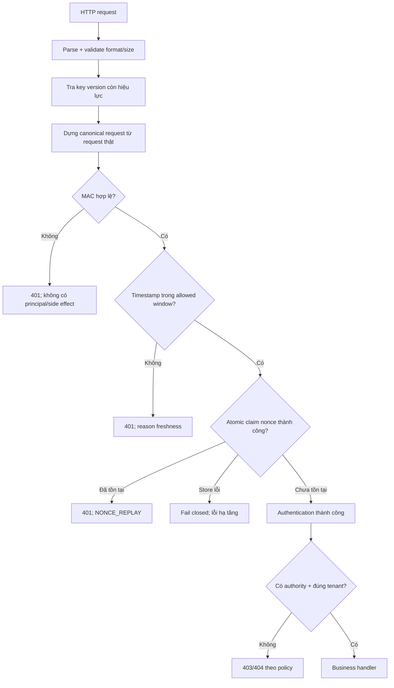
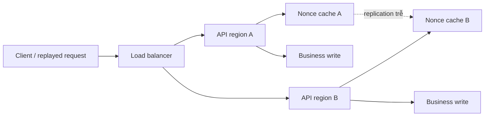

# Replay incident: phát hiện, cô lập và khôi phục khi HTTP HMAC request bị phát lại

## 1. Tình huống mở đầu và mục tiêu

Một đối tác tích hợp gửi `POST /integrations/transfers` kèm `X-Key-Id`, `X-Timestamp`, `X-Nonce` và `X-Signature`. Server xác thực chữ ký HMAC thành công, ghi nhận giao dịch và trả kết quả. Ít phút sau, hệ thống xuất hiện nhiều request có cùng timestamp, nonce và chữ ký. Một số request bị từ chối, nhưng vài giao dịch vẫn được tạo hai lần ở hai vùng triển khai khác nhau.

Đây là một tình huống **replay incident** đáng điều tra: một thông điệp đã được ký hợp lệ có thể bị gửi lại nhằm thực hiện lại hành động, dù người phát lại **không cần biết shared secret**. HMAC chứng minh tính toàn vẹn và việc nắm khóa tại thời điểm tạo MAC, nhưng **không tự bảo đảm một thông điệp chỉ được chấp nhận một lần**.

Bài thuộc chương **Incident response**, chủ đề **Replay incident**, trong module `SECURITY_AUTHENTICATION_HMAC_REQUEST_AUTHENTICATION`. Module hướng tới xác thực HTTP request bằng shared secret và canonical request bảo vệ method, URI, signed headers hoặc body; chống replay bằng timestamp/nonce, xử lý key rotation, gateway/proxy và phân biệt authentication với authorization.

Sau bài học, người học sẽ:

- Nhận diện bằng chứng của replay, phân biệt nó với retry hợp lệ và sự cố idempotency.
- Đánh giá ảnh hưởng tới dữ liệu/tiền/giao dịch dựa trên **side effect thực tế**, không chỉ số lượng `401`.
- Thực hiện triage, containment, bảo toàn bằng chứng, recovery và post-incident review theo thứ tự an toàn.
- Xác minh atomic nonce store, timestamp window, clock skew, multi-instance/multi-region và key lifecycle.
- Thiết kế audit, metrics, runbook và kiểm thử Java/Spring MVC/WebFlux cho replay incident.
- Giữ hệ thống **fail closed** khi cơ chế chống replay mất khả năng bảo vệ.

## 2. Replay là gì? Phân biệt với retry và idempotency

Giả sử client đã ký chính xác request sau:

```text
method:       POST
target:       /integrations/transfers
keyId:        partner-a-v2
timestamp:    2026-11-28T03:15:00Z
nonce:        n-01abc...
bodySha256:   SHA256(exact-body-bytes)
signature:    Base64(HMAC-SHA256(sharedSecret, canonicalRequest))
```

Nếu ai đó gửi lại **cùng thông điệp đã ký** trong lúc server vẫn coi timestamp hợp lệ, phép so HMAC có thể vẫn đúng. Nếu server không nhớ nonce đã dùng, cả hai request có thể đi vào nghiệp vụ.

| Hiện tượng | Có cần chữ ký mới? | Vai trò của nonce/idempotency | Cách đánh giá |
| --- | --- | --- | --- |
| **Replay nguyên request đã ký** | Không | Nonce đã sử dụng phải bị chặn | Đáng ngờ hoặc lỗi retry; không cho thực hiện lại |
| **Retry HTTP có ký mới** | Có thể có timestamp/nonce và MAC mới | Nonce mới; idempotency key giữ nguyên nếu cùng ý định nghiệp vụ | Có thể hợp lệ theo hợp đồng API |
| **Retry nghiệp vụ idempotent** | Mỗi attempt vẫn phải được xác thực | Idempotency store ngăn nhân đôi side effect | Không thay thế kiểm tra HMAC hoặc nonce |
| **Hai request khác nhau có body giống nhau** | Mỗi request ký riêng | Nonce thường khác; idempotency theo ý định nghiệp vụ | Không tự coi là tấn công |
| **HMAC hợp lệ nhưng thiếu quyền** | Chữ ký có thể đúng | Không liên quan trực tiếp đến replay | Authorization từ chối, thường `403` |

**Phân biệt quan trọng:** nonce là bằng chứng freshness trong authentication; idempotency key là khóa điều phối hiệu ứng nghiệp vụ. Một request có nonce mới nhưng cùng idempotency key có thể là retry hợp lệ; một request có nonce cũ nhưng idempotency key mới vẫn phải bị chặn bởi anti-replay. Không được coi `request_id` hay `trace_id` là nonce.

Trong incident response, **nhiều `NONCE_REPLAY` không tự động chứng minh attacker**: SDK có thể retry nguyên HTTP request sau timeout; mạng có thể phát lại ở một middleware; hoặc có hoạt động độc hại. Cần giữ các giả thuyết này song song cho đến khi có bằng chứng.

## 3. Ranh giới bảo vệ: replay không thể giải quyết chỉ bằng so MAC

Một pipeline HMAC an toàn thường có các bước:



Đây là trình tự minh họa. Có thể thực hiện các bước **validate định dạng/timestamp rẻ** trước phép tính MAC để giảm tải, nhưng không được tin các giá trị này như bằng chứng đã xác thực. **Không claim nonce trước khi đã xác minh MAC hợp lệ** nếu điều đó cho phép kẻ tấn công dùng key ID/nonce tự khai để “đốt” nonce của client thật.

Những điều kiện không được bỏ qua trong incident:

1. Canonical request phải ký đúng **method, URI/query, signed headers, body/digest** đã thống nhất; body bị sửa phải làm MAC sai.
2. `X-Timestamp` và `X-Nonce` phải nằm **trong dữ liệu được MAC bảo vệ**, không chỉ là header phụ để server đọc.
3. `X-Key-Id` chọn secret còn hiệu lực theo registry; nó không tự chứng minh danh tính client.
4. Nonce store phải có thao tác **atomic insert-if-absent** trong phạm vi các instance có thể chấp nhận request.
5. Sau xác thực, `GrantedAuthority`, tenant/ownership và policy nghiệp vụ vẫn phải kiểm tra riêng.

Nếu một điều kiện trên không đúng, cần đánh giá lại mức độ ảnh hưởng của sự cố thay vì chỉ đếm log replay.

## 4. Tín hiệu phát hiện sự cố

Các chỉ báo thường gặp:

- `hmac.auth.failure` với reason `nonce_replay` tăng nhanh.
- Hai hoặc nhiều `auth.success` cho cùng **verified client + nonce** khi policy yêu cầu nonce duy nhất.
- Cùng operation/transaction được thực thi nhiều lần dù contract chỉ cho phép một lần.
- `401` tăng sau thay đổi retry client hoặc gateway; phần lớn có `nonce_replay` hay `timestamp_invalid`.
- Một vùng triển khai chấp nhận request đã bị vùng khác chặn; nonce store phân tách hoặc replication trễ.
- Nonce store trả timeout/`5xx`, failover hoặc eviction; sau đó xuất hiện nhiều request cùng nonce thành công.
- `X-Timestamp` gần mép cửa sổ; clock drift hoặc TTL nonce bị cấu hình ngắn hơn khoảng chấp nhận.
- Lưu lượng HTTP tăng bất thường, kèm chữ ký trùng trong khoảng thời gian ngắn.

### 4.1. Schema metric nên dùng

| Metric minh họa | Labels nên có | Ý nghĩa |
| --- | --- | --- |
| `hmac_auth_attempts_total` | `service`, `route`, `outcome`, `environment` | Mỗi attempt có đúng một outcome |
| `hmac_auth_failures_total` | `service`, `reason`, `route` | Phân biệt MAC sai, replay, timestamp, key unusable |
| `hmac_nonce_claims_total` | `service`, `result=claimed/replayed/error` | Kiểm tra kết quả atomic claim |
| `hmac_nonce_store_seconds` | `service`, `operation` | Độ trễ của dependency |
| `hmac_auth_dependency_errors_total` | `dependency=nonce_store/key_store` | Sự cố hạ tầng |
| `hmac_authorization_denied_total` | `service`, `route`, `policy_class` | Phân biệt `403` với lỗi authentication |

Không đặt **raw nonce, signature, key ID, request ID, trace ID hoặc client ID không giới hạn** vào Prometheus labels. Các giá trị này có cardinality rất cao và có thể làm lộ thông tin. Chi tiết theo client/request nên nằm trong **security audit log có phân quyền**, dùng reference đã được xác minh.

### 4.2. PromQL cảnh báo minh họa

Nếu exporter thực sự cung cấp `hmac_auth_failures_total`:

```promql
sum by (service, environment) (
  rate(hmac_auth_failures_total{
    environment="prod",
    reason="nonce_replay"
  }[5m])
)
```

Đây là **số replay failures mỗi giây**; giá trị tăng không đủ kết luận có side effect bị nhân đôi. Cần đối chiếu với tần suất `auth.success`, kết quả giao dịch và độ trễ/error của nonce store. Ngưỡng cảnh báo phải dựa vào baseline, cỡ mẫu, chu kỳ traffic và yêu cầu nghiệp vụ; một lỗi lặp từ SDK không nhất thiết có cùng severity với nhiều giao dịch tài chính bị thực thi trùng.

Ví dụ cảnh báo với threshold dùng **để minh họa**:

```yaml
groups:
  - name: hmac-replay-incidents
    rules:
      - alert: HmacNonceReplaySpike
        expr: |
          sum by (service, environment) (
            rate(hmac_auth_failures_total{
              environment="prod", reason="nonce_replay"
            }[5m])
          ) > 1
        for: 5m
        labels:
          severity: warning
        annotations:
          summary: "Replay failures tăng ở {{ $labels.service }}"

      - alert: HmacNonceStoreErrors
        expr: |
          sum by (service, environment) (
            rate(hmac_auth_dependency_errors_total{
              environment="prod", dependency="nonce_store"
            }[5m])
          ) > 0.1
        for: 2m
        labels:
          severity: critical
        annotations:
          summary: "Nonce store gặp lỗi tại {{ $labels.service }}"
```

Tùy exporter, tên metric và label khác nhau; phải kiểm tra output Micrometer/Prometheus thực tế. Bên cạnh alert về lỗi cần có alert **scrape target down/absent metric**: không có dữ liệu không đồng nghĩa hệ thống không bị replay.

## 5. Triage 15 phút đầu: xác nhận sự cố trước khi thay đổi cấu hình

Runbook ứng phó nên phân công **incident commander**, **người phụ trách security/auth**, **người phụ trách hạ tầng** và **người đánh giá tác động nghiệp vụ** theo tổ chức. Một trình tự ban đầu:

| Thứ tự | Kiểm tra | Bằng chứng mong đợi |
| --- | --- | --- |
| 1 | Alert có thực và scrape còn hoạt động? | Đường biểu diễn `nonce_replay`, attempts, dependency errors, thời gian xuất hiện |
| 2 | Sự cố chỉ ở `401` hay có `auth.success` trùng nonce? | Security audit theo request ID và nonce reference hạn chế |
| 3 | Business side effect có bị nhân đôi? | Đối chiếu transaction IDs, idempotency records, hàng đợi, DB ledger |
| 4 | Xuất hiện sau deploy nào? | Lịch client SDK/gateway, config nonce TTL, Redis cluster, key rotation |
| 5 | Xảy ra ở route/region/instance nào? | Route key, region, pod version, load balancer/trace |
| 6 | Có bị giới hạn ở một client đã xác minh? | Verified client reference, không dựa vào header tự khai |
| 7 | Nonce store có atomic và còn dữ liệu? | Health, persistence/failover, eviction, replication lag |
| 8 | Clock giữa node/gateway sai lệch không? | NTP/clock offsets, timestamp distribution |

Đừng vội **xóa toàn bộ nonce store** để “giải phóng các request đang kẹt”. Nếu đã mất dấu nonce sử dụng, server có thể chấp nhận lại những request trước đó vẫn nằm trong cửa sổ timestamp.

Trong triage, nên đặt câu hỏi riêng:

- **Replay attempt:** có request lặp được gửi không?
- **Replay rejection:** request lặp có bị chặn trước controller không?
- **Replay success:** có request lặp nào được xác thực và thông qua authorization không?
- **Duplicate effect:** có nghiệp vụ bị thực thi hai lần không?

Bốn kết luận này khác nhau. Chỉ số `NONCE_REPLAY` cao đôi khi là bằng chứng **cơ chế bảo vệ đang hoạt động**, không phải bằng chứng đã xảy ra double charge.

## 6. Phân loại mức độ nghiêm trọng và phạm vi ảnh hưởng

Mức độ sự cố phụ thuộc vào **rủi ro và tác động thực tế**, không chỉ số lượng lỗi:

| Mức ví dụ | Tình huống | Hành động |
| --- | --- | --- |
| Điều tra thông thường | Nhiều `NONCE_REPLAY`, toàn bộ bị từ chối, chưa có side effect | Tìm nguyên nhân retry/gateway; theo dõi |
| Mức tăng cường | Nonce store lỗi không ổn định, nhiều clients bị `503`, verifier fail closed | Khôi phục availability an toàn, có incident owner |
| Nghiêm trọng | Hai request cùng nonce được backend chấp nhận, chưa xác định thiệt hại | Containment ngay, khoanh vùng window và routes |
| Khẩn cấp | Side effect nhạy cảm bị nhân đôi, nghi credential bị lộ hoặc có exploit diện rộng | Kích hoạt quy trình security incident và business recovery |

Đây là **ví dụ triage**, không thay thế phân loại severity nội bộ. Nếu endpoint chuyển tiền, mức tác động khác endpoint chỉ đọc một báo cáo công khai; nếu người gọi có thể sử dụng lại chữ ký trên nhiều route do canonicalization lỗi, phạm vi có thể lớn hơn một nonce collision đơn lẻ.

**Ranh giới quan trọng:** replay thành công của request đã ký không tự chứng minh shared secret đã bị đánh cắp. Attacker có thể lấy được **request signature và dữ liệu cần thiết** mà chưa biết key. Ngược lại, nếu phát hiện nhiều request **khác nhau** được ký hợp lệ trái phép, cần điều tra khả năng secret compromise, lộ SDK hoặc quyền truy cập hệ thống ký.

## 7. Containment: chặn lặp mà vẫn giữ fail closed

Khi có dấu hiệu replay thành công, containment cần ưu tiên **ngăn side effect tiếp theo**, không làm giảm bảo vệ:

1. **Tạm giới hạn hoặc ngừng endpoint nhạy cảm có chọn lọc** (gateway rule, feature flag server-side, rate limit/deny rule) nếu nguy cơ tiếp tục mất tiền/dữ liệu cao. Ghi rõ người phê duyệt, phạm vi và thời điểm.
2. **Không bỏ kiểm tra MAC, timestamp, nonce hoặc key status.** Những thay đổi đó có thể biến một đợt replay đã bị chặn thành exploit.
3. **Khôi phục nonce claim có tính nguyên tử** trước khi mở lại luồng nghiệp vụ. Nếu store không khả dụng, từ chối/`503` theo policy thay vì “allow if cache miss”.
4. **Giới hạn lưu lượng tại edge** theo route/client reference đáng tin và chỉ số abuse; không dùng header `X-Client-Id` tự khai để block một đối tác như thể đã xác thực.
5. **Giữ nguyên bằng chứng**: không xóa log, nonce records hay audit trail chỉ để khắc phục nhanh.
6. **Xem xét revoke/rotate key** khi có bằng chứng credential lộ hoặc theo chỉ đạo security; rotation có thể ảnh hưởng nhiều client và không thay thế atomic replay protection.
7. **Đóng các đường bypass**: endpoint/backend trực tiếp, vùng failover, legacy verifier hoặc gateway cho qua unsigned/internal identity headers.

### 7.1. Khi nonce store hỏng: fail closed có nghĩa gì?

Nếu thao tác atomic `claim` bị timeout, mất kết nối hoặc không chắc đã commit, hệ thống **không được giả định nonce chưa từng dùng**. Phải trả lỗi hạ tầng phù hợp, thường `503 Service Unavailable`, và không cho handler thực hiện side effect.

Kết quả của network timeout có thể **không chắc chắn**: Redis có thể đã ghi nonce nhưng response bị mất. Retry nguyên request khi store phục hồi có thể bị coi là replay. Vì vậy runbook cần hướng dẫn client **tạo timestamp/nonce mới, ký lại** và dùng **idempotency key** theo hợp đồng để không nhân đôi nghiệp vụ.

### 7.2. Khi có nguy cơ mất an toàn dữ liệu đang xử lý

Nếu endpoint tài chính nhạy cảm có thể đã nhân đôi giao dịch, có thể cần tạm ngừng processing queue/settlement liên quan và chuyển sang chế độ review có kiểm soát. **Không tự ý xóa hoặc đảo giao dịch** nếu chưa xác minh trạng thái ledger và policy nghiệp vụ; compensating transactions có thể tạo tác động bổ sung.

## 8. Thiết kế nonce store nguyên tử

Một triển khai cần đảm bảo: với mỗi **scope nonce được contract định nghĩa**, tối đa một request có MAC hợp lệ có thể **claim thành công** trong cửa sổ chống replay.

Khóa có thể được định nghĩa theo `verifiedClientId + nonce` nếu contract muốn nonce duy nhất xuyên mọi key version của cùng client. Cũng có thể có namespace theo API/operation nếu được threat model chấp thuận; không mặc nhiên đưa `keyId` vào scope rồi cho nonce trùng qua key rotation.

Ví dụ Redis:

```text
SET replay:<opaque-nonce-reference> "1" NX PX <ttl-milliseconds>
```

- `NX` chỉ ghi khi key chưa tồn tại.
- `PX` đặt TTL tính bằng millisecond.
- Thành công → nonce được claim; trả nil do đã có key → replay.
- Timeout/connection error → **infrastructure error**, không xem như nonce mới.

**Bảo vệ thông tin lưu trong key:** không dùng raw nonce/client ID nhạy cảm trực tiếp nếu có thể tránh; có thể tạo `opaque-nonce-reference` qua keyed HMAC riêng cho replay namespace, ví dụ `HMAC-SHA256(storeNamespaceKey, encodeLengthPrefixed(clientId, nonce))`. Khóa dùng cho reference **khác** shared secret ký HTTP. Việc encode phải không mơ hồ, key quản lý bằng secret manager và có kế hoạch rotation để không vô tình phá khả năng phát hiện nonce cũ.

### 8.1. TTL phải đủ dài

Giả sử verifier chấp nhận timestamp khi:

```text
abs(serverNow - signedTimestamp) <= allowedSkew
```

Một request có thể được chấp nhận sớm nhất gần `signedTimestamp - allowedSkew` và muộn nhất gần `signedTimestamp + allowedSkew`. Do đó, nếu đặt TTL cố định kể từ **lần claim đầu**, thời hạn đủ bảo thủ là **ít nhất `2 * allowedSkew + margin`**, phụ thuộc quy tắc biên, độ trễ và clock drift mà hệ thống cam kết. Hoặc có thể tính expiry dựa trên `signedTimestamp + allowedSkew + safetyMargin`, bảo đảm store giữ dấu cho đến khi request đó không còn đủ điều kiện freshness.

Đây là lập luận theo **hợp đồng timestamp cụ thể**, không phải TTL chuẩn áp dụng mọi hệ thống. Nếu contract cho phép timestamp phía tương lai/bất đối xứng hoặc queue delay dài, phải suy ra TTL theo **khoảng chấp nhận dài nhất**. TTL quá ngắn có thể cho phép cùng nonce trở nên “mới” trước khi cửa sổ timestamp đóng.

### 8.2. Không dùng check-then-set

```text
// SAI khi có concurrency:
if (!cache.exists(key)) {
    cache.put(key, true);
    acceptRequest();
}
```

Hai instance có thể cùng thấy “chưa có” rồi đều chấp nhận. Phải dùng thao tác atomically conditional insert, transaction/unique constraint hoặc primitive tương đương, với tính nhất quán phù hợp.

**Không đánh đồng “Redis đang chạy” với “global uniqueness đã được bảo đảm”:** failover, async replication, cluster partition hoặc multi-region active-active có thể làm mất/không chia sẻ dấu nonce đúng lúc. Cần test thực tế theo topology có thể nhận cùng một client request.

## 9. Multi-instance và multi-region: vùng nào đã chấp nhận?

Một sự cố dễ gặp:



Với cache riêng hoặc replication bất đồng bộ, cả A và B có thể xử lý cùng nonce như mới. Nếu business write cũng không có idempotency constraint, side effect có thể bị nhân đôi.

Điều tra theo thứ tự:

1. Tất cả điểm ingress có dùng **cùng nonce namespace và consistency model** hay không?
2. TTL và eviction policy có giống nhau giữa vùng không? Có failover làm mất key chưa replicate?
3. Có đường gọi backend trực tiếp bypass gateway/nonce store không?
4. Key rotation/canonical protocol version có tạo hai replay scopes ngoài dự định không?
5. Thời điểm replay trùng lúc resize, chuyển vùng hoặc restart nonce cache không?

Cách sửa tùy kiến trúc: **một kho có tính nguyên tử chung**, routing về miền nhất quán được kiểm soát, hoặc transaction/unique constraints ở business layer làm hàng rào bổ sung. Nếu không thể bảo đảm global uniqueness, phải giới hạn phạm vi chấp nhận request để không có hai vùng độc lập cùng xử lý một nonce; không tuyên bố active-active an toàn chỉ vì mỗi vùng có Redis riêng.

## 10. Clock skew và timestamp window trong điều tra replay

Timestamp được client ký phải được server kiểm tra bằng **clock đáng tin**. Những lỗi dễ gây false positives hoặc mở rộng replay window:

- Client gửi epoch **milliseconds** nhưng server hiểu seconds.
- SDK gửi local time không có offset, server parse thành UTC.
- Một node drift lệch đáng kể so với NTP, khiến cùng request được chấp nhận ở node này nhưng bị `401` ở node khác.
- Allowed skew được tăng rất lớn để “giảm lỗi tích hợp”.
- Timestamp nằm ngoài MAC, cho phép sửa mà không cần secret.
- Nonce TTL kết thúc trước thời điểm timestamp không còn hợp lệ.

Tối thiểu, incident timeline phải ghi **server receipt time**, signed timestamp sau khi parse/validate và trạng thái clock/NTP của mỗi node. Không dùng timestamp do client gửi làm bằng chứng rằng request đến vào thời điểm đó.

**Không nên phản ứng bằng cách tăng freshness window vô hạn.** Nếu thật sự có clock drift, sửa đồng hồ, SDK format, gateway delay và chính sách retry; chỉ điều chỉnh skew sau đánh giá bảo mật vì window rộng làm replay có thêm thời gian hữu dụng.

## 11. Gateway/proxy và capture request đã ký

Request HMAC đi qua TLS termination, load balancer, API gateway và proxy. Cần phân biệt:

| Khả năng | Dấu hiệu | Điều tra |
| --- | --- | --- |
| Gateway retry nguyên request `POST` sau timeout | Cùng MAC/nonce được gửi backend nhiều lần | Kiểm tra retry policy ở gateway, response timeout, side effect lần đầu |
| Client SDK retry nguyên payload có chữ ký cũ | `NONCE_REPLAY` tăng theo một release | Kiểm tra retry interceptor, timestamp/nonce regeneration |
| Proxy rewrite path/headers khiến MAC sai | `MAC_MISMATCH` tăng, không nhất thiết replay | So contract canonicalization tại đúng trust boundary |
| Gateway verify HMAC nhưng backend tin header tự khai | Có thể bypass authentication | Chỉ tin verified assertion do gateway bảo vệ; scrub header Internet |
| Header `X-Nonce` bị loại hoặc duplicate | Nhiều `401` malformed hoặc replay state sai | Test H1/H2/H3, duplicate handling và hop-by-hop filtering |
| Có người phát lại request đã quan sát được | Cùng signed bytes xuất hiện từ nguồn/đường khác | Đối chiếu audit với dữ liệu hạ tầng được phép lưu và policy |

**Dấu hiệu “cùng chữ ký” không đủ:** một giao thức có thể tạo signature trùng nếu canonical input giống nhau; cần kiểm tra **nonce/timestamp/route/client đã xác thực** và bằng chứng side effect. Ngược lại, một attacker có secret bị lộ có thể ký request mới với nonce mới, không hiện thành `NONCE_REPLAY`. Khi điều tra, đừng thu hẹp giả thuyết chỉ vào một counter.

Đảm bảo canonical request xác minh đúng method, URI/query, signed headers và body bytes thực tế. Không tắt kiểm tra MAC để “debug replay”. Nếu gateway là nơi duy nhất verify, backend phải nhận danh tính qua kênh nội bộ tin cậy thay vì một `X-Verified-Client` do client tự gửi.

## 12. Audit và forensic evidence: đủ dùng nhưng không làm lộ credential

Security logging hữu ích khi một điều tra có thể nối sự kiện:

```json
{
  "event": "hmac.auth.failure",
  "time": "2026-11-28T03:15:18Z",
  "request_id": "req-7af2",
  "trace_id": "4bf92f3577b34da6a3ce929d0e0e4736",
  "route": "integrations.transfers.create",
  "auth_stage": "freshness",
  "outcome": "failure",
  "reason": "NONCE_REPLAY",
  "client_ref": "unknown",
  "status": 401
}
```

`client_ref=unknown` là lựa chọn thận trọng nếu audit không thể khẳng định danh tính. Nếu verifier đã xác minh MAC bằng key active trước khi phát hiện nonce trùng, hệ thống có thể ghi **verified client reference với trust level rõ ràng** theo chính sách audit, nhưng không được suy verified client từ `X-Key-Id` trên request chưa có MAC hợp lệ.

Sự kiện thành công và dữ liệu business:

```json
{
  "event": "hmac.auth.success",
  "request_id": "req-7af1",
  "route": "integrations.transfers.create",
  "client_ref": "partner-reporting",
  "outcome": "success"
}
```

Để liên kết nhiều attempts dùng nonce giống nhau mà không lưu raw nonce, có thể dùng **nonce reference** được tạo bằng HMAC audit key riêng với encoding không mơ hồ, scope giới hạn và retention phù hợp. Tương tự, signature fingerprint để đối chiếu (nếu thật sự cần) phải dựa trên thiết kế bảo mật được review, không tự ghi raw MAC của client vào log.

**Không ghi vào audit/incident ticket:**

- Shared secret, secret rotation material, full `Authorization` hoặc raw `X-Signature`.
- Toàn bộ canonical request có query/body nhạy cảm, raw body của đơn hàng hoặc dữ liệu cá nhân.
- Raw nonce và signature cùng timestamp đầy đủ nếu có nguy cơ giúp phát lại trong window.
- `Exception.getMessage()`/stack trace chứa header nhạy cảm, raw forwarded identity.

Những bằng chứng cần lưu trong kho điều tra có phân quyền: request IDs, normalized route, thời điểm server, node/region, phiên bản deploy, nonce reference, kết quả atomic claim, trạng thái key và business transaction IDs. Nếu cần giữ bằng chứng nhạy cảm để phục vụ pháp lý, áp dụng quy trình lưu giữ, mã hóa, giới hạn truy cập, chain-of-custody và retention đã được phê duyệt.

## 13. Xác định chính xác tác động nghiệp vụ

Một báo động `NONCE_REPLAY` không trả lời được câu hỏi “đã có bao nhiêu giao dịch bị nhân đôi?”.

Quy trình kiểm chứng:

1. Xác định **window nghi vấn** dựa trên receipt time, nonce store incident, deployment/failover và allowed timestamp skew.
2. Liệt kê route có side effect (chuyển tiền, tạo đơn, webhook fulfillment, phát hành token...) và route chỉ đọc.
3. Từ audit events đã xác thực, đối chiếu `request_id`, `client_ref`, `transaction_id` và trạng thái business.
4. Kiểm tra có **hai lần commit** hay chỉ hai lần HTTP attempts cùng một bản ghi.
5. Kiểm tra downstream jobs, event bus, outbox/inbox, idempotency ledger và dữ liệu external provider để tránh bỏ sót hiệu ứng ngoài database chính.
6. Tách khoản **đã commit**, **đang pending**, **đã rollback**, **được xử lý bù** và **chưa xác minh**.

Nếu một transaction đã được xử lý nhiều lần, khắc phục có thể yêu cầu **compensating action** theo policy nghiệp vụ; không tự xóa evidence hoặc mutate ledger trực tiếp. Việc vô hiệu hóa key hoặc đóng endpoint **không tự đảo ngược** side effects đã hoàn thành.

### 13.1. Replay và idempotency cần hai kiểm soát riêng

| Kiểm soát | Chặn điều gì | Không chặn điều gì |
| --- | --- | --- |
| HMAC + canonical body/method/URI | Sửa nội dung request khi không có secret | Phát lại message đã ký còn hiệu lực |
| Timestamp window | Chữ ký quá cũ hoặc quá xa tương lai | Phát lại trong window |
| Atomic nonce store | Dùng lại nonce trong scope được bảo vệ | Các request **được ký mới** với nonce mới nhưng cùng ý định nghiệp vụ |
| Business idempotency key + unique constraint | Nhân đôi side effect của một ý định | Request giả mạo hoặc MAC sai |
| Authorization/tenant policy | Hành động ngoài quyền dù MAC đúng | Replay của một hành động vốn có quyền |

Đặt các kiểm soát này theo đúng phạm vi giúp tránh khắc phục sai tầng. Nếu anti-replay đã chặn mọi request lặp nhưng nghiệp vụ vẫn tạo hai transaction từ một request do retry nội bộ, lỗi nằm ở **idempotency/transaction semantics**, không phải nonce store.

## 14. Java: một cổng anti-replay rõ ràng và fail closed

Ví dụ tách logic chứng thực, freshness và atomic claim:

```java
import java.time.Clock;
import java.time.Duration;
import java.time.Instant;
import org.springframework.security.authentication.BadCredentialsException;

public record VerifiedHmacIdentity(
        String clientId,
        String tenantId,
        String keyVersion) {}

public interface AtomicNonceStore {
    enum ClaimResult { CLAIMED, ALREADY_USED }

    // Lỗi hạ tầng phải được ném riêng, không trả CLAIMED mặc định.
    ClaimResult claim(
            String trustedClientId,
            String nonce,
            Instant expiresAt);
}

public final class HmacReplayGuard {
    private final AtomicNonceStore nonceStore;
    private final Clock clock;
    private final Duration allowedSkew;
    private final Duration safetyMargin;

    public HmacReplayGuard(
            AtomicNonceStore nonceStore,
            Clock clock,
            Duration allowedSkew,
            Duration safetyMargin) {
        this.nonceStore = nonceStore;
        this.clock = clock;
        this.allowedSkew = allowedSkew;
        this.safetyMargin = safetyMargin;
    }

    public void verifyFreshnessAndClaim(
            VerifiedHmacIdentity verified,
            Instant signedTimestamp,
            String nonce) {
        // Caller PHẢI xác minh MAC và key status trước khi gọi.
        Instant now = clock.instant();

        if (signedTimestamp.isBefore(now.minus(allowedSkew))
                || signedTimestamp.isAfter(now.plus(allowedSkew))) {
            throw new BadCredentialsException(
                    "Invalid HMAC authentication");
        }
        // Nonce syntax/entropy contract phải validate ở parser.
        Instant expiresAt = signedTimestamp
                .plus(allowedSkew)
                .plus(safetyMargin);

        AtomicNonceStore.ClaimResult result =
                nonceStore.claim(verified.clientId(), nonce, expiresAt);
        if (result == AtomicNonceStore.ClaimResult.CLAIMED) {
            return;
        }
        if (result == AtomicNonceStore.ClaimResult.ALREADY_USED) {
            throw new BadCredentialsException(
                    "Invalid HMAC authentication");
        }
        // Null hoặc trạng thái ngoài hợp đồng là lỗi hạ tầng:
        // tuyệt đối không coi đó là nonce mới.
        throw new IllegalStateException(
                "Invalid response from nonce store");
    }
}
```

Đây là **khung minh họa**, không phải một application hoàn chỉnh. Caller phải dựng canonical request đúng hợp đồng (method, URI, signed headers và body digest), tra key version, dùng `Mac.getInstance("HmacSHA256")` với secret tương ứng, decode/so MAC bằng `MessageDigest.isEqual` rồi mới gọi guard. `AtomicNonceStore` là interface ứng dụng, cần implementation atomic thực; `ClaimResult` không được trả `null`, thiếu kết quả hoặc “thành công giả”.

**Quan trọng về expiry:** implementer phải tính TTL thực tế bằng `expiresAt - clockNow` theo một nguồn clock phù hợp, bảo đảm time-to-live đủ bao phủ cửa sổ; cần xử lý skew giữa application và store, overflow/TTL không hợp lệ và tính nhất quán của expiration. `signedTimestamp` đã được ràng buộc MAC, nhưng không được dùng riêng nó để quyết định bảo vệ nếu MAC chưa đúng.

Nếu `nonceStore.claim` ném lỗi kết nối, phải map thành lỗi hạ tầng **fail closed** (thường `503`), không biến thành `ALREADY_USED` hoặc `CLAIMED`. Nếu code có retry claim trên timeout, phải xét tình trạng commit không chắc chắn; retry nguyên request có thể biến thành replay, không thể coi đó là lý do bypass.

## 15. Spring MVC và Spring WebFlux trong incident response

### 15.1. Spring MVC

Một custom `OncePerRequestFilter`/`AuthenticationProvider` có thể:

1. Parse, validate header/canonical bytes theo contract.
2. `AuthenticationManager` xác minh HMAC và key version.
3. Kiểm tra timestamp/atomic nonce claim.
4. Tạo `Authentication` có principal/authorities đáng tin, gắn `SecurityContextHolder`.
5. Gọi `FilterChain` và để authorization/controller quyết định tiếp.

Khi có `BadCredentialsException` do nonce replay, filter phải xóa security context, gọi authentication entry point và không chạy controller. Với `@Async`/Servlet async, không cho side effect chạy trên thread khác **trước** khi quá trình xác thực hoàn thành.

```java
// Pseudocode cho phần xử lý tại điểm security boundary:
VerifiedHmacIdentity identity;
try {
    identity = signatureVerifier.verify(request);
    replayGuard.verifyFreshnessAndClaim(
            identity, parsedTimestamp, parsedNonce);
} catch (AuthenticationException ex) {
    SecurityContextHolder.clearContext();
    entryPoint.commence(request, response, ex); // thường 401
    return;
}

Authentication auth = tokenFactory.authenticated(identity);
SecurityContext context = SecurityContextHolder.createEmptyContext();
context.setAuthentication(auth);
SecurityContextHolder.setContext(context);
try {
    chain.doFilter(request, response);
} finally {
    SecurityContextHolder.clearContext();
}
```

Snippet minh họa **không** tự xử lý exception nonce-store hạ tầng; trong implementation phải map riêng sang error handler trả lỗi server phù hợp và không tiếp tục chain. Phạm vi `catch (AuthenticationException)` chỉ bao quanh việc xác thực, không gom lỗi từ `chain.doFilter` ở downstream vào `401`. `signatureVerifier`, `replayGuard`, `tokenFactory` và `entryPoint` là abstractions ứng dụng, không phải API mặc định. Cần quản lý response đã commit và filter ordering đúng Spring Security chain.

### 15.2. Spring WebFlux

WebFlux dùng `AuthenticationWebFilter`, `ReactiveAuthenticationManager` và `ReactiveSecurityContextHolder`. Atomic claim nên là thao tác **reactive/non-blocking** nếu nonce store qua network. Không gọi `block()` hoặc `subscribe()` thủ công trên event-loop; chain phải đợi verify + claim thành công trước khi chuyển tới handler.

```java
// Reactive sketch: cả hai bước phải được compose theo subscription.
Mono<VerifiedHmacIdentity> verified =
        signatureVerifier.verify(exchange)
            .flatMap(identity ->
                reactiveNonceStore.claim(
                        identity.clientId(),
                        signedNonce,
                        expiresAt)
                    .flatMap(claimed -> {
                        if (!claimed) {
                            return Mono.error(
                                new BadCredentialsException(
                                    "Invalid HMAC authentication"));
                        }
                        return Mono.just(identity);
                    }));

// Claim timeout phải lan ra lỗi hạ tầng; không onErrorReturn(true).
```

Snippet giả định `signatureVerifier.verify` đã kiểm tra MAC/key, timestamp/nonce syntax; `signedNonce` và `expiresAt` đã được tính/validate theo contract. `reactiveNonceStore` là interface ứng dụng; kết quả boolean là outcome atomic claim, **không** được sử dụng boolean mặc định nếu store không phản hồi. Cần test retry/resubscription trong reactive chain vì một publisher có thể bị subscribe lại nếu pipeline được thiết kế sai.

## 16. Kiểm thử tái hiện và xác nhận bản sửa

Mục tiêu không chỉ là “request thứ hai trả `401`”. Cần chứng minh request thứ nhất thành công đúng policy, request thứ hai **không tạo thêm side effect**, và cơ chế hoạt động trên toàn bộ deployment topology.

| Test | Thiết lập | Điều cần assert |
| --- | --- | --- |
| Positive control | MAC đúng, timestamp hợp lệ, nonce mới | Xác thực thành công, đúng client/tenant |
| Replay tuần tự | Gửi lại cùng signed request | Lần hai `401`, không có side effect mới |
| Replay song song | Hai attempt đồng thời cùng nonce | **Tối đa một** atomic claim thành công |
| Nhiều instance | A và B cùng dùng shared store | Không cùng chấp nhận nonce |
| Nhiều region | Topology thật/failover | Global uniqueness theo contract, không split-brain acceptance |
| TTL boundary | Timestamp gần giới hạn | Nonce không “mất dấu” trong cửa sổ còn hợp lệ |
| Timestamp quá hạn | MAC đúng nhưng timestamp cũ | `401`, không claim/không side effect |
| Timestamp tương lai quá mức | MAC đúng, timestamp lệch | `401` |
| MAC sai + nonce của client thật | Không có secret đúng | `401`; không “đốt” nonce của client thật |
| Store timeout | Lỗi atomic claim | Fail closed, lỗi server, không thực hiện nghiệp vụ |
| Redis eviction/failover | Mất hoặc rollback marker | Hệ thống phải giữ policy fail-closed/consistency phù hợp |
| SDK retry nguyên request | Request bị timeout rồi gửi lại | Retry bị chặn nếu đã claim; ứng dụng hướng dẫn ký mới |
| Retry ký mới, cùng idempotency key | Nonce/MAC mới | Anti-replay OK, nghiệp vụ không nhân đôi |
| Key rotation | Hai key của cùng client | Scope nonce đúng across versions theo contract |
| Authz denied | HMAC hợp lệ, thiếu authority | `403`, không có side effect |
| Gateway retry | Gateway gửi lại POST signed bytes | Không có duplicate side effect |
| Canonical body tamper | Body bị đổi sau ký | `401` vì MAC sai; không claim nonce |

### 16.1. Ví dụ test hành vi bằng JUnit

```java
@Test
void replayOfValidSignedRequestIsRejected() throws Exception {
    // Test fixture có Clock.fixed, key registry, nonce store fresh.
    SignedRequest signed = testSigner.newValidPost(
            "/integrations/transfers",
            "nonce-unique-0001",
            "{\"transferId\":\"T-17\"}");

    var first = testApi.execute(signed);
    var replay = testApi.execute(signed); // giữ nguyên MAC/timestamp/nonce

    assertThat(first.status()).isEqualTo(201);
    assertThat(replay.status()).isEqualTo(401);
    assertThat(transferRepository.countById("T-17")).isEqualTo(1L);
}
```

`testSigner`, `testApi`, `SignedRequest` và `transferRepository` là **fixtures ứng dụng**, không có sẵn trong JUnit/Spring. Test phải kiểm tra cả số bản ghi/outbox event, không chỉ HTTP status. Nếu endpoint thực tế trả `200` thay `201`, điều chỉnh theo contract; quan trọng là request đầu được cho phép và request sau bị chặn.

### 16.2. Test atomic claim không race

```java
@Test
void exactlyOneAtomicClaimWinsForSameClientNonce()
        throws Exception {
    String verifiedClient = "partner-reporting";
    String nonce = "nonce-concurrent-0001";
    Instant expiry = fixedClock.instant().plusSeconds(600);

    // Hai task được start cùng barrier trong test fixture,
    // nhưng cần dùng nonce store topology giống production.
    List<AtomicNonceStore.ClaimResult> results =
            concurrencyHarness.claimTwiceAtOnce(
                    nonceStore, verifiedClient, nonce, expiry);

    assertThat(results)
            .containsExactlyInAnyOrder(
                    AtomicNonceStore.ClaimResult.CLAIMED,
                    AtomicNonceStore.ClaimResult.ALREADY_USED);
}
```

`concurrencyHarness` là helper giả định; test cần môi trường thực nếu muốn chứng minh atomicity của Redis/DB chứ không chỉ mock. Test xuyên nhiều regions/restarts phải xác nhận failure mode khi replication lag hoặc failover. **Property “at most one”** vẫn đúng ngay cả khi cả hai attempt thất bại vì dependency không sẵn sàng, nhưng để test atomic store trong trạng thái khỏe mạnh thì nên đòi đúng một `CLAIMED`.

### 16.3. Spring integration tests

Trong Spring MVC dùng `MockMvc` với security filters thật; trong WebFlux dùng `WebTestClient` với `SecurityWebFilterChain` thật. Inject `Clock.fixed` để test timestamp không phụ thuộc thời gian máy và dùng nonce store/test namespace độc lập giữa các test.

Để tránh false positive, một test replay phải có **positive control thành công**, sau đó gửi lại đúng request; không dựng chữ ký placeholder sai rồi kết luận replay protection hoạt động khi thấy `401`. Đồng thời assert `auth.failure reason=NONCE_REPLAY` ở audit sink test, không phải `MAC_MISMATCH`/`TIMESTAMP_INVALID`.

## 17. Phục hồi dịch vụ và xác minh không còn replay success

Khi đã khoanh vùng root cause, quá trình recovery nên có điều kiện rõ ràng:

1. **Bản sửa đã triển khai** ở mọi điểm ingress, instance và region; cấu hình clock/TTL/replay scope đồng nhất.
2. **Nonce store có tính nguyên tử và consistency đã kiểm chứng**; những failure modes chưa giải quyết phải tiếp tục hạn chế traffic hoặc fail closed.
3. **Request replay thử nghiệm bị chặn** cả tuần tự, song song và qua gateway; sửa body/nonce/timestamp không làm verifier chấp nhận MAC cũ.
4. **Business idempotency** ngăn tạo side effect trùng khi retry ký mới.
5. **Không có đường bypass** do legacy key, gateway verified-header tự khai, route không qua filter hoặc worker xử lý trước auth.
6. **Metrics và audit** phân biệt replay failure, auth success và dependency errors; không dùng “không có alert” thay bằng chứng test.
7. **Đã đối chiếu tác động nghiệp vụ**, hoàn thành hoặc có kế hoạch xử lý các transaction bị nhân đôi.
8. **Đối tác có hướng dẫn retry rõ ràng**: nonce mới, timestamp mới, MAC mới, giữ idempotency key cho cùng ý định khi API hỗ trợ.

Nếu nghi shared secret đã lộ, recovery cần key revoke/rotation theo quy trình và kiểm tra tất cả client sử dụng cùng key. Hết replay spike không chứng minh secret đã an toàn; kẻ nắm secret có thể tạo request mới hợp lệ với nonce mới.

**Không xóa nonce store như bước reset sự cố.** Nếu phải khởi tạo lại store, cần một kế hoạch chống chấp nhận lại request nằm trong freshness window, ví dụ duy trì deny/recovery window đủ dài, restore state đáng tin hoặc chỉ mở lại sau khi điều kiện an toàn được chứng minh; chọn phương án theo SLA và threat model.

## 18. Truyền thông và bảo toàn timeline

Incident commander cần một timeline sử dụng **thời gian từ server** và các mốc có căn cứ:

```text
03:12Z  Gateway release bắt đầu rollout ở region B
03:15Z  Alert nonce_replay tăng
03:17Z  Nonce store region B báo failover
03:21Z  Triage xác định 2 auth.success cùng nonce reference
03:25Z  Áp dụng containment cho POST nhạy cảm ở region B
03:40Z  Xác minh business side effects và transaction IDs
04:10Z  Sửa consistency/routing, triển khai canary
04:30Z  E2E replay tests PASS trên các ingress paths
04:45Z  Mở lại có kiểm soát + theo dõi
```

Đây là **timeline minh họa**, không phải dữ liệu sự cố thật. Trong thông báo nội bộ/đối tác, cần tách rõ **điều đã xác nhận**, **điều đang điều tra** và **rủi ro tiềm ẩn**. Không khẳng định “đã lộ key” chỉ vì có replay, cũng không khẳng định “không có tác động” khi audit chưa đối chiếu xong giao dịch.

Thông tin nên có trong cập nhật sự cố:

- Khoảng thời gian và routes bị ảnh hưởng, trạng thái containment.
- Lỗi quan sát được và tác động xác minh được, không tiết lộ credential.
- Workaround an toàn cho retry/khả năng phục vụ, nếu có.
- Trạng thái điều tra duplicate business effects và hướng hỗ trợ.
- Mốc cập nhật tiếp theo theo quy trình tổ chức và người chịu trách nhiệm.

Nếu dữ liệu nhạy cảm hoặc giao dịch tài chính bị ảnh hưởng, cần phối hợp đội an ninh, pháp chế/compliance và chủ sở hữu nghiệp vụ theo nghĩa vụ thông báo áp dụng. Bài học không thay thế quy trình pháp lý của từng tổ chức.

## 19. Postmortem: sửa nguyên nhân hệ thống, không chỉ tắt alert

Các nhóm nguyên nhân gốc thường gặp:

| Root cause | Phát hiện bằng | Biện pháp lâu dài |
| --- | --- | --- |
| Nonce cache cục bộ từng instance | Replay accepted cross-node | Shared atomic store/partition model đủ mạnh |
| Redis async replication rollback marker | Failover timeline và dữ liệu store | Tính nhất quán/kiến trúc failover được chứng minh |
| Check-then-set race | Concurrency stress test | Atomic insert-if-absent |
| TTL ngắn hơn timestamp window | Boundary test | TTL/expiry suy ra từ freshness acceptance |
| Client retry nguyên signed POST | SDK release + replay logs | Retry re-sign, idempotency key |
| Gateway retry POST mà không có idempotency | Gateway traces | Retry policy an toàn theo method/contract |
| Timestamp/nonce không nằm trong MAC | Canonical vectors/tampering tests | Versioned signed contract đầy đủ |
| Nhiều key versions có nonce scope tách ngoài ý định | Cross-version replay tests | Replay namespace theo verified client/policy |
| Key/nonce store outage dẫn tới bypass | Failure injection tests | Fail closed, dependency alert, không fallback |
| Thiếu bảo vệ business side effect | Duplicate ledger events | Unique constraint và idempotent handler |

Postmortem cần ghi **root cause, trigger, blast radius, duration, side effects đã xác minh, những kiểm soát đã hoạt động, những kiểm soát thất bại và các action items có owner**. Những thay đổi tiếp theo nên được chuyển thành test/regression/alert, tránh chỉ thêm một tài liệu runbook không được thực thi.

Các chỉ số cải tiến có thể gồm: thời gian phát hiện và containment, tỷ lệ replay blocked, số duplicate effects được xác minh, nonce store availability, số lỗi fail-closed và coverage test đa vùng. Không làm alert dễ chịu hơn bằng cách ẩn toàn bộ `NONCE_REPLAY` mà không xử lý nguyên nhân.

## 20. Bài thực hành: mô phỏng một replay incident có kiểm soát

Giả lập API:

- `POST /integrations/transfers` yêu cầu `TRANSFER_CREATE`; có side effect trong test database.
- `GET /integrations/transfers/{id}` yêu cầu `TRANSFER_READ`.
- `partner-reporting` (tenant A) có quyền đọc; `partner-fulfillment` (tenant B) có quyền đọc và tạo.
- Mỗi client có key version active trong registry; có thể xoay key trong scenario test.

Các bước thực hiện:

1. **Đặc tả hợp đồng HMAC**: canonical method/URI/signed headers/body digest, `X-Key-Id`, `X-Timestamp` và `X-Nonce` đều được bảo vệ đúng cách.
2. **Tạo positive control** với test secret, fixed clock, nonce mới và client có `TRANSFER_CREATE`.
3. **Gửi lại nguyên request đã ký**: assert `401`, audit `NONCE_REPLAY` và một business effect duy nhất.
4. **Mô phỏng hai instance đồng thời** dùng chung store atomic; chứng minh chỉ một nonce claim thành công.
5. **Thử local caches riêng** trong test environment để thấy nguy cơ cả hai instance chấp nhận; không đưa mô hình lỗi này vào production.
6. **Mô phỏng timeout nonce store**: assert fail closed, lỗi server phù hợp, không gọi controller.
7. **Thử TTL boundary và clock skew**: xác nhận nonce không hết dấu khi timestamp còn hợp lệ.
8. **Thử retry ký mới** với cùng idempotency key theo hợp đồng business: không tạo transfer thứ hai.
9. **Kiểm tra key rotation**: nonce scope xuyên key versions đúng policy; key revoked không được chấp nhận.
10. **Chạy E2E qua gateway**: proxy retry/rewrite path, signed header forwarding và đường backend trực tiếp.
11. **Lập incident timeline** từ audit/metrics không lộ secret, định nghĩa containment và recovery criteria.
12. **Viết postmortem giả lập**: nguyên nhân gốc, tác động, action items, regression tests và metric cần thêm.

### Câu hỏi tự kiểm tra

**1. Vì sao HMAC đúng vẫn có thể xảy ra replay?** Vì một request đã ký có thể được gửi lại nguyên vẹn; HMAC không ghi nhớ việc message từng được xử lý.

**2. Replay spike có luôn là tấn công thành công?** Không. Nhiều request lặp bị chặn có thể cho thấy replay defense hoạt động; phải tìm `auth.success` trùng nonce và side effect thực tế.

**3. Vì sao không thể dùng `request_id` hoặc `trace_id` thay nonce?** Chúng phục vụ correlation, có thể do client/gateway tự tạo, và không tự bảo đảm đã được ký hay kiểm tra duy nhất nguyên tử.

**4. Có nên xóa Redis nonce keys để client hết bị `401` không?** Không. Việc xóa dấu nonce có thể cho phép các request trước đó được chấp nhận lại trong freshness window.

**5. Nonce store timeout thì cho request tiếp tục hay trả lỗi?** Fail closed và trả lỗi hạ tầng phù hợp; không coi timeout là nonce chưa sử dụng.

**6. Tại sao check-then-set không đủ?** Vì hai instance có thể đồng thời thấy nonce chưa tồn tại và cùng thực thi side effect; cần atomic claim.

**7. TTL nonce nên liên hệ thế nào với allowed skew?** Phải bao phủ toàn bộ khoảng request có thể được chấp nhận, kể cả khi request đầu tới sớm và lần replay tới muộn; chỉ lấy TTL bằng allowedSkew từ lần claim có thể thiếu.

**8. Khi client retry do timeout, có nên gửi nguyên POST HMAC cũ không?** Nếu nonce đã được claim, replay phải bị chặn. Client nên tạo timestamp/nonce/MAC mới và dùng idempotency key cho cùng ý định theo API contract.

**9. Hai requests ký đúng với nonce mới nhưng cùng tạo một giao dịch có phải nonce replay không?** Không nhất thiết. Đó có thể là duplicate business intent; xử lý bằng idempotency/transaction controls.

**10. Khi thấy replay thành công, có cần revoke key ngay không?** Cần cân nhắc mức độ nghi compromise; replay thông điệp cũ chưa tự chứng minh secret lộ. Revoke/rotate theo quyết định security và phối hợp containment.

## 21. Ghi nhớ

**Replay incident là sự cố về freshness, tính duy nhất và tác động nghiệp vụ — không phải chỉ là một chữ ký HMAC sai.** Triaging phải tách attempt lặp, request bị từ chối, request được chấp nhận và side effect thực tế. Chữ ký HMAC bảo vệ message; timestamp giới hạn thời gian; **atomic nonce claim** ngăn chấp nhận lại trong phạm vi hợp đồng; idempotency bảo vệ nghiệp vụ khỏi retry hợp lệ nhưng lặp ý định.

Trong ứng phó, hãy **fail closed**, giữ bằng chứng có kiểm soát, xác minh nonce scope/TTL/consistency giữa các vùng, kiểm tra proxy/client retry, clock, key rotation và quyền truy cập. Chỉ khôi phục dịch vụ khi replay tests đi qua security chain thật đều đạt, không có đường bypass và business effects được đối chiếu. Sau cùng, biến nguyên nhân gốc thành test, monitoring và runbook cụ thể thay vì giảm mức bảo vệ để hết cảnh báo.
