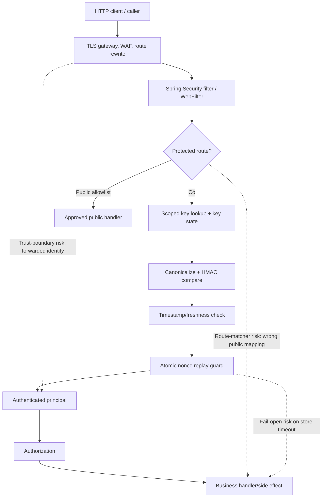
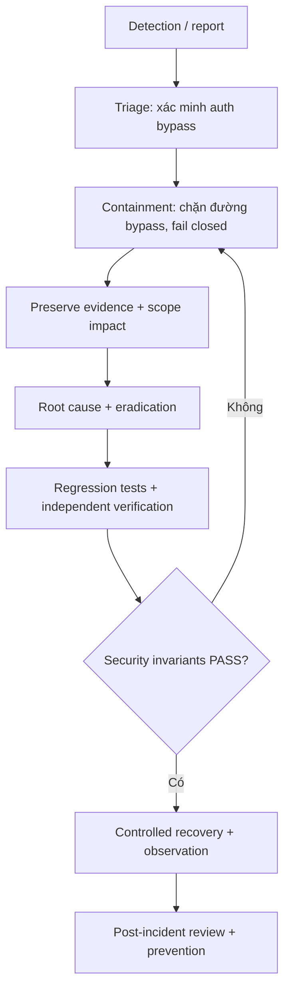
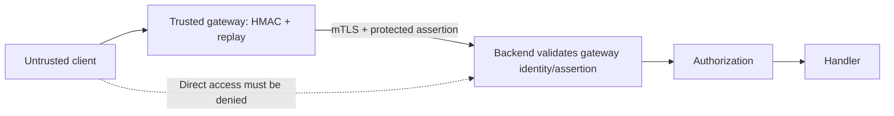

# Signature bypass: phát hiện và ứng cứu sự cố bỏ qua xác minh HMAC

## 1. Bối cảnh và mục tiêu

Trong chương **Incident response**, bài **Signature bypass** nghiên cứu cách phát hiện, cô lập, điều tra, khắc phục và phòng ngừa trường hợp một HTTP request **đi tới tài nguyên được bảo vệ mà không vượt qua cơ chế xác thực chữ ký HMAC bắt buộc**. Đây là một sự cố an toàn quan trọng: hệ thống có thể đang trả `2xx` và thực thi nghiệp vụ cho request không có chữ ký, chữ ký sai hoặc chưa được xác thực bởi một thành phần đáng tin cậy.

Bài học thuộc mô-đun `SECURITY_AUTHENTICATION_HMAC_REQUEST_AUTHENTICATION`, nơi client và server sử dụng **shared secret** cùng một **canonical request** chứa phương thức, URI, header và/hoặc body theo hợp đồng ký. Xác thực đúng cần kiểm MAC, freshness bằng timestamp, chống replay bằng nonce, vòng đời key, cách truyền qua gateway/proxy và **phân biệt xác thực với phân quyền**.

Khi có signature bypass, nhóm xử lý không chỉ “sửa filter để 401 xuất hiện trở lại”. Họ cần trả lời: từ bao giờ request có thể đi vòng qua verifier, những route và tenant nào bị ảnh hưởng, có giao dịch trái phép nào xảy ra, kiểm soát nào có thể giữ dịch vụ an toàn ngay lập tức, bằng chứng được bảo toàn thế nào và sau khắc phục làm sao chứng minh không còn đường bypass.

**Mục tiêu của bài:**

- Định nghĩa được bypass và phân biệt nó với signature mismatch, replay, key compromise, authorization bug và lỗi availability.
- Xây dựng các **bất biến bảo mật**: chỉ request có MAC đúng, key hợp lệ, timestamp/nonce hợp lệ mới được tạo principal; quyền nghiệp vụ được kiểm sau đó.
- Nhận diện những đường bypass thường gặp ở Spring Security MVC/WebFlux, gateway, reverse proxy, route matcher, cấu hình fail-open, identity forwarding và logic chuyển đổi thuật toán.
- Thiết kế tín hiệu phát hiện bằng audit event, metric, trace và kiểm toán nghiệp vụ mà **không ghi shared secret hoặc raw signature/body/canonical request**.
- Thực hiện quy trình incident response từ triage, containment, evidence, scoping, eradication đến recovery và hậu kiểm.
- Viết kiểm thử hồi quy chứng minh request chưa xác thực không thể đạt tới handler/side effect qua mọi đường HTTP được triển khai.
- Ra quyết định rotation/revoke credential đúng mức độ, không tự giả định mọi bypass đều đồng nghĩa shared secret đã lộ.

**Lưu ý:** Ví dụ HTTP status, quy trình cô lập và mã nguồn là hợp đồng minh họa để học và phát triển ứng dụng phòng thủ; thực tế phải tuân quy trình sự cố, chính sách pháp lý và ranh giới vận hành của tổ chức.

## 2. Signature bypass là gì, và không phải là gì?

Một **signature bypass** tồn tại khi một request thuộc diện bắt buộc xác thực HMAC **được xử lý như đã xác thực** mà không có bằng chứng hợp lệ rằng toàn bộ quy trình xác minh bắt buộc đã hoàn tất ở điểm tin cậy. Bypass có thể nằm ở server, gateway, business entry point, middleware, error handler hoặc trust boundary giữa hai dịch vụ.

### Phân biệt các tình huống

| Hiện tượng | Điều gì xảy ra | Có phải signature bypass? |
| --- | --- | --- |
| HMAC tag sai, verifier từ chối với 401 | Không có authenticated principal; handler không chạy | **Không**: kiểm soát đang làm việc. |
| Request không có signature nhưng API protected trả 201 và tạo đơn hàng | Handler thực thi khi chưa chứng minh MAC | **Có**, cần điều tra đường bypass. |
| Tag đúng nhưng timestamp đã hết hạn vẫn được chấp nhận | Freshness check bị bỏ hoặc sai | **Bypass điều kiện xác thực HMAC**, cụ thể là freshness; điều tra như sự cố. |
| Tag đúng nhưng nonce bị phát lại vẫn chạy handler | Chống replay bị bỏ/fail-open | **Bypass anti-replay**, khác với MAC mismatch. |
| Key đã revoked nhưng vẫn được chấp nhận do cache stale | Key lifecycle policy bị bỏ | **Bypass chính sách credential**, có thể nghiêm trọng tương đương. |
| Request ký hợp lệ bởi attacker vì shared secret bị lộ | Server thực sự kiểm MAC đúng nhưng credential đã bị chiếm | **Credential compromise**, không nhất thiết là bypass kỹ thuật; xử lý incident và rotation. |
| HMAC đúng, principal thiếu `orders:write` vẫn tạo đơn hàng | Authorization bị bỏ qua | **Authorization bypass**, không đồng nhất với signature bypass. |
| Endpoint trả 403 sau khi MAC đúng nhưng thiếu quyền | Authentication đạt; authorization từ chối | **Không**: hành vi đúng. |
| Gateway xác thực trước khi rewrite và backend tin assertion bảo vệ bằng mTLS | Backend không tự kiểm MAC nhưng có bằng chứng xác thực đáng tin | **Không nhất thiết bypass** nếu kiến trúc/chứng minh trust boundary đúng. |
| Gateway gắn `X-Authenticated-Client` từ request client mà không verify | Backend tin danh tính chưa được bảo vệ | **Có**: bypass qua identity assertion giả. |
| Replay store timeout, API fail closed với 503 | Không tiếp tục nghiệp vụ khi không bảo đảm anti-replay | **Không**: kiểm soát phòng thủ hoạt động. |
| Public health-check được chính sách miễn HMAC | Route thực sự công khai và không có dữ liệu/quyền nhạy cảm | **Không**, nếu miễn trừ được phê duyệt và không thể mở rộng sang route protected. |

Một request trả `2xx` không tự chứng minh bypass vì có endpoint công khai và có thể gateway đã xác minh. Ngược lại, một request trả `401` **không** chứng minh toàn bộ route đã được bảo vệ nếu một đường alias, HTTP method khác hoặc backend trực tiếp còn có thể vào handler.

### Bất biến cần giữ

Đối với mọi request tới protected business endpoint:

1. Có đúng một **authentication decision có thẩm quyền** (hoặc một bằng chứng identity assertion có xác thực từ verifier được ủy quyền).
2. Credential được tìm trong đúng phạm vi client/tenant/key ID; key chưa revoked/hết hạn và suite được phép.
3. Canonical bytes phản ánh đúng method, URI, signed headers/body theo hợp đồng; MAC được so với tag đã decode nghiêm ngặt.
4. Timestamp được ký và ở trong cửa sổ; nonce đã ký chưa từng được dùng trong namespace liên quan.
5. Nonce được reserve **nguyên tử** trên kho chia sẻ; lỗi kho dẫn đến **fail closed** khi chống replay là yêu cầu bắt buộc.
6. Chỉ sau các bước này mới tạo authenticated principal; không tự nâng `X-Client-Id` thành identity.
7. Authorization áp dụng authority/scope server-side sau authentication và trước mọi side effect.
8. Route không thuộc chính sách public đã phê duyệt không thể đi vòng bằng alternate path, URL rewrite, proxy header, filter registration hoặc protocol/algorithm fallback.

Bất biến phải được biểu diễn thành **test** và **telemetry**, không chỉ thành lời cam kết trong tài liệu.

## 3. Threat model và đường đi dữ liệu



Các nét chấm là **điểm cần kiểm soát**, không phải luồng được phép. Nếu gateway chính là verifier có thẩm quyền thì khối key/HMAC/nonce có thể nằm tại gateway; backend cần xác thực gateway và assertion trước khi tin danh tính. Nếu có nhiều điểm verify, phải làm rõ nơi nào đưa ra quyết định cuối cùng và làm sao tránh việc chỉ một node triển khai policy mới.

### Các nguồn gây bypass thường gặp

| Nhóm | Failure mode | Dấu hiệu cần điều tra |
| --- | --- | --- |
| Route matcher | Pattern public bao phủ cả route protected, hoặc route mới không nằm trong chain HMAC | Endpoint mới/alias trả thành công khi không có auth event. |
| Security chain order | Custom filter không chạy, chạy sai thứ tự, hoặc chain khác match request | Security debug cho thấy chain không chứa verifier; handler chạy không có verified principal. |
| Exception/failure handler | Error bị biến thành success/fallback principal | Lỗi key/replay store trùng thời điểm tăng 2xx bất thường. |
| Feature flag/test bypass | Flag “skip HMAC” còn bật, dùng nhầm cấu hình development | Requests accepted khi feature/config thay đổi. |
| Gateway assertion | Backend tin `X-Authenticated-Client`, `X-User` hay forwarded headers từ client | Bypass chỉ xuất hiện khi gọi backend trực tiếp/qua một hop khác. |
| Canonicalization/parser mismatch | Gateway và backend hiểu khác method, path/query/header | Request được ký theo một ý nghĩa nhưng handler thực thi ý nghĩa khác. |
| Key selection / algorithm agility | Verifier thử mọi key/suite, fallback hoặc không kiểm revoked state | Request được gán danh tính sai scope, legacy suite được chấp nhận ngoài policy. |
| Replay guard | Nonce store local, check-then-set, timeout fail-open, TTL ngắn | Cùng signed request gây side effect nhiều lần. |
| Body verification | Handler nhận byte khác byte được ký, cache/decorator sai | MAC được kiểm trên payload A nhưng handler dùng payload B. |
| Reactive execution | Thiếu subscribe đúng flow, reactive context bị mất, handler chạy trước khi verify hoàn tất | Bypass không ổn định dưới concurrency/cancel/retry. |
| Observability | Log/metrics sai hoặc bị tắt khiến bypass khó phát hiện | Nhiều business success nhưng không có evidence authentication tương ứng. |

Không khẳng định một dấu hiệu riêng lẻ là bằng chứng chắc chắn; ví dụ số handler successes cao hơn số verifier successes có thể do **gateway verify trước backend**, aggregation windows, retries hoặc metric bị drop. Cần đối chiếu kiến trúc và nguồn dữ liệu đáng tin.

## 4. Dấu hiệu kích hoạt quy trình incident response

Những tín hiệu sau cần được xác minh và triage nhanh trong phạm vi hệ thống:

- Một yêu cầu **không có signature / signature không hợp lệ** đi tới protected handler và tạo side effect trong một phép thử đã được cấp phép.
- Audit business thành công nhưng thiếu dấu vết authentication decision, trong khi kiến trúc yêu cầu decision theo từng request.
- Bất kỳ request nào dùng key `REVOKED` được chấp nhận sau giới hạn revoke staleness đã công bố.
- Cùng nonce đã ký được dùng cho nhiều thao tác có side effect dù nằm trong cửa sổ anti-replay.
- Sau rollout gateway/Spring Security, số request `accepted` tăng bất thường trong khi metric `hmac.signature.verifications` giảm, hoặc 401 giảm không tương xứng mà traffic/route không đổi.
- Một protected route trả `2xx` khi kết nối trực tiếp backend, trong khi qua gateway bị chặn.
- Lỗi replay store hoặc credential store tăng nhưng số request thành công không giảm theo chính sách fail closed.
- Xuất hiện response thành công từ một service với danh tính được lấy trực tiếp từ `X-Client-Id`/header tự khai thay vì principal đã xác minh.
- Một đường API sử dụng `permitAll`, cấu hình security matcher sai hoặc bị bypass bởi maintenance/health-check route rộng ngoài phạm vi được duyệt.

### Triage câu hỏi đầu tiên

**Có bằng chứng request cần HMAC thực sự được chấp nhận mà không verify đúng không?** Nếu chưa có, phân loại là *suspected bypass* và bảo vệ đường đi trong khi điều tra. Nếu đã có request không ký được phép thực hiện side effect, kích hoạt ứng cứu như sự cố authentication nghiêm trọng.

Một quy trình triage nên ghi lại:

1. Endpoint và HTTP method, gateway/ingress, backend service, phiên bản triển khai.
2. Thời điểm phát hiện và khoảng thời gian sớm nhất có thể bị ảnh hưởng.
3. Bằng chứng outcome: HTTP status, business transaction ID, trạng thái verify, authentication/authorization decisions.
4. Độ tin cậy của nguồn: log từ proxy đáng tin, telemetry nội bộ hay mô tả của caller bên ngoài.
5. Phạm vi route/tenant/principal/key state, bao gồm đường direct-backend và alternate alias.
6. Có bằng chứng credential leak hoặc chỉ là bypass logic? Hai hướng ứng cứu liên quan nhưng khác biện pháp.
7. Có khống chế được sự cố bằng tạm dừng endpoint, thay policy gateway hoặc rollback an toàn không?

Đừng chờ có đủ danh sách request trước khi chặn **đường bypass đã được chứng minh**. Đồng thời không khôi phục bằng cách tắt logging/audit, vì sẽ làm mất bằng chứng trong thời gian quan trọng.

## 5. Vai trò, mức độ và nguyên tắc điều phối

Incident response cần trách nhiệm rõ:

| Vai trò | Trách nhiệm |
| --- | --- |
| Incident commander | Quyết định ưu tiên, phạm vi containment và tiến trình khôi phục; giữ decision log. |
| Security/on-call | Xác minh dấu hiệu bypass, thu thập bằng chứng an toàn, đánh giá abuse và key compromise. |
| API/backend owner | Kiểm SecurityFilterChain, authentication provider, handler side effects, route/policy. |
| Gateway/platform owner | Kiểm TLS, WAF/ingress, route rewrite, trusted forwarded headers, khả năng chặn trực tiếp backend. |
| Credential/secret owner | Đánh giá key scope, cache, rotate/revoke nếu cần, hạn chế quyền liên quan. |
| Data/business owner | Định lượng thao tác trái phép, dữ liệu bị ảnh hưởng, rollback nghiệp vụ nếu phù hợp. |
| Communications/compliance | Thực hiện thông báo, lưu hồ sơ hoặc yêu cầu pháp lý theo quy trình tổ chức. |

**Phân loại mức độ** theo tác động và khả năng khai thác, không dựa duy nhất vào số lượng log 401. Bypass trên route đọc health-check không nhạy cảm khác bypass trên API chuyển tiền, cấp quyền hoặc thay đổi tài khoản. Cần đánh giá **quyền mà attacker có thể đạt, dữ liệu có thể truy cập, trạng thái giao dịch bị biến đổi và thời gian lộ**.

Một nguyên tắc thực hành quan trọng: **evidence và containment phải đi song song**. Không trì hoãn biện pháp cô lập an toàn để lấy thêm log, nhưng cũng tránh xóa ngay mọi bản ghi/credential/config trước khi tạo bản sao phục vụ điều tra và lưu trữ theo quyền hạn.

## 6. Quy trình ứng cứu theo giai đoạn



Mỗi giai đoạn có thể lặp lại khi xuất hiện thêm bằng chứng. Không dùng trạng thái “HTTP 2xx đã trở lại” làm điều kiện duy nhất cho recovery; API có thể nhanh và khả dụng nhưng đang tiếp tục bypass HMAC.

### 6.1. Phát hiện và xác nhận

- Nhận report từ on-call, partner, audit hoặc test được phê duyệt.
- Xác định endpoint thực sự **phải yêu cầu HMAC** theo policy chính thức, tránh nhầm public route.
- Chạy một kiểm thử **kiểm soát trong môi trường an toàn** chứng minh protected handler không được gọi với unsigned/tampered request; nếu sản phẩm đã bị ảnh hưởng, ưu tiên test fixture/canary có quyền hạn thay vì tạo thêm side effect thật.
- So sánh authentication event và downstream business event theo **request ID do hệ thống tin cậy sinh**; không dựa trên client ID được tự khai.
- Kiểm cấu hình thực đang được deploy, không chỉ code trong repository: routes, filter chains, feature flags, proxy trust boundaries.

### 6.2. Containment

Mục tiêu là chặn thực thi trái phép **ngay cả khi chưa biết chính xác root cause**:

1. Tạm chặn route/operation nhạy cảm ở một điểm tin cậy đang **thực sự bao phủ** tất cả đường vào, hoặc tạm vô hiệu hóa operation theo quy trình vận hành.
2. Đặt protected endpoint mặc định yêu cầu authentication; không chuyển sang `permitAll` vì client đang thấy 401.
3. Chặn đường direct-backend ngoài gateway, hạn chế ingress và chỉ tin identity assertion qua kênh xác thực dịch vụ (ví dụ mTLS và policy phù hợp).
4. Nếu phát hiện flag `skipSignatureVerification` hoặc bypass development còn bật, tắt flag **có kiểm chứng** và xác minh tất cả node cùng policy.
5. Với nonce store/credential store không khả dụng, bảo đảm fail closed; áp quota/rate limit ở edge như lớp phụ, không thay HMAC.
6. Cân nhắc rollback cấu hình/phần mềm về bản đã được xác nhận an toàn; kiểm rollback **không khôi phục lại key đã revoke hoặc legacy suite đã bị cấm**.
7. Nếu không thể đảm bảo các bất biến, ưu tiên **từ chối có kiểm soát** đối với protected action thay vì xử lý tiếp request chưa xác minh.

Rate limiting, CAPTCHA, WAF hoặc IP allowlist có thể giảm rủi ro nhưng **không thay cho MAC và authorization**, đặc biệt với hệ thống B2B có IP dùng chung/NAT. Không coi một rule ở gateway là đủ nếu backend còn đường truy cập trực tiếp.

### 6.3. Bảo toàn chứng cứ

Ghi lại có kiểm soát:

- Timestamp UTC, incident ID, version artifact, hash/ID deployment/config, trạng thái feature flags, key lifecycle metadata, route matching và topology.
- Audit events, access logs **đã được giảm dữ liệu nhạy cảm**, request correlation ID, danh sách transaction IDs và kết quả nghiệp vụ.
- Snapshot cấu hình gateway/filter/permissions tại thời điểm sự cố theo quyền quản trị; trạng thái thay đổi của từng node/region.
- Credential state (active/verify-only/revoked), **không sao chép shared secret vào ticket**.
- Nonce store health, timeout/eviction/TTL metrics và bằng chứng concurrency nếu liên quan.
- Timeline của người phát hiện, thông báo, thay đổi containment, test xác nhận và recovery.

Đảm bảo chain of custody theo chính sách: nguồn, thời gian, người truy cập, quyền đọc, phiên bản/snapshot và thời hạn lưu. Nếu log hiện chứa raw body/signature/secret, hạn chế truy cập và xử lý như **sự cố dữ liệu nhạy cảm liên quan**, không phát tán qua chat/issue tracker.

### 6.4. Scoping và tác động

Một phạm vi kiểm tra tốt không dừng ở một URL:

- Có bao nhiêu **HTTP method, route alias, prefix, query variant, host và ingress** đi vào cùng handler?
- Mọi instance/pod/node đều có cùng security chain, policy và version không?
- Client/tenant nào có thể đạt chức năng protected, có thể giả mạo principal nào?
- Có thao tác dữ liệu, giao dịch, cấp quyền hoặc export nào diễn ra trong khoảng ảnh hưởng?
- Authentication có thực hiện tại gateway trước rewrite hay backend, và assertion có được backend kiểm chứng không?
- Những retry/batch/event bất đồng bộ có thể tiếp tục side effect sau containment không?
- Có cần phân tích **key compromise** riêng khi secret xuất hiện trong log hoặc credential store cũng có dấu hiệu bị xâm nhập?

Phạm vi ảnh hưởng cần có **giới hạn bằng chứng và độ tin cậy**. Không ghi “không có truy cập trái phép” chỉ vì không tìm thấy raw request: telemetry thiếu có thể chính là một phần sự cố.

### 6.5. Khắc phục và recovery

Sửa root cause tại điểm đưa ra quyết định bảo mật, không chỉ thêm rule tình thế ở một hop. Sau sửa:

- Chạy regression theo từng protected route/method và mọi HTTP entry point.
- Kiểm request unsigned/tampered/expired/replayed/revoked không vào handler và không có side effect.
- Kiểm request hợp lệ với nonce mới vẫn thành công và authorization đúng.
- Chạy lại qua TLS gateway/proxy, direct-backend route (nếu còn đường), multi-node replay.
- Xác nhận error paths của key/replay store đều fail closed.
- Triển khai canary hoặc staged rollout có giám sát, rollback guard và owner phê duyệt.
- Giữ containment cho đến khi các điểm xác minh đã được chứng minh an toàn; không chỉ dựa vào một node PASS.

## 7. Bypass ở Spring MVC: route matcher và filter chain

Một nguyên nhân phổ biến là **route protection không phủ đúng đường thực thi**. Spring Security có thể có nhiều `SecurityFilterChain` với `securityMatcher` hoặc `requestMatchers` khác nhau, mỗi chain mang chính sách riêng. Chain khớp đầu tiên theo thứ tự cấu hình sẽ được chọn; một route mới hoặc path sau proxy rewrite có thể không đi qua chain HMAC như dự kiến.

### 7.1. Những kiểm tra cần thực hiện

- Protected routes được **khai báo rõ**, bao gồm method, path alias, API version và context path.
- Không có chain public/`permitAll` rộng hơn vô tình khớp protected route trước chain HMAC.
- HMAC filter có mặt trong chain thực tế được chọn, được chạy ở vị trí phù hợp với xử lý authentication exception.
- Không cho handler tin `X-Client-Id` hoặc header “authenticated” trước khi MAC đạt.
- Không vô hiệu `AuthenticationEntryPoint`/failure handler để trả về success khi verifier lỗi.
- Có deny-by-default cho các route không chủ đích công khai, với policy của route mới được review.
- Sau xác thực, `AuthorizationFilter`/method security còn kiểm authority/scope nghiệp vụ.

Ví dụ **cấu hình khái niệm** về policy public hẹp, protected route và default deny (cần tích hợp verifier HMAC thật trong SecurityFilterChain):

```java
@Bean
SecurityFilterChain apiSecurity(
        HttpSecurity http,
        HmacAuthenticationFilter hmacFilter) throws Exception {

    http
        .csrf(csrf -> csrf.disable()) // Chỉ cho API stateless có threat model phù hợp.
        .sessionManagement(sm -> sm.sessionCreationPolicy(
            SessionCreationPolicy.STATELESS))
        .authorizeHttpRequests(auth -> auth
            .requestMatchers(HttpMethod.GET, "/health/live").permitAll()
            .requestMatchers("/api/partner/**").authenticated()
            .anyRequest().denyAll())
        .addFilterBefore(hmacFilter, AuthorizationFilter.class);

    return http.build();
}
```

**Lưu ý kỹ thuật:** Ví dụ là skeleton cho một chain. `HmacAuthenticationFilter` phải được viết để từ chối đúng request chưa có MAC, tạo `Authentication` **chỉ sau toàn bộ verify**, tránh chạy trên route ngoài scope mà không phân loại. `permitAll()` là chính sách authorization, **không tự động bỏ chạy custom filter**; nếu filter không có bypass public đúng cách thì health endpoint có thể bị yêu cầu HMAC. Ngược lại, nếu filter tự bỏ qua mọi path không bắt đầu bằng `/api/partner/`, phải có test để không tạo lỗ hổng trên route alias/handler khác.

Nếu nhiều filter chain, dùng unit/integration test để xác nhận chain nào match request thật. `addFilterBefore(..., AuthorizationFilter.class)` xác định quan hệ trước AuthorizationFilter, **không tự bảo đảm** exception được `ExceptionTranslationFilter` bắt trong mọi cấu hình; kiểm vị trí thực và failure handler/`AuthenticationEntryPoint`.

### 7.2. Đừng coi mọi `SecurityContext` là bằng chứng HMAC

Một request có thể có authentication object từ session, basic auth hoặc filter khác. Trên route yêu cầu **HMAC cụ thể**, `authenticated()` đơn thuần có thể cho qua principal của một cơ chế khác nếu chain cho phép nhiều authentication mechanisms.

Muốn chắc chắn:

- Quy định **authentication scheme required** cho protected route, hoặc dùng authorization policy/check gắn với `HmacVerifiedAuthentication` do verifier tin cậy tạo.
- Không tin bất kỳ `Authentication` nào có `isAuthenticated=true` nếu nguồn và mức assurance không phù hợp route.
- Chỉ xây principal từ key record đã xác minh; không lấy authority từ body/header client.
- Khi nhiều cơ chế xác thực cùng tồn tại, test rằng bearer/session/basic credential **không** thay thế HMAC trên route có hợp đồng bắt buộc ký request.

Đây là một failure mode khó nhận thấy: MAC verifier có thể không bị lỗi, nhưng một filter khác đã tạo principal nên `AuthorizationFilter` thấy “đã xác thực” và cho đi.

## 8. Bypass ở Spring WebFlux: asynchronous boundary

Với Spring WebFlux, dữ liệu xác thực đi qua `SecurityWebFilterChain`, `AuthenticationWebFilter` hoặc custom `WebFilter`, Reactor Context và `Flux<DataBuffer>`. Một bypass có thể xuất hiện do logic reactive được compose sai: nhánh handler được thực thi ngay cả khi verifier trả empty/error, một side effect chạy trước khi `Mono` xác minh hoàn tất, hoặc principal bị lấy từ context không đúng scope.

### Những bất biến reactive

1. Chỉ subscribe và tiến hành downstream **sau** khi `verifyHmac(...)` phát kết quả hợp lệ.
2. Không dùng `switchIfEmpty(chain.filter(exchange))` để biến “không có authenticated principal” thành “cho qua” ở protected route.
3. Không `onErrorResume(... -> chain.filter(exchange))` cho lỗi MAC, key store hoặc replay store.
4. Khi verifier cần đọc body, dùng bounded body buffer/decorator để downstream đọc **chính bytes đã ký**; không cho handler chạy trên payload chưa được chứng minh.
5. Không `block()` trên event loop khi truy vấn Redis/key store; nếu dependency bị timeout, kết quả vẫn fail closed.
6. Security identity đi theo `ReactiveSecurityContextHolder`/Reactor Context, không giả định `SecurityContextHolder` ThreadLocal của MVC có tác dụng trong reactive pipeline.
7. Các nhánh cancel/retry/resubscribe không tạo authenticated result giả hoặc reserve nonce nhiều lần rồi phát sinh side effect trái policy.

Một mẫu logic phòng thủ ở mức pseudocode:

```java
Mono<Void> authenticateThenContinue(
        ServerWebExchange exchange,
        WebFilterChain chain) {

    return verifier.verify(exchange)
        .switchIfEmpty(Mono.error(
            new BadCredentialsException("HMAC required")))
        .flatMap(verifiedPrincipal ->
            chain.filter(exchange)
                .contextWrite(
                    ReactiveSecurityContextHolder.withAuthentication(
                        verifiedPrincipal.toAuthentication())))
        .onErrorMap(ReplayStoreException.class,
            cause -> new ServiceUnavailableException(
                "Authentication dependency unavailable"));
}
```

Đây là **pseudocode kiến trúc**, chưa xử lý body decorator, error response mapping, security filter order hoặc imports. `verifiedPrincipal` chỉ được trả về **sau MAC, freshness, nonce và key state đều đạt**. Không biến bất kỳ exception nào thành success, và không tự đặt một principal trước khi `verify` kết thúc.

Một test `WebTestClient.bindToController(...)` đơn lẻ có thể **không đi qua SecurityWebFilterChain**; dùng application context có Spring Security hoặc server thật. Khi điều tra, kiểm **pipeline thực tế** thay vì chỉ xem source code của một `WebFilter`.

## 9. Gateway và identity assertion: một đường bypass rất nguy hiểm

Khi gateway xác thực HMAC tại edge rồi chuyển request đã được xác thực vào backend, backend có thể không cần tính lại HMAC. Điều này hợp lệ **chỉ nếu** backend chứng minh được rằng assertion danh tính thật sự do gateway đáng tin cậy tạo và được ràng buộc với request/policy đúng.

### Rủi ro

- Gateway pass-through một header `X-Authenticated-Client` do caller tự gửi.
- Backend có direct public access bỏ qua ingress.
- Proxy route khác chuyển một request đến backend mà không thực hiện HMAC verifier.
- Một gateway verify V2, một gateway khác không verify nhưng cả hai đều gắn identity header.
- Forwarded URI/Host do client kiểm soát được dùng để lựa chọn auth policy hoặc canonical bytes.
- Không có xác thực gateway-to-backend, nên client trên mạng có thể bắt chước assertion.

### Trust boundary đúng

Một kiến trúc có thể chọn:

- **Backend verify:** backend tự xác minh HMAC và chống replay, không tin header identity chưa ký.
- **Gateway verify:** edge xác minh MAC/timestamp/nonce và cấp assertion có ràng buộc rõ; backend chỉ nhận từ gateway có danh tính được xác thực (ví dụ mTLS với authorization service-to-service), kiểm assertion và không cho direct bypass.
- **Verify nhiều tầng:** định nghĩa nguồn có thẩm quyền, không để kết quả từ một tầng không được xác thực ghi đè quyết định của tầng khác.



Không có công thức “chỉ cần thêm `proxy_set_header X-Authenticated-Client ...` là an toàn”. Gateway phải loại bỏ giá trị identity/forwarded header không tin cậy trước khi đặt của chính mình; backend phải xác thực nguồn, không tin một chuỗi header vô điều kiện. Với HTTP/2 và HTTP/1.1 khác nhau về `Host`/`:authority` và path rewrite, cần test canonical target tại **điểm verify có thẩm quyền**.

## 10. Fail-open và error semantics

Một lỗi đặc biệt cần điều tra là code xử lý exception rồi “để request đi tiếp” nhằm ưu tiên availability:

```java
// SAI: lỗi kho chống replay bị biến thành thành công.
try {
    nonceStore.reserve(nonceKey);
} catch (RuntimeException ignored) {
    // Không có bằng chứng nonce là mới.
}
return createAuthenticatedPrincipal();
```

Với API yêu cầu replay protection, hành vi đúng là **không xác thực** khi không thể xác minh nonce mới. Có thể trả lỗi hạ tầng `503` theo API contract, ghi internal reason `REPLAY_STORE_UNAVAILABLE` và kích hoạt cảnh báo.

| Nguyên nhân | Hành vi đúng | Phân loại |
| --- | --- | --- |
| Thiếu tag/format MAC sai | Từ chối authentication, không handler | Ví dụ `401` hoặc `400` cho lỗi request syntax theo contract. |
| MAC không khớp | Từ chối authentication, không handler | `401` với custom scheme và challenge policy phù hợp. |
| Timestamp quá hạn/tương lai hoặc nonce replay | Từ chối authentication, không handler | `401`, reason nội bộ riêng. |
| Key revoked, expired hoặc scope sai | Từ chối authentication, không handler | `401`, không tiết lộ key tồn tại hay không. |
| Credential store/replay store hỏng | **Fail closed**, không dùng principal mặc định | Lỗi hạ tầng, ví dụ `503`. |
| HMAC đúng nhưng authority thiếu | Authentication đạt; authorization từ chối | `403`, không phải MAC sai. |
| Request body vượt limit | Chặn tài nguyên, không OOM | `413` theo contract. |
| Rate limit tại gateway | Từ chối trước verifier | `429` theo policy; không suy là HMAC mismatch. |

`401` có yêu cầu về `WWW-Authenticate` trong HTTP authentication semantics. Nếu API dùng các header `X-*` thay vì một scheme HTTP chuẩn, phải thiết kế challenge/documentation phù hợp; không coi các status trong bảng là những mã bắt buộc giống nhau cho mọi sản phẩm.

Một bypass có thể chỉ xảy ra ở **nhánh exception**. Vì thế kiểm thử chỉ request hợp lệ và tag sai không đủ; phải chủ động giả lập **Redis timeout, key lookup exception, body decoder exception, invalid algorithm version** để xem hệ thống có trả lỗi an toàn và ngừng handler không.

## 11. Algorithm agility và các đường bypass do fallback

Khi nâng HMAC-SHA256 sang suite khác, hệ thống có thể tồn tại V1/V2 song song. Nếu verifier thử mọi thuật toán, key hoặc canonicalization variant đến khi một tag khớp, việc xác thực có thể vượt khỏi phạm vi policy của client/tenant.

**Thiết kế an toàn:**

1. Request công bố `suite/version` rõ theo grammar đã giới hạn.
2. Server xác định suite từ **allowlist** cho endpoint/client/credential/time, không tin bất kỳ `X-Client-Capabilities` nào như quyền chọn.
3. Suite identity nằm trong canonical request và được MAC bảo vệ.
4. Tra credential có scope tenant/client; key metadata ràng buộc allowed suites và trạng thái revoked/verify-only.
5. Verify **một** suite đã khai; không fallback khi nhận 401, 403, timeout hoặc gateway lỗi.
6. Version cũ chỉ được chấp nhận trong thời hạn **chính sách cho phép**, không kéo dài chỉ vì client chưa nâng cấp.

Một client ký HMAC đúng với secret đã bị lộ vẫn có thể giả mạo request; **đó là credential compromise**, không phải lỗi “thuật toán chưa đủ dài”. Chỉ thay HMAC-SHA256 thành HMAC-SHA512 trong khi tiếp tục dùng secret bị lộ không giải quyết rủi ro giả mạo.

## 12. Evidence: dựng timeline mà không ghi secret

Một yêu cầu thường gặp khi sự cố xảy ra là bật debug ở mức cao và in canonical request/signature để so sánh. Điều này **có thể làm tình huống xấu hơn**, vì canonical string chứa URI/query, signed headers và body hash; log có thể chứa token, PII, dữ liệu khách hàng hoặc vật liệu replay. Shared secret rò ra log còn cho phép attacker tự tạo chữ ký mới.

### Schema sự kiện an toàn

```json
{
  "event": "hmac.authentication",
  "schema_version": 1,
  "request_id": "f18aeaf9a23b4950959fdb24ca46e824",
  "route_id": "partner_orders_create",
  "decision": "REJECTED",
  "reason": "SIGNATURE_INVALID",
  "verification_point": "backend",
  "canonical_version": "HMAC-V1",
  "http_status": 401,
  "duration_ms": 7
}
```

Với decision `ACCEPTED`, nếu cần audit, lưu cùng schema và có định danh decision để liên kết đến business event. **Không** ghi shared secret, `X-Signature`, expected MAC, raw nonce, full canonical string, raw body, token trong query, full headers hoặc exception chứa payload.

Trường `request_id` được hệ thống tin cậy sinh/chuẩn hóa ở ingress. `route_id` và `canonical_version` lấy từ danh sách hữu hạn do server xác định, không copy raw input attacker kiểm soát.

### Tái dựng chuỗi sự kiện

```text
gateway request_received    request_id=R1 route=partner_orders_create
hmac authentication         request_id=R1 decision=REJECTED
authorization               request_id=R1 not_evaluated
business_side_effect        request_id=R1 none
```

Nếu thấy business side effect gắn `R1` nhưng không có authentication accepted decision, đó là **tín hiệu cần điều tra**, chưa chắc là kết luận nếu architecture verify ở gateway hoặc event logging bị sampling/drop. Cần đối chiếu audit source có thẩm quyền và lỗ hổng thu thập dữ liệu.

### Bảng truy tìm nguồn

| Bằng chứng | Có thể xác minh | Giới hạn |
| --- | --- | --- |
| HTTP access log của gateway | Ingress, response status, route và upstream | Không chứng minh MAC đã được verify nếu không có event verifier. |
| HMAC verify metric | Tỷ lệ matched/mismatched, key state hoặc reason enum | Aggregated; không gắn trực tiếp với từng giao dịch. |
| Authentication audit | Decision theo request ID/route | Cần bảo đảm event phát đúng thời điểm và không bị sampling ngoài policy. |
| Authorization audit | Authority/scope được kiểm sau principal | Không thay thế sự tồn tại của MAC verification. |
| Business audit/transaction ledger | Side effect đã xảy ra, user/client liên quan, thời điểm | Có thể cần điều tra quyền và nguồn identity. |
| Deployment/config history | Route/filter/flag thay đổi khi nào | Version hiện tại không chứng minh mọi node quá khứ giống nhau. |
| Replay store metrics | Nonce reserve duplicate/error, timeout, evictions | Không tự xác nhận trạng thái từng nonce nếu không giữ audit theo chính sách. |
| Security tests/synthetic traffic | Reproduce behavior với secret/test tenant | Chỉ chứng minh trên topology và cấu hình test đã quan sát. |

Không đưa raw canary test hoặc log chứa secret thật vào public issue/ticket. Nếu cần một bản sao log nhạy cảm để điều tra, xử lý theo kho điều tra được cấp quyền và chain of custody.

## 13. Khi nào cần rotate hoặc revoke shared secret?

Một bypass có thể xảy ra khi **không hề biết secret**: ví dụ filter không chạy. Trong trường hợp này, chỉ rotate secret có thể **không chặn được bypass**. Ngược lại, nếu secret đã lộ hoặc attacker có thể dùng một credential thực để ký request hợp lệ, rotation/revoke trở thành hành động quan trọng.

### Ma trận quyết định

| Bằng chứng | Quyết định ưu tiên |
| --- | --- |
| Protected route bị `permitAll` hoặc bypass filter, chưa thấy key leak | Chặn route/khôi phục verifier trước; phân tích giao dịch và khả năng cần hạn chế client. Rotation toàn bộ không tự giải quyết nguyên nhân. |
| Shared secret xuất hiện trong log/ticket/export không kiểm soát | Cô lập log, revoke/rotate credential liên quan, điều tra access và bản sao, kiểm key cache. |
| Key revoked nhưng vẫn xác thực do cache stale | Sửa key-state validation/invalidation, bảo đảm revoke có hiệu lực; áp containment ngay. |
| Key thuộc tenant B được dùng để xác thực tenant A | Sửa tenant isolation, đánh giá quyền và cấp lại key nếu nguy cơ compromise; test scope. |
| Bypass qua gateway identity header giả | Chặn direct access, xác thực assertion từ gateway; rotation HMAC riêng có thể không đủ. |
| Lạm dụng replay với signature hợp lệ | Sửa nonce store/TTL/atomicity; rotation nếu có bằng chứng secret bị lộ hoặc chính sách yêu cầu. |
| Algorithm downgrade ngoài policy | Chặn suite không được phép, sửa verifier policy và key binding; rotation nếu credential bị ảnh hưởng. |

**Không gộp mọi sự cố vào một biện pháp “rotate tất cả key”.** Nó có thể gây gián đoạn lớn nhưng vẫn để lỗ hổng logic tồn tại. Quyết định cần dựa trên credential exposure, blast radius và SLA thu hồi. Khi đã có bằng chứng key bị lộ, **không coi timestamp/nonce đủ để khắc phục**: attacker biết secret có thể ký request mới với nonce mới.

## 14. Containment kỹ thuật không được mở bypass khác

Một số “fix khẩn” dễ làm sự cố lan rộng:

| Thao tác thiếu kiểm soát | Tại sao nguy hiểm | Thay thế an toàn |
| --- | --- | --- |
| Bỏ HMAC khỏi route để client hết 401 | Biến incident thành bypass chính thức | Chặn route có kiểm soát, sửa verifier hoặc rollback bản an toàn. |
| Cho phép request khi Redis/key store timeout | Bỏ chống replay/kiểm credential đúng lúc dependency yếu | Fail closed, cảnh báo outage, phục hồi dependency. |
| Thêm `permitAll("/api/**")` tạm thời | Vô hiệu authorization cho mọi endpoint match | Public allowlist hẹp, security review rule và test route matrix. |
| Tin `X-Authenticated-Client` từ client để giảm latency | Cho phép giả mạo identity không cần MAC | Assertion chỉ từ gateway được xác thực và ràng buộc request. |
| Không kiểm key revoked vì cache chưa sync | Dùng tiếp credential bị thu hồi | Bound cache staleness, invalidate/fetch đúng policy, fail closed khi không chắc. |
| Fallback mọi HMAC suite/secret | Có thể bypass policy, tăng CPU và tạo oracle | Pin suite và allowed keys theo credential state. |
| Bật full request logging trong production | Lộ secret, body, signature/nonce hoặc PII | Golden vectors giả, enum reason, metric stage và tracing đã làm sạch. |
| Chỉ sửa một gateway node | Load balancer vẫn đưa traffic qua node dễ bị bypass | Chứng minh mọi region/node/entry point đã áp policy. |
| Rollback cả credential policy | Có thể mở lại revoked key/legacy suite | Tách rollback code khỏi security policy và kiểm tác động. |

Trong incident, **mục tiêu containment không phải “giữ mọi request thành công”**. Khi không bảo đảm xác thực, từ chối tác vụ nhạy cảm có kiểm soát có thể là lựa chọn an toàn cần được người chịu trách nhiệm phê duyệt.

## 15. Kiểm thử hồi quy: chứng minh không còn bypass

Một bộ test có ý nghĩa phải kiểm **cả response lẫn side effect**. Nếu chỉ assert 401, request có thể đã tạo bản ghi rồi mới bị error handler đổi status.

### Ma trận hồi quy cốt lõi

| Test | Fixture | Assertion bắt buộc |
| --- | --- | --- |
| Không gửi signature | Request protected thiếu header HMAC | Auth rejected; không principal, không side effect. |
| Signature bị sửa | Tag đúng grammar nhưng sai MAC | 401 theo contract; handler không chạy. |
| Body bị sửa sau khi ký | Ký body A, gửi body B, giữ signature A | MAC mismatch; không side effect. |
| Thay signed path/query/method | Tag của request A nhưng route B vẫn đến verifier | Từ chối đúng lý do; không bypass routing. |
| Timestamp hết hạn được ký hợp lệ | Dùng signer test với timestamp cũ, Clock.fixed | Từ chối freshness, không nhầm với MAC mismatch. |
| Nonce đã dùng | Gửi lại cùng signed request | Lần sau bị từ chối; không xử lý nghiệp vụ lại. |
| Concurrent replay nhiều node | Hai request cùng nonce gần đồng thời qua store chung | Nhiều nhất một request vượt guard. |
| Store unavailable | Giả lập lỗi Redis/key store sau MAC đúng | Fail closed, không authenticated principal/handler. |
| Key revoked | MAC đúng theo secret cũ đã revoke | Từ chối key state, không phải chỉ test tag sai. |
| Cross-tenant credential | Claim tenant A, ký bằng credential B | Không tạo principal A. |
| Algorithm/version không hợp lệ | Header thiếu, lạ, duplicate, downgraded | Không fallback hoặc skip verify. |
| Principal từ cơ chế khác | Session/bearer đã xác thực nhưng route yêu cầu HMAC | Không được thay thế assurance HMAC nếu policy bắt buộc. |
| Authorization fail | MAC/time/nonce hợp lệ nhưng thiếu authority | 403; không side effect. |
| Gateway identity spoof | Client tự đặt assertion header | Bị loại bỏ/bỏ qua, direct backend không bypass. |
| Path alias/encoded target | Mọi route variant được gateway chấp nhận | Protected policy vẫn áp đúng. |
| Body lớn/client cancel | Input vượt limit hoặc body chưa hoàn tất | Không handler, không buffer leak/OOM. |
| Một node chưa cập nhật config | Canary traffic qua từng node/region | Không còn node chấp nhận request chưa xác minh. |

### 15.1. Java: unit test lõi “chỉ tạo principal sau verify”

Một mẫu defensive design là verifier trả về một **kiểu kết quả đã xác minh**, và lớp điều phối chỉ tạo principal từ kiểu đó. Kết quả `VerifiedHmacRequest` phải được tạo bởi code trusted sau khi toàn bộ kiểm tra bắt buộc đạt; không expose một constructor công khai cho mọi code path tự tạo kết quả thành công.

```java
// Pseudocode về kiến trúc, không phải Spring API dựng sẵn.
final class HmacAuthenticationService {
    private final HmacVerifier verifier;

    HmacAuthenticationService(HmacVerifier verifier) {
        this.verifier = verifier;
    }

    Authentication authenticate(SignedRequest request) {
        // verify() phải fail closed nếu:
        // - MAC sai/thiếu; key revoked; timestamp sai;
        // - nonce duplicate; replay store unavailable.
        VerifiedHmacRequest verified = verifier.verify(request);

        // Chỉ lấy identity và authorities từ nguồn server-side
        // đã ràng buộc với key được xác minh.
        return new HmacAuthenticatedToken(
            verified.clientId(),
            verified.authorities()
        );
    }
}
```

`HmacVerifier`, `SignedRequest`, `VerifiedHmacRequest`, `HmacAuthenticatedToken` là kiểu do ứng dụng định nghĩa. Điều quan trọng là **không** có nhánh “catch rồi tạo anonymous-but-authenticated user” hoặc “nếu signature rỗng thì trust `X-Client-Id`”.

Có thể viết unit test dùng Mockito:

```java
@Test
void missingSignatureNeverProducesAuthentication() {
    SignedRequest unsigned = fixtures.unsignedPartnerRequest();

    when(verifier.verify(unsigned))
        .thenThrow(new BadCredentialsException("HMAC required"));

    assertThrows(BadCredentialsException.class,
        () -> service.authenticate(unsigned));

    verify(verifier).verify(unsigned);
    // Không gọi token factory hoặc business handler ở đường lỗi.
}
```

Test này kiểm lớp điều phối trong fixture. Nó **không thay thế** integration test của SecurityFilterChain thật, vì service có thể an toàn nhưng filter không được cấu hình cho một route.

### 15.2. Spring MVC: MockMvc full security chain

```java
@SpringBootTest
@AutoConfigureMockMvc
class HmacBypassRegressionMvcTest {
    @Autowired MockMvc mvc;
    @SpyBean OrderService orderService; // Annotation tùy version Spring Boot.

    @Test
    void unsignedOrderIsRejectedWithoutSideEffect()
            throws Exception {

        mvc.perform(post("/api/partner/orders")
                .contentType(MediaType.APPLICATION_JSON)
                .content("{\"orderId\":\"test-only\"}"))
            .andExpect(status().isUnauthorized());

        verify(orderService, never()).create(any());
    }
}
```

**Điều kiện:** cấu hình test phải thực sự có HMAC `SecurityFilterChain`, route đúng scope, không mock principal, và service spy phù hợp phiên bản Spring Boot (ví dụ annotation tương ứng được hỗ trợ). Nếu request bị 404/403 bởi route/policy khác trước khi vào verifier, test chỉ assert status chưa chứng minh HMAC đã chạy. Bổ sung test probe/metric `MISSING_SIGNATURE` hoặc verification event an toàn để xác nhận đường đi.

Không sử dụng `@WithMockUser` cho test chứng minh HMAC: điều đó tạo principal giả và có thể che lỗi bypass. Có thể dùng helper đó cho test **authorization** riêng, nhưng không phải kiểm chứng chữ ký.

### 15.3. WebFlux: WebTestClient với security chain thật

```java
webTestClient.post()
    .uri("/api/partner/orders")
    .contentType(MediaType.APPLICATION_JSON)
    .bodyValue("{\"orderId\":\"test-only\"}")
    .exchange()
    .expectStatus().isUnauthorized();

// Kết hợp test spy hoặc database assertion:
// không có đơn hàng nào được tạo khi thiếu chữ ký.
```

Dùng `WebTestClient` gắn application context có `SecurityWebFilterChain` hoặc server HTTP thật; `bindToController` đơn lẻ có thể bỏ qua HMAC security filters. Với WebFlux, test thêm event cancellation, body replay/caching và authentication context propagation.

### 15.4. Gateway end-to-end và multi-node

Sử dụng môi trường được cấp phép với fixture test:

1. Ký một request hợp lệ bằng signer **độc lập** và secret giả, kiểm qua public gateway đúng host/TLS.
2. Chạy cùng route với tag sai/thiếu, expired, replay và revoked key, assert side effects bị chặn.
3. Kiểm route aliases, path rewriting, query encoding, duplicate signed headers và forwarded metadata không đáng tin.
4. Thử đường direct-backend mà client bình thường **không được quyền dùng**, bảo đảm bị chặn ở network/auth boundary hoặc vẫn phải verify đúng.
5. Gửi cùng nonce tới hai verifier node gần đồng thời, assert at-most-one success bằng shared replay store.
6. Giả lập key/replay store timeout trong lab để kiểm mọi node fail closed.
7. Kiểm tất cả ingress/ngôn ngữ client/suite đang được hỗ trợ; không chỉ một Java implementation dùng chung canonicalizer với server.

Không gửi hàng loạt request phá hoại trên production để “chứng minh bypass”; dùng canary fixture và kế hoạch kiểm thử được phê duyệt.

## 16. Quan sát và cảnh báo sớm để phát hiện bypass

Chỉ số phản ánh hoạt động HMAC:

| Meter/nguồn | Ý nghĩa | Điều cần chú ý |
| --- | --- | --- |
| `hmac.authentication.requests` | Tổng outcome `accepted/rejected/error` theo route/reason | Có thể thiếu nếu filter bị bypass hoàn toàn. |
| `hmac.signature.verifications` | `match/mismatch` khi so MAC thật | 401 do missing header/key/timestamp không nhất thiết được tính vào compare. |
| `hmac.replay.reservations` | Nonce new/duplicate/store error | Không lưu raw nonce làm label. |
| `hmac.authorization.decisions` | Access allowed/denied sau authentication | Phân biệt authorization bypass với MAC failure. |
| Protected business events | Số side effects và identity nguồn | Phải đối chiếu auth decision ở đúng điểm verify. |
| Gateway protected route counters | Số request đi qua edge/route | Đừng suy verifier đã chạy từ HTTP status của gateway. |
| Replay/key store health | RTT, timeouts, evictions, key cache state | Phát hiện fail-open hoặc revoke stale. |
| Deployment/config audit | Version, rule/flag thay đổi | Tìm khoảng ảnh hưởng theo thời gian. |

### Nguyên tắc cảnh báo đối chiếu

Một chỉ báo có thể là **số protected handler starts có auth decision hợp lệ ít hơn dự kiến** trong cùng scope/đơn vị thời gian. Tuy nhiên, không thể trừ hai counter đơn thuần rồi kết luận ngay: authentication có thể xảy ra ở gateway, một request có retry, một auth decision có nhiều business events, metrics bị sampling hoặc có sự khác biệt cửa sổ.

Giải pháp đáng tin hơn:

- Mỗi protected business operation mang **trusted request ID** và một `verification_decision_id` hoặc assertion đã được xác thực trong context theo kiến trúc.
- Audit tại nơi xác thực phát event accepted/rejected an toàn và tại nơi xử lý nghiệp vụ có reference tương ứng.
- Chạy **synthetic negative canary** được cấp phép trong môi trường thích hợp, kỳ vọng bị từ chối và không tạo side effect.
- Dùng alerts theo **route ID và error reason enum hữu hạn**, không gắn raw header, signature, nonce, key ID hay client ID tùy ý.
- Cảnh báo deployment drift khi một gateway/node chưa áp dụng minimum policy hoặc verifier version đang khác.

### Một vài câu truy vấn PromQL minh họa

Với metric counter phù hợp trong Prometheus:

```promql
sum by (route) (
  rate(hmac_authentication_requests_total{
    outcome="accepted"
  }[5m])
)
```

Đối chiếu hoạt động verify thật:

```promql
sum by (route, result) (
  rate(hmac_signature_verifications_total[5m])
)
```

Và lỗi replay store:

```promql
sum by (route) (
  increase(hmac_replay_store_errors_total[5m])
)
```

**Không** sử dụng riêng các query này như detector bypass tuyệt đối. Chúng chỉ giúp khoanh vùng khi kết hợp protected traffic và business audit. Nếu filter không chạy, cả metric authentication và signature comparison có thể đều vắng mặt; phải có tín hiệu **ngoài chính filter đó** để phát hiện.

## 17. Tình huống ứng cứu 1: một route mới không đi qua HMAC chain

### Triệu chứng

Sau một lần mở rộng API, endpoint `POST /api/partner/v2/orders` xuất hiện. Kết quả kiểm soát cho thấy route mới tạo đơn hàng test khi thiếu header signature, trong khi `/api/partner/v1/orders` vẫn trả 401 nếu không ký.

### Phân tích có hệ thống

- Xác định request từ ingress nào đến được v2 handler.
- Kiểm security chain matcher, thứ tự chain, filter exclusions và path aliases.
- Kiểm controller có tự nhận `clientId` từ HTTP header như authenticated identity không.
- Kiểm policy authorization: `authenticated()` có đang được thỏa mãn nhờ một mechanism khác?
- Tìm thời điểm route v2 và cấu hình HMAC được deploy; đánh giá mọi request v2 trong khoảng đó.
- Kiểm bất kỳ side effects nào của v2 đã xảy ra với danh tính không được chứng minh.

### Containment và root-cause fix

Chặn operation v2 ở gateway tin cậy hoặc tạm vô hiệu endpoint cho đến khi có verifier phù hợp; sửa route-to-chain policy sao cho **mọi đường vào v2** yêu cầu HMAC. Tạo test v1/v2, POST/GET/alternate path và principal-from-other-mechanism, assert unsigned request không tới service.

**Không đủ:** chỉ thêm `if (signature == null) return 401` trong controller. Điều đó không xử lý chữ ký sai, freshness, replay, key state hoặc path khác; dễ tạo nhiều cơ chế không nhất quán.

## 18. Tình huống ứng cứu 2: gateway assertion giả được backend tin

### Triệu chứng

Backend bảo vệ nghiệp vụ bằng một header nội bộ `X-Authenticated-Client`. Khi đi qua gateway chuẩn, header do gateway gắn sau verify; nhưng một route hoặc host khác cho phép caller chạm thẳng backend hoặc chuyển header client giữ nguyên.

### Phân loại

Đây là **trust-boundary bypass**: backend tin bằng chứng xác thực từ một nguồn chưa được chứng minh. Nâng thuật toán HMAC riêng lẻ hoặc rotate toàn bộ shared secret **không khắc phục** việc một header giả có thể được chấp nhận.

### Biện pháp

- Thu hẹp network reachability để chỉ gateway được cấp quyền gọi backend.
- Xác thực gateway-to-backend (mTLS hoặc service authentication phù hợp); kiểm cả danh tính và quyền gateway chuyển assertion.
- Edge strip/overwrite headers danh tính do client cung cấp.
- Ràng buộc assertion với request/route/expiry nếu contract yêu cầu, không để tái dùng tùy ý.
- Đảm bảo backend reject khi assertion vắng mặt/không xác thực.
- Test request qua gateway và direct-backend, cả signed/unsigned/malformed, với test fixture không có side effect thật.

Đánh giá blast radius theo **quyền backend đã cấp dựa vào assertion**, không chỉ theo số request có chữ ký sai.

## 19. Tình huống ứng cứu 3: Redis timeout nhưng đơn hàng vẫn được tạo

### Triệu chứng

Trong một đợt Redis timeout, business success vẫn tăng bình thường, trong khi metric `nonce reservation error` tăng mạnh. Một số request replay có thể thực thi nhiều lần.

### Phân loại

Đây là **anti-replay fail-open** hoặc một đường đi không thực hiện nonce guard. MAC có thể được xác minh đúng; sự cố vẫn phá vỡ điều kiện xác thực request tổng thể. Nếu hệ thống có business idempotency riêng, nó có thể giảm tác hại giao dịch lặp nhưng **không thay thế anti-replay**.

### Biện pháp

1. Chặn/tạm dừng protected mutations khi không thể bảo đảm chống replay.
2. Điều tra exception handling và chính sách reserve nonce, xác nhận thao tác nguyên tử insert-if-absent.
3. Kiểm multi-node shared store, TTL, clock skew và Redis eviction policy.
4. Kiểm idempotency nghiệp vụ, đối soát side effects và khôi phục giao dịch nếu cần.
5. Viết regression test inject timeout, concurrent replay và failover; assert không handler khi store unavailable.
6. Phục hồi có giám sát: nonce store healthy, requests hợp lệ với nonce mới thành công, replay bị chặn.

Không “khắc phục” bằng cách mở rộng cửa sổ timestamp vô hạn hoặc dùng cache nonce local không đồng bộ giữa các node.

## 20. Tình huống ứng cứu 4: legacy suite được chấp nhận ngoài chính sách

### Triệu chứng

Sau sunset `HMAC-V1`, một phần verifier vẫn chấp nhận request V1 ký hợp lệ vì key cache/policy chưa được cập nhật; gateway khác chỉ nhận V2. Request outcome không đồng nhất theo node.

### Nguyên nhân cần phân biệt

- HMAC V1 vẫn mạnh theo threat model nhưng **không còn được policy cho phép**.
- Verifier fallback V1 khi V2 thất bại.
- Key `VERIFY_ONLY` đã hết hạn nhưng cache chưa invalidated.
- Gateway/backend deployment drift, hoặc direct-backend bypass chính sách của edge.

### Khắc phục

Pin allowed suite theo client/credential/time từ nguồn server-side; mọi instance cùng áp policy. Không thử nhiều thuật toán hay key của tenant khác. Test V1 MAC đúng nhưng sau cutoff phải từ chối; V2 với key active vẫn được nhận. Nếu rollback code, không để rollback **mở lại suite/key đã cấm**.

## 21. Recovery: tiêu chí đóng sự cố có thể kiểm chứng

Trước khi đóng sự cố signature bypass, nhóm phụ trách cần bằng chứng cho các điều kiện:

- Tất cả protected entry points, node/region và route aliases đã được map và policy review.
- Unsigned/tampered/expired/replayed/revoked/unknown-suite requests đều bị chặn **trước side effect** ở topology thật.
- Các key/credential được đánh giá đã bị lộ hoặc chưa; key bị lộ được revoke/rotate theo kế hoạch.
- Gateway identity assertions đã được bảo vệ, direct-backend bypass không còn hoặc backend cũng verify bắt buộc.
- Replay store shared/atomic, fail closed khi timeout/failover/eviction không bảo đảm an toàn.
- Principal chỉ được tạo từ verify result có thẩm quyền; authorization không bị trộn.
- Regression tests chạy trong CI và kiểm TLS/proxy/Spring MVC/WebFlux/multi-node ở phạm vi thích hợp.
- Audit/metric có đủ khả năng phát hiện một bypass tương tự, không ghi credential nhạy cảm.
- Side effects trái phép được đánh giá, khắc phục/đối soát và thông báo theo quy trình áp dụng.
- Staged rollout/rollback được xác minh an toàn; không có node vẫn bật bypass flag.
- Có RCA, incident timeline, quyết định containment và owner xử lý phòng ngừa.

**Đóng sự cố không đồng nghĩa mọi dấu hiệu tấn công đã được chứng minh hoặc mọi log lịch sử đều đầy đủ.** Báo cáo phải nêu rõ khoảng không chắc chắn, giới hạn dữ liệu và các follow-up còn tồn đọng.

## 22. Blameless postmortem và cải thiện lâu dài

Một postmortem hữu ích cần ghi **hệ thống đã cho phép điều gì** chứ không chỉ “ai quên thêm filter”. Ví dụ:

| Câu hỏi | Kết quả cần tạo |
| --- | --- |
| Vì sao route mới không tự động được bảo vệ? | Deny-by-default, route inventory, review/security test generator. |
| Vì sao test suite không phát hiện? | Full-chain HTTP tests, negative mutation, side-effect assertions. |
| Vì sao gateway assertion bị tin nhầm? | Trust-boundary specification, mTLS/backend ACL, header strip rules. |
| Vì sao Redis timeout không chặn? | Fail-closed default và fault injection tests. |
| Vì sao không thấy alert? | Authentication-decision audit và protected business telemetry ở hai điểm độc lập. |
| Vì sao key cũ còn hoạt động? | Revocation/rotation SLA, cache TTL/invalidation và fleet-wide policy push. |
| Vì sao mất bằng chứng? | Log schema allowlist, retention, incident evidence procedure và quyền truy cập. |
| Vì sao rollback mở lại lỗ hổng? | Separation giữa software rollback và security policy/kill switch. |

Mọi action item nên có owner, tiêu chí nghiệm thu, test hồi quy và cách xác minh lại trong một lần triển khai. Không chỉ thêm tài liệu “hãy cẩn thận khi tạo route mới” mà bỏ qua cơ chế ngăn lỗi ở build/CI và gateway.

### Phân biệt sửa nguyên nhân và vá triệu chứng

- **Vá triệu chứng:** thêm một rule WAF tạm chặn URL đang bị lạm dụng.
- **Sửa nguyên nhân:** security matcher và authorization policy bao phủ đúng API route, identity source được xác thực, verifier fail closed và có test chống bypass.
- **Giảm tác động dài hạn:** rate limiting, audit/log an toàn, segmentation, credential lifecycle, idempotency và incident runbooks.

Một biện pháp tạm chỉ có thể được gỡ khi root cause đã được xử lý, deploy đầy đủ và regression test PASS.

## 23. Checklist xử lý Signature bypass

### Xác minh và containment

- [ ] Xác nhận endpoint thực sự bắt buộc HMAC; không nhầm với public route.
- [ ] Có bằng chứng request chưa được xác minh đi tới handler hoặc anti-replay/key-state policy bị bỏ.
- [ ] Xác định đầy đủ ingress, proxy, security chain, routes/methods, nodes và tenant có nguy cơ.
- [ ] Đã chặn đường bypass bằng một biện pháp **bao phủ toàn bộ** entry points hoặc tạm dừng operation.
- [ ] Không dùng fail-open, `permitAll` rộng, fallback algorithm/key, hay tin header client giả để duy trì availability.
- [ ] Đã đánh giá key exposure và quyết định revoke/rotation dựa trên bằng chứng.

### Evidence và điều tra

- [ ] Có incident timeline, deployment/config/flag snapshot, request/transaction IDs tin cậy.
- [ ] Audit/log đã tránh secret, signature, raw canonical string và dữ liệu body/query nhạy cảm.
- [ ] Đã kiểm gateway/backend trust boundary, filter chain order, authenticated principal source.
- [ ] Đã kiểm timestamp/nonce, key state, rotation, replay store atomicity và fail-closed behavior.
- [ ] Đã xác định ảnh hưởng nghiệp vụ, side effects, các hành động đối soát/thông báo cần thiết.
- [ ] Đã ghi rõ giới hạn telemetry và những điều chưa thể khẳng định.

### Khôi phục và phòng ngừa

- [ ] Unit + Spring MVC/WebFlux integration + gateway/multi-node regression tests đạt.
- [ ] Signed request hợp lệ được chấp nhận với nonce mới; unsigned/tampered/replayed/expired bị chặn.
- [ ] Key revoked/unknown-suite/cross-tenant request bị từ chối dù MAC có thể hợp lệ với key khác.
- [ ] Authentication/authorization được tách đúng, `403` không bị coi như signature failure.
- [ ] Fault injection key/replay store chứng minh fail closed.
- [ ] Có security canary/alert ở điểm độc lập với verifier để phát hiện filter bị bỏ qua.
- [ ] Recovery đã được triển khai trên mọi node/region và theo dõi sau rollout.
- [ ] Postmortem có owner, regression gate và quyết định về các rủi ro còn lại.

## 24. Câu hỏi tự đánh giá

1. Signature bypass khác signature mismatch ở chỗ nào?
2. Nếu attacker đã biết shared secret và tự tạo MAC đúng, đó là bypass hay credential compromise?
3. Vì sao một API trả 401 khi thiếu signature chưa đủ chứng minh mọi alternate route đều được bảo vệ?
4. Trong Spring MVC, nhiều `SecurityFilterChain` có thể tạo bypass do thứ tự matcher thế nào?
5. Vì sao `authenticated()` chưa chắc bảo đảm route đã được xác thực bằng **HMAC** khi nhiều authentication mechanisms cùng tồn tại?
6. Khi nào backend được phép tin identity assertion do gateway cung cấp mà không tự tính lại MAC?
7. Vì sao client tự gửi `X-Authenticated-Client` không được coi là bằng chứng xác thực?
8. Một gateway strip path trước backend; điều gì cần xác định để verifier dùng đúng canonical target?
9. Nếu Redis nonce store timeout, vì sao không được cho request tiếp tục dù MAC đã đúng?
10. Khi phát hiện một route được `permitAll` ngoài ý muốn, những biện pháp containment nào có thể dùng trước khi sửa code?
11. Vì sao rotation toàn bộ shared secret không tự sửa được lỗi filter không chạy?
12. Khi key đã revoked vẫn được dùng do cache stale, cần kiểm những điều gì trước khi đóng incident?
13. Vì sao cần so business side effects với authentication decisions theo request ID tin cậy?
14. Vì sao metric `hmac.signature.verifications` có thể bằng 0 khi bypass đang diễn ra?
15. Một test chữ ký sai trả 404 trước verifier có chứng minh HMAC đã từ chối request không?
16. Vì sao test expired timestamp phải ký lại chính giá trị timestamp đã quá hạn?
17. Hai request cùng nonce gửi đồng thời đến hai node cần assert điều gì ngoài HTTP status?
18. Với WebFlux, `onErrorResume(... -> chain.filter(exchange))` có thể tạo bypass như thế nào?
19. Đâu là khác biệt giữa **fail closed** và một HTTP 503 thể hiện dependency authentication không sẵn sàng?
20. Khi nào nên thu thập bằng chứng trước/sau containment và làm sao tránh lộ dữ liệu nhạy cảm?
21. Một legacy algorithm suite còn được triển khai nhưng đã bị server policy cấm; MAC đúng có đủ để accept không?
22. Vì sao không được dùng raw signature, shared secret hoặc toàn bộ canonical string làm log điều tra?
23. Để chứng minh đã sửa bypass, tại sao cần test cả request hợp lệ lẫn các request âm tính và side effects?
24. Một postmortem chất lượng cần biến lời nhắc “đừng quên filter” thành những kiểm soát tự động nào?

**Ghi nhớ:** **Signature bypass** là sự cố mà một request thuộc phạm vi phải kiểm HMAC **vượt qua điều kiện xác thực** bằng route/filter/trust-boundary/fail-open sai, không chỉ là một lỗi chữ ký thông thường. Ứng cứu đúng cần **chặn đường đi không an toàn, bảo toàn bằng chứng, xác định tác động, sửa root cause và kiểm thử hồi quy mọi entry point**. Chỉ tạo principal sau MAC + key + timestamp + nonce hợp lệ; chỉ tin gateway assertion qua trust boundary xác thực; luôn tách authentication khỏi authorization. Shared secret bị lộ là sự cố credential riêng có thể cần rotate/revoke, còn bypass logic cần sửa chính nơi đưa ra quyết định bảo mật.
