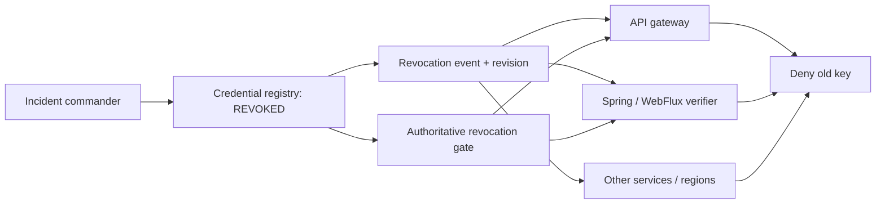

# Thu hồi key khẩn cấp trong hệ thống xác thực HTTP request bằng HMAC

## 1. Bối cảnh: vì sao cần quy trình thu hồi khẩn cấp?

Trong module `SECURITY_AUTHENTICATION_HMAC_REQUEST_AUTHENTICATION`, client và server sử dụng **shared secret** để tính, xác minh chữ ký HMAC trên **canonical request** gồm HTTP method, URI, header và/hoặc body theo hợp đồng. Các thành phần như `X-Timestamp` và `X-Nonce` giúp hạn chế replay, còn key rotation giúp thay đổi secret theo vòng đời. Khi shared secret bị lộ, kẻ đang giữ secret có khả năng **tự tạo chữ ký hợp lệ cho request mới** theo phạm vi credential đó. Hệ thống không thể dựa vào kết quả HMAC để phân biệt request do client chính chủ gửi với request do người đã lấy được cùng secret tạo ra.

**Thu hồi key khẩn cấp** (*emergency key revocation*) là việc chấm dứt khả năng xác thực của một credential hoặc **một phiên bản key cụ thể** ngay khi có dấu hiệu compromise, lạm dụng hoặc mất quyền tin cậy. Mục tiêu của incident response là **chặn việc chấp nhận request mới bằng key bị ảnh hưởng**, xác định ảnh hưởng của request đã chấp nhận, triển khai credential thay thế và phục hồi dịch vụ an toàn.

Tình huống thường gặp:

- Shared secret vô tình xuất hiện trong log, bản dump, repository, ticket hoặc artifact CI.
- Máy của client/đối tác bị xâm nhập; kẻ tấn công có khả năng đọc secret trong cấu hình hoặc bộ nhớ.
- Secret bị gửi cho sai bên nhận, nhân viên hoặc tích hợp đã mất quyền truy cập nhưng vẫn còn bản sao.
- Hệ thống phát hiện các request có **HMAC hợp lệ** nhưng khác thường về vị trí nguồn, thời điểm, phương thức, URI hay tần suất; giả thuyết key bị lộ cần được điều tra.
- Nhà cung cấp KMS/secrets manager, gateway hoặc dịch vụ trung gian thông báo sự cố có thể tác động đến credential.

**Điểm mấu chốt:** thu hồi key không tự động đảo ngược giao dịch đã thực thi, không xóa dấu vết truy cập cũ và không giải quyết việc client bị chiếm quyền điều khiển. Nó cũng không thay thế **phân quyền**: request có HMAC hợp lệ vẫn phải qua chính sách tenant, scope, role và quyền tài nguyên; ngược lại, một key đã bị thu hồi không được vào bước nghiệp vụ dù trước đó client có quyền.

Sau bài học, người học có thể thiết kế runbook thu hồi HMAC key theo đúng phạm vi, thực hiện vô hiệu hóa và lan truyền trạng thái tới mọi verifier, xử lý key rotation khi sự cố xảy ra, kiểm chứng hiệu lực ở cả gateway/proxy và ứng dụng Java/Spring, cũng như ghi nhận bằng chứng phục vụ điều tra và hậu kiểm.

## 2. Phân biệt thu hồi khẩn cấp với key rotation thông thường

Hệ thống có thể hỗ trợ nhiều key version cho cùng một client để xoay khóa không gián đoạn. Trong rotation theo kế hoạch, phiên bản cũ có thể được chấp nhận **trong một cửa sổ chuyển tiếp** do chính sách cho phép. Với key đã xác định hoặc nghi ngờ bị compromise, việc tiếp tục cho phép phiên bản cũ trong cửa sổ đó là **duy trì lối vào cho bên đang nắm secret**.

| Thuộc tính | Rotation theo kế hoạch | Thu hồi khẩn cấp |
|---|---|---|
| Nguyên nhân | Hết chu kỳ, thay thuật toán/chính sách hoặc chuyển hạ tầng. | Nghi lộ secret, mất tin cậy, dấu hiệu lạm dụng, yêu cầu cô lập. |
| Key cũ | Có thể ở trạng thái `GRACE` trong khoảng thời gian xác định. | Chuyển sang `REVOKED`/`DISABLED`; **không được xác thực tiếp**. |
| Key mới | Có thể phát hành trước và chuyển đổi dần. | Phát hành qua kênh an toàn sau khi kiểm soát đường rò rỉ và xác minh client. |
| Ưu tiên | Tính liên tục dịch vụ và tương thích. | Giới hạn thiệt hại, chặn sử dụng trái phép, giữ bằng chứng. |
| Rollback | Có thể quay lại version cũ nếu còn đáng tin và đúng chính sách. | **Không bật lại key đã compromise** để chữa lỗi cấu hình. |
| Kiểm tra | Old/new cùng hoạt động trong giới hạn thời gian. | Mọi node phải từ chối old key dù signature và timestamp/nonce hợp lệ. |

Không phải lỗi xác thực hàng loạt nào cũng là lộ khóa; ví dụ sai canonicalization, clock skew hoặc key rotation không đồng bộ có thể gây `401`. Nhưng khi đã có đủ dấu hiệu buộc phải cô lập, **không chờ xác định toàn bộ nguyên nhân mới khóa đường khai thác**. Quyết định mức độ sự cố, quyền ra lệnh và mức độ gián đoạn cần được tổ chức định nghĩa trong runbook vận hành.

## 3. Định danh và mô hình trạng thái để thu hồi chính xác

Không nên lưu một boolean `enabled` gắn duy nhất với “client” nếu client có nhiều key version. Cần xác định rõ **đơn vị có thể thu hồi**: một key version, toàn bộ credentials của client, một tenant hoặc toàn bộ một hệ thống phát hành key. Thực tế nên có định danh ổn định `(clientId, keyId)` và trạng thái kèm thời điểm cập nhật hoặc revision.

| Trạng thái | Có được xác minh request mới không? | Ghi chú |
|---|---|---|
| `ACTIVE` | Có, nếu các kiểm tra còn lại đạt. | Key đang được phép dùng. |
| `GRACE` | Chỉ khi chính sách rotation thường lệ cho phép, chưa hết hạn. | Không áp dụng cho key đang bị nghi compromise. |
| `SUSPENDED` | Không. | Cô lập tạm trong khi điều tra; có thể yêu cầu quy trình kiểm soát khi mở lại. |
| `REVOKED` | **Không, vô điều kiện.** | Terminal state đối với key version đã bị compromise. |
| `EXPIRED` | Không. | Hết hạn theo lịch, khác với sự cố compromise. |

Ví dụ metadata của một credential **không chứa secret thô**:

```json
{
  "clientId": "partner-payments-a",
  "keyId": "hmac-key-2026-11-a",
  "algorithm": "HmacSHA256",
  "secretRef": "secrets-manager://example/credentials/key-version",
  "state": "REVOKED",
  "revision": 18,
  "revokedAt": "2026-11-28T04:10:00Z",
  "reasonCode": "SUSPECTED_COMPROMISE",
  "incidentId": "INC-HMAC-2026-042"
}
```

Giá trị trên chỉ là ví dụ minh họa. Không dùng `keyId` như secret; nó là mã tra cứu có thể được quan sát trên request và log. Nếu cần lookup từ `X-Key-Id` hoặc `X-Client-Id`, giới hạn phạm vi theo tenant/client, xác thực đúng ràng buộc định danh trong canonical request và **không tự thử mọi secret còn lưu để tìm chữ ký khớp**. Nếu nhiều đối tác đang dùng **chung cùng một secret**, kẻ có secret có thể mạo danh bất kỳ bên nào trong phạm vi chia sẻ: khi đó phạm vi thu hồi phải bao phủ **mọi client/key reference sử dụng secret đó**, không chỉ một nhãn `keyId`.

Một key ở trạng thái `REVOKED` tuyệt đối không được chuyển sang `GRACE` vì tác vụ rotation tự động chạy muộn. Quy tắc chuyển trạng thái nên có tính đơn điệu, tính idempotent và được bảo vệ bằng cập nhật có điều kiện/revision để tránh race với jobs phát hành và kích hoạt khóa.

## 4. Runbook ứng phó: từ phát hiện đến cô lập

### 4.1. Kích hoạt sự cố và xác định phạm vi

Ngay khi nhận tín hiệu đáng tin, người trực/on-call ghi nhận **incident ID**, thời gian phát hiện, nguồn tín hiệu, mức độ nghiêm trọng và đầu mối chịu trách nhiệm. Xác nhận tối thiểu:

1. **Credential nào?** Xác định `clientId`, `keyId`/version, môi trường, chính sách scope, thời gian cấp phát, thời gian sử dụng gần nhất; chỉ sử dụng **mã tham chiếu/fingerprint**, không dán secret vào ticket hoặc chat.
2. **Nguồn lộ ở đâu?** Ví dụ CI artifact, host, container, secret store hoặc máy đối tác. Ghi nhận dấu vết truy cập phục vụ pháp chứng; hạn chế xóa hoặc thay đổi chứng cứ trước khi có bản lưu bảo vệ phù hợp.
3. **Ai có thể bị ảnh hưởng?** Liệt kê tất cả service, SDK, client, tenant, gateway, môi trường và các vùng/region đang sử dụng cùng secret hoặc các bản sao của nó.
4. **Đang có hành vi khai thác?** Đối chiếu audit metadata với endpoint nhạy cảm, thời gian, request ID, IP/thiết bị nguồn và tần suất bất thường; không kết luận chắc chắn chỉ từ IP hoặc từ một signature hợp lệ.
5. **Nên cô lập ở đâu?** Nếu key thuộc một client đơn lẻ, ưu tiên chặn chính xác client/key version. Nếu secret dùng chung, mức độ không chắc chắn cao hoặc revocation store không đáng tin, cân nhắc tạm chặn toàn bộ nhóm tích hợp/endpoint tương ứng tại ingress theo quyền điều hành sự cố.

Việc đánh giá mức độ ảnh hưởng diễn ra **song song** với cô lập. Không dùng “đang phân tích log” làm điều kiện trì hoãn khóa một credential đã được xác nhận lộ.

### 4.2. Vô hiệu hóa key tại nguồn kiểm soát

Người có quyền vận hành thay đổi trạng thái key trong **nguồn dữ liệu có thẩm quyền** (credential registry hoặc secrets management control plane) bằng thao tác nguyên tử và có audit:

```text
revoke(clientId = partner-payments-a,
       keyId = hmac-key-2026-11-a,
       reason = SUSPECTED_COMPROMISE,
       incidentId = INC-HMAC-2026-042)

expected: credential state = REVOKED
          revision advanced
          no grace-period override
          audit event committed
```

Không coi việc **xóa secret ở một node** là đã thu hồi: verifier khác có thể còn secret trong cache; một service có thể lấy lại secret từ bản backup hoặc read replica; gateway có thể tự xác minh ở phía trước. Ngược lại, chỉ sửa secrets manager mà **không đổi trạng thái xác thực** cũng không bảo đảm chặn key nếu app đang cache bản cũ.

Với registry hỗ trợ transaction, có thể mô tả thao tác trạng thái theo dạng SQL giả định:

```sql
-- Mẫu minh họa; cần điều chỉnh theo schema và cơ chế transaction thực tế.
UPDATE hmac_key_versions
   SET state = 'REVOKED',
       revoked_at = CURRENT_TIMESTAMP,
       state_revision = state_revision + 1
 WHERE client_id = :client_id
   AND key_id = :key_id
   AND state <> 'REVOKED';
```

Trong cùng quy trình cần ghi audit cho yêu cầu thu hồi, người thực hiện, reason code và revision mới. Thao tác lặp lại phải giữ trạng thái `REVOKED` (idempotent), không tạo ngược một bản key `ACTIVE`. Nếu cần thu hồi *toàn bộ* client, phải đánh dấu tất cả version có khả năng xác thực và vô hiệu hóa chức năng tự phát hành key mới của client bị nghi chiếm quyền, theo chính sách và phạm vi sự cố.

### 4.3. Lan truyền chặn tới mọi điểm xác minh

Một hệ thống HMAC có thể xác minh tại edge gateway, Spring Security `OncePerRequestFilter`, WebFlux `WebFilter` hoặc các service nội bộ. Phải xác định **mọi điểm có thể đưa request qua authentication**. Sau khi registry cập nhật:

- Gửi sự kiện invalidation theo `clientId/keyId/revision` tới verifier, gateway và cache phân tán; kiểm tra retry, dead-letter và consumer đang mất kết nối.
- Bảo đảm verifier áp dụng revision mới; cache không được lấy một bản `ACTIVE` cũ rồi **ghi đè** trạng thái `REVOKED` mới.
- Với yêu cầu thu hồi gần như tức thời, dùng kiểm tra trạng thái có tính nhất quán phù hợp tại request path hoặc một **revocation gate** mà các verifier buộc phải tra cứu. TTL cache chỉ cung cấp giới hạn độ trễ, **không bảo đảm ngắt hiệu lực tức thì**.
- Khi kho trạng thái hoặc kênh invalidation mất liên lạc, quy định rõ **fail closed** đối với những endpoint/credential rủi ro cao, hoặc chặn ở gateway cho đến khi kiểm chứng đồng bộ. Cơ chế dùng cache cũ vô hạn làm mất ý nghĩa thu hồi khẩn.
- Kiểm tra từng region, replica, pod/service version, API gateway, hàng đợi xử lý lại request và luồng kết nối lâu dài có khả năng xác thực bằng key.

Sơ đồ minh họa:



Hệ thống chỉ nên báo “thu hồi có hiệu lực toàn cụm” khi đã có **bằng chứng từ mỗi đường xác thực**. Nếu còn một điểm chưa xác minh, cần ghi là rủi ro đang tồn tại và áp dụng biện pháp cô lập bổ sung.

### 4.4. Xử lý request đang chạy và hành động phụ

Cần phân biệt ba mốc:

| Request | Phạm vi thu hồi có thể tác động |
|---|---|
| Đến **sau** khi chính sách thu hồi đã có hiệu lực tại điểm xác minh | Phải bị từ chối ngay cả khi HMAC hợp lệ, timestamp còn mới và nonce chưa dùng. |
| Đã đọc trạng thái `ACTIVE` nhưng **chưa hoàn tất authentication** | Có thể bị race; cần revocation gate/kiểm tra lại revision ở điểm quyết định hoặc biện pháp chặn ở ingress. |
| Đã xác thực, phân quyền và **thực thi nghiệp vụ** trước khi thu hồi | Thu hồi không thể tự động hoàn tác; phải rà soát giao dịch, access token/session phát sinh và biện pháp bù trừ phù hợp. |

Trong điều kiện đồng thời, một lần đọc `ACTIVE` từ cache rồi xác minh HMAC trước khi có lệnh thu hồi **không chứng minh** request sau đó vẫn an toàn. Với thao tác nhạy cảm, cân nhắc kiểm tra revision ngay trước khi phát sinh tác dụng nghiệp vụ, kết hợp revocation barrier/ingress gate, và ghi rõ điểm tuyến tính hóa quyết định chấp nhận. Kể cả khi có kiểm tra hai lần, vẫn tồn tại khoảng đua nếu không có đồng bộ hóa thích hợp giữa hoạt động nhận request và lệnh thu hồi.

Nếu HMAC authentication dẫn đến việc phát hành token, session hoặc một credential dẫn xuất, cần **thu hồi/giới hạn thêm các thực thể đó** theo phạm vi sự cố. Nếu request đã gửi message bất đồng bộ vào queue, cần rà soát và cô lập tác vụ đáng ngờ trước khi chúng thực hiện thay đổi; dùng audit, idempotency key và quy trình hoàn tác/bồi hoàn nghiệp vụ khi được cho phép.

## 5. Phát hành key mới an toàn và phục hồi dịch vụ

Sau khi key cũ đã bị chặn, chỉ phát hành key mới khi biết ai có quyền nhận và đường phân phối secret đã đủ an toàn. Nếu kênh triển khai hoặc máy client vẫn bị xâm nhập, việc cấp key mới ngay có thể khiến key mới bị lấy tiếp.

Quy trình nên bao gồm:

1. **Khoanh vùng nguồn lộ:** gỡ secret khỏi chỗ công khai, xử lý account/token/quyền truy cập bị chiếm, bảo vệ evidence trước khi dọn dẹp. Xóa secret khỏi một file hoặc commit mới **không** xóa được bản sao trong lịch sử, cache hay artifact.
2. **Tạo secret mới** bằng CSPRNG và kích thước/thuật toán đáp ứng chính sách; dùng `keyId` mới, tham chiếu secret store/KMS mới và quyền truy cập tối thiểu. Không dùng lại secret cũ hoặc biến thể dự đoán được từ secret cũ.
3. **Xác minh người nhận:** xác nhận identity của đối tác/client bằng kênh đã thỏa thuận ngoài luồng nếu cần; truyền secret qua kênh dành cho credential, có phân quyền và audit. Không gửi key thô qua ticket, chat, email thường hoặc log.
4. **Kích hoạt key version mới** trong registry và cấu hình client, đồng thời giữ phiên bản đã compromise ở `REVOKED`, **không cấp grace period** cho nó. Với hệ thống nhiều client, chỉ cho phép key mới thuộc đúng client/tenant và scope.
5. **Kiểm thử end-to-end:** request ký bằng key mới phải qua xác thực nếu method/URI/header/body, timestamp và nonce đúng; request với key cũ phải bị từ chối tại mọi điểm.
6. **Theo dõi và ổn định:** kiểm tra tỷ lệ `401/403` theo error category, latency xác minh, số lần retry, health của gateway/nonce store và tác động đến đối tác. Mở lại traffic bị chặn theo trình tự kiểm soát và bằng chứng đầy đủ.

Khi cấp key mới, client cần hỗ trợ việc chọn `X-Key-Id`/version và ký chính xác cùng hợp đồng canonical request. Nếu key identifier nằm trong signed headers, nó phải được ký; nếu key identifier dùng để chọn secret trước khi có thể kiểm tra signature, vẫn cần giới hạn lookup theo client/tenant, kiểm tra định dạng/độ duy nhất và ràng buộc danh tính phù hợp trong dữ liệu đã ký. Tuyệt đối không có nhánh “signature sai với key mới thì thử lại bằng key cũ đã revoked”.

## 6. Thiết kế verifier Java/Spring để không chấp nhận key đã thu hồi

### 6.1. Thứ tự kiểm tra

Ví dụ hợp đồng request minh họa có các header `X-Client-Id`, `X-Key-Id`, `X-Timestamp`, `X-Nonce` và `X-Signature`. Thông tin `clientId/keyId` được ràng buộc với canonical request; key store dùng định danh này để tra đúng secret. Trình tự khuyến nghị:

1. Parse request và từ chối header bắt buộc thiếu, lặp hoặc sai định dạng; giới hạn kích thước, URI/header/body theo hợp đồng để tránh DoS.
2. Tra credential theo `clientId` và `keyId`; nếu không tồn tại hoặc có trạng thái `REVOKED`/`SUSPENDED`/`EXPIRED`, **từ chối trước khi sử dụng secret**.
3. Xác minh phiên bản hợp đồng, canonical method, raw URI, signed headers và body byte; tính HMAC từ secret được phép sử dụng, so sánh chữ ký theo cách có thời gian tương đối ổn định và kiểm tra độ dài/encoding trước so sánh.
4. Kiểm tra freshness của timestamp và tính duy nhất của nonce theo phạm vi phù hợp (client/key version), dùng thao tác ghi nhận nonce **nguyên tử**, có TTL phù hợp. Thứ tự giữa các bước có thể thay đổi theo thiết kế chống replay/DoS, nhưng không được ghi nhận nonce hợp lệ từ một request có chữ ký không hợp lệ.
5. Kiểm tra lại trạng thái/revision thông qua **revocation gate** trước khi công bố authentication thành công; đối với yêu cầu chặn tức thời và thao tác nhạy cảm, thiết kế barrier với điểm quyết định rõ ràng.
6. Chỉ sau đó mới xây dựng principal/authorities và chuyển đến authorization, controller.

Pseudocode Java minh họa (các interface, kiểu dữ liệu và chính sách là của ứng dụng, không phải API có sẵn trong Spring Security):

```java
AuthenticationResult authenticate(HttpRequest request) {
    ParsedHmacHeaders headers = parseStrictly(request);
    // Scope lookup theo client; keyId do client cung cấp không phải một quyền.
    KeyVersion key = keyRegistry.find(
        headers.clientId(), headers.keyId(), ReadMode.STRONG);

    if (key == null || !key.canVerifyNow()) {
        throw invalidCredential(); // Cùng phản hồi bên ngoài.
    }

    byte[] canonical = canonicalizer.build(request, headers);
    byte[] suppliedMac = signatureCodec.parseAndValidate(headers.signature());
    byte[] expectedMac = hmacSha256(key.secretBytes(), canonical);
    if (!MessageDigest.isEqual(expectedMac, suppliedMac)) {
        throw invalidSignature();
    }

    clockSkewPolicy.requireFresh(headers.timestamp());
    // Chỉ dùng insert-if-absent nguyên tử; TTL theo chính sách replay.
    nonceStore.requireUnusedAndMark(
        key.clientId(), key.keyId(), headers.nonce(), headers.timestamp());

    // Không dựa vào trạng thái đã cache từ đầu request.
    if (!revocationGate.mayAuthenticate(
            key.clientId(), key.keyId(), key.revision())) {
        throw invalidCredential();
    }
    return authenticatedPrincipal(key.clientId());
}
```

Đoạn mã giải thích **ý tưởng kiểm soát**; đặc biệt bước `mayAuthenticate` phải phù hợp với mô hình đồng thời và nhất quán của hệ thống. Một phép đọc độc lập ở cuối chưa bảo đảm chặn request đã vượt qua bước đó đúng lúc lệnh revoke được commit. Cần thiết kế barrier hoặc ingress gate với hợp đồng rõ ràng về request in-flight. Trong hệ thống thực, không để `byte[] secret` tồn tại trong log/exception, kiểm soát lifetime/bản sao và dùng key management phù hợp.

Các lỗi nội bộ như `KEY_REVOKED`, `INVALID_SIGNATURE`, `REPLAY_DETECTED`, `CLOCK_SKEW` nên có metric/audit riêng. Nhưng response trả client có thể gộp thành lỗi xác thực chung (ví dụ `401` theo hợp đồng API) để tránh lộ trạng thái tồn tại của credential. Khi HMAC đã hợp lệ nhưng không có quyền, authorization có thể trả `403`; **không gán lỗi phân quyền thành key compromise**.

### 6.2. Cache, race và khả năng fail closed

Chỉ đặt `state=REVOKED` vào database không đủ khi mỗi node giữ cache `ACTIVE` vài phút. Cần định nghĩa và đo **revocation effectiveness window**: từ thời điểm lệnh thu hồi được commit đến thời điểm điểm xác minh cuối cùng không còn chấp nhận key. Trong mức yêu cầu bảo mật cao, mục tiêu là hiệu lực tại một cổng kiểm soát có nhất quán mạnh; nơi có chấp nhận độ trễ phải nêu rõ giới hạn và cơ chế giảm thiểu.

Một thiết kế có thể sử dụng **revision tăng đơn điệu**. Khi cache nhận bản `REVOKED, revision=18`, event cũ mang `ACTIVE, revision=17` phải bị bỏ qua. Verifier đang dùng revision 17 phải bị chặn tại gate khi revision authoritative là 18. Đồng thời cần kiểm thử event đến sai thứ tự, message bị lặp, node restart và read replica chậm.

Với các endpoint thay đổi dữ liệu quan trọng, biện pháp cô lập tạm thời ở gateway/ingress có thể giảm cửa sổ race. Không dùng fallback “nếu key registry lỗi thì cho qua với cache cũ” trong tình huống chưa chắc chắn về trạng thái revoked.

## 7. Bộ test bắt buộc cho quy trình thu hồi khẩn

Các ca sau nên dùng **test secret và fake clock/nonce store**, mô phỏng nhiều verifier/gateway. Không kiểm thử thao tác khẩn bằng cách cố tình đưa production secret vào log hoặc môi trường công khai.

| Ca kiểm thử | Thiết lập | Điều phải quan sát |
|---|---|---|
| Baseline | Key A `ACTIVE`, HMAC đúng, timestamp mới, nonce chưa dùng, principal đủ quyền | Authentication thành công, endpoint xử lý theo policy. |
| Revoke A | Chuyển key A thành `REVOKED`, gửi request mới được ký **đúng bằng secret A** | Bị từ chối dù signature đúng và nonce mới; controller không chạy. |
| Khóa khác cùng client | Key B của cùng client còn `ACTIVE`, chưa bị ảnh hưởng | Key B tiếp tục hoạt động nếu chính sách chỉ thu hồi A. |
| Toàn client | Revoke tất cả version hoặc disable client | A, B và mọi key có liên quan bị từ chối; không còn nhánh fallback. |
| Rotation GRACE bị compromise | Key A ở `GRACE`, sau đó bị revoke | A ngừng hiệu lực ngay, không đợi `graceUntil`. |
| Event out of order | Nhận `REVOKED rev18` rồi nhận `ACTIVE rev17` | Cache giữ `REVOKED rev18`. |
| Cache stale | Node chưa nhận invalidation, vẫn cache A `ACTIVE` | Revocation gate hoặc chặn ingress từ chối A; nếu không, lộ rõ giới hạn SLA. |
| Node mới / restart | Node mới khởi động sau revoke | Không nạp bản active cũ từ snapshot/backup. |
| Store outage | Mất kết nối registry trong lúc A bị nghi compromise | Endpoint có chính sách fail closed từ chối; không chấp nhận dựa trên key cache hết hạn. |
| Đồng thời | Revoke A trong lúc nhiều request bằng A đang vào | Đo phạm vi request in-flight; sau điểm hiệu lực, không request nào mới được accept. |
| Signature sai | Key còn `ACTIVE` nhưng HMAC sai | Từ chối vì chữ ký; không ghi nonce như request hợp lệ. |
| Replay/freshness | HMAC A hợp lệ nhưng nonce lặp hoặc timestamp cũ | Chặn replay/freshness độc lập với key status. |
| Phân quyền | Key B `ACTIVE`, HMAC đúng, principal thiếu quyền | Authentication pass, authorization từ chối. |
| Multi-region / gateway | Gửi tới mọi ingress, node, vùng triển khai | Không đường nào còn chấp nhận key A. |
| Key mới | Cấp key C mới đúng client/secret, nonce mới | Request ký với C thành công, request ký với A tiếp tục bị chặn. |

**Kiểm thử case “revoke A” đặc biệt quan trọng:** nếu test chỉ gửi một signature cũ đã sai, server có thể trả `401` ngay cả khi chức năng thu hồi hoàn toàn hỏng. Phải chứng minh request **đúng HMAC bằng chính secret A nhưng bị từ chối vì trạng thái A đã revoked**. Khi test nhiều lần, mỗi request cần nonce riêng hoặc reset store kiểm thử để không nhầm với replay. Nếu status/clock được mock, bảo đảm các mock phản ánh thứ tự và thời điểm dùng trong pipeline thực.

Ví dụ yêu cầu test theo hành vi:

```text
GIVEN client=partner-a, key=A, state=ACTIVE, timestamp fresh
  AND correctly signed request with nonce=N1
WHEN verify()
THEN authentication succeeds

GIVEN key=A has been marked REVOKED and propagated to all verifiers
  AND correctly signed request using secret A with nonce=N2
WHEN verify()
THEN authentication fails with internal reason KEY_REVOKED
  AND no payment/order/resource mutation occurs

GIVEN key=C is newly issued for the same client and state=ACTIVE
  AND correctly signed request using secret C with nonce=N3
WHEN verify()
THEN authentication succeeds (subject to separate authorization)
```

## 8. Quan sát, điều tra và giao tiếp trong sự cố

Một lệnh revoke thành công trong control plane chưa phải là bằng chứng toàn bộ dữ liệu đã được bảo vệ. Cần ghi lại:

| Bằng chứng | Mục đích |
|---|---|
| Incident ID, người phê duyệt/thực hiện, thời gian quyết định và commit | Truy vết hành động và trách nhiệm vận hành. |
| `clientId`, `keyId`, key revision, trạng thái trước/sau, credential scope | Biết chính xác phạm vi tác động; không lưu secret thô. |
| Danh sách verifier/gateway/region, revision mỗi nơi đã nhận | Chứng minh lan truyền và phát hiện nơi chưa cập nhật. |
| Kết quả request thử HMAC hợp lệ bằng key cũ từ từng điểm | Xác nhận key thực sự không còn được chấp nhận. |
| Request ID, endpoint, thời gian, loại lỗi và business audit trong cửa sổ nghi ngờ | Xác định hành động đáng ngờ cần đánh giá và khắc phục. |
| Kết quả phát hành/phân phối key mới và kiểm tra client thật | Xác nhận khôi phục mà không tái tạo đường rò rỉ. |

Metric nên phân biệt `revocation_propagation_lag`, số verifier chưa xác nhận revision, `key_revoked_rejection_count`, `signature_mismatch_count`, `replay_rejection_count` và tỷ lệ xác thực thành công của key mới. Tập log phục vụ điều tra cần được bảo vệ theo chính sách lưu giữ và quyền truy cập. Không log shared secret, full signature, canonical string chứa dữ liệu nhạy cảm hoặc body request; với dữ liệu test giả, vẫn tách rõ môi trường khỏi production.

Trong thông báo cho client/đối tác, chỉ cung cấp thông tin cần thiết: credential nào bị vô hiệu hóa bằng **key identifier**, phạm vi dịch vụ ảnh hưởng, cách nhận key mới an toàn, hành động client cần thực hiện và đầu mối hỗ trợ. Không gửi một bản sao secret qua kênh đang bị nghi compromise. Nếu sự cố có thể ảnh hưởng dữ liệu hoặc giao dịch, phối hợp với bộ phận an ninh, pháp lý và các bên liên quan theo nghĩa vụ thông báo áp dụng.

## 9. Điều kiện đóng sự cố và bài học sau sự cố

Chỉ nên xem giai đoạn khắc phục đã đạt khi có đủ bằng chứng:

1. Key/phiên bản bị compromise đã ở `REVOKED` trong nguồn dữ liệu có thẩm quyền; rotation job và fallback không thể bật lại.
2. Tất cả gateway/verifier/region liên quan từ chối **request có HMAC hợp lệ bằng old secret**; mọi điểm chưa xác minh được cô lập.
3. Đã đánh giá request đang chạy, session/token dẫn xuất, queue, giao dịch và tài nguyên bị ảnh hưởng; có xử lý hoặc kế hoạch xử lý đối với side effect cần khắc phục.
4. Đường lộ ban đầu đã được xử lý hoặc giảm thiểu đủ để cấp secret mới; key mới chỉ được phân phối tới identity được xác thực và có audit.
5. Client dùng key mới được kiểm tra end-to-end; các lỗi `401` do key cũ và lỗi `403` do thiếu quyền được phân biệt.
6. Incident timeline, số liệu thời gian hiệu lực thu hồi, bằng chứng thử nghiệm, phạm vi tác động và quyết định vận hành đã được lưu để postmortem.

Trong postmortem, cần xác định vì sao secret bị lộ, vì sao phát hiện sớm hoặc muộn, nơi nào cache trạng thái quá lâu, có request nào được accept sau lệnh thu hồi, vòng đời key có nhiều client dùng chung hay không, và các biện pháp giới hạn phạm vi (mỗi client một secret riêng, scope tối thiểu, key version, hạn chế hiển thị secret, secret scanning, quy trình rotation và audit) cần cải tiến.

### Bài tập thực hành

Giả lập hệ thống gồm một API gateway và hai Spring service cùng xác thực HMAC cho `partner-a`. Client có hai phiên bản: A đang `GRACE` và B `ACTIVE`. Người vận hành phát hiện secret A trong một CI artifact. Hãy viết runbook thao tác **chỉ thu hồi A**, mô phỏng một service chưa nhận invalidation và kiểm tra request **ký hợp lệ bằng A** vẫn bị từ chối. Sau đó thử tình huống B cũng dùng **cùng secret vật lý** với A: xác định lý do phạm vi thu hồi phải mở rộng.

Tiếp tục mô phỏng phát hành C với secret mới, kiểm chứng request ký bằng C được xác thực và được phân quyền đúng scope, trong khi A không bao giờ được chấp nhận trở lại. Ghi bảng thời gian từ lúc phát hiện đến lúc từng verifier xác nhận revision, liệt kê request in-flight và business side effects cần kiểm tra. Bài thực hành đạt yêu cầu khi người học chứng minh được cả **đường chặn key cũ**, **đường khôi phục key mới** và **khả năng quan sát rủi ro còn tồn tại** mà không làm lộ secret.
