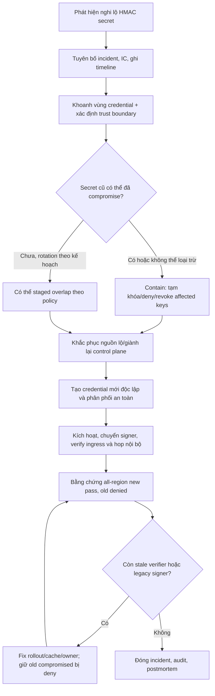

# Rotate toàn bộ secret: ứng phó sự cố lộ khóa HMAC trên toàn hệ thống

## 1. Mục tiêu bài học

**Rotate toàn bộ secret** là một tình huống ứng phó sự cố thuộc chương **Incident response** của module **SECURITY_AUTHENTICATION_HMAC_REQUEST_AUTHENTICATION**. Module này tập trung thiết kế xác thực HTTP request bằng **HMAC với shared secret**, trong đó chữ ký được tính trên **canonical request** gồm HTTP method, URI, header và/hoặc body theo hợp đồng ký. Các yêu cầu bổ sung gồm kiểm tra timestamp/nonce để chống replay, quản lý vòng đời và xoay khóa, xác minh hành vi của proxy/gateway và tách riêng **authentication** khỏi **authorization**.

Trong một đợt sự cố, đội vận hành có thể phát hiện secret HMAC bị đưa vào log, CI artifact, repository, máy nhà phát triển, bản backup không được kiểm soát hoặc secret manager bị truy cập trái phép. Nếu chưa xác định được tập khóa đã lộ, phương án phù hợp có thể là **xoay tất cả credential nằm trong phạm vi tin cậy bị ảnh hưởng**, chứ không chỉ đổi khóa của một client rồi coi sự cố kết thúc.

Đây không phải thao tác “đổi một biến môi trường”: mỗi client, gateway và backend có thể có các secret khác nhau; credential cũ vẫn có thể nằm trong cache, job chạy nền, cấu hình region dự phòng, retry queue và SDK của đối tác. Nếu chỉ sinh khóa mới nhưng chưa **vô hiệu hóa quyền sử dụng của khóa cũ trên mọi verifier**, kẻ có secret bị lộ vẫn có thể tạo request HMAC đúng.

**Mục tiêu học tập:**

1. Phân biệt **rotation định kỳ**, **emergency rotation do nghi lộ secret**, **revocation**, **re-issuance** và **recovery**.
2. Kiểm kê và khoanh vùng mọi HMAC secret theo client, tenant, môi trường, gateway/backend, key ID và nơi phân phối.
3. Quyết định khi nào phải **revoke ngay** thay vì giữ giai đoạn old/new overlap để duy trì tương thích.
4. Thiết kế runbook tạo secret mới an toàn, phân phối qua kênh xác thực, cập nhật signer, enforce trạng thái trên verifier và kiểm tra toàn bộ region.
5. Giữ đúng canonical request, timestamp/nonce, chống replay, key rotation và authorization trong quá trình thay khóa.
6. Áp dụng cơ chế audit, outbox, policy revision và freshness để có **bằng chứng khóa cũ thật sự không còn được chấp nhận**.
7. Viết kiểm thử Java/Spring, kiểm thử HMAC ở gateway/backend, thực hành failure injection và đánh giá hậu kiểm sự cố.

## 2. “Toàn bộ secret” phải có một phạm vi xác định

Trước khi chọn nút “rotate all”, cần trả lời **“all” nghĩa là gì?**. Có thể là tất cả key do một vault bị nghi lộ, toàn bộ key của một tenant, tất cả client HMAC ở một API, mọi credential gateway→backend hoặc tất cả secret dưới một key-encryption key bị nghi compromise. Những phạm vi đó có mức ảnh hưởng khác nhau.

| Loại secret/credential | Nơi dùng | Ai phải cập nhật? | Nếu bị bỏ sót |
|---|---|---|---|
| **Client→gateway HMAC secret** | Client ký HTTP request, gateway xác minh | Chủ tích hợp/SDK, credential registry, ingress gateways | Client tiếp tục dùng key cũ hoặc attacker vẫn ký request ingress |
| **Client→backend direct HMAC secret** | Client gọi backend không qua gateway | Client trực tiếp, backend verifier | Bypass đường gateway đã revoke |
| **Gateway→backend re-sign key** | Gateway ký request sau rewrite, backend xác minh | Gateway signer, backend verifier, DR region | Giao tiếp nội bộ vẫn dùng key nghi lộ |
| **Service-to-service HMAC key** | Microservice ký request nội bộ | Mọi service có quyền ký/xác minh | Attacker có thể giả dịch vụ trong nội bộ |
| **Secret dùng chung giữa nhiều tenant** | Kiến trúc legacy không tách key | Toàn bộ tenants liên quan | Một key lộ có thể ảnh hưởng nhiều client hơn dự đoán |
| **Root key/derivation seed** (nếu có) | Dẫn xuất nhiều HMAC secret | Chủ KMS/vault và mọi bên nhận derived key | Chỉ xoay derived key không đủ nếu root vẫn bị lộ |
| **Key ở CI/test/staging** | Test, sandbox, automation | Pipeline, runner, test clients | Nếu bị tái sử dụng ở production, trở thành đường tấn công |
| **Backup/standby configuration** | Khởi động sau restore/failover | Nhóm DR/SRE | Khôi phục bản cũ có thể tái kích hoạt key revoked |

**“Toàn bộ” không đồng nghĩa tạo ra một secret duy nhất rồi gửi cho tất cả client.** Khi nhiều client dùng chung secret, khó quy trách nhiệm và không thể thu hồi một client độc lập. Phương án an toàn hơn là **mỗi credential có secret riêng**, được cấp phát theo owner, audience và phạm vi quyền; gateway/backend dùng secret **khác** với secret client.

### 2.1. Xác định blast radius

Một cuộc điều tra phải truy vết:

- Secret/credential ID nào có thể bị đọc hoặc xuất khỏi môi trường an toàn?
- Bên bị ảnh hưởng là client, tenant, endpoint, hop, region và environment nào?
- Secret đã xuất hiện trong code, log, trace, crash dump, ticket, support chat, backup, CI artifact hoặc terminal history chưa?
- Có hệ thống nào giữ key cũ trong memory/cache sau khi registry cập nhật?
- Có dấu hiệu request HMAC hợp lệ nhưng không tương ứng với hành vi client bình thường không?
- Những key nào được tạo từ cùng root secret, cùng cơ chế provisioning hoặc có lỗi phân quyền tương tự?
- Có credential mang đặc quyền **admin**, payment, settlement hoặc thay đổi quyền mà cần containment khẩn cấp không?

Không được kết luận một key “chắc chắn không lộ” chỉ vì chưa thấy request đáng ngờ: không quan sát được hành vi sử dụng secret khác với chứng minh secret chưa bị lấy. Mọi giả định, nguồn bằng chứng và độ tin cậy của kết luận phải được ghi trong incident log.

## 3. Rotation theo kế hoạch khác emergency rotation

**Rotation theo kế hoạch** thường cho phép cũ và mới cùng tồn tại trong một khoảng ngắn để client chuyển đổi không gián đoạn. **Emergency rotation** khi nghi secret đã lộ không nên áp dụng grace period mặc định: còn chấp nhận secret cũ nghĩa là còn một credential mà attacker có thể sử dụng.

| Tiêu chí | Rotation định kỳ | Nghi bị lộ secret | Secret đã xác nhận bị lộ/đang bị lợi dụng |
|---|---|---|---|
| Mục tiêu chính | Giảm tuổi thọ credential | Giới hạn rủi ro trong điều kiện chưa chắc chắn | Ngăn tiếp tục sử dụng credential bị compromise |
| Old/new overlap | Có thể cho phép theo policy | Chỉ khi đánh giá rủi ro có kiểm soát | **Không giữ overlap** đối với key bị compromise |
| Ưu tiên | Tương thích và SLO | Containment theo blast radius | Revoke/deny ngay, chấp nhận gián đoạn có kiểm soát |
| Phân phối secret mới | Theo lịch đối tác | Kênh tin cậy, có thể tăng tốc | Tái thiết lập niềm tin trước khi cấp lại |
| Bằng chứng hoàn tất | Lưu lượng chuyển sang new | Old không còn được chấp nhận + xác minh phạm vi | Old deny trên mọi verifier, không còn misuse |
| Rollback về secret cũ | Có thể nếu old còn an toàn, được phê duyệt | Rất hạn chế | **Không được khôi phục secret đã compromise** |

Đôi khi containment tức thì cần **tạm dừng toàn bộ một API, client hoặc nhóm credential**, để bảo vệ dữ liệu trước khi new keys được phân phối. Đó là trade-off availability/security được quyết định theo incident severity, không phải một lỗi cần che giấu bằng cách âm thầm fail-open.

### 3.1. Khi nào phải xoay toàn bộ?

Một số trigger điển hình:

1. Một vault hoặc tài khoản có quyền đọc **toàn bộ** secret HMAC bị compromise.
2. Root derivation key/seed hoặc backup chứa hàng loạt secret bị lộ.
3. Repository/CI artifact/log đã công khai nhiều production secret và không thể xác định đã bị sao chép đến đâu.
4. Nhà cung cấp secret store gặp sự cố buộc tái tạo tập credential theo kế hoạch ứng phó đã phê duyệt.
5. Phát hiện provisioning tạo key trùng giữa nhiều client hoặc nguyên liệu khóa có entropy thấp.
6. Có dấu hiệu attacker dùng key của nhiều client, cho thấy sự cố không còn giới hạn một credential.

Nếu chỉ lộ một credential đã được cô lập thật sự, có thể **revoke và reissue đúng credential đó** thay vì thay khóa hàng chục nghìn client. Tuy nhiên, phải chứng minh phạm vi cô lập bằng nguồn bằng chứng tin cậy; không chọn scope hẹp chỉ vì phương án đó ít ảnh hưởng hơn.

## 4. Những vai trò và quyền quyết định cần xác định trước

Ứng phó sự cố xoay toàn bộ secret là công việc phối hợp, không thể để một người chạy script và mong hệ thống tự đồng bộ.

| Vai trò | Trách nhiệm |
|---|---|
| Incident commander (IC) | Công bố severity/scope, điều phối quyết định containment và thời điểm chuyển phase |
| Security lead | Đánh giá compromise, bằng chứng, tình trạng khóa, policy revoke/rotate và rủi ro rollback |
| Identity/credential owner | Kiểm kê registry, tạo credential mới, quản lý vòng đời, audit và quyền phát hành |
| SRE/platform | Gateway/backend availability, rollout đa region, cache invalidation, telemetry và DR |
| Client integration owner | Phân phối credential qua kênh an toàn, hỗ trợ SDK/signers và xác nhận cutover |
| API/business owner | Ưu tiên các route nhạy cảm, business idempotency, giới hạn gián đoạn và truyền thông |
| Incident scribe | Ghi timeline, quyết định, thay đổi đã phê duyệt và bằng chứng không chứa secret |
| Compliance/legal/privacy (khi cần) | Đánh giá nghĩa vụ thông báo, retention và bảo quản chứng cứ |

Thao tác thu hồi diện rộng nên có **least privilege**, xác thực mạnh của operator, yêu cầu phê duyệt phù hợp mức độ ảnh hưởng và audit trail. Trong sự cố cần hành động tức thì, có thể dùng **break-glass** đã định nghĩa trước với quyền giới hạn/thời hạn ngắn, logging và hậu kiểm bắt buộc.

**Không gửi secret mới vào kênh chat nhóm, ticket, email thường hoặc bảng dashboard** chỉ để tăng tốc. Những nơi này thường có nhiều người đọc, log lâu dài, search/index và backup khó xóa.

## 5. Runbook tổng quan: Detect → Contain → Recover → Verify → Close



Đây là sơ đồ thứ tự **logic**, không buộc containment phải chờ đủ inventory trong sự cố đang bị khai thác. Trên thực tế, có thể tạm khóa một nhóm credential ngay và mở rộng phạm vi sau khi điều tra. Trạng thái incident nên được ghi đủ để người đến sau hiểu vì sao một key đang ở `REVOKED` thay vì `ACTIVE`.

### 5.1. Các điểm dừng an toàn

Không chuyển sang phase tiếp theo nếu:

- Chưa biết nguồn quyền quản lý credential có còn đáng tin không.
- Secret mới vẫn được phân phối qua tài khoản/kênh nghi đã bị chiếm.
- Một verifier có thể còn chấp nhận old compromised key sau thời điểm cam kết revoke.
- Chưa xác định được nonce store hoạt động hoặc có đường **fail-open** khi Redis/registry lỗi.
- Không có positive control dùng key mới trên một hop quan trọng.
- Có DR/backup node có thể khởi động lại với cache/policy cũ mà không kiểm tra lại authoritative state.
- Những key gateway→backend chưa được tách khỏi client key hoặc không biết backend nào chấp nhận chúng.

Ở severity cao, những điểm dừng này có thể đồng nghĩa duy trì từ chối request trong một khoảng thời gian. Không “đưa hệ thống lên xanh” bằng cách chấp nhận key cũ bị nghi lộ.

## 6. Giai đoạn 0 — Bảo toàn chứng cứ nhưng không bảo toàn quyền của secret cũ

Cần lưu **bằng chứng về sự kiện**, không tiếp tục duy trì quyền dùng secret đã bị lộ.

Bằng chứng hữu ích:

- Time range của access logs/vault audit logs, operator actions, CI artifact publication.
- Credential/key ID, owner/tenant/audience, state transition, policy revision và mốc UTC.
- Request ID/tracing ID, route template, hop, decision reason và log kết quả xác thực có kiểm soát.
- Phạm vi IAM principal có quyền đọc secret, thời điểm quyền được cấp và sử dụng.
- Số liệu request thành công bất thường, nonce replay, timestamp skew, proxy rewrite và traffic dùng key old.
- Danh sách các system/component/region đã nhận version revocation mới.

Không thu thập/công bố thêm raw shared secret, full signature, expected HMAC, raw body nhạy cảm hoặc canonical request chứa thông tin cá nhân chỉ để làm postmortem. Nếu một bản ghi chứa secret là bằng chứng bắt buộc cần giữ, phải **cách ly với quyền tối thiểu, mã hóa, audit truy cập và retention hợp pháp**, thay vì copy secret đó sang mọi incident ticket.

### 6.1. Phân biệt event có thể quy thuộc và key ID tự khai

Trước khi MAC hợp lệ, `X-Key-Id` chỉ là **claimed key ID**. Attacker có thể gửi vô số request sai MAC bằng key ID của một đối tác, làm sai dashboard per-client.

- `UNATTRIBUTED`: chưa có đủ bằng chứng để quy cho client; dùng ở security triage.
- `MAC_VERIFIED_CREDENTIAL`: MAC khớp với một credential, nhưng request có thể bị replay/timestamp reject, nên chưa chứng minh actor thực sự là chủ client.
- `AUTHENTICATED_CLIENT`: credential active, MAC hợp lệ, freshness pass và principal được tạo từ registry.

Với key vừa revoke, nếu verifier không còn truy xuất secret để xác minh, request chứa old key ID **không thể** được gọi là “client đã dùng lại revoked key”; đó chỉ là **attempt khai key ID đã revoke**, phù hợp cho security telemetry nội bộ nhưng không để attacker làm bẩn thống kê lỗi của một client.

## 7. Giai đoạn 1 — Khoanh vùng và chặn quyền sử dụng khóa cũ

Có nhiều cách containment tùy hạ tầng:

1. Chuyển credential bị ảnh hưởng sang `SUSPENDED` hoặc `REVOKED` ở authoritative registry.
2. Áp deny policy cho key ID/credential ID hoặc policy epoch trước khi tính MAC nếu registry đáng tin; tất cả request bị từ chối không cấp principal.
3. Tạm khóa client/API nhạy cảm hoặc giới hạn route/permission khi chưa kịp cấp secret mới.
4. Vô hiệu hóa token/credential phụ thuộc vào secret bị lộ, nếu secret còn được dùng ở protocol khác.
5. Vô hiệu hóa đường direct backend access bypass gateway, nếu backend đó vẫn chấp nhận old key.
6. Giảm khả năng replay/exploit bằng rate limiting và network containment; đây là **biện pháp bổ sung**, không thay việc revoke.

**Một key bị revoke phải bị từ chối dù chữ ký HMAC tính trên secret cũ vẫn hoàn toàn đúng.** MAC correctness và credential authorization-to-authenticate là hai điều kiện khác nhau.

### 7.1. Không dựa vào “deploy xong” như bằng chứng revoke

Với nhiều gateway/backend instance, update DB và publish event chưa bảo đảm mọi node nhận policy mới. Một node cache `ACTIVE` có thể vẫn accept request cũ. Bảo đảm phải được định nghĩa rõ:

| Cơ chế | Có thể đạt gì? | Rủi ro |
|---|---|---|
| TTL credential cache | Giảm tải registry | Key revoked có thể được accept trong TTL |
| Pub/sub invalidation | Làm mới nhanh khi có event | Event mất, consumer offline hoặc DR chưa nhận |
| Policy revision/epoch | So sánh cache state với version yêu cầu | Cần nguồn version đáng tin và logic fail-closed |
| Authoritative check trên auth | Xác minh trạng thái hiện hành tại bước verify | Có overhead/availability dependency |
| Cache revision + bounded freshness | Cân bằng độ trễ và chính sách | Không thể gọi “instant revoke” nếu vẫn có cửa sổ stale |

Nếu requirement là **revoke có hiệu lực ngay trên mọi verifier**, phải có thiết kế consistency/freshness đáp ứng điều đó; không thể chỉ đặt TTL=5 phút rồi tuyên bố instant. Trong emergency, có thể buộc verifier kiểm tra policy epoch authoritative và **fail-closed** nếu không lấy được version cập nhật.

### 7.2. Key rotation khác vô hiệu hóa phiên TCP/TLS

HTTP/1.1 keep-alive và HTTP/2 multiplexing có thể giữ cùng connection qua nhiều request. Một request cũ đã được authenticate trước khi revoke không làm request tiếp theo tự được phép.

```text
Connection C1:
  10:00:00  Request R1 ký key-old, lúc đó ACTIVE → auth pass
  10:00:05  Incident revoke key-old, policyRevision=105
  10:00:08  Request R2 ký key-old trên C1 → phải bị deny
  10:00:09  Request R3 ký key-new trên C1 → chỉ pass nếu key mới active,
             MAC/canonical/timestamp/nonce đều đúng
```

Không cache `authenticationSucceeded=true` theo channel/connection. Với HTTP/2, stream khác nhau có thể thuộc client khác; principal phải gắn với **request/reactive context**. Việc revoke key có phải hủy cả **business operation đã qua auth trước đó** hay không là quyết định incident/business policy riêng, cần xem critical actions và timing của commit.

## 8. Giai đoạn 2 — Khắc phục nguyên nhân lộ và tái thiết lập nguồn tin cậy

Nếu operator account hoặc secret manager vẫn bị kiểm soát bởi attacker, **tạo key mới trong hệ thống cũ không giải quyết được**: attacker có thể đọc key mới ngay lập tức.

Một số việc cần hoàn tất hoặc thực hiện song song:

- Thu hồi session/token của principal nghi bị chiếm, rotate quyền truy cập vào vault và giới hạn lại IAM policy.
- Sửa secret leakage trong ứng dụng/logging/CI runner; tắt debug dump nhạy cảm, xóa quyền đọc artifact không cần thiết.
- Phân tách production/staging; bảo đảm không dùng chung HMAC secret giữa môi trường.
- Xác nhận nguồn sinh khóa (CSPRNG hoặc KMS/vault) và kênh phát hành còn đáng tin.
- Kiểm tra việc backup/restore có thể làm secret cũ quay lại; triển khai policy deny/revocation ở control plane độc lập với dữ liệu backup.
- Xác định client SDK có hard-code secret, lưu trên disk không mã hóa, gửi qua support chat hoặc copy giữa tenant hay không.
- Nếu suspected root/derivation key lộ, phát hành **new root/key hierarchy** an toàn trước khi cấp lại derived credentials.

Không cố xóa mọi dấu vết khỏi hệ thống trước khi đội incident thu thập chứng cứ cần thiết. **Loại bỏ quyền sử dụng secret** và **giảm điểm lộ** có thể diễn ra trong khi vẫn giữ các artifact pháp lý cần bảo quản dưới quyền hạn nghiêm ngặt.

## 9. Giai đoạn 3 — Tạo secret mới đúng cách

HMAC dùng **symmetric key**: bên ký và bên xác minh phải biết cùng secret cho credential đó. Mọi key mới phải có entropy đủ cao, được sinh bởi nguồn CSPRNG/KMS đáng tin, không dựa vào timestamp, email, user ID hay UUID có tính dự đoán rồi coi đó là secret.

Ví dụ nguyên tắc:

- Sinh ít nhất **256 bit entropy** cho một HMAC-SHA256 credential mới; policy cụ thể phụ thuộc tiêu chuẩn tổ chức và thuật toán.
- Mỗi client/credential được cấp **secret độc lập**; key gateway/backend và key của các tenant khác không được dùng chung.
- Gắn secret với một **key ID mới**, owner, tenant, audience, algorithm, canonical version và quyền phạm vi tối thiểu.
- Secret mới cần có `notBefore` và trạng thái lifecycle rõ, không tạo ngay principal trước khi control plane/owner đã được xác thực.
- Lưu secret trong vault/KMS/secret store có access control, encryption, audit và retention; không ghi plaintext vào database log/trace.
- Không trả secret trong response API lỗi; không nhúng vào URL, query parameter, dashboard hay build artifact.

### 9.1. Credential ID và key ID không phải secret

Một bản ghi metadata:

```json
{
  "credentialId": "cred-a-2026-11-recovery",
  "keyId": "partner-a-2026-reissue",
  "ownerClientId": "partner-a",
  "tenantId": "tenant-a",
  "algorithm": "HMAC-SHA256",
  "canonicalVersion": "HMAC-REQ-2",
  "audience": "partner-payments",
  "state": "PENDING",
  "notBefore": "2026-11-28T05:00:00Z",
  "expiresAt": "2027-02-28T05:00:00Z",
  "policyRevision": 105,
  "secretRef": "vault://partner-a/recovery/cred-a-2026-11-recovery"
}
```

Đây là **giá trị minh họa**, không phải credential có thể dùng thật. `secretRef` là locator nội bộ, phải hạn chế quyền đọc và thường không công bố cho client. Không đưa `secret` bytes, expected HMAC hoặc các nội dung nhạy cảm vào metadata event dùng chung.

### 9.2. Java 17: sinh ngẫu nhiên key material khi được phép

Trong ứng dụng có KMS/vault, thường nên để **dịch vụ cấp phát** sinh và lưu secret. Ví dụ Java nhỏ dưới đây chỉ diễn giải thuộc tính “độc lập và không dự đoán được” của HMAC key, không phải runbook triển khai production:

```java
import java.security.SecureRandom;
import java.util.Arrays;
import java.util.Base64;

final class TestOnlyHmacKeyGeneration {
    private static final SecureRandom RNG = new SecureRandom();

    static byte[] generateHmacSha256Key() {
        byte[] material = new byte[32]; // 256 bits
        RNG.nextBytes(material);
        return material;
    }

    static void demonstration() {
        byte[] material = generateHmacSha256Key();
        try {
            // Không in, không log, không commit, không chuyển qua ticket.
            // Production: chuyển key qua provisioning flow có kiểm soát
            // và secret manager, không giữ biến này lâu hơn cần thiết.
            assert material.length == 32;
        } finally {
            Arrays.fill(material, (byte) 0);
            // Wipe byte[] chỉ là best-effort: JVM có thể có bản sao khác.
        }
    }
}
```

Không dùng `new Random()`, timestamp hoặc `UUID.randomUUID().toString()` làm trực tiếp key material nếu không có thiết kế entropy và encoding được phê duyệt. `SecureRandom` sinh key cho HMAC; **key ID** có thể là định danh khác, không cần bí mật nhưng phải là giá trị đủ duy nhất và tra cứu đúng owner.

### 9.3. Key mới không được “phát cho tất cả”

Trong trường hợp hàng nghìn client bị ảnh hưởng, xây dựng provisioning workflow theo batch với:

- Chủ sở hữu client/tenant xác thực ở **control plane riêng** (MFA/SSO hoặc phương thức có assurance phù hợp).
- Mỗi client được cấp riêng key ID, secret và metadata ký; phân quyền không cho client A nhận secret B.
- Kênh phân phối secret có mã hóa, xác thực, expiry và audit; ưu tiên hình thức retrieval một lần hoặc secret manager có quyền đọc ngắn hạn.
- Phương thức xác minh receiver nhận secret không bị thay thế bởi attacker trong incident.
- Trạng thái client `PENDING_DELIVERY`, `DELIVERED`, `ACKED`, `VERIFIED_NEW` để xác định tiến độ; không đánh đồng “đã gửi email” với “đã deploy”.
- Thu hồi quyền xem plaintext sau khi provisioning, không giữ secret trong UI/browser cache lâu hơn cần.
- Người hỗ trợ chỉ nhìn được credential ID, trạng thái, request ID và kết quả test, không cần nhìn plaintext secret.

Nếu compromise liên quan danh tính của partner admin, cần **xác minh lại kênh liên hệ và quyền nhận secret**. Gửi secret mới qua cùng account bị chiếm có thể kéo dài sự cố.

## 10. Giai đoạn 4 — Thứ tự rollout và kiểm soát downtime

Khi đã chặn secret bị compromise, triển khai key mới nên tách **server readiness**, **client cutover** và **policy enforcement**:

```text
[Server]
  Provision credential NEW (PENDING)
  → cấu hình verifier biết keyId/version/algorithm mới
  → ACTIVE tại notBefore theo policy và quyền đã phê duyệt

[Client]
  Nhận credential qua trusted provisioning
  → cập nhật signer secret/keyId và canonical contract
  → gửi request test với timestamp/nonce mới
  → xác minh response + correlation ID

[Control plane]
  Confirm verified new traffic
  → bảo đảm old compromised vẫn REVOKED
  → theo dõi canary, region và DR
  → đóng batch/owner khi có bằng chứng
```

Với **routine rotation**, có thể kích hoạt new key trong khi old vẫn active đến deadline. Với **incident compromise**, old key đã được đánh dấu REVOKED và không được tự hồi lại nếu canary của new fail. Hệ thống cần chấp nhận downtime ở một số client hoặc dùng biện pháp khôi phục được Security phê duyệt mà **không** tái sử dụng secret đã lộ.

### 10.1. Hai chiều kết nối khi gateway ký lại

```mermaid
sequenceDiagram
    participant C as Client
    participant G as Gateway
    participant B as Backend
    participant R as Registry / replay store
    C->>G: HMAC client-key-new trên request ingress
    G->>R: Lookup active credential + policy revision
    R-->>G: new ACTIVE; old REVOKED
    G->>G: Verify MAC, timestamp, atomic nonce
    G->>G: Rewrite theo policy, sign outbound bằng gateway-key-new
    G->>B: Request + HMAC gateway-key-new
    B->>B: Verify gateway key/audience/nonce
    B->>B: Authorization cho verified client/tenant/resource
    B-->>G: HTTP response
    G-->>C: HTTP response
```

Có **hai key lifecycle riêng**:

1. `client→gateway`: client sở hữu secret và ký canonical ingress. Gateway xác thực client trước khi tạo principal.
2. `gateway→backend`: gateway ký canonical outbound bằng secret dịch vụ nội bộ, backend xác minh gateway. Không dùng secret client để ký lại và không giả định client sở hữu secret gateway.

Nếu gateway rewrite method, raw URI hoặc body sau khi verify, outbound HMAC phải được tính **sau mọi biến đổi cuối**. Test canary phải bao gồm proxy percent-encoding, query order, body hash, Content-Encoding và signed headers. Không forward `X-Verified-Client-Id` từ Internet nếu nó chưa được gateway tạo và bảo vệ trong hợp đồng nội bộ.

### 10.2. Tại sao chưa thể gọi “đã khôi phục” chỉ từ 2xx?

Một request `GET` nhỏ có thể pass HMAC nhưng `POST` chứa body sau proxy rewrite lại fail canonical. Một gateway vùng chính có thể đã nhận key mới trong khi DR gateway vẫn dùng cache cũ. Một backend có thể verify gateway key mới nhưng deny vì audience/scope sai.

Canary nên gồm:

- Cả **request không có body** và request có body được ký.
- Method/URI/query/header đúng hợp đồng, đặc biệt path encoding và query order.
- Gateway ingress và backend outbound hop đều có verified MAC đúng.
- Timestamp hợp lệ, nonce mới, chống replay hoạt động trên nhiều instance.
- Authorization đúng tenant/scope/resource, không tăng quyền vì credential mới.
- Retry/idempotency đối với POST tạo order/payment.
- Các region, failover, standby và API route/bypass hợp lệ.
- Test negative: old key và revoked gateway key **không** còn được chấp nhận.

## 11. Replay protection khi nhiều key active hoặc vừa chuyển đổi

Một HMAC signature được gắn với timestamp và nonce. Key rotation **không thay thế** anti-replay. Trong đợt thay tất cả secret, có hai tình huống quan trọng.

**Tình huống A — Replay bằng key cũ:** nếu old compromised key đã revoke đúng, request cũ dù có timestamp còn mới và nonce mới cũng phải bị từ chối bởi credential policy. Đừng chờ timestamp tự hết hạn để bảo vệ sự cố lộ key.

**Tình huống B — Retry bằng key mới:** nếu client gửi request đã được backend xử lý nhưng mất response, client có thể tạo timestamp/nonce mới và ký lại bằng key new. HMAC/replay guard vẫn cho qua như một authentication attempt mới. Chống **trùng nghiệp vụ** cần idempotency key theo contract business, đặc biệt với thanh toán/đặt hàng.

### 11.1. Namespace nonce

Một nonce store thường dùng key:

```text
nonce:<credentialId>:<nonce>
```

Cách này chống replay trong phạm vi một credential, nhưng nếu client có nhiều credential active trong routine overlap, cùng nonce có thể được nhận hai lần trên hai key khác nhau. Nếu hợp đồng yêu cầu nonce duy nhất **theo client/audience xuyên key**, một lựa chọn:

```text
nonce:<verifiedCredentialOwnerId>:<audience>:<nonce>
```

Ở đây owner ID lấy từ **credential registry tin cậy sau khi MAC được xác minh**, không lấy từ header tự khai. Dù namespace nào, claim phải là **atomic**, TTL bao phủ cửa sổ timestamp/skew và lưu trên store phù hợp cho multi-instance.

**Lưu ý thiết kế:** namespace cross-key cần thông báo cho client/SDK từ trước để họ sinh nonce đúng phạm vi. Nó không giải quyết hai request với nonce khác nhau gây hai nghiệp vụ; business idempotency vẫn riêng.

### 11.2. Không “dọn sạch” nonce store vì vừa xoay khóa

Reset Redis nonce store để “loại bỏ lỗi sau rotation” có thể mở cửa nhận lại request đã ký trước đó **nếu verifier vẫn còn chấp nhận key liên quan**. Với key revoked thì MAC sẽ bị chặn ở credential policy; nhưng các key khác vẫn có thể bị ảnh hưởng.

Trong incident:

- Không tự xóa nonce state hàng loạt.
- Không claim nonce cho request có MAC sai.
- Không coi Redis unavailable là “nonce chưa dùng”.
- Không đưa raw nonce vào metrics labels/log công khai.
- Ghi rõ thứ tự validate MAC, timestamp và nonce; phụ thuộc policy chống DoS/timing.
- Test lặp request trên gateway A và B, xác nhận tối đa một atomic claim thành công trong namespace đã định.

## 12. Quy trình revoke có audit và outbox nguyên tử

Đổi `state=REVOKED` trong DB chưa đủ nếu cache/verifier không cập nhật. Một pattern thường dùng là cập nhật **state + audit event + outbox** trong cùng một DB transaction. Một consumer sau đó phát notification và theo dõi delivery/ack. Cách này giảm trường hợp DB commit nhưng event mất; nó **không** làm cho mọi node áp dụng ngay tức thì.

### 12.1. Các trường audit khuyến nghị

| Trường | Ý nghĩa |
|---|---|
| `incidentId` | Liên kết mọi thao tác tới sự cố |
| `operationId`/`idempotencyKey` | Nhận biết retry, không revoke/issue trùng |
| `actorId`/`approvalRef` | Ai phê duyệt/thực thi, break-glass nếu có |
| `credentialId`/`keyId` | Định danh credential, không phải secret |
| `ownerClientId`/`tenantId`/`audience` | Phạm vi bị ảnh hưởng từ registry |
| `priorState`/`newState` | Chứng cứ state transition |
| `policyRevision` | Định phiên bản policy cho các verifier |
| `committedAt` | Thời điểm authoritative commit |
| `nodeAckedAt` / `observedAt` | Khi node nhận version mới, không đồng nhất với commit |
| `reasonCode` | `SECRET_EXPOSURE`, `ROOT_COMPROMISE` hoặc enum kiểm soát |
| `outboxEventId` | Theo dõi delivery, dedup |
| `evidenceRefs` | Tham chiếu bằng chứng đã bảo vệ quyền |

Không lưu secret, plaintext key bytes, raw signature, expected MAC hoặc full canonical request vào event audit. Credential ID có thể vẫn nhạy cảm, nên phân quyền log/event theo nguyên tắc least privilege.

### 12.2. SQL mô tả transactional boundary

Ví dụ PostgreSQL **giả định** có bảng `hmac_credential`, `security_audit_event` và `outbox_event`. Cấu trúc chính xác phụ thuộc hệ thống; SQL dưới chỉ minh họa nguyên lý transaction, **không phải script sẵn dùng trên production**.

```sql
BEGIN;

-- Phải có scope được IC/Security phê duyệt từ registry authoritative.
-- Tham số :credential_id lấy từ danh sách verified scope, không nhập tự do.
UPDATE hmac_credential
SET state = 'REVOKED',
    policy_revision = policy_revision + 1,
    revoked_at = CURRENT_TIMESTAMP
WHERE credential_id = :credential_id
  AND state <> 'REVOKED';

-- Service cần kiểm tra row count và policy_revision thực tế;
-- nếu không có row, thực hiện idempotent resolution hoặc báo lỗi.

INSERT INTO security_audit_event (
    event_id, incident_id, operation_id, credential_id,
    actor_id, action, reason_code, occurred_at
)
VALUES (
    :audit_event_id, :incident_id, :operation_id, :credential_id,
    :actor_id, 'CREDENTIAL_REVOKED', 'SECRET_EXPOSURE',
    CURRENT_TIMESTAMP
);

INSERT INTO outbox_event (
    event_id, aggregate_id, event_type, payload, created_at
)
VALUES (
    :outbox_event_id, :credential_id, 'HMAC_CREDENTIAL_REVOKED',
    :redacted_event_json, CURRENT_TIMESTAMP
);

COMMIT;
```

**Các điểm cần làm đúng khi triển khai thật:**

1. Dùng **transaction** bao gồm update, audit và outbox; không ghi audit “REVOKED” trước khi commit state thành công.
2. Bảo đảm **operationId idempotent** bằng unique constraint hoặc transaction guard; retry không tạo nhiều event trái nghĩa.
3. Xử lý optimistic locking/version conflict: không ghi `REVOKED` giả nếu update row không thực hiện.
4. `payload` chỉ chứa identifier/version/event metadata được kiểm soát, không chứa secret hoặc raw request.
5. Outbox consumer có thể giao event **at-least-once**, nên các verifier/cache consumer phải dedup và áp revision **monotonic**.
6. Nếu DB unavailable, không tạo kết luận revoke đã hoàn tất; áp biện pháp containment ở edge/deny policy khác được phê duyệt và báo rõ tình trạng không chắc chắn.
7. Với mass revoke, cập nhật theo batch có checkpoint, giới hạn transaction size và đảm bảo **không có khoảng trống bảo mật** cho credential chưa xử lý. Có thể đặt một **global incident policy epoch/deny marker** để chặn ngay scope bị ảnh hưởng trước khi thao tác từng row.

### 12.3. Event chỉ là tín hiệu, không là bằng chứng áp dụng

```mermaid
sequenceDiagram
    participant IC as Incident control plane
    participant DB as Authoritative registry
    participant OB as Outbox/event bus
    participant GW as Gateway A/B/DR
    IC->>DB: Revoke credential + increase revision
    DB-->>IC: Committed revision 105
    DB->>OB: Publish revoked event revision 105
    OB-->>GW: Deliver invalidation event
    GW->>GW: Refresh/check revision; apply deny
    GW-->>IC: Report applied revision 105
    Note over IC,GW: Phải đo các node chưa ack và fail-closed nếu freshness không đạt
```

Một ACK của consumer không nên chỉ có nghĩa “message đã nhận”: cần định nghĩa **node đã áp dụng policy trong verifier path**. Với node offline, phải đảm bảo khi restart nó tải version mới trước khi accept request; không khởi động với snapshot `ACTIVE` cũ rồi mới đồng bộ sau.

## 13. Java: mô hình hóa chuyển trạng thái trong incident

Ví dụ Java sau minh họa **policy-level guard**, không phải hệ thống rotation hoàn chỉnh. Nó tránh gán principal chỉ dựa trên `X-Key-Id`, phân biệt credential revoked với dependency outage và giữ thời điểm hiệu lực policy bên server.

```java
import java.time.Clock;
import java.time.Instant;
import java.util.Objects;

enum CredentialState {
    PENDING, ACTIVE, SUSPENDED, REVOKED
}

record CredentialPolicy(
        String credentialId,
        String ownerClientId,
        String audience,
        CredentialState state,
        Instant notBefore,
        Instant expiresAt,
        long policyRevision) {
}

enum CredentialPolicyDecision {
    ALLOW_VERIFY,
    REJECT,
    UNAVAILABLE
}

interface TrustedCredentialRegistry {
    // Trả snapshot state + revision từ nguồn được tin cậy.
    // Throws khi không thể biết state, KHÔNG trả null như unknown.
    CredentialPolicy findByKeyId(String keyId)
            throws RegistryUnavailableException;

    // Triển khai production phải dùng revision/freshness contract rõ.
    boolean revisionIsFresh(long revision)
            throws RegistryUnavailableException;
}

final class RegistryUnavailableException extends Exception {
    RegistryUnavailableException(String message) {
        super(message);
    }
}

final class IncidentCredentialGate {
    private final TrustedCredentialRegistry registry;
    private final Clock clock;

    IncidentCredentialGate(TrustedCredentialRegistry registry, Clock clock) {
        this.registry = Objects.requireNonNull(registry);
        this.clock = Objects.requireNonNull(clock);
    }

    CredentialPolicyDecision evaluate(String untrustedKeyId) {
        try {
            // Null = unknown key theo contract của registry.
            CredentialPolicy policy = registry.findByKeyId(untrustedKeyId);
            if (policy == null) {
                return CredentialPolicyDecision.REJECT;
            }
            if (!registry.revisionIsFresh(policy.policyRevision())) {
                return CredentialPolicyDecision.UNAVAILABLE;
            }
            Instant now = clock.instant();
            if (policy.state() != CredentialState.ACTIVE
                    || now.isBefore(policy.notBefore())
                    || !now.isBefore(policy.expiresAt())) {
                return CredentialPolicyDecision.REJECT;
            }
            return CredentialPolicyDecision.ALLOW_VERIFY;
        } catch (RegistryUnavailableException failure) {
            // Không thể biết policy có còn mới → fail-closed.
            return CredentialPolicyDecision.UNAVAILABLE;
        }
    }
}
```

**Giải thích giới hạn:**

- `ALLOW_VERIFY` chỉ cho phép **bắt đầu xác minh HMAC**, **không tạo principal**. Còn phải lấy secret đúng credential, kiểm tra actual method/raw URI/body, tính MAC, so an toàn, timestamp, nonce và cuối cùng authorization.
- `UNAVAILABLE` không đồng nghĩa `REJECT` về HTTP semantics: lỗi registry/freshness không xác định nên **fail-closed 503/5xx**, trong khi wrong MAC/revoked/unknown key là public 401 theo contract.
- `revisionIsFresh` là một **hợp đồng do đội hệ thống hiện thực**, có thể cần authoritative epoch/minimum required revision; một boolean giả tự trả true không cung cấp revocation safety.
- Không in nội dung `untrustedKeyId` vào logs công khai; key ID do request khai báo chưa phải verified identity.
- Race vẫn tồn tại giữa đọc policy và thực thi hành động: định nghĩa linearization point và consistency guarantee. Nếu yêu cầu revoke ngay cả trong giao dịch đang chạy, cần thêm check ở điểm commit nghiệp vụ nhạy cảm theo chính sách.

### 13.1. Pseudocode API quản trị mass rotate

Một workflow quản trị cần là **state machine có checkpoint**, không phải một vòng lặp cập nhật secret kiểu best-effort:

```text
requestRotation(incidentId, approvedScope, approvedBy, operationId):
  assert authenticatedOperatorAndApproval()
  assert controlPlaneTrustRestoredOrContained()
  assert scopeIsBoundedAndAudited()

  ensureIncidentContainmentPolicy(approvedScope)  // deny compromised keys
  for credential in authoritativeScopeSnapshot(approvedScope):
      if old credential not revoked:
          revokeAtomicallyWithAuditAndOutbox(credential, operationId)
      newCredential = ensureNewIndependentCredential(
          owner=credential.owner,
          tenant=credential.tenant,
          audience=credential.audience,
          algorithm=approvedAlgorithm,
          operationId=stableDerivedOperationId)
      enqueueSecureDelivery(newCredential.owner, newCredential.id)

  waitForEnforcementEvidenceAcrossAllRequiredVerifiers()
  trackClientSignerCutoverAndNegativeOldKeyTests()
  closeOnlyAfterApprovalsAndAcceptanceCriteria()
```

Không triển khai trực tiếp `waitForEnforcementEvidence...` bằng sleep vô hạn; đó là bước kiểm tra có timeout, alert, escalation và manual approval. Nếu workflow lỗi giữa chừng, operationId/checkpoints giúp tiếp tục **mà không sinh nhiều secret ngoài kiểm soát hoặc cấp lại quyền cho old credential**.

## 14. Truyền thông với client khi phải thay toàn bộ secret

Đối tác cần biết **phải thay key ID/secret, cập nhật signer và thử nghiệm** nhưng không nên nhận thông tin nội bộ hay secret qua kênh thông báo rộng.

Một thông báo sự cố hợp lý có thể gồm:

- Phạm vi dịch vụ/API bị ảnh hưởng và mức độ gián đoạn theo thời gian.
- Credential/key ID của chính đối tác được yêu cầu đổi, qua portal đã xác thực.
- Thời điểm old key **không còn được chấp nhận**; nếu compromised, nói rõ không có grace period.
- Cách lấy secret mới qua kênh an toàn, cập nhật SDK và ký lại request.
- Các trường canonical không đổi hoặc đã đổi có phiên bản: method, raw URI/query, body digest, timestamp/nonce, algorithm, signature encoding.
- Cách kiểm tra test request, HTTP 401/403/503, request ID phục vụ hỗ trợ.
- Quy tắc retry/idempotency với API tạo tác dụng phụ.
- Kênh hỗ trợ xác thực danh tính và cách xử lý trường hợp client không thể truy cập provisioning portal.

Không đính kèm secret mới vào thông báo, không yêu cầu đối tác gửi secret hoặc raw HMAC signature vào ticket để “nhờ test”. Có thể cung cấp test vector **test-only** và công cụ kiểm tra canonical không lưu secrets.

### 14.1. SDK phải xử lý 401 khác 503

| Response | Cách hiểu | Client nên làm gì |
|---|---|---|
| `401 Unauthorized` với HMAC challenge | Chưa có bằng chứng xác thực hợp lệ; có thể key đã revoke | Kiểm tra provisioning, key ID/algorithm, canonical, clock; **không** retry vô hạn bằng old key |
| `403 Forbidden` | Authentication thành công nhưng thiếu quyền | Kiểm tra scope/tenant/resource, không đổi secret để xử lý 403 |
| `429 Too Many Requests` | Quota/throttling | Backoff theo policy/Retry-After nếu có |
| `503 Service Unavailable` | Có thể không xác minh được registry/nonce store | Retry giới hạn khi thích hợp, không tự coi secret sai |
| `502/504` từ gateway | Lỗi upstream/timeout; operation có thể đã xử lý | Kiểm tra idempotency/status query trước khi phát sinh thao tác mới |

Nếu một client nhận 401 sau khi old key đã revoke, đó có thể là **hành vi đúng của containment**. Không giảm cảnh báo chỉ bằng cách chấp nhận lại old credential.

## 15. Quan sát tiến độ rotation và phát hiện thiếu sót

Một dashboard incident nên có cả **control-plane state** và **data-plane verified behavior**. Chỉ nhìn số lượng key đã phát không chứng minh hệ thống thực sự an toàn.

| Chỉ số/sự kiện | Nguồn tin cậy | Quyết định cần hỗ trợ |
|---|---|---|
| Tổng affected credential đã kiểm kê | Authoritative registry + incident scope | Có thiếu owner/region/hop nào? |
| Credentials old ở `REVOKED` | Registry transaction/audit | Containment state đã commit chưa? |
| Verifier nodes áp ≥ policy revision yêu cầu | Gateway/backend health/ack + freshness check | Còn node stale nào có thể accept old? |
| Số positive canary dùng new key | Authentication events được xác minh | Client/gateway/backend đã thực sự dùng new |
| Last verified old usage | Auth events có bằng chứng MAC/principal phù hợp | Phát hiện transition lag trước revoke; sau revoke phải không còn success |
| Attempt khai old revoked key | Restricted security logs | Triệu chứng abuse/legacy client, **không mặc nhiên quy actor** |
| Lỗi auth `invalid_mac`/`timestamp_window`/`nonce_replay` | Verifier reason hữu hạn | Lỗi cấu hình signer, clock hoặc replay |
| Lỗi `registry_unavailable`/`nonce_store_unavailable` | Dependency metrics | Fail-closed availability incident |
| Các client đã `ACKED/VERIFIED_NEW` | Provisioning + verified traffic | Điều phối hỗ trợ, chưa coi mọi job đã migrate |
| Cache/event propagation lag | Outbox + consumer applied revision | Đánh giá SLO revocation |
| Unauthorized admin/secret read attempts | Vault/portal audit | Phát hiện compromise tiếp diễn |
| Business 2xx/4xx/5xx và idempotency outcomes | API/business telemetry | Tác động khách hàng trong recovery |

Đối với Prometheus/Micrometer, nên dùng **labels có cardinality nhỏ** như `hop`, `region`, `outcome`, `reason` và `credentialState`. **Không** dùng `nonce`, raw path/query, raw signature, secret, request ID hoặc key ID tự do làm time-series labels. Per-client analytics cần protected event store/aggregate với RBAC; identity chỉ được xác lập từ credential đã verify.

### 15.1. Điều kiện “rotation complete”

Không chỉ là:

```text
new keys generated == affected keys
```

Một tiêu chí mạnh hơn:

```text
COMPLETE when:
  authoritative affected-scope snapshot is reconciled;
  every compromised old credential is REVOKED or otherwise denied;
  all required verifier nodes/regions/DR enforce required revision;
  negative tests with old valid MAC fail on every required path;
  positive tests with new MAC, fresh timestamp/nonce pass where authorized;
  gateway->backend credentials and bypass paths are covered;
  no fail-open path on registry/nonce-store outage;
  client provisioning and business recovery meet approved target;
  privileged audits and incident approval are recorded.
```

Với client chưa thể triển khai key mới, có thể duy trì trạng thái **unavailable for that client** trong khi incident vẫn được quản lý; không làm sai lệch completion bằng cách bật lại key compromised. Báo cáo rõ số affected owners chưa phục hồi và mốc dự kiến do IC quyết định, thay vì ngụy trang “100% rotated”.

## 16. Kiểm thử bảo mật và contract sau mass rotation

Mọi batch/cutover phải có **positive tests** và **negative tests**, không chỉ thử một request bằng key mới rồi dừng.

| Test ID | Tình huống | Kết quả mong đợi |
|---|---|---|
| R01 | Old key bị nghi compromise, state REVOKED, MAC vẫn đúng | 401, không có principal/side effect |
| R02 | Key ID unknown | 401 public chung, không lộ key existence |
| R03 | New key ACTIVE, đúng algorithm/canonical | Authentication pass nếu freshness hợp lệ |
| R04 | New key PENDING hoặc chưa đến notBefore | 401, không pass sớm |
| R05 | Old/new key ID cùng owner, secret khác | Signature cũ không verify với credential mới |
| R06 | Client cố dùng old key sau incident cutover | 401 ở ingress, backend không nhận request |
| R07 | Gateway re-sign bằng gateway key cũ revoked | Backend từ chối; public mapping 5xx phù hợp, không lộ internal realm |
| R08 | Gateway ký lại bằng key mới, method/raw URI/body đúng | Backend verify pass, authorization tiếp tục |
| R09 | Proxy rewrite raw URI hoặc body sau ký | MAC fail, không handler, reason đúng hop |
| R10 | Timestamp cũ/quá tương lai | 401, không claim nonce sai logic |
| R11 | Nonce replay trên hai gateway nodes | Tối đa một atomic claim hợp lệ theo namespace |
| R12 | Nonce store timeout sau MAC pass | 503/5xx, fail-closed |
| R13 | Credential store/epoch unavailable | 503/5xx, không tự accept cache stale |
| R14 | Gateway cache state ACTIVE cũ sau DB revoke | Không cho old key qua theo freshness contract |
| R15 | Standby/DR khởi động từ backup chứa old key | Tải revision deny mới trước khi phục vụ |
| R16 | Cùng HTTP/2 connection: R1 old trước revoke, R2 old sau revoke | R2 bị từ chối, không reuse auth |
| R17 | Request HMAC đúng nhưng thiếu quyền tenant/resource | 403/404 theo policy, không nhầm credential |
| R18 | Unauthorized client truy cập portal lấy secret của tenant khác | 403/404, không lộ secret/metadata |
| R19 | Admin action thiếu phê duyệt hoặc bị replay operationId | Bị từ chối hoặc idempotent, audit đúng |
| R20 | Redis/DB outbox consumer giao event hai lần | Revocation áp idempotent, revision không lùi |
| R21 | Client POST retry với key mới và nonce mới | Business idempotency ngăn duplicate nếu API yêu cầu |
| R22 | Client thiếu chữ ký hoặc chữ ký sai | Public 401 nhất quán, không đốt nonce |
| R23 | Header `X-Key-Id` spoofed trước khi MAC hợp lệ | Không gán danh tính client/tenant |
| R24 | New secret có mặt trong log/traces/artifacts | Test security FAIL |
| R25 | Backend direct route bypass gateway vẫn accept old | Test FAIL, containment scope phải mở rộng |
| R26 | Rollback script cố tái kích hoạt compromised credential | Bị policy guard chặn và audit |
| R27 | Key reissue ở staging trùng secret production | Test/cấu hình FAIL |
| R28 | CORS `OPTIONS` và health route | Policy riêng; không vô tình bypass auth cho business request |
| R29 | Credential ACTIVE nhưng algorithm/canonical version mismatch | 401, không thử fallback bằng secret khác |
| R30 | Rate limiting khi attack traffic dùng key ID tùy ý | Không coi claimed key ID là verified principal |

### 16.1. Tránh false positive trong các bài negative test

Một request old nhận 401 **chưa chứng minh revoke thành công** nếu:

- Timestamp đã hết hạn.
- Nonce đã bị claim trước đó.
- Body/URI/method bị thay sau ký.
- Key test không có trong registry ngay từ đầu.
- Route trả 405 trước khi HMAC verifier chạy.
- Gateway trả 401 nhưng backend direct path vẫn accept secret cũ.

Vì vậy, test revoke cần:

1. Dùng old credential test **từng active** và positive control pass trước incident.
2. Sinh chữ ký HMAC **đúng trên bytes thực tế**, timestamp mới, nonce chưa dùng.
3. Chuyển old credential sang REVOKED và xác nhận revision applied.
4. Gửi lại **một request mới ký đúng** bằng old secret (không reuse signature cũ/nonce).
5. Assert internal decision `credential_revoked`/`revocation_policy_denied` qua kênh test, public 401 và handler không chạy.
6. Lặp ở mọi gateway/backend/direct path/DR cần bảo vệ, không chỉ node canary.

Test mới phải tạo principal đúng từ credential owner trong registry. Client có MAC đúng nhưng không có quyền vẫn phải 403; **không** dùng 2xx của route giả để bỏ qua authorization.

## 17. Kiểm thử transaction/audit/outbox cho mass revoke

Một integration test của control plane nên mô phỏng các lỗi:

- Transaction update credential thành công nhưng insert audit thất bại → rollback tất cả, không báo đã revoke.
- Insert outbox thất bại → rollback state/audit trong DB transaction.
- Worker retry cùng operationId → không sinh thêm credential mới hoặc event ngược; kết quả idempotent.
- Hai operator đồng thời rotate cùng credential → chỉ một state transition hợp lệ, version monotonic và audit rõ.
- Outbox consumer nhận trùng event hoặc out-of-order revision → không lùi cache từ revision 105 về 104.
- Gateway bị mất connection event bus → phải áp cơ chế freshness/authoritative check hoặc fail-closed.
- DR node offline hơn TTL rồi quay lại → không phục vụ auth với snapshot cũ.
- Registry query timeout sau khi policy đã commit → không suy ra key vẫn active.
- Một batch fail giữa 10.000 credential → checkpoint thể hiện đã revoke key nào, còn key nào chưa; có containment scope rộng bảo vệ phần còn lại.
- Operator mất quyền break-glass giữa job → process không lặng lẽ kéo dài quyền; phải có lease/authorization policy đã duyệt.

Với **mass rotation**, không thể kiểm thử chỉ ở unit test mô phỏng một map in-memory. Phải có test DB transaction/outbox thực hoặc tương đương về semantics, multi-instance Redis/cache và canary HTTP qua gateway.

## 18. Chaos drill và tabletop scenario

Giả sử tổ chức phát hiện một CI artifact công khai chứa HMAC secret của 200 client và secret gateway nội bộ. Không biết ai đã tải artifact trước khi nó được gỡ. Có 6 ingress gateway instances, 3 backend clusters, 2 regions và một DR environment chỉ chạy khi failover. Một số client có cron job chạy mỗi 6 giờ; API xử lý payment và order.

### 18.1. Diễn biến giả định

| Mốc tương đối | Sự kiện | Cần quan sát/ra quyết định |
|---|---|---|
| T0 | Security phát hiện artifact chứa secret | Mở incident, khóa artifact/quyền, kiểm tra thời gian công khai |
| T0+ | Blast radius gồm client và gateway key | Liệt kê owner, audience, region/DR; phân loại mức compromise |
| Containment | Revoke/deny key cũ, có thể tạm dừng payment endpoint | Chứng minh không có old valid MAC nào pass |
| Recovery | Tạo 200 client credentials mới và gateway key mới | Phân phối an toàn, không dùng chung secret |
| Canary | 10 client và gateway backend path dùng new key | Positive request pass và negative old key bị chặn |
| Expansion | Batch phân phối/activate key mới | Theo dõi owner ACK, verified new traffic, support |
| DR exercise | Khởi động DR từ snapshot cũ | Verifier áp revision mới trước khi phục vụ |
| Close | Security xác nhận all old deny, data-plane tests, audit | Incident closure và hậu kiểm |

Các mốc trên là **thứ tự logic**, không phải SLA hoặc số phút đảm bảo. Trong sự cố đang bị khai thác, chặn key cũ có thể phải thực hiện trước khi thu thập xong mọi dữ liệu.

### 18.2. Kịch bản tiêm lỗi bắt buộc

1. **Registry/DB bị mất kết nối** trong lúc worker revoke. Verify rằng scope bị ảnh hưởng vẫn được containment deny, và job báo không chắc chắn chứ không coi toàn bộ đã complete.
2. **Event bus chậm 10 phút**. Gateway không được accept key revoked vượt freshness guarantee đã công bố; nếu buộc fail-closed, status phải thể hiện outage 503/5xx.
3. **Gateway region B còn cache ACTIVE**. Gửi old HMAC với timestamp/nonce mới vào region B, phải bị chặn hoặc test FAIL.
4. **Client không nhận secret mới** vì provisioning portal bị khóa. Không phát lại secret cũ; kích hoạt escalation/hỗ trợ định danh an toàn.
5. **Gateway signer vẫn dùng key gateway cũ** dù client new đã pass ingress. Backend phải từ chối internal MAC, phát cảnh báo và public mapping 5xx đúng.
6. **Client retry POST payment sau timeout** bằng key mới. Dùng idempotency key xác minh không tạo thanh toán đôi.
7. **DR restore có key cũ**. Khi node start, yêu cầu tải deny epoch/revocation state trước khi nhận traffic.
8. **Operator nhầm tenant** khi chọn mass revoke. Workflow phải chặn scope sai hoặc yêu cầu approval phù hợp, ghi được operationId và nguồn scope.
9. **Secret mới bị leak trong CI output**. Phải dừng phân phối, xử lý như vòng compromise mới; không tuyên bố recovery hoàn tất.
10. **Key old bị dùng trên direct backend bypass route**. Test phát hiện và bổ sung containment ở đúng boundary.

### 18.3. Bằng chứng hoàn thành bài drill

Một báo cáo chấp nhận gồm:

```text
Incident ID: INC-HMAC-EXERCISE-01 (test only)
Scope: ingress client keys, gateway re-sign keys, direct backend keys
Affected credentials: authoritative inventory snapshot, redacted IDs
Containment: policy revision >= required epoch, fail-closed verified
Reissue: new independent credentials in trusted vault
Provisioning: authenticated owner ACK + verified signed canary
Old-key negative tests: PASS on all expected nodes/routes/DR
New-key positive tests: PASS with method/URI/body/nonce contract
Replay/authorization: PASS
Secret leakage sentinel scan: PASS
Audit/outbox: transaction + dedup + applied revision evidence PASS
Outstanding clients/outages: enumerated with owner and mitigation
Final approval: IC + Security + service owners
```

Báo cáo **không** chứa plaintext secrets, raw MAC, raw nonce, full body hay live credentials. Test phải dùng key test, cô lập dữ liệu và cấu hình, không thực hiện drill destructive trên production nếu chưa có approval dành riêng.

## 19. Những sai lầm nghiêm trọng khi xoay toàn bộ secret

| Sai lầm | Vì sao nguy hiểm | Biện pháp |
|---|---|---|
| Chỉ thay secret trong ENV của gateway | Backend/direct paths/cache vẫn nhận old | Inventory theo hop, test all-region |
| Cấp một secret mới chung cho mọi client | Một client lộ làm ảnh hưởng tất cả | Key độc lập theo owner/credential |
| Duy trì old key compromised trong grace period | Attacker vẫn ký request hợp lệ | Revoke ngay hoặc containment theo risk decision |
| Phát secret mới qua email/chat không xác thực | Secret mới bị lộ lần nữa | Portal/secret delivery có xác thực, audit |
| Tạo key mới khi vault admin vẫn bị compromise | Attacker lấy luôn key mới | Khôi phục trust của control plane |
| In secret trong logs để debug | Tạo đợt rò rỉ thứ hai | Redaction + fixture/sentinel test |
| Coi 401 nhiều là lỗi cần bật lại old key | Containment bị vô hiệu hóa | Phân biệt đúng auth failure/availability |
| Chỉ test key mới, không test old-key negative | Node stale vẫn có thể accept old | All-node negative checks |
| Bỏ Redis nonce store cho hết timeout | Replay protection fail-open | Fail-closed 503 và sửa dependency |
| Quên key gateway/backend hoặc DR | Đường tấn công nội bộ còn mở | Scope inventory và cutover từng hop |
| Đếm key đã phát là key đã deploy | Client/job vẫn ký old | Verified request events + owner ACK |
| Tự fallback old algorithm khi 401 | Downgrade và kéo dài compromise | Pinning policy, cấm fallback |
| Khôi phục backup làm sống lại old key | Rollback security state | Revocation epoch độc lập, startup freshness |
| Retry POST bằng key mới nhưng không idempotency | Duplicate payment/order | Business idempotency key |
| Chỉ revoke ở DB rồi tin event đã gửi | Node cache stale vẫn pass | Applied revision evidence và fail-closed |
| Giữ secret “để audit” trong bảng event | Tăng blast radius khi log lộ | Audit identifiers/version, không log secrets |

## 20. Checklist sẵn sàng trước sự cố

Một tổ chức chuẩn bị tốt có thể giảm đáng kể thời gian containment và tránh những quyết định nguy hiểm lúc hệ thống căng thẳng.

**Inventory và architecture:**

- Có danh mục credential, owner, tenant, audience, algorithm, canonical version, hop, region/DR và secretRef.
- Có đồ thị data flow client→gateway→backend và các route direct/bypass.
- Không có một secret dùng chung giữa tenant không liên quan, hoặc có kế hoạch loại bỏ legacy secret đó.
- Secret store có quyền read/rotate/revoke tách biệt, MFA/break-glass và audit.

**Protocol/security:**

- Key ID và thuật toán được ràng buộc với credential registry và canonical contract; không thử fallback.
- MAC được so an toàn, parser giới hạn input; body hash theo byte thật.
- Timestamp + nonce atomic claim, namespace đúng và fail-closed khi store lỗi.
- Không dùng HMAC authentication success để bỏ qua authorization.
- Không reuse auth decision theo TCP/TLS/HTTP2 connection.
- Error contract public phân biệt 401/403/429/503/502/504 theo đúng boundary.

**Operations:**

- Có API/workflow mass revoke với approved scope, idempotency, transaction audit/outbox và checkpoint.
- Có cơ chế policy revision/epoch và đo được applied state ở từng verifier.
- Có runbook secure provisioning và client notification không chứa secret.
- Có template canary positive/new và negative/old cho nhiều HTTP methods, body và hop.
- Có policy rollback **không hồi sinh credential compromised**.
- Có drill định kỳ về registry outage, event lag, DR restore, gateway key rotation và double-submit business operation.

## 21. Bài thực hành

Một hệ thống Spring Security dùng HMAC-SHA256 trên canonical gồm `method`, `rawPath`, `rawQuery`, `timestamp`, `nonce` và `SHA256(body bytes)`. Gateway xác minh secret client, kiểm tra nonce bằng Redis, rewrite request có chính sách rồi ký lại bằng secret gateway cho backend. Có ba client `partner-a`, `partner-b`, `partner-c`, mỗi client có một credential active; gateway dùng một credential nội bộ khác. Security phát hiện secret của cả ba client và gateway được đưa vào một bản CI artifact đã truy cập công khai.

**Nhiệm vụ:**

1. **Vẽ trust boundary và inventory**: liệt kê bốn loại credential đang chịu ảnh hưởng, owner, region, key ID và nơi sử dụng. Tính thêm DR/direct access, không chỉ ba client.
2. **Viết incident severity/scope**: nêu điều biết/chưa biết, evidence refs và quyết định tạm dừng endpoint hay revoke ngay. Giải thích tại sao không thể giữ old key active như rotation định kỳ.
3. **Thiết kế registry state machine**: `ACTIVE → REVOKED` cho key cũ, `PENDING → ACTIVE` cho key mới; cấm transition `REVOKED → ACTIVE` trong incident mà không có quy trình phát hành credential mới.
4. **Thiết kế operation idempotent**: triển khai transaction state/audit/outbox, policy revision và checkpoint. Mô tả hành vi khi một bước DB rollback hoặc outbox consumer replay event.
5. **Sinh key test mới**: dùng CSPRNG, key ID riêng, secret độc lập; thiết kế secure delivery tới đúng client và gateway operator.
6. **Triển khai verify contract**: ký request mới đúng method/raw URI/body, timestamp/nonce. Client new pass; client old revoked fail dù MAC đúng và nonce mới.
7. **Test multi-hop**: gateway ký lại bằng key gateway mới; backend xác minh outbound; thử một proxy rewrite raw URI sau ký và xác minh bị từ chối.
8. **Test fail-closed**: Redis nonce store timeout hoặc registry/cache epoch unavailable → 503/5xx, không tạo principal và không gọi handler.
9. **Test replay/idempotency**: gửi cùng nonce qua hai gateway nodes, một claim thành công; retry payment với nonce mới và idempotency key, chỉ một nghiệp vụ được commit.
10. **Test cutover toàn cụm**: giả lập region B/DR giữ credential state cũ, chứng minh freshness guard/deny policy chặn request từ old key.
11. **Test portal authorization**: client A không xem secret mới của B; không có secret trong audit, logs hoặc test report.
12. **Viết closure report**: nêu tổng credential affected/revoked/reissued/verified, applied policy revision của mọi node, negative/positive test evidence, client outstanding và approval.

### Câu hỏi tự đánh giá

1. “Rotate toàn bộ secret” khác “đổi secret của một client” ở phạm vi và bằng chứng hoàn tất thế nào?
2. Khi secret nghi đã lộ, vì sao không thể giữ grace period cũ chỉ để tránh downtime?
3. Vì sao key mới cấp qua cùng tài khoản provisioning đã compromise có thể kéo dài sự cố?
4. Tại sao không nên tạo một secret mới chung cho nhiều tenant?
5. Một request với key REVOKED nhưng MAC cryptographically valid phải được xử lý ra sao?
6. Vì sao “outbox event published” chưa chứng minh mọi gateway/backend đã áp revoke?
7. Cần làm gì khi Redis timeout sau lệnh claim nonce và kết quả không rõ?
8. Vì sao HTTP keep-alive hoặc HTTP/2 không cho phép reuse authenticated principal cho request tiếp theo?
9. Gateway key nội bộ khác key client thế nào, và vì sao phải inventory cả hai?
10. Tại sao chỉ thấy HTTP 401 sau cutover chưa chứng minh old key bị revoke?
11. Khi retry POST với key mới, tại sao vẫn cần business idempotency key?
12. Vì sao không được gán request khai key ID của đối tác cho đối tác trước khi verify MAC?
13. Làm sao đảm bảo DR restore không làm old key sống lại?
14. Vì sao transaction DB + outbox cần idempotency và applied revision ở verifier?
15. Khi nào có thể tuyên bố incident đã containment, khi nào có thể tuyên bố client đã recovered?
16. Trong tình huống rollback SDK new không hoạt động, tại sao không được tự active lại secret old bị lộ?

**Kết quả cần đạt:** người học có thể điều phối và kiểm chứng một đợt **rotate toàn bộ HMAC secret** ở mức incident-response: khoanh vùng blast radius, chặn khóa compromise, phát hành và phân phối secret mới độc lập, kiểm soát gateway/backend/DR bằng policy revision và audit, bảo đảm request-level HMAC/freshness/replay/authorization, phân biệt lỗi 401/403/503, chạy canary + negative tests và đóng sự cố dựa trên bằng chứng **old key không còn được chấp nhận** chứ không chỉ dựa vào số lượng secret đã tạo.
