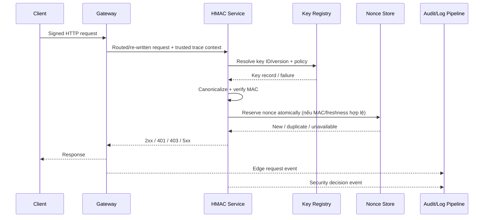
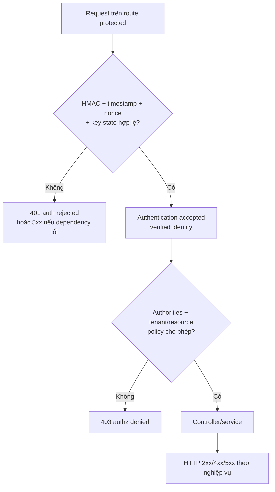

# Điều tra security log khi xảy ra sự cố xác thực HTTP request bằng HMAC

## 1. Mục tiêu: từ một dòng 401 đến kết luận điều tra có căn cứ

Trong module `SECURITY_AUTHENTICATION_HMAC_REQUEST_AUTHENTICATION`, client tạo chữ ký HMAC với **shared secret** trên **canonical request** theo hợp đồng ký (HTTP method, URI/path/query, các signed headers và/hoặc hash của raw body). Server chọn khóa theo key ID/version, tự dựng canonical request, xác minh HMAC, kiểm tra timestamp và nonce chống replay, rồi tạo principal đã xác thực. **Authorization** là bước tiếp theo, độc lập với việc chữ ký có hợp lệ hay không.

Khi production xuất hiện nhiều `401 Unauthorized`, một số `403 Forbidden` hoặc yêu cầu từ một đối tác đột ngột thất bại, việc đọc một dòng log rồi kết luận “bị tấn công” hoặc “khách hàng ký sai” là không đủ. Các nguyên nhân khả dĩ gồm:

- Client cấu hình sai secret, signed headers, Base64 hoặc canonical URI.
- Gateway rewrite path/query/host, normalize header hoặc thay đổi body encoding.
- Client retry với timestamp/nonce cũ, bị chặn replay đúng như thiết kế.
- Key rotation kết thúc overlap nhưng một client vẫn dùng key đã bị thu hồi.
- Key store/nonce store mất khả dụng; server **fail closed** với lỗi hạ tầng.
- Một ứng dụng cố ý dò key ID, thử chữ ký, gửi nhiều request bất thường.
- HMAC đã xác thực thành công nhưng authorization policy hoặc tenant ownership từ chối.
- Có dấu hiệu lộ shared secret và request ký hợp lệ phát sinh từ nguồn bất thường.

**Điều tra security log** là quá trình thu thập, đối chiếu, phân loại và kiểm chứng các **security events** để tái dựng điều gì đã xảy ra, đánh giá mức ảnh hưởng và quyết định cách ứng phó. Mục tiêu không chỉ là tìm một chuỗi trong log, mà là tránh suy diễn sai **ai đã được xác thực**, **vì sao request bị chặn** và **liệu dữ liệu/nghiệp vụ có bị tác động**.

Sau bài này, người học cần có thể:

1. Thiết kế event schema đủ hữu ích cho điều tra mà không chứa HMAC secret hoặc dữ liệu nhạy cảm.
2. Phân biệt **key ID do client khai** với **key ID/principal đã được server chứng thực**.
3. Dựng timeline theo request ID, trace ID, route và mốc thời gian ở gateway, service, key/nonce store.
4. Phân biệt authentication failure `401`, authorization denial `403` và dependency outage `5xx`.
5. Điều tra replay, canonicalization mismatch, key rotation và nghi ngờ credential compromise.
6. Viết truy vấn tổng hợp, đối chiếu với metrics/traces và đánh giá độ tin cậy của bằng chứng.
7. Thực hiện các bước bảo toàn chứng cứ, cô lập sự cố, khắc phục và xác minh sau khắc phục.
8. Kiểm thử logging trong Spring Security Servlet/MVC và WebFlux để incident response có dữ liệu đúng.

## 2. Security log, audit log, access log, trace và metric khác nhau thế nào?

Một nguồn dữ liệu duy nhất hiếm khi trả lời được toàn bộ câu hỏi điều tra.

| Nguồn | Ví dụ dữ liệu | Giá trị trong điều tra | Giới hạn |
| --- | --- | --- | --- |
| **Security event log** | `hmac.auth.rejected`, `replay_detected`, `authorization.denied` | Xác định **quyết định bảo mật** | Có thể thiếu khi logger/collector mất dữ liệu |
| **Audit log** | Credential đã xác minh, chính sách/phiên bản được áp dụng, request ID | Theo dõi hành động có trách nhiệm giải trình | Cần bảo vệ truy cập và tính toàn vẹn |
| **HTTP access log** | Method, route, response status, edge hop, latency | Đếm lưu lượng và xác định request có tới gateway/service | Status không chỉ ra chính xác nguyên nhân HMAC |
| **Distributed trace** | Các span ở gateway, verifier, key lookup, nonce reserve | Biết request đi qua đâu và độ trễ ở mỗi hop | Sampling/cancellation có thể làm thiếu một phần |
| **Metrics** | Tỷ lệ `401`/`403`/`5xx`, replay, signature mismatch, store timeout | Phát hiện xu hướng và phạm vi sự cố | Không đủ để truy ngược từng request |
| **Deployment/config events** | Bản release, cấu hình gateway, key policy, rotation cutoff | Đối chiếu sự cố với thay đổi hệ thống | Bản ghi thay đổi không tự chứng minh nguyên nhân |
| **Key/nonce store telemetry** | Thời gian lookup, reserve timeout/conflict, replication | Tìm lỗi hạ tầng, race và failover | Thường không có danh tính client nếu thiết kế đúng |

Một `401` trên access log chỉ chứng minh HTTP layer **đã cố gắng trả** mã đó; không đủ để kết luận chữ ký sai, key bị revoke hay có tấn công. Tương tự, `hmac.auth.accepted` không chứng minh authorization `allowed` và cũng không chứng minh controller đã hoàn thành giao dịch.

**Quy tắc điều tra:** xác định *nguồn phát sự kiện*, *ranh giới tin cậy*, *độ đầy đủ* và *ngữ nghĩa* trước khi sử dụng event làm bằng chứng.

## 3. Threat model cho chính quá trình điều tra

Log là tài sản nhạy cảm. Kẻ tấn công không chỉ muốn vượt HMAC; họ có thể muốn **làm sai lệch bằng chứng** hoặc **lấy credential qua công cụ điều tra**.

Một số rủi ro:

1. **Giả mạo danh tính trong log:** attacker gửi `X-Key-Id` của một đối tác khác. Nếu log tự ghi “partner-A attempted access”, người điều tra có thể quy kết nhầm.
2. **Log injection:** header/path chứa ký tự điều khiển hoặc encoding tạo dòng log giả sau khi parser decode.
3. **Log flooding:** hàng triệu key ID/nonce/path khác nhau làm tràn storage, tăng cardinality hoặc che event quan trọng.
4. **Rò dữ liệu từ debug log:** developer in shared secret, expected signature, raw `Authorization` hoặc canonical request chứa dữ liệu khách hàng.
5. **Mất log/trace:** collector outage, sampling, pipeline drop, timestamp skew hoặc pod restart tạo khoảng trống bằng chứng.
6. **Thao túng metadata proxy:** client giả mạo `Forwarded`/`X-Original-URI` khiến timeline hoặc canonical target bị hiểu sai.
7. **Sửa/xóa chứng cứ:** quyền truy cập log quá rộng, retention ngắn hoặc không có dấu vết export.

Do đó incident response có **hai yêu cầu đồng thời**: log đủ hữu ích để phân tích, và mọi dữ liệu/đường thu thập phải duy trì **confidentiality, integrity và access control**.

## 4. Key ID chưa xác thực không phải danh tính đã xác minh

Đây là khác biệt quan trọng nhất khi điều tra HMAC.

Ví dụ request do Internet gửi:

```http
POST /api/orders HTTP/1.1
X-Key-Id: partner-acme-v3
X-Request-Timestamp: 1795834800
X-Request-Nonce: request-unknown-0001
X-Signature: <client-supplied-signature>
```

Trước khi server kiểm tra HMAC, `partner-acme-v3` chỉ là **giá trị attacker có thể tự khai**. Dù server tìm thấy một key record trùng ID, đó vẫn **không chứng minh** bên sở hữu credential đã gửi request. Sau khi signature, timestamp, nonce và key policy đều được xác minh, server mới có căn cứ tạo principal từ **credential record tin cậy**.

| Thuộc tính log | Nguồn | Khi nào được tin? |
| --- | --- | --- |
| `key_id_present` | Parser HTTP | Có thể ghi trước xác thực, chỉ là boolean |
| `claimed_key_id` | Header do client gửi | **Không được xem là authenticated identity**; không log raw theo mặc định |
| `key_id_syntax_valid` | Parser/grammar | Chỉ cho biết định dạng, không cho biết key có tồn tại |
| `key_lookup_result` | Trusted registry | Metadata nội bộ có thể hỗ trợ điều tra; không tiết lộ qua response |
| `verified_key_tag` | Pseudonym từ **stored key record** đã chứng thực | Chỉ xuất ở event authentication accepted |
| `verified_client_tag` | Client identity ánh xạ server-side | Chỉ sau xác thực đầy đủ |
| `principal/authorities` | Server policy sau xác thực | Dùng trong authorization và audit đã phân quyền |
| `source_ip` | Network metadata | Có thể là IP ingress/proxy/NAT, **không phải bằng chứng ai sở hữu key** |

**Không ghi** `verified_key_tag` vào event chữ ký sai chỉ vì key ID lookup được. Nếu muốn phân nhóm brute force trên một credential được nhắc tới trong request thất bại, nên dùng một nhãn phụ thuộc chính sách riêng với ý nghĩa rõ là **claimed/unverified**; hạn chế xuất dữ liệu này ra dashboard rộng rãi. Trong nhiều hệ thống, `key_id_present`, route, source class và reason code là đủ cho điều tra ban đầu.

### 4.1. Pseudonym hóa khác với mã hóa secret

Nếu cần tương quan theo credential đã xác minh, có thể sinh `verified_key_tag` từ stored key ID bằng một **khóa logging riêng** do secret manager quản lý. Không băm/HMAC trực tiếp **shared secret dùng ký HTTP** để tạo fingerprint đưa vào log.

Một tag không làm nó “vô hại” với privacy: vẫn có thể liên kết hoạt động giữa nhiều request. Quy định retention, quyền truy cập và rotation cho log tag; tag cũng không được dùng làm nhãn Prometheus vô hạn cardinality.

## 5. Event taxonomy: thống nhất tên sự kiện trước khi có sự cố

Một event schema nên do hệ thống định nghĩa bằng enum/allowlist, không tạo tùy tiện từ exception message.

| Event | Khi phát | Ý nghĩa |
| --- | --- | --- |
| `hmac.auth.rejected` | Credential thiếu/sai, signature mismatch, timestamp sai, replay | **Authentication không thành công**; chưa có principal đã chứng thực |
| `hmac.auth.accepted` | HMAC, timestamp, nonce atomic và key state đều hợp lệ | Principal đã được xác thực; chưa khẳng định có quyền |
| `hmac.auth.unavailable` | Key/nonce store hoặc verifier dependency không thể đưa ra quyết định an toàn | **Fail closed**; thường trả lỗi `5xx` |
| `hmac.authz.denied` | Principal đã xác thực nhưng không đủ quyền/tenant policy | Authorization từ chối; thường `403` |
| `hmac.authz.allowed` | Policy chấp nhận | Có quyền đến bước nghiệp vụ |
| `hmac.credential.rotated` | Credential lifecycle được thay đổi bởi kênh quản trị | Sự kiện quản trị, không phải HTTP client authentication |
| `hmac.credential.revoked` | Secret/key version bị thu hồi | Cần đối chiếu với request đến sau cutoff |
| `hmac.policy.changed` | Canonical protocol/algorithm/signed-header policy thay đổi | Hỗ trợ tương quan với lỗi signature |
| `hmac.audit.pipeline.degraded` | Audit sink mất khả năng ghi theo chính sách | Giới hạn độ tin cậy của log hiện tại |

**Ghi chú quan trọng:** event `accepted` chỉ được phát **sau khi toàn bộ bước xác thực hoàn thành**. HMAC match nhưng nonce replay hoặc key revoked vẫn phải bị từ chối. Không phát “accepted” rồi phát “rejected” cho cùng request chỉ vì bước nonce được đặt sau phép so sánh HMAC.

### 5.1. Phân loại mã lỗi có kiểm soát

| `reason_code` nội bộ | Nguyên nhân | HTTP thường dùng | Diễn giải trong điều tra |
| --- | --- | --- | --- |
| `missing_credential` | Header auth bắt buộc vắng mặt | `401` | Có thể do client/gateway hoặc request quét |
| `malformed_credential` | Header sai grammar, duplicate, quá dài | `400`/`401` theo contract | Không phải chữ ký đã được kiểm tra |
| `invalid_credentials` | Unknown key, key không hợp lệ hoặc signature không khớp theo policy public | `401` | Không khẳng định người sở hữu key đã gửi |
| `signature_mismatch` | Expected MAC không khớp | `401` | Cần kiểm tra signed bytes/canonical version, không dump bytes |
| `timestamp_out_of_window` | Request cũ/tương lai quá cửa sổ | Thường `401` | Có thể clock skew hoặc replay |
| `replay_detected` | Nonce đã được reserve theo policy | Thường `401` | Có thể retry hợp lệ hoặc tấn công phát lại |
| `unsupported_algorithm` | Algorithm/protocol không được phép | `401`/`400` | Điều tra downgrade hoặc migration |
| `credential_revoked` | Credential không còn hợp lệ | `401` chung | Theo dõi cutoff; không lộ revoke ra Internet |
| `key_store_unavailable` | Không thể tra key an toàn | `503`/`5xx` | Outage, **không** coi là client ký sai |
| `nonce_store_unavailable` | Không thể bảo đảm chống replay | `503`/`5xx` | Outage, không gán nhãn replay |
| `insufficient_authority` | Principal hợp lệ nhưng thiếu scope | `403` | Điều tra IAM/tenant/policy, không phải lỗi HMAC |

Response công khai có thể **gộp nhiều lý do** thành lỗi authentication chung để tránh oracle liệt kê key. Log nội bộ chỉ giữ mã chi tiết nếu policy cho phép và quyền đọc được giới hạn.

## 6. Thiết kế security event có cấu trúc, không ghi secret

Event mẫu khi authentication thành công:

```json
{
  "event_type": "hmac.auth.accepted",
  "event_time": "2026-11-28T04:10:00.150Z",
  "service": "order-api",
  "environment": "production",
  "request_id": "req-91b5",
  "trace_id": "c0ffee77d0c0ffee",
  "route_template": "/api/orders/{id}",
  "http_method": "GET",
  "canonical_contract_version": "hmac-v2",
  "algorithm_class": "hmac_sha256",
  "verified_key_tag": "kt1:507cbe9e7e4d0a73",
  "key_lifecycle_class": "active",
  "auth_outcome": "accepted",
  "authz_outcome": "not_evaluated"
}
```

Event trên là **dữ liệu giả minh họa**. `authz_outcome=not_evaluated` làm rõ authorization chưa được quyết định. Một event từ chối sau đó có cùng `request_id` nhưng khác `event_type`:

```json
{
  "event_type": "hmac.authz.denied",
  "event_time": "2026-11-28T04:10:00.155Z",
  "request_id": "req-91b5",
  "route_template": "/api/orders/{id}",
  "verified_key_tag": "kt1:507cbe9e7e4d0a73",
  "reason_code": "insufficient_authority",
  "http_status": 403
}
```

Event khi xác thực bị từ chối:

```json
{
  "event_type": "hmac.auth.rejected",
  "event_time": "2026-11-28T04:10:02.009Z",
  "request_id": "req-91b6",
  "route_template": "/api/orders/{id}",
  "key_id_present": true,
  "signature_present": true,
  "reason_code": "signature_mismatch",
  "auth_outcome": "rejected",
  "http_status": 401
}
```

**Không thêm** `verified_key_tag` vào event trên, vì verifier chưa xác minh được credential. Nếu HTTP proxy/service áp dụng status khác, cần phân biệt `http_status_planned` (được security handler quyết định) với `http_status_sent` hoặc edge-observed status. Một client đóng kết nối trước khi nhận response không làm mất thực tế server đã quyết định từ chối.

### 6.1. Danh sách trường không nên có trong event

**Không log**:

- Shared secret, raw HMAC key bytes, secret cũ/mới trong rotation, key từ secret manager.
- Supplied `Authorization`/`X-Signature` và **expected signature**.
- Canonical request nguyên văn chứa path/query/header/body, raw body hoặc payload JSON nghiệp vụ.
- Nonce/timestamp nguyên bản khi không có lý do đã phê duyệt; ưu tiên skew bucket và replay reason.
- Full `Forwarded`/`X-Forwarded-*` từ client chưa tin cậy.
- Arbitrary `ex.getMessage()`, `toString()` của config/credential object, stack variables nhạy cảm.

Không dùng hash của shared secret để so các phiên bản key trong log. Nếu cần xác định **key version** được sử dụng sau xác thực, dùng alias/pseudonym từ trusted credential registry, không lộ key material.

## 7. Tái dựng dòng thời gian từ nhiều hop

Một sự cố HMAC thường có ít nhất hai hệ thống tham gia: gateway và service. Có thể có thêm secret manager, nonce store, tracing collector và service nghiệp vụ.



Sơ đồ là luồng minh họa: nếu HMAC sai, service không nhất thiết gọi nonce store. Khi lỗi xảy ra trước khi key lookup, có thể không có sự kiện ở dependency.

### 7.1. Chọn mốc thời gian chuẩn

- Ưu tiên `event_time` UTC theo định dạng thống nhất, kèm nhận biết độ chính xác đồng hồ.
- Ghi `ingest_time` của collector **riêng** với thời điểm event phát sinh.
- Theo dõi clock skew giữa gateway/pod/Redis; log xuất hiện trễ không nhất thiết có nghĩa request xử lý trễ.
- Không sắp xếp timeline chỉ bằng timestamp client gửi: `X-Request-Timestamp` là **untrusted claim** trước khi HMAC được kiểm chứng.
- Đối với hệ nhiều vùng, xem xét độ trễ gửi log và việc collector nhận event không theo thứ tự thực thi.

### 7.2. Correlation ID phải có nguồn tin cậy

Một `X-Request-Id` từ Internet có thể do client tự đặt hoặc cố tình trùng với request khác. Ingress nên validate format/length, ghi đè hoặc tạo ID mới theo policy; downstream dùng ID đã chuẩn hóa.

Khi trace không liên tục do gateway không propagate context, có thể correlate bằng **một tổ hợp** timestamp window, route template, hop identity, edge-generated request ID và connection/request metadata đã được phép. Đừng “đoán” hai request là một chỉ vì timestamp và path giống nhau.

### 7.3. Ví dụ timeline có thể giải thích

| UTC | Hệ thống | Event (đã rút gọn) | Diễn giải |
| --- | --- | --- | --- |
| 04:10:00.000 | Gateway | `request.received req-91b5 /api/orders/42` | Request đi tới edge |
| 04:10:00.005 | Service | `hmac.auth.accepted req-91b5` | HMAC + freshness/nonce hợp lệ |
| 04:10:00.008 | Service | `hmac.authz.denied req-91b5` | Bị chặn do thiếu quyền |
| 04:10:00.010 | Gateway | `response 403 req-91b5` | Phản hồi cuối là 403 |
| 04:10:02.000 | Gateway | `request.received req-91b6 /api/orders/43` | Request thứ hai |
| 04:10:02.009 | Service | `hmac.auth.rejected req-91b6 signature_mismatch` | Không vượt authentication |
| 04:10:02.012 | Gateway | `response 401 req-91b6` | Phản hồi cuối 401 |

Hai request có path gần nhau **không đủ** kết luận cùng client hay có hoạt động chiếm quyền. Request thứ hai không có verified identity. Cần thêm bằng chứng: cấu hình proxy, release change, traffic pattern, quyền API, audit từ các request đã chứng thực.

## 8. Quy trình triage trong 15 phút đầu

Thời gian dưới đây là **một khung tác nghiệp minh họa**, không thay thế SLA/runbook của tổ chức. Tập trung vào việc thu thập bằng chứng tối thiểu trước khi thay đổi cấu hình.

### Bước 1 — Xác định loại tín hiệu

Sự cố được phát hiện từ đâu?

- Tỷ lệ `401`/`403`/`5xx` tăng trên gateway/service?
- Alert `replay_detected` hoặc `signature_mismatch`?
- Đối tác báo “mọi request đều bị 401” sau khi rotate key?
- SIEM phát hiện request thành công bất thường của credential?
- Health key/nonce store báo xuống hoặc logs/traces thiếu đột ngột?

Ghi nguồn cảnh báo, thời điểm phát hiện, phạm vi route/region/pod và mức ảnh hưởng **đã xác minh**. Đừng coi một sự kiện `401` đơn lẻ là tấn công.

### Bước 2 — Phân loại sơ bộ

| Quan sát | Hướng điều tra ban đầu |
| --- | --- |
| Chỉ `missing_credential` tăng sau deploy gateway | Header stripping, filter/security matcher, client config |
| `signature_mismatch` tăng ở nhiều client sau rewrite | Canonical URI/host/header/body contract |
| `timestamp_out_of_window` tăng trên nhiều route | Clock skew, queue/delay, client timestamp format |
| `replay_detected` tăng ở một SDK sau retry | Client tái sử dụng nonce, retry sau timeout |
| `nonce_store_unavailable`/`key_store_unavailable` tăng | Dependency outage, fail closed, capacity |
| `403` tăng nhưng `hmac.auth.accepted` ổn định | Authority/tenant/resource policy |
| Accepted request xuất hiện sau revoke cutoff | Policy/cache invalidation/security incident cần ưu tiên |
| Request ký hợp lệ từ nguồn bất thường | Nghi ngờ credential compromise; cần xác minh thêm |

### Bước 3 — Giữ phạm vi và bằng chứng

Ghi time range UTC, deployment IDs, gateway config versions, policy changes, trace IDs và index/log pipeline liên quan. Bảo toàn log trong phạm vi được phép trước khi retention hoặc rotation log làm mất dữ liệu. Nếu có nghi ngờ secret lộ, **không tìm và sao chép raw secret vào báo cáo**.

### Bước 4 — Chọn thao tác giảm thiểu an toàn

- Không disable HMAC, timestamp hoặc nonce checking để “phục hồi 2xx”.
- Nếu dependency không xác minh an toàn: **fail closed**, trả lỗi hạ tầng phù hợp, khôi phục service/store.
- Nếu nghi credential bị lộ: kích hoạt runbook credential rotation/revocation có phối hợp, bảo vệ bằng chứng và thông báo đúng kênh.
- Nếu gateway canonical contract sai: rollback/sửa cấu hình qua quy trình thay đổi; đối chiếu test vectors trước khi mở traffic rộng.

## 9. Truy vấn log: từ tổng quan đến request cụ thể

Các truy vấn dưới đây là **mẫu ngữ nghĩa** để chuyển sang OpenSearch/Elasticsearch SQL, BigQuery, ClickHouse, Loki hoặc SIEM đang dùng. Không giả định hệ thống đã tồn tại bảng thật hoặc tên cột giống hệt ví dụ.

### 9.1. Phân nhóm quyết định bảo mật theo thời gian

```sql
-- Ví dụ SQL trên một bảng event giả định.
SELECT
    date_trunc('minute', event_time) AS minute_utc,
    event_type,
    reason_code,
    route_template,
    COUNT(*) AS events
FROM security_events
WHERE event_time >= :window_start_utc
  AND event_time < :window_end_utc
  AND service = 'order-api'
  AND event_type IN (
      'hmac.auth.rejected',
      'hmac.auth.unavailable',
      'hmac.authz.denied'
  )
GROUP BY 1, 2, 3, 4
ORDER BY minute_utc, events DESC;
```

Cách gọi `date_trunc` và bind parameters tùy hệ SQL. Kết quả giúp xem sự cố tập trung theo phút, reason hoặc route. Nếu log bị sampling/dropped, `COUNT(*)` là số **event thu được**, không phải tổng số request thật.

### 9.2. Dựng timeline theo request ID tin cậy

```sql
SELECT
    event_time,
    ingest_time,
    service,
    component,
    event_type,
    reason_code,
    route_template,
    http_status
FROM security_events
WHERE request_id = :trusted_request_id
ORDER BY event_time, ingest_time;
```

Để an toàn, tham số query lấy từ request ID **đã được ingress tạo/chuẩn hóa**; khi một ID xuất hiện ở nhiều request do client spoof hoặc backend tái sử dụng, phải đối chiếu thêm context.

### 9.3. So sánh trước/sau deployment

```sql
SELECT
    deployment_version,
    canonical_contract_version,
    reason_code,
    COUNT(*) AS rejected_events
FROM security_events
WHERE event_type = 'hmac.auth.rejected'
  AND event_time >= :window_start_utc
  AND event_time < :window_end_utc
GROUP BY 1, 2, 3
ORDER BY rejected_events DESC;
```

Nếu `signature_mismatch` tăng ở đúng version gateway mới, đó là **tương quan**, chưa phải bằng chứng quyết định. Cần kiểm tra signed path/query/header contract bằng test vectors và có thể A/B hay rollback có kiểm soát.

### 9.4. Metrics bổ trợ bằng PromQL

Giả sử ứng dụng **tự định nghĩa** meter `hmac.requests.rejected` được xuất thành `hmac_requests_rejected_total`:

```promql
sum by (reason, route) (
  rate(hmac_requests_rejected_total[5m])
)
```

Metric này hữu ích để xác định thời điểm tăng bất thường. Không đưa raw key ID, signature, nonce, request ID hoặc raw URI vào nhãn metric. Một metric counter reset sau pod restart phải được diễn giải bằng `rate()`/`increase()`, không so các giá trị cumulative tùy ý.

## 10. Điều tra tăng 401: signature mismatch, key state hay canonicalization?

Khi `401` tăng, hãy tách các giả thuyết và bằng chứng:

| Giả thuyết | Tín hiệu phù hợp | Cách kiểm chứng an toàn |
| --- | --- | --- |
| Client dùng sai secret/version | Lỗi tập trung ở phiên bản SDK hoặc giai đoạn rotation | Kiểm tra provisioning/version metadata, test bằng credential test |
| Gateway đổi public path/query | Tăng sau deploy gateway, một số route bị ảnh hưởng | Test signed public target qua edge; so config version |
| Header bị strip/normalize sai | `missing_credential` hoặc mismatch sau proxy | Kiểm tra policy forwarding, signed header set ID |
| Body bytes bị chuyển đổi | Mismatch chỉ với request có body hoặc Content-Encoding | Test raw body bytes giả, hash/encoding contract |
| Client đồng hồ lệch | `timestamp_out_of_window` tăng theo một nhóm SDK | Đồng bộ thời gian, đo skew bucket đã kiểm soát |
| Client retry nonce cũ | `replay_detected` tăng sau timeout/retry | So client retry implementation và nonce store result |
| Attacker thử credential | Nhiều malformed/invalid signatures, traffic pattern bất thường | Đối chiếu nhiều tín hiệu; không quy kết chỉ dựa IP |
| Key registry/nonce store outage | `hmac.auth.unavailable`/`5xx` | Theo dõi dependency failures, không gán nhầm 401 |

### 10.1. Đừng dump canonical request để tìm mismatch

Canonical request có thể chứa URL query mang token, signed header `Authorization` hoặc hash body liên kết dữ liệu nhạy cảm. Không in full canonical bytes, expected signature hay shared secret. Thay vào đó log:

```json
{
  "event_type": "hmac.auth.rejected",
  "reason_code": "signature_mismatch",
  "request_id": "req-4112",
  "route_template": "/api/orders",
  "canonical_contract_version": "hmac-v2",
  "signed_header_set_id": "orders-v2",
  "gateway_route_class": "edge-orders",
  "http_status": 401
}
```

Đối chiếu với **golden vectors chỉ chứa dữ liệu giả** và cấu hình canonicalization giữa client/gateway/service. Nếu cần thông tin sâu hơn trong một điều tra được phê duyệt, phải có cơ chế thu thập nhạy cảm riêng với quyền truy cập và retention giới hạn; không bật debug dump bừa bãi trên production.

### 10.2. 401 không phải số lượng attacker

Một hệ thống gửi retry không hợp lệ có thể tạo hàng nghìn `401`/phút từ một SDK lỗi. Ngược lại, một kẻ có shared secret thật có thể gửi request **được xác thực thành công** nên không xuất hiện trong biểu đồ `401`. Phân tích an ninh phải bao gồm cả **accepted events** với nguồn, thời gian và hành vi nghiệp vụ bất thường, không chỉ failures.

## 11. Điều tra replay và nonce store

Một request HMAC hợp lệ vẫn có thể bị phát lại nếu timestamp còn nằm trong cửa sổ và attacker/client gửi lại nguyên thông điệp. **HMAC không tự chống replay**. Nonce store cần giữ trạng thái dùng một lần theo phạm vi credential phù hợp, thường dùng primitive atomic như `SET ... NX EX` trong Redis hoặc unique constraint ở database.

### 11.1. Những thông tin cần từ log/metric

- `reason_code=replay_detected` và request/trace ID.
- Route template, gateway hop/region, thời điểm quyết định.
- `clock_skew_bucket` thay vì raw timestamp nếu cần.
- Nonce reserve result `new` / `duplicate` / `unavailable`.
- Latency, timeout, memory/eviction, keyspace và failover của nonce store.
- Client retry/version/timeout policy qua cấu hình hoặc telemetry đáng tin.
- Nếu đã được chứng thực, verified client/key tag ở accepted event trước đó.

**Không log raw nonce mặc định.** Nếu quy trình điều tra cần tương quan nonce giữa hai request, cân nhắc một **nonce correlation tag** có miền và thời hạn rõ ràng, tính từ dữ liệu phù hợp bằng khóa logging riêng, và chỉ khi privacy/security policy cho phép. Tag nonce không phải danh tính đã xác thực; event replay rejected vẫn không được gán “authenticated client” chỉ vì nonce/key ID trùng một accepted event trước đó.

### 11.2. Dấu hiệu có thể gây nhầm

- **Legitimate retry:** client không nhận response, gửi lại request đã ký với cùng nonce; server đúng khi chặn lần sau.
- **Request replay thật:** một request bị lấy lại/phát từ nguồn khác; cần bằng chứng về cơ chế replay, không suy từ một event duy nhất.
- **Duplicate client nonce:** SDK có lỗi RNG/counter, nhiều request nghiệp vụ khác nhau dùng nonce trùng.
- **Nonce store outage:** không thể reserve nonce an toàn, phải fail closed bằng `5xx`, **không** phát `replay_detected` nếu store chưa đưa ra kết luận duplicate.
- **Race hai replica:** nếu `exists()` rồi `set()`, cùng nonce có thể được hai instance chấp nhận; số replay detected ít không chứng minh an toàn.
- **TTL/eviction sai:** nonce được quên trước khi cửa sổ timestamp kết thúc, tạo khả năng chấp nhận lại.

### 11.3. Bài test tái lập để xác minh giả thuyết

```text
A. Ký request đúng, nonce N mới -> accepted.
B. Gửi lại đúng request và N -> rejected as replay.
C. Ký request mới với nonce M -> accepted.
D. Hai request cùng N trên hai replica -> tối đa một accepted.
E. Tắt nonce store trong môi trường test -> fail closed, không accepted.
```

Chạy trên fixture test riêng, không dùng key thật của đối tác hoặc dữ liệu production. Với request có side effect, tách idempotency logic khỏi nonce: **nonce mới không ngăn lặp giao dịch nghiệp vụ**.

## 12. Điều tra key rotation, revoke và nghi ngờ lộ credential

Key rotation thường có các giai đoạn `current`, `previous_allowed` trong khoảng overlap và `revoked`. Khi một client tiếp tục dùng key cũ sau cutoff, signature có thể được tính đúng bằng secret cũ nhưng **server phải từ chối** theo lifecycle policy.

Bảng nhận định:

| Dấu hiệu | Giả thuyết | Hành động xác minh |
| --- | --- | --- |
| Rejected tăng ngay sau cutoff | Client chưa chuyển key, cache policy stale | Đối chiếu rotation plan, key state theo registry |
| Accepted với `previous_allowed` gần cutoff | Client vẫn đang migration | Giao tiếp đối tác qua kênh đã xác thực |
| Accepted sau **revocation có hiệu lực** | Có thể lỗi cache/invalidation hoặc policy nghiêm trọng | Ưu tiên điều tra, xem audit của nhiều node |
| Accepted từ vùng/route/hành vi bất thường | Có thể credential compromise | Xác minh nguồn, request pattern và nghiệp vụ |
| Unknown key ID tăng hàng loạt | Có thể enumeration/probing | Rate limit và kiểm tra đầu vào; tránh công khai key inventory |
| Secret xuất hiện trong log/trace | Credential exposure | Kích hoạt incident runbook, rotate/revoke |

**Không suy rằng một key đã bị lộ chỉ vì `401` tăng**. Ngược lại, có bằng chứng shared secret đã vào log/CI artifact thì không nên chờ xuất hiện request bất thường mới xử lý.

### 12.1. Nếu nghi hoặc xác nhận secret bị lộ

1. Cô lập quyền xem log/artifact, bảo toàn chứng cứ về nơi secret đã xuất hiện **mà không nhân bản secret vào ticket**.
2. Xác định credential và môi trường bị ảnh hưởng qua kho quản lý khóa, metadata và quyền truy cập được kiểm soát.
3. Chuẩn bị key mới theo quy trình tin cậy; cập nhật client với cơ chế provisioning an toàn.
4. **Revoke/rotate** secret có nguy cơ lộ theo mức độ khẩn cấp và hậu quả nghiệp vụ; rút ngắn overlap nếu phù hợp.
5. Kiểm tra cache key, multi-instance và gateway: không instance nào được chấp nhận key đã revoke sau khi policy có hiệu lực.
6. Dò lại accepted events trong cửa sổ có nguy cơ, liên kết với nghiệp vụ, quyền và tác động thực tế; **không quy kết thủ phạm chỉ từ IP**.
7. Đánh giá backup/log export/retention và nghĩa vụ thông báo theo chính sách.

Một secret đã từng vào log không tự trở nên an toàn chỉ vì xóa một bản sao; collector, snapshot hoặc backup có thể còn giữ dữ liệu. Rotation/revocation là kiểm soát quan trọng để hạn chế khả năng tiếp tục ký request trái phép.

### 12.2. Algorithm migration và downgrade

Nếu API đang hỗ trợ HMAC-SHA256 và HMAC-SHA512 trong giai đoạn chuyển tiếp, log có thể có `algorithm_class` từ **server allowlist**. Khi điều tra thuật toán bị từ chối, phân biệt:

- Header `alg` chưa được chứng thực: chỉ là client request metadata.
- Algorithm đã được verifier chấp nhận theo key policy và đã xác thực: có thể ghi ở accepted event.
- Algorithm cũ đã hết hạn: phải reject, không thử fallback các thuật toán.
- Gateway thay `X-HMAC-Alg` hoặc client retry xuống thuật toán thấp hơn sau `401`: cần đối chiếu contract và policy.

Không dùng raw `alg` tùy ý làm nhãn metric, và không thử `all key × all algorithm × all canonical formats` để “cứu” request đang lỗi.

## 13. 403 và authorization: không đổ lỗi cho HMAC

Một request có HMAC hợp lệ, timestamp/nonce mới và key active vẫn có thể bị từ chối vì scope hoặc tenant ownership.



Ví dụ sau key rotation, một client vẫn ký hợp lệ nhưng credential mới chưa được ánh xạ authority `orders:create`. Quan sát:

```text
hmac.auth.accepted -> hmac.authz.denied -> HTTP 403
```

Nguyên nhân cần kiểm tra authority mapping và IAM policy, **không phải sửa HMAC algorithm hay secret**. Nếu policy che sự tồn tại của tài nguyên bằng `404`, log nội bộ cần diễn giải đúng authorization decision thay vì coi mọi `404` là route không tồn tại.

Không ghi raw tenant/resource ID nhạy cảm tràn lan. Nếu cần điều tra cross-tenant access, dùng truy vấn audit có phân quyền trên metadata nội bộ, không lấy toàn bộ payload ra dashboard chung.

## 14. Gateway và canonical request: nhận diện lỗi theo hop

Gateway/reverse proxy có thể thay method, scheme/host, path, query, signed headers hoặc body encoding. Client có thể ký:

```text
POST https://api.example.test/v1/orders?region=vn
```

trong khi service nhận:

```text
POST http://orders-service:8080/internal/orders?region=vn
```

Nếu hợp đồng ký public URI, verifier phải biết **đúng public request target được nhận tại trusted ingress**, hoặc HMAC phải được xác minh ở edge trước rewrite. `Forwarded` không tiêu chuẩn hóa original path/query; các header như `X-Original-URI` hoặc `X-Forwarded-Prefix` cần chính sách sanitize/overwrite và trust boundary rõ ràng.

### 14.1. Dấu hiệu cần đối chiếu trong log

| Tín hiệu | Có thể gợi ý |
| --- | --- |
| Signature mismatch chỉ sau gateway deploy | Path/query/header rewriting đổi |
| Chỉ route có URL encoding đặc biệt lỗi | Raw path vs decoded/normalized URI contract |
| Chỉ JSON/large body lỗi | Body rewrite, compression, whitespace hoặc payload handling |
| Header `Authorization` có ở edge nhưng thiếu ở service | Header stripping, routing hoặc security policy |
| Thay host/scheme thì lỗi | Host/proto là signed field nhưng proxy metadata không đúng |
| Service nhận thêm/mất Content-Type | Signed header value không khớp |
| Lỗi chỉ trên HTTP/2 | `:path`/`:authority` translation hoặc HTTP client behavior |

Các dấu hiệu trên là **giả thuyết điều tra**. Xác minh bằng test vectors giả và test E2E qua gateway, không dump raw production header/body.

### 14.2. Điều tra log loss giữa gateway và service

Không tìm thấy service event cho một edge request có thể vì:

- Gateway chặn request trước upstream.
- Request không đến service (routing/TLS/network).
- Service crash/timeout trước khi tạo event.
- Collector drop/sampling hoặc clock/ingest delay.
- Request đi vào một security chain khác không có HMAC audit.

Cần kiểm tra gateway routing logs, HTTP completion, pod lifecycle, metrics và tracing sampling trước khi kết luận attacker đã bypass verifier.

## 15. Java/Spring Security Servlet: phát sự kiện đúng thời điểm

Mục tiêu của ví dụ là **tách hẳn audit event khỏi raw HTTP request và secret**. Ở Spring MVC, custom HMAC filter có thể là `OncePerRequestFilter` trong `SecurityFilterChain`. Không nên để verifier tự log mọi bước rồi entry point lại log lần hai.

### 15.1. Typed event và reason code

```java
public enum HmacAuthReason {
    MISSING_CREDENTIAL,
    INVALID_CREDENTIAL,
    SIGNATURE_MISMATCH,
    TIMESTAMP_OUT_OF_WINDOW,
    REPLAY_DETECTED,
    UNSUPPORTED_ALGORITHM
}

public enum ProtectedRoute {
    ORDERS_CREATE("orders_create"),
    ORDERS_READ("orders_read"),
    OTHER("other");

    private final String tag;
    ProtectedRoute(String tag) { this.tag = tag; }
    public String tag() { return tag; }
}

public final class HmacAudit {
    private static final Logger LOG =
            LoggerFactory.getLogger("security.hmac.audit");

    public void rejected(
            String trustedRequestId,
            ProtectedRoute route,
            HmacAuthReason reason) {

        LOG.warn("event={} request_id={} route={} reason_code={}",
                "hmac.auth.rejected",
                safeRequestId(trustedRequestId),
                route.tag(),
                reason.name().toLowerCase(Locale.ROOT));
    }

    public void accepted(
            String trustedRequestId,
            ProtectedRoute route,
            VerifiedKeyTag verifiedKeyTag) {

        LOG.info("event={} request_id={} route={} verified_key_tag={}",
                "hmac.auth.accepted",
                safeRequestId(trustedRequestId),
                route.tag(),
                verifiedKeyTag.value());
    }

    private static String safeRequestId(String input) {
        if (input == null || !input.matches("[A-Za-z0-9_-]{1,64}")) {
            return "unavailable";
        }
        return input;
    }
}
```

Các kiểu `VerifiedKeyTag`/logger imports do ứng dụng cung cấp. **Không** cho `HmacAudit` nhận `SecretKey`, `byte[] sharedSecret`, `HttpServletRequest` hay `Map<String,Object>` tùy ý. Chỉ nhận các trường có schema giới hạn. SLF4J placeholder `{}` không tự làm dữ liệu an toàn nếu developer truyền raw credential.

### 15.2. Vị trí phát accepted/rejected

```java
// Trong custom HMAC filter, minh họa các nhánh.
final VerifiedHmacIdentity verified;
try {
    verified = verifier.verify(request); // MAC + timestamp + nonce atomic
} catch (HmacCredentialException ex) {
    audit.rejected(requestId, route, ex.reason());
    SecurityContextHolder.clearContext();
    entryPoint.commence(request, response, ex);
    return;
}

// verified phải chứa stored key ID lấy từ trusted registry,
// principal đã authenticated và request wrapper nếu đọc body.
SecurityContext context = SecurityContextHolder.createEmptyContext();
context.setAuthentication(verified.authentication());
SecurityContextHolder.setContext(context);

audit.accepted(
        requestId,
        route,
        keyTagFactory.fromVerifiedStoredId(verified.storedKeyId()));

// Authn accepted không có nghĩa authz allowed hoặc business succeeded.
chain.doFilter(verified.requestForChain(), response);
```

Đây là fragment minh họa, không phải class standalone. Trong code thực:

- `verifier.verify(...)` chỉ trả thành công sau **signature, key state, timestamp, nonce atomic**.
- Nonce/key store timeout phải được xử lý bằng **đường hạ tầng riêng** (`5xx`/`unavailable`), không catch mọi exception thành `invalid_credentials`.
- Nếu verifier đọc body, `requestForChain()` phải phát lại **đúng bytes đã được xác minh**.
- Phát rejected **một lần**: hoặc filter phát, hoặc `AuthenticationEntryPoint` phát, không cả hai.
- Phát accepted một lần theo **logical request/attempt**; Servlet async/error dispatch có thể chạy lại filter.
- `chain.doFilter(...)` nằm ngoài `catch(AuthenticationException)`; exception authorization ở downstream không được biến thành signature mismatch.

### 15.3. MDC không được gây nhiễm chéo log

Trong Servlet đồng bộ, có thể đặt request ID và verified key tag sau authentication:

```java
try (MDC.MDCCloseable rid =
             MDC.putCloseable("request_id", requestId);
     MDC.MDCCloseable kid =
             MDC.putCloseable("verified_key_tag", keyTag.value())) {
    chain.doFilter(requestForChain, response);
}
```

MDC thường gắn với thread; phải cleanup trong `finally`/`MDCCloseable`. Với async dispatcher/executor, cần kiểm tra propagation/cleanup riêng. **Không bao giờ** đặt shared secret, raw signature hoặc canonical request vào MDC.

## 16. Spring WebFlux: điều tra trong pipeline reactive

Ở WebFlux, `SecurityWebFilterChain`, `AuthenticationWebFilter` và `ReactiveAuthenticationManager` thường xử lý HMAC qua `Mono`/`Flux`. Không dựa vào `ThreadLocal` để suy ra request nào đang được xử lý: Reactor có thể đổi thread giữa các operator.

Một thiết kế reactive có thể phát event sau khi verifier đã hoàn tất:

```java
public Mono<Authentication> authenticate(HmacEvidence evidence) {
    return verifier.verify(evidence)  // Mono<VerifiedHmacIdentity>
            .doOnNext(verified -> audit.accepted(
                    evidence.trustedRequestId(),
                    evidence.protectedRoute(),
                    tagger.fromVerifiedStoredId(
                            verified.storedKeyId())))
            .map(VerifiedHmacIdentity::authentication)
            .doOnError(HmacCredentialException.class, ex ->
                    audit.rejected(
                            evidence.trustedRequestId(),
                            evidence.protectedRoute(),
                            ex.reason()));
}
```

`HmacEvidence`, `VerifiedHmacIdentity`, `verifier` và `tagger` là API ứng dụng giả định. Không lấy `trustedRequestId()` trực tiếp từ raw header client chưa validate. Không log toàn bộ `evidence` vì có thể chứa supplied signature và body.

**Lưu ý side effect/reactive semantics:**

- `doOnNext` chỉ chạy sau verification thành công; publisher phải có contract kiểm tra **nonce atomic** trước khi emit.
- `doOnError` có thể được gọi theo subscription; `retry()`/resubscription có thể khiến event lặp hoặc trạng thái nonce thay đổi. Thiết kế audit event theo attempt ID hoặc owner duy nhất.
- Không tự `subscribe()` chỉ để log, không `block()` trên Netty event loop.
- Với `Flux<DataBuffer>` signed body, cần size limit, release pooled buffers đúng cách và replay exact body bytes cho downstream.
- Tracing correlation có thể dùng Reactor Context và context propagation được cấu hình; kiểm thử tránh gắn nhầm request ID/key tag giữa các scheduler.
- Với audit sink I/O blocking, dùng queue/bounded async publisher phù hợp, không block event loop. Nếu audit bắt buộc theo quy định nghiệp vụ, cần policy bền vững riêng (ví dụ transactional outbox) và quyết định fail closed ở đúng ranh giới.

## 17. Bảo toàn chứng cứ và chain of custody

Điều tra đúng kỹ thuật nhưng bằng chứng bị sửa hoặc phát tán dữ liệu nhạy cảm vẫn có thể thất bại.

### 17.1. Lưu giữ với phạm vi tối thiểu

- Xác định thời gian UTC, hệ thống, log indices, account truy cập và lý do thu thập.
- Áp chính sách bảo toàn/retention có phê duyệt; tránh xóa log trước khi phân tích.
- Ghi thời điểm export, người/chủ thể thực hiện, nguồn dữ liệu, filter query, phiên bản schema.
- Tính digest (ví dụ SHA-256) của **artifact export** khi cần kiểm tra tính toàn vẹn; lưu digest riêng với metadata chuỗi bàn giao. Điều này **khác** với việc băm shared secret để ghi log.
- Phân quyền tối thiểu, mã hóa khi truyền/lưu, tách dữ liệu đã làm sạch với bằng chứng gốc trong kho được bảo vệ.
- Không gửi raw log chứa credential hoặc PII qua chat/ticket thông thường; báo cáo sử dụng event IDs, thống kê và trường đã redacted.

### 17.2. Đánh giá độ đầy đủ

Một bảng điều tra nên ghi:

| Nguồn | Time range | Có đủ không? | Hạn chế |
| --- | --- | --- | --- |
| Gateway access logs | UTC start/end | Đã xác minh/chưa rõ | Sampling, request bị chặn sớm |
| HMAC security events | UTC start/end | Đã xác minh/chưa rõ | Event sink outage, duplicate attempts |
| Nonce store telemetry | UTC start/end | Đã xác minh/chưa rõ | Không có log từng nonce, eviction |
| Credential lifecycle audit | UTC start/end | Đã xác minh/chưa rõ | Key cache propagation delay |
| Distributed traces | UTC start/end | Đã xác minh/chưa rõ | Span sampling/missing context |
| Deployment/config changes | UTC start/end | Đã xác minh/chưa rõ | Rollback thiếu metadata |

Không nói “không có request đáng ngờ” nếu hệ thống đã mất log trong 20 phút. Kết luận phải tách **đã kiểm tra**, **không có bằng chứng**, **bằng chứng thiếu** và **đã loại trừ bằng kiểm thử**.

### 17.3. Tránh làm tổn hại bằng chứng khi truy vấn

Đừng chạy script tự sửa/xóa log để “dọn dữ liệu” trong lúc điều tra. Truy vấn nên read-only. Khi cần tạo bản redacted cho chia sẻ, giữ bản gốc trong kho bảo vệ theo policy, ghi lại quy trình redaction và quyền truy cập.

## 18. Kiểm thử độ tin cậy của security logging

Chính logging pipeline cũng cần được kiểm thử như một thành phần bảo mật. Một hệ thống có HMAC đúng nhưng ghi sai `reason_code` khiến incident response đi sai hướng.

| Ca thử | Kết quả HMAC | Event mong đợi |
| --- | --- | --- |
| Thiếu credential | `401` | `hmac.auth.rejected`, `missing_credential`, không verified tag |
| Key ID giả, signature sai | `401` | Không gắn danh tính client đã xác thực |
| Path/body thay sau khi ký | `401` | `signature_mismatch` khi đã tới verifier |
| Timestamp quá hạn | Thường `401` | `timestamp_out_of_window`, không accepted |
| Replay nonce | Thường `401` | `replay_detected`, không accepted cho lần lặp |
| HMAC đúng, nonce mới | Authentication accepted | Một `hmac.auth.accepted` với verified tag |
| HMAC đúng, thiếu authority | `403` | Auth accepted riêng và `hmac.authz.denied` |
| Nonce store timeout | `503`/`5xx` | `hmac.auth.unavailable`, không fake replay |
| Key store timeout | `503`/`5xx` | Outage reason, không fake signature mismatch |
| Key bị revoke | `401` | Rejected, không accepted sau cutoff |
| Key rotation overlap | Theo policy | Accepted chỉ với key/version còn cho phép |
| Gateway rewrite sai | `401` khi mismatch | Contract version và gateway route class an toàn |
| Duplicate headers/CRLF | `400`/`401` theo contract | Không log injection hoặc raw header |
| Audit collector chậm/mất kết nối | Theo audit policy | Không bypass HMAC, nhận biết log loss |
| WebFlux retry/cancel | Theo verifier | Không ghi accepted trùng hoặc leak DataBuffer |
| Servlet async/error dispatch | Theo handler | Không đếm rejected/accepted trùng |
| Secret manager exception chứa sentinel | `5xx`, fail closed | Không in secret/exception message nhạy cảm |

### 18.1. Test bằng sentinel không dùng secret production

Dùng secret, chữ ký và body token **chỉ dành cho môi trường test**, đặt sentinel nhận diện trong từng nguồn. Thu log qua appender/test sink, kết quả HTTP, span exporter và metric registry.

```java
String fakeSecret = "TEST_ONLY_HMAC_SECRET_NEVER_LOG_7281";
String fakeSignature = "TEST_ONLY_SIGNATURE_NEVER_LOG_3921";
String fakeBodyToken = "TEST_ONLY_BODY_TOKEN_NEVER_LOG_6419";

// Kích hoạt fixture trên nhánh authn accepted, rejected,
// replay, key/nonce store unavailable và 403 authorization.

String captured = testLogSink.allText();

assertFalse(captured.contains(fakeSecret));
assertFalse(captured.contains(fakeSignature));
assertFalse(captured.contains(fakeBodyToken));
assertTrue(captured.contains("hmac.auth."));
```

Đây là pseudocode cho test sink do ứng dụng cung cấp. Ngoài formatted message, cần kiểm tra **structured key-value fields**, SLF4J arguments, MDC, JSON encoder output, exception serialization, APM spans, proxy access log và CI artifacts. Không dump toàn bộ captured log trong assertion failure vì bản báo cáo CI có thể vô tình chứa đúng sentinel mà test đang tìm.

### 18.2. Test tính đúng của event sau xác thực

```java
@Test
void signedButReplayedRequestMustNotCreateAcceptedEvent() {
    // Fixture tạo chữ ký đúng, cùng nonce hai lần.
    // Lần đầu accepted; lần sau rejected as replay.
    var first = runSignedRequestWithNonce("nonce-replay-test");
    var second = runSameSignedRequest();

    assertEquals(200, first.status());
    assertEquals(401, second.status());
    assertEquals(1, auditSink.count("hmac.auth.accepted"));
    assertEquals(1, auditSink.count("hmac.auth.rejected",
                                   "replay_detected"));
}
```

Các helper/return types là API giả định của test fixture. Với endpoint có side effect, dùng môi trường và dữ liệu test an toàn; status success có thể khác `200` theo API. Quan trọng là audit accepted chỉ xuất hiện sau **atomic replay check**, không phải ngay sau MAC comparison.

### 18.3. Test log injection và cardinality

Fuzz `X-Key-Id`, nonce, query và forwarded headers với giá trị dài, ký tự điều khiển/encoding, duplicate fields. Kiểm tra event name, reason_code, route template và metric labels **không xuất phát từ raw input**. Không kiểm thử chỉ bằng cách tìm newline trong formatted string; structured logging encoder cũng cần được kiểm tra đúng escaping.

## 19. Bài thực hành: điều tra sự cố sau triển khai gateway

Giả sử `order-api` bảo vệ `POST /api/orders` bằng HMAC-SHA256. Client ký method, canonical public URI, `Content-Type` và SHA-256 raw JSON body, timestamp và nonce. Gateway rewrite `/v1/orders` sang `/internal/orders`. Service chạy nhiều replica, tra key version từ credential registry, dùng Redis nonce store atomic và yêu cầu authority `orders:create`.

Tình huống giả định (mọi số liệu là **mẫu học tập**, không phải sự cố thực):

- 04:00 UTC: gateway triển khai bản mới.
- 04:03 UTC: `signature_mismatch` tăng mạnh ở route tạo đơn hàng.
- 04:05 UTC: một số client báo retry lại request và nhận `replay_detected`.
- 04:07 UTC: team phát hiện key rotation overlap cũng đang diễn ra.
- 04:10 UTC: một số `403` tăng sau thay đổi authority mapping.
- 04:12 UTC: telemetry nonce store báo latency tăng nhưng chưa xác định outage.

### 19.1. Nhiệm vụ điều tra

1. **Khoanh vùng:** xác định UTC window, vùng triển khai, version gateway/service và route chịu ảnh hưởng; kiểm tra collector có mất log không.
2. **Phân loại:** tách `signature_mismatch`, `replay_detected`, `key_store_unavailable`, `nonce_store_unavailable` và `insufficient_authority` thành các nhóm riêng.
3. **Dựng timeline:** nối edge event với service event qua trusted request ID/trace ID, không dùng raw key ID làm identity.
4. **Xây giả thuyết:** so sánh canonical public path, rewrite policy, signed header set và body bytes với **test vectors giả**; không dump request production.
5. **Điều tra replay:** xem retry có tái sử dụng timestamp/nonce không; kiểm tra Redis atomic reserve, timeout và TTL; xác định liệu replay là hành vi mong đợi.
6. **Điều tra rotation:** đối chiếu key state/cutoff với accepted/rejected events, kiểm tra cache propagation mà không đọc hoặc log secret.
7. **Điều tra 403:** kiểm tra principal đã authenticated, authority mapping `orders:create` và tenant policy.
8. **Đánh giá compromise:** chỉ đánh dấu nghi ngờ khi có bằng chứng hỗ trợ, như secret exposure hoặc accepted behavior bất thường; không quy kết cho đối tác dựa key ID giả.
9. **Đề xuất mitigation:** sửa/rollback gateway có kiểm soát, khắc phục nonce store, cập nhật client retry hoặc credential migration; tuyệt đối không bỏ qua HMAC/anti-replay.
10. **Giữ bằng chứng:** xuất event đã chọn theo policy, ghi version/schema, UTC window, integrity digest, người truy cập và giới hạn độ đầy đủ.
11. **Xác minh sau khắc phục:** chạy positive/negative HMAC vectors qua gateway và theo dõi `401`/`403`/`5xx`, accepted throughput, latency và replay decisions.
12. **Hậu kiểm:** cập nhật runbook, logging schema, cảnh báo, test gateway/rotation và chính sách lưu giữ bằng chứng.

### 19.2. Mẫu báo cáo điều tra ngắn

```text
Incident ID:       IR-HMAC-EXAMPLE-001
Window (UTC):      [start, end)
Affected route:    orders_create
Source coverage:   gateway / service / nonce store / key audit
Observed facts:    reason counts, request timeline, deploy IDs
Hypotheses:        canonical path rewrite, client nonce retry,
                   key rotation policy, authorization mapping
Evidence status:   verified / partial / missing per source
Impact:            failed requests, business effects verified separately
Mitigation:        approved change, no HMAC/replay bypass
Credential risk:   no evidence / suspected / confirmed + basis
Next actions:      owner, deadline, validation and follow-up
Sensitive data:    no raw secret/signature/body in report
```

Không viết “root cause là gateway” chỉ vì deploy trùng thời điểm tăng `401`; cần test hoặc bằng chứng đối chiếu. Không viết “không có compromise” nếu accepted events hoặc log của một vùng chưa được thu thập.

### 19.3. Tiêu chí hoàn thành bài thực hành

- Dựng được timeline nhiều hop với nguồn ID và time semantics đáng tin.
- Có phân loại đúng **401 authentication**, **403 authorization**, **5xx dependency outage**.
- Không gán danh tính đối tác cho request có key ID giả nhưng chưa xác thực.
- Phân biệt replay thật, retry nonce cũ, nonce store timeout và lỗi atomic/TTL.
- Có bằng chứng test cho canonical path/header/body qua gateway và key rotation policy.
- Không đưa shared secret, expected/supplied signature, raw canonical request hoặc dữ liệu khách hàng vào log/truy vấn export công khai.
- Báo cáo mức độ tin cậy, khoảng trống log và chuỗi quản lý chứng cứ.
- Mitigation giữ nguyên HMAC verification, freshness, nonce atomic và kiểm tra quyền.
- Có regression tests, metric/alert và tiêu chí kết thúc sự cố dựa trên dữ liệu.

**Kết luận:** Điều tra security log trong xác thực HMAC không phải chỉ tìm `401` hay đếm signature mismatch. Đó là việc chứng minh **request đã đi qua những ranh giới tin cậy nào, ở bước nào bị từ chối hay được chấp nhận và bằng chứng nào hỗ trợ kết luận**. Một hệ thống có event schema rõ ràng, correlation đáng tin, log không lộ secret, anti-replay/key lifecycle được quan sát chính xác và khả năng bảo toàn chứng cứ sẽ giúp xử lý sự cố hiệu quả mà không đánh đổi chính các bảo đảm bảo mật của HMAC.
