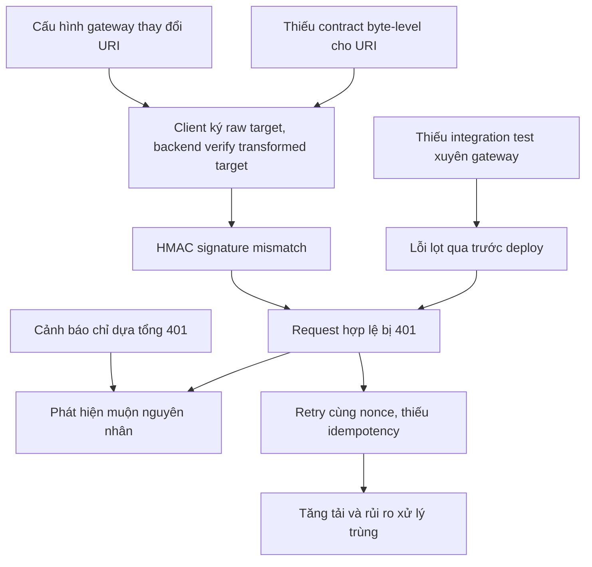

# Bài học sau sự cố — Post-incident review cho HMAC request authentication

## 1. Mục tiêu của giai đoạn học hỏi sau sự cố

**Incident response** không kết thúc ở thời điểm hệ thống hết báo động hoặc tỷ lệ HTTP `401` trở lại bình thường. Sau khi đã cô lập rủi ro, khôi phục dịch vụ và bảo quản bằng chứng, đội ngũ cần thực hiện **post-incident review (PIR)** để trả lời: điều gì đã thực sự xảy ra, vì sao cơ chế phòng vệ không phát hiện hoặc ngăn chặn sớm hơn, và cần chứng minh điều gì để sự cố tương tự khó tái diễn.

Trong module **`SECURITY_AUTHENTICATION_HMAC_REQUEST_AUTHENTICATION`**, hợp đồng HMAC dựa trên shared secret và canonical request gồm HTTP method, URI, các header hoặc body theo quy tắc ký. Timestamp/nonce chống phát lại; key rotation giới hạn vòng đời credential; proxy/gateway có thể làm biến đổi request; xác thực bằng HMAC và phân quyền là hai lớp riêng. Vì vậy bài học sau sự cố phải đánh giá **toàn bộ chuỗi xử lý request**, không chỉ hàm tính HMAC.

Kết quả mong đợi của một PIR có chất lượng:

- Dòng thời gian có bằng chứng, nêu rõ sự kiện **đã xác minh**, giả thuyết và phần còn chưa biết.
- Phạm vi ảnh hưởng tới client/tenant, endpoint, dữ liệu, giao dịch và độ sẵn sàng của dịch vụ.
- Nguyên nhân trực tiếp, điều kiện góp phần, các lớp kiểm soát đã thất bại và vì sao phát hiện bị chậm.
- Các hành động khắc phục có **owner, ưu tiên, hạn hoàn thành, tiêu chí nghiệm thu và bằng chứng kiểm thử**.
- Một bộ test hồi quy liên kết trực tiếp với lỗi đã tìm thấy, gồm unit, integration và kiểm thử qua gateway khi cần.
- Kết quả đánh giá lại rủi ro còn lại, người chấp nhận rủi ro và thời điểm rà soát lại.

PIR nên tập trung vào điều kiện hệ thống và quyết định có thể kiểm tra, **không quy lỗi cho cá nhân**. Một người cấu hình sai gateway có thể là tác nhân khởi phát; việc không có hợp đồng canonicalization, test xuyên gateway và cảnh báo theo mã lỗi mới là những khoảng trống có thể sửa để hệ thống bền vững hơn.

## 2. Phân biệt phục hồi sự cố và rút ra bài học

| Công việc | Trong khi ứng phó | Sau khi hệ thống đã ổn định |
| --- | --- | --- |
| Ưu tiên | Giảm nguy cơ, ngăn request không hợp lệ, khôi phục dịch vụ | Hiểu nguyên nhân và giảm khả năng tái diễn |
| Bằng chứng | Giữ log/audit, timestamp, cấu hình, mẫu lỗi | Đối chiếu, xác minh giả thuyết, hoàn thiện timeline |
| Shared secret | Revoke/suspend nếu nghi lộ; cấp lại theo mức độ khẩn cấp | Kiểm tra vòng đời secret, phạm vi quyền, cache và chính sách thu hồi |
| HMAC mismatch | Tạm dừng thay đổi, xử lý drift giữa client và server | Chốt contract, thêm test vectors và kiểm thử qua proxy |
| Replay | Chặn nonce trùng, đảm bảo replay store hoạt động | Kiểm tra tính nguyên tử, TTL, namespace và hành vi khi store lỗi |
| Quyền truy cập | Chặn thao tác nguy hiểm và side effect | Đánh giá quyền tối thiểu của principal đã xác thực |
| Hoàn thành | Dịch vụ ổn định theo tiêu chí containment/recovery | Hành động cải tiến được giao, xác minh và theo dõi |

Nếu incident liên quan **secret compromise**, PIR không thay thế các hành động thu hồi credential khẩn cấp: phải đảm bảo secret lộ không còn được chấp nhận trước khi xem xét các hoạt động cải tiến dài hạn. Với incident do canonicalization mismatch, **không** giải quyết bằng cách tắt HMAC hoặc tự động thử nhiều secret/thuật toán đến khi một chữ ký khớp.

## 3. Một tình huống xuyên suốt: gateway đổi URI sau khi client ký

Xét một ví dụ giả định. Đối tác gọi API đã được bảo vệ bằng HMAC:

```http
POST /v1/orders?customer=a%2Fb HTTP/1.1
X-Key-Id: client-42
X-Timestamp: <thoi-gian-hien-tai>
X-Nonce: <nonce-moi>
X-Signature: <signature>

{"sku":"A1","quantity":2}
```

Theo hợp đồng ký minh họa, client ký **request-target đúng dạng percent-encoded đã thống nhất**: `/v1/orders?customer=a%2Fb`. Sau một thay đổi cấu hình, gateway chuyển tiếp một URI đã decode thành `/v1/orders?customer=a/b` nhưng backend vẫn dựng canonical request từ URI nhận được. Chữ ký HMAC của client khi đó không khớp.

Đây là **sự cố tương thích canonicalization**: server có thể từ chối nhiều request hợp lệ. Trong khi đó, một đội vận hành phản ứng bằng cách tạm cho phép thử cả URI đã decode và chưa decode để phục hồi nhanh có thể vô tình tạo hai cách diễn giải request, mở rộng bề mặt nhầm lẫn về chữ ký. PIR cần xem xét cả **nguyên nhân phát sinh lỗi** lẫn **rủi ro do biện pháp khắc phục tạm thời**.

Kịch bản này là ví dụ học tập, **không phải mô tả một sự cố thật**. Tất cả mốc thời gian và kết quả bên dưới là giả định.

### Timeline minh họa

| Mốc tương đối | Sự kiện | Bằng chứng cần kiểm tra |
| --- | --- | --- |
| `T-1` | Triển khai cấu hình gateway mới | Change record, diff cấu hình, phiên bản gateway |
| `T0` | Tỷ lệ `INVALID_SIGNATURE` trên route tăng | Dashboard và log xác thực theo route/client |
| `T+5` | Client hợp lệ bắt đầu retry; một số retry bị `NONCE_REPLAY` | Correlation ID, nonce/retry policy, replay store |
| `T+12` | On-call phát hiện tăng `401` và điều tra | Alert/event timeline, trao đổi incident |
| `T+20` | Rollback biến đổi URI ở gateway | Revision cấu hình, xác nhận thay đổi có hiệu lực |
| `T+30` | Positive request qua gateway thành công | Test vector/client probe, log verifier |
| `T+60` | Đối soát đơn hàng trong thời gian gián đoạn | Business audit, idempotency records, queue/dead-letter |

Phân biệt rõ **thời điểm sự kiện xảy ra**, **thời điểm hệ thống ghi nhận** và **thời điểm nhóm vận hành biết đến**; lệch đồng hồ giữa các node có thể làm sai thứ tự. Các mốc `T+...` chỉ là mẫu cách lập timeline, không phải SLA.

## 4. Thu thập bằng chứng mà không làm lộ thêm dữ liệu nhạy cảm

HMAC có một đặc thù: chi tiết hữu ích cho debug thường nằm gần **shared secret**, chữ ký, header và body. Nếu ghi lại toàn bộ request để điều tra, sự cố vận hành có thể biến thành sự cố lộ credential hoặc dữ liệu cá nhân.

Nên ưu tiên:

1. **Metadata của credential:** client/tenant, `keyId`, profile thuật toán, trạng thái key, policy revision và thời điểm thay đổi. Không sao chép shared secret vào báo cáo PIR.
2. **Sự kiện xác thực:** route template, phương thức, kết quả, mã lỗi nội bộ, thời gian xử lý và region/gateway node. Không đưa nguyên văn signature hay toàn bộ header xác thực vào log.
3. **Dấu vết về canonicalization:** loại thay đổi quan sát được như `RAW_TARGET_DIFFERENCE`, `BODY_DIGEST_DIFFERENCE`, `HEADER_DUPLICATE`; trong môi trường test có thể đối chiếu digest có kiểm soát. Không mặc định rằng một hash của payload nhạy cảm đã đủ ẩn danh.
4. **Audit thay đổi:** phiên bản cấu hình proxy/backend, bản build, feature flag, chính sách key rotation và thời gian propagation.
5. **Kết quả nghiệp vụ:** request nào đã tạo side effect, giao dịch nào thất bại hay retry, có double processing hoặc mâu thuẫn idempotency hay không.
6. **Chỉ dấu bảo mật:** truy cập secret store, request hợp lệ khác hành vi thông thường, nonce duplicate xuyên node và key đã revoke vẫn được chấp nhận.

Phải biết **giới hạn của bằng chứng**. Khi một shared secret đã bị lộ, HMAC hợp lệ không chứng minh request đến từ client hợp pháp: bất kỳ ai giữ secret có thể ký request mới. Ngược lại, số lượng `401` tăng không tự động chứng minh có tấn công; có thể là drift về clock, URI, encoding hoặc key registry.

### Mẫu dòng sự kiện an toàn

```json
{
  "event": "hmac_auth_rejected",
  "correlationId": "request-demo-01",
  "clientId": "client-42",
  "keyId": "key-revision-07",
  "routeTemplate": "POST /v1/orders",
  "signatureProfile": "hmac-sha256-v1",
  "reasonCode": "INVALID_SIGNATURE",
  "gatewayRevision": "gw-rev-18",
  "policyRevision": 42,
  "region": "region-a"
}
```

Đây là dữ liệu mẫu, không bao gồm secret hoặc chữ ký đầy đủ. Với môi trường sản xuất, các trường định danh cũng phải có quyền truy cập, thời gian lưu và quy tắc ẩn danh phù hợp.

## 5. Phân tích nguyên nhân: từ triệu chứng tới lỗ hổng hệ thống

**Triệu chứng** trong tình huống là nhiều request nhận `401`. **Nguyên nhân kỹ thuật trực tiếp** là client và verifier dựng canonical URI khác nhau sau thay đổi gateway. Nhưng chỉ kết luận “gateway thay URI” là chưa đủ để quyết định cách ngăn tái diễn.

Một sơ đồ nhân quả minh họa:



### Ví dụ chuỗi “5 Whys”

- **Vì sao nhiều client hợp lệ bị từ chối?** Chữ ký server tính khác chữ ký client.
- **Vì sao chữ ký khác?** Canonical URI server dùng khác URI phía ký.
- **Vì sao URI khác?** Gateway chuyển đổi percent-encoding trước khi backend verify.
- **Vì sao thay đổi này được triển khai?** Kiểm thử trước phát hành không chạy request HMAC end-to-end qua gateway với ký tự percent-encoded.
- **Vì sao không có phép thử đó?** Hợp đồng ký chưa định nghĩa rõ byte URI được bảo vệ và chưa có người sở hữu bộ cross-component test vectors.

“5 Whys” chỉ là một cách khám phá **các điều kiện có thể góp phần**, không phải bằng chứng rằng mọi sự cố đều có đúng một nguyên nhân cuối cùng. Nếu audit hoặc packet trace không xác nhận gateway rewrite, phải ghi nhận đây là **giả thuyết** và điều tra thêm trước khi chốt.

### Ma trận các cơ chế bảo vệ

| Cơ chế | Câu hỏi sau sự cố | Tín hiệu cần kiểm chứng |
| --- | --- | --- |
| Canonical method/URI | Client, gateway và server có ký cùng byte/chuẩn hóa không? | Golden vector và request trace trong test |
| Header đã ký | Header có bị đổi case/value, trim, gộp duplicate? | Parser contract, case/duplicate test |
| Body digest | Server lấy đúng body bytes trước business deserialize không? | Raw-body mutation test |
| Timestamp | Clock skew có gây từ chối sai, overflow hoặc chấp nhận quá cũ không? | Time-window boundary test |
| Nonce | Store có atomic reserve, shared giữa node và fail-closed theo policy không? | Concurrent replay test, fault injection |
| Key rotation | Key cũ/new, key ID/profile và trạng thái revoke có nhất quán không? | Key lifecycle test trên mọi node |
| Proxy/gateway | Có tuyến bypass hay rewrite khác môi trường test không? | Differential gateway test |
| Authorization | HMAC hợp lệ có dẫn đến quyền quá rộng hoặc side effect trước auth không? | Forbidden-resource và handler-not-called test |

## 6. Chuyển phát hiện thành hành động có thể nghiệm thu

Một hành động PIR tốt phải nêu **thay đổi gì, ai phụ trách, cách kiểm tra hiệu quả, và bao giờ xem lại**. “Tăng monitoring” hoặc “cẩn thận khi deploy” là quá mơ hồ.

| Ưu tiên | Hành động từ tình huống | Owner theo vai trò | Tiêu chí nghiệm thu |
| --- | --- | --- | --- |
| P0 | Đảm bảo gateway ngừng rewrite sai hoặc verifier dùng canonical target đã được hợp đồng ký xác định | Gateway + Security | Request hợp lệ qua toàn bộ tuyến thành công; signed target bị sửa bị từ chối |
| P0 | Loại bỏ workaround thử nhiều canonical URI, nhiều key hoặc nhiều thuật toán | Security | Negative test chứng minh một request chỉ có **một** cách verify được phép |
| P1 | Công bố signature contract versioned gồm path/query, percent-encoding, header/body, LF, charset | API owner | Có đặc tả byte-level và test vectors chung cho SDK/backend |
| P1 | Đưa gateway HMAC integration test vào CI/release gate | QA + Platform | Corpus có encoded path, duplicate header, body bytes, proxy rewrite |
| P1 | Tách telemetry `INVALID_SIGNATURE`, `STALE_TIMESTAMP`, `NONCE_REPLAY`, `KEY_REVOKED` | Observability | Có dashboard và alert phân loại theo route/client/region |
| P1 | Kiểm thử replay store atomic và retry/idempotency khi HTTP 401/timeout | Backend + SRE | Một nonce chỉ được chấp nhận một lần trong phạm vi được quy định; không double side effect |
| P2 | Diễn tập key compromise/revocation và khả năng cập nhật cache xuyên region | Security + Operations | Key `REVOKED` ký đúng vẫn bị từ chối trên mọi verifier |
| P2 | Cập nhật runbook và hướng dẫn client xử lý lỗi xác thực | Incident lead + API owner | Diễn tập xác định đúng nguyên nhân mà không cần in secret/signature ra log |

Các mức `P0/P1/P2` ở đây là **ví dụ tương đối**, không phải thời hạn cố định hay SLA áp dụng cho mọi tổ chức. Trong backlog thực tế, mỗi hành động cần có incident ID, người chịu trách nhiệm cụ thể, ngày hạn, phụ thuộc, trạng thái và link bằng chứng. Owner của đầu việc kỹ thuật phải xác nhận phép thử áp dụng được với đúng HTTP stack đang chạy.

Mỗi hành động cần giải quyết một **đường lỗi** được tìm thấy. Nếu tìm thấy hai lỗi độc lập, chẳng hạn gateway rewrite và nonce store không atomic, phải có **hai action items và hai phép thử**; một fix cho canonicalization không chứng minh được chống replay.

## 7. Ví dụ kiểm thử hồi quy Java 17 + JUnit 5

Đoạn mã sau minh họa bài học về **canonical request phải nhất quán theo byte**. Hợp đồng thử nghiệm gồm: method viết hoa, raw request-target theo dạng đã thỏa thuận (path và query), timestamp epoch seconds, nonce và lowercase SHA-256 của **body bytes**; các trường được nối bằng LF, không có LF cuối. HMAC dùng `HmacSHA256`. Đây là **fixture độc lập với HTTP framework**, không phải một security filter production.

```java
import org.junit.jupiter.api.Test;

import javax.crypto.Mac;
import javax.crypto.spec.SecretKeySpec;
import java.nio.charset.StandardCharsets;
import java.security.GeneralSecurityException;
import java.security.MessageDigest;
import java.util.HexFormat;

import static org.junit.jupiter.api.Assertions.assertEquals;
import static org.junit.jupiter.api.Assertions.assertFalse;
import static org.junit.jupiter.api.Assertions.assertTrue;

class CanonicalizationIncidentRegressionTest {
    private static final byte[] TEST_SECRET =
            "test-only-HMAC-secret-not-for-production"
                    .getBytes(StandardCharsets.UTF_8);
    private static final String TIMESTAMP = "1800000000";
    private static final String NONCE = "unit-fixture-nonce-001";
    private static final String EXTERNAL_TARGET =
            "/v1/orders?customer=a%2Fb";
    private static final String REWRITTEN_TARGET =
            "/v1/orders?customer=a/b";

    private static byte[] utf8(String s) {
        return s.getBytes(StandardCharsets.UTF_8);
    }

    private static String canonical(
            String method,
            String rawTarget,
            String timestamp,
            String nonce,
            byte[] rawBody) throws GeneralSecurityException {
        String digest = HexFormat.of().formatHex(
                MessageDigest.getInstance("SHA-256").digest(rawBody));
        return String.join("\n",
                method, rawTarget, timestamp, nonce, digest);
    }

    private static byte[] sign(String target, byte[] body)
            throws GeneralSecurityException {
        String signed = canonical(
                "POST", target, TIMESTAMP, NONCE, body);
        Mac mac = Mac.getInstance("HmacSHA256");
        mac.init(new SecretKeySpec(TEST_SECRET, "HmacSHA256"));
        return mac.doFinal(utf8(signed));
    }

    private static boolean verify(
            String receivedTarget, byte[] receivedBody, byte[] signature)
            throws GeneralSecurityException {
        return MessageDigest.isEqual(
                sign(receivedTarget, receivedBody), signature);
    }

    @Test
    void canonicalStringMatchesIndependentGoldenFixture()
            throws GeneralSecurityException {
        // SHA-256 của body rỗng là một hằng số chuẩn đã biết.
        String expected = "POST\n"
                + "/v1/orders?customer=a%2Fb\n"
                + TIMESTAMP + "\n"
                + NONCE + "\n"
                + "e3b0c44298fc1c149afbf4c8996fb924"
                + "27ae41e4649b934ca495991b7852b855";

        assertEquals(expected, canonical(
                "POST", EXTERNAL_TARGET, TIMESTAMP, NONCE, new byte[0]));
    }

    @Test
    void uriRewriteCannotReuseOriginalSignature()
            throws GeneralSecurityException {
        byte[] body = utf8("{\"sku\":\"A1\",\"quantity\":2}");
        byte[] signature = sign(EXTERNAL_TARGET, body);

        assertTrue(verify(EXTERNAL_TARGET, body, signature));
        assertFalse(verify(REWRITTEN_TARGET, body, signature));
    }

    @Test
    void changingSignedBodyAlsoInvalidatesSignature()
            throws GeneralSecurityException {
        byte[] original = utf8("{\"sku\":\"A1\",\"quantity\":2}");
        byte[] changed = utf8("{\"sku\":\"A1\",\"quantity\":9}");
        byte[] signature = sign(EXTERNAL_TARGET, original);

        assertFalse(verify(EXTERNAL_TARGET, changed, signature));
    }
}
```

**Giới hạn quan trọng:** Trong unit test trên, signer và verifier cùng dùng hàm `canonical()`, nên cả hai có thể mắc cùng một lỗi. Assert `canonicalStringMatchesIndependentGoldenFixture` đặt ra một byte-level oracle cho trường hợp body rỗng; dự án thật còn cần **test vector độc lập từ client SDK khác triển khai**, gồm body Unicode/nhị phân, query nhiều giá trị, dấu `%` và phân tách URI.

Timestamp cố định trong unit test **không** phù hợp để chạy trên HTTP verifier có kiểm tra thời gian. Integration test phải dùng timestamp đang hợp lệ và **nonce mới** cho mỗi request được gửi vào replay store. Nếu dùng lại nonce từ positive control, negative case có thể bị chặn bởi replay thay vì vì sai canonical URI, tạo kết luận giả.

### Integration test cần chạy qua gateway thật

Bên cạnh unit test, dựng hai request độc lập qua đúng đường đi production-like:

- **Positive:** client ký URI đúng hợp đồng, body đúng; kỳ vọng bước HMAC thành công rồi mới xét quyền của endpoint.
- **Negative:** client ký URI A với nonce mới, nhưng gateway/test proxy làm URI gửi đến verifier thành B (A và B khác canonical bytes); giữ chữ ký cho A. Kỳ vọng `INVALID_SIGNATURE` và không gọi nghiệp vụ.
- **Policy:** sửa key ID/profile nhưng giữ chữ ký, phải từ chối; key `REVOKED` ký đúng vẫn bị chặn nếu incident có liên quan tới key lifecycle.
- **Anti-replay:** hai request giống nonce sau khi được ký hợp lệ, gửi đồng thời vào nhiều node; chỉ một request có thể qua bước reserve nonce trong phạm vi được định nghĩa.
- **Authorization:** request đã xác thực nhưng thiếu quyền trên resource phải bị từ chối ở authorization, không gây side effect.

Nếu gateway **hợp lệ** phải normalize URI trước khi ký, hợp đồng phải định nghĩa đúng dạng đó để client/server thống nhất. Nếu cần bảo toàn URI gốc qua proxy, chỉ nhận dữ liệu từ header nội bộ **được thiết lập bởi gateway đáng tin cậy sau khi loại bỏ header cùng tên do client gửi**; không dùng `X-Original-URI` do client tự truyền làm bằng chứng đầu vào để verify.

## 8. Những bài học thường gặp trong sự cố HMAC

### 8.1. Chuẩn hóa request phải là hợp đồng, không phải hành vi ngầm của framework

HTTP libraries, servlet container, WebFlux và gateway có thể xử lý path, percent-encoding, query order, whitespace hoặc JSON theo cách khác nhau. Một điểm khác byte trong thành phần đã ký có thể làm request hợp lệ bị từ chối. Giải pháp là chốt canonicalization và tạo test vectors **xuyên client SDK, gateway và backend**.

Khi chuyển đổi hợp đồng canonical, phải quản lý **signature profile/version** rõ ràng, không thêm fallback tự thử biến thể đến khi khớp.

### 8.2. Timestamp/nonce chống replay nhưng không sửa được secret compromise

Nếu shared secret bị lộ, kẻ tấn công có thể tạo timestamp và nonce mới và tính HMAC hợp lệ. Bài học là **khả năng revoke nhanh**, secret tách theo tenant/client, key ID có vòng đời và thử negative với **HMAC đúng từ secret đã bị thu hồi**. Giữ secret cũ ở `VERIFY_ONLY` khi đã compromise vẫn có thể cho phép kẻ tấn công ký request mới.

### 8.3. Key rotation cần chính sách trên toàn hệ thống

Không được kết luận rotation hoàn tất chỉ vì client chuyển sang key mới. Xem xét gateway, backend, region, node cache, worker phụ trợ và đường bypass gateway. Mỗi verifier phải từ chối key đã `REVOKED`. Rollback cấu hình không được vô tình hồi sinh key cũ.

### 8.4. Replay store phải có thao tác nguyên tử và phạm vi khóa hợp lý

Chống replay bằng `check then put` không nguyên tử có thể cho hai request đồng thời đều vượt qua. Thiết kế cần `put-if-absent`/atomic reservation với TTL, xử lý partition/failure theo policy và xác định namespace theo principal/tenant, thay vì mặc định chỉ theo version hay key ID. Phải cân nhắc retry idempotent của client khi response bị mất.

### 8.5. HMAC authentication khác authorization

HMAC hợp lệ chứng minh bên gửi có thể dùng credential còn hiệu lực, **không** chứng minh được mọi hành động đều được cho phép. Sau PIR nên rà soát scope, tenant isolation và nguyên tắc quyền tối thiểu. Nếu một request bị `403` sau khi xác thực đúng, đó có thể là hoạt động phân quyền chính xác, không phải HMAC mismatch.

### 8.6. HTTP status không đủ để xác định nguyên nhân

Nhiều lỗi có thể cho cùng `401`. Telemetry nội bộ cần phân biệt `INVALID_SIGNATURE`, `EXPIRED_TIMESTAMP`, `NONCE_REPLAY`, `UNKNOWN_KEY`, `REVOKED_KEY` và lỗi parser. Phản hồi cho client vẫn phải theo chính sách thông tin lỗi của API, tránh tiết lộ secret hoặc sự tồn tại của credential.

## 9. Đo hiệu quả các cải tiến

Các chỉ số PIR nên bám sát đường lỗi, có đường cơ sở trước/sau thay đổi và người chịu trách nhiệm diễn giải.

| Chỉ số | Cách dùng |
| --- | --- |
| MTTD — thời gian phát hiện | Đo từ sự kiện bất thường đầu tiên tới lúc có cảnh báo hữu ích |
| Thời gian containment | Đo từ khi phát hiện tới lúc tác động bị cô lập/credential bị chặn |
| Thời gian khôi phục | Đo tới khi các client hợp lệ phục hồi theo tiêu chí SLO |
| `INVALID_SIGNATURE` theo gateway revision/client/route | Phát hiện drift canonicalization sau deploy |
| `NONCE_REPLAY` và retry rate | Kiểm chứng retry và replay semantics có tác động tới lưu lượng hay không |
| Key revoke propagation | Thời gian mọi node cập nhật chính sách thu hồi |
| Tỷ lệ regression cases chạy qua gateway | Kiểm tra độ bao phủ của đúng ranh giới gây lỗi |
| Side effects sau auth failure | Phải không có thao tác nghiệp vụ khi xác thực thất bại |
| Action items đã nghiệm thu | Đếm theo bằng chứng kiểm thử, không chỉ theo trạng thái “đã merge” |

Không nên chọn ngưỡng cảnh báo tùy tiện cho toàn bộ hệ thống. Hãy so sánh với baseline của từng route/client/region, xác định mức ảnh hưởng chấp nhận được theo SLO và thử trên môi trường staging trước khi áp vào production. Alert phải hướng người trực tới **runbook có hành động kiểm chứng**, thay vì chỉ gửi biểu đồ.

## 10. Mẫu PIR ngắn gọn để nhóm tự điền

```markdown
# PIR: <incident-id> — <tóm tắt hiện tượng>

## Tác động
- Thời gian bắt đầu/kết thúc:
- Client/tenant, route, request bị từ chối hoặc chấp nhận sai:
- Side effects, dữ liệu và đối soát còn mở:

## Timeline và bằng chứng
| Mốc | Sự kiện | Nguồn bằng chứng | Mức chắc chắn |
|-----|---------|------------------|--------------|

## Nguyên nhân và yếu tố góp phần
- Điều kiện khởi phát:
- Cơ chế kỹ thuật trực tiếp:
- Điều kiện hệ thống khiến lỗi lọt qua:
- Vì sao phát hiện chậm:
- Những điều chưa thể kết luận:

## Phòng vệ đã hoạt động / không hoạt động
- HMAC canonicalization:
- Timestamp và nonce:
- Key lookup/rotation/revocation:
- Gateway/backend consistency:
- Authentication versus authorization:

## Action items
| Hành động | Owner | Mốc | Test nghiệm thu | Bằng chứng |
|-----------|-------|-----|-----------------|------------|

## Kiểm chứng và rủi ro còn lại
- Positive/negative regression vectors:
- Test qua gateway, multi-node, failover:
- Cách theo dõi effectiveness sau deploy:
- Rủi ro còn tồn tại, người chấp nhận và ngày rà soát:
```

Mẫu này là công cụ tổng hợp, không phải lý do để đưa secret hoặc payload nhạy cảm vào tài liệu công khai. Mọi nhận định phải liên kết được với bằng chứng hoặc được đánh dấu là giả thuyết.

## 11. Khi nào có thể coi bài học đã được thực thi?

Tuyên bố “PIR đã họp xong” chưa đồng nghĩa hệ thống đã an toàn hơn. Cần có tiêu chí đóng cho từng cấp:

1. **Báo cáo PIR hoàn chỉnh:** timeline nhất quán, nêu tác động, nguyên nhân, yếu tố góp phần, giới hạn bằng chứng và nguyên nhân phát hiện chậm.
2. **Hành động có trách nhiệm rõ:** mỗi corrective/preventive action có owner, deadline, mức ưu tiên và phép nghiệm thu dựa trên hành vi thực.
3. **Đã kiểm thử trên ranh giới liên quan:** ví dụ lỗi proxy phải được test qua proxy, lỗi nonce race cần concurrent multi-node test, lỗi revoke cần test mọi verifier.
4. **Không còn workaround rủi ro chưa quản lý:** fallback HMAC, key legacy vẫn active, bỏ qua timestamp/nonce hoặc tắt authorization phải được loại bỏ hay ghi nhận ngoại lệ có kiểm soát và hạn chót.
5. **Theo dõi sau phát hành:** dashboard/alert đủ phân biệt lỗi, release gate chặn lại regression và có lịch kiểm tra hiệu quả.
6. **Rủi ro tồn đọng được ghi rõ:** lỗi chưa sửa xong hoặc bằng chứng chưa đủ phải có người quản lý và kế hoạch theo dõi; không khẳng định “đã hết nguy cơ” khi chưa xác minh.

Báo cáo có thể được chốt sau khi điều tra đủ và action items được giao; **việc hoàn thành action items là một trạng thái theo dõi riêng**. Tránh giữ PIR mở vô thời hạn chỉ để chờ một thay đổi kiến trúc dài hạn, đồng thời cũng không cho phép các action trọng yếu biến mất khỏi backlog.

## 12. Bài tập thực hành

**Bài tập A — Đọc timeline:** Dựa trên tình huống ở mục 3, chỉ ra đâu là triệu chứng, đâu là nguyên nhân kỹ thuật và đâu là điều kiện hệ thống. Đề xuất ba bằng chứng độc lập có thể xác nhận hoặc bác bỏ giả thuyết gateway đã biến đổi URI.

**Bài tập B — Viết regression test:** Mở rộng `CanonicalizationIncidentRegressionTest` với query parameter đảo thứ tự, body chứa ký tự tiếng Việt và header trùng tên khác hoa/thường. Với mỗi biến thể, nêu rõ theo hợp đồng nào thì phải từ chối và theo hợp đồng nào có thể tương đương.

**Bài tập C — Replay và key rotation:** Giả sử sau sự cố một node vẫn chấp nhận key đã revoke, và hai request cùng nonce chạy song song vào hai region. Hãy tạo ma trận integration test chứng minh key policy nhất quán và atomic replay reservation, kèm assertion không có double side effect.

**Bài tập D — Họp PIR:** Viết một action item cho từng phát hiện: thiếu golden vectors, thiếu telemetry mã lỗi, và chưa có chặn key compromised trên toàn cluster. Mỗi action phải có owner theo vai trò, mức ưu tiên, phép thử nghiệm thu và bằng chứng kết quả.

**Thông điệp cần nhớ:** Bài học sau sự cố HMAC chỉ có giá trị khi chuyển từ **“chúng ta đã thấy lỗi”** thành **“chúng ta biết đường lỗi, đã sửa điều kiện gây lỗi và có kiểm thử độc lập chứng minh nó không tái xuất hiện”**. Một hệ thống HMAC vận hành vững cần đồng bộ canonical request, key lifecycle, timestamp/nonce, gateway, authn/authz và telemetry, với người chịu trách nhiệm rõ cho từng ranh giới.
