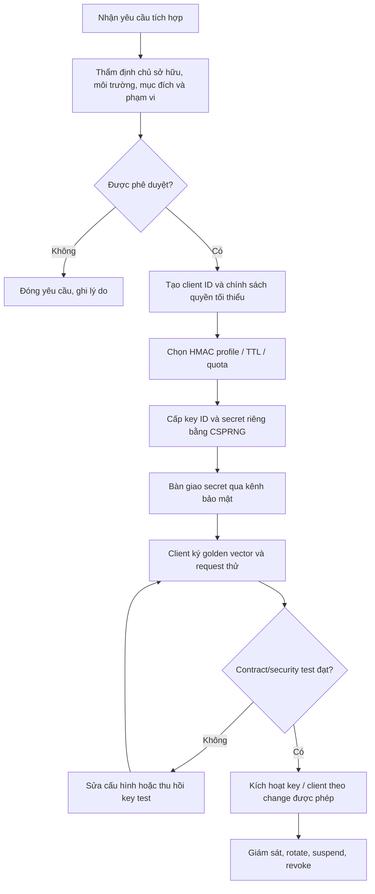

# Đăng ký client cho HMAC Request Authentication

## 1. Đăng ký client là bước vận hành gì?

Trong dịch vụ `SECURITY_AUTHENTICATION_HMAC_REQUEST_AUTHENTICATION`, một **client** là ứng dụng hoặc hệ thống bên ngoài cần gửi HTTP request đã ký bằng **HMAC với shared secret**. Server kiểm tra chữ ký trên canonical request, thường bao gồm method, URI/query, một tập header và/hoặc body digest theo hợp đồng. Server còn kiểm tra timestamp và nonce để chống replay, xử lý key rotation, bảo đảm proxy/gateway không làm lệch dữ liệu được ký và tách riêng **xác thực** khỏi **phân quyền**.

**Đăng ký client (client registration/onboarding)** là quy trình tạo một danh tính tích hợp được quản lý, xác định chủ sở hữu và quyền được đề nghị, gắn chính sách chữ ký, phát hành credential, bàn giao bí mật an toàn, xác nhận khả năng tương thích rồi mới cho phép client truy cập môi trường cần thiết. Đây là hoạt động kéo dài qua cả vòng đời của một tích hợp: sau khi kích hoạt vẫn phải theo dõi, xoay khóa, giới hạn phạm vi, tạm ngừng hoặc thu hồi.

Ví dụ một đối tác vận chuyển muốn gọi `POST /v1/shipments` để tạo vận đơn. Việc họ gửi được HMAC đúng chứng minh request đến từ bên có secret và những byte được ký không bị đổi. Điều đó **chưa chứng minh** đối tác có quyền tạo vận đơn cho mọi tenant hay đọc dữ liệu của đối tác khác. Quyền thao tác phải được quản lý riêng theo principal, tenant, operation và resource.

Mục tiêu của bài này là thiết kế một quy trình **Operations** có thể thực thi, kiểm tra và truy vết, từ yêu cầu đăng ký đến xác nhận client hoạt động an toàn.

## 2. Những khái niệm phải tách bạch ngay từ đầu

| Thành phần | Chức năng | Sai lầm thường gặp |
| --- | --- | --- |
| **Client ID** | Định danh tích hợp, ví dụ `logistics-partner-a`; thường có thể xuất hiện trong audit/management API. | Coi client ID tự khai là bằng chứng đã xác thực. |
| **Key ID** (`kid`) | Định danh public của một secret cụ thể để server tra cứu; một client có thể có nhiều key trong lúc rotation. | Dùng key ID như mật khẩu hoặc cho phép key ID từ tenant khác ánh xạ sai principal. |
| **Shared secret** | Byte bí mật dùng làm key HMAC; phải được giữ kín ở cả signer và verifier/key store. | Lưu plaintext trong Git, ticket, log, URL, chat hay chia sẻ cùng một secret cho nhiều client. |
| **Signature contract/profile** | Phiên bản quy định thuật toán HMAC, canonicalization, signed fields, digest, encoding và định dạng signature. | Tự cho phép mọi thuật toán do client gửi hoặc sửa contract mà không thay version. |
| **Principal** | Danh tính server thiết lập **sau khi HMAC hợp lệ** và kiểm tra credential. | Dùng tên tenant từ header chưa ký để quyết định danh tính đã xác thực. |
| **Authorization policy** | Danh sách thao tác, tenant, resource, quota hoặc hạn chế mạng được phép. | Cấp tất cả quyền chỉ vì client có credential hợp lệ. |
| **Replay state** | Trạng thái nonce đã sử dụng trong cửa sổ thời gian. | Coi timestamp hợp lệ là đủ; bỏ qua nonce hoặc chỉ lưu nonce trên từng replica. |
| **Registration record** | Metadata quản lý chủ sở hữu, trạng thái, credential tham chiếu và lịch sử phê duyệt. | Nhúng toàn bộ shared secret vào bản ghi metadata có thể đọc rộng rãi. |

Mỗi môi trường `dev`, `staging`, `production` nên có **định danh và credential tách biệt**, policy rõ ràng và secret độc lập. Việc client hoạt động ở staging không mặc nhiên cho phép cùng key dùng trong production.

## 3. Quy trình đăng ký client từ yêu cầu đến kích hoạt



### Bước 1 — Thu thập yêu cầu và xác minh chủ sở hữu

Hồ sơ onboarding tối thiểu nên bao gồm: tên tích hợp, **đơn vị/người chịu trách nhiệm**, môi trường, hệ thống nguồn, mục đích xử lý dữ liệu, endpoint/HTTP method cần gọi, tenant được phục vụ, lưu lượng dự kiến, đầu mối nhận sự cố và quy trình thu hồi khẩn cấp. Xác minh rằng người yêu cầu có quyền đại diện cho bên tích hợp và có kênh nhận credential đã được phê duyệt.

Đặt **một client ID cho một phạm vi tin cậy rõ ràng**: một workload/ứng dụng hoặc một tổ chức tích hợp theo kiến trúc đã chọn. Không tái sử dụng client ID giữa hai pháp nhân/tenant không cùng quyền quản lý chỉ để giảm số lượng bản ghi. Khi một đối tác có nhiều workload hoặc ranh giới trách nhiệm khác nhau, tách client/credential giúp thu hồi và điều tra chính xác hơn.

### Bước 2 — Phê duyệt phạm vi và nguyên tắc quyền tối thiểu

Đội sở hữu API và đội phụ trách bảo mật/credential phê duyệt **các operation thực sự cần**. Ví dụ client giao vận chỉ cần `shipment:create` cho tenant `tenant-alpha`, không mặc định có `shipment:read-all`, quyền thay đổi policy, hoặc quyền truy cập tenant `tenant-beta`.

Nếu có hạn chế IP, mạng, thời gian hoặc quota, hãy xem chúng là **kiểm soát bổ sung**. Chúng không thay thế việc xác minh MAC và kiểm tra authorization. Đặc biệt, không lấy `X-Client-Id` hoặc `X-Tenant-Id` do request chưa xác thực khai báo làm danh tính đáng tin để cấp phép.

### Bước 3 — Chọn và cố định hợp đồng ký

Hai phía phải thống nhất một **signature profile được đánh version**, chẳng hạn `hmac-v1` dùng `HmacSHA256`, trước khi phát hành client. Hợp đồng cần mô tả chính xác:

1. **Request-target:** method, path gốc hay path sau gateway, quy tắc percent-encoding, sắp xếp query và xử lý tham số trùng.
2. **Signed headers:** danh sách tên header bắt buộc, thứ tự, cách chuẩn hóa case/whitespace, cách xử lý header bị lặp. Header có tác động đến định tuyến, tenant, loại body hoặc phân quyền cần được bảo vệ theo thiết kế.
3. **Body:** body bytes nào được hash, có/không giải nén, biểu diễn digest (hex/Base64), cách ký body rỗng, cách xử lý request streaming.
4. **Thời gian và nonce:** đơn vị timestamp (ví dụ Unix seconds), sai lệch đồng hồ cho phép, format và entropy nonce, phạm vi uniqueness, cách xác định TTL replay store.
5. **MAC:** thuật toán chính xác, cách encode secret/signature, tag length, canonical byte encoding, dấu xuống dòng và domain separator/version.
6. **Lỗi và giới hạn:** header thiếu/sai, chữ ký không khớp, replay, key bị revoke, version không hỗ trợ, body quá lớn và response semantics.

Đính kèm **golden vectors** độc lập: input HTTP/byte body, canonical bytes, body digest và signature kỳ vọng. Không xem “cùng trả về 401” là bằng chứng hai bên canonicalize giống nhau; phía client phải đối chiếu từng byte trước khi mở production.

### Bước 4 — Cấp phát key và lưu bí mật đúng nơi

Server hoặc hệ thống cấp phát credential được ủy quyền phải sinh **secret riêng cho từng client/key** bằng bộ sinh ngẫu nhiên mật mã (CSPRNG); với HMAC-SHA-256, ví dụ một secret 32 byte ngẫu nhiên (256 bit) là lựa chọn thích hợp. Không dùng tên công ty, UUID có thể đoán, timestamp, mật khẩu do con người đặt hoặc `java.util.Random` làm HMAC secret.

Ví dụ Java tạo secret dùng cho **thành phần cấp phát credential được tin cậy**:

```java
import java.security.SecureRandom;
import java.util.Base64;

public final class HmacSecretGenerator {
    private static final SecureRandom RANDOM = new SecureRandom();

    public static byte[] generateKeyBytes() {
        byte[] key = new byte[32]; // 256 bit
        RANDOM.nextBytes(key);
        return key;
    }

    public static String encodeForSecureDelivery(byte[] key) {
        // Chỉ encode để truyền/lưu trong secret manager; Base64 không mã hóa bảo mật.
        return Base64.getUrlEncoder().withoutPadding().encodeToString(key);
    }
}
```

Trong quy trình cấp phát thực tế, tạo key ID riêng và lưu secret trong **secret manager/KMS hoặc kho khóa được kiểm soát truy cập**, tham chiếu bằng `secretRef`; không in secret ra console và không ghi vào audit event. Đảm bảo chỉ dịch vụ verifier có quyền đọc secret tương ứng. Nếu định dạng secret ở wire là Base64url, cả hai phía phải **decode về cùng 32 byte** trước khi dùng `Mac.init(...)`; không vô tình dùng UTF-8 của chuỗi Base64 làm key.

Khóa được gửi cho client **qua kênh bàn giao được xác thực, mã hóa và giới hạn người nhận**. Một thiết kế thường cho phép client nhận secret **một lần** khi cấp phát hoặc thông qua cơ chế xuất secret có kiểm soát; tránh cho quản trị viên xem lại plaintext bằng API thông thường. Nếu bên nhận làm mất secret, nên cấp lại key mới, thu hồi key cũ theo chính sách thay vì tạo chức năng “xem lại” tràn lan.

### Bước 5 — Kiểm tra kỹ thuật trước khi kích hoạt production

Trên staging, client phải tự tạo chữ ký bằng secret test, đi qua **đường truy cập thực tế** có load balancer/gateway nếu production dùng gateway, rồi xác minh kết quả. Kiểm tra ít nhất: MAC đúng; MAC sai; body bị sửa; timestamp cũ/tương lai; nonce replay; header bị lặp; query/path có percent-encoding; key ID không thuộc client; profile không được phép; quyền tenant không đúng. Kiểm tra mốc rate limit và kích thước body/header trước khi cho client gửi tải thực.

Chỉ sau khi xác nhận client đáp ứng canonical contract và policy quyền, credential của môi trường tương ứng mới được **activate**. Phân biệt việc cho phép client authenticated với việc cho phép một API operation cụ thể.

## 4. Registration record mẫu và trạng thái vòng đời

Một registry có thể biểu diễn **metadata không chứa plaintext secret** như sau. Đây là **schema minh họa**, không phải format bắt buộc hay cấu hình sẵn có của Spring Security:

```yaml
clientId: logistics-partner-a
environment: production
ownerTeam: integration-operations
ownerContactRef: internal-directory:partner-a-owner
tenantBinding: tenant-alpha
status: ACTIVE
registeredAt: 2026-11-28T00:00:00Z
approvedScopes:
  - shipment:create
allowedResources:
  - /v1/shipments
signaturePolicy:
  allowedProfiles:
    - hmac-v1
  allowedAlgorithms:
    - HmacSHA256
  timestampSkewSeconds: 300
  nonceMinEntropyBits: 128
  replayScope: authenticated-principal
  bodyMaxBytes: 1048576
  clientQuotaRef: quota/partner-a
keys:
  - keyId: partner-a-2026-01
    secretRef: secrets/prod/hmac/partner-a-2026-01
    state: ACTIVE
    notBefore: 2026-11-28T00:00:00Z
    expiresAt: 2027-02-28T00:00:00Z
approvalRef: change/EXAMPLE-1234
```

Các mốc ngày, endpoint, scope, quota và tên key trên chỉ để làm rõ mô hình. **Thời hạn key và ngưỡng timestamp thực tế phải được định nghĩa trong chính sách của dịch vụ**; không lấy các số trong ví dụ làm chuẩn mặc định.

### 4.1. Trạng thái client và key phải được quản lý riêng

| Đối tượng | Trạng thái | Ý nghĩa |
| --- | --- | --- |
| Client | `PENDING_APPROVAL` | Chưa được phép nhận credential production hoặc thực hiện operation. |
| Client | `REGISTERED` | Metadata đã tạo, còn chờ provision hoặc conformance test. |
| Client | `ACTIVE` | Có thể được xác thực nếu có key active và policy cho phép. |
| Client | `SUSPENDED` | Tạm khóa do sự cố, vi phạm quota hoặc yêu cầu nghiệp vụ. |
| Client | `REVOKED` | Không còn được phép truy cập; phục hồi cần quy trình phê duyệt/cấp lại riêng. |
| Key | `STAGED` | Key đã phát hành để chuẩn bị xoay, chưa được phép verify ở production hoặc chưa đến `notBefore`. |
| Key | `ACTIVE` | Key nằm trong cửa sổ hiệu lực và được phép verify theo profile. |
| Key | `RETIRING` | Key cũ được nhận trong cửa sổ overlap có hạn để client chuyển sang key mới. |
| Key | `EXPIRED` / `REVOKED` | Không được dùng xác thực; `REVOKED` cũng có thể xảy ra trước ngày hết hạn. |

Lưu ý: `REGISTERED` hoặc `ACTIVE` là trạng thái của **client**; chúng không tự khiến mọi key của client hợp lệ. Điều kiện nhận request là client hoạt động, key hoạt động/được phép trong khoảng thời gian, version và thuật toán được cho phép, signature đúng, timestamp/nonce đúng và không có ràng buộc bổ sung bị vi phạm.

### 4.2. Ràng buộc key ID → principal phải do server kiểm soát

Hệ thống xác minh cần tra record theo key ID đã giới hạn độ dài và format, lấy **client/principal thật** từ registry hoặc key store, sau đó đối chiếu các trường do request khai báo với bản ghi có thẩm quyền. Nếu một client gửi `X-Client-Id: partner-b` nhưng ký bằng secret của partner A, request không được trở thành principal B. Không dùng secret “dùng chung toàn hệ thống” hoặc tự chấp nhận key trùng với nhiều principal; như vậy audit và thu hồi trở nên mơ hồ.

## 5. Minh họa handshake của client mới đăng ký

Giả sử `hmac-v1` đã quy định header `X-HMAC-Key-Id`, `X-HMAC-Version`, `X-HMAC-Timestamp`, `X-HMAC-Nonce`, `X-Content-SHA256` và `X-HMAC-Signature`. Request có dạng:

```http
POST /v1/shipments HTTP/1.1
Host: api.example.test
Content-Type: application/json
X-HMAC-Key-Id: partner-a-2026-01
X-HMAC-Version: hmac-v1
X-HMAC-Timestamp: <current-unix-seconds>
X-HMAC-Nonce: <fresh-random-nonce>
X-Content-SHA256: <sha256-of-exact-body-bytes>
X-HMAC-Signature: <base64url-hmac-of-canonical-request>

{"orderId":"example-123","addressId":"addr-test-1"}
```

Các giá trị trong dấu `<...>` là **placeholder**, không phải request đã ký hợp lệ. Để tính signature, client phải lấy byte body đúng như gửi, băm theo profile, dựng canonical request từ những trường hợp đồng quy định, rồi tính HMAC bằng secret đã decode. Signature không được tính trên JSON object sau khi serialize khác nhau giữa client và server, cũng không được bỏ các header quan trọng theo ngữ nghĩa mà contract yêu cầu ký.

Khi nhận request, verifier có thể thực hiện chuỗi bước sau:

```text
1. Giới hạn kích thước method/path/query/header/body, parse format và version.
2. Tra key ID có giới hạn; lấy principal, key state và policy từ registry.
3. Kiểm tra key/profile/client còn được phép và timestamp trong cửa sổ.
4. Tính lại body digest, dựng canonical bytes của đúng profile.
5. Tính HMAC và so sánh MAC byte với hàm constant-time.
6. Chỉ sau khi MAC hợp lệ, ghi nonce atomically vào replay store dùng chung.
7. Tạo authenticated principal và đưa vào lớp authorization.
8. Kiểm tra operation, resource, tenant và quota; sau đó mới xử lý nghiệp vụ.
```

Đây là **luồng khái niệm**, thứ tự tối ưu cụ thể tùy vào giải pháp gateway, Servlet hoặc WebFlux. Không cho phép yêu cầu dùng `HmacSHA1` hay tên thuật toán tùy ý từ header nếu chưa có trong allowlist. MAC sai không được thử secret của tất cả client, thử nhiều profile để “cứu” request hoặc ghi nhận nonce như đã dùng. Việc ghi nonce atomically cần bao trùm các replica; TTL phải bao phủ toàn bộ cửa sổ còn có thể chấp nhận timestamp. Nếu key store hoặc nonce store thiết yếu bị lỗi, xác thực phải xử lý theo policy fail-closed đã công bố.

### Định nghĩa rõ phản hồi cho client

| Điều kiện | Kết quả gợi ý | Lưu ý |
| --- | --- | --- |
| Chữ ký thiếu/sai, credential revoke, key/profile bị cấm | `401 Unauthorized` hoặc mã authentication được API quy định | Trả lỗi nhất quán, tránh tiết lộ key ID tồn tại hay không. |
| Principal đã xác thực nhưng thiếu quyền tenant/operation | `403 Forbidden` | Không đánh đồng authentication với authorization. |
| Request sai cú pháp HTTP/header cơ bản hoặc tham số vượt format | `400 Bad Request` | Có thể bị gateway từ chối sớm. |
| Body vượt giới hạn đã công bố | `413 Content Too Large` | Cần giới hạn cả byte sau giải nén nếu hệ thống hỗ trợ nén. |
| Vượt quota/giới hạn tốc độ | `429 Too Many Requests` | Phân biệt quota theo nguồn trước xác thực với quota theo principal sau xác thực. |
| Secret provider/nonce store thiết yếu không khả dụng | Phản hồi lỗi có kiểm soát theo thiết kế, thường `503 Service Unavailable` | **Không** coi request đã authenticated; trả code cụ thể theo API contract. |

Không gửi lại shared secret, canonical request chứa dữ liệu nhạy cảm, full MAC hay thông tin nội bộ của key store trong body phản hồi lỗi.

## 6. Contract test và security test trước khi bàn giao

Những test dưới đây là **điều kiện chấp nhận đăng ký**, có thể dùng trong CI với fixed clock và test secret, rồi kiểm tra end-to-end qua gateway trước khi chuyển sang production:

| ID | Kịch bản | Kỳ vọng |
| --- | --- | --- |
| C01 | Client đã đăng ký, key active, MAC đúng, nonce mới, timestamp hợp lệ | Được authenticated thành **đúng principal** đã bind với key. |
| C02 | Đổi 1 byte body nhưng giữ `X-Content-SHA256`/signature cũ | Từ chối xác thực vì body digest/chữ ký không hợp lệ. |
| C03 | Đổi method, path, query hoặc một header nằm trong signed fields | Từ chối chữ ký cũ; không có bypass do canonicalization. |
| C04 | Đảo thứ tự query, percent-encoding, duplicate query/header | Kết quả theo **quy tắc profile** đã công bố, không tùy framework. |
| C05 | Key ID chưa tồn tại hoặc key không thuộc client khai báo | Từ chối; không lộ danh tính/key qua thông báo khác biệt quá mức. |
| C06 | Client `SUSPENDED`, key `EXPIRED` hoặc `REVOKED` với MAC đúng | Từ chối theo state/policy ngay cả khi tính toán MAC thành công. |
| C07 | Timestamp quá cũ/tương lai hoặc ở đúng biên clock skew | Từ chối/chấp nhận theo hợp đồng bằng clock kiểm soát được. |
| C08 | Phát lại **cùng request ký hợp lệ** 2 lần | Tối đa một lần authenticated trong replay window. |
| C09 | 32 request cùng nonce đến nhiều replica đồng thời | Replay store ghi atomically; không nhiều request cùng được xác thực. |
| C10 | Gửi MAC hợp lệ theo profile không được allowlist cho key | Từ chối, không tự downgrade hoặc fallback algorithm. |
| C11 | Client A có MAC đúng nhưng truy cập tài nguyên tenant B | Authentication cho A, authorization từ chối resource B. |
| C12 | Tách tenant bằng header do request gửi | Không thể đổi tenant bằng header chưa được MAC bảo vệ hoặc chưa đối chiếu policy. |
| C13 | Thử request sau proxy/gateway thay đổi path/query/header/body | Hai phía ký/xác minh cùng canonical bytes hoặc từ chối theo contract. |
| C14 | Rotation có key cũ và mới cùng active trong overlap | Cả hai theo chính sách tạm thời được verify; sau retirement key cũ bị từ chối. |
| C15 | Không có nonce store hoặc key provider khi xử lý request | Không có request sai nào được coi authenticated; có lỗi/metric kiểm soát. |
| C16 | Header/query/body quá lớn, key ID ngẫu nhiên với tải giới hạn | Có rate/size bounds, không làm tăng cache và tài nguyên vô hạn. |

Test C08/C09 phải dùng **MAC đúng**; nếu dùng chữ ký giả, verifier từ chối từ bước MAC trước khi tới nonce và test sẽ không chứng minh replay protection. Test C11 dùng cả authentication assertion và authorization assertion để bảo đảm `403` không bị hiểu nhầm là lỗi HMAC. Khi đo tải, giữ nhóm traffic hợp lệ làm đối chứng và chỉ thực hiện trên môi trường được phép.

### Mẫu biên bản kích hoạt

```text
Client ID: logistics-partner-a
Environment: staging / production (chọn một)
Owner/approver: <directory-ref-and-approval-id>
Tenant & scopes: tenant-alpha / shipment:create
Signature profile: hmac-v1 / HmacSHA256
Key ID: partner-a-2026-01
Secret location: <secret-manager-reference-only>
Credential delivery: <secure-channel-and-recipient-confirmation>
Golden vector: PASS / FAIL
Gateway contract test: PASS / FAIL
Nonce/replay & timestamp test: PASS / FAIL
Authorization isolation: PASS / FAIL
Activation timestamp: <utc-time>
Rotation/revocation contact: <on-call-or-owner-ref>
Change/audit ID: <ticket-or-change-id>
```

Biên bản tuyệt đối không lưu **plaintext shared secret**; chỉ tham chiếu an toàn và bằng chứng phê duyệt/kiểm thử.

## 7. Vận hành sau đăng ký: rotation, suspension, revocation

### 7.1. Key rotation có giai đoạn overlap được giới hạn

Một lần xoay key không nên yêu cầu dừng toàn bộ client nếu hệ thống hỗ trợ nhiều key ID cho cùng principal. Quy trình điển hình:

1. Sinh secret mới với `keyId` mới, lưu ở secret manager; chưa tự động thay đổi quyền đã phê duyệt.
2. Phê duyệt cửa sổ overlap và thời điểm ngừng key cũ, kiểm tra profile/version cho key mới.
3. Bàn giao key mới qua kênh bảo mật; client triển khai signer mới và thử trên staging.
4. Kích hoạt key mới; trong cửa sổ overlap, verifier chỉ chấp nhận **hai key cụ thể** được policy cho phép.
5. Theo dõi traffic theo key ID đã phân loại, kiểm tra request ký bằng key mới đi qua gateway và quyền tenant đúng.
6. Đưa key cũ về `RETIRING`, hết overlap chuyển `REVOKED`/`EXPIRED`; thử bằng **MAC cũ đúng** để chứng minh bị chặn.
7. Cập nhật audit và dọn tham chiếu secret theo retention policy; không xóa dữ liệu cần điều tra trước mốc lưu giữ.

**Không** để verifier thử lần lượt toàn bộ secret để tìm một MAC khớp: vừa khuếch đại chi phí vừa gây lỗi bind principal, làm khó chặn key đã revoke. Key ID được dùng để tra đúng record, rồi kiểm tra trạng thái, profile, principal và MAC một cách nhất quán.

### 7.2. Tạm khóa và thu hồi

Nếu phát hiện credential lộ, client bị xâm nhập hoặc đơn vị đối tác kết thúc hợp đồng, vận hành cần có chức năng **suspend/revoke ngay**. Khi suspend, client không được authenticated dù signature có thể đúng. Khi revoke key, request dùng key đó bị từ chối trên **mọi replica**; cache cần có thời hạn/phương thức invalidation phù hợp để quyết định thu hồi phát huy hiệu lực trong thời gian công bố.

Trong sự cố lộ secret, cần đánh giá thêm khả năng attacker đã tạo **request hợp lệ có nonce riêng** trước lúc khóa, truy vết theo principal/key ID và correlation ID, điều tra side effect nghiệp vụ, rotate credential và yêu cầu đối tác sửa nguyên nhân lộ. **Không** sửa status trở lại `ACTIVE` chỉ bằng một thao tác đơn giản nếu key đã bị đánh dấu compromised; cấp lại key mới sau thẩm định.

### 7.3. Replay store và quota vận hành

Nonce cần đủ khó đoán và duy nhất theo hợp đồng, ví dụ ít nhất 128 bit entropy. Lưu trạng thái đã sử dụng trong kho dùng chung có thao tác ghi **nguyên tử** (`SET ... NX EX ...` hoặc cơ chế tương đương), với namespace thống nhất theo principal và chính sách chuyển key/profile. TTL không được ngắn hơn khoảng mà timestamp còn được chấp nhận, kể cả sai lệch clock hai phía.

Chỉ ghi nonce sau khi MAC được xác minh, nếu không request giả có thể chiếm nonce hợp lệ. Rate limit cần kết hợp **giới hạn theo nguồn trước xác thực** và **quota theo principal sau xác thực**; key ID trước xác thực có thể bị giả để làm cạn quota của người khác. Theo dõi memory/eviction của replay store, key lookup, timeouts và hành vi fail-closed.

## 8. Quan sát, hỗ trợ tích hợp và điều tra lỗi

Dashboard cho một client nên có số request theo version/key state, tỷ lệ accepted/rejected, loại lỗi hữu hạn (`bad_mac`, `expired`, `replay`, `key_revoked`, `profile_denied`, `authorization_denied`), p95/p99, rate-limit, độ trễ key store và nonce store. Hạn chế cardinality metric: không dùng raw nonce, signature, toàn bộ query hoặc client-provided key ID chưa kiểm tra làm label không giới hạn. Không ghi secret hoặc body nhạy cảm vào log.

Nếu client báo nhiều `401`, điều tra theo thứ tự đủ cụ thể để tránh vô tình mở bảo mật:

1. Kiểm tra trạng thái client/key, version được phép, hiệu lực `notBefore/expiresAt` và clock skew.
2. Xác nhận client decode đúng secret được cấp, dùng đúng key ID và đúng thuật toán theo profile.
3. So sánh body digest và **canonical bytes** trên fixture không nhạy cảm, gồm method, URI/query, signed headers, dấu xuống dòng và percent-encoding.
4. Kiểm tra gateway có rewrite path/host/header hoặc thay đổi body trước khi verifier nhận dữ liệu không.
5. Phân biệt `bad_mac`, `expired`, `replay` với `403 authorization_denied`: không nới whitelist tenant chỉ để giảm `401`.
6. Kiểm tra key lookup cache, nonce store, quota và metric; lỗi hạ tầng không được tạo đường cho phép authentication khi chưa xác minh đủ.

Hệ thống cần runbook hỗ trợ riêng cho lỗi “client ký đúng trên máy cục bộ nhưng sai sau gateway”, vì cùng tên path/header có thể bị proxy chuẩn hóa khác đi. Sửa hợp đồng hoặc vị trí xác minh có kiểm soát; không vô tình chấp nhận nhiều biến thể canonical không được đặc tả.

## 9. Các lỗi thiết kế khi đăng ký client

| Anti-pattern | Hậu quả | Điều chỉnh |
| --- | --- | --- |
| Cấp một shared secret cho tất cả partner | Lộ một secret ảnh hưởng mọi client, không thu hồi theo chủ thể. | Credential riêng theo client và key ID riêng. |
| Gửi secret qua ticket/email nhóm/log | Bí mật lan rộng ngoài đối tượng được phép. | Kênh bàn giao có xác thực, mã hóa, giới hạn quyền và audit. |
| Xem đăng ký thành công nghĩa là full access | Client mới có thể đọc/sửa dữ liệu ngoài phạm vi. | Authorization policy theo tenant/resource/scope. |
| Cho phép client tự chọn mọi algorithm/profile | Nguy cơ downgrade/algorithm confusion. | Allowlist profile theo key/principal, MAC ràng buộc version. |
| Chỉ kiểm tra MAC, bỏ timestamp/nonce | Request hợp lệ có thể bị phát lại. | Timestamp window + atomic replay prevention. |
| Xác định tenant từ header không ký | Attacker đổi tenant mà chữ ký vẫn hợp lệ. | Bind tenant vào principal và bảo vệ field ảnh hưởng quyết định. |
| Kích hoạt production trước khi qua gateway test | Request thật bị từ chối do khác canonicalization, hoặc có bypass. | Golden vector và end-to-end test. |
| Mất key thì “đọc lại” plaintext từ registry | Tăng diện lộ bí mật và khó audit. | Re-issue/rotate theo quy trình, secret manager kiểm soát. |
| Cache key bị revoke vô hạn | Client bị thu hồi vẫn có thể được xác thực trên node cũ. | Expiry/invalidation và revoke test toàn cụm. |
| Dùng `401` để đại diện cả lỗi phân quyền | Điều tra sai và dễ mở rộng quyền nhầm. | Tách authentication result và authorization result. |

## 10. Tình huống thực hành: onboard một đối tác vận chuyển

Một đối tác mới cần gọi API tạo vận đơn cho duy nhất `tenant-alpha`. API nằm sau gateway và có ba replica. Đội Operations cần:

1. Ghi rõ owner, môi trường staging/production, danh sách method/path và scope `shipment:create`. Phê duyệt tenant và quota.
2. Tạo client ID và key ID riêng, phát hành secret 32 byte bằng CSPRNG, lưu secret trong kho được bảo vệ. Bàn giao cho đối tác qua kênh đã xác thực.
3. Công bố profile HMAC có method/path/query, các header cần ký, body digest, timestamp, nonce và golden vectors. Yêu cầu client chứng minh signer khớp vector.
4. Kiểm thử tích hợp qua gateway với body JSON: gửi request đúng, sửa byte body, đổi query và lặp nonce. Xác nhận `bad_mac`/`replay` không tạo principal.
5. Gửi request đã ký đúng nhưng truy cập tenant khác: authentication có thể hợp lệ, nhưng authorization phải chặn và không có side effect.
6. Sau khi đủ điều kiện, kích hoạt client/key production. Theo dõi lỗi theo profile/key state mà không thu thập raw signature/secret.
7. Lập lịch key rotation, diễn tập revoke với MAC cũ đúng trên nhiều replica và kiểm tra chính sách cache invalidation.

**Câu hỏi tự đánh giá:** Nếu `X-HMAC-Key-Id` trỏ đến secret của A nhưng request tự khai `X-Client-Id: B`, server nên tạo principal nào? Vì sao chỉ kiểm tra HMAC mà bỏ nonce chưa đủ? Key rotation khác việc cấp thêm quyền API ở điểm nào? Khi proxy thay đổi `%2F` trong path, bạn cần đối chiếu dữ liệu nào trước khi điều chỉnh verifier?

## 11. Checklist trước khi đóng hồ sơ đăng ký

- [ ] Danh tính client và chủ sở hữu đã được kiểm tra, có contact xử lý sự cố và audit/approval ID.
- [ ] Môi trường, tenant, endpoint và permission scope tuân thủ quyền tối thiểu.
- [ ] Mỗi key ID gắn đúng client/principal; secret được tạo bằng CSPRNG và lưu/bàn giao an toàn.
- [ ] Signature profile được cố định theo version, có canonical contract và golden vectors.
- [ ] Client đã kiểm chứng method, URI/query, signed headers và body digest qua đường gateway thực.
- [ ] Server từ chối MAC sai, key lạ/revoked, timestamp không hợp lệ, replay và version không được phép.
- [ ] Nonce store dùng chung có thao tác nguyên tử và TTL phù hợp; hạ tầng lỗi không làm fail-open.
- [ ] Authorization được kiểm thử độc lập với authentication, gồm trường hợp khác tenant/resource.
- [ ] Có giới hạn kích thước/rate và quota trước/sau xác thực, không lộ secret trong log/metrics.
- [ ] Credential production chỉ được activate sau khi test đạt và có kế hoạch rotation/revocation.
- [ ] Hồ sơ có bằng chứng bàn giao, cấu hình, người phê duyệt, thời điểm hiệu lực và kết quả nghiệm thu.

Đăng ký client tốt tạo ra một **danh tính có thể quản lý và thu hồi**, một **hợp đồng HMAC có thể kiểm thử** và một **chính sách quyền có thể giải thích**. Chữ ký hợp lệ chỉ là một phần của quá trình: an toàn vận hành còn phụ thuộc vào secret lifecycle, chống replay, xử lý gateway, bảo vệ tài nguyên và khả năng ứng phó sự cố.
