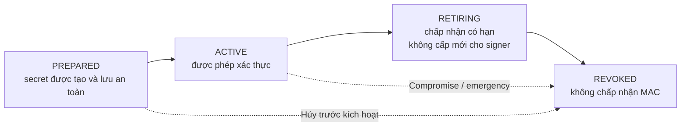
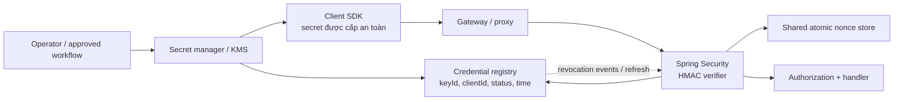
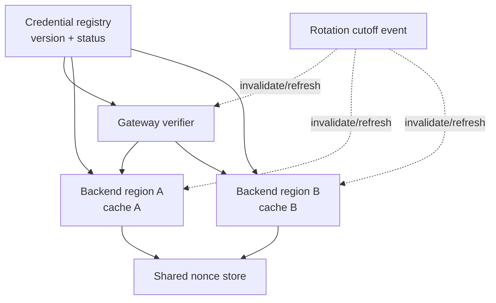

# Rotate secret: vận hành xoay shared secret cho xác thực HTTP request bằng HMAC

## 1. Mục tiêu: thay credential mà không tạo lỗ hổng hoặc gián đoạn ngoài dự kiến

Trong module `SECURITY_AUTHENTICATION_HMAC_REQUEST_AUTHENTICATION`, mỗi HTTP request được client ký bằng **HMAC** sử dụng shared secret; server dựng **canonical request** theo hợp đồng, thường bảo vệ method, URI/query, một số header và body hoặc body digest, sau đó so chữ ký. Hệ thống còn phải chống replay bằng timestamp/nonce, quản lý phiên bản khóa, xử lý gateway/proxy và **phân biệt authentication với authorization**.

Giả sử đối tác `partner-fulfillment` ký request với key `fulfillment-2026a`. Secret hiện tại đã được dùng lâu và sắp hết hạn theo chính sách. Đội vận hành cần cấp secret mới `fulfillment-2026b`, giúp đối tác chuyển đổi có kiểm soát và **ngừng chấp nhận secret cũ tại một thời điểm xác định**. Nếu tắt khóa cũ quá sớm, đối tác bị `401` hàng loạt. Nếu giữ khóa cũ vô thời hạn, “đã xoay khóa” chỉ có nghĩa là thêm một secret mới, chứ chưa giảm nguy cơ của credential cũ.

**Rotate secret** là quy trình vận hành trọn vòng đời credential: chuẩn bị, sinh/phân phối secret mới, kích hoạt, chuyển lưu lượng, kết thúc overlap, thu hồi khóa cũ, xác minh và lưu bằng chứng. Nó **không** chỉ là đổi biến môi trường rồi restart dịch vụ.

Bài thuộc chương **Operations**, tập trung vào hành động vận hành, kiểm soát thay đổi, trách nhiệm phối hợp và tiêu chí xác minh secret rotation an toàn trên hệ thống HMAC đang phục vụ request thực.

Sau bài học, bạn có thể:

- Thiết kế trạng thái **PREPARED → ACTIVE → RETIRING → REVOKED** và overlap có hạn.
- Phân biệt rotation dự kiến với thu hồi khẩn cấp khi nghi compromise.
- Gắn `key ID` với **đúng một version của secret**, client/tenant và policy server đáng tin.
- Bảo vệ key ID, timestamp, nonce, method/URI và body integrity trong canonical request.
- Xây runbook cho client SDK, secret manager, Spring MVC/WebFlux, gateway và nhiều vùng triển khai.
- Kiểm thử cutoff, cache invalidation, nonce replay xuyên các key versions, lỗi dependency và authorization.
- Đặt telemetry/audit và tiêu chí hoàn thành: **secret cũ thật sự không còn được chấp nhận**.

## 2. Phân biệt những đối tượng thường bị gọi chung là “khóa”

| Khái niệm | Ví dụ | Chức năng | Có phải danh tính đã xác thực không? |
| --- | --- | --- | --- |
| `client ID` | `partner-fulfillment` | Định danh ứng dụng đã đăng ký sau verify | Có, **sau MAC hợp lệ** |
| `tenant ID` | `tenant-b` | Phạm vi dữ liệu/tổ chức từ registry | Không tự cấp quyền |
| `key ID` | `fulfillment-2026b` | Tìm đúng key version | **Không** khi mới đọc header |
| `shared secret` | 256-bit random bytes | Vật liệu mật mã để tạo/verify HMAC | Không được lộ hoặc log |
| `algorithm suite` | `HmacSHA256` | Xác định phép MAC và yêu cầu đầu ra | Không |
| `canonical contract version` | `HMAC-REQ-V2` | Quy định chính xác bytes được ký | Không |
| `X-Timestamp`, `X-Nonce` | Thời gian ký và số ngẫu nhiên một lần | Chống phát lại, phải được MAC bảo vệ | Không thay principal |
| `idempotency key` | `transfer-req-17` | Tránh lặp side effect của một ý định nghiệp vụ | Không thay nonce |

**Rotation của secret khác nâng cấp thuật toán**: cùng `HmacSHA256` và cùng hợp đồng canonical request, hai key `2026a` và `2026b` có thể cùng tồn tại trong một cửa sổ migration. Đổi từ `HmacSHA1` sang `HmacSHA256` là **algorithm agility**; có thể kết hợp với secret rotation nhưng cần policy và test riêng. Đổi cách chuẩn hóa URI/query hoặc signed headers cũng là thay đổi contract riêng.

Key ID là **public lookup hint**, không cần được giữ bí mật như shared secret, nhưng cũng không được dùng để suy ra client đã xác thực hay quyền. Một kẻ tấn công có thể tự điền `X-Key-Id: fulfillment-2026b` mà không biết secret.

## 3. Hai kiểu xoay secret cần runbook khác nhau

### 3.1. Rotation định kỳ

Áp dụng khi secret sắp tới hạn, chính sách yêu cầu đổi định kỳ hoặc tổ chức muốn giảm thời gian phơi nhiễm credential. Mục tiêu: **không gián đoạn không cần thiết**; có thể chuẩn bị secret mới, cấp cho client qua kênh được bảo vệ, cho phép overlap ngắn và khóa cũ ngừng có hiệu lực đúng cutoff.

### 3.2. Emergency rotation / revocation

Áp dụng khi có bằng chứng hoặc nghi ngờ hợp lý shared secret đã bị lộ, tài khoản quản lý key bị xâm nhập, một hệ thống bị chiếm quyền hoặc một key được dùng ký request trái phép. Mục tiêu ưu tiên: **chặn sử dụng credential có rủi ro**. Có thể **không cho overlap** hoặc rút ngắn thời gian thay đổi, chấp nhận gián đoạn có kiểm soát và kích hoạt incident response.

| Quyết định | Rotation định kỳ | Emergency |
| --- | --- | --- |
| Chuẩn bị client | Có lịch và cảnh báo trước | Càng sớm càng tốt; thông báo an toàn |
| Overlap hai key | Có thể, theo cutoff | Không mặc định; đánh giá rủi ro |
| Thu hồi key cũ | Sau khi chuyển đổi và xác minh | Có thể **ngay lập tức** |
| Khóa key cũ trong cache | Invalidate tại cutoff | Invalidate khẩn, fail closed khi không chắc policy |
| Business continuity | Rollout theo canary/đối tác | Containment các route nhạy cảm nếu cần |
| Điều tra | Lưu audit của quá trình thay đổi | Bảo toàn forensic evidence và đánh giá tác động |

Không được dùng một runbook “đợi mọi client chuyển xong mới revoke” cho trường hợp key đã bị lộ nghiêm trọng. Ngược lại, thu hồi đồng loạt không cần thiết trong rotation định kỳ có thể gây outage cho các đối tác chưa nhận secret mới.

## 4. Vòng đời một key version



| Trạng thái | Có thể cung cấp cho client để bắt đầu ký? | Backend verify request mới? |
| --- | --- | --- |
| `PREPARED` | Chỉ khi quy trình phân phối/activation cho phép; chưa dùng để ký trên production | **Không** trước activation |
| `ACTIVE` | Có, theo client/key policy | Có, nếu trong effective window |
| `RETIRING` | Không khuyến khích bắt đầu dùng mới | Có **đến cutoff**, nếu policy cho phép |
| `REVOKED` | Không | **Không**, dù MAC toán học đúng |

Thực tế có thể tách trạng thái **primary signing key** phía client khỏi trạng thái **accepted verification keys** phía server. Trong một overlap, server chấp nhận hai key versions, còn client nên chủ động chuyển sang **một key mới làm primary**. Một key có thể chuyển trực tiếp từ `ACTIVE` sang `REVOKED` khi có sự cố.

**Thời điểm kiểm tra là thời điểm xác thực theo clock server**, không dựa vào timestamp client tự gửi để kéo dài hiệu lực khóa. Request được ký trước cutoff nhưng đến sau cutoff thường phải bị từ chối theo policy hiện hành; nếu cần ngoại lệ in-flight, phải định nghĩa rõ thời hạn và rủi ro.

## 5. Trust boundary và kiến trúc luân chuyển



Các trách nhiệm phải rõ:

1. **Secret manager**: sinh/nhận secret theo quy trình được phê duyệt, lưu dạng có bảo vệ, truy cập tối thiểu, ghi nhận ai tạo/đọc/thu hồi. Nếu key chỉ dùng được trong một HSM/provider non-exportable, signer/verifier phải tích hợp API/provider phù hợp; không mặc định mọi key có thể export thành bytes.
2. **Credential registry**: ánh xạ `key ID → key version + client/tenant + allowed algorithm + status/effective window`, không để client tự cung cấp metadata này.
3. **Client SDK/partner**: chọn key mới đã được cấp, ký request theo canonical contract, tạo timestamp/nonce mới cho mỗi attempt theo hợp đồng.
4. **Gateway**: giữ các thành phần đã ký nhất quán hoặc verify trước rewrite; không chèn/sửa bằng chứng HMAC sau khi client ký.
5. **Backend verifier**: chỉ tra **key ID được khai báo**, kiểm tra status và MAC; không thử mọi secret còn lưu để “cứu” request.
6. **Nonce store**: lưu dấu đã dùng bằng thao tác nguyên tử, chia sẻ giữa các điểm xác thực có thể nhận cùng request.
7. **Security audit**: ghi nhận kết quả xác thực và sự kiện rotation, không lộ secret hoặc full signature.

Tổ chức có thể đặt verify tại gateway hoặc backend. Nếu gateway verify rồi chuyển identity, backend chỉ được tin assertion nội bộ qua mTLS hoặc cơ chế xác thực bảo vệ tương đương; gateway phải xóa header “verified client” tự khai từ Internet.

## 6. Key ID, MAC và canonical request phải được ràng buộc

Hợp đồng ký minh họa cho request tạo đơn:

```http
POST /integrations/orders?source=partner HTTP/1.1
Host: api.example.test
Content-Type: application/json
X-Key-Id: fulfillment-2026b
X-Timestamp: 2026-11-28T03:15:00Z
X-Nonce: nonce-sample-0000001
X-Signature: <base64-hmac-sha256>

{"orderId":"O-17","amount":125000}
```

Ví dụ canonical bytes dùng UTF-8 với các dòng phân cách LF, không có LF cuối:

```text
HMAC-REQ-V2
POST
/integrations/orders?source=partner
x-key-id:fulfillment-2026b
x-timestamp:2026-11-28T03:15:00Z
x-nonce:nonce-sample-0000001
content-type:application/json
sha256-body:<lowercase-hex-digest-of-body-bytes>
```

Đây là **hợp đồng ứng dụng minh họa**, không phải định dạng HMAC chung cho mọi API. Phải quy định chính xác signed header order, duplicate headers, OWS, URI/query encoding, digest body, content type, cách encode signature và cách proxy xử lý. Những giá trị `<...>` là placeholder, không phải credential sử dụng được.

Tại rotation, key ID `fulfillment-2026a` và `fulfillment-2026b` phải tương ứng **hai secret khác nhau**. Khi client ký bằng secret A, thay `X-Key-Id` thành B **mà không ký lại** phải bị từ chối. Kể cả khi secret A/B bị cấu hình trùng ngoài ý muốn, hợp đồng **ký cả key ID** giúp ngăn tráo định danh version bằng cách sửa header đơn giản; tuy nhiên, tránh reuse secret giữa versions ngay từ đầu.

Các yêu cầu không thay đổi do rotation:

- MAC vẫn phải bảo vệ method, URI/query, signed headers và body đúng contract.
- Timestamp và nonce vẫn **nằm trong MAC**, không được coi là dữ liệu unsigned.
- `X-Signature` là kết quả HMAC, không tự đưa vào input của phép tính.
- Không dùng `X-Key-Id` hoặc `X-Client-Id` làm principal trước khi MAC và key status hợp lệ.
- Không fallback sang secret cũ khi signature theo key ID mới bị sai.

## 7. Sinh secret mới an toàn

Một secret HMAC phải có **entropy đủ mạnh**. Với `HmacSHA256`, 32 byte (256 bit) ngẫu nhiên từ CSPRNG là lựa chọn thông dụng; không tạo secret bằng mật khẩu dễ đoán, ngày tháng, UUID ghép thủ công hoặc hash của một ID công khai.

Một ví dụ Java chỉ để minh họa cách lấy byte từ CSPRNG:

```java
import java.security.SecureRandom;
import java.util.Arrays;

byte[] candidate = new byte[32];
new SecureRandom().nextBytes(candidate);

// Chuyển candidate vào kho bí mật qua API được cấp quyền, có kiểm toán.
// Không log hoặc đưa vào source control.
try {
    secretProvisioner.storeNewVersion("fulfillment-2026b", candidate);
} finally {
    Arrays.fill(candidate, (byte) 0);
}
```

`secretProvisioner` là abstraction do ứng dụng/vận hành thiết kế, **không phải API Java/Spring mặc định**. Trong vận hành thực, nên để secret manager/KMS có chức năng sinh key ở đúng môi trường quản lý bí mật nếu khả dụng. Xóa `candidate` chỉ giảm lưu giữ một bản sao trong bộ nhớ ứng dụng; nó **không bảo đảm** JVM, provider, serializer hoặc secret manager đã xóa toàn bộ bản sao.

**Không tạo secret mới ở mỗi lần restart backend.** Credential phải có identity/version và lifecycle ổn định qua các instance; nếu thay ngẫu nhiên trên từng pod, client sẽ ký bằng một key không tồn tại ở pod khác.

### 7.1. Phân phối secret tới client

Secret mới nên được cấp qua kênh quản lý credential đã xác thực và bảo vệ, chẳng hạn portal tích hợp có MFA, API provisioning được ủy quyền, secret manager giữa những hệ thống tin cậy hoặc quy trình an toàn tương đương. Khi tổ chức cho phép hiển thị secret một lần, phải có cơ chế phục hồi bằng **tạo key version mới**, không gửi secret vào email/chat không được bảo vệ.

Cần ghi audit ai/ứng dụng nào được cấp key, thời điểm, client ID đích và key ID, **không** ghi nguyên secret. Không đặt secret trong URL/query, ticket, CI logs, commit, container image, metric labels hay tracing baggage. Áp dụng quyền tối thiểu và phân tách trách nhiệm giữa người yêu cầu, người phê duyệt và người thực thi theo mức rủi ro.

### 7.2. Secret storage và mã hóa

Lưu secret theo policy của hệ thống quản lý bí mật, mã hóa khi lưu và truyền, giới hạn quyền read/verify, có audit truy cập và kế hoạch backup/restore. Nếu backend cần raw key để tính `Mac`, phải có quyền truy cập key material qua kênh bảo vệ; nếu dùng HSM/non-exportable key, cần provider cho phép tính MAC mà không export secret. **Không đưa raw key material vào Redis nonce store** hay cấu hình gateway không được kiểm soát.

## 8. Planned rotation: quy trình zero-downtime có giới hạn

Lộ trình tham khảo:

```text
T-14 ngày: Inventory, thông báo đối tác, xác định deadline
T-7  ngày: Tạo key mới PREPARED, phân phối an toàn, chạy contract tests
T-5  ngày: Activate v2, kiểm thử canary, backend dual-accept v1/v2
T-3  ngày: Client chuyển primary signer sang v2, theo dõi auth success
T     ngày: Cutoff v1: RETIRING -> REVOKED theo policy
T+1  ngày: E2E test chặn v1, kiểm tra log/metric, loại cache cũ
Sau đó: Cleanup secret material theo retention và change record
```

Các mốc là **lịch giả định**; độ dài overlap phụ thuộc yêu cầu thực tế, khả năng cập nhật SDK, mức độ rủi ro và hợp đồng hỗ trợ. Không có thời gian overlap chuẩn bắt buộc cho mọi hệ thống.

### Bước 1 — Inventory và phân tích phụ thuộc

Xác định client/tenant, key IDs đang hoạt động, application owners, SDK versions, endpoints, HMAC verifier tại gateway/backend, môi trường và vùng triển khai. Tìm đường bypass như webhook adapter, batch job, legacy filter hoặc failover region; một route quên cập nhật có thể vẫn chấp nhận key cũ.

Quan sát từ **audit đã xác thực** để biết client nào còn sử dụng version cũ. Đừng coi mọi request tự khai `X-Key-Id` là traffic hợp lệ của client đó.

### Bước 2 — Phê duyệt và chuẩn bị

Tạo change record: mục tiêu rotation, thời điểm activation/cutoff theo UTC, người duyệt, người triển khai, mức tác động dự kiến, phương án rollback an toàn, thông báo client và tiêu chí xác nhận thành công. Sinh **secret khác** cho key ID mới, đăng ký metadata và lưu ở secret manager.

Đồng bộ key metadata qua các region. Key PREPARED chưa được verify trong production trước thời điểm activation; test canary có thể dùng môi trường test hoặc route/đối tác có chính sách đã phê duyệt.

### Bước 3 — Activate key mới trước khi chuyển client

Server bật verify cho key mới ở trạng thái `ACTIVE` trong phạm vi client/policy được phép. **Đừng bắt đầu cho SDK ký bằng key mới khi backend chưa thể nhận nó** ở mọi điểm ingress dự kiến.

Ở giai đoạn này, server có thể chấp nhận key A `RETIRING` và B `ACTIVE`; không có nghĩa server “thử A rồi B”. Mỗi request mang đúng một key ID, verifier tra đúng version và tính MAC duy nhất cho version đó.

### Bước 4 — Chuyển signer phía client

Đối tác/SDK chuyển **primary signing key** sang key mới. Mỗi HTTP attempt phải sinh timestamp/nonce theo hợp đồng, dựng canonical request và ký bằng secret tương ứng với `X-Key-Id` hiện tại. Cần kiểm thử thực tế qua gateway đối với cả API GET và POST/body có payload.

Khi retry sau timeout, không phát lại nguyên request đã ký nếu anti-replay yêu cầu nonce mới; hãy tạo timestamp/nonce/MAC mới và dùng **idempotency key** để tránh tạo nghiệp vụ trùng khi API hỗ trợ.

### Bước 5 — Theo dõi chuyển đổi và quyết định cutoff

Theo dõi số request **xác thực thành công** bằng key cũ/mới, tỉ lệ `401`, `MAC_MISMATCH`, `KEY_UNUSABLE`, `TIMESTAMP_INVALID`, `NONCE_REPLAY`, latency của key registry/nonce store và lỗi `5xx`. Trước cutoff, đối chiếu client còn phụ thuộc key cũ và liên hệ đúng chủ sở hữu.

Không kéo dài overlap vô thời hạn vì “chưa thấy lỗi”. Nếu phải gia hạn, yêu cầu phê duyệt, thời điểm hết hạn mới và lý do; ghi vào audit.

### Bước 6 — Revoke key cũ

Tại cutoff theo **clock server**, đổi key cũ thành `REVOKED` và/hoặc áp dụng `acceptedUntil` không còn hiệu lực. Bảo đảm gateway, backend, cache và mọi region đã nhận chính sách. **MAC HMAC của key cũ dù đúng về mặt toán học vẫn phải bị từ chối.**

Không xóa secret ngay trước khi bảo đảm mọi dependency/caching paths đã được xử lý; nhưng không được coi việc còn giữ secret để lưu trữ/audit là lý do để tiếp tục accept nó.

### Bước 7 — Xác minh, cleanup và đóng change

Thử chủ động key cũ đã có chữ ký đúng qua từng ingress path: phải nhận lỗi xác thực; key mới hợp lệ tiếp tục thành công. Kiểm tra cache invalidation, audit, retry behavior và side effects. Xóa/hủy key material theo chính sách retention/forensics và đóng change record với bằng chứng xác minh.

## 9. Emergency rotation: ưu tiên containment, không giữ overlap theo quán tính

Khi secret nghi lộ, thứ tự thực thi phải gắn với mức độ rủi ro và khả năng thay thế credential:

1. **Kích hoạt incident response**, xác định client/key/route/tenant có nguy cơ, đóng băng bằng chứng và phân công người quyết định.
2. **Chặn credential nghi lộ** ở điểm verify đáng tin; revoke ngay khi đánh giá yêu cầu, có thể tạm ngừng endpoint nhạy cảm thay vì chấp nhận request dùng key cũ.
3. **Kiểm soát mọi vùng/gateway**: cập nhật policy và vô hiệu hóa đường backend trực tiếp có thể bypass. Nếu không thể xác nhận trạng thái key từ registry, phải fail closed.
4. **Cấp secret mới qua kênh bảo vệ riêng**; không đặt secret mới vào cùng kênh/thiết bị vừa bị nghi xâm nhập mà chưa xử lý nguyên nhân.
5. **Khôi phục client và nghiệp vụ có kiểm soát**, dùng key mới, bảo đảm nonce store và idempotency hoạt động.
6. **Điều tra audit/side effects**: credential bị lộ có thể cho phép attacker ký **request mới có nonce mới**, không chỉ replay request cũ.
7. **Theo dõi và hậu kiểm**: xác nhận key cũ bị từ chối, điều tra dấu hiệu lộ key tiếp diễn và tài liệu hóa nguyên nhân gốc.

Nếu khóa bị lộ, **rotation không chữa được hệ thống phát hành key đang bị xâm nhập**. Phải khắc phục kênh provisioning, quyền đọc secret, host, SDK hoặc CI secrets bị lộ; nếu không, secret mới cũng có thể bị đánh cắp.

Mọi ngoại lệ “cho phép key cũ thêm vài giờ” trong trường hợp compromise cần được đội bảo mật phê duyệt rõ, giới hạn theo key/client/route và có cutoff bắt buộc. Không bật một cờ `skipHmac=true` để cứu SLA.

## 10. Data model cho credential lifecycle

Một bản ghi metadata phía server có thể có:

```yaml
clientId: partner-fulfillment
tenantId: tenant-b
keyVersions:
  - keyId: fulfillment-2026a
    algorithm: HmacSHA256
    status: RETIRING
    notBefore: "2026-01-01T00:00:00Z"
    acceptedUntil: "2026-12-05T00:00:00Z"
    secretRef: "secret-manager://hmac/fulfillment/2026a"
  - keyId: fulfillment-2026b
    algorithm: HmacSHA256
    status: ACTIVE
    notBefore: "2026-11-28T00:00:00Z"
    acceptedUntil: "2027-12-05T00:00:00Z"
    secretRef: "secret-manager://hmac/fulfillment/2026b"
```

Đây là **YAML minh họa một mô hình cấu hình nội bộ**, không phải định dạng chuẩn của Spring Security. `secretRef` chỉ là URI giả, **không chứa raw secret**. Trong hệ thống thật, lưu metadata và key reference trong kho được bảo vệ, có consistency/versioning, approval và audit.

Những bất biến cần áp dụng:

- Key ID là **duy nhất trong scope registry**; không tái sử dụng một ID cho secret mới.
- Một key version xác định rõ algorithm suite, client/tenant, effective window và trạng thái.
- `PREPARED` hoặc `REVOKED` không thể verify.
- `RETIRING` có thời hạn chấp nhận; server chặn sau cutoff.
- Registry/cache không được trả secret của version khác khi key ID thiếu hoặc sai.
- Trạng thái `REVOKED` phải chiếm ưu tiên so với timestamp cũ hay cache chứa material cũ.
- Secret và access policy không nên được đẩy sang những nơi không cần biết nó.

**Không nhầm key ID, client ID và tenant ID**. Hai key IDs có thể cùng thuộc một client đang rotation; sau khi MAC hợp lệ, principal vẫn có cùng client ID và tenant theo registry hiện hành. Một header `X-Client-Id` tự khai không thay thế việc tra registry đáng tin.

## 11. Java: một policy gate không phụ thuộc MAC calculation

Thiết kế quan trọng là kiểm tra key lifecycle **trước** khi dùng nó để xác minh HMAC. Ví dụ Java 17:

```java
import java.time.Instant;
import javax.crypto.SecretKey;

public enum KeyLifecycle {
    PREPARED,
    ACTIVE,
    RETIRING,
    REVOKED
}

public record HmacKeyVersion(
        String keyId,
        String clientId,
        String tenantId,
        String algorithm,
        KeyLifecycle lifecycle,
        Instant notBefore,
        Instant acceptedUntil,
        SecretKey secretKey) {

    public boolean canVerifyAt(Instant now) {
        boolean allowedState = lifecycle == KeyLifecycle.ACTIVE
                || lifecycle == KeyLifecycle.RETIRING;
        return allowedState
                && !now.isBefore(notBefore)
                && now.isBefore(acceptedUntil);
    }
}
```

`acceptedUntil` có semantics **exclusive**: tại đúng mốc cutoff, secret cũ **không còn được phép dùng**. `now` phải lấy từ server clock kiểm soát được. Ví dụ dùng `SecretKey` để tránh đặt raw secret dưới dạng `String`; object key và provider vẫn có vòng đời bộ nhớ cần quản lý. Trong production, validate tất cả metadata ở constructor/policy loader, không cho state lạ hoặc `null` phá logic.

Việc gọi `canVerifyAt` trên metadata **cũ trong cache** không bảo đảm đã thấy revoke mới nhất. Registry phải có chính sách consistency, TTL/invalidation và hành vi khi mất kết nối đáp ứng yêu cầu thu hồi, đặc biệt khi compromise.

### 11.1. Verifier dùng đúng một key version

```java
import java.security.GeneralSecurityException;
import java.security.MessageDigest;
import java.time.Clock;
import java.time.Instant;
import java.util.Base64;
import javax.crypto.Mac;
import org.springframework.security.authentication.BadCredentialsException;

public final class RotatingHmacVerifier {
    private final HmacKeyRegistry registry;
    private final HmacCanonicalizer canonicalizer;
    private final HmacReplayGuard replayGuard;
    private final Clock clock;

    public RotatingHmacVerifier(
            HmacKeyRegistry registry,
            HmacCanonicalizer canonicalizer,
            HmacReplayGuard replayGuard,
            Clock clock) {
        this.registry = registry;
        this.canonicalizer = canonicalizer;
        this.replayGuard = replayGuard;
        this.clock = clock;
    }

    public VerifiedClient verify(HmacEvidence evidence) {
        // Parser ở HTTP boundary phải kiểm tra header single-valued,
        // required fields, size/encoding và signature format.
        Instant now = clock.instant();
        HmacKeyVersion key = registry.findCurrent(evidence.keyId())
                .orElseThrow(() -> new BadCredentialsException(
                        "Invalid HMAC credentials"));

        if (!key.canVerifyAt(now)
                || !"HmacSHA256".equals(key.algorithm())) {
            throw new BadCredentialsException(
                    "Invalid HMAC credentials");
        }

        final byte[] received;
        try {
            received = Base64.getDecoder().decode(
                    evidence.signatureBase64());
        } catch (IllegalArgumentException ex) {
            throw new BadCredentialsException(
                    "Invalid HMAC credentials");
        }
        if (received.length != 32) {
            throw new BadCredentialsException(
                    "Invalid HMAC credentials");
        }

        // Chỉ encoder phía server dựng canonical bytes từ request thật.
        // keyId, timestamp, nonce, method, URI, signed headers/body
        // phải được ràng buộc đúng HMAC contract.
        byte[] canonical = canonicalizer.encode(evidence);
        final byte[] expected;
        try {
            Mac mac = Mac.getInstance("HmacSHA256");
            mac.init(key.secretKey());
            expected = mac.doFinal(canonical);
        } catch (GeneralSecurityException ex) {
            throw new HmacCryptoUnavailableException(
                    "HMAC provider failed", ex);
        }
        if (!MessageDigest.isEqual(expected, received)) {
            throw new BadCredentialsException(
                    "Invalid HMAC credentials");
        }

        // Đã có bằng chứng sở hữu secret của đúng key version;
        // phải kiểm tra timestamp và claim nonce trước side effect.
        VerifiedClient client =
                new VerifiedClient(key.clientId(), key.tenantId());
        replayGuard.checkAndClaim(
                client.clientId(), evidence.timestamp(), evidence.nonce(), now);
        return client;
    }
}
```

Đây là ví dụ **định hướng kiến trúc**, cần các interface ứng dụng `HmacKeyRegistry`, `HmacCanonicalizer`, `HmacReplayGuard`, `HmacEvidence`, `VerifiedClient` và exception hạ tầng tương ứng. Không phải code độc lập để copy vào production. `registry.findCurrent` phải đọc **policy/key metadata hiện hành** theo consistency đã thiết kế, không âm thầm dùng snapshot cũ sau revoke.

Các chốt bảo mật trong ví dụ:

1. `evidence.keyId()` là lookup hint; chỉ chọn **một** key version. Không thử secret cũ nếu MAC với ID đã khai không khớp.
2. `key.canVerifyAt(now)` chặn PREPARED/REVOKED và request quá cutoff, **trước tính MAC**.
3. Tính HMAC bằng `Mac` cục bộ cho lần verify, không chia sẻ mutable `Mac` giữa threads.
4. Dùng `MessageDigest.isEqual` so bytes; signature Base64 phải decode đúng 32 bytes cho HMAC-SHA-256 đầy đủ.
5. Dựng canonical từ request thật theo hợp đồng; không nhận canonical string tự khai từ client.
6. MAC đúng **chưa đủ**: timestamp và atomic nonce claim vẫn cần đạt.
7. Registry/nonce store unavailable hoặc crypto provider lỗi → **fail closed** và lỗi server phù hợp, không coi như credentials hợp lệ.

Nếu algorithm agility yêu cầu nhiều suite, phải dùng **enum allowlist + key-suite binding**; không truyền trực tiếp `X-Algorithm` tùy ý vào `Mac.getInstance(...)`. Rotation secret **không phải cơ chế nâng cấp thuật toán ngầm**.

## 12. Khóa cũ và khóa mới không được tạo hai replay namespaces ngoài ý định

Một lỗi thường gặp khi key rotation:

```text
nonceKey = keyId + ":" + nonce

Request A: keyId=fulfillment-2026a, nonce=N -> CLAIMED
Request B: keyId=fulfillment-2026b, nonce=N -> CLAIMED tiếp
```

Nếu hợp đồng yêu cầu nonce **duy nhất theo client** xuyên các key versions, key replay theo `keyId + nonce` đã chia một miền bảo vệ thành hai. Hãy chọn scope bằng **verified client ID + nonce** (và namespace API/tenant khi contract cho phép), chỉ sau MAC đúng. Nonce phải là giá trị đủ entropy; **retry ký mới** phải tạo nonce mới theo chính sách.

Một thiết kế logic:

```text
replayReference = HMAC-SHA256(
    replayNamespaceKey,
    lengthPrefix(verifiedClientId) || lengthPrefix(nonce)
)

atomicInsertIfAbsent(replayReference, expiresAt)
```

`replayNamespaceKey` khác shared secret ký HTTP và được bảo vệ riêng. `lengthPrefix` biểu diễn độ dài rõ ràng để không có ambiguity khi ghép field. Không dùng raw nonce/client ID làm metric labels. Việc rotate namespace key cũng phải có **kế hoạch dual-lookup/transition an toàn** nếu còn nonce chưa hết hạn; không tự đổi HMAC reference key rồi quên toàn bộ replay history.

### 12.1. TTL và timestamp khi nhiều key versions cùng hợp lệ

Nếu request được phép khi `abs(serverNow - signedTimestamp) <= allowedSkew`, nonce marker phải tồn tại cho tới khi timestamp đó **không còn được chấp nhận**. TTL đặt từ lần claim đầu thường cần bao phủ gần `2 * allowedSkew + margin` trong trường hợp request đầu đến sớm, hoặc có thể tính expiry theo `signedTimestamp + allowedSkew + margin` với clock semantics được kiểm tra.

Key rotation **không cho phép** tắt nonce store hoặc xóa dấu nonce cũ. Request cũ đã được ký có thể còn nằm trong freshness window sau khi key mới được kích hoạt. Nếu key A bị revoke thì nó không được verify nữa, nhưng nonce marker của các request hợp lệ khác vẫn phải được giữ theo policy để tránh mở lỗ hổng chéo key/version.

### 12.2. In-flight request và idempotency

Trong overlap, client có thể retry một thao tác đang xử lý bằng key B sau khi lần đầu gửi bằng key A. Nó phải tạo timestamp/nonce và MAC mới cho attempt mới; **idempotency key** của ý định nghiệp vụ có thể giữ nguyên theo API contract. Đừng dùng nonce làm business idempotency key: chức năng, vòng đời và TTL khác nhau.

Nếu request đã có side effect nhưng client không nhận response, việc cho phép key B ký lại không có nghĩa phải thực thi nghiệp vụ lần thứ hai. Cần unique business constraint/idempotency ledger độc lập với HMAC.

## 13. Multi-instance, cache và propagation của revocation

Một quy trình đổi registry từ `RETIRING` sang `REVOKED` chỉ có ý nghĩa nếu **mọi điểm xác minh** áp dụng trạng thái đó:



Các failure mode:

- **Cache TTL dài** khiến một pod tiếp tục dùng key revoked.
- **Invalidation event bị mất** tại một vùng hoặc failover backend.
- **Gateway và backend dùng cấu hình khác**: gateway chặn key A nhưng backend direct route vẫn chấp nhận.
- **Registry read replica trễ** khiến trạng thái key bị thay đổi không đồng bộ.
- **Rollback deployment** mang theo snapshot key/policy cũ.
- **Secret material cũ còn trong connection pool, thread-local hoặc crypto object cache**; dù policy đổi, một nhánh code không tra trạng thái mới vẫn verify được.

Yêu cầu vận hành:

1. Định nghĩa **mức độ nhất quán revocation** cần đạt: đồng bộ mạnh, bounded staleness hoặc hạn chế lưu lượng khi không đạt. Với compromise nghiêm trọng, không được tiếp tục tin cache có thể đã lỗi thời.
2. Ghi policy version/updatedAt trong audit; kiểm tra từng ingress instance thực sự áp dụng version mới.
3. Cài invalidation/refresh và health check phù hợp; thử restart/failover trong test.
4. Khi không thể xác nhận key đang được phép sử dụng, **fail closed** theo chính sách, không fallback sang secret cũ.
5. Có đường thử chủ động với **legacy valid MAC** qua tất cả region để chứng minh cutoff thật sự hiệu lực.

Không dùng `ThreadLocal<Mac>` hoặc keyed `Mac` pool giữ vĩnh viễn key A để tối ưu hiệu năng: `Mac.reset()` không xóa secret khỏi object và không quyết định key còn hợp lệ. Nếu reuse được cân nhắc, mọi phép verify vẫn phải áp dụng lifecycle policy và quản lý bộ nhớ/retention.

## 14. Spring MVC và Spring WebFlux khi rotate secret

| Khía cạnh | Spring MVC | Spring WebFlux |
| --- | --- | --- |
| Vị trí xác thực | `OncePerRequestFilter`, `AuthenticationManager`/`AuthenticationProvider` | `AuthenticationWebFilter`, `ReactiveAuthenticationManager` |
| Key lookup | Thường synchronous/blocking theo driver | Ưu tiên non-blocking/reactive key store client |
| Phép tính HMAC | `Mac` cục bộ trong phép verify | `Mac` cục bộ trong reactive stage, không share giữa subscriptions |
| Replay claim | Atomic repository operation, timeout rõ | Publisher cho atomic claim, không `block()` event-loop |
| Security context | `SecurityContextHolder` sau verify | `ReactiveSecurityContextHolder` sau verify |
| Cache invalidation | Pod/thread-safe refresh theo chính sách | Tương tự, tránh state bị gắn nhầm giữa các subscriptions |
| Test HTTP | `MockMvc` với filters thật | `WebTestClient` với reactive security chain |

### 14.1. Thứ tự xác thực phải đúng

Ở cả MVC và WebFlux:

1. Parse, validate header `X-Key-Id`/`X-Signature` đúng một giá trị, chống duplicate và injection.
2. Tra registry để biết key version có trong accepted window, không bị revoke.
3. Dựng canonical bytes từ request thật theo contract, tính/so MAC.
4. Kiểm tra timestamp/nonce chống replay và claim nguyên tử.
5. **Chỉ sau đó** tạo authenticated principal/authorities; chuyển tới authorization/controller.

Không đặt `SecurityContext` dựa trên `X-Client-Id`, `X-Key-Id` hay `X-Verified-Client` chưa được bảo vệ. Rotation không làm thay đổi quyền: một client có hai key active vẫn chỉ có những authorities được policy server cấp.

### 14.2. Đừng đóng băng key material trong filter singleton

Một `@Component` hoặc `SecurityFilterChain` được tạo lúc startup không nên giữ một `SecretKey` cố định vô hạn rồi giả định rotation sẽ tự có hiệu lực. Chỉ cache theo **bounded lifecycle policy**, có refresh/invalidation và test khi key bị revoke. Ngay cả khi hai keys cùng accepted, mỗi request cần xác định key ID từ evidence để tra đúng version.

Với WebFlux, tránh `subscribe()` thủ công trong `WebFilter` hoặc dùng `onErrorReturn(true)` khi nonce store lỗi: điều đó có thể đưa request chưa xác thực vào controller. Security decision phải là một phần của reactive chain và **hoàn tất trước business work**.

## 15. Gateway/proxy: rotation không sửa lỗi canonicalization

Ví dụ client ký external path:

```text
POST /public-api/orders?source=partner
X-Key-Id: fulfillment-2026b
```

Gateway rewrite:

```text
POST /integrations/orders?source=partner
X-Key-Id: fulfillment-2026b
```

Nếu server verify trên internal path nhưng client ký external path, chữ ký sẽ sai **dù secret mới được phân phối đúng**. Triệu chứng có thể giống lỗi rotation: `401 MAC_MISMATCH` tăng khi chuyển key. Không nên rollback key cũ hoặc bỏ URI khỏi chữ ký để “sửa” mismatch.

Checklist E2E khi rotate:

- Server/client đồng ý **đúng canonical contract version** và thời điểm verify.
- Gateway không thay giá trị signed `X-Key-Id`, timestamp, nonce, `Content-Type` hoặc body digest theo contract.
- Nếu rewrite raw path/Host/authority, có trust boundary và representation thống nhất.
- HTTP/1.1 `Connection`/hop-by-hop header có thể làm mất `X-Signature`; backend phải từ chối request thiếu evidence.
- HTTP/2/3 tên header lowercase/framing khác; không ký `Transfer-Encoding` hoặc hop-by-hop fields qua nhiều hop.
- Gateway nếu tự verify phải tuân thủ trạng thái key và cutoff giống backend; internal identity assertion được bảo vệ.

Một request đã ký đúng với key B ở test unit **chưa chứng minh** backend qua gateway nhận và xác minh đúng bytes.

## 16. Error semantics trong giai đoạn rotation

| Trạng thái request | Response thường dùng | Audit reason gợi ý |
| --- | --- | --- |
| Key ID không tồn tại hoặc revoked | `401 Unauthorized` | `KEY_UNUSABLE` (nội bộ) |
| Key A đã cutoff dù MAC đúng với secret A | `401` | `KEY_RETIRED` |
| Key B active nhưng chữ ký được tính bằng secret A | `401` | `MAC_MISMATCH` |
| Signature malformed hoặc header duplicate | `401` theo HMAC credential contract, hoặc HTTP `400` ở parser | `MALFORMED_EVIDENCE` |
| Timestamp ngoài window hoặc nonce replay | `401` | `TIMESTAMP_INVALID` / `NONCE_REPLAY` |
| HMAC đúng với key B nhưng thiếu `ORDER_CREATE` | `403 Forbidden` | `AUTHZ_DENIED` |
| HMAC đúng nhưng truy cập tenant khác | `403` hoặc `404` theo policy | `TENANT_DENIED` |
| Key registry/nonce store không khả dụng | Lỗi server phù hợp, thường `503` | `DEPENDENCY_ERROR` |
| Rate limit do thử key ID hàng loạt | `429 Too Many Requests` | `RATE_LIMITED` |

Phản hồi công khai nên tránh tiết lộ key có tồn tại hay không. Ví dụ các lỗi credentials có thể trả cùng `INVALID_REQUEST_AUTHENTICATION` và request ID, trong khi reason chi tiết chỉ ở internal logs. Với `401`, ứng dụng cần tuân thủ HTTP authentication challenge `WWW-Authenticate` phù hợp scheme HMAC đã công bố; đừng vô tình trả `Bearer` cho endpoint chỉ hỗ trợ HMAC.

**Không đổi `401` thành `403`** chỉ vì client quen dùng key cũ: `403` dành cho request đã được xác thực nhưng thiếu quyền. Một key đã revoked không còn xác thực danh tính được.

## 17. Observability: đo thành công bằng điều đã được xác minh

Các chỉ báo hữu ích cho rotation:

| Tín hiệu | Metric/event minh họa | Câu hỏi vận hành |
| --- | --- | --- |
| Tổng attempts theo outcome | `hmac_auth_attempts_total` | Lưu lượng tổng thể có bị gián đoạn không? |
| Xác thực thành công sau rotation | Audit `hmac.auth.success` với verified key version | Đối tác đã thật sự dùng key mới chưa? |
| Chữ ký sai | `reason=mac_mismatch` | SDK, canonical bytes hay secret mới có lỗi? |
| Key cũ bị chặn | `reason=key_unusable` / `key_retired` | Cutoff có hoạt động không? |
| Timestamp/nonce | `timestamp_invalid` / `nonce_replay` | Client retry/clock có vấn đề không? |
| Registry/nonce store error | `hmac_auth_dependency_errors_total` | Availability có ảnh hưởng xác thực không? |
| Latency | `hmac_auth_verification_seconds` | Key lookup mới có làm tăng p95/p99 không? |
| Policy propagation | `policy_version` trong audit, config status | Mọi node đã nhận cutoff chưa? |

**Không đưa raw key ID, nonce, request ID, trace ID, chữ ký hay client ID của hàng nghìn đối tác vào Prometheus labels**: cardinality lớn và có thể lộ thông tin. Dùng `service`, `route template`, `outcome`, `reason`, `environment` và một số lifecycle labels hữu hạn. Muốn điều tra một đối tác cụ thể, truy vấn audit có phân quyền và chỉ dùng **verified client reference** sau khi MAC hợp lệ.

Với request MAC sai/unknown key, `X-Key-Id` chỉ là **presented key ID**, không chứng minh client sở hữu secret. Không tạo alert “đối tác A đang ký sai” chỉ dựa trên header tự khai; đối chiếu verified traffic, secret provisioning và thông tin hỗ trợ.

### 17.1. Một truy vấn PromQL tham khảo

```promql
sum by (service, environment, reason) (
  rate(hmac_auth_failures_total{
    environment="prod",
    reason=~"mac_mismatch|key_unusable|key_retired"
  }[5m])
)
```

Metric names phụ thuộc Micrometer/exporter thật; kiểm tra tên series trên production monitoring trước khi sử dụng. Truy vấn trên chỉ đo **failure rate**, không phải bằng chứng mọi client đã dùng key mới. Cần theo dõi verified key-version adoption qua audit hoặc báo cáo chuyên dụng có kiểm soát.

### 17.2. Cảnh báo thiết yếu tại cutoff

Tối thiểu nên cảnh báo khi: `401` tăng bất thường sau activation/cutoff, backend không đọc được key registry, nonce store lỗi, một instance vẫn **accept key revoked**, hoặc không có telemetry từ một vùng. “Không thấy lỗi key cũ” không có nghĩa là mọi ingress path đã chặn nó: phải có test chủ động.

## 18. Runbook ngắn cho người trực vận hành

| Pha | Ai chịu trách nhiệm | Hoạt động | Dấu hiệu đạt |
| --- | --- | --- | --- |
| Plan | Security owner + integration owner | Inventory, risk review, cutoff UTC, thông báo | Change được duyệt |
| Provision | Credential admin | Tạo key B khác A, đăng ký metadata, cấp secret | Secret không lộ, audit hợp lệ |
| Activate | API/security platform | Bật verify B ở đúng ingress, A còn trong overlap | Signed B request thành công |
| Migrate | Client/SDK owner | Chuyển primary signer sang B, test qua gateway | Verified success từ key B tăng |
| Observe | On-call/SRE | Theo dõi auth failures, nonce, dependency, route | Không có bất thường chưa giải thích |
| Cutoff | Security owner | Revoke A; invalidate caches/policy ở mọi vùng | MAC A đúng vẫn nhận `401` |
| Verify | QA/SRE | Kiểm tra A bị chặn, B vẫn pass, authz không đổi | E2E matrix PASS |
| Cleanup | Credential admin | Hủy material cũ theo retention, đóng change | Không có đường verify legacy |

### 18.1. Nếu key B không hoạt động

Phân tích **trước khi sửa**:

1. Key B đã ACTIVE trên đúng registry/region chưa?
2. Client có đang dùng **secret B với key ID B**, hay đổi header mà vẫn ký bằng A?
3. Canonical contract, body digest, path rewrite và header forwarding có khớp không?
4. Timestamp/nonce còn hợp lệ? Nonce store có lỗi?
5. Có lỗi caching/policy version của một số pods không?

Nếu đang **trước cutoff và không có compromise**, có thể giữ signer A thêm trong cửa sổ đã phê duyệt và sửa triển khai B. Sau cutoff, rollback cần đánh giá security, không bật lại key A bị revoked như một thao tác mặc định.

### 18.2. Nếu key A vẫn xác thực sau cutoff

Xem đây là **lỗi kiểm soát quan trọng**, không phải “tính năng giúp client cũ”. Khoanh vùng pod/region, registry snapshot, cache, đường backend trực tiếp và verifier legacy. Cần chặn acceptance trái policy, kiểm tra side effects, tăng mức độ cảnh báo theo rủi ro và lưu dấu cấu hình đã làm lộ đường bypass.

## 19. Kiểm thử rotation: các ca bắt buộc

| # | Kịch bản | Kết quả kỳ vọng | Điều cần assert |
| --- | --- | --- | --- |
| 1 | Key A ACTIVE, MAC A đúng | Auth success | Principal A đúng client/tenant |
| 2 | Key B PREPARED, MAC B đúng | `401` | Không dùng trước activation |
| 3 | B ACTIVE, MAC B đúng, nonce mới | Auth success | Principal/authorities không thay đổi |
| 4 | A RETIRING, trước cutoff, MAC A đúng | Có thể success theo policy | Overlap được kiểm soát |
| 5 | A đúng tại cutoff (exclusive), MAC A đúng | `401` | Chặn trước business side effect |
| 6 | A REVOKED, MAC A đúng, timestamp mới | `401` | Revocation thắng MAC validity |
| 7 | Header `X-Key-Id=B` nhưng signature ký A | `401` | Không fallback sang A |
| 8 | Header `X-Key-Id=A` nhưng signature ký B | `401` | Không thử B |
| 9 | Unknown key ID | `401` | Không default key, không key enumeration |
| 10 | Key ID thiếu/rỗng/duplicate | `401`/reject theo parser contract | Không chọn tùy ý first/last header |
| 11 | HMAC B đúng, timestamp hết hạn | `401` | Không bỏ freshness do migration |
| 12 | HMAC B đúng, nonce đã dùng | `401` | Không side effect lần hai |
| 13 | MAC A trước, MAC B sau dùng cùng nonce client | Theo replay scope contract; thường B bị chặn | Không reset replay history khi rotate |
| 14 | Hai instances đồng thời claim một nonce | Tối đa một thành công | Atomic store, không check-then-set |
| 15 | Key registry hoặc nonce store unavailable | `503`/server failure, fail closed | Không fallback A |
| 16 | B được xác thực nhưng thiếu `ORDER_CREATE` | `403` | Authentication khác authorization |
| 17 | B ký đúng nhưng truy cập tenant khác | `403/404` | Không truy cập cross-tenant |
| 18 | Client ký B qua gateway rewrite path | Thành công theo canonical contract hoặc reject đúng | Không nới lỏng MAC |
| 19 | B chưa được propagate tới region B | Canary phát hiện trước rollout toàn bộ | Không mở traffic sai |
| 20 | A đã REVOKED nhưng cache một node còn state cũ | Node phải reject theo consistency policy | Không bypass revocation |
| 21 | Gateway/legacy backend trực tiếp còn accept A | Không được | E2E toàn bộ ingress |
| 22 | Restart/scale up pod trong overlap/cutoff | Policy nhất quán | Không quay về cấu hình cũ |
| 23 | Retry ký mới B với cùng business idempotency key | HMAC hợp lệ, không nhân đôi nghiệp vụ | Idempotent side effects |
| 24 | Token/credential cũ xuất hiện trong logs | Không được | Redaction và quyền truy cập |

### 19.1. Unit test policy cutoff

Định nghĩa test time và hai key versions. Để đơn giản, dưới đây dùng `HmacKeyVersion` với `SecretKey` giả:

```java
import static org.junit.jupiter.api.Assertions.assertFalse;
import static org.junit.jupiter.api.Assertions.assertTrue;
import java.time.Instant;
import javax.crypto.spec.SecretKeySpec;
import org.junit.jupiter.api.Test;

class KeyRotationPolicyTest {
    static final Instant CUTOFF =
            Instant.parse("2026-12-05T00:00:00Z");

    @Test
    void retiringKeyStopsBeingAcceptedExactlyAtCutoff() {
        byte[] testBytes = new byte[32]; // Test fixture, không phải key thật
        var key = new HmacKeyVersion(
                "fulfillment-2026a",
                "partner-fulfillment",
                "tenant-b",
                "HmacSHA256",
                KeyLifecycle.RETIRING,
                Instant.parse("2026-01-01T00:00:00Z"),
                CUTOFF,
                new SecretKeySpec(testBytes, "HmacSHA256"));

        assertTrue(key.canVerifyAt(CUTOFF.minusNanos(1)));
        assertFalse(key.canVerifyAt(CUTOFF));
        assertFalse(key.canVerifyAt(CUTOFF.plusSeconds(1)));
    }

    @Test
    void revokedKeyIsRejectedEvenBeforeCutoff() {
        var key = new HmacKeyVersion(
                "fulfillment-2026a",
                "partner-fulfillment",
                "tenant-b",
                "HmacSHA256",
                KeyLifecycle.REVOKED,
                Instant.parse("2026-01-01T00:00:00Z"),
                CUTOFF,
                new SecretKeySpec(new byte[32], "HmacSHA256"));
        assertFalse(key.canVerifyAt(CUTOFF.minusSeconds(1)));
    }
}
```

Các byte test cố định ở ví dụ **chỉ** dùng để khởi tạo object trong unit test lifecycle, **không dùng làm shared secret vận hành**. Test policy không kiểm tra toàn bộ HMAC và nonce; cần bổ sung test signer/verifier thật với key A/B có giá trị khác nhau và golden vectors độc lập.

### 19.2. MockMvc / WebTestClient

Trong Spring MVC, dùng `MockMvc` với security filters thật:

```java
@SpringBootTest
@AutoConfigureMockMvc(addFilters = true)
class RotateSecretMvcTest {
    @Autowired MockMvc mockMvc;

    @Test
    void revokedKeyWithValidOldMacCannotCreateOrder() throws Exception {
        // Clock cố định ở SAU cutoff; registry có key A REVOKED,
        // key B ACTIVE; nonce store fresh.
        SignedRequest request = testSigner.signWithKeyA(
                "POST", "/integrations/orders",
                "{\"orderId\":\"O-17\"}", "nonce-test-001");

        mockMvc.perform(post("/integrations/orders")
                .headers(request.headers())
                .content(request.body()))
            .andExpect(status().isUnauthorized());

        // Assert spy/repository: không tạo order, không có principal.
    }
}
```

`SignedRequest`, `testSigner` và registry/clock fixtures là code của ứng dụng test, không phải API Spring. Phải ký **đúng bằng key A còn lưu trong test registry** để chứng minh `401` là do revocation, không phải do MAC sai. Sau đó chạy positive control với key B mới để biết security chain và canonical contract thực sự hoạt động.

Trong WebFlux, dùng `WebTestClient` đi qua `SecurityWebFilterChain` thật; test key A bị chặn và key B được chấp nhận sau cutoff, cả tình huống nonce store timeout. Reactive code phải compose verify + nonce claim trước handler, không gọi `subscribe()` thủ công hay `onErrorReturn(true)` khi có lỗi hạ tầng.

### 19.3. Cross-region và gateway E2E

Không chỉ test backend một instance. Dùng cùng hai bộ signed requests A/B đi qua gateway, từng region, failover endpoint và route đặc biệt. Thay đổi trạng thái A sang REVOKED trong môi trường test, xác nhận không pod nào tiếp tục chấp nhận MAC A sau khi policy cần có hiệu lực. Test cả trường hợp cache đang nóng và node vừa restart.

## 20. An toàn vận hành, rollback và bằng chứng đóng change

Một rotation chỉ nên được đánh dấu hoàn thành khi có **bằng chứng đo và kiểm thử**:

| Bằng chứng | Điều chứng minh |
| --- | --- |
| Secret B đã được cấp qua workflow đúng quyền | Provisioning an toàn |
| Key B ACTIVE trên tất cả điểm verify | Không lỗi activation/propagation |
| Signed request B hợp lệ qua gateway | SDK, canonical contract và registry khớp |
| MAC A hợp lệ bị từ chối sau cutoff | **Đã thật sự retire key cũ** |
| Unknown/wrong-key ID không fallback | Không key confusion |
| Replay/nonce tests xuyên version pass | Rotation không mở cửa replay |
| 403 cross-tenant và missing authority vẫn đúng | Rotation không thay authorization |
| Registry/nonce store lỗi thì fail closed | Không tạo đường bypass vì availability |
| Audit/migration dashboard không lộ secret | Quan sát được nhưng không lộ credential |
| Old key material được hủy/lưu theo retention | Credential lifecycle kết thúc |

**Rollback có điều kiện:** trước cutoff, trong planned rotation và không có compromise, có thể cho client tiếp tục dùng key A trong cửa sổ đã phê duyệt, đồng thời sửa lỗi key B. Sau cutoff hoặc khi nghi compromised, bật lại A là **thay đổi bảo mật mới** phải có risk assessment và phê duyệt; có thể cần tạm dừng endpoint thay vì nhận key không còn tin cậy.

Không coi một dashboard “tỷ lệ lỗi đã trở về 0” là bằng chứng thành công nếu chưa thử key A bị từ chối. Có thể không có traffic A hoặc telemetry bị mất; kiểm tra cả alert về scrape target down/no data.

### 20.1. Những thao tác tuyệt đối không làm khi gặp lỗi

- Không copy shared secret vào log hoặc ticket để so thủ công.
- Không dùng một key ID cho hai secret và để verifier thử cả hai.
- Không tăng vô hạn timestamp skew hoặc tắt nonce store để giảm `401`.
- Không cho key REVOKED tự được chấp nhận bằng cách dùng cached `Mac` object.
- Không hạ cấp tất cả 401 thành 200/anonymous có quyền nghiệp vụ.
- Không xóa dấu nonce đang còn hiệu lực chỉ vì đổi secret.
- Không chuyển key B qua cùng kênh bị nghi lộ trong emergency incident.
- Không dùng `X-Client-Id` hoặc `X-Verified-Client` từ Internet làm bằng chứng đã xác thực.

## 21. Bài thực hành: rotate secret cho hai client HMAC

Mô hình thực hành:

- `GET /integrations/orders/{id}` yêu cầu `ORDER_READ`.
- `POST /integrations/orders` yêu cầu `ORDER_CREATE`.
- `partner-reporting` thuộc `tenant-a`, chỉ có `ORDER_READ`, key `reporting-a` đang RETIRING và `reporting-b` mới ACTIVE.
- `partner-fulfillment` thuộc `tenant-b`, có `ORDER_READ` và `ORDER_CREATE`, key `fulfillment-a` và `fulfillment-b`.

Thực hiện theo trình tự:

1. **Đặc tả canonical request** bảo vệ method, raw URI/query, key ID, timestamp, nonce, signed headers và body digest bằng HMAC-SHA-256.
2. **Xây key registry test** có trạng thái PREPARED/ACTIVE/RETIRING/REVOKED, effective windows, client/tenant và hai secret độc lập cho mỗi version.
3. **Viết verifier** chọn đúng một key ID, kiểm tra policy trước MAC, so bằng `MessageDigest.isEqual` và claim nonce atomically.
4. **Sinh hai bộ golden vectors** A/B đã được xác nhận độc lập; test sửa `X-Key-Id` sau ký nhưng giữ MAC cũ phải `401`.
5. **Mô phỏng planned rotation**: bật B; cho A overlap ngắn; chuyển signer sang B; so verified traffic; cutoff A.
6. **Dùng `Clock.fixed`** thử ngay trước/tại/sau cutoff; assert key A bị từ chối và key B vẫn thành công với nonce mới.
7. **Kiểm thử replay xuyên keys** theo scope client; không cho cùng nonce được claim hai lần ngoài contract.
8. **Chạy MockMvc/WebTestClient** với security chains thật; client reporting không được `ORDER_CREATE` dù ký đúng bằng key B.
9. **Mô phỏng cache stale và failover**: một node giữ metadata A cũ, yêu cầu reject hoặc fail closed đúng revocation consistency policy.
10. **Thử E2E gateway** có rewrite URI/header và H1/H2 nếu hỗ trợ; tìm canonical mismatch chứ không bỏ xác thực.
11. **Mô phỏng emergency**: đánh dấu secret A compromised, revoke ngay, khóa đường bypass và cấp B qua kênh bảo vệ.
12. **Viết rotation change record**: owner, cutoff, rollback policy, alerts, E2E evidence và cleanup.

### Câu hỏi tự kiểm tra

**1. Key ID thay đổi có đủ để nói đã rotate secret chưa?** Không. Phải có secret mới thực sự khác, được cấp an toàn, client ký bằng secret ấy và server chấp nhận đúng version.

**2. Tại sao server được phép chấp nhận hai keys trong overlap nhưng không được thử cả hai cho cùng request?** Overlap cho phép **hai key IDs riêng** hợp lệ trong một thời hạn. Với một request, key ID đã khai phải chọn đúng một secret; fallback mở key confusion và làm vô hiệu cutoff.

**3. Vì sao phải ký key ID trong canonical request?** Để ngăn sửa version được khai mà vẫn dùng MAC cũ; giúp ràng buộc request với key version theo hợp đồng.

**4. MAC bằng secret cũ vẫn đúng sau cutoff, server nên làm gì?** Từ chối authentication theo lifecycle policy, thường `401`. Toán học đúng không có nghĩa key còn được phép dùng.

**5. Có thể dùng cache key cũ khi registry tạm mất kết nối không?** Chỉ khi kiến trúc/consistency policy bảo đảm không chấp nhận key đã revoke và đáp ứng threat model. Nếu không thể xác minh current policy, phải fail closed; đặc biệt trong emergency rotation.

**6. Đổi key làm mất lịch sử nonce có được không?** Không nếu contract yêu cầu uniqueness theo client xuyên versions. Nonce store là bảo vệ replay độc lập với key rotation.

**7. Client ký đúng bằng key mới nhưng không có `ORDER_CREATE` có được tạo đơn không?** Không. Authentication thành công, authorization vẫn phải từ chối, thường `403`.

**8. Nếu `MAC_MISMATCH` tăng sau xoay key, có chắc secret mới sai không?** Không. Có thể là key ID/secret chưa đồng bộ, client ký sai canonical path/query/body, gateway rewrite hoặc nonce/timestamp format.

**9. Khi nghi secret bị lộ, có nên giữ overlap để không mất SLA?** Không mặc định. Phải ưu tiên đánh giá rủi ro và containment; có thể cần revoke ngay hoặc tạm dừng endpoint.

**10. Khi không có request nào dùng key A trong một tuần, đã chứng minh A bị từ chối chưa?** Chưa. Phải gửi test có **MAC A hợp lệ** sau cutoff qua các điểm ingress và chứng minh policy reject.

## 22. Ghi nhớ

**Rotate secret là một quy trình vận hành credential có trạng thái, thời hạn và bằng chứng hoàn tất.** Cấp secret mới chưa phải kết thúc; phải chuyển signer, quan sát adoption, chặn key cũ tại cutoff, vô hiệu hóa cache/bypass và kiểm thử cả planned lẫn emergency paths. Hãy dùng **key ID duy nhất cho mỗi secret version**, registry đáng tin và một MAC verification path cho mỗi request — không thử nhiều secrets khi chữ ký sai.

Xoay khóa phải giữ nguyên các kiểm soát của HTTP HMAC authentication: canonical method/URI/signed headers/body, timestamp/nonce chống replay, trạng thái key, trust boundary qua gateway/proxy và **authorization/tenant policy** sau khi xác thực. Nếu key registry hoặc nonce store không đáng tin, hãy **fail closed**, không mở đường sử dụng lại secret cũ chỉ để đạt SLA. Chỉ kết luận rotation thành công khi **key mới hoạt động đúng và key cũ đã được chứng minh bị từ chối ở mọi nơi cần bảo vệ**.
