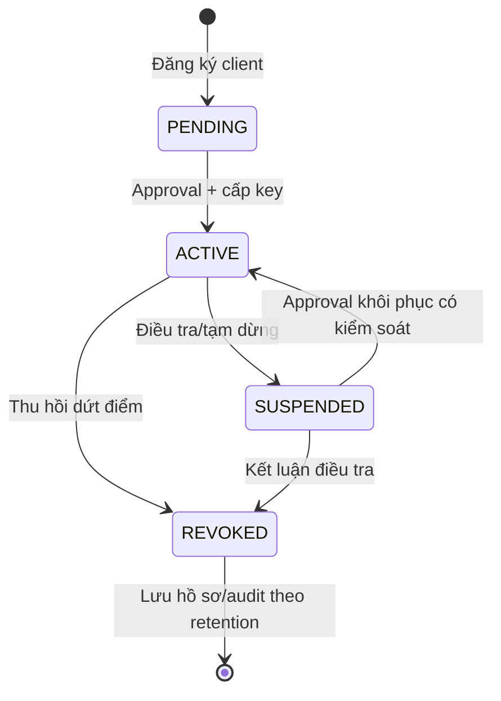
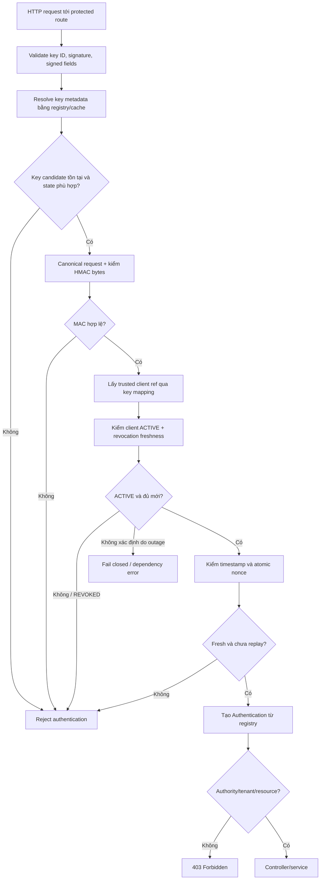
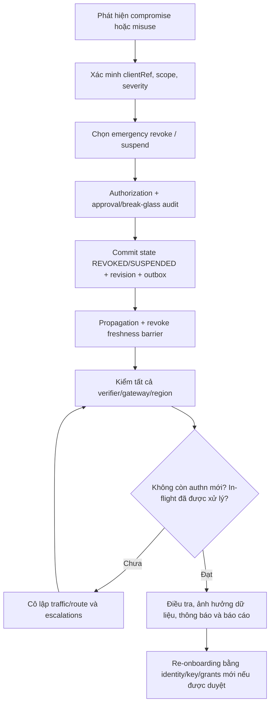
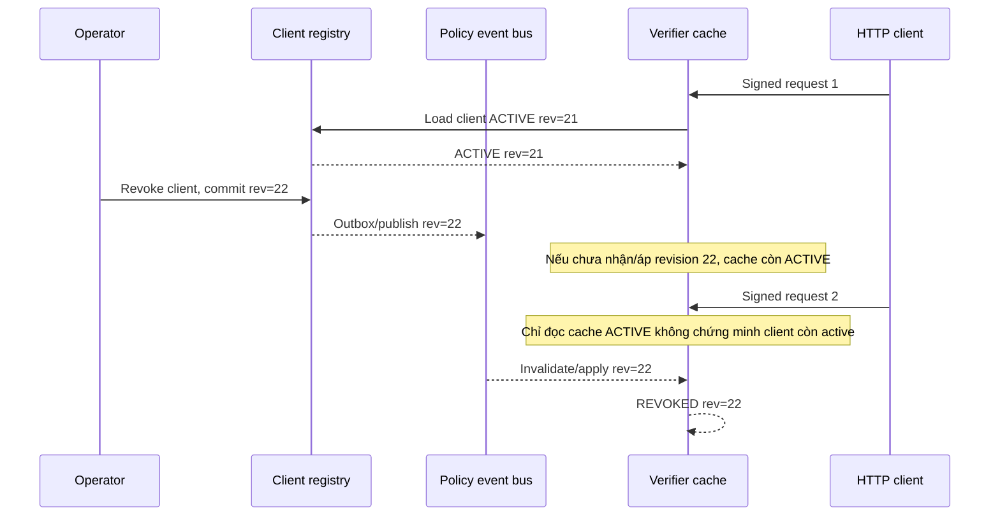

# Thu hồi client trong xác thực HMAC: runbook vận hành, hiệu lực và kiểm chứng

## 1. Bối cảnh: vì sao thu hồi client khác xoay vòng một khóa?

Trong module `SECURITY_AUTHENTICATION_HMAC_REQUEST_AUTHENTICATION`, một hệ thống xác thực HTTP request bằng **HMAC và shared secret**. Client gửi định danh khóa, timestamp, nonce, chữ ký và các trường nghiệp vụ. Server chọn key ứng viên, xây dựng **canonical request** từ method, URI/query, các header và/hoặc body digest theo hợp đồng ký, kiểm tra HMAC và chống replay. Khi xác thực thành công, hệ thống còn phải kiểm tra **authorization** đối với route, tenant, tài nguyên và hành động.

Trong vận hành thực tế, đôi khi hệ thống phải **thu hồi quyền sử dụng API của cả một client**: đối tác chấm dứt hợp đồng, service account bị chiếm quyền, ứng dụng mất thiết bị giữ secret, phát hiện giao dịch bất thường hoặc một client cố tình vi phạm chính sách. Thao tác này không nhất thiết đồng nghĩa với việc chỉ thu hồi một HMAC key.

Ví dụ một client tên nội bộ `payment-agent-A` có ba key:

```text
Client: payment-agent-A
  key-A1  RETIRING  (còn trong overlap)
  key-A2  ACTIVE
  key-A3  STAGED    (chưa được dùng)
```

Nếu operator chỉ revoke `key-A2`, client có thể vẫn ký bằng `key-A1` đang RETIRING, hoặc đợi `key-A3` được kích hoạt. Nếu mục tiêu là **không cho client A tạo thêm request đã được xác thực**, phải đặt một **ràng buộc ở cấp client** áp dụng cho **toàn bộ key versions, protocol versions, gateway instances và routes** liên quan.

Đây là bài thuộc chương **Operations**, đề bài trực tiếp **“Thu hồi client”**. Sau bài học, người học có thể:

1. Phân biệt thu hồi client với revoke key, rotate secret, ngừng cấp authority và vô hiệu hóa một endpoint.
2. Định nghĩa source of truth, state machine, revision, effective time và phạm vi hiệu lực của quyết định thu hồi.
3. Thực hiện runbook thu hồi theo kế hoạch hoặc thu hồi khẩn cấp, có approval, audit và xác nhận thực thi.
4. Thiết kế đường xác thực Spring MVC/WebFlux có kiểm tra trạng thái client, không để cache/proxy/gateway tạo đường bypass.
5. Hiểu giới hạn của TTL, pub/sub invalidation và các request đã qua bước xác thực trước khi quyết định thu hồi có hiệu lực.
6. Kiểm thử nhiều key versions, concurrent requests, key rotation, anti-replay, mất kết nối và khôi phục hoạt động.
7. Thiết kế metric/alert, xử lý lỗi 401/403/5xx và bằng chứng hậu kiểm.

> Bài sử dụng các trạng thái và API **minh họa**. Tên field, metric và thời gian bảo đảm phải được tổ chức xác nhận theo security policy, kiến trúc control plane/data plane và hợp đồng HTTP HMAC thực tế. Không xem một lệnh cập nhật database thành “thu hồi tức thời ở tất cả nơi” nếu chưa kiểm chứng các điểm verify.

## 2. Thuật ngữ và ranh giới của hành động thu hồi

### 2.1. Client, key, credential và authority

| Thực thể | Ý nghĩa | Khi bị thu hồi |
| --- | --- | --- |
| **Client / service principal** | Danh tính ứng dụng hoặc đối tác được registry quản lý | Toàn bộ credential thuộc danh tính đó không được tạo phiên xác thực mới theo policy |
| **HMAC key version** | Một shared secret và metadata với `keyId`, lifecycle, effective times | Một key không còn được dùng; các key khác của client có thể vẫn hợp lệ |
| **Credential binding** | Quan hệ key → client/tenant/scope được registry tin cậy | Cắt một đường dùng credential cụ thể; không tự động vô hiệu client khác |
| **Authority/grant** | Quyền thao tác, ví dụ `ORDER_CREATE` hoặc tenant scope | Client có thể vẫn xác thực HMAC nhưng bị **403** trên thao tác đã mất quyền |
| **Algorithm/protocol policy** | Các version canonical request và HMAC algorithms được phép | Client có thể dùng key hợp lệ nhưng không được dùng một version/algorithm đã cấm |
| **Authentication result** | Kết quả xác minh của **một request** | Không phải phiên đăng nhập tồn tại mãi mãi; không cache Authentication theo key ID |
| **Business job đã khởi chạy** | Công việc được tạo sau request đã được xác thực | Không tự bị hủy chỉ vì sau đó client bị revoke; cần cơ chế riêng |

Một request có **HMAC MAC hợp lệ về mặt mật mã** vẫn có thể bị từ chối vì client đã bị disabled, key bị revoked, timestamp quá hạn, nonce đã dùng hoặc quyền không đủ. **Crypto correctness ≠ credential acceptance ≠ authorization**.

### 2.2. Các kiểu hành động thường bị nhầm

| Hành động | Phạm vi | Dùng khi |
| --- | --- | --- |
| `REVOKE_KEY(keyId)` | Một key version | Secret cụ thể lộ, cần thay thế nhưng client vẫn được tiếp tục qua key khác |
| `ROTATE_KEY(clientId)` | Thêm key mới, đưa key cũ qua RETIRING rồi REVOKED | Thay secret định kỳ, migration có overlap |
| `DISABLE_CLIENT(clientRef)` | Toàn bộ client identity và các key liên quan | Chấm dứt hợp đồng, compromise ở cấp client hoặc vi phạm nghiêm trọng |
| `SUSPEND_CLIENT(clientRef)` | Tạm khóa toàn client theo quy trình | Điều tra, có khả năng khôi phục theo approval |
| `REMOVE_AUTHORITY(clientRef, grant)` | Một quyền hoặc phạm vi tenant | Client vẫn được xác thực nhưng không được thực hiện hành động đó |
| `DISABLE_ROUTE/INTEGRATION` | Route hoặc kênh kết nối | Giảm rủi ro tạm thời khi có sự cố hệ thống |

**Mục tiêu của bài là client-level revocation.** Khi đã quyết định thu hồi client, toàn bộ key ứng viên cần bị chặn **bằng trạng thái client đáng tin**, không chỉ bằng danh sách một vài `keyId` được thu thập thủ công.

### 2.3. Hai loại thu hồi cần phân biệt trong runbook

**Thu hồi theo kế hoạch:** Chấm dứt quyền truy cập theo hợp đồng hoặc chuyển sang service account khác. Có lịch, thông báo và kiểm tra các workload phụ thuộc.

**Thu hồi khẩn cấp:** Phát hiện shared secret bị lộ, hành vi bất thường hoặc chủ thể đã bị chiếm quyền. Ưu tiên **chặn credential ngay theo bảo đảm đã công bố**, cô lập các luồng ghi và bảo toàn audit; không đợi client phản hồi email mới thực hiện.

## 3. Invariants bảo mật khi client bị thu hồi

Một chính sách thu hồi tốt phải ghi rõ **điều gì tuyệt đối không được phép sau thời điểm có hiệu lực**:

1. Request mới ký bằng bất kỳ key version của client bị thu hồi **không được tạo một `Authentication` thành công**.
2. Không có nhánh fallback sang key cũ, algorithm cũ hoặc canonicalization version cũ để bypass client-level status.
3. Gateway và backend không được cấp danh tính từ một header do external caller tự khai báo.
4. Failure khi load trạng thái client không được biến thành `ACTIVE` mặc định.
5. Replay store không bị xóa vô điều kiện để “giúp” client bị thu hồi thử lại.
6. Các quyền/grants cũ không được khôi phục tự động nếu client được cấp lại quyền truy cập.
7. Một client khác không bị ảnh hưởng chỉ vì có key ID cùng tên trong namespace khác hoặc cùng IP/NAT.
8. Audit có đủ bằng chứng ai quyết định, khi nào, lý do/mã ticket và các thành phần đã áp dụng.

### 3.1. Cần phát biểu chính xác “thu hồi có hiệu lực”

Có ít nhất ba mức cam kết khác nhau:

| Mức | Diễn đạt chính xác | Điều cần làm |
| --- | --- | --- |
| **Control-plane committed** | Registry đã ghi trạng thái `REVOKED` và revision mới | Atomic transaction, audit/outbox |
| **No new authentication decision** | Các verifier trong phạm vi cam kết sẽ không chấp nhận client sau một mốc/barrier | Revocation freshness đủ mạnh, propagation/ack hoặc authoritative check |
| **No further business mutation** | Các lệnh đang chạy cũng không thể ghi thay đổi sau mốc | Cơ chế fencing/transaction checks/cancel jobs ở business layer |

Chỉ cập nhật cột `status` trong database mới đạt mức **control-plane committed**. Ngay cả khi verifier từ chối mọi request mới, một request đã authenticated từ trước có thể vẫn đang chạy trong controller, consumer queue hoặc asynchronous job. **Client revocation không tự hủy tác vụ đang thực thi**.

Để đáp ứng yêu cầu cao hơn, có thể dùng một **client epoch/revision fencing token** và kiểm lại trạng thái ở ranh giới thay đổi dữ liệu (commit, outbox enqueue, payment execution), hoặc cô lập tenant/workload liên quan. Đây là quyết định kiến trúc riêng cần test, không có sẵn chỉ vì thêm flag `REVOKED`.

### 3.2. Không được đánh đồng với 401/403

- Client đã `REVOKED`: credential **không được chấp nhận** cho request mới, thường là **401** theo hợp đồng HMAC.
- Client vẫn ACTIVE, MAC/freshness/nonce hợp lệ nhưng mất quyền truy cập endpoint/resource: **403**.
- Registry hoặc revocation freshness service không thể cho kết luận đáng tin: **fail closed**, thường là **503/5xx**, thay vì lén trả một `Authentication`.

Response public có thể cố ý không phân biệt “unknown key” với “revoked client” để tránh key/client enumeration; reason nội bộ vẫn phải tách để điều tra.

## 4. Thiết kế source of truth và client lifecycle

### 4.1. Mô hình trạng thái minh họa



Trong bài:

- `PENDING`: chưa được phép tạo request đã xác thực.
- `ACTIVE`: có thể được xác thực **nếu** key, MAC, timestamp, nonce, scope và policy đều hợp lệ.
- `SUSPENDED`: tạm từ chối xác thực, có thể được khôi phục theo quy trình.
- `REVOKED`: từ chối xác thực; **không tự chuyển lại ACTIVE** bằng “undo” đơn giản.

Một client đã REVOKED có thể cần **tạo identity/credential mới** sau thủ tục re-onboarding, cấp lại quyền theo nguyên tắc least privilege và ghi liên hệ với client cũ cho audit. Nếu chính sách tổ chức cho phép un-revoke, phải coi đó là một hành động quản trị nhạy cảm tương đương onboarding, có approval, revision mới và kiểm lại secrets/grants — không phải phép đảo tự động của revoke.

### 4.2. Client registry và key registry phải nối với nhau qua dữ liệu tin cậy

Mô hình dữ liệu tối thiểu:

```text
ClientRecord:
  internalClientRef      (opaque, immutable)
  tenantRef              (nếu có)
  lifecycleState         (PENDING/ACTIVE/SUSPENDED/REVOKED)
  lifecycleRevision      (tăng đơn điệu)
  stateEffectiveAt       (trusted time)
  revokedAt              (nếu có)
  revokedReasonCode      (enum nội bộ)
  credentialEpoch        (thay đổi khi disable/re-onboard)
  policyRevision         (revision nguồn sự thật)

KeyRecord:
  keyId                  (selector, unique theo scope đã định)
  internalClientRef      (owner từ registry)
  keyState               (STAGED/ACTIVE/RETIRING/REVOKED)
  notBefore/acceptUntil
  allowedProtocolVersion
  allowedAlgorithm
  secretRef              (không trả raw secret ra log)
  keyPolicyRevision
```

**ClientRecord là lớp khóa cuối cùng cho toàn danh tính.** Kể cả một `KeyRecord` còn ACTIVE do caching, verifier không được chấp nhận request khi ClientRecord tương ứng đã REVOKED theo consistency guarantee của hệ thống.

Không định danh client bằng `X-Client-Id` do caller tự gửi, IP address, User-Agent hoặc một key ID tự khai báo. Phải lấy `internalClientRef` từ mapping key→client tin cậy và ràng buộc nó với **MAC hợp lệ** trước khi tạo principal.

### 4.3. Revision, effective time và epoch có vai trò khác nhau

| Trường | Chức năng | Không thay thế được |
| --- | --- | --- |
| `lifecycleRevision` | Phát hiện trạng thái client thay đổi theo thứ tự | Nguồn dữ liệu mới nhất nếu node mất kết nối |
| `stateEffectiveAt` | Mốc áp chính sách theo đồng hồ tin cậy | Acknowledgment rằng mọi verifier đã áp dụng |
| `policyRevision` | Định danh snapshot policy được phân phối | Tính nhất quán của dữ liệu khi chưa có propagation guarantee |
| `credentialEpoch` | Fencing phiên/credential/workload đời cũ | Kiểm MAC và nonce của từng request |
| `revokedAt` | Dấu vết thời gian thu hồi | Thời gian bảo đảm không còn business side effects |

Revision nên tăng đơn điệu tại source of truth, có quy tắc xử lý event out-of-order. Không dùng timestamp do **client gửi** để quyết định hiệu lực revoke; timestamp ký trong HTTP request chỉ phục vụ freshness.

## 5. Luồng quyết định HMAC phải kiểm client status ở đâu?



Đây là **một thứ tự tham chiếu**, không phải thứ tự duy nhất. Hệ thống có thể kiểm state client sớm hơn MAC để giảm chi phí của request đã revoke, miễn là **không xác thực client từ key ID** và không tiết lộ trạng thái nhạy cảm qua response. Dù thứ tự khác, bất biến là: **trước khi quyết định xác thực thành công, phải có bằng chứng key, MAC, timestamp, nonce và client state đều đạt policy**.

### 5.1. “Found key” không có nghĩa “allowed client”

Ví dụ:

```text
key resolver:       FOUND key-A2
key lifecycle:      ACTIVE
HMAC comparison:    MATCH
client lifecycle:   REVOKED
decision:           REJECT AUTHENTICATION
```

Không tạo `Authentication` với authority cũ rồi kỳ vọng tầng authorization tự chặn mọi endpoint. Việc thu hồi client là **credential acceptance gate**, không phải chỉ xóa một quyền.

### 5.2. Không dùng cache Authentication theo key ID

Mỗi HTTP request HMAC cần kiểm signature của **chính request đó**, freshness và nonce. Cache `keyId → Authentication` hoặc `clientId → SecurityContext` sẽ làm request chưa có MAC hợp lệ có thể thừa hưởng một danh tính đã xác thực. Nếu metadata được cache để cải thiện hiệu năng, trạng thái client vẫn cần tính mới đủ theo revocation policy.

### 5.3. In-flight requests sau thời điểm revoke

Nếu request R đã hoàn tất HMAC verification lúc T1, operator commit revoke ở T2, controller ghi dữ liệu lúc T3, thì **chỉ kiểm client status tại T1** không ngăn side effect T3. Hệ thống phải ghi rõ:

- Có cho request đã được authenticated trước revoke hoàn tất không?
- Với thao tác nguy hiểm, có check `credentialEpoch` hoặc client state lần nữa **trong transaction** không?
- Các job async đã queue có được gắn clientRef/epoch và bị kiểm trước khi thực thi không?
- Ai được phép hủy các công việc đang chạy? Có bảo đảm idempotency/compensation không?

Không hứa “mọi request dừng ngay lập tức” nếu chỉ có một authn filter trước controller.

## 6. Quy trình thu hồi theo kế hoạch (planned offboarding)

Thu hồi theo kế hoạch phù hợp khi đối tác ngừng hợp tác, ứng dụng được thay thế hoặc service account không còn được sử dụng.

### 6.1. Chuẩn bị và đánh giá tác động

1. **Xác định clientRef từ registry**; không dùng key ID do client gửi làm nguồn danh tính quản trị.
2. Kiểm môi trường, tenant, toàn bộ key versions, protocol versions, các gateway/regions và những workload đang sử dụng credential.
3. Liệt kê endpoints/quyền liên quan, các tác vụ định kỳ, webhook/queue/outbox và trách nhiệm dữ liệu sau khi khóa.
4. Xác nhận người yêu cầu, người phê duyệt, mã change ticket và thời điểm hiệu lực.
5. Thông báo chủ client theo chính sách và chuẩn bị phương án migration sang client mới nếu cần.
6. Chuẩn bị **positive control** (client khác còn ACTIVE) và **negative control** (client sắp bị revoke) dùng **test identities/fixtures**, không dùng production secret trên máy cá nhân.
7. Xác định SLO/guarantee propagation đã được hệ thống hỗ trợ: ví dụ “đạt `no new authn decision` trong thời gian đã phê duyệt”, không tự điền con số.

### 6.2. Thực thi theo lệnh quản trị có kiểm soát

Một hành động control plane nên là:

```text
Request:
  targetClientRef = internal-client-opaque-ref
  requestedAction = REVOKE_CLIENT
  reasonCode      = CONTRACT_TERMINATED
  changeTicket    = CHG-EXAMPLE-1042
  requestedBy     = authenticated-operator
  approvedBy      = authorized-approver
  idempotencyKey  = opaque-command-id
  expectedRevision= 17

Atomic state transition:
  require current state/revision match policy
  state = REVOKED
  lifecycleRevision = 18
  revokedAt = trusted-server-time
  append audit/outbox event for revision 18
```

Đây là **mẫu hợp đồng vận hành**, không phải endpoint hay script có sẵn. Thao tác phải được bảo vệ bằng danh tính quản trị, phân quyền và approval phù hợp. **Không nên cung cấp một public API chỉ cần HMAC key của chính client bị nghi lộ là có thể revoke/un-revoke mọi client**.

### 6.3. Phân phối và xác nhận hiệu lực

Sau khi transaction commit:

- Phát event/revision bằng transactional outbox hoặc cơ chế tương đương để tránh “DB update thành công, event mất”.
- Invalidate metadata/client state cache ở từng verifier và gateway có trách nhiệm kiểm HMAC.
- Kiểm heartbeat, revision, refresh age và trạng thái các instance đang nhận traffic.
- Thực hiện synthetic probes trên **từng route/region/algorithm profile** có ảnh hưởng bằng test key thuộc client được thiết kế riêng cho bài kiểm.
- Xác nhận client đã revoke không còn tạo authentication thành công; client khác vẫn bình thường.
- Theo dõi request bị từ chối, key lookup errors, nonce-store health và tác vụ in-flight cần xử lý.
- Lưu evidence/audit, đóng change ticket chỉ khi đạt tiêu chí acceptance đã công bố.

Không coi “event đã được publish” hay “cache.invalidate() trả thành công trên một node” là bằng chứng toàn cụm đã chặn client.

## 7. Thu hồi khẩn cấp khi nghi client/secret bị chiếm quyền

Thu hồi khẩn cấp ưu tiên giảm khả năng attacker tiếp tục ký request, đồng thời giữ bằng chứng để điều tra.

### 7.1. Runbook ở mức quyết định



1. **Triage:** Dùng audit/registry xác định chính xác client identity, các key versions và các routes đã sử dụng; không dựa vào một header tự khai báo trong request đáng ngờ.
2. **Containment:** Khi độ tin cậy yêu cầu cao, ưu tiên khóa tại source of truth và lập tức thực thi các biện pháp bổ sung ở gateway/route/service với quy trình break-glass có audit.
3. **Commit:** Ghi trạng thái, revision, thời điểm và actor bằng một transaction. Event outbox theo sau commit.
4. **Propagation:** Đẩy policy mới tới mọi data plane instance, kiểm unknown/stale status phải fail closed theo policy.
5. **Verification:** Thực hiện kiểm chứng từ các vị trí thực sự nhận traffic; không dùng request mang production secret bị nghi compromised để “thử” vô hạn.
6. **In-flight work:** Chặn/kiểm lại hàng đợi, job, payment/transfer còn đang thực thi; cân nhắc fencing token và rollback/compensation đúng quy trình nghiệp vụ.
7. **Forensics:** Bảo toàn audit, các dấu hiệu abuse, key rotation timeline và giao dịch có thể bị ảnh hưởng.
8. **Recovery:** Chỉ tạo client/key/grants mới sau đánh giá nguyên nhân, thay đổi môi trường giữ secret và phê duyệt. Không chỉ đổi tên key trong registry rồi mở lại client cũ.

### 7.2. Không “xoay key trước” nếu mục tiêu là khóa toàn client

Key rotation có overlap thường cố ý cho phép key cũ còn dùng một thời gian. Trong tình huống client identity đã bị chiếm quyền, overlap có thể duy trì năng lực ký của attacker. Thu hồi cấp client phải **đứng trên key-level state**; rotate key chỉ thực hiện khi có kế hoạch phục hồi danh tính và secret mới an toàn.

### 7.3. Khi revocation service gặp outage

Không chuyển client sang `ACTIVE` mặc định vì source of truth/cache unavailable. Các lựa chọn phụ thuộc hệ thống:

- **Authoritative check bắt buộc:** Không thể đọc trạng thái đủ mới → chặn xác thực/fail closed và trả lỗi dependency phù hợp.
- **Bounded offline policy:** Cho phép dùng snapshot chưa vượt freshness budget đã được phê duyệt; quá budget → fail closed.
- **Route cô lập:** Đối với endpoint ghi dữ liệu nhạy cảm, có thể tạm dừng tiếp nhận cho tới khi chắc chắn trạng thái client.

Không có một TTL/cache/pubsub nào tự động bảo đảm “revoke tức thời”, đặc biệt khi mạng phân vùng. Quy trình emergency phải kiểm chứng giới hạn kiến trúc đang có thay vì giả định.

## 8. Đồng bộ thu hồi: control plane, data plane và cache

### 8.1. Vấn đề stale client metadata

Một client bị revoke ở registry trong khi một node vẫn cache `ACTIVE`:



Nếu verifier chỉ dựa vào `expireAfterWrite(30s)`, một cửa sổ stale có thể tồn tại gần 30 giây hoặc hơn khi lỗi store/event. **TTL không đồng nghĩa với cam kết revoke**.

### 8.2. Các chiến lược đồng bộ và giới hạn

| Chiến lược | Ưu điểm | Điểm phải kiểm soát |
| --- | --- | --- |
| Không cache client state; authoritative check mỗi request | Trạng thái mới nhất theo consistency của store | Chi phí latency/dependency; tải cao và outage |
| Local cache có TTL ngắn | Nhanh, ít phụ thuộc registry | Staleness tới TTL, không đáp ứng yêu cầu thu hồi khẩn cấp mạnh |
| Invalidation pub/sub | Thường cập nhật nhanh | Event mất/trễ/out-of-order, node offline, race với cache load |
| Revision watermark + reject snapshot cũ | Chống dữ liệu cũ hơn revision **đã biết** | Node mất kết nối không thể biết có revision mới |
| Barrier/ack từ mọi điểm verify trong scope | Có thể đưa ra cam kết rõ hơn sau khi hoàn thành | Phải xử lý node không ack, ingress bypass, partitions, rolling deploy |
| Strongly consistent revocation/fencing check | Cam kết chặt hơn cho quyết định authn/mutation | Availability/latency tradeoff, cần thiết kế transaction rõ |

Đừng tuyên bố “đã chặn ở mọi instance” chỉ dựa trên ack của một số node nếu load balancer vẫn có thể gửi request tới node chưa đồng bộ. Với node mất kết nối hoặc chưa ack, control plane phải đưa chúng ra khỏi traffic hoặc khiến chúng **fail closed** theo chính sách.

### 8.3. Race “load trước, invalidate sau, load cũ ghi đè”

```text
T1: Verifier bắt đầu load ClientRecord revision=41 (ACTIVE)
T2: Registry commit REVOKED revision=42
T3: Verifier nhận event revision=42 và xóa cache
T4: Load tại T1 hoàn thành; ghi ACTIVE revision=41 vào cache
T5: Request mới đọc ACTIVE revision=41
```

Một `cache.invalidate(clientRef)` tại T3 không đủ để chặn tình huống này. Có thể kết hợp:

1. Watermark tăng đơn điệu (`highestKnownRevision`) và kiểm `loadedRevision >= requiredRevision`.
2. Không ghi/không dùng snapshot thấp hơn watermark.
3. Coalesced load và ordering/invalidation đã kiểm concurrency.
4. Tách `revoked client tombstone` với expiry policy nghiêm ngặt nếu cần, nhưng không dựa tombstone local như nguồn sự thật vĩnh viễn.
5. Khi không xác định được watermark hiện hành trong phạm vi có yêu cầu bảo đảm mạnh → fail closed hoặc dùng authoritative check.

**Watermark cục bộ không phát hiện một revoke event mà node chưa từng nhận**. Muốn đưa ra cam kết nghiêm ngặt cần nguồn revocation state đủ tin cậy và cơ chế chống node stale vẫn tiếp tục nhận traffic.

### 8.4. Nhiều region và gateway độc lập

Nếu gateway A tự verify HMAC, backend B chỉ tin identity assertion từ gateway, việc revoke ở backend không đủ khi gateway A vẫn cache ACTIVE. Cần:

- Danh sách đầy đủ điểm **authenticate** hoặc **accept asserted authentication**.
- Mapping revision/epoch đến từng component, region, environment.
- Bảo vệ gateway → backend bằng mTLS/network policy và metadata được kiểm; strip header `X-Verified-Client` do internet client tự gửi.
- Kiểm đường truy cập backend trực tiếp không bypass gateway-authn.
- Phân biệt ack của config distribution với thực tế verifier đang chạy revision mới.

## 9. Java/Spring: mô hình client-state gate trong verifier

Các đoạn code dưới đây là **minh họa thiết kế** theo Spring Security 6, không phải implementation hoàn chỉnh có thể sao chép vào production mà không thêm repository, crypto, error mapping, monitoring và security review.

### 9.1. Metadata và contract truy vấn

```java
import java.time.Instant;
import java.util.Optional;

enum ClientState {
    PENDING, ACTIVE, SUSPENDED, REVOKED
}

record ClientSnapshot(
    String internalClientRef,
    ClientState state,
    long lifecycleRevision,
    long credentialEpoch,
    Instant stateEffectiveAt
) {}

record HmacKeySnapshot(
    String keyId,
    String internalClientRef,
    boolean keyIsAcceptable,
    long keyRevision
) {}

interface HmacKeyRegistry {
    Optional<HmacKeySnapshot> findCandidateById(String keyId);
}

interface ClientStateRepository {
    // Phải tuân thủ revocation freshness/consistency contract.
    // Lỗi hạ tầng ném exception, không trả ACTIVE mặc định.
    ClientSnapshot requireFreshSnapshot(String internalClientRef);
}
```

`keyId` là input chưa xác thực; validate format và giới hạn độ dài **trước khi lookup**. `HmacKeySnapshot` không chứa secret để tránh nhầm giữa metadata và key material. Key material được lấy qua secret provider có quyền riêng; không đưa vào `toString()`, audit, exception message hoặc metrics.

### 9.2. Kiểm client status chỉ từ registry tin cậy

```java
import org.springframework.security.authentication.BadCredentialsException;
import org.springframework.security.authentication.AuthenticationServiceException;

final class ClientAcceptancePolicy {
    private final ClientStateRepository repository;

    ClientAcceptancePolicy(ClientStateRepository repository) {
        this.repository = repository;
    }

    ClientSnapshot requireAcceptable(String trustedClientRef) {
        final ClientSnapshot client;
        try {
            client = repository.requireFreshSnapshot(trustedClientRef);
        } catch (RuntimeException dependencyFailure) {
            // Không trả ACTIVE/permitAll khi registry lỗi.
            throw new AuthenticationServiceException(
                "Client state could not be verified",
                dependencyFailure
            );
        }

        if (client == null ||
            !trustedClientRef.equals(client.internalClientRef()) ||
            client.state() != ClientState.ACTIVE) {
            // Response công khai có thể dùng message chung để tránh enumeration.
            throw new BadCredentialsException("Invalid HMAC credentials");
        }
        return client;
    }
}
```

Method `requireFreshSnapshot(...)` là một **hợp đồng security-critical**: nếu nguồn dữ liệu không đủ mới theo guarantee, nó phải báo lỗi thay vì trả snapshot ACTIVE cũ. `ClientAcceptancePolicy` kiểm đúng clientRef và ACTIVE, nhưng **không thể tự biết cache stale** nếu repository đánh lừa nó bằng một snapshot cũ.

### 9.3. Tích hợp vào thứ tự HMAC verification

```java
// Pseudocode domain service; các method do ứng dụng tự định nghĩa.
ParsedHmacRequest parsed = parser.parseAndValidate(request);
HmacKeySnapshot key = keyRegistry
    .findCandidateById(parsed.keyId())
    .orElseThrow(() -> invalidCredentials());

keyPolicy.requireAcceptable(key, parsed);
byte[] canonicalBytes = canonicalizer.build(parsed, request);
byte[] expectedMac = secretProvider.signForVerification(
    key, canonicalBytes
);
if (!constantTimeMacComparator.matches(
    expectedMac, parsed.signatureBytes())) {
    throw invalidCredentials();
}

// Chỉ trusted clientRef từ key registry mới được dùng ở đây.
ClientSnapshot client = clientAcceptancePolicy
    .requireAcceptable(key.internalClientRef());

freshnessPolicy.requireFresh(parsed.signedTimestamp());
nonceStore.reserveAtomicallyOrReject(
    client.internalClientRef(), parsed.nonce()
);

Authentication authentication =
    principalFactory.createFromTrustedMetadata(client, key);
return authentication; // Authorization xử lý sau.
```

Đoạn này minh họa kiểm **MAC trước khi tạo principal**. Nếu muốn kiểm trạng thái client sớm hơn để tiết kiệm HMAC CPU khi client đã revoke, phải tiếp tục bảo vệ khỏi timing/key enumeration và không lấy keyId làm danh tính đã xác thực. Với mỗi thứ tự, điều cốt lõi là **không tạo Authentication nếu client không ACTIVE/không đủ freshness**, dù key ACTIVE hoặc MAC khớp.

Khi revoke được commit **giữa** bước `requireAcceptable` và `return authentication`, cam kết “no new authn after commit” đòi hỏi cơ chế quyết định/linearization rõ hơn một lần đọc cache; với mức bảo đảm mạnh, dùng authoritative decision/barrier hoặc token/epoch fencing theo thiết kế.

### 9.4. Service cập nhật state có revision và outbox

Control plane nên cập nhật client state và audit/outbox **trong cùng transaction**. Ví dụ kiến trúc:

```java
// Pseudocode control plane, không phải code JPA có thể copy nguyên xi.
@Transactional
public RevocationReceipt revokeClient(RevokeCommand cmd) {
    // Authorization/approval được kiểm ở ingress admin API và đây.
    // idempotencyKey được ràng buộc với actor+target+action.
    ClientEntity client = clients.lockByInternalRef(cmd.clientRef());
    requireExpectedRevision(client, cmd.expectedRevision());
    requireApproval(cmd.actor(), cmd.approvalReference());

    if (client.isRevoked()) {
        return receipts.forExistingRevocation(client, cmd);
    }

    long nextRevision = revisions.nextForClient(client.ref());
    client.markRevoked(serverClock.instant(), nextRevision);
    clients.save(client);

    auditOutbox.append(RevocationEvent.of(
        client.ref(), nextRevision, "CLIENT_REVOKED",
        cmd.reasonCode(), cmd.actor(), cmd.changeTicket()
    ));
    return receipts.created(client.ref(), nextRevision);
}
```

Ví dụ sử dụng interface giả để minh họa transaction. Trong code thật phải giải quyết thứ tự **idempotency check vs optimistic-lock revision** nhất quán: một retry với cùng idempotency key nên nhận lại receipt trước đó; một lệnh mới với expectedRevision cũ phải nhận conflict, không tự ghi đè. `@Transactional` chỉ bảo đảm atomicity khi database/outbox cùng transaction manager và đều tham gia transaction; phát message trực tiếp ra event bus bên trong transaction **không** tự có bảo đảm này.

Không log `RevokeCommand` nguyên object nếu chứa reference nhạy cảm hoặc token admin; audit chỉ giữ các trường được duyệt.

## 10. Spring MVC: SecurityFilterChain và xử lý lỗi

### 10.1. HMAC authentication và authorization là hai chặng khác nhau

Trong Spring MVC/Spring Security, một custom `OncePerRequestFilter` hoặc `AuthenticationFilter` có thể gọi domain verifier, nhận `Authentication` và đặt trong `SecurityContext` cho request. Tiếp theo, `AuthorizationFilter` và method/service security quyết định route/resource authority.

Ví dụ cấu hình minh họa:

```java
@Bean
SecurityFilterChain hmacChain(
    HttpSecurity http,
    HmacAuthenticationFilter hmacFilter,
    AuthenticationEntryPoint hmacEntryPoint,
    AccessDeniedHandler accessDeniedHandler
) throws Exception {
    http.securityMatcher("/internal/**")
        .csrf(csrf -> csrf.disable()) // Chỉ trong API stateless được review.
        .sessionManagement(sm -> sm.sessionCreationPolicy(
            SessionCreationPolicy.STATELESS
        ))
        .exceptionHandling(ex -> ex
            .authenticationEntryPoint(hmacEntryPoint)
            .accessDeniedHandler(accessDeniedHandler)
        )
        .authorizeHttpRequests(auth -> auth
            .requestMatchers(HttpMethod.GET, "/internal/orders/**")
                .hasAuthority("ORDER_READ")
            .requestMatchers(HttpMethod.POST, "/internal/orders")
                .hasAuthority("ORDER_CREATE")
            .anyRequest().denyAll()
        )
        .addFilterBefore(
            hmacFilter, UsernamePasswordAuthenticationFilter.class
        );
    return http.build();
}
```

`csrf.disable()` chỉ là lựa chọn minh họa cho API HMAC stateless đã phân tích CSRF; không sao chép vô điều kiện vào ứng dụng dùng cookie/session. Import/bean implementation không được liệt kê đầy đủ. Cần bảo đảm matcher/chain ordering bảo vệ **cả request thiếu header HMAC**, không chỉ những request có signature header.

### 10.2. Chú ý ngoại lệ từ custom authentication filter

Một authentication filter chạy **trước** `ExceptionTranslationFilter` không thể chỉ ném `BadCredentialsException` rồi mặc định kỳ vọng `ExceptionTranslationFilter` ở phía sau bắt được. Filter phải xử lý `AuthenticationException` theo cơ chế của Spring Security filter đang dùng, hoặc **gọi `AuthenticationEntryPoint` trực tiếp** và dừng filter chain.

```java
// Pseudocode bên trong custom authentication filter.
final Authentication verified;
try {
    verified = hmacVerifier.authenticate(request);
} catch (AuthenticationException authFailure) {
    SecurityContextHolder.clearContext();
    if (!response.isCommitted()) {
        entryPoint.commence(request, response, authFailure);
    }
    return; // Dừng tại đây, không gọi downstream filter/handler.
}

SecurityContext context = SecurityContextHolder.createEmptyContext();
context.setAuthentication(verified);
SecurityContextHolder.setContext(context);
try {
    filterChain.doFilter(request, response);
} finally {
    SecurityContextHolder.clearContext();
}
```

Đây là **minh họa luồng**, không phải implementation hoàn chỉnh của `doFilterInternal`: chỉ bắt `AuthenticationException` từ **bước authenticate** trước khi chạy downstream; các lỗi do filter/handler phía sau phát sinh không được bắt nhầm thành “HMAC credentials sai”. Phải bảo đảm status của `AuthenticationServiceException` được map khác lỗi credentials nếu contract yêu cầu 5xx. Trong ứng dụng thật, ưu tiên dùng các filter/handler có semantics đã được Spring Security hỗ trợ, xử lý vòng đời `SecurityContext` và error handlers theo đúng cấu hình của ứng dụng.

Khi client bị REVOKED, verifier **không** tạo `Authentication`. Khi client ACTIVE nhưng thiếu quyền, authentication thành công và `AccessDeniedHandler` trả 403. Không gán `ROLE_ADMIN` từ một header do client tự ký nếu policy không cho phép client tự cấp quyền.

### 10.3. HTTP response an toàn

Ví dụ response công khai với credential không được chấp nhận:

```http
HTTP/1.1 401 Unauthorized
Content-Type: application/problem+json
Cache-Control: no-store

{"type":"about:blank","title":"Unauthorized","status":401}
```

Không trả `client_id`, key state, toàn bộ danh sách key, expected MAC, canonical request hoặc chi tiết “khóa này có tồn tại nhưng client đã revoke” nếu có thể hỗ trợ enumeration. `401` và `403` phải theo chuẩn API contract và test qua gateway để tránh một hop đổi status hoặc che mất `Cache-Control`.

## 11. Spring WebFlux: client revocation trong pipeline reactive

WebFlux có `SecurityWebFilterChain`, `AuthenticationWebFilter` và `ReactiveSecurityContextHolder`. Không được giữ principal trong `ThreadLocal` để dùng giữa các asynchronous stages.

### 11.1. Kiểm trạng thái client theo publisher

```java
// Pseudocode: mỗi helper trả Mono và đều non-blocking.
return reactiveHmacVerifier.verifyMac(exchange)
    .flatMap(verified -> reactiveClientPolicy
        .requireAcceptable(verified.trustedClientRef())
        .thenReturn(verified))
    .flatMap(verified -> reactiveReplayGuard
        .verifyFreshAndReserve(verified)
        .thenReturn(verified))
    .flatMap(verified ->
        chain.filter(verified.replayableExchange())
            .contextWrite(
                ReactiveSecurityContextHolder.withAuthentication(
                    verified.authentication()
                )
            )
    );
```

Ví dụ nhấn mạnh **không gọi `block()` trên Netty event loop** để lấy client state/Redis nonce record và không tự `subscribe()` để chạy policy check ngoài request subscription. Reactor publisher phải kết thúc thành công **trước khi** đi vào downstream có quyền.

Nếu `requireAcceptable` lỗi do thiếu trạng thái đủ mới, publisher phải fail closed và được map qua reactive `ServerAuthenticationEntryPoint` hoặc error handling phù hợp; không dùng `onErrorResume(e -> Mono.just(activeClient))`.

### 11.2. Reactive context không phải cache theo client

Một request đã authenticated đặt `Authentication` trong Reactor Context **của subscription đó**. Sau khi client bị revoke, request mới vẫn phải qua verification; không cache `Authentication`/`SecurityContext` theo `keyId` hoặc `clientRef`.

Các test quan trọng:

- Client ACTIVE → request đã ký nhận đúng principal trong downstream.
- Client REVOKED → request mới không được vào controller.
- Hai requests song song khác client không lẫn danh tính qua thread hop.
- Body buffer ký HMAC được cung cấp lại cho handler theo đúng bytes, có giới hạn memory.
- Cancel/timeout của client-state lookup không mở downstream.
- Nếu stream/job đã chạy trước revoke, kiểm business fencing ở nơi cần cam kết mạnh.

## 12. Key rotation, algorithm agility và replay khi thu hồi client

### 12.1. Client revoked phải thắng mọi trạng thái key

| Client state | Key state | MAC | Kết quả authentication |
| --- | --- | --- | --- |
| ACTIVE | ACTIVE | Đúng | Có thể thành công nếu freshness/nonce/scope hợp lệ |
| ACTIVE | RETIRING còn hạn | Đúng | Có thể thành công theo overlap policy |
| ACTIVE | STAGED | Đúng | Từ chối vì key chưa active |
| ACTIVE | REVOKED | Đúng | Từ chối vì key đã revoke |
| **REVOKED** | ACTIVE | Đúng | **Từ chối vì client revoked** |
| **REVOKED** | RETIRING | Đúng | **Từ chối**, không dùng overlap bypass |
| **REVOKED** | STAGED | Đúng | **Từ chối**, không cho activate về sau |
| SUSPENDED | ACTIVE | Đúng | Từ chối trong thời gian suspend |
| ACTIVE | ACTIVE | Sai | Từ chối vì MAC không khớp |

Nếu registry có quy trình tự động kích hoạt `STAGED → ACTIVE`, hành động này **không được** tự kích hoạt lại client bị REVOKED. Client-level state cần được kiểm ở quyết định cuối cùng và trong control-plane key management operations phù hợp.

### 12.2. Đổi thuật toán không làm sống lại client

Một client có thể ký bằng HMAC-SHA256 hoặc HMAC-SHA512 nếu policy hỗ trợ. Nếu state client đã REVOKED, thử thuật toán khác, canonicalization version khác hoặc quay về legacy parser không được thay đổi kết quả. Tránh:

```java
// KHÔNG LÀM:
if (clientRevoked() && legacyHmacSha256SignatureMatches()) {
    return authenticateForCompatibility();
}
```

Algorithm agility chỉ điều khiển **định dạng/primitive chấp nhận được**, không cung cấp đường “đăng nhập tạm” cho một danh tính đã bị thu hồi.

### 12.3. Nonce store và idempotency

Anti-replay vẫn cần:

- Timestamp/nonce được đưa vào canonical request đã ký.
- Atomic check-and-record theo **verified client scope** hoặc scope được threat model định nghĩa.
- Nonce record tồn tại đủ lâu trong freshness window trên mọi instance có thể verify.
- Không reset/xóa nonce store chung khi revoke một client nếu việc đó cho phép replay của client khác.

Thu hồi client không phải business idempotency. Một request hợp lệ đã tạo lệnh thanh toán hoặc job có thể còn chạy sau khi client bị revoke; business layer cần transaction constraints, idempotency, cancellation/fencing theo mức bảo đảm đã chọn.

## 13. Audit và quyền thao tác thu hồi

### 13.1. Ai được thu hồi client?

Không phải mọi operator có quyền xem monitoring đều được phép revoke. Một policy có thể phân biệt:

| Vai trò | Quyền ví dụ |
| --- | --- |
| Support observer | Xem trạng thái đã redacted, tạo yêu cầu |
| Security operator | Đề xuất hoặc thực thi thu hồi trong scope được phép |
| Approver | Phê duyệt planned change hoặc break-glass |
| Incident commander | Điều phối emergency, không tự động bỏ audit |
| Service owner | Xác nhận dependencies và kế hoạch re-onboarding |
| Auditor | Truy cập audit trail theo least privilege |

Thiết kế phải tránh **self-approval** cho hành động nhạy cảm nếu quy định yêu cầu bốn mắt; break-glass cần cảnh báo, lý do và hậu kiểm. Không cấp quyền quản trị revoke dựa trên một header role mà client HMAC tự ký.

### 13.2. Một audit event cần trường nào?

```json
{
  "eventType": "HMAC_CLIENT_REVOKED",
  "eventVersion": 1,
  "targetClientRef": "opaque-client-ref",
  "previousState": "ACTIVE",
  "newState": "REVOKED",
  "previousRevision": 31,
  "newRevision": 32,
  "reasonCode": "SUSPECTED_CREDENTIAL_COMPROMISE",
  "changeTicket": "INC-EXAMPLE-407",
  "actorRef": "operator-opaque-ref",
  "approvalRef": "approval-opaque-ref",
  "effectiveAt": "2026-11-28T08:00:00Z",
  "commandId": "opaque-idempotency-id"
}
```

Đây là **schema minh họa**; tuyệt đối không đưa shared secret, full canonical request, HMAC signature, raw nonce hoặc credential admin vào event. `targetClientRef` và `actorRef` vẫn có thể là dữ liệu nhạy cảm: áp quyền truy cập, retention, masking và integrity controls.

### 13.3. Audit của “ý định” và “hiệu lực” là hai loại bằng chứng

Cần phân biệt:

- `CLIENT_REVOCATION_REQUESTED`: ai đã tạo yêu cầu.
- `CLIENT_REVOCATION_APPROVED`: ai đã duyệt.
- `CLIENT_REVOKED_COMMITTED`: registry commit revision mới.
- `CLIENT_POLICY_APPLIED`: data plane instance/gateway áp policy.
- `CLIENT_REVOCATION_VERIFIED`: kết quả synthetic probe/security assertion được thu thập.
- `CLIENT_REONBOARDING_APPROVED`: thủ tục cấp lại identity mới, nếu có.

Một event “committed” không chứng minh tất cả verifiers đã áp dụng; một event “applied” không tự chứng minh các business jobs đã dừng.

### 13.4. Độ tin cậy của audit trail

Để giảm mất event:

- Ghi state và **transactional outbox** trong cùng database transaction nếu kiến trúc hỗ trợ.
- Publisher có retry/idempotency, event ID và ordering/revision controls.
- Phân vùng truy cập/retention phù hợp, chống sửa/xóa trái phép.
- Đồng bộ đồng hồ và dấu vết who/when/why/what; không dùng timestamp client làm audit time.
- Theo dõi audit delivery lag/errors; với quyết định cực nhạy cảm cần policy riêng nếu audit không khả dụng.

## 14. Failure semantics và client behavior sau thu hồi

### 14.1. Hợp đồng HTTP minh họa

| Tình huống | Nội bộ | HTTP thường dùng | Điều client nên làm |
| --- | --- | --- | --- |
| Key ID không tồn tại | `KEY_NOT_FOUND` | 401 | Kiểm cấu hình credential qua kênh hỗ trợ |
| Key ACTIVE nhưng client REVOKED | `CLIENT_REVOKED` | 401 | **Không** retry liên tục cùng credential |
| Client SUSPENDED | `CLIENT_SUSPENDED` | 401 | Liên hệ quản trị theo quy trình |
| MAC sai/timestamp hết hạn/replay | `SIGNATURE_INVALID` / `NONCE_REPLAY` | 401 | Sửa ký/timestamp/nonce nếu còn được phép |
| Registry/revocation check unavailable | `CLIENT_STATE_UNAVAILABLE` | 503/5xx | Backoff; không bỏ HMAC hoặc fallback key |
| HMAC+client ACTIVE nhưng thiếu quyền | `AUTHZ_DENIED` | 403 | Xin quyền thích hợp, không rotate key mù quáng |
| Client khác ACTIVE, đủ quyền | `VERIFIED` | 2xx/3xx tùy API | Tiếp tục theo business contract |

Response cho caller thường không cần trả `CLIENT_REVOKED` cụ thể nếu điều đó tiết lộ sự tồn tại client. Giữ reason code chi tiết **trong telemetry nội bộ đã hạn chế quyền**, sử dụng Problem Details/response schema nhất quán.

### 14.2. Không tự động retry 401 bằng key cũ

SDK/gateway không được:

```text
401 -> thử key A1
401 -> thử key A2
401 -> thử thuật toán legacy
401 -> bỏ timestamp/nonce
```

để “giữ tương thích”. Hành vi này có thể bypass chính sách revoke hoặc làm tăng tải khi incident. Với 503 dependency outage, retry có giới hạn/backoff và **không tái sử dụng một request nonce đã được reserve** mà không xét idempotency; một timeout có thể xảy ra sau khi backend xử lý xong.

### 14.3. Idempotency và retry của lệnh revoke

**Control-plane API** tự nó cũng cần xử lý duplicate:

| Tình huống | Mong đợi |
| --- | --- |
| Lệnh revoke lặp cùng `idempotencyKey`, cùng actor/target/action | Trả receipt cũ, không nhân đôi side effect |
| Lệnh revoke mới khi đã REVOKED | Không tự re-activate; trả trạng thái đã revoked hoặc kết quả idempotent theo contract |
| Hai operator thay state đồng thời | Optimistic locking/transaction serialization, không mất update |
| Lệnh revoke với `expectedRevision` cũ | Conflict; phải đọc trạng thái mới và quyết định lại |
| Event outbox phát lại | Consumer xử lý theo event ID/revision, không áp state cũ |
| Event `ACTIVE rev=10` tới sau `REVOKED rev=11` | Không lùi trạng thái về ACTIVE |

Không gắn kết quả “revoke thành công” với một HTTP 200 từ admin API nếu transaction chưa commit hoặc còn data-plane nodes chưa đạt tiêu chí hiệu lực.

## 15. Test plan: xác nhận client bị khóa ở mọi đường

### 15.1. Test fixture và điều kiện tiên quyết

Ví dụ xây test environment có:

```text
Client A / tenant A:
  key-A1 RETIRING
  key-A2 ACTIVE
  key-A3 STAGED
  authority ORDER_READ, ORDER_CREATE

Client B / tenant B:
  key-B1 ACTIVE
  authority ORDER_READ

2 verifier instances + 1 gateway
shared nonce store
client/key registry có revision
fixed clock và test audit sink
```

Tạo **HMAC known signature vectors** với shared secret giả và canonical bytes cố định. Test phải kiểm request hợp lệ của A thành công **trước revoke**; nếu baseline ký sai hoặc nonce đã hết hạn, một loạt 401 sau đó không chứng minh client-level revocation.

### 15.2. Ma trận test

| ID | Trạng thái/tình huống | Expected |
| --- | --- | --- |
| REV-01 | Client A ACTIVE, key-A2 ACTIVE, MAC/freshness/nonce đúng | Authentication thành công trước revoke |
| REV-02 | A REVOKED, key-A2 vẫn ACTIVE trong cache | Reject, không tạo Authentication |
| REV-03 | A REVOKED, key-A1 RETIRING còn overlap | Reject, không dùng key cũ |
| REV-04 | A REVOKED, key-A3 tự chuyển ACTIVE theo scheduler | Reject do client-level gate |
| REV-05 | A REVOKED, request dùng algorithm/contract version legacy | Reject, không fallback |
| REV-06 | Client B vẫn ACTIVE sau revoke A | B tiếp tục xác thực và được kiểm quyền riêng |
| REV-07 | A REVOKED, dùng header giả `X-Verified-Client: B` | Không bypass gateway/backend trust |
| REV-08 | A REVOKED, tới verifier node 1, 2 và gateway | Tất cả điểm verify trong scope đều reject theo guarantee |
| REV-09 | Revoke event bị trễ/mất trên một node | Node stale bị loại traffic/fail closed hoặc phát hiện không đạt cam kết |
| REV-10 | Old load ACTIVE rev=10 hoàn thành sau REVOKED rev=11 | Không dùng snapshot cũ theo revision/freshness policy |
| REV-11 | Client-state repository lỗi timeout | Fail closed/5xx, không default ACTIVE |
| REV-12 | Key registry outage | Không tạo Authentication; lỗi dependency |
| REV-13 | Authn đã PASS trước revoke, job còn chạy | Kiểm quyết định về in-flight và business fencing |
| REV-14 | Client ACTIVE nhưng thiếu `ORDER_CREATE` | 403, không nhầm CLIENT_REVOKED |
| REV-15 | A vừa revoke, gửi lại nonce cũ | Reject; replay state không bị reset sai |
| REV-16 | Revoke A khi gateway đang retry signed POST | Không tạo side effect lần hai trái idempotency |
| REV-17 | API revoke lặp cùng command ID | Không nhân đôi state transition; trả receipt phù hợp |
| REV-18 | Hai operator revoke/suspend đồng thời | Trạng thái cuối đúng revision/approval policy |
| REV-19 | Event revision thấp tới muộn | Không ghi đè REVISION cao hơn |
| REV-20 | Client bị revoke rồi thử “undo” qua API không có approval | Reject re-activation |
| REV-21 | Re-onboarding tạo client/key mới theo policy | Chỉ quyền mới được cấp có thể dùng |
| REV-22 | Lỗi audit outbox commit | Atomic transaction không ghi state nhưng bỏ event theo hợp đồng |
| REV-23 | Audit publisher gửi trùng event | Consumer xử lý idempotent |
| REV-24 | HTTP/1.1 và HTTP/2 qua proxy rewrite | Kết quả revoke nhất quán ở đúng điểm verify |
| REV-25 | Raw key ID/nonce/signature trong test logs/metrics | Không rò dữ liệu nhạy cảm |
| REV-26 | Route alias/trailing slash/bypass matcher | Không có protected route nào cho A đi qua |
| REV-27 | Cache snapshot hết freshness budget | Fail closed trước khi tạo Authentication |
| REV-28 | Region/network partition | Hành vi đạt guarantee đã khai báo hoặc báo mất hiệu lực rõ ràng |

Một test nên assert nhiều hơn HTTP status: **identity không được tạo, controller không chạy, side effect count không tăng, audit reason code đúng**, và verifier policy revision đã áp dụng. Các test cross-region/partition cần giới hạn trong staging/lab được phép.

### 15.3. Unit test client state gate

```java
import static org.junit.jupiter.api.Assertions.*;
import java.time.Instant;
import org.junit.jupiter.api.Test;
import org.springframework.security.authentication.BadCredentialsException;
import org.springframework.security.authentication.AuthenticationServiceException;

class ClientAcceptancePolicyTest {

    @Test
    void revokedClientIsNeverAccepted() {
        ClientStateRepository repo = ref ->
            new ClientSnapshot(
                ref, ClientState.REVOKED, 12, 4,
                Instant.parse("2026-11-28T08:00:00Z")
            );

        ClientAcceptancePolicy policy = new ClientAcceptancePolicy(repo);
        assertThrows(BadCredentialsException.class,
            () -> policy.requireAcceptable("client-a"));
    }

    @Test
    void dependencyOutageFailsClosed() {
        ClientStateRepository repo = ref -> {
            throw new IllegalStateException("registry unavailable");
        };

        ClientAcceptancePolicy policy = new ClientAcceptancePolicy(repo);
        assertThrows(AuthenticationServiceException.class,
            () -> policy.requireAcceptable("client-a"));
    }

    @Test
    void activeClientCanProceedToOtherChecks() {
        ClientStateRepository repo = ref ->
            new ClientSnapshot(
                ref, ClientState.ACTIVE, 13, 5,
                Instant.parse("2026-11-28T08:00:00Z")
            );

        ClientAcceptancePolicy policy = new ClientAcceptancePolicy(repo);
        assertEquals(ClientState.ACTIVE,
            policy.requireAcceptable("client-b").state());
    }
}
```

Test này chỉ kiểm lớp **client gate**. Nó không chứng minh MAC thật hợp lệ, timestamp/nonce đúng, authoritative freshness hay propagation. Những phần đó cần integration/distributed tests bên dưới.

### 15.4. Spring MVC và WebFlux integration

Với `MockMvc`/`WebTestClient`, chạy SecurityFilterChain thật và test:

1. Request ký đúng trước revoke → thành công, principal/quyền từ registry.
2. Commit revoke, đảm bảo policy revision đã áp ở verifier test → cùng client ký request mới với **nonce mới** → 401/không tạo Authentication.
3. Thử cả key hiện ACTIVE và key RETIRING, algorithm/contract versions đang được support → đều bị chặn.
4. Client B còn ACTIVE vẫn làm việc theo policy; tránh test tạo outage toàn hệ thống.
5. HMAC đúng nhưng authority thiếu → 403, kiểm ownership tenant/resource ở service.
6. Nonce store lỗi → fail closed; không gọi handler; không giả định lỗi là 401 signature.
7. Gateway rewrite raw target/body và header ambiguity → kết quả theo canonical contract, không che mất trạng thái revoke.

Với `MockMvc`, không dùng `@WithMockUser` để “chứng minh” HMAC/client-state gate vì annotation có thể dựng Authentication trực tiếp. Với WebFlux, không dùng `block()`/`subscribe()` thủ công để vượt các bước kiểm tra reactive.

### 15.5. Distributed test về độ mới và in-flight

Một thử nghiệm có giá trị gồm:

- Chạy **hai app processes** (không chỉ hai object dùng chung cache) và gateway test.
- Làm nóng cache client A ACTIVE tại cả hai node.
- Commit REVOKED revision 20; cố ý làm trễ event tại node B hoặc làm node B offline trong lab.
- Gửi request mới của A đến cả hai node. Đánh giá đúng **guarantee**: node B phải refresh, fail closed hoặc bị loại traffic trước thời hạn cam kết.
- Cho một load ACTIVE rev=19 hoàn tất sau invalidate rev=20 để phát hiện race.
- Gửi request đã pass authn nhưng chưa commit business side effect; xác minh fencing/cancel policy nếu hệ thống cam kết “no further mutation”.

Không đánh giá thành công chỉ dựa vào “sau 30 giây cache hết TTL”. Nếu runbook công bố bảo đảm mạnh hơn TTL, test phải chứng minh cơ chế tương ứng.

## 16. Monitoring, alerting và playbook sau revoke

### 16.1. Các metric nên có

| Metric minh họa | Ý nghĩa | Ghi chú nhãn |
| --- | --- | --- |
| `hmac_client_revocation_commands_total` | Lệnh revoke/suspend thành công, lỗi, conflict | `action/outcome` hữu hạn |
| `hmac_client_state_rejections_total` | Request bị từ chối vì client state | `state/reason/region` thuộc allowlist |
| `hmac_client_policy_revision_applied` | Revision đang chạy tại verifier/gateway | `component/region` hữu hạn |
| `hmac_client_policy_refresh_age_seconds` | Tuổi lần refresh chính sách gần nhất | Cảnh báo stale nodes |
| `hmac_client_policy_refresh_errors_total` | Registry/invalidation propagation lỗi | Phân biệt lỗi hạ tầng và credential |
| `hmac_authentication_total` | Authentication success/failure | Tách `CLIENT_REVOKED` khỏi `SIGNATURE_INVALID` nội bộ |
| `hmac_authorization_denied_total` | Client đã xác thực nhưng thiếu quyền | Không gộp với revoked |
| `hmac_key_lookup_duration_seconds` | Latency lookup key metadata | Phát hiện load tăng do invalidation |
| `hmac_nonce_store_errors_total` | Replay store không thể kết luận | Fail-closed errors |
| `hmac_audit_outbox_lag_seconds` | Audit/event chưa phân phối | Kiểm không mất bằng chứng |

Các tên metric chỉ mang tính ví dụ. **Không dùng raw clientRef/keyId/nonce/signature/body/query làm Prometheus labels**, kể cả khi hash nếu cardinality vẫn tăng theo số client/key. Muốn điều tra client cụ thể, dùng audit trail có opaque reference và kiểm soát quyền.

### 16.2. Alert nào đáng ưu tiên?

1. **Revoked client vẫn có authentication success** sau mốc cam kết: ưu tiên sự cố bảo mật, kiểm pipeline verify, cache và bypass.
2. Verifier/gateway chưa áp revision revoke trong thời hạn policy: kiểm event/ack, ingress traffic, stale cache và network partition.
3. Một client bị revoke vẫn có **business mutation** khi hệ thống đã cam kết chặn in-flight: kiểm fencing/jobs và transactional boundary.
4. Key/client lookup error tăng sau invalidation hàng loạt: kiểm cache stampede, registry saturation, backoff.
5. Audit outbox không được publish hoặc event out-of-order không được xử lý: nguy cơ thiếu bằng chứng/propagation.
6. AUTHZ 403 tăng nhưng AUTHN không thất bại: có thể là thay đổi grant/scope, không phải client revoke.

### 16.3. Incident response khi xác minh revoke không đạt

```text
Signal:
  Client đã REVOKED nhưng còn authn success ở gateway/region B.

Triage:
  1. Xác nhận clientRef/identity từ audit tin cậy.
  2. So source-of-truth revision với applied revision từng node.
  3. Kiểm ingress, direct backend bypass, gateway assertion trust.
  4. Kiểm stale cache, event loss, load-after-invalidate race.

Contain:
  5. Cô lập node/region/route không đạt guarantee.
  6. Bảo đảm không có fail-open fallback khi registry lỗi.
  7. Chặn tác vụ ghi nhạy cảm/in-flight theo policy.

Recover:
  8. Khôi phục replication/invalidation hoặc authoritative checks.
  9. Kiểm lại bằng signed synthetic fixtures an toàn.
  10. Lưu evidence và sửa regression test/monitoring.
```

Không “khắc phục” bằng cách bật lại client hoặc tắt HMAC verification. Nếu client B hợp lệ cũng bị lỗi vì thay đổi cache policy, xử lý riêng availability mà vẫn giữ **invariants về revocation**.

## 17. Khôi phục hoặc cấp lại client: không phải undo revocation

### 17.1. SUSPENDED và REVOKED có recovery path khác nhau

**SUSPENDED** có thể được kích hoạt lại khi:

- Đã xác minh nguyên nhân và loại bỏ rủi ro.
- Có approval, change ticket và trạng thái/key policy mới.
- Kiểm client/gateway/revision/caches đã đồng bộ.
- Có re-acceptance tests và monitoring sau mở lại.

**REVOKED** thường không nên chuyển về ACTIVE trên cùng danh tính/secret cũ. Với incident liên quan compromise:

1. Điều tra cách secret bị lộ, cô lập nơi lưu secret cũ.
2. Tạo **client identity/credential epoch mới** theo chính sách.
3. Phát shared secret mới qua kênh an toàn; không dùng lại key bytes cũ.
4. Cấp lại authorities/tenant scopes tối thiểu, không copy quyền cũ một cách vô điều kiện.
5. Cập nhật mapping SDK/gateway, canonicalization/algorithm contract đúng version.
6. Kiểm positive request mới và negative request bằng tất cả key cũ.
7. Giữ revocation/audit trail của client cũ theo retention.

Không xóa lịch sử revoke chỉ để dashboard sạch. Một client đã bị thu hồi có thể có nghĩa vụ dữ liệu, đối soát hoặc hợp đồng cần lưu theo quy định tổ chức.

### 17.2. Khi nào một client chỉ cần rotate key?

Nếu chỉ một key version bị lộ và **client identity cùng môi trường tin cậy vẫn an toàn**, có thể revoke đúng key, cấp key mới và giữ client ACTIVE. Tuy nhiên nếu đối tượng tấn công có quyền trong hệ thống quản lý secret hoặc có thể tự yêu cầu key mới cho cùng identity, **client-level revoke/re-onboarding** thường phù hợp hơn. Quyết định dựa trên threat model, không phải số lần 401.

## 18. Checklist vận hành thu hồi client

1. **Phân loại đúng hành động:** Client revoke khác key revoke, algorithm deprecation và authority removal.
2. **Xác định identity tin cậy:** internal clientRef từ registry, tất cả key versions, tenant/scope, routes/gateways/regions.
3. **Xác định mức bảo đảm:** Control-plane commit, no new authn, có cần no in-flight mutation hay không.
4. **Chốt approval/actor/ticket:** RBAC admin, four-eyes/break-glass và audit.
5. **Commit state + revision + audit outbox:** Transaction, idempotency key, optimistic locking.
6. **Không chỉ invalidate cache:** Kiểm event loss/out-of-order, load race, policy watermark, stale nodes và freshness guarantee.
7. **Đảm bảo verifier fail closed:** Key/secret/client state/nonce checks không được bypass khi dependency lỗi.
8. **Chặn mọi key version và algorithm:** ACTIVE/RETIRING/STAGED, canonicalization v1/v2 và edge/backend verify.
9. **Giữ phân biệt authentication–authorization:** Revoke thường làm authn thất bại; thiếu authority là 403.
10. **Kiểm replay/idempotency:** Nonce store không reset sai, job/payment in-flight có policy riêng.
11. **Đồng bộ gateway và backend:** Trusted assertion, mTLS/network boundaries, không nhận `X-Verified-Client` giả.
12. **Kiểm thử trước/sau:** Baseline HMAC hợp lệ, negative client revoked trên mọi instance, positive client khác.
13. **Quan sát và cảnh báo:** Applied revision/refresh age, revoked-client authn successes, audit lag, key/nonce store failures.
14. **Bảo vệ bí mật:** Không log/export shared secret, signature, raw nonce, raw body hoặc client data ngoài nhu cầu audit.
15. **Xử lý in-flight:** Dùng fencing/transaction checks nếu runbook cam kết không có mutation sau revoke.
16. **Phục hồi có kiểm soát:** SUSPENDED có thể mở theo approval; REVOKED thường cần re-onboarding và credential mới.
17. **Lưu evidence:** Actor, approval, reason, revision, effectiveAt, các điểm verify đã xác nhận và kết quả hậu kiểm.
18. **Không kết luận sớm:** “Đã cập nhật DB” ≠ “mọi điểm verify đã từ chối” ≠ “mọi job đã dừng”.

**Điểm cần nhớ:** **Thu hồi client** trong hệ thống HMAC phải khóa **danh tính ứng dụng ở cấp server-side policy**, không chỉ xóa một shared secret hoặc chờ cache hết TTL. Cần nguồn sự thật có revision, thao tác quản trị có audit, kiểm độ mới ở mọi điểm xác thực, chặn mọi key/protocol version, bảo toàn chống replay và xác minh kết quả trên nhiều instance/gateway. Một runbook đáng tin phải nói rõ **thời điểm nào không còn authentication mới được chấp nhận**, xử lý các công việc đã chạy ra sao và có bằng chứng kiểm thử cho từng cam kết ấy.
