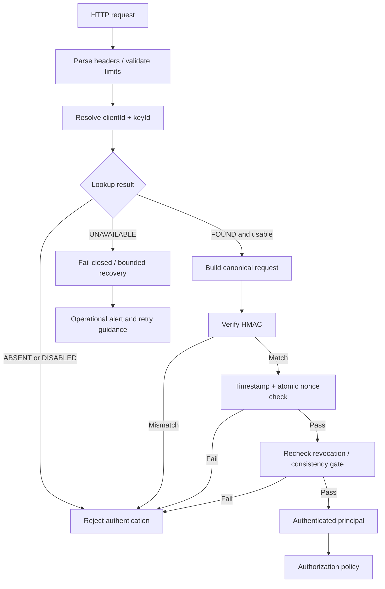

# Xử lý key lookup failure trong vận hành xác thực HMAC request

## 1. Key lookup failure là gì và vì sao nguy hiểm?

Trong module `SECURITY_AUTHENTICATION_HMAC_REQUEST_AUTHENTICATION`, client ký HTTP request bằng HMAC với **shared secret** trên một **canonical request** có thể gồm method, URI, header và body theo hợp đồng ký. Server muốn xác minh chữ ký phải chọn đúng credential/secret tương ứng với client và phiên bản khóa. Bước truy xuất credential đó gọi là **key lookup**; đây là bước phụ thuộc vào credential registry, secrets manager/KMS, cache hoặc dịch vụ định danh.

**Key lookup failure** không chỉ là trường hợp “không tìm thấy key”. Nó còn có thể xảy ra khi:

- `X-Client-Id` hoặc `X-Key-Id` không tồn tại, sai phạm vi tenant, sai định dạng hoặc bị thay đổi;
- key có tồn tại nhưng đã `REVOKED`, `SUSPENDED`, `EXPIRED` hoặc chưa có hiệu lực;
- credential registry bị timeout, trả lỗi `5xx`, read replica chậm, cache lỗi hoặc circuit breaker đang mở;
- secrets manager trả metadata nhưng không thể lấy secret material, bản key bị thiếu hoặc sai phiên bản;
- có lỗi phân quyền khi dịch vụ verifier gọi secrets manager, lỗi giải mã, lệch cấu hình giữa các node hoặc giữa các region;
- key rotation vừa chuyển từ key A sang key B nhưng bản cập nhật chưa lan truyền đồng bộ.

Khi không biết chắc credential được phép sử dụng và secret đúng là gì, verifier **không có cơ sở xác thực HMAC**. Quy tắc bất biến là **không bao giờ biến lỗi lookup thành “cho qua” xác thực**. Tuy nhiên, nếu gộp mọi lỗi thành cùng một nguyên nhân, đội vận hành cũng sẽ khó phân biệt client gửi key sai với sự cố hạ tầng đang gây từ chối hàng loạt.

Trong chương **Operations**, bài học này tập trung vào cách thiết kế **fail closed**, phân loại lỗi, chọn chiến lược cache/fallback an toàn, quan sát sự cố và kiểm thử khi key lookup bị gián đoạn. Những vấn đề liên quan timestamp/nonce chống replay, key rotation, proxy/gateway và phân biệt authentication với authorization được đặt đúng vị trí trong luồng xử lý.

### Mục tiêu học tập

Sau khi hoàn thành, người học có thể:

1. Phân biệt “credential không tồn tại” với “hệ thống không thể xác định credential có tồn tại hay không”.
2. Thiết kế kết quả lookup có kiểu rõ ràng, thay vì trả `null` hoặc coi mọi ngoại lệ là `NOT_FOUND`.
3. Xây chính sách fail closed và cân bằng availability với yêu cầu thu hồi key, đặc biệt khi cache còn dữ liệu cũ.
4. Tích hợp với pipeline Java/Spring Security mà không bỏ qua HMAC, replay prevention hoặc authorization.
5. Viết runbook, dashboard và test fault injection để xác minh hành vi khi lookup lỗi.

## 2. Bản đồ phụ thuộc: verifier cần gì để chấp nhận request?

Một thiết kế HMAC minh họa sử dụng:

- `X-Client-Id`: định danh client đã đăng ký;
- `X-Key-Id`: phiên bản credential thuộc client;
- `X-Timestamp`, `X-Nonce`: hỗ trợ ngăn request bị phát lại;
- `X-Signature`: thuật toán/phiên bản chữ ký và MAC nhận từ client.

Tên header và cú pháp trên chỉ là ví dụ. Hợp đồng thực tế có thể dùng `Authorization` hoặc trường khác. Mọi trường ảnh hưởng danh tính, key selection hoặc tài nguyên cần được **ràng buộc nhất quán** với canonical request; nếu `keyId` chỉ dùng để tra secret trước khi xác minh, tuyệt đối không được xem nó là bằng chứng client đã được xác thực.



**Điểm ràng buộc quan trọng:** nếu key lookup không thành công, không có “principal mặc định”, “anonymous nhưng cho phép route nhạy cảm” hay “chữ ký tạm hợp lệ”. Một request chỉ được đưa đến authorization sau khi HMAC được xác minh bằng credential hợp lệ, timestamp/nonce đạt yêu cầu và trạng thái key vẫn được tin cậy ở thời điểm quyết định chấp nhận.

Việc API có một số public endpoint không bắt buộc HMAC là **chính sách route được khai báo trước**, không phải ngoại lệ kích hoạt khi registry bị lỗi. Hãy phân loại đường dẫn public/private trước theo cấu hình có kiểm soát, không sửa chính sách để chữa sự cố lookup.

## 3. Phân loại kết quả lookup thành các trạng thái tường minh

Trả về `null` từ `findSecret()` cho mọi thất bại dễ làm lẫn ba tình huống rất khác nhau: không có credential, credential bị thu hồi và backend đang hỏng. Một hợp đồng nội bộ nên có ít nhất:

| Kết quả nội bộ | Diễn giải | Quyết định bảo mật | Phản hồi bên ngoài thường dùng* |
|---|---|---|---|
| `FOUND_USABLE` | Tìm đúng key thuộc client, trạng thái và thời gian cho phép dùng. | Tiếp tục tính/so sánh HMAC rồi kiểm tra replay. | Chưa quyết định; phụ thuộc các bước sau. |
| `NOT_FOUND` | Registry có thẩm quyền xác nhận không có `(clientId, keyId)` đó. | Từ chối xác thực. | `401` hoặc lỗi xác thực chung theo hợp đồng. |
| `DISABLED/REVOKED` | Credential tồn tại nhưng không còn được tin cậy. | Từ chối ngay, không có grace period khẩn cấp. | Lỗi xác thực chung; không tiết lộ chi tiết trạng thái. |
| `EXPIRED/NOT_YET_VALID` | Không hợp lệ tại thời điểm request. | Từ chối; không tự chọn key version khác. | Lỗi xác thực chung. |
| `LOOKUP_UNAVAILABLE` | Timeout, mất kết nối, `5xx`, circuit open, mất quorum. | **Fail closed**; áp dụng recovery có giới hạn nếu đáp ứng chính sách. | Có thể `503` với `Retry-After`, tùy API và chống rò rỉ thông tin. |
| `LOOKUP_FORBIDDEN` | Verifier thiếu quyền truy xuất vault/KMS hoặc bị policy từ chối. | Fail closed; đây là lỗi cấu hình/hạ tầng, không phải bad client secret. | Thường phản hồi dịch vụ không sẵn sàng nếu đã xác minh đó là lỗi backend. |
| `LOOKUP_INCONSISTENT` | Revision mâu thuẫn, key material thiếu, thuật toán không khớp, dữ liệu hỏng. | Fail closed, cảnh báo ưu tiên cao; không thử secret tùy ý. | Theo chính sách lỗi hệ thống đã chuẩn hóa. |

*Mã HTTP là ví dụ chính sách, không phải quy tắc cố định của HMAC.* Đặc biệt, public response không nên làm lộ sự khác nhau giữa client không tồn tại và key đã revoked. Số liệu nội bộ có thể chi tiết hơn nhưng phải tránh log secret, raw signature và dữ liệu nhạy cảm.

**`NOT_FOUND` chỉ đáng tin khi có phản hồi thành công từ nguồn lookup đủ thẩm quyền.** Timeout không được biến thành `NOT_FOUND` rồi ghi negative cache. Tương tự, `401` từ secrets manager khi **service account** hết quyền không có nghĩa credential của client HTTP không tồn tại; cần tách status code của dependency khỏi status code cho request.

### 3.1. Tách lỗi client, lỗi credential và lỗi backend

Ví dụ ba request:

1. Client gửi `keyId=old-key` không tồn tại; registry trả `NOT_FOUND` trong 8 ms. Bộ xác minh từ chối xác thực; dashboard có `key_not_found`.
2. Client gửi `keyId=key-a` đã `REVOKED`; registry trả trạng thái bị thu hồi. Bộ xác minh từ chối **dù HMAC có thể toán học chính xác** với secret lịch sử; dashboard có `key_revoked`.
3. Client gửi `keyId=key-b` hợp lệ; registry mất kết nối và không trả lời. Hệ thống **không biết** `key-b` hợp lệ hay bị thu hồi trong thời gian mất kết nối; dashboard có `key_lookup_unavailable` và xử lý theo fail-closed policy.

Không kết luận rằng key bị compromise chỉ vì tỷ lệ `NOT_FOUND` tăng. Một triển khai SDK sai `keyId`, lỗi case/Unicode ở identifier hoặc replication delay trong rotation có thể tạo cùng triệu chứng. Dùng tương quan deploy, region, dependency và loại lỗi để điều tra.

## 4. Các bất biến bảo mật khi lookup thất bại

**Bất biến 1 — Không có secret thay thế ngầm.** Không dùng secret rỗng, zero-filled, giá trị hardcode, “default tenant key”, bản secret của client khác hoặc một secret cũ đã revoked để thử cho bằng được. Fallback kiểu “thử hết các key còn trong cache” dễ tạo lỗ hổng cross-tenant và làm mờ sự kiện thu hồi.

**Bất biến 2 — Phạm vi lookup phải chính xác.** Truy xuất theo `(tenant/clientId, keyId)` và loại/phiên bản thuật toán đã được đăng ký. Không lấy key chỉ theo `keyId` nếu định danh không được bảo đảm toàn cục và không dùng thông tin client chưa xác thực làm quyền truy cập dữ liệu của tenant khác.

**Bất biến 3 — Revocation là ưu tiên cao nhất.** Một bản ghi `REVOKED` hoặc tombstone revocation có revision mới phải thắng bản `ACTIVE` cũ còn trong cache. Lỗi đường truyền invalidation không cho phép key bị thu hồi tiếp tục được dùng vô hạn.

**Bất biến 4 — Replay và authorization vẫn độc lập.** Sau lookup/HMAC thành công, timestamp và nonce phải được kiểm tra theo hợp đồng; khi nonce store không khả dụng cho endpoint yêu cầu anti-replay, không được bỏ qua bước đó. Authentication thành công cũng không đồng nghĩa client được quyền thao tác tài nguyên.

**Bất biến 5 — Không có bypass qua gateway/proxy.** Nếu gateway xác thực thay ứng dụng hoặc ký lại request cho downstream, phải định nghĩa trust boundary và ràng buộc danh tính. Một gateway gặp lookup error không được gắn header “authenticated” giả hoặc cho phép upstream đi tắt tới controller.

**Bất biến 6 — Giá trị quan sát không được làm rò khóa.** Metric/log chỉ ghi mã lỗi, request/correlation ID, key identifier được phép ghi, thời lượng và dependency/region. Không ghi shared secret, full HMAC, canonical request chứa dữ liệu cá nhân hay payload nguyên vẹn.

## 5. Chính sách cache khi credential registry không khả dụng

Cache cải thiện latency và giảm tải backend nhưng có nguy cơ đặc biệt trong HMAC: key còn trong cache có thể **đã bị thu hồi** tại nguồn trong khi invalidation chưa tới. Đội vận hành phải chọn rõ một trong các mô hình:

| Mô hình | Khi registry lỗi | Rủi ro / điều kiện |
|---|---|---|
| **Strong revocation gate** | Mỗi lần xác thực cần xác nhận trạng thái/revision qua thành phần đủ nhất quán. Gate lỗi → fail closed. | Bảo vệ thu hồi tốt hơn nhưng giảm availability khi gate lỗi; phải có HA và latency budget. |
| **Cache tích cực + revocation stream đáng tin** | Dùng key cache chỉ nếu bằng chứng revocation đủ mới và chưa vượt giới hạn tuổi dữ liệu; nếu thiếu → fail closed. | Cần giới hạn thời gian stale, revision monotonic, xử lý event trễ/đảo thứ tự/restart. Không bảo đảm tức thì nếu không có barrier. |
| **Stale-while-error có điều kiện** | Có thể dùng bản key gần nhất còn hiệu lực trong cửa sổ đã **được phê duyệt theo mức rủi ro**, với revocation gate độc lập đáng tin. | Không phù hợp khi chỉ có cache stale mà mất luôn khả năng biết key đã revoked. Không tự bật khi sự cố xảy ra. |
| **Không cache** | Không có backend → từ chối mọi request yêu cầu HMAC. | Đơn giản hơn, không có stale-credential fallback nhưng dependency availability là điểm yếu cần thiết kế HA. |

Không có chính sách “luôn phục vụ bằng cache nếu backend timeout” nào mặc nhiên an toàn. Tổ chức cần định nghĩa **maximum revocation propagation lag**, **maximum positive cache age**, nguồn dữ liệu có thẩm quyền và hành vi khi mất kênh revocation, đặc biệt với API tài chính/ghi dữ liệu.

### 5.1. Cache key, revision và negative cache

Một positive cache entry có thể chứa:

```text
scope:           clientId=partner-a, keyId=k-2026-11
state:           ACTIVE
stateRevision:   42
algorithm:       HmacSHA256
secretRef:       vault://.../version-7   (minh họa, không phải secret)
loadedAt:        monotonic timestamp
expiresAt:       configured expiry
```

Cache **không** được tự chuyển từ trạng thái `REVOKED revision=43` về `ACTIVE revision=42` khi message đến sai thứ tự. Phải kiểm tra `keyId`, client/tenant và revision khi merge; sự kiện revocation cần được áp dụng đến tất cả gateway, pod, region. Nếu cần giữ secret trong memory cache, giới hạn thời gian sống, quyền truy cập và khả năng bị xuất hiện trong dump/log.

**Negative cache** chỉ nên ghi nhận `NOT_FOUND` được xác nhận từ nguồn có thẩm quyền, với TTL ngắn/có giới hạn, vì một key vừa phát hành có thể chưa được biết tới ở replica. Không cache timeout/permission error như `NOT_FOUND`. Khi phát hành hoặc thu hồi credential, cần xóa/đổi phiên bản cả negative và positive cache liên quan.

### 5.2. Bẫy của key rotation

Giả sử client đã chuyển từ A sang B. Nếu một gateway chưa thấy B, nó có thể trả `NOT_FOUND` dù B tồn tại; phải điều tra replication/rollout và có thể dừng cutover, **không tự thử key A thay cho B**. Nếu A đã bị thu hồi khẩn, không dùng grace period thông thường để mở lại A. Một request phải được xác minh bằng **đúng key version được chọn trong hợp đồng**, không bởi bất kỳ secret nào làm signature khớp.

Nếu identifier `X-Key-Id` hoặc `X-Client-Id` là một phần dữ liệu quyết định identity, hợp đồng canonicalization phải ràng buộc chúng, ví dụ đưa vào signed headers. Nếu chúng chỉ dùng để tra khóa trước khi xác minh, verifier vẫn phải xác nhận danh tính và quy tắc ánh xạ sau khi signature hợp lệ; không cho phép đổi `keyId` làm đổi tenant/role mà không có kiểm soát.

## 6. Timeout, retry, circuit breaker và bulkhead

Một lần key lookup chậm có thể giữ thread/connection, làm trễ toàn API, rồi gây “retry storm” nếu client, gateway và ứng dụng cùng retry không giới hạn. Các quy tắc vận hành:

1. **Timeout trong ngân sách request.** Xác định timeout cho registry/vault theo latency SLO của endpoint; dùng deadline tổng thay vì mỗi lần retry lại được cấp toàn bộ thời gian.
2. **Retry có giới hạn và jitter.** Chỉ retry lỗi **transient** có khả năng hồi phục (ví dụ kết nối bị reset, `503` từ backend), tối đa số lần rất nhỏ trong deadline. Không retry `NOT_FOUND`, `REVOKED` hay lỗi xác thực của service account.
3. **Circuit breaker đúng phạm vi.** Khi dependency liên tục lỗi, mở circuit để giảm tải; khi circuit mở, kết quả là `LOOKUP_UNAVAILABLE`, **không phải FOUND**. Half-open thử phục hồi có kiểm soát.
4. **Bulkhead và concurrency limit.** Giới hạn số lookup đang chờ theo dependency; tránh một tenant/client có lưu lượng bất thường làm cạn tài nguyên của verifier phục vụ các tenant khác.
5. **Rate limiting/abuse controls.** Chặn việc liệt kê `keyId` với số lượng lớn; cap độ dài identifier, định dạng và kích thước header trước lookup. Áp dụng giới hạn phù hợp để không biến key store thành oracle xác nhận credential.
6. **Single-flight/coalescing.** Nhiều request đồng thời tra cùng key có thể dùng một lần tải về nếu thiết kế cache phù hợp; phải bảo đảm trạng thái `REVOKED` vẫn được áp dụng trước khi chấp nhận request.

Ví dụ tính ngân sách (số liệu **minh họa**, không phải SLO mặc định): request có budget 200 ms, parser/canonical/HMAC/replay chiếm tối đa 80 ms và network overhead 40 ms thì phần lookup còn khoảng 80 ms. Không đặt 3 lần retry, mỗi lần timeout 150 ms: tổng đó vượt ngân sách và làm lỗi dây chuyền. Thay vào đó cần một deadline tổng và khả năng trả lỗi nhanh khi backend unhealthy.

Khi backend thật sự down, trả `503` cùng `Retry-After` (nếu hợp đồng cho phép và hệ thống bảo đảm không tiết lộ trạng thái từng credential), kèm client retry với backoff/jitter. Không khuyến khích client retry các request nghiệp vụ không idempotent nếu không có idempotency key hoặc cơ chế chống nhân đôi tác dụng; timestamp/nonce còn làm chữ ký cũ có thể hết hiệu lực trong quá trình retry.

## 7. Phác thảo triển khai Java/Spring Security

### 7.1. Tách resolver khỏi HMAC verifier

Các kiểu dưới đây là **pseudocode gần Java 17** để diễn đạt contract, không phải class sẵn có trong Spring Security. Mục tiêu là tránh một hàm `findKey()` ném mọi ngoại lệ rồi bị catch và coi là anonymous.

```java
// Các type HmacCredential, LookupFailure, RequestData... thuộc ứng dụng.
sealed interface KeyLookupResult
        permits KeyFound, KeyAbsent, KeyDenied,
                KeyUnavailable, KeyInconsistent { }

record KeyFound(HmacCredential key) implements KeyLookupResult { }
record KeyAbsent() implements KeyLookupResult { }
record KeyDenied(KeyState state) implements KeyLookupResult { }
record KeyUnavailable(String dependency, String reason)
        implements KeyLookupResult { }
record KeyInconsistent(String reason) implements KeyLookupResult { }

interface HmacKeyResolver {
    KeyLookupResult lookup(String clientId, String keyId, Instant now);
}

AuthenticationResult authenticate(RequestData request) {
    ParsedHeaders h = parseStrictly(request); // missing/duplicate -> reject
    KeyLookupResult lookup = resolver.lookup(
        h.clientId(), h.keyId(), clock.instant());

    if (lookup instanceof KeyAbsent) {
        metrics.increment("hmac_key_not_found");
        throw genericInvalidCredential();
    }
    if (lookup instanceof KeyDenied denied) {
        metrics.increment("hmac_key_denied", denied.state().name());
        throw genericInvalidCredential();
    }
    if (lookup instanceof KeyUnavailable unavailable) {
        metrics.increment("hmac_key_lookup_unavailable",
                          unavailable.dependency());
        throw hmacServiceUnavailable(); // Không gọi controller.
    }
    if (lookup instanceof KeyInconsistent) {
        metrics.increment("hmac_key_lookup_inconsistent");
        throw hmacServiceUnavailable(); // Fail closed, cần cảnh báo.
    }

    HmacCredential key = ((KeyFound) lookup).key();
    // Validate again: active/grace policy, tenant, version, expiry.
    if (!key.isUsableFor(h.clientId(), h.keyId(), clock.instant())) {
        throw genericInvalidCredential();
    }

    byte[] canonical = canonicalizer.buildFromRawRequest(request, h);
    byte[] supplied = signatureCodec.decodeAndCheckLength(h.signature());
    byte[] expected = hmacSha256(key.secretBytes(), canonical);
    if (!MessageDigest.isEqual(expected, supplied)) {
        throw genericInvalidCredential();
    }

    freshnessPolicy.requireValid(h.timestamp(), clock.instant());
    nonceStore.markOnceOrReject(h.clientId(), h.keyId(), h.nonce());

    // Nếu dùng cache, cổng này phải có ngữ nghĩa revocation nhất quán
    // với cam kết về thời điểm key có hiệu lực hoặc bị thu hồi.
    if (!revocationGate.allows(
            h.clientId(), h.keyId(), key.stateRevision())) {
        throw genericInvalidCredential();
    }
    return AuthenticationResult.authenticated(key.clientId());
}
```

Lưu ý mã trên **chỉ minh họa thứ tự và phân loại lỗi**: các interface, phần parser, cơ chế quản lý secret, thử lỗi, signature version và transaction chống replay đều phải được triển khai đúng hợp đồng. Với yêu cầu chống replay và thu hồi đồng thời nghiêm ngặt, thứ tự `markOnceOrReject` và kiểm tra gate phải đi kèm chính sách atomicity/rollback rõ ràng; không mặc định rằng một lần đọc revocation ở cuối loại bỏ mọi race với lệnh thu hồi đang commit.

Trong **Spring Security Servlet**, có thể đặt bước xác thực ở một `OncePerRequestFilter` hoặc một `AuthenticationProvider` được kết nối với filter phù hợp. Với **Spring WebFlux**, sử dụng `WebFilter`/`ReactiveAuthenticationManager` và API async/non-blocking; không gọi backend blocking trên event loop. Hai stack cần cùng chính sách:

- Credential absent/revoked → authentication không thành công, không xây dựng `SecurityContext` đã xác thực.
- Backend lookup unavailable → response lỗi vận hành theo hợp đồng, không fallback thành successful/permit-all.
- HMAC mismatch → từ chối xác thực; timestamp/nonce chỉ được xử lý theo hợp đồng chống replay.
- Authentication thành công → chuyển sang `AuthorizationManager` hoặc policy tương ứng để kiểm tra role/scope/tenant/resource.
- Request không yêu cầu HMAC → chỉ được bỏ qua nếu route đã định nghĩa **trước đó** bằng cấu hình bảo mật rõ ràng.

Nên có handler riêng ánh xạ lỗi key lookup hạ tầng sang phản hồi `503` thích hợp, nhưng vẫn bảo đảm proxy/caching layer không cache nhầm lỗi hoặc bộc lộ `keyId` hiện hữu. Với mã `401` nên đặt response header phù hợp với scheme của API, không sao chép thông báo nội bộ `key not found`/`key revoked` ra client.

### 7.2. Tránh hai lỗi triển khai thường gặp

**Anti-pattern A — Catch rồi đi tiếp:**

```java
// SAI: lỗi backend bị chuyển thành bỏ qua authentication.
try {
    key = resolver.find(clientId, keyId);
} catch (Exception ex) {
    filterChain.doFilter(request, response); // bypass nguy hiểm
    return;
}
```

**Anti-pattern B — Default secret:**

```java
// SAI: không tồn tại key -> dùng shared secret mặc định.
byte[] key = resolver.find(clientId, keyId)
        .orElse(DEFAULT_SHARED_SECRET);
```

Đúng hơn, handler phải **kết thúc nhánh xác thực không thành công** hoặc ném exception đã phân loại để framework trả lỗi; đồng thời ghi telemetry tối thiểu và không gọi downstream business handler. Với lỗi backend, đội vận hành nên biết *dependency nào lỗi* thay vì chỉ thấy biểu đồ `401` tăng.

## 8. Quan sát, SLO và cảnh báo trong production

Những metric hữu ích (đặt tên ví dụ, tùy hệ telemetry thực tế):

| Metric / tín hiệu | Ý nghĩa và chú ý |
|---|---|
| `hmac_key_lookup_total{outcome}` | Tỷ lệ `FOUND`/`NOT_FOUND`/`DENIED`/`UNAVAILABLE`/`INCONSISTENT`. |
| `hmac_key_lookup_duration_seconds{dependency,region}` | p50/p95/p99, timeout và queue time của dependency. |
| `hmac_key_cache_hit_total{type}` | Cache hit/miss, negative hit, stale attempted/blocked; phân biệt rõ fallback được phép và bị chặn. |
| `hmac_key_revocation_lag_seconds` | Độ trễ từ commit thu hồi đến khi verifier cuối cùng áp dụng revision. |
| `hmac_auth_rejection_total{reason_class}` | Phân biệt lỗi credential, chữ ký, freshness, nonce và phân quyền. |
| `hmac_key_lookup_dependency_health` | Circuit breaker, connection saturation, permission error, error budget. |
| `hmac_key_rotation_propagation_lag` | Thời gian key version mới có thể dùng ở toàn bộ vùng/điểm xác minh. |

Tránh gắn `clientId`/`keyId` tùy ý vào **metric label có cardinality cao**. Nếu cần phân tích per-client, dùng log có kiểm soát truy cập hoặc aggregation đã băm/ẩn danh phù hợp. Request logging chỉ cần request ID, environment, region, outcome, dependency, elapsed time, policy/canonical version và key identifier trong giới hạn cho phép. Không log raw secret, toàn signature hoặc payload/canonical request chứa dữ liệu nhạy cảm.

Định nghĩa các mục tiêu vận hành riêng:

- **Lookup availability:** bao nhiêu phần trăm lượt tra key hợp lệ trả về kết quả có thẩm quyền trong deadline?
- **Lookup latency:** p95/p99 lookup có nằm trong budget của toàn request?
- **Revocation freshness:** từ lúc revoke có hiệu lực ở nguồn đến lúc mọi verifier từ chối key cũ mất bao lâu?
- **Rotation readiness:** mất bao lâu từ khi key B được phát hành đến khi tất cả node chấp nhận B?
- **Authentication correctness:** trong fault injection, có đường nào bỏ qua HMAC hoặc chấp nhận key revoked không?

SLO thực tế là quyết định của hệ thống, không tự áp cùng một thời hạn cho mọi API. Cảnh báo nên dựa trên sự tăng đột biến của `UNAVAILABLE`, latency, circuit open, stale positive cache và revocation lag; kết hợp với deploy/rotation gần đây để giảm báo động giả.

## 9. Runbook xử lý sự cố key lookup

### Bước 1 — Xác nhận triệu chứng và mức tác động

Xác định request bị ảnh hưởng tập trung ở một client, một region, một node hay toàn hệ thống. Phân rã theo `NOT_FOUND`, `REVOKED`, `UNAVAILABLE` và `INCONSISTENT`. Ước lượng tỷ lệ lỗi, loại endpoint, thời gian bắt đầu, có liên quan deploy/cert/credential rotation hay không.

**Không** kết luận `NOT_FOUND` là backend outage nếu registry vẫn trả lời có thẩm quyền; cũng **không** kết luận client gửi sai key khi tất cả node đồng thời timeout. Kiểm tra health của secrets manager, credential registry, DNS/TLS, quyền của service account, quota/throttle, connection pool và lệch giờ.

### Bước 2 — Giữ fail closed và cô lập lỗi

Xác nhận filter/security chain tiếp tục chặn request không được xác minh. Nếu gateway/proxy hoặc service có nhánh bypass khi backend lỗi, ưu tiên vô hiệu hóa nhánh đó và chặn ingress nhạy cảm theo playbook sự cố. Đừng “giảm security” bằng cách bỏ chữ ký hoặc bỏ kiểm tra revocation.

Giới hạn retry/concurrency, kích hoạt circuit breaker nếu đã được thiết kế, mở rộng năng lực dependency hoặc chuyển sang replica/vùng **có trạng thái key đủ thẩm quyền và revocation cập nhật**. Không chuyển sang bản backup chứa key `ACTIVE` cũ khi key có thể đã `REVOKED`.

### Bước 3 — Kiểm tra propagation và rotation

So sánh revision/trạng thái `(clientId, keyId)` trên nguồn có thẩm quyền và trên từng gateway/node, không truy vấn hoặc in secret thô. Nếu key mới B bị `NOT_FOUND` sau cutover, kiểm tra invalidation, negative cache, replication, cấu hình ID và timestamp activation. Nếu key cũ A đã revoked, **không bật lại A** chỉ để khôi phục tỷ lệ thành công.

Kiểm tra `X-Key-Id`, `X-Client-Id` và các signed headers mà verifier thực nhận sau proxy. Việc gateway rewrite URI/header có thể làm HMAC mismatch **sau khi lookup thành công**; đừng nhầm đó thành lỗi lookup. Có thể phát sinh đồng thời cả hai nhóm lỗi, nên chẩn đoán theo stage riêng.

### Bước 4 — Phục hồi theo giai đoạn và kiểm chứng

Sau khi dependency ổn định, cho phép circuit breaker half-open thử có giới hạn; theo dõi latency, tỷ lệ `FOUND`, rejection reason và cache age. Chạy test request có HMAC hợp lệ với key `ACTIVE` và nonce/timestamp mới, test key `REVOKED` có **chữ ký hợp lệ nhưng phải bị từ chối**, test key không tồn tại và test thiếu quyền tài nguyên.

Trong giai đoạn sự cố, request đã thất bại có thể được client retry. Đối với thao tác ghi, phải đánh giá idempotency, trạng thái nonce và transaction trước khi replay request nghiệp vụ; không tùy tiện nhận lại request chỉ vì hệ thống đã hồi phục.

### Bước 5 — Tổng kết và ngăn tái diễn

Lưu incident timeline, các điểm verifier bị tác động, lỗi dependency, nguyên nhân gốc, chính sách cache đã áp dụng, độ trễ revocation/rotation và bằng chứng fail-closed. Tạo hành động cải tiến có owner: HA/permission monitoring của secret store, policy về TTL/negative cache, deadline, canary, chaos tests và runbook rollback **không hồi sinh secret đã compromise**.

## 10. Ma trận kiểm thử lỗi và tiêu chí hoàn thành

Không đủ để chỉ test `keyId` không tồn tại. Cần chủ động gây lỗi ở từng tầng, đồng thời kiểm tra **chữ ký hợp lệ** khi muốn chứng minh cơ chế chặn do lookup/credential state, tránh việc HMAC sai che đi lỗi khác.

| Test case | Thiết lập và fault injection | Kết quả mong đợi |
|---|---|---|
| Key hợp lệ | Registry trả `ACTIVE`, đúng client/version/secret, timestamp/nonce mới. | HMAC pass rồi vào authorization đúng chính sách. |
| Unknown key | Registry trả `NOT_FOUND` có thẩm quyền. | Từ chối xác thực; không lấy default secret và không xử lý nghiệp vụ. |
| Revoked key | Key tồn tại, `REVOKED`; request ký **đúng bằng secret cũ**. | Vẫn bị từ chối; không chuyển sang grace/fallback. |
| Wrong client key | Cùng `keyId` ở tenant khác hoặc cố dùng secret client A làm client B. | Không dùng key cross-tenant; xác thực thất bại. |
| Lookup timeout | Delay vượt deadline; circuit chưa mở. | Có outcome `UNAVAILABLE`; fail closed và telemetry đúng. |
| Backend 5xx | Registry trả `503` hoặc network reset. | Retry giới hạn trong deadline, sau đó fail closed; không biến thành `NOT_FOUND`. |
| Backend 401/403 | Verifier service account không được truy xuất secret. | Báo lỗi hạ tầng/permission; không coi client key không tồn tại. |
| Circuit open | Lookup bị chặn nhanh do circuit breaker. | Fail closed, không truy vấn ồ ạt; half-open kiểm soát sau. |
| Stale cache | Cache A `ACTIVE rev10`, nguồn A `REVOKED rev11`. | Revision/gate ngăn A được chấp nhận. |
| Out-of-order event | Rev11 đến trước rev10. | Cache không ghi đè trạng thái revoked bằng active cũ. |
| Negative cache sau phát hành | B vừa được tạo, trước đó có `NOT_FOUND` cache. | Invalidation/TTL cho phép B hoạt động theo rollout SLO. |
| Rotation key mới | Client chuyển sang B, replica cũ chưa biết B. | Từ chối an toàn và cảnh báo propagation; không thử key A thay. |
| Nonce store outage | Lookup + HMAC đúng, nhưng nơi ghi nonce lỗi. | Không bỏ qua anti-replay đối với route bắt buộc. |
| Chữ ký sai | Key `ACTIVE` được tra thành công, signature sai. | Authentication fail, không đổ lỗi cho lookup. |
| Authorization fail | Lookup/HMAC thành công nhưng principal thiếu quyền. | Từ chối theo authorization, không báo key lookup failure. |
| Gateway rewrite | URI/header bị biến đổi ở ingress. | Phân biệt HMAC/canonical mismatch với lookup error. |
| Concurrent load | Nhiều key miss và lookup chậm cùng lúc. | Không cạn thread pool; bulkhead, rate limit, circuit hoạt động. |
| Multi-region outage | Một region mất registry nhưng vùng khác bình thường. | Region lỗi fail closed; failover chỉ tới nguồn revocation đáng tin. |

**Acceptance criteria** cho bài thực hành:

1. Có cấu trúc kết quả lookup phân biệt `FOUND`, `NOT_FOUND`, `DENIED`, `UNAVAILABLE` và `INCONSISTENT`; các trạng thái này không bị catch chung rồi đi tiếp.
2. Mọi request không có credential đáng tin cậy đều **không được xác thực**, không gọi controller nhạy cảm và không cấp principal có quyền.
3. Key đã `REVOKED` không được chấp nhận từ positive cache cũ; timeout không được ghi vào negative cache; rotation không tái kích hoạt key cũ.
4. Fault injection chứng minh timeout/retry/circuit breaker đáp ứng deadline và không tạo retry storm.
5. Dashboard phân biệt lỗi lookup, signature, freshness, replay và authorization; người trực có runbook khôi phục mà không phải giảm mức bảo mật.

### Bài tập thực hành

Giả lập một dịch vụ Spring Security xác minh request HMAC từ hai client `merchant-a` và `merchant-b`. Resolver truy vấn credential registry có cache local. Tạo bộ test với fake clock, fake nonce store và fake registry:

- Gửi request hợp lệ của `merchant-a`, sau đó cho registry timeout nhưng cache vẫn giữ bản key cũ: mô tả chính sách hệ thống chọn (fail closed hay dùng cache **kèm revocation gate đáng tin**), chỉ rõ giới hạn cửa sổ stale.
- Thu hồi khẩn key của `merchant-a` ở revision 12, cố đưa event `ACTIVE rev11` tới cache sau event `REVOKED rev12`; chứng minh request ký đúng bằng old secret vẫn bị từ chối.
- Phát hành key version mới cho `merchant-b` và cố tình giữ negative cache từ trước; kiểm thử invalidation, latency rollout và khác biệt giữa `NOT_FOUND` với backend `UNAVAILABLE`.
- Thử request HMAC hợp lệ nhưng thiếu scope; chỉ ra rằng đây là **authorization failure**, không phải key lookup failure.

Kết quả tốt là một triển khai **không bao giờ vượt qua xác thực khi lookup không đủ tin cậy**, đồng thời chẩn đoán được lỗi hạ tầng nhanh, xử lý key rotation/revocation đúng và không nhầm với các lỗi canonical request, nonce hoặc phân quyền.
