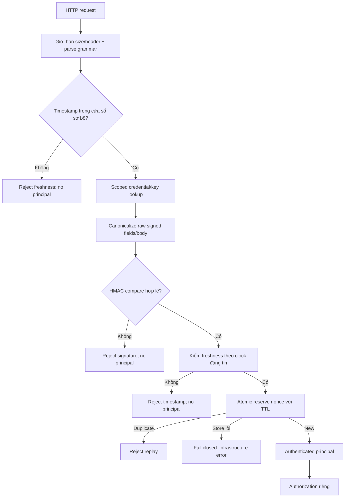

# Xử lý clock drift trong vận hành xác thực HTTP request bằng HMAC

## 1. Bài toán và kết quả học tập

Trong chương **Operations**, chủ đề **Xử lý clock drift** trả lời câu hỏi: khi đồng hồ của client, gateway, backend hoặc cụm lưu nonce không nhất quán, hệ thống HMAC phải vận hành thế nào để vừa hạn chế request hợp lệ bị từ chối, vừa không tạo ra cơ hội phát lại hay đường bỏ qua xác thực?

Bài thuộc mô-đun `SECURITY_AUTHENTICATION_HMAC_REQUEST_AUTHENTICATION`. Theo hợp đồng, client dùng **shared secret** để tạo HMAC trên **canonical request**, có thể bao gồm method, URI, signed headers và/hoặc body. Timestamp và nonce phải nằm trong dữ liệu đã ký để server kiểm độ mới và chống replay; key rotation, proxy/gateway, authentication và authorization là những ranh giới liên quan. Một request có tag HMAC đúng **vẫn không được xác thực** nếu timestamp không hợp lệ, nonce đã dùng hoặc key hết hiệu lực.

Thực tế vận hành có nhiều nguyên nhân làm lệch thời gian: dịch vụ NTP/chrony không đồng bộ, VM tạm dừng rồi resume, host/container mất kết nối time source, một node bước đồng hồ ngược, mobile client bị chỉnh giờ, timestamp được tạo quá sớm trong queue, gateway retry sau timeout hoặc ứng dụng nhầm timezone/đơn vị giây và mili giây. Dấu hiệu thường thấy là tăng 401/`TIMESTAMP_EXPIRED` hoặc `TIMESTAMP_TOO_FAR_IN_FUTURE` sau deploy, nhưng **không thể kết luận có clock drift chỉ từ HTTP status**.

Sau bài học, người học có thể:

- Phân biệt **wall-clock time**, **monotonic elapsed time**, **clock offset/skew** và **clock drift**.
- Định nghĩa hợp đồng timestamp, cửa sổ chấp nhận trước/sau, quy tắc biên, yêu cầu đồng bộ nguồn thời gian và độ sai số được phép.
- Phân biệt lỗi clock thật với lỗi canonicalization, Base64, key rotation, signed timestamp mutation và replay.
- Tính và kiểm TTL nonce đủ bao phủ cửa sổ timestamp trên nhiều node có sai số đồng hồ.
- Dùng Java `Clock` để tách logic khỏi đồng hồ hệ thống, viết kiểm thử ranh giới và fault injection.
- Quan sát NTP health, server time offset, rejected reasons, request latency và gateway/Redis health mà không gắn raw timestamp/nonce làm metric label.
- Lập runbook triage–containment–recovery an toàn khi một cụm bị clock skew hoặc time source không đáng tin.

**Nguyên tắc xuyên suốt:** clock drift là một vấn đề **đồng bộ thời gian và chính sách xác thực**, không phải lý do để tắt timestamp/nonce hoặc âm thầm nới cửa sổ chấp nhận không giới hạn.

## 2. Các khái niệm cần phân biệt

| Thuật ngữ | Ý nghĩa | Liên hệ với HMAC |
| --- | --- | --- |
| **Wall clock** | Thời gian lịch, như UTC instant tại một thời điểm. Có thể bị điều chỉnh hoặc nhảy. | Dùng để so signed timestamp với giới hạn `now ± window`. |
| **Monotonic clock** | Bộ đo khoảng thời gian trôi qua theo tiến trình, không phụ thuộc việc đổi múi giờ/điều chỉnh lịch thông thường. | Đo timeout/latency trong một process; **không** trực tiếp thay thế UTC timestamp từ client. |
| **Clock offset / skew** | Chênh lệch giữa hai đồng hồ ở cùng một thời điểm tham chiếu. | Server nhanh/chậm hơn client làm timestamp tưởng như quá cũ hoặc quá xa tương lai. |
| **Clock drift** | Tốc độ chạy của một đồng hồ lệch chuẩn, khiến offset tăng theo thời gian. | Một node có thể đang đúng lúc khởi động nhưng lệch dần sau nhiều giờ. |
| **Clock step** | Thời gian wall clock được chỉnh nhảy đột ngột. | Có thể khiến request mới bị reject hoặc kéo dài/thu hẹp cửa sổ freshness tức thì. |
| **Clock slew** | Đồng hồ được hiệu chỉnh dần bằng thay đổi tốc độ. | Thường giảm nhảy thời gian nhưng vẫn cần giám sát offset trong khi chỉnh. |
| **Timestamp freshness window** | Khoảng tuổi request server cho phép so với trusted `now`. | Giới hạn request ký cũ/tương lai có thể được chấp nhận. |
| **Replay window** | Thời gian có thể phát lại một request ký hợp lệ nếu nonce guard không hoạt động. | Càng nới freshness window thì càng cần bảo đảm lưu nonce đủ lâu. |
| **Clock uncertainty** | Giới hạn mức sai số có thể tin của nguồn thời gian. | Khi sai số quá lớn, không thể khẳng định freshness đúng; cần containment/fail closed. |

### 2.1. Ví dụ skew đơn giản

Giả sử client và server tại cùng một instant thực:

```text
Thời gian đúng tham chiếu:       12:00:00 UTC
Client clock:                     12:00:40 UTC (nhanh 40 giây)
Server clock:                     12:00:00 UTC
Client tạo X-Timestamp:          12:00:40 UTC
```

Nếu server chỉ chấp nhận timestamp **tối đa 30 giây trong tương lai**, request bị `TIMESTAMP_TOO_FAR_IN_FUTURE` dù MAC được tạo đúng. Điều này khác với việc attacker sửa `X-Timestamp` sau khi ký: khi header timestamp là một phần canonical request, sửa header mà giữ tag cũ sẽ gây **MAC mismatch**, không phải bằng chứng clock drift.

Ngược lại, một client chậm 400 giây với cửa sổ quá khứ 300 giây có thể tạo request có MAC đúng nhưng bị xem là expired. Clock offset mang tính quan hệ: không chỉ client nhanh/chậm mà **server, gateway hoặc node được chọn** cũng có thể sai.

### 2.2. Wall time khác elapsed time

- Để đọc `X-Timestamp` của request, dùng **trusted wall-clock UTC** của verifier, ví dụ `Instant.now(clock)`.
- Để đo “việc xác thực mất bao lâu”, dùng timer dựa trên nguồn elapsed/monotonic thích hợp của framework (`Timer` của Micrometer hoặc `System.nanoTime()` để tính duration trong cùng JVM).
- Không lấy `System.nanoTime()` để đổi thành một thời điểm UTC cho timestamp validation: gốc của giá trị nanosecond là tùy process/runtime, không phải Unix epoch.
- Không dùng `LocalDateTime.now()` và timezone máy làm timestamp HMAC khi hợp đồng yêu cầu UTC; `Instant` biểu diễn thời điểm độc lập múi giờ.

## 3. Hợp đồng timestamp phải chính xác đến định dạng và biên

Một ví dụ contract `HMAC-V1` để học:

- `X-Timestamp` bắt buộc, **đúng một giá trị**.
- Timestamp dùng UTC ISO-8601 chính xác đến giây, dạng `yyyy-MM-dd'T'HH:mm:ss'Z'`, ví dụ `2026-11-28T03:00:00Z`.
- Không nhận giá trị thiếu `Z`, thêm phần nghìn giây, dùng offset `+07:00` hoặc epoch milliseconds nếu contract không công bố hỗ trợ.
- Timestamp được đưa vào **canonical request** cùng version, method, URI, signed headers, body digest và nonce.
- `maxPast = 300 giây`; `maxFuture = 30 giây` là **cấu hình minh họa**, không phải giới hạn mặc định của HMAC hay Spring Security.
- Tại một giá trị `now` duy nhất đọc từ clock verifier, timestamp hợp lệ khi:

```text
now - maxPast <= signedTimestamp <= now + maxFuture
```

Hai ranh giới trên **được bao gồm** theo ví dụ; production phải quyết định rõ tính bao gồm hay loại trừ và kiểm thử tương ứng.

| Server now | Signed timestamp | Tuổi request theo server | Kết quả ví dụ |
| --- | --- | --- | --- |
| `03:00:00Z` | `02:54:59Z` | 301 giây trước | `EXPIRED` |
| `03:00:00Z` | `02:55:00Z` | 300 giây trước | `VALID` |
| `03:00:00Z` | `03:00:00Z` | Hiện tại | `VALID` |
| `03:00:00Z` | `03:00:30Z` | 30 giây tương lai | `VALID` |
| `03:00:00Z` | `03:00:31Z` | 31 giây tương lai | `TOO_FAR_IN_FUTURE` |
| `03:00:00Z` | `03:00:00.000Z` | Sai định dạng HMAC-V1 demo | `MALFORMED` |
| `03:00:00Z` | `10:00:00+07:00` | Cùng instant nhưng wire format không đúng | `MALFORMED` |

**Không dùng phép đo thời gian để thay phép kiểm MAC.** Timestamp nằm trong message được ký để attacker không thể dịch chuyển tuổi request bằng cách sửa header. Nếu hợp đồng có một signed field khác bị đổi, MAC phải sai; freshness và signature integrity là hai điều kiện độc lập cần được kiểm.

### 3.1. Thứ tự xử lý request

Có thể tối ưu bằng cách parse timestamp và từ chối request **rõ ràng sai format hoặc ngoài cửa sổ** trước khi tính HMAC, nhằm giảm CPU khi gặp traffic giả. Nhưng khi đó outcome chỉ chứng minh **input timestamp trên wire không hợp lệ**, không chứng minh người sở hữu credential đã ký một timestamp sai.

Nếu cần xác nhận nguyên nhân drift của một client **đã xác thực**, cách đáng tin là đánh giá time difference của **timestamp nằm trong request có MAC đúng**. Production thường cần cân bằng:



Sơ đồ cho phép một kiểm freshness sơ bộ để giảm tải, rồi kiểm lại theo **đúng thời điểm/policy được định nghĩa**. Không có nghĩa production bắt buộc kiểm freshness hai lần: một pipeline cũng có thể verify MAC trước freshness. Quan trọng là trường hợp request bị delay qua key store/body hashing phải có một mốc thời gian kiểm tra rõ, đồng nhất, không để request đã quá hạn tạo side effect.

**Tuyệt đối không reserve nonce trước khi có bằng chứng MAC/key hợp lệ** nếu điều đó cho phép request giả mạo chiếm nonce namespace của client thật.

## 4. Clock drift tác động tới các lớp nào?

### 4.1. Client clock

- Thiết bị di động/IoT có thể mất đồng bộ thời gian, tắt máy lâu, chỉnh tay hoặc khởi động từ RTC sai.
- SDK có thể tạo timestamp **khi xây request**, rồi để request nằm trong hàng đợi trước khi gửi.
- Retry có thể gửi lại cùng request với timestamp cũ và nonce đã được dùng; nếu retry là một **attempt mới**, cần có contract ký mới và idempotency nghiệp vụ.
- Một client dùng local timezone nhưng serialize thiếu `Z` có thể gửi instant khác hoàn toàn với ý định.

Giải pháp là kiểm clock synchronization, đặt timestamp càng gần lúc gửi càng tốt, theo policy tin cậy; đồng bộ UTC và dùng thư viện thời gian ổn định. Không cho client tự đặt `X-Timestamp` tùy ý trong request ngoài signer có trách nhiệm kiểm format.

### 4.2. Verifier backend nhiều node

Nếu node A lệch +60 giây, node B lệch -60 giây, cùng một request có thể được đánh giá khác nhau. Load balancer làm lỗi trông “ngẫu nhiên”, nhất là timestamp sát biên.

Giải pháp: mọi node verifier phải có **time-source health policy** và mức sai số cho phép; đưa node có đồng hồ mất tin cậy ra khỏi luồng xử lý yêu cầu freshness thay vì mở rộng window toàn cụm. Sử dụng nguồn thời gian được quản trị, nhất quán với topology và có telemetry trên từng node.

### 4.3. Gateway và TLS termination

Gateway có thể:

- Xác thực HMAC **trước khi** rewrite URI, rồi chuyển assertion danh tính tin cậy sang backend.
- Chỉ terminate TLS và forward HTTP, còn backend verify HMAC.
- Ghi nhận `Date`/request time hoặc phân phối qua nhiều region với clock offset khác nhau.
- Queue/retry request, làm timestamp già đi trước khi tới verifier.

Cần biết **điểm kiểm freshness có thẩm quyền** là ở đâu. Nếu gateway là verifier thì clock gateway phải đáng tin; nếu backend là verifier, clock backend quyết định, không dùng một header thời gian từ proxy không xác thực để “sửa now”. Header `Date` hoặc `X-Server-Time` tự khai không phải nguồn thời gian tin cậy cho quyết định xác thực.

TLS chỉ bảo vệ kênh truyền khi được cấu hình đúng; nó **không** thay cơ chế kiểm timestamp/nonce hoặc khắc phục clock drift.

### 4.4. Replay store và TTL

Khi MAC đúng và freshness đạt, nonce cần được reserve atomically trong kho chia sẻ. Một node nhanh/chậm có thể ảnh hưởng:

- Khoảng thời gian mà nonce phải còn tồn tại.
- Thời gian hết hạn khi Redis hoặc database sử dụng wall-clock time.
- Việc tạo nhiều request hợp lệ có timestamp sát ranh giới trên các node khác nhau.
- Bảo đảm sau failover/eviction/restart nonce không bị quên khi vẫn còn khả năng request được chấp nhận.

Giữ freshness policy, nonce TTL và khả năng mất đồng bộ của **cả verifier lẫn replay store** trong cùng threat model.

## 5. Tính TTL nonce đúng khi có clock skew

Một lỗi vận hành phổ biến: cửa sổ quá khứ cho phép 300 giây nên nonce key cũng được lưu đúng 300 giây. Điều này có thể **không đủ**.

Giả sử:

- `maxPast = 300s`;
- `maxFuture = 30s`;
- Một request đầu tiên tới server khi signed timestamp nằm **30 giây trong tương lai**, vẫn hợp lệ.

Ở thời điểm đầu `T0`:

```text
serverNow(T0) = 12:00:00
signedTime    = 12:00:30  (maxFuture)
lastAllowedBySameClock = 12:05:30  (signedTime + maxPast)
minimumRemainingLifetime = 330 giây
```

Nếu TTL chỉ 300 giây từ lúc reserve đầu, Redis có thể xóa nonce lúc 12:05:00 trong khi request có cùng timestamp vẫn hợp lệ đến 12:05:30. Bản sao request **có thể được chấp nhận lần nữa** nếu nonce đã bị xóa.

### Quy tắc thiết kế bảo thủ

Đối với một cửa sổ đối xứng theo **hai phía** của trusted `now` và TTL bắt đầu tại lần reserve đầu:

```text
minimumTTL >= maxPast + maxFuture
              + boundOnVerifierClockDifferences
              + safetyMarginForProcessingAndStore
```

Công thức là **quy tắc capacity planning mang tính bảo thủ**, không thay thế mô hình chính xác của từng hệ thống. Ví dụ: `300 + 30 + 10 = 340 giây` nếu 10 giây đã được xác định đủ cho chênh lệch giữa node và sai số khác. Các node có lệch lớn hơn margin làm mất bảo đảm; phải khôi phục time synchronization hoặc fail closed.

Trong production, có thể tính TTL theo `signedTimestamp + maxPast` và thời điểm reserve của verifier, sau đó cộng margin. Cách đó tiết kiệm memory so với TTL cố định max-window nhưng cần phân tích race, các node có clock khác nhau và min TTL. Đừng giảm TTL dưới mức bảo vệ chỉ để giảm Redis memory.

### 5.1. Một lệnh reserve nguyên tử

Với Redis, có thể dùng cú pháp khái niệm:

```text
SET replay:<client-scope>:<keyId>:<nonce> 1 NX PX <ttlMillis>
```

- `NX` bảo đảm chỉ tạo key nếu chưa tồn tại.
- `PX` đặt thời hạn tính theo milliseconds trong **cùng một lệnh nguyên tử**.
- `SET NX` thành công nghĩa là nonce mới đối với key namespace đó; không dùng `EXISTS` rồi `SET`.
- Namespace gồm định danh được ràng buộc với credential đã xác minh, không lấy raw tenant/client từ header chưa có MAC làm authority.
- Không log full Redis key nếu chứa nonce/ID nhạy cảm.
- Cần giới hạn memory, eviction policy và kiểm độ bền/failover; nếu nonce bị evict sớm, hệ thống có thể bỏ chặn replay dù TTL toán học đúng.

**Chú ý đồng hồ Redis:** TTL là chức năng của kho dữ liệu, không phải một chứng cứ rằng clock verifier và clock Redis hoàn toàn đồng bộ. Redis có cơ chế theo thời gian của hệ thống và thay đổi wall clock có thể ảnh hưởng expiration; cần đo/test trên phiên bản/topology thực tế. Khi time source hoặc replay state trở nên không đáng tin, hệ thống có thể cần từ chối request để giữ anti-replay.

### 5.2. Hai chiều sai số giữa các node

Giả sử node A nhanh hơn tham chiếu 3 giây, node B chậm 3 giây. **Chênh lệch tương đối** có thể là 6 giây. Một nonce được reserve tại A có thể vẫn cần được ghi nhớ khi request đến B, dù cả hai đều nằm trong tolerance ±3 giây so với nguồn chuẩn. Vì thế, margin phải xét **sai số tương đối tối đa** giữa các điểm verify cùng chấp nhận request, không chỉ offset của một node riêng lẻ.

Nếu node không thể chứng minh mình nằm trong time bound đã được thiết kế, đừng tiếp tục xử lý HMAC chỉ vì “thường vẫn đúng”; loại node khỏi traffic yêu cầu freshness, hoặc fail closed với thông báo lỗi hạ tầng phù hợp.

## 6. Time source: NTP/chrony, môi trường ảo hóa và đồng bộ đa region

Đồng bộ thời gian là một **control vận hành**, không phải cấu hình tùy ý chỉ phục vụ log. Các yêu cầu thường gồm:

1. Máy host có dịch vụ đồng bộ NTP/chrony hoặc nguồn thời gian của nền tảng được quản lý.
2. Kết nối tới time source đáng tin với chính sách mạng, xác thực và giám sát phù hợp threat model.
3. Có nhiều nguồn tham chiếu khi kiến trúc yêu cầu khả năng chịu lỗi; tránh lệ thuộc một endpoint không giám sát.
4. Theo dõi time offset, trạng thái synchronized, thời gian từ lần update cuối, stratum/quality và các cảnh báo mất đồng bộ.
5. Có giới hạn **max tolerated offset**, tách khỏi cửa sổ chấp nhận request.
6. Node mới hoặc vừa resume từ snapshot/VM pause phải kiểm time health **trước khi nhận protected traffic**.
7. Redis/replay store và các node verifier có time sync policy tương thích, không chỉ application pods.

Ví dụ trên host Linux sử dụng chrony, những lệnh **chỉ đọc** giúp kiểm tình trạng:

```bash
chronyc tracking
chronyc sources -v
timedatectl show -p NTPSynchronized -p TimeUSec
date -u
```

Đây là lệnh tham khảo; không phải mọi image/container đều cài chrony hoặc có quyền truy cập daemon trên host. Trên Kubernetes, pod thường dùng **đồng hồ của host kernel**, không thể “sửa NTP trong từng container” như những máy ảo độc lập. Điều tra node/host time synchronization và cơ chế nền tảng, rồi mới đánh giá ảnh hưởng tới pod.

Khi dùng Windows host, `w32tm /query /status` và `w32tm /query /peers` là ví dụ nguồn quan sát theo hệ điều hành; công cụ cụ thể tùy môi trường. Không ép chạy lệnh chỉnh đồng hồ trên máy đang phục vụ giao dịch chỉ để thực nghiệm, vì điều chỉnh lớn có thể tác động timeout, cache, TLS và dữ liệu audit.

### 6.1. VM resume, snapshot và autoscaling

Một node vừa tạo từ snapshot có thể mang trạng thái clock chưa đồng bộ; một pod vừa được schedule lên host drifted có thể bắt đầu phát 401 sai. Runbook nên yêu cầu:

- Kiểm host time health trong quy trình readiness của thành phần verifier.
- Có grace/warm-up phù hợp để time source hội tụ trước khi nhận protected traffic.
- Gắn metric time sync theo `node/instance` từ inventory đáng tin, không từ dữ liệu request.
- Không để liveness restart liên tục làm lỗi nghiêm trọng hơn nếu nguyên nhân là nguồn thời gian của host.
- Tách triệu chứng client time skew với server node drift bằng nguồn tham chiếu độc lập.

## 7. Java: dùng Clock và Instant thay vì thời gian hệ thống rải rác

Một thiết kế có thể kiểm thử cần **inject `Clock`** vào timestamp verifier. Không gọi `Instant.now()` trực tiếp ở nhiều nơi không kiểm soát khi xác định một decision; lấy `now` một lần, xử lý nhất quán.

### 7.1. Quy tắc parse và freshness

Ví dụ sau là **helper ứng dụng** dành cho một hợp đồng demo nhận timestamp đúng dạng UTC giây nguyên. Nó không thay HMAC verifier và không tạo principal.

```java
import java.time.Clock;
import java.time.Duration;
import java.time.Instant;
import java.time.format.DateTimeParseException;
import java.util.Objects;
import java.util.regex.Pattern;

enum FreshnessResult {
    VALID,
    MISSING_OR_MALFORMED,
    EXPIRED,
    TOO_FAR_IN_FUTURE
}

final class HmacTimestampPolicy {

    private static final Pattern UTC_SECOND =
        Pattern.compile(
            "\\d{4}-\\d{2}-\\d{2}T\\d{2}:\\d{2}:\\d{2}Z");

    private final Clock clock;
    private final Duration maxPast;
    private final Duration maxFuture;

    HmacTimestampPolicy(
            Clock clock, Duration maxPast, Duration maxFuture) {

        this.clock = Objects.requireNonNull(clock);
        this.maxPast = Objects.requireNonNull(maxPast);
        this.maxFuture = Objects.requireNonNull(maxFuture);

        if (maxPast.isNegative() || maxFuture.isNegative()) {
            throw new IllegalArgumentException(
                "Timestamp windows must be nonnegative");
        }
    }

    FreshnessResult check(String timestamp) {
        if (timestamp == null
                || !UTC_SECOND.matcher(timestamp).matches()) {
            return FreshnessResult.MISSING_OR_MALFORMED;
        }

        Instant signedTime;
        try {
            signedTime = Instant.parse(timestamp);
        } catch (DateTimeParseException ex) {
            return FreshnessResult.MISSING_OR_MALFORMED;
        }

        Instant now = clock.instant(); // Một trusted now/decision.
        if (signedTime.isBefore(now.minus(maxPast))) {
            return FreshnessResult.EXPIRED;
        }
        if (signedTime.isAfter(now.plus(maxFuture))) {
            return FreshnessResult.TOO_FAR_IN_FUTURE;
        }

        return FreshnessResult.VALID;
    }
}
```

**Điều kiện ứng dụng:** regex giới hạn đến grammar, `Instant.parse` còn xác minh ngày/giờ thực sự hợp lệ. Nếu contract cho epoch seconds hoặc fractional seconds, cần parser/version khác và golden tests riêng, **không** tự đoán nhiều định dạng để “chữa” lỗi 401.

Mã này cho thấy kiểm cửa sổ bằng `isBefore`/`isAfter`, nên **biên bằng chính xác được chấp nhận**. `Clock` giúp test không lệ thuộc ngày thật hoặc timezone máy. Với ứng dụng production, nên thêm giới hạn kích thước HTTP header và từ chối duplicated signed headers **trước** helper; tránh nhận giá trị do proxy/parser chọn tùy ý.

### 7.2. Cấu hình Clock cho Spring

Có thể đưa clock hệ thống UTC vào DI:

```java
@Configuration
class TimeConfiguration {

    @Bean
    Clock utcClock() {
        return Clock.systemUTC();
    }

    @Bean
    HmacTimestampPolicy timestampPolicy(Clock utcClock) {
        return new HmacTimestampPolicy(
            utcClock,
            Duration.ofMinutes(5),
            Duration.ofSeconds(30));
    }
}
```

`Clock.systemUTC()` **không tự bảo đảm đồng hồ host chính xác**. Nó chỉ tạo nguồn thời gian lịch UTC theo clock hệ thống; time sync, readiness và health alert vẫn là yêu cầu vận hành. Không tạo một `Clock.offset(...)` cố định trong production để “bù” client drift mà chưa xác minh và quản lý policy.

### 7.3. Kiểm thử với Clock.fixed

```java
import static org.junit.jupiter.api.Assertions.assertEquals;
import java.time.Clock;
import java.time.Duration;
import java.time.Instant;
import java.time.ZoneOffset;
import org.junit.jupiter.api.Test;

class HmacTimestampPolicyTest {

    private HmacTimestampPolicy policyAt(String nowUtc) {
        Clock clock = Clock.fixed(
            Instant.parse(nowUtc), ZoneOffset.UTC);

        return new HmacTimestampPolicy(
            clock,
            Duration.ofSeconds(300),
            Duration.ofSeconds(30));
    }

    @Test
    void acceptsInclusiveWindowBoundaries() {
        HmacTimestampPolicy p =
            policyAt("2026-11-28T03:00:00Z");

        assertEquals(FreshnessResult.VALID,
            p.check("2026-11-28T02:55:00Z"));
        assertEquals(FreshnessResult.VALID,
            p.check("2026-11-28T03:00:30Z"));
    }

    @Test
    void rejectsOldAndFutureTimestamps() {
        HmacTimestampPolicy p =
            policyAt("2026-11-28T03:00:00Z");

        assertEquals(FreshnessResult.EXPIRED,
            p.check("2026-11-28T02:54:59Z"));
        assertEquals(FreshnessResult.TOO_FAR_IN_FUTURE,
            p.check("2026-11-28T03:00:31Z"));
    }

    @Test
    void rejectsUnsupportedRepresentations() {
        HmacTimestampPolicy p =
            policyAt("2026-11-28T03:00:00Z");

        assertEquals(FreshnessResult.MISSING_OR_MALFORMED,
            p.check("2026-11-28T10:00:00+07:00"));
        assertEquals(FreshnessResult.MISSING_OR_MALFORMED,
            p.check("2026-11-28T03:00:00.000Z"));
        assertEquals(FreshnessResult.MISSING_OR_MALFORMED,
            p.check(null));
    }
}
```

Các ví dụ có thể đưa vào JUnit 5 trong dự án Java 17+. Test này kiểm **helper timestamp**, chưa chứng minh MAC, key, nonce và Spring Security được tích hợp đúng. Trong test xác thực toàn tuyến, phải tạo request có **MAC hợp lệ trên timestamp đã chọn** để lỗi freshness không bị che bởi signature mismatch.

### 7.4. Mô phỏng drift với Clock.offset

```java
Clock reference = Clock.fixed(
    Instant.parse("2026-11-28T03:00:00Z"),
    ZoneOffset.UTC);

Clock aheadFortySeconds =
    Clock.offset(reference, Duration.ofSeconds(40));

HmacTimestampPolicy driftedVerifier =
    new HmacTimestampPolicy(
        aheadFortySeconds,
        Duration.ofSeconds(300),
        Duration.ofSeconds(30));

// Server nhanh 40s, timestamp đúng theo reference
// trông như đã cũ đi 40s, nhưng vẫn thuộc maxPast=300s.
assertEquals(FreshnessResult.VALID,
    driftedVerifier.check("2026-11-28T03:00:00Z"));
```

Đoạn này minh họa **độ lệch đồng hồ cố định**, không mô phỏng drift rate tích lũy. Muốn test clock step/rollback khi tiến trình chạy, dùng một `Clock` test có trạng thái điều khiển được theo bước, hoặc tạo những `Clock.fixed` khác nhau cho các thời điểm quyết định độc lập. Không chỉnh system clock của máy CI.

## 8. Tích hợp freshness vào HMAC authentication đúng thứ tự

Giả sử Spring Security sử dụng một custom `AuthenticationProvider` hoặc verifier service. Tập hợp logic nên có ranh giới rõ:

```text
HTTP request
  -> Validate header grammar, method/path, size/format
  -> Find candidate credential in client/tenant scope
  -> Verify key state and allowed signature suite
  -> Reconstruct canonical request from exact signed bytes
  -> Decode tag and compare HMAC
  -> Evaluate signed timestamp against trusted verifier Clock
  -> Atomic reserve signed nonce in shared store
  -> Create authenticated principal with server-side authorities
  -> Run authorization for required permissions
  -> Execute business handler
```

Đây là thứ tự dễ lý giải, nhưng một pipeline có thể lọc timestamp rõ ràng sai **trước** MAC để chống CPU DoS. Khi đó cần phân loại telemetry theo điểm kiểm, không gọi mọi 401 là “client có MAC đúng nhưng lệch giờ”.

### 8.1. Java skeleton điều phối

```java
final class HmacRequestAuthenticator {

    private final CandidateKeyRepository keys;
    private final HmacVerifier macVerifier;
    private final HmacTimestampPolicy timestampPolicy;
    private final NonceStore nonceStore;

    Authentication authenticate(SignedHttpRequest req) {
        // req đã qua parser/size checks; đây là pseudocode.
        CandidateKey key =
            keys.lookupWithinClaimedClientScope(req.keyId(),
                                                req.clientId());

        key.requireUsableFor(req.suite());
        macVerifier.requireMatchingTag(key, req);

        FreshnessResult freshness =
            timestampPolicy.check(req.signedTimestamp());

        if (freshness != FreshnessResult.VALID) {
            throw new BadCredentialsException(
                "Invalid HMAC request");
        }

        // Nonce/key/clientId/timestamp là giá trị đã được MAC ký.
        // Reserve là thao tác nguyên tử trên shared store.
        // Store timeout => fail closed, không tạo principal.
        boolean reserved = nonceStore.reserveIfAbsent(
            key.replayScope(), req.signedNonce());

        if (!reserved) {
            throw new BadCredentialsException(
                "Invalid HMAC request");
        }

        return createAuthenticationFromVerifiedKey(key);
    }
}
```

Các lớp là **API ứng dụng minh họa**, không phải những kiểu được Java/Spring cung cấp sẵn; đặc biệt `reserveIfAbsent` trong code demo đã lược bỏ TTL parameter: production phải cung cấp TTL đã được policy tính đúng và xử lý store timeout **khác** với nonce duplicate. Không bỏ qua exception mặc định của Redis. `createAuthenticationFromVerifiedKey` chỉ lấy danh tính/authority từ metadata server-side, **không** từ header chưa được kiểm.

### 8.2. Authentication khác authorization

- Timestamp đúng, MAC sai → **chưa authenticated**.
- MAC đúng, timestamp expired → **chưa authenticated**.
- MAC/timestamp đúng, nonce replay → **chưa authenticated**.
- MAC/timestamp/nonce/key đúng, thiếu quyền `orders:write` → **authenticated nhưng authorization denied** (thường HTTP 403).
- Gateway xác thực HMAC thay backend chỉ hợp lệ khi assertion được truyền qua trust boundary có xác thực và backend kiểm scope; backend không được tin `X-Authenticated-Client` do client tự gửi.

Không điều chỉnh `maxPast` để khắc phục những lỗi 403 do chính sách quyền hoặc `SIGNATURE_INVALID` do canonical URI.

## 9. Runbook nhận diện và điều tra clock drift

Khi dashboard xuất hiện tăng `TIMESTAMP_EXPIRED` hoặc `TIMESTAMP_TOO_FAR_IN_FUTURE`, triển khai theo thứ tự sau:

### Bước 1 — Xác nhận đúng loại lỗi

- Phân biệt 401 của HMAC với 403 authorization, 429 gateway rate limit, 5xx hạ tầng và 400 do timestamp malformed.
- Kiểm internal reason enum `TIMESTAMP_EXPIRED`, `TIMESTAMP_FUTURE`, `MALFORMED_TIMESTAMP`, `SIGNATURE_INVALID`, `NONCE_REPLAY`, `KEY_NOT_ACCEPTED`.
- Kiểm verifier có thực sự đọc timestamp đã được MAC bảo vệ, hay request đã bị reject sớm trước MAC.
- Không suy clock drift từ thay đổi tổng HTTP 401.

### Bước 2 — Khoanh vùng theo node/route/deployment

- Có tập trung vào một node, availability zone, cluster, gateway hoặc một phiên bản client SDK?
- Những node lỗi có time sync `unsynchronized`, offset lớn hoặc vừa resume/schedule lại không?
- Lỗi bắt đầu sau lần triển khai code canonicalizer, đổi proxy path/host, key rotation hay cập nhật NTP config?
- Số request thành công của cùng client qua node khác có khác thường không? Nếu có, so node clock offset trước khi yêu cầu client sửa đồng hồ.

### Bước 3 — So đồng hồ với nguồn đáng tin

- Dùng time sync telemetry hoặc lệnh host được cấp phép; không so tùy ý với một trang web/thiết bị cá nhân không bảo đảm thời gian.
- Ghi offset/uncertainty, sync status và thời gian từ lần cập nhật cuối, trên **tất cả điểm verify**.
- Phân biệt “server nhanh hơn client” và “client chậm hơn server” bằng một time reference thứ ba đáng tin khi có thể.
- Kiểm hệ thống có bị leap/step, VM pause hoặc network partition với time source.

### Bước 4 — Kiểm logic và thứ tự ký request

- Client ký timestamp lúc nào: ngay trước gửi hay lúc tạo job nhiều phút trước?
- Format UTC và đơn vị thời gian có đúng contract không; có nhầm epoch milliseconds thành seconds?
- `X-Timestamp` có được đưa vào canonical bytes? Gateway có sửa header hay thay `Host`/path đã ký?
- Nếu lỗi xuất hiện sau deploy, chạy golden vector ký bằng **secret giả** qua proxy test; không bật log raw canonical request của production.

### Bước 5 — Kiểm chống replay

- `NonceStore` dùng chung mọi verifier và thực hiện atomic insert-if-absent?
- TTL được tính theo `maxPast + maxFuture + margin` hoặc theo thời gian còn lại hợp lệ, đã xét clock differences?
- Có Redis eviction, failover hoặc đồng hồ kho thay đổi khiến nonce key hết hạn sớm?
- Có tình huống request được chấp nhận lại sau khi TTL kết thúc trong khi timestamp còn valid?

### Bước 6 — Containment và phục hồi

- Nếu time sync của một verifier không đáng tin, **gỡ node đó khỏi traffic yêu cầu freshness** bằng readiness/route control an toàn, hoặc fail closed trên endpoint liên quan.
- Khôi phục time sync theo cơ chế nền tảng; không chỉnh thời gian thủ công trên máy đang có nghiệp vụ nhạy cảm khi chưa đánh giá tác động.
- Chỉ điều chỉnh freshness window thông qua security policy có review, kiểm TTL nonce, capacity và tất cả client; không tạo ngoại lệ vô hạn cho một client.
- Quan sát lỗi timestamp theo node/route, nonce replay, body/auth latency và acceptance sau khi node hội tụ.
- Chạy negative replay test và positive signed test với nonce mới trước khi trả node về full traffic.

Không bỏ kiểm timestamp hoặc nonce để “giảm lỗi 401”; nếu không biết trusted now, không thể bảo đảm freshness.

## 10. Monitoring: quan sát clock health mà không lộ secret

### 10.1. Các nguồn cần theo dõi

| Metric / nguồn | Ý nghĩa | Phạm vi |
| --- | --- | --- |
| Time synchronization offset | Độ lệch của node so với nguồn đồng bộ đang dùng. | Theo host/node/instance đã được cấu hình. |
| Time sync status/quality | Đồng bộ có hoạt động, tuổi mẫu đồng bộ, độ bất định. | Node verifier và replay store host. |
| `hmac.authentication.requests{reason}` | Số auth rejected do timestamp expired/future/malformed. | Route ID và reason enum hữu hạn. |
| HMAC compare result | `match` và `mismatch` thực sự được so. | Không đồng nhất với tất cả 401. |
| Signed timestamp offset histogram | `serverNow - signedTime` cho request có MAC hợp lệ. | Bucket hữu hạn, không dùng raw timestamp hoặc client ID làm nhãn. |
| `hmac.replay.reservations` | New/duplicate/error theo route. | Chẩn đoán replay guard/TTL. |
| Client/gateway/HTTP latency | Queue, retry, network delay có khiến timestamp già đi? | Theo điểm đo và route. |
| Key lifecycle / deployment | Rotation, revocation và change markers. | Phân biệt lỗi time với credential. |

**Chỉ đo signed timestamp delta cho request có MAC đúng** nếu muốn suy được thời gian client đã ký. Với request có timestamp chưa xác thực, attacker có thể tùy ý điền giá trị và làm méo histogram; những request bị reject sơ bộ có thể đo riêng như input validation attempts nhưng không nên được gán là “clock client đã xác minh”.

Signed timestamp khác server now còn có thể chứa **network delay, queue delay, thời gian client chuẩn bị/ký trước gửi và retry**; nó không đo chính xác clock offset riêng của client. Cần một nguồn thời gian độc lập hoặc telemetry của client để kết luận drift.

### 10.2. PromQL minh họa

Giả sử hệ thống xuất counter theo convention:

```promql
sum by (route, reason) (
  rate(hmac_authentication_requests_total{
    reason=~"timestamp_expired|timestamp_future|timestamp_malformed"
  }[5m])
)
```

Theo dõi lỗi replay store:

```promql
sum by (route) (
  increase(hmac_replay_store_errors_total[5m])
)
```

Nếu có metric time sync do exporter cung cấp với tên **minh họa** `time_sync_offset_seconds`:

```promql
max by (instance) (
  abs(time_sync_offset_seconds)
)
```

**Lưu ý:** tên và semantics của time sync metric phụ thuộc exporter/nền tảng, không có series `time_sync_offset_seconds` mặc định cho mọi ứng dụng. Cần kiểm tài liệu exporter và output thực tế. Mỗi cảnh báo nên có thời gian duy trì, traffic tối thiểu khi dùng ratio, và độ bất định của mẫu; đừng coi một số đo offset đơn lẻ là bằng chứng mọi request đã bị ảnh hưởng.

### 10.3. Alerts hữu ích

- Node verifier **mất đồng bộ** với nguồn thời gian tin cậy hoặc offset vượt operational tolerance trước khi đạt freshness window.
- Tỷ lệ timestamp reject tăng trên một node hoặc region, với **đủ số request** và thời gian duy trì.
- Signed timestamp offset histogram dịch chuyển đột ngột ở nhóm client đã xác minh, trong khi node offset ổn định.
- Nonce replay/replay store error tăng khi freshness policy hoặc time config thay đổi.
- Một rollback/deployment đã tăng `maxPast/maxFuture` không qua security policy approval.
- Time synchronization của replay store host không đạt giới hạn hoạt động, nhất là sau failover.

**Tránh alert “timestamp expired > 0”** theo mọi route: một số client gửi request cũ là hành vi bình thường. Alert phải dựa vào baseline, lưu lượng, tác động tới valid client và risk của endpoint.

## 11. Time drift và security logging

Một số dữ liệu dễ bị ghi quá mức trong lúc debug:

- `X-Signature`, expected HMAC tag, shared secret, canonical request đầy đủ.
- `X-Nonce` và key Redis thô chứa nonce.
- Raw URI/query hoặc body có token/PII, dù chỉ muốn so timestamp.
- `X-Key-Id`/client ID với giá trị tùy ý làm Prometheus label.
- Header `Forwarded`/`X-Original-URI` chưa được kiểm nguồn.

Nên dùng một event schema allowlist:

```json
{
  "event": "hmac.authentication",
  "request_id": "lab-7f92b6c4",
  "route_id": "partner_orders_create",
  "outcome": "REJECTED",
  "reason": "TIMESTAMP_EXPIRED",
  "verifier_location": "backend",
  "clock_health": "SYNCED",
  "duration_ms": 6
}
```

`request_id` do hạ tầng tin cậy tạo; không log raw timestamp nếu chính sách log không cần, và không lấy full exception message làm reason. Nếu cần điều tra theo từng client, dùng hệ thống audit có quyền truy cập riêng và chính sách retention phù hợp, không đưa client ID vô hạn vào metric.

Trường `clock_health` là trạng thái đã được hạ tầng đánh giá, không phải một header tự khai. Log `TIMESTAMP_EXPIRED` mà không ghi value vẫn đủ cho phần lớn phân tích trend; nếu cần xem raw request để sửa lỗi signer, dùng fixture giả và môi trường kiểm soát.

## 12. Các kịch bản kiểm thử bắt buộc

Một môi trường test nên có `Clock` inject được, signer **độc lập**, shared replay store test và full Spring Security chain.

| ID | Điều kiện | Mong đợi |
| --- | --- | --- |
| `T01` | MAC/key đúng, timestamp = `now`, nonce mới | Authentication đạt, authorization riêng. |
| `T02` | Timestamp đúng biên quá khứ `now-300s`, signed MAC đúng | Được chấp nhận theo demo policy. |
| `T03` | Timestamp cũ `now-301s`, signed MAC đúng | `TIMESTAMP_EXPIRED`; handler không chạy. |
| `T04` | Timestamp đúng biên tương lai `now+30s`, signed MAC đúng | Được chấp nhận; nonce TTL bao phủ đủ. |
| `T05` | Timestamp tương lai `now+31s`, signed MAC đúng | `TIMESTAMP_TOO_FAR_IN_FUTURE`. |
| `T06` | Timestamp thiếu/sai format/duplicate header | Từ chối parse/grammar, không cấp principal. |
| `T07` | Đổi timestamp sau ký nhưng giữ tag | HMAC mismatch, không coi là drift test thuần. |
| `T08` | Clock của verifier nhanh/chậm trong giới hạn | Kết quả acceptance theo policy trên từng node. |
| `T09` | Clock bước ngược/nhảy tiến khi traffic đang chạy | Không fail open; time health guard/readiness hoạt động. |
| `T10` | Client ký từ trước rồi request chờ queue nhiều phút | Expired đúng; không tự gia hạn signature. |
| `T11` | Hai node có offset khác nhau, gửi lại cùng nonce | Tối đa một accept; TTL không hết hạn sớm. |
| `T12` | Nonce vừa hết TTL **trong khi** timestamp còn hợp lệ | Đây là **bug**; test phải thất bại, sửa TTL/margin. |
| `T13` | Replay store timeout/hỏng | Fail closed, không side effect. |
| `T14` | Redis failover/eviction/host clock step | Không mất bảo đảm replay; nếu không thể bảo đảm, từ chối. |
| `T15` | Key revoked nhưng MAC/timestamp đúng | Từ chối credential, không bị che bởi freshness. |
| `T16` | HMAC hợp lệ nhưng thiếu authority | Authorization 403; không là timestamp failure. |
| `T17` | Gateway rewrite URI/Host/signed headers | Outcome theo canonical contract; không gán nhầm “drift”. |
| `T18` | Hai client có format timestamp UTC khác nhau | Chỉ định dạng hợp đồng được chấp nhận; test compatibility. |
| `T19` | Client đặt timestamp bằng epoch milliseconds trong trường seconds | Reject format/range, không gây overflow tùy ý. |
| `T20` | Node mới từ snapshot chưa đồng bộ giờ | Không nhận protected traffic tới khi clock health đạt. |

### 12.1. Đừng làm test time “xanh giả”

**Sai:** tạo MAC với timestamp hiện tại, sửa header thành 6 phút trước, nhận 401 rồi kết luận expiration được kiểm. Khi timestamp đã được ký, thao tác sửa header làm MAC sai, nên 401 có thể đến từ chữ ký.

**Đúng:** dùng signer fixture ký **trên timestamp đã hết hạn ngay từ đầu**, với key test đang active và nonce chưa dùng. Cố định `Clock` verifier rồi assert internal reason `TIMESTAMP_EXPIRED` hoặc probe cho thấy đúng nhánh freshness đã từ chối. Đồng thời assert handler/service không chạy.

### 12.2. Đo nonce TTL bằng fake time và real store

Trong unit tests, có thể dùng fake nonce store có clock kiểm soát để mô phỏng TTL boundary. Nhưng để chứng minh Redis TTL/eviction/failover, cần **integration test với store gần production**; không kết luận kho thật an toàn chỉ vì fake store trả đúng.

Một test regression quan trọng:

1. Chọn timestamp `T0 + maxFuture` và ký request hợp lệ.
2. Reserve nonce ở `T0` qua node A.
3. Tiến clock test tới gần `T0 + maxPast + maxFuture`, hoặc điều phối bằng môi trường thời gian kiểm soát để tránh chờ dài.
4. Gửi lại cùng signed request qua node B lúc timestamp vẫn nằm trong cửa sổ cho phép.
5. Assert vẫn **bị từ chối do replay**. Sau khi timestamp hết cửa sổ, request dù nonce key đã hết TTL vẫn bị từ chối do freshness.

Nếu test dùng `Clock.fixed` của application nhưng Redis thật dùng wall time hệ thống, **việc tiến Java Clock không tự làm Redis TTL trôi đi**. Cần test store/TTL riêng với kiểm soát thời gian tương ứng hoặc test integration có thời gian thật và timeout phù hợp.

## 13. Vận hành Spring MVC và WebFlux khi thời gian bất thường

### Spring MVC / Servlet

Trong Spring Security MVC, HMAC verifier có thể nằm ở `OncePerRequestFilter` hoặc `AuthenticationProvider`. Một request ký body cần wrapper phát lại đúng byte cho `@RequestBody`; không sử dụng `ContentCachingRequestWrapper` như thể nó tự phát lại input stream đã tiêu thụ.

Đối với clock drift:

- Inject một `Clock` được dùng nhất quán trên mọi lần đánh giá freshness.
- Bảo đảm filter order và failure mapping không biến `TIMESTAMP_EXPIRED` thành anonymous success.
- Tách `AuthenticationEntryPoint` (401 hoặc contract error) khỏi `AccessDeniedHandler` (403).
- Đừng để custom filter bị đăng ký hai lần khiến nonce reserve lần hai thành replay rejection giả.
- Đo thời gian chờ thread/key lookup/replay store; request có thể expired do queueing trong server, không phải đồng hồ sai.

### Spring WebFlux / Reactive

Trong WebFlux, xử lý bất đồng bộ làm thời điểm đọc `now` quan trọng:

- Lấy time khi **thực sự verify** trong reactive subscription/lifecycle, không mặc định lấy `Instant.now()` quá sớm khi tạo `Mono`.
- Không gọi `block()` để tra key/nonce trên Netty event loop; queueing chậm có thể khiến timestamp hết hạn.
- `ReactiveSecurityContextHolder` mang identity theo Reactor Context; không dùng Servlet ThreadLocal `SecurityContextHolder` làm sự thật.
- Khi filter đọc `Flux<DataBuffer>` để hash body, phải cache/decorate có giới hạn và release pooled buffers trên success/error/cancel.
- Nếu retry/resubscribe làm verifier chạy nhiều lần trên cùng nonce, cần phân biệt actual replay attempt với lỗi logic reactive.
- Timer đo elapsed time của completion signal, không dùng chênh lệch hai wall-clock `Instant.now()` có thể bước ngược làm latency âm.

Một nguyên tắc: dù pipeline là blocking hay reactive, **không cho handler chạy trước khi MAC, key state, freshness và nonce reservation đạt**. Clock drift không thể là lý do tạo principal “tạm thời”.

## 14. Quyết định containment khi client hoặc server lệch giờ

| Tình huống | Quyết định an toàn | Không nên làm |
| --- | --- | --- |
| Một client có timestamp thường xuyên ở tương lai, server clock khỏe | Cung cấp thông tin đồng bộ giờ/SDK, dùng time endpoint đáng tin nếu kiến trúc có; test client signer. | Mở future window vô hạn cho client đó. |
| Một node verifier unsynchronized | Gỡ node khỏi protected traffic hoặc fail closed, phục hồi time sync rồi chạy canary. | Để load balancer tiếp tục gửi request vì “đa số node vẫn đúng”. |
| Gateway queue cao khiến request tới backend quá hạn | Giảm queue/latency, đánh giá retry và timestamp lúc gửi; có thể điều chỉnh policy qua review. | Bỏ timestamp khỏi HMAC. |
| Toàn region lệch giờ do time-source issue | Incident về nền tảng; containment theo độ nhạy API, fail closed nếu không bảo đảm freshness. | Sửa giờ thủ công hàng loạt mà không kiểm trạng thái transaction. |
| NTP/chrony chỉ mất nguồn tạm thời nhưng offset hiện vẫn nhỏ | Theo dõi holdover uncertainty, policy readiness và cảnh báo; có thể duy trì có điều kiện nếu time accuracy được bảo đảm. | Tự coi “NTP down” là mọi node đã sai hoặc mặc định “không sao”. |
| Replay store TTL đang nhỏ hơn freshness window | Điều chỉnh TTL/policy, đánh giá các nonce đã có và nguy cơ replay, kiểm hồi quy. | Chỉ nâng TTL cho nonce mới rồi tuyên bố mọi request lịch sử đã an toàn. |
| Redis eviction/clock jump khiến nonce mất sớm | Containment/fail closed trong phạm vi liên quan, kiểm capacity và state restoration. | Chuyển sang nonce cache local không đồng bộ. |
| Key rotation vừa diễn ra, 401 tăng | Kiểm key state/scope, verify-only overlap và cache; phân loại trước khi điều chỉnh time. | Tăng timestamp window để che lỗi key. |

**Đánh đổi cần được ghi nhận:** cửa sổ rộng làm giảm false rejection do một số sai số, nhưng kéo dài khoảng thời gian request đã ký có thể được sử dụng nếu nonce protection có sự cố. Vì vậy, khi thay window phải đồng thời rà soát TTL, Redis capacity, monitoring, threat model và lịch triển khai của tất cả verifier.

## 15. Kịch bản sự cố 1: một node Kubernetes bị lệch 90 giây

### Triệu chứng

Cùng client ký request đúng, khi đi qua node A được chấp nhận, qua node B bị `TIMESTAMP_TOO_FAR_IN_FUTURE` hoặc có tỷ lệ expired khác biệt. Node B được schedule lên host có time sync bị gián đoạn.

### Cách điều tra

1. Xác nhận route/gateway, client signer và key giống nhau bằng request **mới với nonce mới** cho từng attempt; không dùng lại cùng nonce rồi nhầm replay thành skew.
2. Đọc host/node time sync telemetry, offset và deployment placement; xác định node B là ngoại lệ.
3. Kiểm timestamp acceptance boundary và trusted clock của verifier, không bắt đầu bằng cách yêu cầu tất cả client đổi thời gian.
4. Đưa B ra khỏi luồng protected traffic, phục hồi đồng bộ thời gian ở host và kiểm readiness.
5. Chạy positive HMAC + negative expired/future/replay test qua B; cho B trở lại khi offset và uncertainty trong giới hạn.
6. Đánh giá các request rejected trong khoảng ảnh hưởng và client notification nếu cần; không tự xử lý lại các POST không có idempotency policy.

**Học được:** clock drift có thể là lỗi **host** trong Kubernetes, không phải lỗi của từng pod. Khôi phục bằng NTP/time service của host/pool, không cài thêm một cron chỉnh giờ tùy tiện vào container.

## 16. Kịch bản sự cố 2: client queue ký quá sớm

### Triệu chứng

Ứng dụng client tạo JSON, timestamp và signature lúc job được đưa vào queue. Worker chỉ gửi sau 7 phút. Backend từ chối `TIMESTAMP_EXPIRED` mặc dù cả hai đồng hồ được đồng bộ.

### Nguyên nhân

Timestamp phản ánh **thời điểm chuẩn bị request**, không phải thời điểm gửi. Đây là lỗi thiết kế signer/retry, không phải clock drift.

### Khắc phục

- Chuẩn bị data trước, nhưng tạo timestamp, nonce và HMAC **gần thời điểm gửi thực**.
- Nếu queue retry lại một operation, cần ký lại request theo đúng contract và dùng **idempotency key nghiệp vụ** để tránh tạo giao dịch trùng. Nonce mới không thay idempotency key.
- Nếu request đã được server chấp nhận nhưng response mất, retry với nonce mới có thể gây side effect lần nữa; nghiệp vụ phải có idempotency/reconciliation riêng.
- Có metric client-side `time_from_sign_to_send` nếu đủ quyền quan sát; không gửi raw secret/signature vào telemetry.

**Không đúng:** tăng `maxPast` lên 15 phút chỉ để che một queue chờ 7 phút mà không đánh giá cửa sổ replay/nonce TTL.

## 17. Kịch bản sự cố 3: TTL nonce ngắn hơn thời gian chấp nhận

### Triệu chứng

Server cho phép timestamp tới 30 giây trong tương lai và tối đa 300 giây quá khứ. Nonce store chỉ đặt `EX 300` cho tất cả request. Một bản signed request có timestamp ở tương lai được chấp nhận lúc đầu, sau đó có thể được chấp nhận lần nữa trước khi hết freshness window do nonce đã expire.

### Khắc phục

1. Tái hiện bằng secret giả trong lab và nhiều verifier có time offsets được kiểm soát.
2. Điều chỉnh policy TTL đủ `maxPast + maxFuture + margin`; kiểm cùng lệnh atomic `SET NX PX` hoặc equivalent.
3. Kiểm Redis eviction, failover, host time sync và key state; TTL cao hơn vẫn không giúp nếu kho xóa sớm.
4. Đánh giá tác động và khả năng phát lại các request đã ký trong khoảng trước khi sửa.
5. Chạy test TTL boundary và multi-node concurrent replay trên stack thật.
6. Ghi regression test để mọi thay đổi freshness window đều kéo theo kiểm invariant TTL.

**Lưu ý:** sau khi đổi TTL cho nonce **mới**, những nonce **đã được lưu với TTL cũ** vẫn có thể expire sớm. Cần một chiến lược migration/containment cho giai đoạn chuyển tiếp khi risk model yêu cầu.

## 18. Kịch bản sự cố 4: gateway retry làm request trở nên cũ

### Triệu chứng

Gateway retry upstream chậm; lần gửi đầu có thể đã được xử lý, lần sau dùng cùng signed request và nonce. Một số response là `NONCE_REPLAY`; các retry kéo dài thêm có thể là `TIMESTAMP_EXPIRED`.

### Chẩn đoán

- Request đầu có thực sự tới handler và commit không?
- Retry ở gateway được bật cho method không idempotent hay không?
- Nonce đã được reserve ở lần đầu hay lỗi thật do drift?
- Timestamp được tạo ở client và có còn trong cửa sổ khi retry?
- Gateway có rewrite signed target hoặc signed headers trên lần retry không?

### Hướng xử lý

Định nghĩa retry policy cho signed request: nếu operation không idempotent, cần idempotency/reconciliation; không tự bypass nonce khi thấy request lặp. Nếu client chủ động retry bằng request mới, ký lại với nonce/timestamp mới và giữ idempotency key nghiệp vụ theo hợp đồng. Nếu gateway retry nguyên request đã ký, backend **phải tiếp tục chống replay**; đây không phải lý do nới freshness window vô hạn.

## 19. Checklist vận hành trước production

- [ ] Hợp đồng timestamp ghi rõ format UTC, signed headers, đơn vị, window `maxPast/maxFuture` và tính bao gồm của biên.
- [ ] Timestamp và nonce là thành phần được MAC bảo vệ, không thể đổi sau ký mà tag vẫn đúng.
- [ ] Server dùng trusted `Clock`, kiểm time sync status và offset/uncertainty ở mọi verifier node.
- [ ] Host/container/VM có nguồn thời gian được quản trị; readiness chặn node không đủ tin cậy.
- [ ] Không dùng `LocalDateTime`/timezone địa phương để kiểm `Instant` của request.
- [ ] Đã đo network, queue, body buffering, gateway retry và signer time-to-send trước khi kết luận drift.
- [ ] Có error reasons riêng cho malformed, expired, too-far-future, signature mismatch, replay và key-state failure.
- [ ] Nonce store dùng chung, atomic insert-if-absent, không bị evict sớm và **fail closed** khi unavailable.
- [ ] TTL tính đủ `maxPast + maxFuture + boundOnSkew + margin` theo topology hoặc công thức còn lại có chứng minh tương đương.
- [ ] Redis/replay store và verifier cùng được giám sát time-source health/failover.
- [ ] Có unit tests bằng `Clock.fixed` và `Clock.offset` ở cả hai biên thời gian.
- [ ] Integration test dùng **MAC hợp lệ trên timestamp expired/future**, không chỉ sửa header sau ký.
- [ ] Có test nonce TTL boundary, concurrent replay nhiều node, clock step/rollback, time source outage và gateway retry.
- [ ] Spring MVC/WebFlux request body verification và security chain được kiểm thực, không tạo principal trước MAC/time/nonce.
- [ ] Monitoring có offset, sync health, auth reason enum và histogram signed timestamp age chỉ sau MAC hợp lệ.
- [ ] Log/metric không chứa shared secret, full signature, nonce, raw body, raw canonical string hoặc URL query nhạy cảm.
- [ ] Thay đổi freshness window đi qua security review, capacity planning và regression tests.
- [ ] Có runbook khi node mất đồng bộ, lệnh quan sát time source, containment và recovery với canary tests.
- [ ] Khi HMAC đúng nhưng principal thiếu quyền, vẫn trả authorization failure riêng (thường 403).

## 20. Sai lầm thường gặp

| Sai lầm | Vì sao nguy hiểm/sai | Cách đúng |
| --- | --- | --- |
| Coi mọi 401 là lệch giờ | 401 có thể do signature/key/nonce. | Phân loại reason và điểm fail. |
| Chỉ lấy `Date` header làm server time | Header có thể bị sửa, không phải nguồn tin cậy. | Dùng host trusted Clock/time sync health. |
| Dùng local timezone để ký timestamp | DST/offset làm instant sai hoặc grammar không hợp lệ. | UTC, định dạng rõ, `Instant`. |
| Cho phép ±15 phút không review | Mở rộng cửa sổ sử dụng lại signed request. | Window theo threat model, TTL tương ứng. |
| Nonce TTL = maxPast dù cho future timestamp | Nonce hết trước khi timestamp hết hạn. | TTL ≥ past + future + margin đã chứng minh. |
| Dùng Redis `EXISTS` rồi `SET` | Race cho phép request lặp ở node khác. | Atomic `SET NX PX`. |
| Fail-open khi clock/NTP không đáng tin | Không thể khẳng định freshness. | Readiness/containment hoặc từ chối có kiểm soát. |
| Client sửa `X-Timestamp` nhưng giữ tag | Tag sai; không còn là test drift thuần. | Ký mới trên timestamp mục tiêu. |
| Test fake Clock rồi cho rằng Redis TTL cũng tiến | Java fake time không điều chỉnh Redis time. | Test fake store và integration Redis riêng. |
| Chỉ sửa client clock khi một node lỗi | Bỏ sót host verifier drift. | So tham chiếu độc lập và per-node time health. |
| Thêm timestamp vào metric label | Cardinality cao, dễ lộ dữ liệu/cho attacker gây tải metric. | Reason enum, bucket histogram hữu hạn. |
| Dùng `nanoTime` để so UTC timestamp | Không có epoch UTC. | Wall-clock `Instant` để freshness, monotonic để elapsed. |
| Bỏ nonce để khắc phục false replay | Có thể cho phép phát lại request có MAC đúng. | Sửa nonce uniqueness/TTL/atomicity. |
| Nới thời gian vì 403 | 403 là authorization, không phải freshness. | Kiểm principal/authority. |
| Tắt ký URI/header khi proxy làm sai HMAC | Phá toàn vẹn của routing/signed request. | Sửa canonicalization/trust boundary qua gateway. |

## 21. Câu hỏi tự kiểm tra

1. Clock offset/skew và clock drift khác nhau ở đâu? Một server có thể offset lớn nhưng drift rate bình thường không?
2. Vì sao dùng `System.nanoTime()` để so với `X-Timestamp` UTC là sai?
3. Tại sao `Clock.systemUTC()` chưa chứng minh clock của host chính xác?
4. Với `maxPast=300s` và `maxFuture=30s`, timestamp tại `now+30s` được nhận hay từ chối theo demo?
5. Vì sao một timestamp ở `now-301s` phải bị reject dù tag HMAC được tính đúng?
6. Nếu sửa timestamp header mà giữ signature, test đang kiểm freshness hay MAC integrity?
7. Client ký request 7 phút trước khi gửi: đó có nhất thiết là clock drift không?
8. Khi server node A và B có offset đối nghịch, vì sao một request sát biên có thể được nhận/từ chối khác nhau?
9. Tại sao TTL nonce cố định 300 giây có thể không đủ cho window past=300/future=30?
10. Margin TTL cần tính offset của một node hay **chênh lệch tương đối tối đa** giữa các verifier?
11. Vì sao Redis eviction có thể làm mất bảo đảm replay dù đặt TTL đủ dài?
12. Nếu Redis timeout, có nên bỏ nonce check và vẫn tạo authenticated principal không?
13. Nên kiểm sync health ở pod, host hay cả platform? Vì sao Kubernetes pod thường dùng host clock?
14. Clock step ngược có thể ảnh hưởng expiry/replay theo những đường nào?
15. Làm sao dùng `Clock.fixed` và `Clock.offset` để tạo test biên mà không chỉnh đồng hồ máy CI?
16. Vì sao metric signed timestamp offset chỉ có ý nghĩa chẩn đoán client time khi MAC đã được xác minh?
17. Tại sao timestamp offset quan sát được còn chứa network/queue delay, không chỉ clock skew?
18. Gateway TLS termination có làm backend được quyền tin `X-Server-Time` từ client không?
19. Khi queue gateway tăng, những metric nào giúp phân biệt latency với host drift?
20. Nếu một verifier node unsynchronized, containment nào phù hợp mà không làm mất anti-replay?
21. Nếu gateway retry cùng signed request, nonce replay có thể là hành vi đúng không?
22. Vì sao nonce HMAC không thay thế idempotency key nghiệp vụ?
23. Key rotation đang diễn ra và 401 tăng: điều gì cần kiểm trước khi nới timestamp window?
24. MAC/time/nonce đúng nhưng thiếu authority `orders:write` nên được phân loại thế nào?
25. Một test real Redis TTL cần gì ngoài fake Java Clock để phản ánh đúng hệ thống production?

**Ghi nhớ:** **Xử lý clock drift** không phải chỉnh thời gian tùy tiện hoặc mở rộng cửa sổ timestamp đến khi hết 401. Hãy quản trị time source tin cậy, dùng UTC `Instant` và `Clock` kiểm thử được, ký timestamp và nonce trong canonical request, xác minh MAC/key/freshness trước khi cấp principal, reserve nonce nguyên tử với TTL bao phủ **cả past window, future window và sai số giữa node**, đồng thời giữ fail-closed khi time/replay state không đáng tin. Chẩn đoán bằng telemetry an toàn, tách clock skew khỏi queueing, key rotation và lỗi phân quyền, rồi kiểm thử đa node/gateway trước khi khôi phục traffic.
