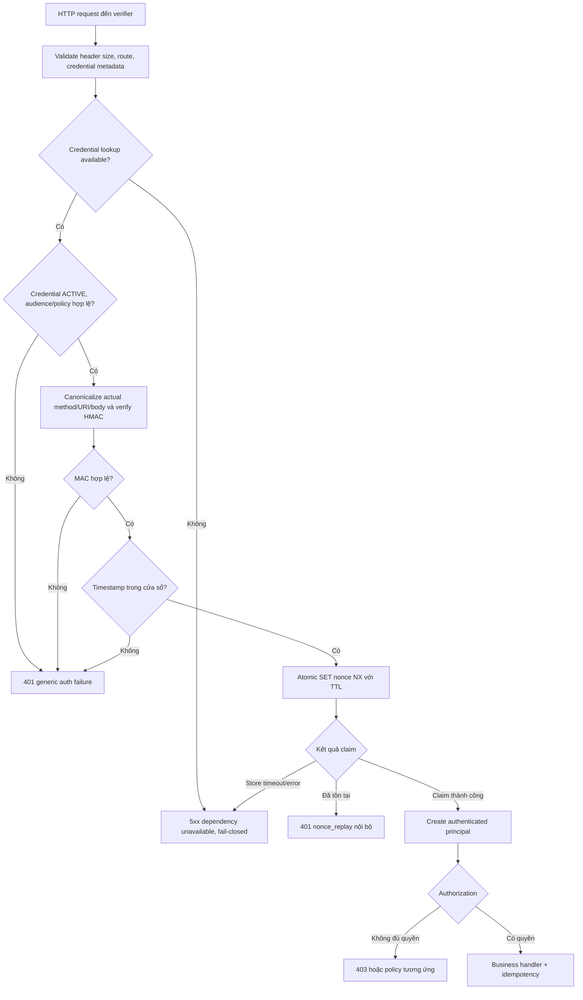
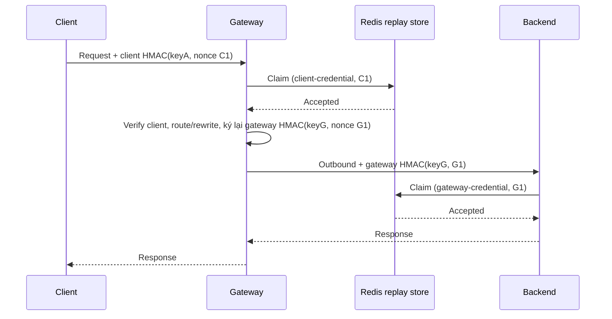

# Xử lý replay spike: runbook vận hành khi số request HMAC bị phát lại tăng đột biến

## 1. Mục tiêu, phạm vi và tình huống mở đầu

Bài học **Xử lý replay spike** thuộc chương **Operations** của module **SECURITY_AUTHENTICATION_HMAC_REQUEST_AUTHENTICATION**. Module này thiết kế xác thực HTTP request bằng **HMAC với shared secret** và một **canonical request** ràng buộc phương thức, URI, header hoặc body theo hợp đồng ký. Ngoài xác minh chữ ký, hệ thống cần kiểm soát **timestamp/nonce** để chống replay, quản lý key rotation, kiểm thử proxy/gateway và phân biệt **authentication (xác thực)** với **authorization (phân quyền)**.

Giả sử dashboard đột ngột báo `nonce_replay` tăng từ vài chục lên hàng chục nghìn sự kiện trong 5 phút. Nhiều API trả 401, đối tác phản ánh request thanh toán bị lỗi, trong khi đội SRE thấy p99 latency của backend tăng và gateway vừa được deploy. Đây là một **replay spike** cần điều tra, nhưng chưa đủ bằng chứng để kết luận secret HMAC bị lộ: chính client SDK có thể đang retry **nguyên request với cùng timestamp, nonce và signature** sau khi mất response; gateway cũng có thể tái sử dụng nonce khi retry outbound.

**Replay spike** trong bài này là sự gia tăng bất thường của những lần xác minh phát hiện một nonce đã được claim trong đúng namespace và cửa sổ kiểm tra của giao thức. Thuật ngữ đó phải được gắn với **đơn vị đo và bước xác minh cụ thể**. “Nhiều 401” không tự động là replay spike vì 401 cũng có thể do sai MAC, key đã revoke, timestamp hết hạn hoặc thiếu credential.

Sau bài học, người học có thể:

1. Định nghĩa sự kiện `nonce_replay` chỉ khi có **đủ bằng chứng kiểm tra MAC và trạng thái nonce**.
2. Phân biệt replay attack, retry sai, duplicate delivery, gateway re-sign lỗi, clock skew, cache/store inconsistency và lỗi hạ tầng.
3. Dùng dashboard, log an toàn, trace, metric theo hop và runbook để triage theo mức độ ảnh hưởng.
4. Xử lý outage Redis/nonce store **fail-closed** mà không giả thành replay hoặc invalid signature.
5. Điều chỉnh SDK retry, request signing, key lifecycle và idempotency nghiệp vụ mà **không làm yếu anti-replay**.
6. Viết ví dụ Java/Spring/Redis và test concurrency để xác minh atomic claim, TTL, namespace, time window.
7. Xác định điều kiện containment, escalation, recovery, theo dõi sau sửa và hậu kiểm có bằng chứng.

## 2. Nắm rõ thuật ngữ trước khi xử lý

### 2.1. HMAC chứng minh gì?

Một HMAC hợp lệ chứng minh rằng bên tạo MAC **có quyền truy cập secret tương ứng** và thông điệp canonical chưa bị thay đổi sau khi ký, nếu hợp đồng và thuật toán được triển khai đúng. Nó **không** chứng minh request được gửi đúng một lần: một người có toàn bộ request đã ký có thể phát lại nguyên bytes trong thời gian mà chữ ký còn được xem là hợp lệ.

Một thiết kế chống replay điển hình yêu cầu client gửi:

```http
POST /partner/orders HTTP/1.1
Host: api.example.test
X-Key-Id: partner-a-k7
X-Timestamp: 1795852800
X-Nonce: 39f6b2e6-84fa-40f5-9bc0-c1a215db6e2b
X-Signature: <HMAC trên canonical request và các trường freshness>
Content-Type: application/json

{"orderId":"ord-123"}
```

Đây là request **minh họa**. Timestamp cố định không nhất thiết còn nằm trong cửa sổ hợp lệ khi chạy thật; test tích hợp phải dùng fake clock hoặc timestamp mới. Nonce là định danh ngẫu nhiên đủ khó trùng, được ràng buộc trong nội dung đã ký. Với một ký hiệu nonce dạng UUID, SDK phải bảo đảm nguồn entropy, phạm vi uniqueness và cách triển khai phù hợp, không coi ký tự UUID là bảo đảm tuyệt đối.

Một canonical contract ví dụ:

```text
HMAC-REQ-1
<METHOD>
<RAW_PATH>
<RAW_QUERY>
<KEY_ID>
<TIMESTAMP_SECONDS>
<NONCE>
<LOWERCASE_SHA256_OF_EXACT_BODY_BYTES>
```

Server tính HMAC trên canonical **từ request thực nhận ở điểm verify**, kiểm tra credential còn active, timestamp nằm trong time window và **claim nonce nguyên tử** trước khi tạo authenticated principal.

### 2.2. Từ “nonce reused” tới “replay detected” phải có chứng cứ

Phân loại sự kiện:

| Sự kiện | Điều đã biết | Có nên gọi là replay? |
|---|---|---|
| Header nonce lặp nhưng **MAC chưa verify** | Input do requester tự khai; có thể giả mạo key ID | **Không**. Chỉ là duplicate claimed nonce, không quy cho client |
| MAC sai, nonce giống sự kiện trước | Request có thể bị sửa hoặc giả | **Không**. Kết luận `invalid_mac` |
| MAC hợp lệ với credential active, timestamp hợp lệ, nonce claim trả `false` vì key đã có | Có bằng chứng nonce đã được claim trong namespace | **Có**, gọi `nonce_replay` hoặc `duplicate_signed_attempt` theo contract |
| MAC hợp lệ nhưng timestamp ngoài window, chưa claim nonce | Freshness fail vì thời gian | Ghi `timestamp_window`, **không tự suy replay** |
| Redis timeout sau lệnh claim, kết quả không rõ | Store có thể đã ghi hoặc chưa ghi | **Không khẳng định replay**. Ghi `nonce_store_unavailable`/`indeterminate` |
| Duplicate event từ event bus/collector | Hai bản ghi cho cùng một auth decision | **Không phải** hai request replay; cần dedup bằng event ID |
| Hai request HMAC mới, nonce khác nhau nhưng cùng đơn hàng | Authentication attempts độc lập | Không phải nonce replay; xử lý bằng **business idempotency** |

**Cảnh báo:** chỉ có MAC hợp lệ chưa chứng minh **chính client chủ sở hữu** gửi lại request. Một attacker giữ được request đã ký hợp lệ có thể phát lại. Dashboard nên ghi “MAC-verified attempt associated with credential X”, không mặc nhiên ghi “client X tấn công”.

### 2.3. Replay, retry và idempotency là ba vấn đề khác nhau

- **Replay attack:** cố tình dùng lại request/proof đã ký để vượt qua authentication hoặc gây tác dụng phụ.
- **Transport/application retry:** SDK, proxy hoặc gateway gửi lại attempt sau timeout/reset/5xx; có thể sai vì giữ nonce cũ hoặc đúng protocol nhưng vẫn cần idempotency.
- **Business idempotency:** nhiều request hợp lệ khác nonce cùng một operation key chỉ được thực thi nghiệp vụ một lần theo hợp đồng ứng dụng.

Ví dụ `POST /payments` được xử lý thành công nhưng response mất. Retry nguyên nonce bị từ chối `401 nonce_replay`; retry với **nonce và HMAC mới** có thể xác thực thành công, nhưng nếu không có `Idempotency-Key` và server-side idempotency, hệ thống vẫn có nguy cơ tạo thanh toán thứ hai.

## 3. Dòng xử lý chuẩn và điểm nào có thể tạo “replay spike”



Luồng trên là một **contract thiết kế mẫu**, không phải thứ tự bắt buộc duy nhất cho tất cả hệ thống. Một số verifier kiểm tra timestamp trước khi tính MAC để giảm chi phí; khi đó event timestamp reject **chưa thể được quy cho client**. Điều quan trọng là không suy danh tính từ `X-Key-Id` chưa được chứng minh, không claim nonce trước khi có MAC hợp lệ, không fail-open và không cấp quyền nghiệp vụ chỉ vì MAC đúng.

### 3.1. Một request, nhiều hop HMAC



Gateway có thể retry khi outbound connection timeout. Nếu gateway dùng lại **chính G1** cho một outbound attempt thứ hai, backend có thể báo `nonce_replay` ở **hop gateway→backend** dù client không phát lại bất cứ request nào. Ngược lại, client retry ingress C1 có thể bị chặn tại gateway, backend không hề nhìn thấy request đó.

Do đó mọi dashboard/runbook bắt buộc phân biệt **hop, credential kind và attempt unit**:

| Hop | Secret được kiểm tra | Nonce thuộc ai? | Ai có thể gây retry/duplicate? |
|---|---|---|---|
| `client_to_gateway` | Client shared secret | Nonce client ký | Client SDK, mobile network/proxy của client, request replay |
| `gateway_to_backend` | Internal gateway HMAC secret | Nonce gateway signer tạo | Gateway retry/resign logic, upstream connection pool |
| `service_to_service` | Credential của service nội bộ | Nonce service caller tạo | Message redelivery, service retry, queue consumer |

Không cộng tổng `nonce_replay` của mọi hop rồi kết luận “số client replay”. Cần theo dõi ingress attempts riêng với internal outbound attempts. Nếu backend nhận header `X-Verified-Client` do gateway tạo, header này phải được bảo vệ bởi MAC nội bộ; không tin một giá trị client Internet tự gửi.

## 4. Những nguồn gây replay spike thường gặp

### 4.1. Client retry nguyên request đã ký

Một số SDK xây request HMAC một lần rồi đưa vào HTTP retry middleware. Khi network timeout, middleware gửi lại cùng `X-Timestamp`, `X-Nonce` và `X-Signature`:

```text
sign(request, nonce=N1) → send attempt 1 → server đã claim N1
                              ↘ response mất
retry middleware → send attempt 2 với N1 → 401 nonce_replay
```

**Dấu hiệu:** spike xuất hiện sau release SDK/retry config, liên quan với 502/504, connection reset hoặc timeout; nhiều duplicate trên cùng route với khoảng thời gian ngắn. Cần so sánh error counts theo **verified credential** và các dấu hiệu network, không chỉ dựa vào 401.

**Khắc phục đúng:** đặt bước ký **sau mỗi lần middleware quyết định outbound attempt**, tạo timestamp/nonce mới và tính lại MAC cho method/raw URI/body thực gửi; vẫn giữ **business idempotency key** qua các attempt của cùng nghiệp vụ. Không bỏ replay protection để giúp SDK cũ chạy.

### 4.2. Gateway retry không ký lại mỗi outbound attempt

Gateway xác minh client đúng, rewrite request, ký lại bằng gateway secret rồi gửi tới backend. Khi backend trả timeout hoặc connection reset, gateway phát lại **nguyên outbound HMAC proof**. Backend đã claim nonce ở lần đầu nên lần sau bị chặn.

**Dấu hiệu:** `nonce_replay` tăng chủ yếu ở `gateway_to_backend`, trong khi ingress verification thành công; spike theo gateway release, backend latency và pool retries.

**Khắc phục:** bảo đảm canonical outbound và nonce được tạo lại ở mỗi attempt hợp lệ, theo policy re-sign; đánh giá retry có an toàn không khi backend có thể đã xử lý. Không “giữ chữ ký client cũ” sau khi gateway thay URI/body. Không đánh đồng gateway key bị replay với key client đã bị compromise.

### 4.3. Nonce generator không đủ uniqueness

Sai lầm:

```java
// Ví dụ KHÔNG AN TOÀN: nonce theo giây, đụng độ khi concurrency cao.
String nonce = Long.toString(System.currentTimeMillis() / 1000);
```

Nhiều request trong một giây cùng credential sẽ có nonce trùng. Một vài lỗi tương tự: counter reset khi process restart, seed RNG cố định, nonce chỉ dựa vào thread ID, cache/reuse đối tượng request khi nhiều worker chạy song song, hoặc các instance sinh cùng counter không có prefix phân vùng.

**Dấu hiệu:** spike ngay cả khi không có HTTP retry, tăng cùng throughput, tập trung theo một SDK/runtime version hoặc nhiều worker cùng service. Cần kiểm tra nonce generation ở client bằng fixture an toàn, không yêu cầu đối tác gửi plaintext secret.

**Khắc phục:** sinh nonce đủ entropy, duy nhất trong namespace/time window đã công bố (ví dụ 128 bit CSPRNG), hoặc dùng scheme counter có cơ chế đảm bảo uniqueness xuyên process/region. Kiểm tra deterministic unit/concurrency tests và sự khác biệt giữa dev/staging/prod.

### 4.4. Replay attack hoặc secret/request bị thu thập

Một bên thứ ba có thể phát lại request đã ký từ log bị lộ, proxy bị chiếm quyền hoặc môi trường quan sát sai. Replay guard có nhiệm vụ chặn, nhưng sự kiện có thể là dấu hiệu của sự cố bảo mật nếu:

- MAC hợp lệ bị dùng lại từ nguồn/network pattern không tương ứng với client;
- traffic tập trung ở route nhạy cảm và pattern không khớp retry hợp lệ;
- có dấu hiệu leaked request/signature hoặc compromise credential;
- một client ghi nhận nonce đã dùng trong khi hệ thống gửi hợp lệ của họ không có retry tương ứng.

**Không kết luận attacker chỉ từ IP, user-agent hoặc raw key ID.** Những dữ liệu này có thể bị proxy che, NAT gom nhiều client hoặc giả mạo. Chuyển Security/incident response khi có bằng chứng tăng dần; không dùng một biểu đồ replay để tự động revoke toàn bộ secret.

### 4.5. Clock skew và sai đơn vị timestamp

Client gửi epoch milliseconds thay vì seconds, đồng hồ lệch hoặc NTP sai thường dẫn tới `timestamp_window`, **không phải nonce replay** nếu verifier phân loại đúng.

Tuy nhiên, clock skew cũng ảnh hưởng **thời gian sống nonce**: nếu TTL ngắn hơn toàn bộ khoảng timestamp có thể được chấp nhận, nonce cũ có thể bị loại khỏi store khi request còn trong freshness window, làm replay guard thất bại.

**Cần phân tách rõ** timestamp rejects với nonce duplicate. Khi có dấu hiệu nhiều request bị retry sau timestamp failure, cả hai metric có thể cùng tăng, nhưng thứ tự và mối quan hệ phải được chứng minh bằng internal reason và per-hop event.

### 4.6. Misconfigured namespace hoặc nhiều verifier dùng state không nhất quán

Một số lỗi nguy hiểm:

- Tất cả client dùng cùng nonce namespace toàn hệ thống, không có owner/credential scope rõ → nonce của hai client khác nhau va chạm không cần thiết.
- Scope nonce quá hẹp, mỗi node giữ local map → phát lại qua node khác vẫn được chấp nhận, **replay bypass** chứ không chỉ spike.
- Dùng raw `X-Key-Id` để tạo namespace trước khi MAC verify → attacker có thể “đốt nonce” của client khác.
- Gateway và backend dùng cùng namespace nhưng có thể tạo nonce trùng ở hai hop mà không có tách domain.
- Cross-key rotation: policy yêu cầu nonce duy nhất theo client nhưng lại namespace theo credential, hoặc ngược lại mà client SDK chưa biết.
- Consumer Redis reconnect thay đổi database/cluster key prefix gây mất state.

Một spike có thể xuất hiện do **cấu hình namespace bị gom quá rộng**; ngược lại, giảm đột ngột về 0 replay cũng có thể là dấu hiệu mất state hoặc telemetry bị lỗi. Không diễn giải metric nhỏ đi là an toàn hơn khi chưa kiểm tra replay acceptance.

## 5. Bước 0 — Phát hiện và xác minh tín hiệu đo

Trước tiên cần chứng minh đây là một thay đổi thực, không phải sự cố quan sát:

1. Xác định dashboard/alert dựa trên **metric nào** và đơn vị đếm: incoming HTTP requests, authentication decisions, nonce claims hay security events.
2. Xác định time window, baseline, số mẫu tối thiểu, timezone, release marker và scope hop.
3. Kiểm tra scrape/export pipeline: exporter có đang up? Event bus có giao trùng `eventId`? Counter reset sau restart có được `rate()` xử lý đúng không?
4. Kiểm tra classification: từ lúc deploy, một lỗi Redis timeout có bị map sai thành `nonce_replay` hay không?
5. Kiểm tra spike chỉ ở một region/node, tất cả gateway hay backend nội bộ.
6. Đối chiếu HTTP 401/403/429/503/502/504 và client-visible latency; thiếu 401 tăng chưa loại trừ attack nếu proxy nuốt lỗi.

### 5.1. Các metric cần có

| Metric/nguồn | Đơn vị | Ý nghĩa |
|---|---|---|
| `hmac_auth_decisions_total` theo `hop/outcome/reason` | Một quyết định auth | Phân loại success, invalid MAC, replay, dependency error |
| `hmac_nonce_claims_total` theo `hop/result` | Một lần atomic claim | `claimed`, `already_exists`, `error`; tách khỏi kết luận authentication |
| `hmac_ingress_requests_total` | Một request attempt tại ingress | Mẫu số tải client→gateway |
| `hmac_gateway_outbound_attempts_total` | Mỗi lần gửi gateway→backend | Theo dõi retry phía gateway |
| `hmac_timestamp_rejections_total` | Một lần reject freshness | Phân biệt clock skew với replay |
| `hmac_nonce_store_latency_seconds` | Thời gian I/O tới store | Phát hiện Redis latency, timeout |
| `hmac_nonce_store_errors_total` | Lỗi store thực tế | Không coi timeout là duplicate |
| `http_server_requests_seconds` hoặc tương đương | HTTP request latency | Theo dõi tác động đến khách hàng |
| `http_client_connection_pool_*` | Pool active/pending/timeouts | Định vị gateway retries do pool |
| `security_auth_event` có `eventId/requestId/hop` | Structured event | Correlate, dedup và phân tích theo credential với quyền phù hợp |
| `hmac_verified_credential_usage` | Successful authenticated credential | Đối chiếu key rotation/revocation |

Nhãn metric nên có tập giá trị hữu hạn như `hop`, `route_template` từ router allowlist, `region`, `outcome`, `reason` và `credential_kind`. **Không dùng** nonce, raw signature, shared secret, request ID, raw path/query hay client ID tùy ý làm time-series labels.

Nếu hệ thống có 50.000 client, phân tích per-client cần protected event store/aggregate có RBAC. Không thêm `clientId` vào mọi metric Prometheus chỉ để dashboard drilldown.

### 5.2. Truy vấn PromQL minh họa

Giả sử exporter phát các metric đã nêu:

```promql
# Số lần nonce claim trả already_exists mỗi giây trong 5 phút ở ingress.
sum(rate(hmac_nonce_claims_total{
  hop="client_to_gateway",result="already_exists"
}[5m]))
```

```promql
# Tỷ lệ nonce replay trong những auth decisions có outcome/reason phân loại.
sum(rate(hmac_auth_decisions_total{
  hop="client_to_gateway",reason="nonce_replay"
}[5m]))
/
clamp_min(
  sum(rate(hmac_auth_decisions_total{
    hop="client_to_gateway"
  }[5m])),
  1e-9
)
```

```promql
# Tốc độ lỗi nonce store: không được gộp thành already_exists.
sum(rate(hmac_nonce_store_errors_total[5m]))
```

```promql
# Replay trong hop gateway→backend.
sum(rate(hmac_auth_decisions_total{
  hop="gateway_to_backend",reason="nonce_replay"
}[5m]))
```

**Cảnh báo về tỷ lệ:** mẫu số `all auth decisions` bao gồm invalid MAC, unknown key và dependency errors, nên tỷ lệ trên phù hợp để theo dõi **phần trăm lỗi replay trong tổng quyết định**, không có nghĩa “x% request authenticated đã replay”. Nếu muốn ước lượng xác suất replay trên **MAC-verified candidates đủ điều kiện claim**, cần bộ đếm riêng `eligible_nonce_claims` và định nghĩa rõ các nhánh trước claim. Không viết KPI không có mẫu số được giải thích.

Đừng kết luận chỉ từ `rate` khi traffic rất thấp: một duplicate trong hai requests cho tỷ lệ 50% nhưng có thể không đáng paging. Alert nên dùng ngưỡng số lượng tối thiểu, baseline theo giờ/ngày, thời gian kéo dài và mức độ ảnh hưởng.

## 6. Bước 1 — Phân loại mức độ sự cố và phạm vi

Một replay spike cần phân loại theo **ảnh hưởng nghiệp vụ và dấu hiệu lạm dụng**, không chỉ tỷ lệ 401.

| Mức phản ứng | Tình huống minh họa | Hành động |
|---|---|---|
| Quan sát/ticket | Vài duplicates sau một retry ở staging, không ảnh hưởng khách hàng | Tạo ticket SDK/QA, xác minh nguyên nhân |
| SRE triage | Replay tăng đáng kể ở production, 401 tăng, một đối tác gián đoạn | Mở runbook, phối hợp integration owner |
| Incident nghiêm trọng | Nhiều tenant/region bị ảnh hưởng, thanh toán bị chặn hoặc 503 tăng | Incident commander, phối hợp SRE/security/business |
| Security incident | Có bằng chứng secret/request bị lộ, forged traffic hoặc replay có chủ đích | Containment, audit, cân nhắc revoke/rotate theo blast radius |
| Dependency outage | Redis/credential store không khả dụng, auth fail-closed | Khôi phục dependency, thông báo availability; không gọi đây là replay attack |

Các nhãn severity và tiêu chí định lượng do tổ chức ban hành; bảng chỉ là hướng tư duy. Không tự động “rotate all client keys” khi spike chỉ do SDK retry sai, và không trì hoãn containment khi có bằng chứng secret compromise.

### 6.1. Chọn người chịu trách nhiệm

- **SRE/on-call:** xác nhận metric pipeline, Redis health, gateway pool, deploy/retry settings.
- **Security:** đánh giá khả năng request/secret bị thu thập, key compromise, attribution và containment.
- **Client integration/SDK owner:** kiểm tra signing middleware, nonce generator, retry/redirect behavior và client release.
- **API/backend owner:** xác định operation/idempotency impact và DB/outbox side effects.
- **Incident commander:** điều phối nhiều team, severity, rollback/containment và thông báo đối tác.
- **Support:** cung cấp request ID và hướng dẫn ký lại an toàn, **không yêu cầu partner gửi secret**.

## 7. Bước 2 — Tách nguyên nhân theo hop và bằng chứng danh tính

Giả sử dashboard báo 30.000 `nonce_replay`:

```text
26.000 tại gateway_to_backend: gateway re-sign retries?
 3.000 tại client_to_gateway: client SDK retries hoặc replay attack?
 1.000 tại service_to_service: queue redelivery/retry?
```

Đây là số liệu **giả định**, không phải kết luận từ hệ thống thực. Nếu chỉ nhìn tổng, đội vận hành có thể vội thông báo hàng chục nghìn client “request của bạn đang bị replay”, trong khi 26.000 sự kiện do chính gateway tạo.

### 7.1. Mức attribution

| Attribution | Có bằng chứng gì? | Dùng khi xử lý spike |
|---|---|---|
| `UNATTRIBUTED` | Key ID/nonce chỉ do request khai báo, MAC chưa verify | Điều tra abuse aggregate, không đổ lỗi cho một client |
| `MAC_VERIFIED_CREDENTIAL` | MAC hợp lệ với credential known, có thể fail freshness | Gắn attempted replay với credential để triage, **không khẳng định actor** |
| `AUTHENTICATED_CLIENT` | MAC, key state, timestamp và nonce claim hoàn tất | Dùng cho successful usage, authorization và business attribution |

**Không lấy `X-Key-Id` từ request MAC sai làm client principal.** Một attacker có thể spoof key ID để làm bẩn dashboard hoặc gây rate-limit cho tenant khác. Event gắn với credential sau MAC verification vẫn cần được mô tả là “associated with credential”, vì một request bị replay có thể do người khác phát lại.

### 7.2. Correlation trên event ID, request ID và trace

Một event replay nội bộ có thể mang:

```json
{
  "eventId": "ev-replay-0007",
  "requestId": "req-07ef",
  "observedAt": "2026-11-28T05:05:03.414Z",
  "hop": "client_to_gateway",
  "attribution": "MAC_VERIFIED_CREDENTIAL",
  "verifiedCredentialRef": "cred-a-117",
  "verifiedClientId": null,
  "routeTemplate": "/partner/orders",
  "authDecision": "AUTH_FAILURE",
  "internalReason": "NONCE_REPLAY",
  "nonceClaimResult": "ALREADY_EXISTS",
  "httpStatus": 401,
  "gatewayRelease": "gateway-2026.11.28"
}
```

Không lưu raw `nonce`, plaintext secret, received/expected signature hoặc full canonical chứa body/PII ở event. `verifiedCredentialRef` trong ví dụ là tham chiếu đã gắn qua MAC, còn `verifiedClientId` để null vì freshness chưa đạt. Nếu muốn correlate nhiều attempts với một nonce, có thể dùng **HMAC audit token** của nonce với một telemetry key riêng có kiểm soát hoặc hash theo thiết kế privacy phù hợp, nhưng không dùng như khóa xác thực và không xuất token đó ra public dashboard.

### 7.3. Điều tra bằng SQL trên protected event store

Ví dụ PostgreSQL giả định bảng `hmac_auth_event` có schema chuẩn hóa, event đã được dedup, tenant scope do nguồn đáng tin:

```sql
-- Nội bộ SRE/Security: phân bố replay theo hop/region/release.
SELECT date_trunc('minute', observed_at) AS minute_utc,
       hop,
       region,
       gateway_release,
       COUNT(*) AS replay_events
FROM hmac_auth_event
WHERE observed_at >= :from_utc
  AND observed_at < :to_utc
  AND internal_reason = 'NONCE_REPLAY'
  AND attribution = 'MAC_VERIFIED_CREDENTIAL'
GROUP BY 1, 2, 3, 4
ORDER BY 1 DESC, replay_events DESC;
```

Với dashboard dành cho client, API phải kiểm tra quyền xem credential owner/tenant **tại server**, lọc trước khi trả kết quả và tránh hiển thị event chưa xác minh. Đừng cho client tự gửi SQL/PromQL hay sửa `clientId` trong URL để xem dữ liệu tenant khác.

## 8. Bước 3 — Kiểm tra Redis/nonce store trước khi sửa retry

Replay spike có thể là tín hiệu store hoạt động **đúng** khi requester gửi nonce lặp. Nhưng nếu store bị lỗi, kết luận phải khác. Cần kiểm tra:

1. `SET NX` có **atomic** không? Có dùng cùng Redis key/namespace trên mọi instance cùng trust boundary không?
2. TTL đặt đúng time window, có tính future skew allowance và safety margin chưa?
3. Key có chứa credential/owner ID đáng tin và audience/hop/domain separation không?
4. Redis client có timeout, pool exhaustion, reconnect, redirection/cluster failover hoặc queue backlog không?
5. Lỗi `Redis timeout` có bị `onErrorResume(... -> Mono.just(false))` biến thành “nonce đã dùng” không?
6. Event consumer/metric có đếm trùng decision khi reactive pipeline retry/resubscribe không?
7. DR/region có local nonce store riêng nhưng traffic đi qua nhiều region không? Nếu có, replay guard toàn hệ thống có thể mất tính nhất quán.
8. Có operator nào vừa flush database, đổi key prefix, đổi Redis DB number hoặc hạ TTL để giảm memory không?

**Không xóa nonce keys để làm giảm tỷ lệ 401.** Làm vậy có thể cho phép phát lại request còn hạn, đặc biệt nếu cùng một client đang có nhiều attempt song song. Không tăng acceptance window tùy tiện khi chưa đánh giá ảnh hưởng replay exposure.

### 8.1. Atomic claim theo Redis

Giả sử namespace theo credential:

```text
redisKey = "hmac:nonce:v1:" + credentialId + ":" + nonceToken
SET redisKey "1" NX EX 630
```

Ý nghĩa: nếu key chưa có, tạo key với TTL 630 giây và trả thành công; nếu key đã tồn tại, trả false/null tùy client và không cập nhật lại TTL. Đây là **giá trị TTL minh họa**, phải được tính theo hợp đồng timestamp/clock skew và đặc điểm triển khai.

Không dùng hai lệnh:

```text
GET key
if missing:
    SET key value
```

vì hai request đồng thời có thể đều nhìn thấy “missing”, sau đó cả hai đều được chấp nhận. `SET NX EX` gộp điều kiện và thao tác thành một lệnh nguyên tử trên key Redis.

### 8.2. Tính TTL từ acceptance window thay vì đoán

Giả sử verifier chấp nhận timestamp khi:

```text
now - timestamp <= pastAllowance
timestamp - now <= futureAllowance
```

Một request mang timestamp T có thể được chấp nhận **sớm nhất** ở `T - futureAllowance` và **muộn nhất** ở `T + pastAllowance`. Nếu nonce được claim ngay ở đầu khoảng, cần giữ state ít nhất:

```text
nonce_ttl >= futureAllowance + pastAllowance + margin
```

Ví dụ: `pastAllowance=300 s`, `futureAllowance=300 s`, chọn TTL giả định `630 s` khi margin 30 s được đánh giá đủ cho clock accuracy, rounding, processing/scheduling và consistency policy. **Không** coi 630 giây là cấu hình chuẩn áp cho mọi API.

Nếu client gửi timestamp gần cực đại tương lai nhưng TTL chỉ 300 giây, nonce có thể hết hạn trước khi timestamp bị loại. Một request bị phát lại sau đó lại được claim là mới, phá bất biến chống replay. Nếu hệ thống dùng nonce expiration gắn với timestamp, cần tính expiration time đúng và đảm bảo mọi node thống nhất nguồn thời gian/margin.

### 8.3. Redis timeout không có nghĩa “nonce trùng”

Một timeout có thể xảy ra **sau khi Redis đã ghi key** nhưng **trước khi gateway nhận ACK**:

```text
Gateway → Redis: SET NX EX
Redis ghi key thành công
Network timeout trước khi response về gateway
Gateway không biết claim thành công hay thất bại
```

Không được ghi `NONCE_REPLAY` hoặc cho qua như `CLAIMED` trong trường hợp này. Hệ thống phải **fail-closed**, trả 503/5xx theo error contract, log reason `NONCE_STORE_UNAVAILABLE/UNKNOWN_RESULT` và giữ correlation để điều tra.

Khi client retry, dùng **timestamp/nonce mới và ký lại** theo policy; tuy nhiên nếu operation có side effect, idempotency nghiệp vụ phải bảo vệ tình trạng backend có thể đã thực thi trước khi response thất lạc. Không tự xóa nonce vừa có thể claim để “cứu request”.

## 9. Ví dụ Java/Spring WebFlux: replay guard phân biệt ba kết quả

Dưới đây là ví dụ dùng `ReactiveStringRedisTemplate` với một Redis command có `NX + TTL`. Nó giả định HMAC đã được **xác minh thành công**, credential được xác định từ registry tin cậy và timestamp nằm trong acceptance window. **Không** gọi trực tiếp `claim(...)` với key ID/nonce chưa xác thực.

```java
import java.nio.charset.StandardCharsets;
import java.security.MessageDigest;
import java.security.NoSuchAlgorithmException;
import java.time.Duration;
import java.util.HexFormat;
import java.util.Objects;

import org.springframework.data.redis.core.ReactiveStringRedisTemplate;
import reactor.core.publisher.Mono;

enum ReplayClaimResult {
    CLAIMED,
    ALREADY_EXISTS
}

final class ReplayStoreUnavailableException extends RuntimeException {
    ReplayStoreUnavailableException(Throwable cause) {
        super("Replay store unavailable", cause);
    }
}

final class RedisHmacReplayGuard {
    private final ReactiveStringRedisTemplate redis;
    private final Duration ttl;

    RedisHmacReplayGuard(
            ReactiveStringRedisTemplate redis,
            Duration ttl) {
        this.redis = Objects.requireNonNull(redis);
        if (ttl.isZero() || ttl.isNegative()) {
            throw new IllegalArgumentException("TTL must be positive");
        }
        this.ttl = ttl;
    }

    // credentialId là định danh verified từ registry, không lấy từ
    // header chưa được xác thực. Nonce đã được giới hạn size/syntax.
    Mono<ReplayClaimResult> claim(
            String credentialId,
            String audience,
            String nonce) {
        String key = "hmac:nonce:v1:"
                + safeSegment(credentialId) + ":"
                + safeSegment(audience) + ":"
                + sha256Hex(nonce);

        return redis.opsForValue()
                .setIfAbsent(key, "1", ttl)
                .switchIfEmpty(Mono.error(
                        new IllegalStateException(
                                "Unexpected empty Redis claim result")))
                .map(inserted -> inserted
                        ? ReplayClaimResult.CLAIMED
                        : ReplayClaimResult.ALREADY_EXISTS)
                .onErrorMap(
                        error -> !(error instanceof
                                ReplayStoreUnavailableException),
                        ReplayStoreUnavailableException::new);
    }

    private static String safeSegment(String value) {
        if (value == null || !value.matches("[A-Za-z0-9._-]{1,128}")) {
            throw new IllegalArgumentException(
                    "Invalid trusted namespace segment");
        }
        return value;
    }

    private static String sha256Hex(String value) {
        if (value == null
                || value.length() < 16 || value.length() > 128) {
            throw new IllegalArgumentException("Invalid nonce length");
        }
        try {
            byte[] digest = MessageDigest.getInstance("SHA-256").digest(
                    value.getBytes(StandardCharsets.UTF_8));
            return HexFormat.of().formatHex(digest);
        } catch (NoSuchAlgorithmException error) {
            throw new IllegalStateException(error);
        }
    }
}
```

**Những giới hạn không thể bỏ qua:**

- Đây là code **minh họa** về atomic claim, không phải toàn bộ HMAC verifier. Production còn phải validate canonical request, active credential, timestamp, MAC, body size, rate limits và authorization.
- `setIfAbsent(key, "1", ttl)` đại diện thao tác SET NX với expiration do Spring Data Redis gửi; dùng driver và Redis deployment phù hợp, kiểm thử atomic behavior thực.
- `ALREADY_EXISTS` chỉ được gọi `NONCE_REPLAY` khi MAC/timestamp/credential policy **đã hợp lệ**, đúng namespace.
- `Mono.empty()` từ driver không được tự coi là success hoặc duplicate; ví dụ chuyển thành lỗi fail-closed. Trong ứng dụng thật có thể phân loại riêng client protocol error và dependency unavailable.
- `onErrorMap` trong ví dụ wrap cả lỗi như `IllegalArgumentException` nếu phát sinh trong reactive chain; production nên phân loại validation/bug và Redis I/O chính xác để không che lỗi lập trình. Mọi exception này **không** cho phép request đi tiếp.
- Hàm hash nonce nhằm giữ key bounded và không hiển thị raw nonce trong Redis key; **không tự làm nonce an toàn hơn** nếu nonce generator yếu. Nếu raw nonce cần che khỏi operator có quyền xem Redis keyspace, cân nhắc dùng keyed pseudonymization/HMAC với telemetry/keyspace secret độc lập, có đánh giá threat model.
- `credentialId` là namespace theo credential. Nếu chính sách yêu cầu uniqueness xuyên key rotation, đổi thành namespace theo **verified owner + audience**, đồng bộ với SDK và contract.
- Redis TTL không thay thế kiểm tra timestamp; timestamp ngoài window vẫn phải bị từ chối dù nonce mới.

### 9.1. Xử lý ba trạng thái ở authentication pipeline

Pseudocode:

```text
verify(request):
  credential = registry.lookup(request.keyId)      # trusted lookup
  require credential ACTIVE / audience allowed
  canonical = canonicalize(actualMethod, rawUri, signedHeaders, bodyBytes)
  require constantTimeCompare(
      HMAC(credential.secret, canonical),
      receivedSignature)
  require signedTimestampWithinWindow(now, request.timestamp)

  claimResult = atomicNonceStore.claim(
      credential.id, audience, request.nonce)

  if claimResult == ALREADY_EXISTS:
      record auth_failure(reason=NONCE_REPLAY, attribution=MAC_VERIFIED_CREDENTIAL)
      return 401 AUTHENTICATION_FAILED

  if claimResult == STORE_UNAVAILABLE_OR_UNKNOWN:
      record auth_dependency_error(reason=NONCE_STORE_UNAVAILABLE)
      return 503 SERVICE_UNAVAILABLE

  if claimResult == CLAIMED:
      principal = buildFromVerifiedCredential(credential)
      return authorizationThenHandler(principal, request)
```

Không bắt ngoại lệ Redis rồi đổi thành `ALREADY_EXISTS` hoặc `CLAIMED` chỉ để code đơn giản. Khi 401 authentication failure, `WWW-Authenticate` phải đúng scheme HMAC được API định nghĩa; không lộ nội bộ “nonce đã dùng”, key existence, expected MAC hay secret nếu public contract yêu cầu message chung.

### 9.2. Cảnh báo về cancel và request đã qua verify

Khi body của request chưa nhận đủ, không nên claim nonce chỉ dựa vào header. Nếu body nằm trong canonical, cần tính hash trên byte body thực tế, giới hạn bộ nhớ và chỉ claim nonce **sau MAC valid**. Nếu client disconnect giữa quá trình đọc body, không ghi `NONCE_REPLAY` mà không có kết quả atomic claim.

Nếu Redis claim thành công nhưng client disconnect trước khi handler, nonce vẫn bị giữ; đó là hành vi bảo thủ để chống replay. **Không tự xóa nonce để client retry cùng proof** vì rất khó chứng minh request trước chưa có side effect ở các tầng khác.

## 10. Bước 4 — Tương quan replay spike với retry và network errors

Một mẫu triage hữu ích:

| Quan sát | Khả năng ưu tiên kiểm tra | Cần bằng chứng nào? |
|---|---|---|
| Replay ingress tăng ngay sau SDK release | Signer chạy trước retry middleware | SDK trace/test fixture, timestamp/nonce lifecycle |
| Replay backend tăng sau gateway deploy | Gateway reuse signed outbound attempt | Gateway retry/resign metrics, hop-trace |
| Replay tăng theo 502/504/upstream latency | Client/gateway retry do mất response | HTTP metrics, retries count, idempotency events |
| Replay tăng khi throughput tăng, ít timeouts | Nonce generator collisions | Test concurrency, RNG/state trên nhiều process |
| Replay chỉ trên một region sau failover | Store namespace/replication/routing mismatch | Redis topology, keyspace prefix, node version |
| Replay 401 tăng kèm timestamp 401 | Clock skew và retry loop | Verified timestamp histogram, NTP, SDK epoch unit |
| Nhiều valid-MAC replays không khớp client activity | Nguy cơ request capture/credential exposure | Security evidence, trusted client confirmation |
| Counter replay tăng nhưng HTTP 401 không tăng | Double-emission/metric semantics, status mapping | Event ID dedup, log filter/response path |
| Redis errors tăng mà replay cũng tăng | Có thể mapping lỗi store sai hoặc hai sự cố độc lập | Internal reason và driver outcome, test timeout |
| Replay đột nhiên về 0 sau restart | Có thể mất nonce state hoặc telemetry | Synthetic replay test và scrape/Redis health |

Không tuyên bố nguyên nhân chỉ vì hai biểu đồ cùng tăng. Hãy xác minh thứ tự sự kiện, thiết lập giả thuyết và dùng test đối chứng.

### 10.1. Điều tra client SDK mà không yêu cầu secret

Một checklist hỗ trợ đối tác:

1. SDK tạo nonce **mới cho mỗi outbound attempt** hay một lần trước khi vào retry loop?
2. Signer có nhìn thấy **method và raw URI cuối cùng** (sau redirect/URL rewriting) không?
3. Body bytes được ký có giống bytes thực gửi không? JSON serialization có bị thay ở retry?
4. HTTP client có retry POST không, retry với policy nào, bao nhiêu lần?
5. Khi bị 401, SDK có retry vô hạn bằng **cùng** signature không?
6. Có gửi header timestamp ở seconds trong khi server mong milliseconds (hoặc ngược lại) không?
7. Nonce generator có unique xuyên threads/processes/regions và restart không?
8. Idempotency key nghiệp vụ có ổn định qua retries của cùng transaction không?
9. SDK có xử lý `Retry-After` và exponential backoff cho 429/503 đúng policy không?
10. Có keep-alive/HTTP2 multiplexing gây reuse mutable headers/security context giữa requests không?

**Chỉ yêu cầu test vectors hoặc thông tin đã ẩn nhạy cảm**, ví dụ request ID, SDK version, method/route template, reason code được server cung cấp theo quyền; không yêu cầu đối tác gửi production shared secret hoặc full raw signature.

## 11. Bước 5 — Chọn containment không làm yếu anti-replay

Khi replay spike diễn ra, các lựa chọn an toàn cần dựa trên nguyên nhân:

| Nguyên nhân được xác minh | Containment phù hợp | Không được làm |
|---|---|---|
| SDK retry cùng signed request | Tắt/giảm retry không an toàn, hotfix signer per attempt, thông báo owner | Tắt nonce check, clear store hàng loạt |
| Gateway outbound retry reuse nonce | Rollback gateway release/hotfix re-sign, giới hạn retries theo idempotency | Forward proof cũ và “whitelist” backend |
| Nonce collision do generator | Ngừng deployment lỗi, sửa RNG/counter, rollout SDK | Tăng tolerance cho nonce duplicate |
| Redis outage | Khôi phục store, giảm load, fail-closed 503 | Coi lỗi store là claim success hoặc replay |
| Key/request nghi bị lộ | Security containment, xác minh scope, revoke/rotate credential cần thiết | Giữ secret compromised active để tránh 401 |
| Clock skew | Đồng bộ NTP/sửa epoch format, giữ freshness window theo policy | Tăng window vô hạn chỉ để giảm lỗi |
| Namespace overlap/collision | Sửa key derivation/domain separation với migration plan | Dọn state bất cẩn làm replay bypass |
| Metric double count | Sửa instrument/dedup event ID | Tuyên bố “spike biến mất” khi traffic vẫn lỗi |

Nếu cần giữ API hoạt động trong lúc Redis bị lỗi, phải có **cơ chế chống replay thay thế** đã được security review với consistency guarantee tương đương, không tùy tiện cho request vượt qua. Trong phần lớn kiến trúc, lựa chọn mặc định là fail-closed và 503, không phải “bỏ nonce tạm 15 phút”.

### 11.1. Cẩn trọng với rate limiting và IP blocking

Rate limiting theo `X-Key-Id` trước MAC verification dễ bị lạm dụng: attacker khai key ID của client khác để làm client đó bị chặn. Giai đoạn chưa xác thực chỉ có thể dùng rate limit theo ingress/IP/network/protocol signal dưới threat model, kèm lưu ý về NAT/CDN/proxy.

Sau khi MAC hợp lệ, có thể áp giới hạn theo credential/tenant đáng tin, nhưng replay request có thể do attacker giữ proof cũ. Không lập tức khóa toàn client chỉ vì vài duplicate có MAC hợp lệ. Đối với lạm dụng xác nhận, chính sách containment có thể khóa credential hoặc route và phối hợp owner/security.

### 11.2. Khi nào cần key rotation?

Replay spike đơn lẻ **không chứng minh secret bị lộ**; một request đã ký có thể bị phát lại ngay cả khi attacker không biết secret. Nếu có bằng chứng request/secret capture hoặc MAC hợp lệ xuất hiện từ nguồn không thể giải thích, mở security incident:

1. Xác minh trusted control plane và scope credential bị ảnh hưởng.
2. Thu thập bằng chứng có giới hạn, không copy secret vào ticket.
3. Revoke hoặc suspend credential bị compromise theo severity/policy.
4. Cấp secret/key ID độc lập, phân phối qua kênh đã xác thực.
5. Test old key deny và new key pass trên tất cả gateways/backends/regions.
6. Đảm bảo key rotation không bypass nonce store, cache revocation không stale.

Nếu secret cũ bị compromise, không duy trì old/new overlap chỉ để giữ availability; cần quyết định theo incident containment thay vì routine rotation.

## 12. Bước 6 — Hướng xử lý lỗi 401, 403, 429 và 503

Khi vận hành, **public HTTP status** và **internal reason** là hai lớp khác nhau. API thường không tiết lộ chính xác nonce nào đã dùng hoặc trạng thái key để tránh tạo oracle.

| Điều kiện | Public status thường dùng | Mã nội bộ | Cách xử lý |
|---|---:|---|---|
| HMAC sai/unknown/revoked key | 401 | `INVALID_MAC`/`UNKNOWN_KEY`/`REVOKED_KEY` | Kiểm tra signer/key lifecycle |
| Timestamp ngoài window | 401 | `TIMESTAMP_WINDOW` | Clock/epoch/contract |
| MAC valid nhưng nonce đã tồn tại | 401 | `NONCE_REPLAY` | Retry/gateway/attack triage |
| MAC valid, nonce claim cần Redis nhưng lỗi | **503/5xx** | `NONCE_STORE_UNAVAILABLE` | Fail-closed, sửa hạ tầng |
| HMAC success, thiếu quyền tài nguyên | **403** (hoặc 404 theo policy) | `AUTHZ_DENIED` | Kiểm tra scope/tenant, không đổi secret |
| Rate limit áp theo policy | 429 | `RATE_LIMITED` | Backoff, quota/rate guard |
| Gateway không lấy được upstream connection | 502/503/504 theo nguyên nhân | `UPSTREAM_UNAVAILABLE` | Pool/network/backend, không giả là replay |
| Body vượt giới hạn | 413 | `PAYLOAD_TOO_LARGE` | Body-size/streaming policy |

Ví dụ một response 401 chung:

```http
HTTP/1.1 401 Unauthorized
WWW-Authenticate: HMAC realm="partner-api"
Content-Type: application/problem+json
Cache-Control: no-store
X-Request-Id: req-2c19

{
  "type": "about:blank",
  "title": "Unauthorized",
  "status": 401,
  "detail": "Authentication is required or invalid.",
  "code": "AUTHENTICATION_FAILED",
  "requestId": "req-2c19"
}
```

`HMAC` trong challenge là authentication scheme riêng của API, không mặc nhiên được mọi client HTTP hỗ trợ. Contract phải được tài liệu hóa và kiểm thử. Một public response không ghi “nonce already used” vẫn có thể đi kèm **log/metric nội bộ** đủ chính xác cho on-call; chỉ người có quyền mới xem được reason chi tiết.

**Không gửi 401 khi Redis chết**: điều đó khiến SDK tưởng signature/key sai, khách hàng đổi key vô ích và security mất tín hiệu availability. Ngược lại, đừng trả 503 cho MAC sai chỉ để client retry.

## 13. Bước 7 — Sửa logic retry nhưng giữ an toàn nghiệp vụ

Một cách hình dung đúng là tách hai khái niệm:

- `request intent`: nghiệp vụ người dùng muốn thực hiện (ví dụ tạo payment X).
- `HTTP attempt`: một lần gửi intent qua mạng, với **signature/nonce riêng**.

```text
Intent: create-payment(idempotencyKey=PAYMENT-2026-001)
  Attempt 1:
    timestamp=T1, nonce=N1, HMAC1 → server đã claim N1
    response có thể bị mất

  Attempt 2 (nếu policy cho phép retry):
    timestamp=T2, nonce=N2, HMAC2 → có thể vượt qua auth
    idempotencyKey=PAYMENT-2026-001 giữ nguyên
    business layer xác định payment đã tồn tại hay chưa
```

Không dùng nonce HMAC làm business idempotency key: nonce phải mới ở mỗi attempt, còn idempotency key cho cùng logical operation cần ổn định. Một API thanh toán có thể thiết kế idempotency key đi vào canonical hoặc header có ràng buộc integrity để tránh bị sửa giữa các lần thử.

### 13.1. Pseudocode signer chạy trong retry boundary

```text
sendWithRetry(intent, policy):
  for attemptNumber in 1..policy.maxAttempts:
      outbound = buildHttpRequestFromIntent(intent)

      # Recompute trên request cuối cùng cho từng attempt.
      outbound.timestamp = currentUnixSeconds()
      outbound.nonce = secureUniqueNonce()
      outbound.signature = hmacSign(
          sharedSecret,
          canonicalize(outbound.method,
                       outbound.rawPath,
                       outbound.rawQuery,
                       outbound.signedHeaders,
                       outbound.bodyBytes))

      result = httpSend(outbound)

      if result.isFinalSuccess():
          return result
      if result.status == 401 or result.status == 403:
          return result    # không retry vô hạn / không downgrade key
      if !policy.mayRetry(result, intent.idempotencyPolicy):
          return result
      backoffWithJitter(attemptNumber)

  return finalFailure
```

Đây là **pseudocode**, không phải triển khai production đầy đủ. Lệnh `httpSend` có thể timeout sau khi backend đã commit; policy retry phải dùng idempotency/status lookup nếu operation có tác dụng phụ. Nếu HTTP client tự follow redirect, signer phải ký **actual method/raw URI/audience** của attempt mới, không forward signature sang origin không tin cậy.

### 13.2. Retry gateway cần tách nonce từng hop

Khi gateway đã verify client request, nó không thể tùy tiện biến request client thành một logical request khác mà không có authorization/policy. Nếu được retry outbound:

- Tạo nonce/timestamp mới cho **gateway key** ở từng attempt.
- Ký trên method/raw URI/body đã rewrite cuối cùng.
- Không mang nonce/signature của client sang backend như bằng chứng gateway.
- Bảo vệ các claim về `verifiedClient/tenant/audience` do gateway tạo bằng chữ ký nội bộ.
- Retry chỉ khi operation idempotent hoặc có business idempotency contract.
- Tách metric `gateway_outbound_attempts` khỏi `client_ingress_attempts` để không đếm đôi.

## 14. Bước 8 — Kiểm tra key rotation, revocation và thuật toán

Replay spike có thể trùng với key rotation, nhưng nguyên nhân thường khác. Cần kiểm tra:

1. Trong giai đoạn old/new overlap, SDK có vô tình dùng **cùng nonce** cho hai credential không?
2. Namespace nonce của server là **per credential** hay **per verified client+audience**? Có đúng policy đã công bố không?
3. Credential cũ đã revoked có còn được accept do cache stale hay không?
4. SDK có tự fallback từ thuật toán mới sang thuật toán cũ khi nhận 401 không?
5. Gateway/backend có cùng canonical version, algorithm policy và key ID/audience ở đúng hop không?
6. Redis namespace có thay đổi khi rotate key, làm mất khả năng phát hiện replay trong cửa sổ còn hiệu lực không?
7. Có secret bị chia sẻ giữa tenants hoặc môi trường khiến replay/collision khó phân loại không?

**Quan trọng:** khi một key bị revoked, verifier phải từ chối dù MAC với secret cũ vẫn cryptographically valid. Nó không được “thử khóa khác” hoặc “chấp nhận vì nonce mới” để cứu request. Với các key đang ACTIVE, không được xóa replay state bừa bãi khi chuyển algorithm/canonical version.

### 14.1. Hai chiến lược namespace xuyên key rotation

| Namespace | Ưu điểm | Rủi ro/điều kiện |
|---|---|---|
| `credentialId + nonce` | Dễ tách riêng key và thu hồi; tránh collision giữa credentials | Client có thể dùng cùng nonce trên old/new key và được claim cả hai |
| `verifiedClientId + audience + nonce` | Thực thi uniqueness xuyên credentials của cùng client | SDK cần sinh nonce unique across keys; identity phải lấy từ registry và MAC verified |
| `tenantId + audience + nonce` | Có thể bảo vệ tập credentials cùng tenant khi policy yêu cầu | Scope rộng dễ collision giữa nhiều client trong tenant nếu không thiết kế trước |

Không có một lựa chọn đúng cho mọi dịch vụ. Security architecture phải ghi rõ **đơn vị uniqueness**, client contract, TTL, storage scaling, key revocation và multi-region consistency. Trong mọi trường hợp, **raw nonce tự nó không là authenticated identity**.

## 15. Bước 9 — Xác minh khôi phục bằng test thật

Chỉ giảm số 401 hoặc replay metric là **không đủ** để tuyên bố khôi phục. Có thể một engineer đã tắt nonce check, Redis keyspace bị flush hoặc exporter chết khiến biểu đồ về 0.

Cần chạy **positive và negative canaries** với key TEST trên đường gần production:

```text
Canary A — positive:
  key ACTIVE + correct canonical HMAC + timestamp fresh + nonce new
  → authentication success và authorization theo policy

Canary B — replay:
  gửi lại chính signed request của A trong acceptance window
  → 401, internal reason=NONCE_REPLAY, handler không chạy lần hai

Canary C — invalid MAC:
  ký request đúng rồi sửa một byte MAC
  → 401, internal reason=INVALID_MAC; nonce không bị claim

Canary D — dependency failure:
  Redis inaccessible hoặc mock injection
  → 503/5xx fail-closed; không cấp principal

Canary E — concurrent nonce claim:
  gửi cùng signed request đồng thời qua hai gateway nodes
  → tối đa một lần CLAIMED theo namespace, các attempt khác REPLAY

Canary F — rotate/revoke:
  old key revoked, MAC old valid + timestamp/nonce fresh
  → 401; new key active pass nếu đúng contract
```

Dùng canary ở môi trường test/staging hoặc endpoint production được Security phê duyệt **không gây side effect**. Nếu endpoint có side effect, dùng resource/idempotency data cô lập và xác nhận không phát sinh giao dịch ngoài dự kiến.

### 15.1. Test concurrency của atomic claim

Một integration test (ví dụ JUnit/Testcontainers Redis) có thể mô tả:

```java
// Pseudocode test tích hợp: dùng Redis thật hoặc equivalent
// với atomic SET NX semantics, và tạo N task đồng thời.
String credentialId = "cred-test";
String audience = "test-api";
String nonce = "unique-test-nonce-12345678";

List<Mono<ReplayClaimResult>> attempts =
        IntStream.range(0, 50)
                .mapToObj(i -> replayGuard.claim(
                        credentialId, audience, nonce))
                .toList();

List<ReplayClaimResult> results = Flux.merge(attempts)
        .collectList()
        .block(Duration.ofSeconds(5)); // Chỉ ở code test, không trong WebFilter.

long accepted = results.stream()
        .filter(r -> r == ReplayClaimResult.CLAIMED)
        .count();
long duplicates = results.stream()
        .filter(r -> r == ReplayClaimResult.ALREADY_EXISTS)
        .count();

assertEquals(1, accepted);
assertEquals(49, duplicates);
```

Đây là khung test minh họa **không phải một class compilable độc lập**; cần import, setup Redis namespace được làm sạch trước test và các thành phần fixture. Đoạn `block()` chỉ nằm trong **test harness**, không được sao chép vào reactive request filter production.

Nếu chạy ở môi trường Redis cluster/multi-region thực, cần kiểm tra consistency guarantee và failure modes phù hợp. Một bài unit test trên in-memory map không đủ chứng minh atomicity khi nhiều gateway instances cùng cạnh tranh.

### 15.2. Negative test về nonce TTL

Một test cần chứng minh state không hết hạn sớm:

```text
Given:
  pastAllowance = 300s, futureAllowance = 300s
  ttl = 630s, fake clock
  request timestamp = T, nonce = N

At time T - 300s:
  request A hợp lệ về timestamp và MAC → CLAIMED

At time T + 300s (vẫn trong window):
  request B identical proof → ALREADY_EXISTS

After end of timestamp window:
  request C identical proof → timestamp reject
  dù nonce có thể đã hết TTL sau đó
```

Phải kiểm thử ranh giới inclusive/exclusive, rounding seconds vs milliseconds, clock skew nhiều node và Redis TTL behavior. Nếu network latency khiến request A và B tới các node khác thời gian, vẫn phải giữ bảo đảm không có hai lần business execution cho cùng nonce theo contract.

## 16. Bước 10 — Đóng sự cố và bài học vận hành

Một replay spike được xem là đã xử lý khi:

1. **Nguồn spike** đã được xác minh đủ để đưa ra hành động: SDK retry, gateway re-sign, nonce collision, dependency issue hoặc security abuse.
2. Biểu đồ replay trở về baseline theo cùng metric semantics/hop, không phải vì thay đổi instrument.
3. `invalid_mac`, `timestamp_window` và dependency errors không bị map sai thành replay.
4. Positive HMAC canary, replay negative canary và concurrent nonce claim vẫn pass.
5. Redis giữ atomic/TTL/namespace đúng và fail-closed khi outage.
6. Client/gateway retry dùng nonce/timestamp/signature mới cho mỗi attempt được phép, idempotency business hoạt động.
7. Không có dấu hiệu authenticated principal bị cấp cho request replay.
8. Nếu đã revoke key, mọi verifier/region thực sự từ chối key cũ; cache policy revision và DR đã được xác nhận.
9. Chỉ số error rate, request success, backend latency, support tickets và customer impact được theo dõi sau sửa.
10. Incident timeline, quyết định/approval, root cause và preventive actions được ghi vào hồ sơ, không đính kèm secret.

### 16.1. Mẫu timeline có thể kiểm toán

```text
11:00  Alert: replay at gateway_to_backend +600% baseline
11:03  SRE xác minh event pipeline và reason mapping còn đúng
11:07  Correlate với gateway release và backend timeouts
11:12  Security triage: chưa có bằng chứng compromised secret
11:18  Canary thấy gateway retry dùng lại same outbound nonce
11:25  Rollback gateway retry change theo approved rollback plan
11:30  Replay và HTTP 401 giảm; 503 Redis không tăng
11:40  Positive/negative HMAC + Redis concurrency canaries PASS
12:05  Theo dõi ổn định; mở follow-up về per-attempt signing và load tests
```

Đây là **timeline giả định** để tập đọc tình huống, không phải SLA, nhật ký thực hoặc khuyến nghị luôn rollback sau một số phút cố định.

### 16.2. Postmortem nên trả lời

- Vì sao replay spike không được phát hiện ở staging? Test retry sau timeout có mô phỏng server đã claim nonce nhưng client mất response không?
- Có ambiguity trong retry middleware, gateway signing stage hoặc hop semantics không?
- Metric `nonce_replay` được tạo sau MAC validation thật hay từ raw nonce header?
- Redis timeout đã được phân loại riêng, có tình huống fail-open nào không?
- TTL, namespace và credential cache có được review theo key rotation/region topology không?
- Alert có đủ sample count, baseline và customer impact hay gây on-call noise?
- Client support có hướng dẫn an toàn, không đòi secret hoặc signature không?
- Điều kiện phát hiện compromised key và quy trình Security escalation có rõ không?
- Có cần thêm contract tests cho HTTP2, gateway retry, body rewrite, nonce concurrency và DR failover không?

## 17. Ma trận test chấp nhận cho “replay spike”

| Test ID | Tình huống | Bằng chứng pass |
|---|---|---|
| P01 | Request HMAC hợp lệ, nonce mới, key ACTIVE | Authentication success, handler chạy đúng policy |
| P02 | Gửi lại signed request với cùng nonce trong window | 401 `NONCE_REPLAY`, không side effect mới |
| P03 | Sai MAC nhưng gửi lại nonce từ P01 | 401 `INVALID_MAC`, không ghi thêm replay giả |
| P04 | Key ID giả mạo của client B, MAC sai | Không quy attribution cho client B |
| P05 | Timestamp quá hạn nhưng MAC đúng | `TIMESTAMP_WINDOW`, không tự ghi `NONCE_REPLAY` |
| P06 | Redis lệnh claim timeout/unknown result | 503/5xx, fail-closed, không ghi claim success |
| P07 | Redis trả `false` vì nonce đã có | 401 replay, không coi là Redis error |
| P08 | Hai gateway nodes đồng thời nhận cùng proof | Tối đa một atomic claim thành công |
| P09 | Gateway outbound retry giữ nonce nội bộ cũ | Backend phát hiện replay ở đúng hop |
| P10 | Gateway outbound retry ký lại nonce mới hợp lệ | HMAC pass nếu route/idempotency policy cho phép |
| P11 | SDK retry cùng signed request | Rejected; test regression phát hiện SDK lỗi |
| P12 | SDK signer chạy sau retry selection | Nonce/timestamp/HMAC mới ở mỗi allowed attempt |
| P13 | Client nhiều worker dùng nonce theo seconds | Test tìm collisions, fix generator |
| P14 | Retry POST với nonce mới cùng idempotency key | Không tạo duplicate business operation |
| P15 | Same nonce, different credential (policy per key) | Kết quả theo namespace đã công bố |
| P16 | Same nonce, old/new credentials (policy per client) | Uniqueness xuyên key nếu contract yêu cầu |
| P17 | TTL ngắn hơn entire freshness interval | Test FAIL, không cho phép replay acceptance |
| P18 | TTL đủ cho window + margin | Replay bị chặn đến khi timestamp không còn hợp lệ |
| P19 | Redis pool exhausted | 503/5xx, không map thành 401 |
| P20 | Replay metric pipeline double-count một eventId | Aggregation dedup, báo chính xác |
| P21 | Auth 401 count tăng nhưng nonce metric không tăng | Không gán bừa là replay; điều tra invalid MAC |
| P22 | Replay metric về 0 sau Redis flush | Canary cho thấy replay guard không bị bypass |
| P23 | Key revoked nhưng MAC cũ đúng | 401 key state, không cho qua nhờ nonce mới |
| P24 | Credential cache stale trên standby/DR | Freshness policy chặn old revoked key |
| P25 | HMAC đúng nhưng thiếu quyền tài nguyên | 403/404, không trộn với replay |
| P26 | HTTP/2 nhiều requests trên một connection | Nonce/principal riêng từng request |
| P27 | Proxy đổi raw path/body sau ký | MAC fail; không thành replay nếu nonce chưa claim |
| P28 | CORS preflight hoặc health route | Policy riêng; không tạo replay spike giả |
| P29 | Alert khi ít mẫu | Guardrail không paging vì 1/2 attempts |
| P30 | Có bằng chứng secret/request bị lộ | Incident containment theo scope; old key deny và new key pass |

### 17.1. Test một spike giả lập từ client SDK

Fixture:

```text
Client: partner-a, HMAC-SHA256, credential ACTIVE
Route: POST /partner/orders
Business idempotency key: order-2026-test-17

1. Attempt 1:
   nonce=N1, HMAC1, request đến gateway, nonce N1 claimed,
   backend tạo order (response về client bị mất).

2. Attempt 2 (SDK cũ):
   nonce=N1, HMAC1 như cũ.
   Gateway trả 401, reason=NONCE_REPLAY.
   Backend không tạo order thứ hai.

3. Attempt 3 (SDK mới):
   nonce=N2, HMAC2 đúng canonical, idempotency key giữ nguyên.
   Gateway verify pass, business trả kết quả order đã tạo
   thay vì tạo order thứ hai.

4. Redis outage:
   attempt N3 không xác định claim.
   Hệ thống trả 503/5xx, không cấp principal.
```

Bài học từ fixture: **chống replay ở lớp authentication không thay thế idempotency ở lớp business**; cách retry phải tương thích cả hai.

### 17.2. Test spike từ gateway outbound

Fixture thứ hai:

```text
Ingress:
  Client gửi request hợp lệ C1.
  Gateway verify client → success.

Outbound:
  Gateway ký request mới bằng gateway key, nonce G1.
  Backend nhận, claim G1 → success.
  Gateway bị timeout trước khi nhận response.

Bad retry:
  Gateway gửi lại proof G1 → backend NONCE_REPLAY.

Correct protocol retry (nếu business policy cho phép):
  Gateway tạo nonce G2 và re-sign actual outbound request.
  Backend verify G2 → authentication success,
  business idempotency đảm bảo không duplicate.
```

Assert metric `gateway_to_backend` tăng đúng hop, còn `client_to_gateway` không tự tăng như thể client đã gửi thêm request. Nếu client cũng retry ingress, phải ghi nhận **một attempt mới riêng** và không nhập nhằng hai cơ chế.

## 18. Bài thực hành

Hệ thống thực hành:

- Spring Cloud Gateway/WebFlux nhận HTTP request từ ba client: `partner-a`, `partner-b`, `partner-c`.
- HMAC-SHA256 canonical trên method, raw URI/query, key ID, timestamp, nonce và SHA-256 byte body.
- Credential registry cho biết secret, active/revoked, owner, tenant, audience và policy revision.
- Redis shared dùng atomic nonce claim, hỗ trợ nhiều gateway nodes.
- Gateway xác minh client, rewrite route có chính sách và ký lại bằng gateway secret riêng trước khi gọi Spring backend.
- Backend kiểm tra HMAC gateway và authorization theo verified client/tenant; API `POST /partner/payments` có idempotency key.

Một phiên bản SDK mới làm retry nguyên request đã ký, và sau đó biểu đồ `nonce_replay` tăng vọt ở cả ingress lẫn backend.

**Nhiệm vụ:**

1. **Định nghĩa tín hiệu:** lập bảng `AUTH_SUCCESS`, `INVALID_MAC`, `TIMESTAMP_WINDOW`, `NONCE_REPLAY`, `NONCE_STORE_UNAVAILABLE` và HTTP 401/403/503 với điểm phát event.
2. **Xác định scope:** tạo metric/dashboard theo `hop`, route template, release và region. Chỉ dùng verified credential để phân tích per-client.
3. **Tái hiện lỗi SDK:** ký request một lần, gửi attempt 1 tới gateway rồi giả lập mất response; phát lại cùng nonce/signature. Xác minh lần hai là 401 vì replay, không gọi handler.
4. **Sửa SDK:** chuyển HMAC signer tới mỗi outbound attempt, dùng nonce CSPRNG mới. Thử 2–3 retries và chứng minh business idempotency ngăn duplicate payment.
5. **Tái hiện lỗi gateway:** ký lại một outbound request, timeout rồi retry cùng gateway nonce. Xác nhận `nonce_replay` tăng ở hop backend, không gán nhầm cho client.
6. **Sửa gateway re-sign:** mỗi outbound attempt được phép dùng nonce/timestamp/HMAC gateway mới trên actual URI/body; giữ business idempotency policy.
7. **Thử Redis concurrency:** 50 request đồng thời dùng cùng valid HMAC proof trên hai gateway instances; tối đa một claim thành công.
8. **Thử Redis outage:** injection timeout trước/sau `SET NX`; xác minh 503/5xx và không cấp principal, không gọi là replay.
9. **Thử TTL edge cases:** dùng fake clock gần biên future/past allowance; đảm bảo nonce state sống đủ cho toàn timestamp acceptance window.
10. **Thử key rotation:** old/new keys active theo policy, rồi revoke old; kiểm tra namespace, cache freshness, không accept old do giữ connection.
11. **Đánh giá incident compromise:** giả lập request đã ký bị copy từ log; nêu bằng chứng/điều kiện Security cần trước khi revoke key hoặc mở rộng blast radius.
12. **Viết runbook closure:** xác nhận replay trở baseline, auth/Redis/SDK canaries pass, customer impact giảm và chưa có fail-open.

### Câu hỏi tự đánh giá

1. Vì sao một `nonce_replay` event không chứng minh chủ client tự gửi lại request?
2. Tại sao `X-Key-Id` trước MAC verification không đủ để quy lỗi cho client?
3. Khi HTTP 401 tăng, những lý do nào khác ngoài replay cần loại trừ?
4. Vì sao client retry cùng timestamp/nonce/signature dễ gây spike sau network timeout?
5. Trong gateway-to-backend retry, ai phải tạo nonce mới và ký lại?
6. Tại sao Redis `GET` rồi `SET` không đủ chống concurrent replay?
7. Vì sao Redis timeout sau `SET NX` không thể được phân loại chắc chắn thành `ALREADY_EXISTS`?
8. Công thức TTL nên dựa trên cả `pastAllowance` và `futureAllowance` như thế nào?
9. Tại sao một nonce key tồn tại không đồng nghĩa client có chủ đích tấn công?
10. Vì sao bật lại key đã revoked hoặc xóa toàn bộ nonce store là cách “chữa” spike nguy hiểm?
11. Tại sao retry với nonce mới vẫn cần idempotency key khi gọi `POST /payments`?
12. Tại sao 403 authorization denied không phải 401 HMAC replay?
13. Khi metric replay đột ngột về 0 sau deploy, cần những positive/negative tests nào?
14. Vì sao không nên dùng nonce/key ID/raw URI làm Prometheus labels?
15. Khi nào phải escalate từ SRE incident sang Security incident và cân nhắc rotate secret?
16. Làm sao phân biệt spike ở hop client→gateway với hop gateway→backend?
17. Những điều kiện nào cần đủ trước khi tuyên bố replay spike đã được xử lý?

**Kết quả cần đạt:** người học xây dựng được **runbook vận hành xử lý replay spike** cho hệ thống xác thực HMAC: phát hiện đúng, triage theo hop và mức attribution, tách retry/collision/attack/Redis failure, duy trì atomic nonce claim và TTL phù hợp, sửa cách ký mỗi retry attempt, giữ business idempotency, phân loại lỗi 401/403/503 đúng contract, biết khi nào containment/rotation là cần thiết, và xác minh recovery bằng test chứ không bằng việc tắt anti-replay.
