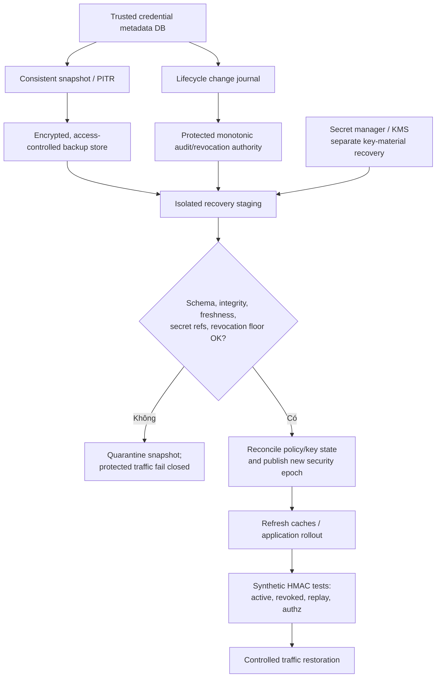
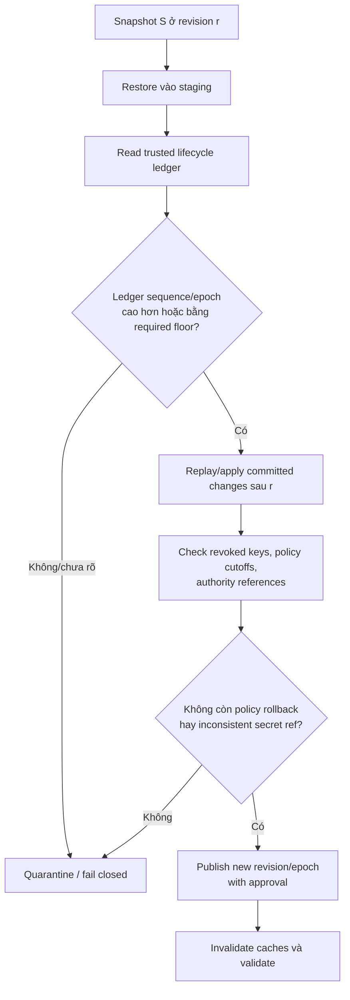

# Backup key metadata: sao lưu và khôi phục metadata khóa HMAC an toàn

## 1. Bài toán vận hành: vì sao metadata của khóa cần được backup riêng?

Trong module `SECURITY_AUTHENTICATION_HMAC_REQUEST_AUTHENTICATION`, client ký HTTP request bằng HMAC với **shared secret**. Server chọn khóa theo key ID/version, tái dựng **canonical request** từ method, URI, signed headers hoặc body hash đúng hợp đồng, xác minh MAC, kiểm tra timestamp/nonce chống replay, rồi tạo principal. **Authorization** chỉ được thực hiện sau bước xác thực và dựa trên quyền/policy do server kiểm soát.

Một thiết kế production không chỉ cần lưu secret; nó còn cần **key metadata** để xác định:

- Key ID nào thuộc credential/client nào?
- Secret nào được tham chiếu, phiên bản nào đang active?
- Key đã revoked, expired hay đang trong rotation overlap?
- Thuật toán HMAC và signing protocol/canonicalization version nào được phép?
- Chính sách thời gian, tenant, scope và authority được áp dụng ra sao?
- Khi nào sự thay đổi có hiệu lực, do quy trình quản trị nào thực hiện?
- Tất cả replica/region có nhìn thấy policy mới và cutoff revoke chưa?

Nếu bảng metadata mất hoặc bị rollback, hệ thống có thể **không tra được secret**, từ chối toàn bộ request hợp lệ, áp sai authority, hoặc — nguy hiểm hơn — **chấp nhận lại key đã revoke** vì bản backup quá cũ. Backup tốt phải khôi phục được tính liên tục hoạt động **và** các quyết định bảo mật đúng chính sách.

**Backup key metadata** là quá trình sao lưu, bảo vệ, kiểm chứng và khôi phục dữ liệu mô tả vòng đời credential/HMAC key mà **không lẫn lộn metadata với raw secret material**.

Bài này thuộc chương **Operations**. Mục tiêu là vận hành một kho metadata có thể phục hồi, hỗ trợ HMAC verification, key rotation, proxy/gateway và anti-replay, nhưng không biến backup thành cơ chế bỏ qua bảo mật.

### Kết quả học tập

Sau bài này, người học có thể:

1. Xác định dữ liệu nào là key metadata và dữ liệu nào là cryptographic secret.
2. Thiết kế schema, version và lifecycle state phục vụ backup/restore.
3. Xác lập RPO/RTO, mã hóa, quyền truy cập, integrity, freshness và anti-rollback.
4. Phân biệt backup nhất quán, backup incremental, WAL/CDC và nhật ký thay đổi credential.
5. Thiết kế restore **không làm sống lại key revoked**, không dùng policy stale.
6. Kiểm tra secret references với secret manager/KMS mà không xuất raw key.
7. Kết hợp restore với nonce store, timestamp window và fail-closed semantics.
8. Thực hành runbook phục hồi, Spring Boot integration, monitoring và kiểm thử fault injection.

## 2. Phân biệt key metadata, key material và nonce state

Ba nhóm dữ liệu này **không thể thay thế lẫn nhau**.

| Nhóm | Ví dụ | Mục đích | Cách backup |
| --- | --- | --- | --- |
| **Key metadata** | Key ID, client/tenant ID, secret reference, algorithm allowlist, created/expire/revoked timestamps, key state, policy revision | Quyết định secret nào được phép dùng và principal/authority nào được tạo | Snapshot/PITR/event journal có mã hóa, integrity và chống rollback |
| **Key material** | Raw HMAC shared secret, KMS-wrapped secret bytes, secret manager value | Thực sự tính và xác minh MAC | Quy trình bảo vệ/recovery riêng của secret manager hoặc hệ quản lý khóa; **không đưa raw secret vào metadata backup** |
| **Replay state** | Nonce đã reserve, credential scope, TTL còn lại | Ngăn một request có chữ ký hợp lệ được dùng lại trong cửa sổ timestamp | Đánh giá continuity/persistence riêng; **không giả định restore metadata khôi phục được anti-replay** |
| **Audit/lifecycle events** | Key created/rotated/revoked, policy changed, admin approval | Đối chiếu thay đổi và xác minh restore không lùi trạng thái | Append-only/immutable theo policy, bảo toàn sequence và nguồn độc lập |
| **Application config/policy** | Signing protocol v2, allowed algorithms, URI canonicalization rules | Xác định ý nghĩa signature và verification | Version hóa và quản lý cấu hình, tương thích với metadata revision |

Một kho metadata có thể chứa **encrypted key blobs** hoặc wrapped key. Khi đó phần dữ liệu này vẫn là **cryptographic key material được mã hóa**, không thể mặc nhiên coi là metadata vô hại. Nó phải được backup theo kiểm soát dành cho secret và KMS recovery, không chỉ theo quyền truy cập bảng metadata.

### 2.1. Secret reference không phải secret

Một bản ghi có thể lưu:

```text
key_id:            partner-a-key-v4
secret_ref:        vault://hmac/partner-a/key/v4
secret_version:    4
algorithm:         HMAC-SHA256
state:             ACTIVE
policy_revision:   1287
```

`secret_ref` là **định danh tham chiếu**, không phải giá trị secret. Sau restore, hệ thống còn phải xác minh:

- Reference trỏ đúng secret version đã được provisioning.
- Secret manager/KMS trong môi trường đích thực sự còn giữ value đúng.
- Instance được phép truy xuất theo identity/policy hiện hành.
- Reference không bị nhầm giữa staging, production, region hoặc tenant.
- Algorithm, key length và lifecycle state phù hợp policy.

Không tự tái tạo shared secret từ key ID, version hoặc secret reference. Metadata backup **không đủ** để phục hồi một secret đã bị xóa vĩnh viễn khỏi secret manager nếu không có một cơ chế recovery key material được phép và bảo vệ riêng.

### 2.2. Metadata có thể vẫn rất nhạy cảm

Dù không chứa raw secret, bản backup metadata có thể tiết lộ danh sách đối tác, định danh tenant, thời gian revoke, cấu trúc Vault/KMS, policy IAM và lịch rotation. Vì vậy nó vẫn cần:

- Mã hóa khi lưu và truyền, phân quyền tối thiểu.
- Không công khai trên web, bucket public hay CI artifacts.
- Phân tách quyền **đọc bản backup** và **sử dụng key material**.
- Retention, auditing, rotation và xử lý dữ liệu cá nhân theo chính sách.

## 3. Threat model: backup cũng là bề mặt tấn công

Một thiết kế backup/restore phải chống không chỉ mất dữ liệu mà còn cả thao túng trạng thái bảo mật.

| Mối đe dọa | Tác động | Biện pháp trọng tâm |
| --- | --- | --- |
| Backup bị đọc trái phép | Lộ credential inventory, secret refs, policy | Encryption, access control, network isolation, audit |
| Backup bị sửa | Gán sai secret ref/authority, bật lại key revoked | Authenticated integrity, schema/business validation, dual control |
| Backup bị thay bằng bản cũ | Rollback revocation/rotation cutoff | Trusted revision floor, durable revoke journal, anti-rollback |
| Backup bị xóa/ransomware | Mất khả năng restore | Immutable/offsite copies, separation of duties, recovery drill |
| Secret reference bị đổi | Dùng key của tenant khác hoặc môi trường khác | Binding checks, environment/tenant constraints |
| Chỉ backup metadata, mất secret manager | Không xác minh được HMAC | Secret recovery plan riêng, fail closed |
| Restore metadata nhưng mất nonce store | Request cũ có thể được phát lại | Anti-replay continuity strategy, refuse unsafe traffic |
| Restore thiếu authority mapping | Client được quyền sai | Reconcile IAM/authorization policy cùng revision |
| Stale cache sau restore | Replica tiếp tục dùng key/policy cũ | Epoch fencing, cache invalidation, rollout verification |
| Kẻ xấu chỉnh retention/log | Mất bằng chứng ai revoke key | Protected lifecycle audit and change journal |

**Phục hồi thành công** không chỉ là DB lên trạng thái `UP`. Phải chứng minh **mỗi key được chấp nhận vẫn được phép tồn tại** theo chính sách mới nhất có thẩm quyền.

## 4. Mô hình metadata và bất biến của key lifecycle

Một thiết kế HMAC credential thường cần tách client, key version và thay đổi policy.

### 4.1. Các trường dữ liệu khuyến nghị

| Trường | Ví dụ | Bất biến cần giữ |
| --- | --- | --- |
| `credential_id` | `cred-7df2` | ID ổn định, duy nhất trong scope |
| `client_id` | `partner-a` | Liên kết server-side đáng tin, không lấy trực tiếp từ request chưa xác minh |
| `tenant_id` | `tenant-12` | Không cross-tenant khi restore |
| `key_id` | `partner-a-v4` | Duy nhất trong namespace có định nghĩa |
| `key_version` | `4` | Mapping nhất quán đến đúng secret version |
| `secret_ref` | `vault://.../v4` | Không chứa raw secret; reference immutable/version-pinned nếu có thể |
| `algorithm_id` | `HMAC-SHA256` | Enum từ allowlist, không lấy raw string tùy ý |
| `signing_contract_version` | `HMAC-REQ-V2` | Phù hợp canonicalization của client/server |
| `status` | `ACTIVE`/`PREVIOUS_ALLOWED`/`REVOKED`/`EXPIRED` | Không tự chuyển từ REVOKED về ACTIVE khi restore |
| `valid_from`, `valid_until` | UTC timestamps | Không mở rộng cửa sổ do backup cũ |
| `revoked_at`, `revocation_reason` | UTC + reason code | Revocation đã có hiệu lực phải được bảo toàn |
| `authority_policy_ref` | `orders-writer-v3` | Ref trỏ policy đúng revision |
| `created_at`, `updated_at` | UTC | Truy vết thay đổi, không thay thế monotonic revision |
| `record_revision` | `1287` | Conflict detection/version control |
| `global_security_epoch` | `244` | Chặn replica/backups dùng policy cũ nếu được thiết kế |

**Ví dụ trạng thái:** `PENDING` → `ACTIVE` → `PREVIOUS_ALLOWED` → `REVOKED` hoặc `EXPIRED`. Đây là mô hình lifecycle minh họa; các chuyển trạng thái phải được kiểm soát bởi nghiệp vụ và audit.

Trạng thái `REVOKED` thường có tính **terminal theo cùng key identity/version**: nếu muốn cấp quyền lại một client sau sự cố, tạo credential/key version mới thay vì “bật sống” secret đã revoke. Nếu chính sách có ngoại lệ, cần quy trình phê duyệt và điều kiện nghiêm ngặt, không để restore tự quyết.

### 4.2. Ví dụ schema SQL

```sql
-- PostgreSQL: cấu trúc minh họa, cần bổ sung schema migration,
-- foreign keys, enum constraints và index theo workload thực.
CREATE TABLE hmac_key_metadata (
    credential_id        UUID           NOT NULL,
    client_id            VARCHAR(128)   NOT NULL,
    tenant_id            VARCHAR(128)   NOT NULL,
    key_id               VARCHAR(160)   NOT NULL,
    key_version          INTEGER        NOT NULL,
    secret_ref           VARCHAR(512)   NOT NULL,
    algorithm_id         VARCHAR(32)    NOT NULL,
    contract_version     VARCHAR(32)    NOT NULL,
    lifecycle_status     VARCHAR(32)    NOT NULL,
    valid_from           TIMESTAMPTZ    NOT NULL,
    valid_until          TIMESTAMPTZ,
    revoked_at           TIMESTAMPTZ,
    authority_policy_ref VARCHAR(160)   NOT NULL,
    record_revision      BIGINT         NOT NULL,
    updated_at           TIMESTAMPTZ    NOT NULL,
    PRIMARY KEY (credential_id, key_version),
    UNIQUE (tenant_id, key_id, key_version),
    CHECK (key_version >= 1),
    CHECK (record_revision >= 1),
    CHECK (lifecycle_status IN (
      'PENDING', 'ACTIVE', 'PREVIOUS_ALLOWED', 'REVOKED', 'EXPIRED'
    )),
    CHECK (algorithm_id IN ('HMAC-SHA256', 'HMAC-SHA512')),
    CHECK (valid_until IS NULL OR valid_until > valid_from)
);
```

Ví dụ này **không** chứa raw secret. Một ứng dụng có thể có thêm bảng client/tenant/policy với foreign keys và event journal. Cột `revoked_at` không thay thế việc đối chiếu với **revocation ledger mới nhất**; record bản backup có thể chưa biết một revoke xảy ra sau snapshot.

### 4.3. Version của record khác key version

- `key_version` nói tới đời secret cụ thể.
- `record_revision` thay đổi khi chỉnh metadata hoặc policy của key.
- `global_security_epoch` (nếu có) giúp nhận biết version của một tập policy/key inventory.
- `signing_contract_version` nói tới canonical request format.
- `backup_generation` nói tới thời điểm tạo artifact.

Đây là các trục độc lập. Không suy rằng “key v4 nằm trong backup generation 4 thì state mới nhất”. Một bản backup mới có thể chứa một record stale nếu source replica chưa bắt kịp replication.

## 5. RPO và RTO: định lượng khả năng phục hồi

**Recovery Point Objective (RPO)** là giới hạn tổn thất dữ liệu chấp nhận được theo thời gian. **Recovery Time Objective (RTO)** là thời gian tối đa mục tiêu để phục hồi dịch vụ.

Ví dụ cần phân loại theo dữ liệu:

| Dữ liệu/quyết định | Hậu quả khi mất thay đổi gần đây | Yêu cầu thiết kế |
| --- | --- | --- |
| Client/key mới được cấp | Client mới không xác thực được | RPO phù hợp provisioning SLA |
| Key rotation đang triển khai | Nhầm active/previous key, tăng 401 | Đồng bộ metadata/secret versions |
| Key **đã revoke** | **Có thể nhận lại key không còn được phép** | Không được rollback; ledger/authority độc lập |
| Authority giảm quyền | Có thể phục hồi quyền quá rộng | Policy revision floor, reconcile với IAM |
| Canonical/algorithm cutoff | Có thể chấp nhận signing protocol cũ | Chặn downgrade bằng policy hiện hành |
| Nonce/replay state | Có thể chấp nhận phát lại trong timestamp window | Continuity/fail-closed strategy riêng |
| Security audit events | Thiếu bằng chứng incident | Durable event pipeline, retention |

**RPO tính bằng vài phút có thể chấp nhận cho metadata onboarding**, nhưng không đương nhiên an toàn đối với revocation hoặc giảm quyền. Nếu một revocation có hiệu lực lúc 10:00 và restore snapshot 09:55, hệ thống **không được cho phép lại secret đó** chỉ vì backup được tạo trước revoke.

### 5.1. Thiết kế trusted source of truth cho revoke

Một chiến lược là duy trì **append-only lifecycle journal** hoặc revocation ledger được bảo vệ, có **revision/sequence tăng đơn điệu**, lưu tách biệt khỏi snapshot có nguy cơ bị rollback. Restore phải replay/đối chiếu mọi revoke và thay đổi policy bắt buộc sau snapshot, rồi xác minh state cuối cùng.

Điều kiện cốt lõi: ledger/epoch phải có **nguồn tin cậy đủ độc lập** và cùng được sao lưu/phục hồi theo chính sách. Nếu cả snapshot và ledger cùng rollback về một thời điểm, không có căn cứ để biết revocation mới hơn đã tồn tại. Một bộ đếm monotonic trong chính DB đã bị rollback **không tự ngăn rollback**.

Có thể dùng nguồn authority độc lập, quorum/consensus store, append-only immutable storage có khóa tách quyền hoặc cơ chế tương đương phù hợp threat model. Tránh quảng cáo rằng chỉ một `updated_at` hoặc checksum SHA-256 đã đủ chống rollback.

## 6. Kiến trúc backup và restore được khuyến nghị



Mục tiêu là tạo một **restore candidate** tách khỏi production, xác thực đầy đủ rồi **publish** có kiểm soát. Không ghi đè DB đang phục vụ request HMAC bằng snapshot chưa kiểm tra, vì các replica có thể thấy state bất nhất giữa lúc thay thế.

### 6.1. Ba lớp cần bảo vệ

1. **Metadata snapshot/PITR** để có trạng thái dữ liệu ở một mốc.
2. **Lifecycle journal/authority** để khôi phục thay đổi sau mốc và xác nhận không rollback revoke/policy.
3. **Secret manager recovery** để đảm bảo secret version được tham chiếu vẫn tồn tại và truy cập được theo IAM đích.

Nếu thiếu lớp 2, restore cũ có thể mất revoke. Nếu thiếu lớp 3, metadata hợp lệ vẫn không có khả năng tính HMAC. Nếu thiếu nonce continuity, restore metadata “xanh” vẫn có thể mất chống replay.

## 7. Thiết kế bản sao lưu nhất quán

### 7.1. Snapshot nhất quán ở transaction boundary

Giả sử rotation tạo key v5, chuyển v4 sang `PREVIOUS_ALLOWED` và cập nhật active pointer. Nếu backup chụp các bảng vào những thời điểm khác nhau, có thể thấy:

```text
active_version = v5
key_v5 metadata = chưa xuất hiện
key_v4 state = PREVIOUS_ALLOWED
```

Restore snapshot đó dẫn tới tình trạng **active pointer không trỏ tới record hợp lệ** hoặc một số instance chọn sai key. Vì vậy:

- Backup cơ sở dữ liệu phải có transactional consistency tại cùng mốc hoặc PITR theo WAL/redo log phù hợp engine.
- Lưu lại LSN/transaction boundary hay sequence từ source khi công cụ hỗ trợ.
- Với metadata nằm nhiều store, cần protocol/saga có sự kiện commit/reconciliation rõ ràng, không giả định snapshot riêng lẻ là atomic trên toàn hệ.
- Không backup bằng vòng `SELECT *` từng bảng từ các replica có replication lag khác nhau rồi gọi đó là snapshot nhất quán.
- Schema version, policy version và event-journal position phải đi cùng metadata backup.

### 7.2. Full, incremental, WAL/CDC

| Kiểu | Ưu điểm | Rủi ro/kiểm soát |
| --- | --- | --- |
| **Full snapshot** | Restore đơn giản cho một mốc | RPO kém nếu tần suất thấp, size lớn |
| **Incremental/differential** | Giảm khối lượng mỗi lần | Cần chuỗi đầy đủ, integrity và dependency rõ |
| **PITR bằng WAL/redo log** | Chọn mốc phục hồi chính xác hơn | Cần retained WAL, kiểm thử replay đúng |
| **CDC/lifecycle journal** | Theo dõi thay đổi gần thời gian thực | Phải biết commit/order, không nhầm event chưa commit |
| **Immutable/offsite copy** | Chống xóa/sửa bởi lỗi/ransomware | Phải có quản lý khóa/retention và quy trình khôi phục |

Một event `key_revoked` được phát trước commit nhưng giao dịch DB rollback **không được** coi như đã revoke, và ngược lại. Dùng outbox pattern hoặc cơ chế atomic commit giữa state và event khi cần đảm bảo nhất quán. Chỉ tiêu “journal đã được ghi” phải có định nghĩa durability rõ.

### 7.3. Backup source phải đủ mới

Nếu đọc từ replica secondary, kiểm tra replication lag và độ mới của WAL/sequence. Một bản backup “vừa tạo lúc 11:00” có thể chứa dữ liệu nguồn từ 10:45 do replica đang chậm. Dùng `source_commit_position` và `source_observed_at` thay vì chỉ dựa `backup_completed_at`.

## 8. Backup manifest: biết chính xác đã sao lưu cái gì

Mỗi backup nên có manifest đi kèm; ví dụ **metadata minh họa, không chứa secret**:

```yaml
schema_version: 3
backup_id: "hmac-meta-20261128-0008"
environment: "staging-example"
source_cluster_id: "credential-registry-stg"
created_at_utc: "2026-11-28T04:00:00Z"
source_commit_position: "LSN_OR_SEQUENCE_FROM_DB"
security_policy_epoch: 244
lifecycle_journal_position: 18640
snapshot_format: "encrypted-database-snapshot"
encryption_key_reference: "kms://backup-domain/staging/key-3"
object_count: 1280
checksum_algorithm: "SHA-256"
checksum_value: "REPLACE_WITH_REAL_DIGEST"
integrity_signature_ref: "REPLACE_WITH_VALIDATED_MANIFEST_SIGNATURE"
restore_policy_id: "hmac-key-metadata-v3"
```

**Placeholder không phải giá trị đã xác minh**: một pipeline backup thật phải tính checksum và xác thực manifest signature/AEAD tag theo format đã công bố. Không chỉ ghi string “SHA-256” rồi bỏ qua verification.

Trường quan trọng:

- **Environment/cluster identity:** tránh restore dữ liệu production vào staging hoặc ngược lại không qua chuyển đổi có kiểm soát.
- **Source commit position:** đối chiếu với journal và backup khác.
- **Security epoch/journal position:** phát hiện trạng thái cũ hơn authority.
- **Schema version:** biết migration nào cần chạy.
- **Encryption/key reference:** phục hồi bằng key được phép; không ghi raw encryption key.
- **Integrity proof:** xác nhận artifact không bị sửa hoặc lẫn file.
- **Retention/legal hold:** quy tắc giữ/xóa khi cần.

Manifest cũng là dữ liệu cần bảo vệ. Các identifier có thể tiết lộ hạ tầng; chỉ dùng trên kênh quản trị có phân quyền.

## 9. Mã hóa, authenticity, quyền truy cập và quản lý khóa backup

### 9.1. Mã hóa khi lưu và truyền

- Mã hóa backup bằng AEAD hoặc cơ chế mã hóa có xác thực và cấu hình được tổ chức phê duyệt.
- Truyền qua TLS/mTLS hay kênh mã hóa có xác minh danh tính, không gửi file qua HTTP không bảo vệ.
- Dùng **backup encryption key** tách mục đích với **HMAC request shared secrets**.
- Giới hạn quyền decrypt chỉ cho recovery automation/operators phù hợp, có audit.
- Bảo vệ key/wrapping keys trong KMS/HSM/secret manager có recovery độc lập.

**Không dùng một client shared secret để mã hóa bản backup metadata**. Key phục vụ request authentication và key phục vụ backup có lifecycle, trust domain và mục đích khác nhau.

### 9.2. Integrity khác freshness/anti-rollback

SHA-256 checksum cho biết bytes có thay đổi so với digest **được tin cậy** hay không. Nó **không tự chứng minh** một bản backup là do hệ thống hợp lệ tạo ra, và **không tự chống** kẻ tấn công thay cả backup lẫn checksum bằng một cặp cũ.

Bổ sung:

- AEAD tag hoặc chữ ký/MAC của manifest bằng key bảo vệ độc lập.
- Đối chiếu monotonic epoch/revocation ledger từ nguồn authority đã xác thực.
- Kiểm tra backup source/environment, chuỗi incrementals, journal gap.
- Phê duyệt và audit cho thao tác restore production.

Một bản backup **được ký hợp lệ nhưng cũ** vẫn có thể không được phép khôi phục vào production nếu sẽ hồi sinh key đã revoke.

### 9.3. Quyền vận hành

Tách vai trò:

| Vai trò | Quyền tối thiểu |
| --- | --- |
| Backup producer | Đọc dữ liệu nguồn và ghi artifact backup vào kho quy định |
| Backup storage operator | Quản lý retention/availability, **không nhất thiết được decrypt** |
| Restore operator | Tạo restore candidate trong môi trường cách ly |
| Security approver | Xem bằng chứng, xác nhận policy floor/revocation reconciliation |
| Secret manager custodian | Quản lý truy cập/recovery key material riêng |
| Auditor | Xem manifest, sự kiện backup/restore, không nhận raw secret |

Chế độ immutable/WORM, retention lock và bản sao khác failure domain giúp chống xóa dữ liệu; không giải quyết việc chọn **nhầm backup version** nếu thiếu kiểm tra policy.

## 10. Key rotation và revocation: phần khó nhất của restore

Xét timeline:

```text
09:00  Snapshot S chụp key-v3=ACTIVE.
09:15  Cấp key-v4=ACTIVE; key-v3=PREVIOUS_ALLOWED.
09:30  Revoke key-v3 do nghi lộ secret.
10:00  DB metadata hỏng.
10:05  Operator định restore S (09:00).
```

Nếu restore S rồi mở traffic, server có thể lại chấp nhận key-v3 dù đã revoke lúc 09:30. **Đó là sự cố bảo mật**, không chỉ lỗi backup.

### 10.1. Bất biến phải giữ

1. **Revocation monotonic:** một key identity/version đã revoke không được tự hồi sinh bởi restore.
2. **Policy minimum:** không khôi phục allowed algorithm/canonical protocol cũ đã bị cấm.
3. **Authority restriction:** không khôi phục quyền cao hơn những gì policy hiện hành cho phép.
4. **Key version binding:** active/current pointer luôn trỏ tới record + secret version hợp lệ.
5. **Rotation overlap:** khoảng chấp nhận previous key không được mở rộng tùy tiện do timestamp cũ.
6. **Auditability:** phải biết ai thay đổi, khi nào, theo revision nào và được phê duyệt bởi ai.

Để thực hiện, restore phải đối chiếu **trusted current policy authority** và apply mọi changes có thứ tự sau snapshot; nếu nguồn này không thể truy cập hoặc không đủ tin cậy, **không thể khẳng định khôi phục an toàn**. Khi không chứng minh được key nào được phép, hãy từ chối request protected theo chính sách fail-closed trong lúc phục hồi.

### 10.2. Quy trình đối chiếu revocation



Chú ý: `required floor` phải đến từ nguồn authority tin cậy ở ngoài snapshot bị khôi phục. Nếu cả ledger và required floor đều mất, dùng một bản metadata cũ **không thể** tự chứng minh không có revocation xảy ra sau đó; phải dùng quy trình khôi phục tin cậy khác hoặc xử lý credentials theo chính sách sự cố.

## 11. Mối liên hệ với secret manager và KMS

Metadata thường chứa secret reference đến Vault, cloud secret manager hoặc KMS-backed store. Backup metadata thành công nhưng mất quyền/khả năng decrypt secret vẫn làm HMAC verification ngừng hoạt động.

### 11.1. Secret references phải được xác thực

Sau restore, với từng key eligible:

- Kiểm tra reference có thuộc đúng environment, client/tenant và expected secret version.
- Kiểm tra principal của service có quyền **read/unwrap** theo IAM hiện tại.
- Kiểm tra key/version chưa bị destroy theo retention policy.
- Kiểm tra key bytes/format/algorithm phù hợp mà **không log value**.
- Kiểm tra secret lifecycle khớp metadata; có thể secret manager đã revoke phiên bản mà snapshot chưa biết.
- Không tự chọn “latest” secret version nếu metadata đã pin version cũ; “latest” có thể trỏ sang key khác.

Nếu key material đã bị destroy, chỉ metadata reference không thể giúp tái tạo MAC. Cần quy trình restore/provisioning key riêng, có người phê duyệt và trust control.

### 11.2. Nguy cơ môi trường

Một reference kiểu `vault://hmac/client-A/v2` có thể tồn tại ở cả staging và production nhưng chứa **secret khác nhau**. Vì vậy namespace trong reference và restore policy phải có environment/tenant binding; không tự tin rằng path giống nhau đồng nghĩa key giống nhau.

### 11.3. Không thử nhiều secret để “cứu” request

Nếu restore làm metadata trỏ sai secret version, không sửa bằng cách thử mọi secret trong store cho đến khi một signature khớp. Điều này mở rộng tập credential được chấp nhận, tạo oracle và phá key rotation. Phải sửa dữ liệu gốc và xác minh contract theo test vectors đã biết.

## 12. Nonce/replay state: restore metadata không tự khôi phục chống replay

Đây là ranh giới đặc biệt quan trọng với HMAC.

Giả sử request R ký hợp lệ với timestamp còn hạn và nonce N. Server đã reserve N trong Redis. Metadata DB bị hỏng và được phục hồi, còn Redis cũng bị reset hoặc dùng một snapshot cũ chưa chứa N. Nếu tiếp tục cho qua request ngay, **R có thể được chấp nhận lại** trong cửa sổ timestamp dù key metadata chính xác.

### 12.1. Các chiến lược continuity

| Chiến lược | Ý nghĩa | Yêu cầu bảo mật |
| --- | --- | --- |
| Nonce store có persistence/failover đáng tin | Giữ state chống replay qua sự cố | Đảm bảo không rollback reservation trong cửa sổ |
| Durable ledger/checkpoint phù hợp | Phục hồi nonces chưa hết hạn | Consistent ordering và atomic reserve semantics |
| Quarantine/deny window sau state loss | Tạm không nhận protected requests đến khi replay window cũ hết | **Fail closed** trong khoảng không thể đảm bảo |
| Protocol epoch/nonce namespace mới | Chuyển sang miền freshness mới | Chỉ an toàn nếu client và server ràng buộc epoch vào MAC, không chấp nhận lại request epoch cũ |
| Re-provision credentials theo sự cố | Thay secret và key ID khi không thể đảm bảo continuity | Cần phối hợp, cutoff và key revoke có thẩm quyền |

**Không đủ** chỉ “restart Redis rồi tiếp tục `SET NX`”. Redis mới không biết nonce nào đã dùng trước crash. Cũng không đủ xóa một cache local nonce nếu các replica khác còn nhận request.

### 12.2. TTL và timestamp window

Nếu server cho phép timestamp trong khoảng `±Δ` với clock skew, nonce retention phải đủ để mọi request đã từng được chấp nhận không được chấp nhận lại **khi timestamp còn hợp lệ**. Thiết kế TTL cần gắn với mốc nhận request, cửa sổ hợp đồng và skew, không dùng một số “5 phút” mà không kiểm chứng biên.

Trong recovery, nếu mất nonce state và không có cơ chế continuity, một phương án nghiêm ngặt là **ngừng chấp nhận request protected** trong khoảng rủi ro (bao gồm biên timestamp và clock skew đã công bố) hoặc dùng rekey/epoch protocol có ràng buộc mật mã. Không thay `401 replay` bằng `200` để giữ uptime.

### 12.3. Idempotency khác anti-replay

Nonce ngăn **cùng thông điệp ký** được dùng lại. Nó không ngăn client tạo hai request khác nonce nhưng cùng yêu cầu tạo đơn hàng. Trong API ghi, cần idempotency key/policy nghiệp vụ riêng. Backup/restore idempotency records cũng có yêu cầu nhất quán khác với nonce store; không dùng một cơ chế thay thế cho cơ chế kia.

## 13. Runbook: sao lưu metadata khóa theo lịch

Một kế hoạch backup thực tế nên công bố **ai**, **khi nào**, **điểm nhất quán**, **độ mới**, **khóa mã hóa** và **bằng chứng thành công**.

### Giai đoạn 1 — Chuẩn bị

1. Xác định dữ liệu nằm trong phạm vi: key records, lifecycle statuses, authority policy references, protocol version, event journal positions; loại trừ raw secrets nếu chính sách đặt secret ở store riêng.
2. Kiểm tra schema migration và compatibility của restore tooling.
3. Xác định RPO/RTO, tần suất full + incremental/WAL và retention có bảo vệ.
4. Kiểm tra backup destination, IAM least privilege, KMS encryption key recovery.
5. Kiểm tra không có credential/secret bị đưa vào log, filename hay metrics labels.

### Giai đoạn 2 — Tạo bản sao nhất quán

1. Chọn snapshot/transaction boundary bằng tính năng DB hỗ trợ.
2. Ghi `source_commit_position`, thời gian quan sát, schema version, source cluster.
3. Lưu snapshot và chuỗi WAL/change journal cần thiết.
4. Mã hóa artifact trước khi đưa vào storage chung hoặc dùng server-side encryption đáng tin có authentication/integrity thích hợp.
5. Tạo manifest, integrity proof và retention metadata.

### Giai đoạn 3 — Kiểm chứng ngay sau backup

1. Kiểm tra artifact có đầy đủ, kích thước/digest/AEAD tag/chữ ký hợp lệ.
2. Xác minh mọi phần incremental và journal continuity không bị thiếu.
3. Kiểm tra snapshot phù hợp RPO so với **source commit position**, không chỉ timestamp hoàn thành.
4. Ghi audit `backup.created`/`backup.verified` với backup ID, epoch, kết quả; không log secret refs không cần thiết.
5. Theo dõi lịch test restore, không coi `backup job exit code 0` là đủ.

### Giai đoạn 4 — Bảo vệ và giám sát

- Bản sao ở failure domain khác, có retention lock/immutability theo policy.
- Tách tài khoản backup writer, restore reader và security approver.
- Alert nếu backup job thất bại, backup quá cũ, manifest sai hoặc verification không đạt.
- Thử khôi phục định kỳ vào môi trường tách biệt.
- Kiểm tra khả năng truy cập encryption key và secret manager cũng được đưa vào DR plan.

## 14. Runbook: khôi phục metadata khi production lỗi

**Mục tiêu:** đưa hệ thống về trạng thái xác thực HMAC an toàn, không chỉ khôi phục bảng.

### Bước 1 — Cô lập và quyết định fail-closed

- Phân loại sự cố: metadata DB outage, corruption, accidental delete, ransomware hay policy rollback.
- Ghi UTC window, số replica/region, phiên bản release và policy.
- Ngăn request protected vượt qua verifier khi không tra được key state; trả `503` hoặc lỗi hạ tầng theo contract.
- Không dùng “last-known-good cache” nếu không chứng minh key revoke/policy freshness còn đáp ứng yêu cầu.
- Bảo toàn bản chứng cứ corruption và audit trước khi thao tác có khả năng ghi đè.

### Bước 2 — Chọn backup và kiểm tra độ tin cậy

- Chọn candidate đáp ứng RPO và khớp environment/schema.
- Kiểm tra manifest, integrity proof, encryption key reference, nguồn backup.
- Xác định snapshot revision, commit position và lifecycle journal position.
- Đối chiếu required security epoch/revoke floor **từ nguồn authority độc lập**.
- Nếu một phần change log thiếu/không rõ: tạm dừng restore/publish, không mở traffic theo policy stale.

### Bước 3 — Restore vào vùng cách ly

- Phục hồi snapshot/PITR vào database staging/recovery riêng.
- Áp schema migration đã review; không chạy scripts nguy hiểm với secret.
- Replay các lifecycle changes **committed** theo thứ tự đúng, xử lý idempotency/duplicate event và gap.
- Kiểm tra uniqueness, foreign keys, active pointers và state transition.
- Xác nhận revoked/expired records không bị tự chuyển ACTIVE.

### Bước 4 — Đối chiếu secret/policy

- Kiểm tra secret reference version-pinned còn resolvable theo IAM hiện tại.
- Đối chiếu policy hiện hành về thuật toán, canonical contract, authority và cutoff.
- Kiểm tra key rotation overlap, valid_from/valid_until và revoked_at.
- Xác định nonce/replay store có continuity hay phải áp chính sách quarantine.
- Không copy raw secret vào report hay chạy query xuất toàn key material.

### Bước 5 — Publish có kiểm soát

- Có phê duyệt từ owner/security theo severity.
- Publish **một generation/epoch nhất quán**; tránh đọc nửa snapshot mới, nửa cache cũ.
- Invalidate caches và bảo đảm các replica đã chuyển sang ít nhất required epoch.
- Không nhận protected request từ node chưa xác nhận state, hoặc có cơ chế centralized rejection.
- Giới hạn lưu lượng ban đầu, theo dõi accepted/rejected/unavailable và dependency latency.

### Bước 6 — Xác minh bằng signed synthetic checks

Dùng credential **test-only** qua gateway, với signed request theo contract:

1. Key active + signature hợp lệ + nonce mới → authentication accepted.
2. Key revoked, dù signature chính xác theo secret cũ → **rejected**.
3. Key expired hoặc algorithm bị cấm → rejected.
4. Key trong rotation overlap hợp lệ → accepted đúng window, không vượt cutoff.
5. Dùng lại nonce của request đã được chấp nhận → rejected (nếu continuity đã xác thực).
6. HMAC hợp lệ nhưng thiếu authority → `403`; authentication đã thành công.
7. Gateway rewrite public path/query theo contract → HMAC vẫn đúng; thay path sau ký → reject.
8. Key/nonce store mất khả dụng → fail closed, không được chạy controller.
9. Không log raw secret, MAC, nonce hoặc raw body trong test artifacts.

**Không** bật lại traffic production chỉ vì health endpoint trả `UP`. Health connectivity không chứng minh revocation và replay correctness.

## 15. Java/Spring Boot: tách metadata repository và secret resolver

Ví dụ Java 17/Spring Boot 3 minh họa cấu trúc đọc metadata cho HMAC authentication. Đây không phải code hoàn chỉnh cho backup engine — backup/restore cần do một service/job quản trị tách biệt sở hữu.

### 15.1. Các kiểu dữ liệu có schema rõ

```java
import java.time.Instant;
import java.util.Set;

public enum KeyLifecycle {
    PENDING, ACTIVE, PREVIOUS_ALLOWED, REVOKED, EXPIRED
}

public enum AllowedHmacAlgorithm {
    HMAC_SHA256, HMAC_SHA512
}

public record HmacKeyMetadata(
        String credentialId,
        String clientId,
        String tenantId,
        String keyId,
        int keyVersion,
        String secretRef,
        AllowedHmacAlgorithm algorithm,
        String signingContractVersion,
        KeyLifecycle lifecycle,
        Instant validFrom,
        Instant validUntil,
        Instant revokedAt,
        String authorityPolicyRef,
        long recordRevision,
        long securityEpoch) {
}
```

**Không đặt raw key material trong `HmacKeyMetadata`**. Nếu ứng dụng có class `HmacCredential` chứa secret, tránh `toString()` tự sinh/structured logging làm lộ nội dung. `secretRef` vẫn nên được xem là metadata nhạy cảm và không phát tán vào response.

### 15.2. Kiểm tra trạng thái metadata trước khi dùng secret

```java
public final class HmacKeyEligibility {

    public boolean allowedForVerification(
            HmacKeyMetadata key,
            Instant now,
            long requiredSecurityEpoch) {

        if (key.securityEpoch() < requiredSecurityEpoch) {
            return false; // Policy stale: phải fail closed.
        }
        if (key.lifecycle() == KeyLifecycle.REVOKED
                || key.lifecycle() == KeyLifecycle.EXPIRED
                || key.lifecycle() == KeyLifecycle.PENDING) {
            return false;
        }
        if (key.revokedAt() != null
                && !now.isBefore(key.revokedAt())) {
            return false;
        }
        if (now.isBefore(key.validFrom())) {
            return false;
        }
        return key.validUntil() == null
                || now.isBefore(key.validUntil());
    }
}
```

Đây là **một guard cục bộ minh họa**, không phải đầy đủ logic anti-rollback hay authorization. `requiredSecurityEpoch` phải lấy từ trusted authority đủ mới; nếu authority không truy cập được, **không dùng 0 hoặc một default cũ** để “cho chạy tiếp”. Khi thiếu thông tin hiện hành, verifier phải fail closed theo policy.

Một key ở `PREVIOUS_ALLOWED` cần thêm kiểm tra rotation overlap/cutoff theo policy; `allowedForVerification` không tự đủ để quyết định tất cả version. Algorithm/contract cũng phải được kiểm tra theo allowlist hiện hành, không dùng enum từ header client để override metadata.

### 15.3. Xử lý metadata không nhất quán

```java
public VerifiedHmacIdentity verify(HttpServletRequest request) {
    // Chỉ là outline, không phải code có thể biên dịch ngay.
    ParsedHmacEvidence evidence = parseAndValidate(request);
    long requiredEpoch = policyAuthority.currentRequiredEpoch();

    HmacKeyMetadata meta = metadataRepository.resolve(
            evidence.keyId());

    ensureConsistentAndEligible(meta, requiredEpoch);

    SecretKeyMaterial secret = secretResolver.resolveVersionPinned(
            meta.secretRef(), meta.keyVersion());

    byte[] canonical = canonicalizer.build(request, meta);
    verifyMacConstantTime(secret, canonical, evidence.signature());
    verifyTimestampWindow(evidence.timestamp());
    nonceStore.reserveAtomically(meta.credentialId(),
                                evidence.nonce());
    return principalFactory.fromTrustedMetadata(meta);
}
```

Các lớp/helper ở đây là **pseudocode**. Trong implementation thực, cần:

- Giới hạn header/body trước parse, kiểm tra duplicate/encoding.
- Không dùng key ID client tự khai làm principal trước MAC.
- Trả `401` cho credential/signature không hợp lệ theo contract, `403` khi principal hợp lệ thiếu quyền.
- Nếu policy authority/metadata store/secret resolver/nonce store không khả dụng, **fail closed**, thường `503`/`5xx`; không giả đó là signature mismatch.
- So sánh MAC bằng API phù hợp (như `MessageDigest.isEqual` với decoded signature length đã validate).
- Chỉ reserve nonce sau kiểm tra signature/freshness phù hợp để tránh attacker làm cạn nonce của client hợp lệ.
- Không log secret, expected signature, raw canonical request hoặc object config có key material.
- Sau xác thực mới áp authorization với authority/tenant policy server-side đã reconcile.
- Với WebFlux dùng reactive client/`Mono` và `Flux<DataBuffer>` có giới hạn, không `block()` trên event loop.

**Restore không được sửa trực tiếp verifier để “thử mọi key”** khi metadata sai. Một key/version duy nhất phải được chọn theo nguồn tin cậy.

## 16. Audit và metrics cho backup/restore

Backup cần có observability độc lập với business request logging.

### 16.1. Audit events

Một bộ event có cấu trúc:

```json
{
  "event": "hmac.metadata.backup.verified",
  "event_time": "2026-11-28T04:03:00Z",
  "backup_id": "hmac-meta-20261128-0008",
  "source_cluster_class": "credential-registry",
  "source_policy_epoch": 244,
  "source_commit_position_class": "recorded",
  "integrity_check": "passed",
  "encryption_check": "passed",
  "object_count": 1280
}
```

Các event khác có thể là `backup.failed`, `restore.started`, `restore.validated`, `restore.blocked_rollback`, `restore.published` và `restore.failed`. Chỉ phát `restore.published` sau xác minh đầy đủ và hành động publish thực sự hoàn tất.

Không log secret refs đầy đủ, raw credentials, shared secrets, MAC, DB connection strings chứa password, KMS raw keys hoặc manifest nội bộ khi không cần.

### 16.2. Metrics gợi ý

| Metric/mục tiêu | Nhãn hữu hạn | Ý nghĩa |
| --- | --- | --- |
| `hmac_metadata_backup_success_total` | `result=success/failure` | Đếm job backup |
| `hmac_metadata_backup_age_seconds` | `environment_class` | Độ cũ bản backup hợp lệ mới nhất |
| `hmac_metadata_backup_verify_failures_total` | `reason=integrity/schema/sequence` | Backup không qua kiểm chứng |
| `hmac_metadata_restore_duration_seconds` | `phase=download/validate/reconcile/publish` | Xem restore bottleneck |
| `hmac_metadata_restore_blocked_total` | `reason=stale_epoch/revocation_gap/missing_secret_ref` | Phát hiện restore không an toàn |
| `hmac_metadata_policy_epoch_lag` | `service_group` | Node chậm policy epoch |
| `hmac_dependency_unavailable_total` | `dependency=key_store/nonce_store` | Mất khả năng xác minh HMAC |

Tên trên là **meter do ứng dụng/job tự định nghĩa**, không phải mặc định có trong Spring Boot. Không dùng raw `keyId`, secret reference, backup object path, nonce hay tenant ID không giới hạn làm metric labels.

### 16.3. Alert và dashboard

Một dashboard vận hành nên hiển thị:

- Tuổi bản backup đã xác minh gần nhất, so với RPO.
- Tình trạng chain WAL/incremental và độ trễ journal.
- Kết quả restore drill gần nhất, so với RTO.
- Lỗi integrity/decryption và số backup bị quarantine.
- Policy epoch chênh lệch giữa authority và các node.
- Key/nonce store availability và HMAC authn `accepted`/`rejected`/`unavailable`.
- Số request sử dụng key class `previous_allowed` gần cutoff; không dùng raw key ID.
- Sự kiện revoke/cutoff và kết quả negative signed canary.

Nếu chỉ có “backup success = true” nhưng chưa từng chạy restore, chưa thể kết luận RTO/RPO đạt mục tiêu.

## 17. Test restore: bắt buộc kiểm tra bảo mật chứ không chỉ số hàng

Một restore test cần setup metadata + lifecycle journal + secret references + nonce state theo môi trường cách ly. Không sử dụng raw production secret trong fixture.

| Kịch bản | Tình trạng ban đầu | Kỳ vọng khi restore |
| --- | --- | --- |
| Snapshot mới, integrity hợp lệ | Không thay đổi sau snapshot | Restore + verify được |
| Snapshot stale trước revoke | Key-v3 ACTIVE trong backup, đã revoke sau đó | Không publish trạng thái ACTIVE; reconcile revoke |
| Snapshot stale trước giảm authority | Role `orders:create` đã bị rút | Không khôi phục quyền đã bị rút |
| Thiếu lifecycle journal segment | Không biết thay đổi sau mốc snapshot | **Block publish/fail closed** |
| Snapshot bị sửa | Payload hoặc manifest thay đổi | Integrity verification thất bại |
| Snapshot đúng bytes nhưng cũ | Checksum/chữ ký hợp lệ, epoch dưới floor | **Chặn rollback** |
| Backup đúng source nhưng sai environment | Staging/production mismatch | Block import nếu chưa có migration được phép |
| Secret ref missing | Metadata active trỏ key đã destroy | Không xác minh được; block/repair an toàn |
| Secret version trỏ sai | Key v4 metadata, v5 value | Không tự chọn “latest”; validation fail |
| Rotation overlap | Current + previous còn window | Chỉ chấp nhận version theo cutoff |
| Key revoked rồi re-created cùng ID | Có nguy cơ ID collision | Enforce immutable identity + explicit new version |
| Schema migration không tương thích | Snapshot version cũ | Block hoặc migrate theo kế hoạch kiểm thử |
| Replica cache stale | DB đã publish epoch mới | Node cũ không nhận traffic protected |
| Nonce store bị reset | Lost used-nonce state | Quarantine/continuity protocol, không fail open |
| Key store mất kết nối | Metadata vẫn đọc được | Protected requests trả `5xx` thích hợp |
| HMAC hợp lệ thiếu authority | Credential active, policy deny | `403`, không phải 401 |
| Gateway canonical path rewrite | Public URL được ký | Positive/negative test đúng contract |
| Audit/metrics collector lỗi | Restore vẫn phải bảo toàn policy | Không bypass security; policy audit được áp |

### 17.1. Contract tests cho secret ref và key state

Test nên có dữ liệu giả:

```text
credential = test-partner-A
key-v3: previously ACTIVE, later REVOKED at revision 101
key-v4: ACTIVE at revision 102
snapshot: revision 100 (contains v3 ACTIVE)
ledger:   committed revocation 101, activation 102
required_security_epoch: 102

EXPECTED:
- restored v3 = REVOKED
- restored v4 = ACTIVE
- HMAC signed by v3 -> rejected
- HMAC signed by v4 with fresh nonce -> accepted
- HMAC signed by v4 replayed -> rejected
```

Test phải kiểm tra **HTTP outcome qua verifier thật**, không chỉ assert object `lifecycleStatus` đã đổi thành `REVOKED`. Nếu cache hoặc secret resolver vẫn dùng v3, việc kiểm tra DB object có thể xanh nhưng production đã sai.

### 17.2. Unit test validator bằng JUnit

```java
@Test
void revokedKeyFromNewerAuthorityMustNeverBeReactivated() {
    HmacKeyMetadata stale = fixtureKey(
            "test-v3", KeyLifecycle.ACTIVE,
            100L /* snapshot epoch */);

    long requiredEpoch = 102L; // Trusted, không lấy từ snapshot.

    HmacKeyEligibility eligibility = new HmacKeyEligibility();

    assertFalse(eligibility.allowedForVerification(
            stale, Instant.parse("2026-11-28T04:00:00Z"),
            requiredEpoch));
}
```

`fixtureKey` là helper do test cung cấp; ví dụ chỉ test guard. Một test đầy đủ còn phải xác minh reconciliation của revocation ledger, publish policy epoch, cache invalidation và signed request bị từ chối. Đừng biến `HmacKeyEligibility` thành nguồn authority mới cho rollback.

### 17.3. Chaos/fault injection và RTO

Thử mất database, network partition, replica lag, WAL bị thiếu, KMS decrypt timeout, secret manager outage, process restart, corruption snapshot, partial restore và multi-region failover trong môi trường được phép.

Báo cáo kết quả:

```text
Scenario: stale snapshot before key revocation
Recovery input: snapshot epoch 100, required epoch 102
Integrity validation: PASS
Freshness validation: FAIL before reconciliation
Reconciliation: replay committed events 101..102
Policy validation: PASS
Revoked key accepted after restore: NO
Active key accepted with fresh nonce: YES
Replay accepted: NO
Actual restore duration: <measured value>
Result: PASS only if every security invariant holds
```

Giá trị `<measured value>` phải được đo thật khi thực hành; không tự điền một thời gian tưởng tượng rồi tuyên bố đạt RTO.

## 18. Các sai lầm vận hành thường gặp

1. **Nhầm metadata backup với secret backup.** Khôi phục reference không tái tạo key material đã mất.
2. **Cho raw shared secret vào file metadata backup.** Mở rộng bề mặt rò rỉ và phá phân tách quyền.
3. **Tin checksum là chống rollback.** Snapshot cũ có checksum đúng vẫn có thể hồi sinh revoked key.
4. **Không lưu lifecycle event journal.** Mất revoke/cutoff xảy ra sau snapshot.
5. **Đặt epoch floor ngay trong snapshot rollback.** Không có thẩm quyền độc lập để phát hiện state cũ.
6. **Backup từ replica lag mà không ghi source position.** Tưởng backup mới nhưng dữ liệu cũ.
7. **Chụp nhiều bảng không nhất quán.** Active pointer, policy ref và key versions không đồng bộ.
8. **Coi backup job success là restore success.** Không biết artifact có decrypt/migrate/publish được không.
9. **Không kiểm tra KMS/secret manager recovery.** Metadata nguyên vẹn nhưng verifier vẫn thiếu secret.
10. **Chọn secret “latest” khi bản metadata chỉ ra version cụ thể.** Có thể ký sai hoặc chấp nhận nhầm key.
11. **Không invalidate cache.** Một replica tiếp tục chấp nhận key trước revoke.
12. **Khôi phục nonce store rỗng và mở traffic ngay.** Có thể chấp nhận request replay.
13. **Bỏ HMAC/nonce verification để đạt readiness xanh.** Biến outage thành bypass.
14. **Khôi phục quyền cũ đã bị rút.** Authorization sai dù HMAC đúng.
15. **Đưa secret refs, key IDs và client IDs vào metric labels.** Cardinality và rò thông tin.
16. **Đưa bản backup vào bucket/CI artifact công khai.** Lộ topology và credential inventory.
17. **Restore trực tiếp production không staging/approval.** Khó rollback hoặc phân tích khi state sai.
18. **Không kiểm thử qua gateway.** Local HMAC test xanh nhưng signed public path bị rewrite sai.
19. **Đánh đồng 401/403/5xx khi khôi phục.** Không phân biệt credential sai, thiếu quyền và dependency outage.
20. **Không giữ bằng chứng sự cố trước thao tác recovery.** Mất thông tin về corruption/compromise.

## 19. Bài thực hành: phục hồi metadata HMAC sau sự cố

Một hệ thống `orders-api` có:

- `POST /api/orders` yêu cầu HMAC-SHA256 trên method, public canonical URI, `Content-Type`, SHA-256 raw JSON body, timestamp và nonce.
- Spring Security Servlet hoặc WebFlux xác thực HMAC, rồi kiểm tra authority `orders:create`.
- Credential registry SQL lưu key metadata; Vault/secret manager lưu shared secrets version-pinned.
- Redis lưu used nonces atomic với TTL trong timestamp acceptance window.
- Gateway rewrite `/v1/orders` sang `/internal/orders` theo trusted ingress contract.
- Nhiều replica dùng cache key metadata có TTL và invalidation.
- Hệ thống backup có snapshot lúc 09:00, lifecycle journal còn sự kiện rotate lúc 09:15 và revoke lúc 09:30. Metadata DB hỏng lúc 10:00.

### 19.1. Nhiệm vụ triển khai

1. **Thiết kế schema:** key ID, client/tenant, secret version-pinned reference, algorithm, contract version, lifecycle state, valid window, authority policy và revision; không lưu raw secret.
2. **Tạo dữ liệu test:** key-v3 active ở snapshot, key-v4 active sau rotate, v3 revoked sau cutoff; ghi committed journal events và trusted epoch floor.
3. **Tạo snapshot/PITR:** lưu consistent commit position, schema version, manifest, integrity proof và object retention.
4. **Cấu hình lưu giữ:** encryption key cho backup tách khỏi HMAC signing key, phân quyền backup/restore, offsite/immutable copy, KMS recovery.
5. **Khôi phục staging:** import snapshot, xác minh integrity/decryption/schema và event-journal continuity.
6. **Reconcile:** replay rotation/revocation events, kiểm tra authority policy không rollback và không mở rộng algorithm/canonical contract cũ.
7. **Validate references:** key-v4 secret còn resolvable bằng đúng version; key-v3 revoked không được sử dụng dù secret cũ vẫn còn trong store.
8. **Quản lý nonce continuity:** giả lập một lần Redis reset; quyết định phương án quarantine hoặc restore anti-replay state được phép; chứng minh không có replay accepted.
9. **Publish có phê duyệt:** gắn epoch mới, đồng bộ các replica/cache, chỉ nhận traffic protected trên instance đã validate.
10. **Kiểm thử qua gateway:** ký public URI đúng với key-v4 → accepted; sửa path sau ký → 401; key-v3 revoked → rejected; principal thiếu quyền → 403; store outage → 5xx/fail closed.
11. **Quan sát:** thu backup age, restore duration, epoch lag, dependency errors và HMAC auth decisions; không ghi secret, signature, nonce hay raw body.
12. **Báo cáo DR:** ghi RPO/RTO mục tiêu và thời gian đo thực, nguồn authority đối chiếu, giới hạn evidence và hành động follow-up.

### 19.2. Câu hỏi tự đánh giá

- Tại sao một snapshot có checksum hợp lệ vẫn có thể không được phép restore vào production?
- Metadata chỉ giữ `secret_ref` có đủ để phục hồi toàn bộ HMAC verification khi Vault mất dữ liệu không?
- Nếu restore về trước lúc revoke, điều kiện nào giúp nhận biết key đã bị thu hồi sau snapshot?
- Vì sao một `security_epoch` nằm trong cùng DB backup không tự chống rollback?
- Khi Redis mất used nonce state, tại sao `SET NX` trên một Redis rỗng không đủ chống replay của request trước crash?
- Khi một client có HMAC đúng nhưng authority bị rút sau snapshot, restore phải xử lý thế nào?
- Vì sao không nên gọi `Mac` với mọi secret version lần lượt đến khi signature khớp khi metadata trỏ sai?
- Điều gì làm một báo cáo restore có giá trị hơn việc ghi “DB lên, endpoint health UP”?

### 19.3. Tiêu chí hoàn thành

Bài thực hành đạt yêu cầu khi người học chứng minh được:

- Backup metadata **không lẫn** raw HMAC signing secret và được bảo vệ ở cả storage, transport, identity và audit.
- Restore **nhất quán và xác thực được**, bao gồm manifest integrity, environment/schema, journal position và policy epoch.
- Một key đã revoke hoặc authority đã rút **không được hồi sinh** bởi snapshot cũ.
- Secret references tồn tại, đúng version/tenant/environment và có cơ chế recovery key material riêng.
- Nonce anti-replay vẫn có continuity hoặc request protected fail closed trong khoảng không thể chứng minh an toàn.
- Chỉ publish/nhận traffic từ replica dùng policy generation đã xác minh; stale cache không có quyền quyết định cũ.
- HMAC đúng nhưng thiếu quyền trả `403`; credential sai trả `401`; dependency không khả dụng trả `5xx` phù hợp, không bypass.
- Golden vectors và signed synthetic check đi qua gateway, key rotation, timestamp/nonce và body canonicalization đều đạt.
- RPO/RTO, kết quả DR drill, metric/alert, evidence gaps và các bước phục hồi được ghi rõ.

**Kết luận:** Backup key metadata cho hệ thống xác thực HMAC là **bài toán bảo toàn quyết định bảo mật theo thời gian**, không chỉ sao lưu các hàng trong database. Một bản backup hữu ích phải có khả năng khôi phục đúng mapping key/version/secret reference, giữ các thay đổi revoke và authority mới nhất, không cho phép replay sau sự cố và có quy trình kiểm thử trước khi mở traffic. Khi metadata, secret material, lifecycle authority và nonce state được quản trị theo từng ranh giới riêng, hệ thống có thể phục hồi hoạt động mà không đánh đổi tính xác thực, toàn vẹn và phân quyền.
