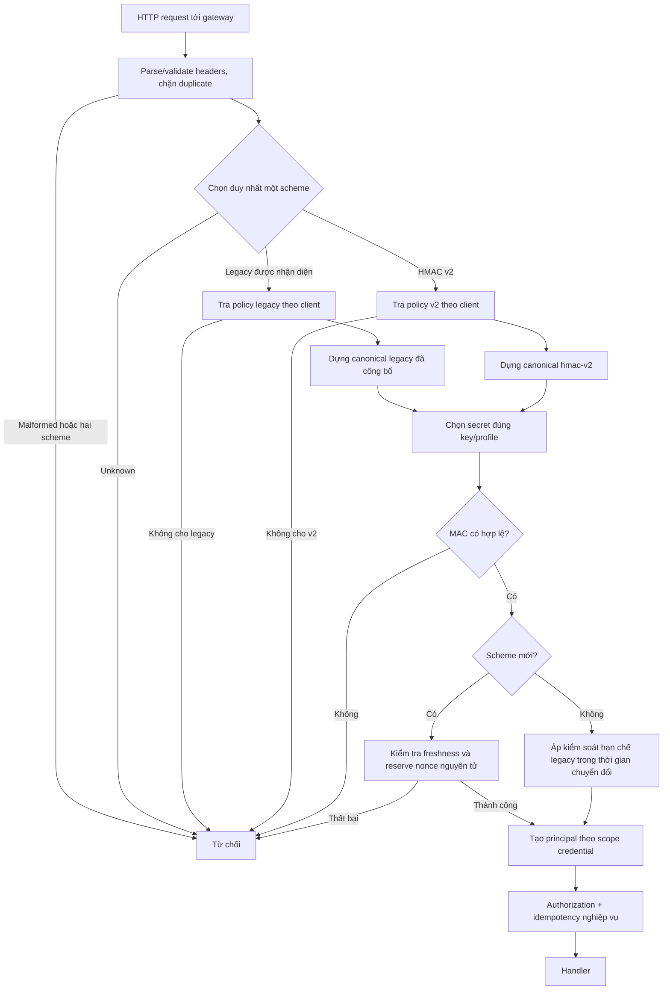

# Di trú scheme cũ — Chuyển cơ chế xác thực HTTP sang HMAC có phiên bản

## 1. Di trú scheme cũ là gì và vì sao cần làm?

Trong hệ thống **SECURITY_AUTHENTICATION_HMAC_REQUEST_AUTHENTICATION**, HTTP request được xác thực bằng HMAC với shared secret trên một **canonical request**. Hợp đồng ký cần quy định chính xác method, URI, header và/hoặc body nào được bảo vệ. Timestamp và nonce hỗ trợ chống replay; key rotation quản lý vòng đời credential; proxy/gateway có thể ảnh hưởng đến cách hai phía diễn giải request. Sau khi xác thực thành công, hệ thống vẫn phải kiểm tra **phân quyền** trước khi thực hiện nghiệp vụ.

**Di trú scheme cũ (legacy authentication scheme migration)** là chuyển từng client, credential và tuyến xác thực từ hợp đồng cũ sang hợp đồng mới, có cơ chế tương thích tạm thời và thời điểm chấm dứt rõ ràng. Scheme ở đây là **toàn bộ quy tắc xác thực**, không chỉ tên thuật toán HMAC: header trên wire, cách chọn key, thành phần được ký, chuẩn canonicalization, định dạng chữ ký, anti-replay, policy và cách báo lỗi.

Ví dụ một hệ thống hiện đang có:

- **Legacy v0:** HMAC-SHA256 chỉ ký `METHOD + "\n" + PATH`, không ký query, header nghiệp vụ, body, timestamp hay nonce. Request cũ có thể bị replay trong cửa sổ key còn hiệu lực hoặc bị thay query/body mà chữ ký vẫn đúng.
- **HMAC v2:** HMAC-SHA256 ký version, key ID, method, request-target đầy đủ (path + query), `Content-Type`, timestamp, nonce và SHA-256 của body. Server chỉ chấp nhận credential đúng profile, đồng thời kiểm tra timestamp và reserve nonce nguyên tử.

Đây là **hai scheme minh họa cho bài học**, không khẳng định mọi hệ thống legacy đều dùng v0 như vậy. Dịch vụ thực tế có thể đang dùng static API key, Basic Auth, custom MAC hoặc một phiên bản HMAC khác. Trước khi triển khai, phải **kiểm kê và ghi lại scheme đang vận hành**, không tự thay thế bằng giả định của ví dụ.

### Mục tiêu của migration

1. Hỗ trợ client hợp lệ chuyển đổi mà vẫn đảm bảo đường phục vụ mới hoạt động ổn định.
2. Không tạo đường **downgrade** hoặc fallback xác thực yếu hơn chỉ vì request mới bị lỗi chữ ký.
3. Không dùng lại secret yếu/lộ hoặc để credential cũ được chấp nhận vô thời hạn.
4. Chuẩn hóa byte-level contract cho method, URI, header và body giữa client, gateway và backend.
5. Bật chống replay với timestamp/nonce, kiểm soát idempotency và giữ phân quyền độc lập.
6. Chỉ ngừng scheme cũ khi có bằng chứng các client đã chuyển và server **thực sự từ chối** legacy sau cutoff.

**Đổi client sang ký scheme mới không đồng nghĩa migration đã hoàn tất.** Nếu backend vẫn có nhánh nhận scheme cũ hoặc một gateway đang cache policy legacy, bề mặt xác thực cũ còn tồn tại.

## 2. Khảo sát trước khi thiết kế migration

Trước khi tạo mã xác minh mới, cần vẽ được bức tranh các đường request thực tế và điều kiện chấp nhận của scheme cũ.

| Câu hỏi kiểm kê | Ví dụ dữ liệu cần thu | Rủi ro nếu bỏ qua |
| --- | --- | --- |
| Ai đang dùng scheme cũ? | Client/tenant, owner, SDK, số lượng request, endpoint | Client bị gián đoạn hoặc tiếp tục dùng legacy mà không biết |
| Scheme cũ ký những gì? | Method, path/query, header, body, canonicalization, encoding | Giữ lại khả năng sửa nội dung chưa được ký |
| Secret được dùng ra sao? | Key ID, entropy, nơi lưu, scope, key reuse, ngày hết hạn | Một key cũ mở quyền cho nhiều client/tenant |
| Anti-replay có gì? | Timestamp, nonce, replay store, TTL, namespace, clock skew | Replay vẫn có thể xảy ra trong giai đoạn hỗ trợ kép |
| Có bao nhiêu điểm xác minh? | Gateway, reverse proxy, backend, sidecar, region, batch/worker | Một tuyến còn chấp nhận scheme cũ sau cutoff |
| Đường đi HTTP biến đổi gì? | Path decoding, query order, header folding, body compression | Chữ ký client và server bị lệch |
| Client có thể nâng cấp không? | SDK/client version, cấu hình, kênh phát secret mới | Không thể cắt legacy đúng hạn |
| Có request đang chạy/retry không? | Queue, timeout, idempotency, circuit breaker | Thực thi lặp nghiệp vụ giữa hai scheme |

Gắn mỗi client với một **trạng thái migration** do server quản lý, ví dụ `LEGACY_ONLY`, `DUAL_ALLOWED`, `NEW_ONLY` và `DISABLED`. Đây là tên chính sách minh họa; cần có một nguồn sự thật đáng tin cậy và audit được các thay đổi trạng thái.

Phân biệt ba thứ dễ bị trộn:

- **Scheme/profile:** cách ký và xác minh request; thay canonicalization dù vẫn dùng HMAC-SHA256 cũng có thể phải tạo profile mới.
- **Key ID và secret:** credential cụ thể dùng với scheme. Có thể rotate key trong cùng một scheme mà không đổi format request.
- **API/business version:** ví dụ endpoint `/v2/orders`; không nhất thiết đồng nghĩa dùng scheme xác thực `hmac-v2`.

Không dùng số phiên bản API để tự đoán scheme ký. Cũng không cho phép client tự quyết định scheme nào được cấp quyền sử dụng bằng một header chưa được kiểm chứng.

## 3. Hợp đồng minh họa: từ legacy-v0 sang hmac-v2

Giả sử cả hai scheme đều dùng HMAC-SHA256 nhưng có **hai shared secret độc lập** và **hai canonical schema khác nhau**. Sự thay đổi lớn là các trường được bảo vệ và anti-replay, thay vì thay thuật toán MAC chỉ để tạo tên version mới.

| Đặc điểm | `legacy-v0` | `hmac-v2` |
| --- | --- | --- |
| Thuật toán MAC | HMAC-SHA256 | HMAC-SHA256 |
| Dữ liệu được ký | `METHOD` + LF + `PATH` | Domain + scheme + key ID + method + full target + content type + timestamp + nonce + body digest |
| Query string | **Không ký** | Ký đúng byte canonical theo hợp đồng |
| Header nghiệp vụ | **Không ký** | `Content-Type` được ký trong ví dụ |
| Body | **Không ký** | SHA-256 của body bytes được đưa vào canonical request |
| Chống replay | Không có nonce đã ký | Timestamp hợp lệ + nonce mới, reserve nguyên tử |
| Secret | Secret legacy riêng | Secret mới, scope theo client/tenant, không tái sử dụng legacy |
| Chữ ký trên wire | Base64url không padding | Base64url không padding của 32-byte MAC |
| Chính sách | Chỉ dùng khi client còn trong kỳ migration | Bắt buộc khi client đã `NEW_ONLY` |
| Kết thúc vòng đời | Thu hồi credential, tắt đường nhận legacy | Duy trì rotation, revoke và monitoring |

### 3.1. Ví dụ request của scheme mới

```http
POST /v1/orders?customer=a%2Fb HTTP/1.1
Host: api.example.test
Content-Type: application/json
X-Auth-Scheme: hmac-v2
X-Key-Id: partner-a-key-2026
X-Timestamp: <epoch-seconds-hop-le>
X-Nonce: <nonce-moi>
X-Signature: <base64url-no-padding>

{"sku":"A1","quantity":2}
```

Các giá trị `<...>` chỉ là placeholder, phải được thay bằng dữ liệu tạo trong test/SDK. Tên host và đường dẫn là minh họa, không phải endpoint triển khai thật.

Định nghĩa **canonical request v2** trong ví dụ là UTF-8 của **chín dòng**, nối bằng LF (`\n`), không có LF cuối:

```text
HMAC-REQUEST
hmac-v2
partner-a-key-2026
POST
/v1/orders?customer=a%2Fb
application/json
<timestamp-dang-ky>
<nonce-dang-ky>
<lowercase-hex-SHA256-of-raw-body>
```

Quy tắc ký phải được mô tả đủ chính xác:

- `METHOD` được viết hoa theo quy định của profile. HTTP method không được tùy ý sửa sau khi ký.
- `REQUEST_TARGET` dùng dạng origin-form gồm path và query, theo byte/encoding đã được thỏa thuận. Trong ví dụ, `%2F` khác `/`; không decode, normalize hay sắp xếp lại query một cách ngầm định.
- `Content-Type` trong profile ví dụ được yêu cầu là một giá trị duy nhất, đúng byte đã xác định; duplicate và whitespace mơ hồ phải bị parser từ chối hoặc chuẩn hóa theo **một** quy tắc được công bố. Không giả định mọi header khác đều được ký.
- `TIMESTAMP` là số epoch giây dạng ASCII, với clock-skew window được server cấu hình; `NONCE` là giá trị duy nhất trong namespace đã quy định.
- `BODY_SHA256` được tính trên body bytes tại điểm ký đã thống nhất với gateway/backend; không tự deserialize rồi serialize JSON lại.
- Version `hmac-v2` và key ID được **đưa vào canonical request**. Thay đổi scheme hoặc key ID sau khi ký phải làm xác minh không khớp.
- Chữ ký là Base64url không padding của **toàn bộ** 32 byte HMAC-SHA256. Parser phải chặn biểu diễn sai hoặc MAC bị cắt ngắn nếu không có thỏa thuận riêng.

`HMAC-REQUEST` là domain separator. Key material nên được tách riêng theo client, mục đích và scheme; domain separator **không thay thế** việc quản lý khóa.

### 3.2. Nếu client cũ không có header version thì sao?

Một client legacy có thể chỉ gửi `X-Legacy-Signature` hoặc gọi một đường vào chuyên biệt. Khi đó **adapter ở ingress** được phép nhận biết scheme từ **hình dạng request legacy đã đặc tả** (ví dụ tên header riêng hoặc route riêng), sau khi kiểm tra duplicate và ambiguity. Nó chuyển request sang đúng verifier legacy, với policy `LEGACY_ONLY` hoặc `DUAL_ALLOWED`.

Không được triển khai:

```text
if verifyHmacV2(request) fails:
    try verifyLegacyV0(request)  // NGUY HIỂM: fallback sau lỗi
```

Từng request phải được phân loại **trước khi xác minh**, rồi chỉ đi qua **một nhánh xác thực**. Nếu request đồng thời mang credential legacy và mới hoặc không phân loại được, hãy từ chối theo hợp đồng; không tự chọn nhánh nào dễ chấp nhận hơn.

## 4. Thiết kế đường đi xác thực và ngăn downgrade



Các điểm cần kiểm soát:

1. **Lựa chọn scheme là thao tác phân luồng, không phải quyền.** Header phiên bản hoặc tên trường legacy được coi là dữ liệu không đáng tin cậy cho đến khi signature hợp lệ. Server policy quyết định chủ thể/key nào được dùng scheme đó.
2. **Mỗi credential gắn một scheme.** Registry nên tra cứu theo `(tenant/client, keyId, scheme)`; key mới phải có secret mới. Nếu dùng key ID trùng giữa scheme, backend vẫn phải có key binding không mơ hồ.
3. **Ký version trong schema mới.** Kẻ tấn công sửa `X-Auth-Scheme` từ v2 thành legacy sẽ không thể tái sử dụng chữ ký v2 trong canonical legacy. Điều này **chưa đủ** nếu vẫn sở hữu secret legacy có hiệu lực: policy `NEW_ONLY` phải chặn mọi request legacy mới.
4. **Chống replay ở scheme mới.** Sau khi signature và timestamp hợp lệ, reserve nonce nguyên tử theo principal/tenant, có TTL đáp ứng cửa sổ thời gian. Không lạm dụng `keyId` hay scheme làm namespace để cùng principal tái sử dụng nonce qua các key khác nhau mà không được thiết kế.
5. **Giới hạn legacy trong cửa sổ quá độ.** Với scheme không ký timestamp/nonce, header timestamp/nonce thêm vào không tạo ra anti-replay mật mã. Có thể tạm giảm quyền, rate-limit, giới hạn endpoint hoặc chặn nghiệp vụ nhạy cảm, nhưng phải xác định rằng những biện pháp đó **không biến legacy thành v2**.
6. **Phân quyền vẫn độc lập.** MAC hợp lệ chỉ đưa tới authenticated principal với scope đã đăng ký; bộ kiểm tra quyền vẫn phải xác minh tenant ownership, action và resource. Không cấp quyền cao hơn chỉ vì scheme cũ hoặc scheme mới.

Một chính sách mẫu:

| Client policy | Request legacy được ký đúng | Request v2 được ký đúng | Ý nghĩa |
| --- | --- | --- | --- |
| `LEGACY_ONLY` | Cho qua bước MAC nếu credential còn hiệu lực | Từ chối | Client chưa chuẩn bị chuyển |
| `DUAL_ALLOWED` | Cho qua bước MAC với key legacy được cấp | Cho qua bước MAC với key v2 được cấp | Chuyển đổi có thời hạn |
| `NEW_ONLY` | **Từ chối dù MAC legacy hợp lệ** | Cho qua bước MAC | Đã cutoff cho client |
| `DISABLED` | Từ chối | Từ chối | Credential/client bị khóa |

Trong sơ đồ, việc một request đi qua bước MAC **không đồng nghĩa toàn bộ xác thực đã hoàn thành**. Với v2, timestamp, nonce và các policy bắt buộc phải thành công trước khi tạo principal. Với legacy, giới hạn của scheme phải được chấp nhận một cách tường minh và được loại bỏ theo kế hoạch.

## 5. Triển khai từng giai đoạn, có điểm dừng và bằng chứng

### Giai đoạn 0 — Chốt hợp đồng và dữ liệu nền

Lập danh sách client/tenant còn dùng legacy, endpoint và phiên bản SDK, owner, key ID, request rate và khả năng di trú. Công bố tài liệu profile v2 có byte-level canonical request, lỗi HTTP dự kiến, timestamp window, nonce scope, key rotation và ví dụ chữ ký đã kiểm chứng độc lập.

Thiết lập baseline trên dashboard: lưu lượng legacy/v2, `INVALID_SIGNATURE`, `UNKNOWN_SCHEME`, `STALE_TIMESTAMP`, `NONCE_REPLAY`, `KEY_REVOKED`, response latency và business errors. Metadata cần được bảo vệ; không log shared secret, chữ ký đầy đủ hay body chứa dữ liệu nhạy cảm.

### Giai đoạn 1 — Deploy verifier mới nhưng chưa buộc client đổi ngay

Đưa parser và verifier v2 tới **toàn bộ** backend/gateway/region trước khi cấp key v2 cho client. Giữ routing legacy rõ ràng theo policy đã có. Kiểm thử canary nội bộ để chắc chắn mọi node có cùng signature profile và cùng quy tắc URI/header/body.

Nếu gateway thực hiện HMAC verification, cần xác định **nơi xác thực có thẩm quyền** và cơ chế truyền identity xuống backend. Backend không được tin header principal do client tự gửi; gateway phải loại bỏ header do client đặt cùng tên, chỉ cấp identity nội bộ qua kênh đáng tin cậy.

### Giai đoạn 2 — Cấp credential v2 và cho phép song song có kiểm soát

Tạo key ID và shared secret **mới**, riêng cho từng client/tenant. Cấp secret qua kênh credential an toàn. Bật `DUAL_ALLOWED` cho những client đã sẵn sàng, trong một khoảng thời gian và phạm vi được duyệt.

Mỗi request phải khai báo/được phân loại đúng một scheme. Không được phép ký thất bại bằng v2 rồi thử v0. Với hệ thống gửi lệnh thay đổi trạng thái, idempotency key nên gắn với ý nghĩa nghiệp vụ và principal qua **cả hai scheme** để tránh một hành động được thực thi hai lần do client retry bằng cách khác.

### Giai đoạn 3 — Canary và tăng dần tỷ lệ client v2

Chọn một nhóm client có thể rollback có kiểm soát, đo kết quả rồi mở rộng. Theo dõi theo **client, route, region, gateway revision và key/profile**; không chỉ dựa vào tỷ lệ `2xx` tổng. Lỗi body/signature, clock skew, nonce collision hoặc retry thường chỉ xuất hiện ở một nhóm client có SDK/cách encode khác.

Nếu số lỗi tăng, **tạm dừng việc mở rộng** và điều tra. Có thể giữ client chưa chuyển ở policy legacy theo thời hạn đã công bố; không tự bật lại legacy cho client đã `NEW_ONLY`, đặc biệt khi key cũ bị nghi lộ.

### Giai đoạn 4 — Cutoff theo client và thu hồi legacy

Khi client đã qua positive test v2 và hết cửa sổ chuyển đổi, cập nhật policy thành `NEW_ONLY`, thu hồi key legacy và vô hiệu tuyến verify cũ. Cần thử request **ký đúng bằng secret legacy** trên mọi gateway/backend/region: hệ thống phải từ chối do policy hoặc revoked key, dù chữ ký legacy tự nó đúng.

Sau khi tất cả client chuyển xong, xóa branch legacy và config liên quan theo quy trình release. Giữ **negative regression test** để đảm bảo đường legacy không vô tình tái xuất hiện khi rollback cấu hình hoặc rolling deploy.

### Giai đoạn 5 — Theo dõi hậu migration

Xác nhận không còn request legacy được **chấp nhận**, không có node cũ và không tồn tại key registry entry legacy còn active. Xem xét metrics, error budget, idempotency, độ trễ và chi phí HMAC; lưu lại danh sách các ngoại lệ có hạn chót, owner và điều kiện gỡ bỏ.

## 6. Credential lifecycle, replay và continuity khi chuyển đổi

### 6.1. Không tái sử dụng shared secret legacy

**Tạo secret mới** cho v2. Một key cũ yếu về entropy, có nguy cơ bị lộ hoặc đã tồn tại trong nhiều nơi sẽ không trở nên an toàn chỉ vì dùng canonical request mới. Key registry cần biết chủ thể sở hữu, scope, scheme, trạng thái `ACTIVE`/`SUSPENDED`/`REVOKED` và revision policy.

Trong rotation thông thường, server có thể tạm chấp nhận hai key **độc lập và đang được cấp phép** trong một profile nếu chính sách quy định. Nếu secret bị compromise, phải **revoke** nó; không duy trì `VERIFY_ONLY` rồi tiếp tục xác minh chữ ký bằng secret đã lộ.

### 6.2. Replay protection ở v2

Ký timestamp và nonce theo hợp đồng. Trong ví dụ, timestamp là epoch seconds ASCII; server so sánh với đồng hồ tin cậy và giới hạn clock skew. Nonce nên có độ ngẫu nhiên/khả năng duy nhất phù hợp với lưu lượng, và được lưu bằng thao tác **put-if-absent nguyên tử** trên toàn bộ node. Replay store nên dùng namespace theo principal/tenant và phạm vi nghiệp vụ đã định nghĩa; việc key rotation không tự tạo cơ hội replay một nonce đã dùng.

Nếu replay store lỗi, phải có chính sách rõ cho request nhạy cảm, thường ưu tiên **fail closed**. Không âm thầm bỏ qua nonce chỉ vì hệ thống muốn giữ availability.

### 6.3. Retry, idempotency và chuyển scheme

Replay nonce ngăn phát lại **cùng nonce**, còn idempotency ngăn lặp **cùng ý định nghiệp vụ** khi client retry sau timeout. Giả sử client gửi một lệnh bằng legacy, response mất, sau đó gửi lại bằng v2 với nonce mới: dù v2 HMAC hợp lệ, nghiệp vụ vẫn có nguy cơ được thực thi hai lần.

Với endpoint thanh toán/đặt hàng, nên thiết kế idempotency key có scope `(principal, business operation)` và thời hạn phù hợp. Nếu idempotency key là một header quyết định hành vi nghiệp vụ, cân nhắc **đưa header này vào canonical request v2**. Legacy không ký header đó nên không thể coi nó đã được bảo vệ như v2; cần biện pháp kiểm soát hoặc hạn chế tương ứng khi di trú.

## 7. Java 17: dispatcher tường minh, không fallback scheme

Ví dụ code dưới đây diễn giải **lựa chọn scheme, key binding và policy cutoff**. Nó là một **test fixture về HMAC**, không phải Spring Security filter production: lớp HTTP parser, timestamp validation, nonce reservation, giới hạn kích thước, authorization và quản trị secret vẫn phải được triển khai độc lập.

Giả định:

- `legacy-v0` ký `METHOD + LF + PATH`, cố ý bỏ qua query/body để minh họa rủi ro legacy.
- `hmac-v2` ký schema ở mục 3, bao gồm scheme và key ID.
- Hai scheme dùng HMAC-SHA256 với **hai secret khác nhau**.
- Khóa lưu theo `(clientId, keyId, scheme)`, và server policy chỉ định scheme được phép. Tên `clientId` ban đầu được hiểu như **identity claim để tìm key**; principal chỉ được xác thực sau MAC và các kiểm tra bắt buộc.
- Chữ ký dùng Base64url không padding, đúng 32 byte. Mọi string và body đầu vào đã được kiểm tra cú pháp và giới hạn tại HTTP parser.

```java
import javax.crypto.Mac;
import javax.crypto.spec.SecretKeySpec;
import java.nio.charset.StandardCharsets;
import java.security.GeneralSecurityException;
import java.security.MessageDigest;
import java.util.Base64;
import java.util.HexFormat;
import java.util.Map;
import java.util.Set;

public final class SchemeMigrationVerifier {
    private SchemeMigrationVerifier() {}

    public enum Scheme {
        LEGACY_V0("legacy-v0"), HMAC_V2("hmac-v2");
        final String wireName;

        Scheme(String wireName) {
            this.wireName = wireName;
        }

        static Scheme parse(String wireName) {
            for (Scheme s : values()) {
                if (s.wireName.equals(wireName)) {
                    return s;
                }
            }
            return null;
        }
    }

    public record KeyRef(String clientId, String keyId, Scheme scheme) {}
    public record Credential(byte[] secret, boolean active) {}
    public record Policy(Set<Scheme> allowedSchemes) {}

    public record RequestFields(
            String clientId, String keyId, String method,
            String requestTarget, String contentType,
            String timestamp, String nonce, byte[] body) {}

    private static String canonical(Scheme scheme, RequestFields r)
            throws GeneralSecurityException {
        if (scheme == Scheme.LEGACY_V0) {
            int questionMark = r.requestTarget().indexOf('?');
            String path = questionMark < 0
                    ? r.requestTarget()
                    : r.requestTarget().substring(0, questionMark);
            return r.method() + "\n" + path;
        }

        String digest = HexFormat.of().formatHex(
                MessageDigest.getInstance("SHA-256").digest(r.body()));
        return String.join("\n",
                "HMAC-REQUEST", "hmac-v2",
                r.keyId(), r.method(), r.requestTarget(),
                r.contentType(), r.timestamp(), r.nonce(), digest);
    }

    private static byte[] signBytes(Scheme scheme, byte[] key, RequestFields r)
            throws GeneralSecurityException {
        Mac mac = Mac.getInstance("HmacSHA256");
        mac.init(new SecretKeySpec(key, "HmacSHA256"));
        return mac.doFinal(
                canonical(scheme, r).getBytes(StandardCharsets.UTF_8));
    }

    public static String sign(Scheme scheme, byte[] key, RequestFields r)
            throws GeneralSecurityException {
        return Base64.getUrlEncoder().withoutPadding().encodeToString(
                signBytes(scheme, key, r));
    }

    // Chỉ xác minh MAC + chính sách scheme; KHÔNG phải toàn bộ HTTP auth.
    public static boolean verifyMacOnly(
            String wireScheme, RequestFields r, String wireSignature,
            Map<KeyRef, Credential> registry,
            Map<String, Policy> clientPolicies)
            throws GeneralSecurityException {
        if (r == null || r.clientId() == null || r.keyId() == null
                || r.method() == null || r.requestTarget() == null
                || r.contentType() == null || r.timestamp() == null
                || r.nonce() == null || r.body() == null
                || wireSignature == null || registry == null
                || clientPolicies == null) {
            return false;
        }

        Scheme scheme = Scheme.parse(wireScheme);
        Policy policy = clientPolicies.get(r.clientId());
        if (scheme == null || policy == null
                || policy.allowedSchemes() == null
                || !policy.allowedSchemes().contains(scheme)) {
            return false;
        }

        Credential credential = registry.get(
                new KeyRef(r.clientId(), r.keyId(), scheme));
        if (credential == null || !credential.active()
                || credential.secret() == null
                || credential.secret().length == 0) {
            return false;
        }

        final byte[] supplied;
        try {
            supplied = Base64.getUrlDecoder().decode(wireSignature);
        } catch (IllegalArgumentException malformed) {
            return false;
        }
        if (supplied.length != 32
                || !Base64.getUrlEncoder().withoutPadding()
                        .encodeToString(supplied).equals(wireSignature)) {
            return false;
        }

        byte[] expected = signBytes(scheme, credential.secret(), r);
        return MessageDigest.isEqual(expected, supplied);
    }
}
```

Trong production, `Scheme.parse` không được gọi trên một header tùy ý sau khi nhiều trường credential đã bị gộp/trùng; HTTP parser phải xác định một scheme duy nhất theo contract. Với client legacy không mang version, ingress adapter cần chọn đúng `LEGACY_V0` trước khi gọi verifier theo dấu hiệu legacy duy nhất đã công bố.

**Đặc biệt:** `verifyMacOnly() == true` **không** đồng nghĩa request đã được xác thực hoàn chỉnh. Với v2, bộ điều phối phải tiếp tục kiểm tra timestamp và reserve nonce nguyên tử rồi mới tạo principal. Với legacy, cần kiểm soát bổ sung và thời hạn chấm dứt. Không copy code mẫu này thành filter xác thực production.

## 8. JUnit 5: legacy có rủi ro, v2 bảo vệ body và cutoff chặn downgrade

Các test sau minh họa vì sao migration cần cả **cơ chế ký mới** và **policy cắt legacy**. Chúng chạy với lớp `SchemeMigrationVerifier` ở mục 7, sử dụng Java 17 và JUnit 5. Secret và timestamp chỉ dùng làm fixture; test HTTP thực tế phải lấy timestamp hiện hành và nonce riêng.

```java
import org.junit.jupiter.api.Test;

import java.nio.charset.StandardCharsets;
import java.security.GeneralSecurityException;
import java.util.Map;
import java.util.Set;

import static org.junit.jupiter.api.Assertions.assertFalse;
import static org.junit.jupiter.api.Assertions.assertTrue;

class SchemeMigrationVerifierTest {
    private static byte[] utf8(String value) {
        return value.getBytes(StandardCharsets.UTF_8);
    }

    private static final byte[] LEGACY_KEY =
            utf8("test-only-legacy-shared-secret-012345");
    private static final byte[] NEW_KEY =
            utf8("test-only-hmac-v2-shared-secret-67890");

    private static SchemeMigrationVerifier.RequestFields request(
            String keyId, byte[] body) {
        return new SchemeMigrationVerifier.RequestFields(
                "partner-a", keyId, "POST",
                "/v1/orders?customer=a%2Fb",
                "application/json", "1700000000",
                "unit-nonce-001", body);
    }

    private static final Map<SchemeMigrationVerifier.KeyRef,
            SchemeMigrationVerifier.Credential> KEYS = Map.of(
            new SchemeMigrationVerifier.KeyRef("partner-a", "old-key",
                    SchemeMigrationVerifier.Scheme.LEGACY_V0),
            new SchemeMigrationVerifier.Credential(LEGACY_KEY, true),
            new SchemeMigrationVerifier.KeyRef("partner-a", "new-key",
                    SchemeMigrationVerifier.Scheme.HMAC_V2),
            new SchemeMigrationVerifier.Credential(NEW_KEY, true));

    private static Map<String, SchemeMigrationVerifier.Policy> policy(
            SchemeMigrationVerifier.Scheme... schemes) {
        return Map.of("partner-a",
                new SchemeMigrationVerifier.Policy(Set.of(schemes)));
    }

    @Test
    void legacyDoesNotProtectBodyButV2Does()
            throws GeneralSecurityException {
        byte[] original = utf8("{\"sku\":\"A1\",\"quantity\":2}");
        byte[] tampered = utf8("{\"sku\":\"A1\",\"quantity\":9}");
        var oldRequest = request("old-key", original);
        var newRequest = request("new-key", original);

        String oldSignature = SchemeMigrationVerifier.sign(
                SchemeMigrationVerifier.Scheme.LEGACY_V0,
                LEGACY_KEY, oldRequest);
        String newSignature = SchemeMigrationVerifier.sign(
                SchemeMigrationVerifier.Scheme.HMAC_V2,
                NEW_KEY, newRequest);

        assertTrue(SchemeMigrationVerifier.verifyMacOnly(
                "legacy-v0", request("old-key", tampered), oldSignature,
                KEYS, policy(SchemeMigrationVerifier.Scheme.LEGACY_V0)));

        assertFalse(SchemeMigrationVerifier.verifyMacOnly(
                "hmac-v2", request("new-key", tampered), newSignature,
                KEYS, policy(SchemeMigrationVerifier.Scheme.HMAC_V2)));
    }

    @Test
    void v2AndLegacyWorkOnlyWhenExplicitlyAllowed()
            throws GeneralSecurityException {
        byte[] body = utf8("{\"sku\":\"A1\",\"quantity\":2}");
        var legacy = request("old-key", body);
        var modern = request("new-key", body);
        String oldSig = SchemeMigrationVerifier.sign(
                SchemeMigrationVerifier.Scheme.LEGACY_V0,
                LEGACY_KEY, legacy);
        String newSig = SchemeMigrationVerifier.sign(
                SchemeMigrationVerifier.Scheme.HMAC_V2,
                NEW_KEY, modern);

        var dual = policy(SchemeMigrationVerifier.Scheme.LEGACY_V0,
                SchemeMigrationVerifier.Scheme.HMAC_V2);
        assertTrue(SchemeMigrationVerifier.verifyMacOnly(
                "legacy-v0", legacy, oldSig, KEYS, dual));
        assertTrue(SchemeMigrationVerifier.verifyMacOnly(
                "hmac-v2", modern, newSig, KEYS, dual));

        // Sau cutoff: chữ ký legacy ĐÚNG vẫn không được chấp nhận.
        var newOnly = policy(SchemeMigrationVerifier.Scheme.HMAC_V2);
        assertFalse(SchemeMigrationVerifier.verifyMacOnly(
                "legacy-v0", legacy, oldSig, KEYS, newOnly));
        assertTrue(SchemeMigrationVerifier.verifyMacOnly(
                "hmac-v2", modern, newSig, KEYS, newOnly));
    }

    @Test
    void changingSchemeOrKeyIdNeverFallsBack()
            throws GeneralSecurityException {
        byte[] body = utf8("{\"sku\":\"A1\",\"quantity\":2}");
        var modern = request("new-key", body);
        String v2Signature = SchemeMigrationVerifier.sign(
                SchemeMigrationVerifier.Scheme.HMAC_V2, NEW_KEY, modern);
        var dual = policy(SchemeMigrationVerifier.Scheme.LEGACY_V0,
                SchemeMigrationVerifier.Scheme.HMAC_V2);

        assertFalse(SchemeMigrationVerifier.verifyMacOnly(
                "legacy-v0", modern, v2Signature, KEYS, dual));
        assertFalse(SchemeMigrationVerifier.verifyMacOnly(
                "hmac-v2", request("old-key", body),
                v2Signature, KEYS, dual));
        assertFalse(SchemeMigrationVerifier.verifyMacOnly(
                "unknown-v9", modern, v2Signature, KEYS, dual));
    }
}
```

Kết quả legacy body tampering trong `legacyDoesNotProtectBodyButV2Does` là **hành vi yếu có chủ ý của profile ví dụ**, không phải một “test thành công” về bảo mật. Test phải được dùng làm bằng chứng tại sao cần bỏ scheme cũ. Với hệ thống thực, hãy thay fixture bằng cách ký và verify của client/backend cũ thực tế rồi cập nhật kỳ vọng theo đúng hợp đồng được kiểm kê.

Những test trên chỉ chứng minh **cryptographic dispatch và policy**. Cần thêm HTTP integration test để xác nhận parser, gateway và security filter thật từ chối request sai trước khi handler nghiệp vụ chạy.

## 9. Ma trận test migration ở HTTP stack và gateway

| Tình huống | Kỳ vọng / phép kiểm |
| --- | --- |
| Legacy đúng, client `LEGACY_ONLY` trong cửa sổ chuyển đổi | MAC legacy hợp lệ; vẫn phải qua authorization và kiểm soát legacy |
| V2 đúng, client `DUAL_ALLOWED` | MAC, timestamp, nonce hợp lệ; chỉ sau đó tạo principal |
| V2 đúng, client `NEW_ONLY` | Thành công qua authn, rồi xét authorization |
| Legacy **ký đúng**, client `NEW_ONLY` | Từ chối do policy, không có principal hay side effect |
| Request khai báo `hmac-v2` nhưng chữ ký tạo theo legacy | Từ chối; không fallback |
| Request mang cả header legacy và v2 | Từ chối theo contract phân loại scheme duy nhất |
| Missing/duplicate/unknown scheme header | Từ chối theo parser contract |
| Đổi `keyId` sau khi v2 đã ký | HMAC mismatch hoặc key policy reject |
| Đổi body, `Content-Type`, method, query/URI sau khi ký v2 | HMAC mismatch theo profile v2 |
| Chỉ đổi chữ hoa/thường tên HTTP header | Kết quả tương đương theo HTTP semantics, trừ khi tên đó không thuộc contract |
| Body JSON giữ nghĩa nhưng khác whitespace | HMAC mismatch nếu ký raw body bytes |
| Gateway đổi `%2F` thành `/` hoặc đổi query order | Test phải phát hiện khác canonical bytes và bảo đảm không xác thực sai |
| Timestamp cũ/quá xa tương lai | Từ chối do freshness; tránh nhầm với lỗi MAC |
| Nonce trùng trên hai node | Tối đa một request được reserve nonce thành công trong namespace quy định |
| Replay store unavailable | Fail theo chính sách đã công bố; không tự bỏ qua anti-replay |
| Retry cùng nghiệp vụ qua legacy và v2 | Idempotency không cho double side effect |
| Key legacy `REVOKED` nhưng chữ ký còn hợp lệ | Từ chối trên gateway/backend/region, kể cả sau restart |
| V2 xác thực đúng nhưng principal không có quyền | Phân quyền từ chối; không nhầm thành signature mismatch |
| Rolling deploy xen kẽ node cũ và mới | Không có node cho phép downgrade hoặc xử lý canonical khác |
| Credential sai định dạng/giá trị quá dài | 400/401 hoặc lỗi gateway đúng contract, không 5xx bất ngờ |

Đối với Spring MVC có thể dùng `MockMvc` với filter chain thực; với Spring WebFlux dùng `WebTestClient`. Những hành vi dựa trên **raw HTTP bytes** hoặc proxy rewrite cần test qua chính gateway/server triển khai, vì mock HTTP client có thể tự normalize URI và header trước khi gửi.

Cần có **positive control** cho mỗi nhánh (legacy khi còn được phép, v2 hợp lệ) và **negative control** với timestamp/nonce hợp lệ nhưng signature/policy bị cố ý làm sai. Nếu gửi lại nonce đã dùng, test có thể nhận `401` vì replay mà không hề kiểm chứng downgrade hoặc body integrity.

Không chỉ assert HTTP status: phải quan sát mã lỗi nội bộ như `SCHEME_DISABLED`, `INVALID_SIGNATURE`, `NONCE_REPLAY` và kiểm tra handler, database, message publisher **không có side effect** cho request thất bại authentication. Phản hồi công khai không cần tiết lộ client/key ID có tồn tại hay không.

## 10. Observability, rollback và tiêu chí cắt scheme cũ

### Theo dõi sự tiến triển

| Chỉ số | Mục đích |
| --- | --- |
| Số request thành công theo scheme, client và region | Đo mức adoption v2 |
| Request legacy sau mốc cutoff | Phát hiện client chưa chuyển hoặc đường cũ còn nhận |
| `INVALID_SIGNATURE` theo gateway revision | Phát hiện canonical drift khi thay proxy |
| `CLOCK_SKEW` / `NONCE_REPLAY` | Phát hiện lỗi timestamp và nonce ở SDK mới |
| Key registry revision / revoke propagation | Chứng minh policy `NEW_ONLY` có hiệu lực trên toàn bộ verifier |
| Số request authn thất bại nhưng có side effect | Phải bằng 0 |
| Idempotency duplicate across schemes | Bắt tình huống retry cùng tác vụ bằng hai scheme |
| Lỗi nghiệp vụ sau xác thực và `403` | Không đánh đồng quyền/validation với lỗi MAC |

### Rollback có kiểm soát

Rollback cấu hình deployment **không được tự động bật lại** scheme legacy cho client đã cutoff hoặc key đã `REVOKED`. Nếu v2 phát sinh lỗi nghiêm trọng, ưu tiên sửa canonicalization/key registry/clock và tạm dừng mở rộng. Việc mở lại legacy là **thay đổi chính sách bảo mật**, cần đánh giá theo client, quyền và thời hạn, đặc biệt nếu scheme legacy có nguy cơ sửa body hoặc replay.

Với credential đã bị compromise, rollback **không** được đưa secret lộ trở lại `ACTIVE` hoặc `VERIFY_ONLY`. Cấp secret mới và khôi phục tương thích an toàn là đường xử lý phù hợp.

### Điều kiện kết thúc migration

Migration có thể được đánh dấu hoàn thành khi:

1. Mọi client/tenant trong phạm vi đều ở trạng thái `NEW_ONLY` hoặc đã bị `DISABLED` theo quyết định có ghi nhận; ngoại lệ chưa xử lý có owner và deadline.
2. Key legacy đã bị thu hồi và không có đường gateway/backend/region nào tiếp tục xác thực request legacy, kể cả khi MAC legacy được tính đúng.
3. Bộ test vector mới thống nhất giữa client SDK, gateway và backend đối với method, URI/query, signed header và body bytes.
4. Timestamp/nonce được kiểm thử qua nhiều node với atomic reserve và clock skew, có chiến lược xử lý lỗi replay store.
5. Idempotency và authorization tiếp tục hoạt động đúng khi client chuyển scheme; không có side effect sau authentication failure.
6. Dashboard theo dõi `unknown scheme`, `legacy attempt`, `signature mismatch` và key policy; regression test chặn việc bật lại legacy không chủ ý.
7. Mọi thao tác đóng legacy có record, owner, bằng chứng và kế hoạch dọn code/config. **Không** tuyên bố “đã di trú” chỉ vì v2 chiếm đa số traffic.

## 11. Bài tập thực hành

**Bài tập A — Phân tích legacy.** Một scheme cũ chỉ ký HTTP method và path, không ký body, query, timestamp hay nonce. Hãy mô tả những sửa đổi request có thể vượt qua MAC và vì sao một header nonce thêm sau này nhưng không được ký vẫn không giải quyết replay.

**Bài tập B — Cắt legacy có kiểm chứng.** Thiết kế test gửi một request legacy được ký đúng bằng secret cũ sau khi client chuyển `NEW_ONLY`. Test phải chứng minh request bị từ chối vì **policy**, không phải do timestamp hết hạn hay chữ ký ngẫu nhiên sai. Lặp test qua gateway và backend tại mỗi region.

**Bài tập C — Gateway và canonical URI.** Client ký `/v1/orders?customer=a%2Fb` nhưng proxy chuyển thành `/v1/orders?customer=a/b`. Hãy xác định hai hướng sửa hợp đồng hợp lệ: bảo toàn request-target được ký qua trusted ingress hoặc quy định chuẩn canonicalization chung cho hai phía. Giải thích vì sao không nên thử cả hai dạng đến khi chữ ký khớp.

**Bài tập D — Migration có retry.** Một client gửi lệnh tạo đơn bằng legacy, mất response, rồi retry bằng v2 với nonce mới. Đề xuất khóa idempotency và assertion rằng chỉ một đơn được tạo, đồng thời kiểm tra request v2 vẫn vượt qua signature/freshness/replay đúng quy trình.

**Bài tập E — Kiểm tra scheme confusion.** Mở rộng `SchemeMigrationVerifierTest` để mô phỏng key mới bị đánh dấu `inactive`, một client khác dùng trùng `keyId` và một request thay `X-Auth-Scheme` sau khi ký. Với từng ca, phân biệt lỗi parser, key policy và cryptographic verification.

**Ghi nhớ:** Di trú scheme cũ thành công khi **hợp đồng ký mới được định nghĩa ở mức byte, mọi client và verifier hiểu giống nhau, key/algorithm/profile có chính sách rõ, request cũ không thể fallback và scheme legacy thực sự bị vô hiệu sau cutoff**. Độ ổn định vận hành và an toàn HMAC phải được xác nhận bằng test xuyên gateway, chống replay, key rotation và phân quyền, không chỉ bằng thống kê số client đã nâng cấp.
