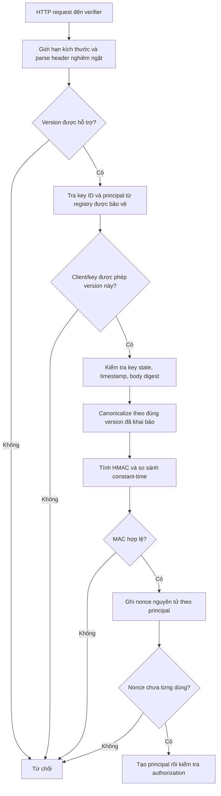

# Di trú canonical format trong HMAC Request Authentication

## 1. Vì sao cần di trú canonical format?

Trong module **`SECURITY_AUTHENTICATION_HMAC_REQUEST_AUTHENTICATION`**, client và server chia sẻ một secret để tạo và xác minh HMAC của HTTP request. Hai phía phải chuyển request thành **cùng một dãy byte** (*canonical request*) trước khi tính MAC. Hợp đồng có thể ký method, URI/query, header, body digest, timestamp và nonce. Sau khi chữ ký hợp lệ, server mới gắn principal đã xác thực và áp dụng **phân quyền** theo client/tenant/resource.

Ví dụ, một client ký `GET /v1/orders?b=2&a=1` theo thứ tự query nhận được, còn server mới lại sắp xếp tham số thành `a=1&b=2` trước khi xác minh. Cả hai đều dùng `HmacSHA256`, cùng secret và cùng body, nhưng **MAC khác nhau** vì byte đầu vào khác nhau. Khi hàng trăm client SDK, API gateway và verifier cùng hoạt động, việc sửa một hàm canonicalization tại server có thể gây ra hàng loạt `401` hoặc mở ra cách diễn giải mơ hồ bị khai thác.

**Di trú canonical format** là quá trình chuyển một hợp đồng tạo byte ký (*canonicalization contract*) từ phiên bản cũ sang phiên bản mới với cách viết specification, kiểm thử, chuyển traffic, giám sát và chấm dứt hỗ trợ version cũ có kiểm soát. Đây là một bài toán tương thích giao thức **và** bảo mật, không chỉ là đổi cách nối chuỗi.

Mục tiêu khi di trú:

- Client cũ và mới không phải đoán server đang ký theo quy tắc nào; mỗi request có một **version tường minh và được ràng buộc trong MAC**.
- Mỗi request được xác minh bằng **đúng một** canonicalization profile được phép cho client/key; signature sai không kích hoạt thử lại bằng profile khác.
- Canonical bytes thể hiện nhất quán dữ liệu HTTP mà nghiệp vụ thực sự xử lý, kể cả khi đi qua proxy/gateway.
- Timestamp/nonce, key rotation, phân quyền và giới hạn tài nguyên không bị nới lỏng trong giai đoạn chuyển đổi.
- Các thay đổi có thể chứng minh bằng golden vectors, contract tests, security tests và ma trận tương thích.

> Các tên `hmac-v1`/`hmac-v2` và format bên dưới là **giao thức minh họa của bài**, không mặc định là chuẩn HMAC của mọi API. Một hệ thống triển khai thật phải sử dụng hợp đồng ký đã được hai phía thống nhất và phê duyệt.

## 2. Nhận diện chính xác phần nào của canonical format thay đổi

Một request HTTP có thể được hiểu thành nhiều chuỗi byte tương đương ở một lớp nhưng khác nhau ở lớp khác. Bảng sau giúp phát hiện điểm cần lập version và test trước khi chỉnh code.

| Thành phần | Biến thể cần kiểm tra | Nguy cơ khi sửa âm thầm |
| --- | --- | --- |
| Method | `GET`/`get`, method extension, cách lấy method sau gateway | Phía ký và phía xác minh tạo chuỗi khác hoặc hiểu khác ý định request. |
| Path | `/a/b` và `/a//b`, slash cuối, `%2F`, `%2e`, dot-segment, path rewrite | Gateway/backend xử lý đường dẫn khác với path đã ký; có thể lệch routing/resource. |
| Query | Thứ tự `a=1&b=2`, duplicate key, empty value, key không có `=`, percent-encoding, `+` và `%20` | Thay đổi MAC hoặc ký giá trị khác giá trị ứng dụng sử dụng. |
| Header | Tên header hoa/thường, OWS, trùng tên, nhiều value, thứ tự, `Host`/authority, forwarded headers | Proxy sửa header hoặc phía nhận chọn sai value so với phía ký. |
| Body | Byte gốc và JSON được parse/serialize lại; charset, newline, gzip, chunked transfer | Digest sai hoặc bỏ sót thay đổi trong body. |
| Dấu phân cách | LF/CRLF, dấu `:`, line rỗng, newline cuối, Unicode normalization | Cùng request nhưng MAC khác do format, không phải do key. |
| Phạm vi field được ký | Thêm/bớt `Content-Type`, tenant header, authority hoặc body digest | Request có thể bị thay đổi ngữ nghĩa trong khi MAC vẫn hợp lệ. |
| Kỹ thuật ký | HMAC primitive, key ID, signature encoding, tag size, domain separator | Hợp đồng mới không còn tương thích với verifier cũ. |

**Canonical format version** khác **API version** và **key version**. API `/v2/orders` vẫn có thể dùng signature profile `hmac-v1` nếu policy cho phép; key ID thay đổi trong rotation không tự động làm canonical format thay đổi. Ngược lại, nếu chỉ đổi quy tắc sắp xếp query mà giữ cùng tên `hmac-v1`, client đã triển khai v1 sẽ không biết phải ký theo cách nào.

### 2.1. Phân loại thay đổi trước khi chọn phương án migration

**Tương thích với canonical format hiện tại:** tái cấu trúc code mà với mọi input hợp lệ vẫn tạo ra đúng cùng byte, ví dụ tối ưu hóa bộ đệm mà golden vectors không đổi. Có thể giữ profile nếu các trường hợp biên cũng được chứng minh không đổi.

**Thay đổi canonical bytes:** sửa thứ tự query, chuẩn hóa URI, đổi danh sách signed headers, đổi charset hoặc cách tính body digest. Cần profile mới và contract tests cho cả hai phiên bản trong giai đoạn hỗ trợ đồng thời.

**Thay đổi security semantics:** profile cũ không ký một header quyết định tenant, hoặc cách parse duplicate query khiến verifier và backend hiểu khác nhau. Không được tự động cho phép profile cũ chỉ để giữ tương thích; cần đánh giá nguy cơ, đóng lỗ hổng hoặc **fix-forward** nếu v1 không còn an toàn.

## 3. Ví dụ thiết kế `hmac-v1` sang `hmac-v2`

Giả sử một hệ thống muốn bỏ việc ký query theo thứ tự xuất hiện và chuyển sang ký theo **thứ tự canonical ổn định** để SDK ở các ngôn ngữ khác nhau tạo ra cùng MAC cho request có cùng tập tham số. Để tập trung vào canonical migration, cả hai phiên bản dưới đây giữ **HmacSHA256, SHA-256 body digest và cùng các trường được bảo vệ**; khác biệt chính là canonical query và version được ký.

| Quy tắc | `hmac-v1` (cũ) | `hmac-v2` (mới) |
| --- | --- | --- |
| Header chọn profile | `X-HMAC-Version: hmac-v1` | `X-HMAC-Version: hmac-v2` |
| Dòng version trong canonical request | `hmac-v1` | `hmac-v2` |
| Canonical query | Giữ nguyên raw query của request-target như client thực gửi, không sắp xếp | Parse và encode lại theo quy tắc v2, sắp xếp key rồi value |
| Path | Path đã được percent-encode trong request-target theo quy ước v1, không tự decode/re-encode | Cùng cách biểu diễn path trong ví dụ; chỉ được đổi nếu v2 được đặc tả riêng |
| Signed headers | `x-content-sha256`, `x-hmac-key-id`, `x-hmac-nonce`, `x-hmac-timestamp`, `x-hmac-version` | Cùng tập và thứ tự |
| Dữ liệu ký | Method, path, query, các header bắt buộc, digest của byte body | Cùng trường, được diễn giải theo quy tắc v2 |
| Digest / MAC | Body SHA-256 hex thường; HMAC-SHA-256; Base64url không padding | Giống v1 |
| Nonce/timestamp | Cần chính sách chống replay riêng của hệ thống | Giữ nguyên chính sách, không reset trạng thái replay khi nâng version |

### 3.1. Đóng băng quy tắc của v1, đặc tả chặt quy tắc của v2

Đối với ví dụ này, v1 dùng query string **đúng byte ASCII đã percent-encode** trong request-target, không tự đổi thứ tự. Khi v1 nhận `b=2&a=1`, phần query được ký là `b=2&a=1`. Một client v1 ký `a=1&b=2` sẽ tạo MAC khác ngay cả khi API coi hai query tương đương. Phải bảo tồn hành vi v1 đã công bố; nếu v1 có vấn đề bảo mật do URI bị diễn giải mơ hồ, không tiếp tục cho phép v1 ở môi trường không được đánh giá an toàn.

Quy tắc v2 minh họa:

1. **Nhận raw request-target đã được xác định tại điểm ký.** Từ chối percent-encoding không hợp lệ, byte không được phép và chuỗi UTF-8 không hợp lệ. Chọn rõ nguyên tắc xử lý dấu `?`, query rỗng và query không có dấu `=`.
2. **Tách query thành các phần tử** phân cách bởi `&`, theo tập cú pháp đã công bố. Ví dụ này coi `flag` là tương đương `flag=` và biểu diễn canonical là `flag=`; giá trị rỗng được bảo tồn. Không âm thầm loại tham số trùng. Nếu query có phần tử rỗng như `&&` hoặc ký tự không hợp lệ thì từ chối theo contract thay vì đoán.
3. **Percent-decode phần key/value hợp lệ thành byte UTF-8**, rồi encode lại từng key/value theo RFC 3986: các ký tự `A–Z`, `a–z`, `0–9`, `-._~` giữ nguyên; những byte còn lại viết `%HH` (hex hoa). Trong profile này, **ký tự `+` chưa escape là dấu cộng**, không tự biến thành space theo quy ước form-urlencoded; `+` thành `%2B`, space thành `%20`.
4. **Sắp xếp ổn định theo chuỗi byte ASCII đã encode** của key, sau đó value. Giữ mọi cặp duplicate (ví dụ `tag=a&tag=b`). Sau sắp xếp, nối `key=value` bằng `&` và không thêm `&` cuối. Query rỗng tạo ra **dòng rỗng** trong canonical request.
5. **Giữ nguyên quy tắc xử lý path** đã chốt cho ví dụ; không decode `%2F` thành `/` hoặc tự bỏ slash cuối. Mọi thay đổi path normalization phải được đặc tả và kiểm thử như một migration riêng.
6. **Phối hợp với parser nghiệp vụ:** nếu `tenant`, `account` hoặc khóa phân quyền xuất hiện trùng, hậu xử lý có thể chọn giá trị đầu/cuối khác với phía xác minh. Nên từ chối duplicate ở các trường quyết định quyền/định tuyến; không coi một phép sắp xếp query là biện pháp giải quyết mọi xung đột parser.

Với header trong profile ví dụ, tên được viết thường, loại bỏ OWS đầu/cuối theo hợp đồng và giữ nội dung bên trong. **Từ chối** header bắt buộc bị lặp hoặc chứa CR/LF; không tự nối nhiều bản header khi hai phía chưa cùng quy tắc. Body digest phải được tính trên **đúng byte payload** ở điểm ký và điểm xác minh; không parse rồi serialize lại JSON, không đổi encoding trong khi verifier tính MAC.

### 3.2. Canonical request và danh sách signed headers

Hai profile cùng có **12 dòng**, nối bằng LF (`0A`) giữa các dòng, UTF-8, không có LF ở cuối. Các trường trong dấu `<...>` dưới đây là placeholder cấu trúc, không phải giá trị được gửi đi:

```text
HMAC-REQUEST
<hmac-v1-or-hmac-v2>
<UPPERCASE_METHOD>
<CANONICAL_PATH>
<CANONICAL_QUERY_BY_SELECTED_VERSION>
x-content-sha256:<LOWERCASE_HEX_SHA256_OF_BODY_BYTES>
x-hmac-key-id:<KEY_ID>
x-hmac-nonce:<NONCE>
x-hmac-timestamp:<UNIX_SECONDS>
x-hmac-version:<hmac-v1-or-hmac-v2>
x-content-sha256;x-hmac-key-id;x-hmac-nonce;x-hmac-timestamp;x-hmac-version
<LOWERCASE_HEX_SHA256_OF_BODY_BYTES>
```

`X-HMAC-Signature` chứa Base64url **không padding** của 32 byte MAC; header này không tự nằm trong input được ký. Việc ghi version vào **header và hai vị trí trong canonical bytes** ràng buộc profile đã chọn với chữ ký. Verifier vẫn phải kiểm tra key/client có được phép dùng profile này hay không.

**Lưu ý về nghĩa vụ bảo vệ field:** danh sách signed headers trên chỉ dành cho golden vector đơn giản. Với request thật, nếu `Host`/authority, `Content-Type`, tenant header hay header khác ảnh hưởng đến điều hướng hoặc quyền, profile triển khai phải bảo vệ chúng bằng cách ký hoặc ràng buộc dữ liệu đã được xác thực. Không mang nguyên profile ví dụ vào production khi nó bỏ qua những trường quyết định bảo mật.

## 4. Golden vectors để chứng minh di trú đúng byte

Golden vector là bằng chứng không phụ thuộc vào một implementation signer/verifier cụ thể. Fixture ghi nhận byte request đầu vào, secret **chỉ dùng trong test**, canonical bytes, body digest, MAC kỳ vọng và version. Những vector bất biến này giúp phân biệt lỗi do canonicalization với lỗi do key, Base64 hoặc thuật toán HMAC.

Xét **cùng HTTP request** có body rỗng:

```http
GET /v1/orders?b=2&a=1 HTTP/1.1
Host: api.example.test
X-HMAC-Key-Id: partner-01
X-HMAC-Timestamp: 1795849200
X-HMAC-Nonce: fixture-0001
X-Content-SHA256: e3b0c44298fc1c149afbf4c8996fb92427ae41e4649b934ca495991b7852b855
X-HMAC-Version: hmac-v1
X-HMAC-Signature: <computed-for-selected-version>
```

Sử dụng secret test bằng byte UTF-8 của chuỗi `contract-test-only-secret`. Timestamp và nonce **cố định để kiểm thử**: verifier phải có clock được điều khiển phù hợp khi chạy test chấp nhận chữ ký; không sử dụng nonce cố định hoặc key dễ đoán này trong sản phẩm thật.

**Vector v1 — ký raw query theo thứ tự truyền:**

```text
HMAC-REQUEST
hmac-v1
GET
/v1/orders
b=2&a=1
x-content-sha256:e3b0c44298fc1c149afbf4c8996fb92427ae41e4649b934ca495991b7852b855
x-hmac-key-id:partner-01
x-hmac-nonce:fixture-0001
x-hmac-timestamp:1795849200
x-hmac-version:hmac-v1
x-content-sha256;x-hmac-key-id;x-hmac-nonce;x-hmac-timestamp;x-hmac-version
e3b0c44298fc1c149afbf4c8996fb92427ae41e4649b934ca495991b7852b855
```

Kết quả: **368 byte UTF-8**, `HmacSHA256` và Base64url không padding:

```text
jY4cPLjN5ixwDXWy4iaLhlaEsJ9lmuagxXKWB6AWwHQ
```

**Vector v2 — sắp xếp query theo quy tắc v2, version được ký là `hmac-v2`:**

```text
HMAC-REQUEST
hmac-v2
GET
/v1/orders
a=1&b=2
x-content-sha256:e3b0c44298fc1c149afbf4c8996fb92427ae41e4649b934ca495991b7852b855
x-hmac-key-id:partner-01
x-hmac-nonce:fixture-0001
x-hmac-timestamp:1795849200
x-hmac-version:hmac-v2
x-content-sha256;x-hmac-key-id;x-hmac-nonce;x-hmac-timestamp;x-hmac-version
e3b0c44298fc1c149afbf4c8996fb92427ae41e4649b934ca495991b7852b855
```

Kết quả: **368 byte UTF-8**, `HmacSHA256` và Base64url không padding:

```text
JNEDKr9cgcO3dI8hS_0jiEzifH4GlfF1XgVI3RggqkM
```

Để gửi request v2, đổi `X-HMAC-Version` và `X-HMAC-Signature` sang giá trị v2 tương ứng; giữ nguyên request-target `?b=2&a=1` bên ngoài. Khi nhận request đó, verifier v2 sẽ tự canonicalize query thành `a=1&b=2`. Hai vector dùng **cùng nonce để đối chiếu phép toán trên fixture độc lập**; không phát lại cả hai lên hệ thống đang dùng replay store chung rồi kỳ vọng cả hai đều được xác thực. Trong integration test, xóa/khởi tạo lại replay state đúng phạm vi mỗi fixture hoặc dùng nonce khác nhau và tính lại chữ ký.

### 4.1. Unit test Java cho hai vector bất biến

Đoạn mã JUnit 5 này kiểm tra HMAC/JCA và **byte canonical đã công bố**. Sau đó phải kiểm tra riêng hàm canonicalizer của client và server có tạo ra chính chuỗi này từ HTTP input, thay vì dùng cùng một hàm để sinh cả expected lẫn actual.

```java
import static org.junit.jupiter.api.Assertions.assertEquals;
import static org.junit.jupiter.api.Assertions.assertNotEquals;

import java.nio.charset.StandardCharsets;
import java.util.Base64;
import javax.crypto.Mac;
import javax.crypto.spec.SecretKeySpec;
import org.junit.jupiter.api.Test;

class CanonicalMigrationGoldenVectorTest {
    private static final String SHA_EMPTY =
            "e3b0c44298fc1c149afbf4c8996fb92427ae41e4649b934ca495991b7852b855";

    private static String fixture(String version, String query) {
        return String.join("\n",
                "HMAC-REQUEST",
                version,
                "GET",
                "/v1/orders",
                query,
                "x-content-sha256:" + SHA_EMPTY,
                "x-hmac-key-id:partner-01",
                "x-hmac-nonce:fixture-0001",
                "x-hmac-timestamp:1795849200",
                "x-hmac-version:" + version,
                "x-content-sha256;x-hmac-key-id;x-hmac-nonce;x-hmac-timestamp;x-hmac-version",
                SHA_EMPTY);
    }

    private static String signature(String canonical) throws Exception {
        byte[] secret = "contract-test-only-secret".getBytes(StandardCharsets.UTF_8);
        Mac mac = Mac.getInstance("HmacSHA256");
        mac.init(new SecretKeySpec(secret, "HmacSHA256"));
        byte[] tag = mac.doFinal(canonical.getBytes(StandardCharsets.UTF_8));
        return Base64.getUrlEncoder().withoutPadding().encodeToString(tag);
    }

    @Test
    void oldRawQueryGoldenVector() throws Exception {
        String canonical = fixture("hmac-v1", "b=2&a=1");
        assertEquals(368, canonical.getBytes(StandardCharsets.UTF_8).length);
        assertEquals("jY4cPLjN5ixwDXWy4iaLhlaEsJ9lmuagxXKWB6AWwHQ", signature(canonical));
    }

    @Test
    void newSortedQueryGoldenVector() throws Exception {
        String canonical = fixture("hmac-v2", "a=1&b=2");
        assertEquals(368, canonical.getBytes(StandardCharsets.UTF_8).length);
        assertEquals("JNEDKr9cgcO3dI8hS_0jiEzifH4GlfF1XgVI3RggqkM", signature(canonical));
    }

    @Test
    void contractVersionsMustNotBeInterchangeable() throws Exception {
        assertNotEquals(signature(fixture("hmac-v1", "b=2&a=1")),
                signature(fixture("hmac-v2", "a=1&b=2")));
    }
}
```

Để kiểm tra canonicalizer v2 thực tế, thêm các test gửi `?a=1&b=2` và `?b=2&a=1` vào signer và xác nhận **cùng canonical query và cùng MAC khi các trường khác giữ nguyên**. Với v1, hai thứ tự phải tạo hai canonical requests khác nhau. Thêm test cho `%20`, `+`, `%2B`, duplicate keys, `flag`/`flag=`, query rỗng, Unicode UTF-8, `%2F` trong path và encoding lỗi. Không chỉ so sánh chữ ký cuối: xuất và so sánh **byte canonical** của fixture test để truy nguyên sự khác biệt.

## 5. Chọn đúng profile khi server hỗ trợ cả hai version

Trong giai đoạn migration, server có thể triển khai cả `canonicalizeV1` và `canonicalizeV2`, nhưng việc chấp nhận từng version phải thuộc **chính sách server gắn với key ID/principal**, không phải một fallback khi MAC không hợp lệ.



Version trong header **chưa đáng tin** khi mới parse; lúc này server chỉ dùng nó làm selector cho profile có trong allowlist. Khi HMAC hợp lệ trên canonical bytes chứa version, và policy của key/principal cho phép version đó, server mới công nhận request. Ví dụ nếu `hmac-v2` không xác minh được, **không thử lại `hmac-v1`**. Không cho request tự truyền tên thuật toán tùy ý rồi chuyển trực tiếp vào `Mac.getInstance(...)`.

### 5.1. Chính sách cho phép theo client và key

Ví dụ cấu hình **minh họa**, không phải property có sẵn của Spring Security:

```yaml
hmac:
  supportedCanonicalProfiles: [hmac-v1, hmac-v2]
  clientPolicies:
    partner-a:
      allowedKeyProfiles:
        partner-a-key-v1: [hmac-v1]
        partner-a-key-v2: [hmac-v2]
      v1AcceptUntilUtc: "2027-02-01T00:00:00Z"
    partner-b:
      allowedKeyProfiles:
        partner-b-key-v2: [hmac-v2]
      v1AcceptUntilUtc: null
  replayPolicy:
    namespace: authenticated-principal-and-nonce
    requireAtomicInsert: true
```

Các key/secret nên được quản lý theo client và version đã phê duyệt; nếu dùng chung secret cho hai profile, phải ràng buộc version bằng MAC, đánh giá tách miền và có chính sách rõ. Key rotation là một thao tác riêng: có thể đổi secret mà không thay canonical format, hoặc triển khai cả hai cùng lúc nhưng phải biết trường nào gây lỗi. Một client bị cấu hình **v2-only** phải bị từ chối khi gửi **MAC v1 đúng**, kể cả server vẫn giữ code v1 để hỗ trợ client khác.

### 5.2. Pseudocode verifier không fallback

```java
AuthenticationResult authenticate(HttpRequest request) {
    SignatureHeaders headers = parseAndValidateHeadersStrictly(request);
    CanonicalProfile profile = approvedProfiles.get(headers.version());
    if (profile == null) return reject("unsupported_version");

    // Lookup giới hạn độ dài và thời gian; record xác định principal/key state.
    Credential key = credentialStore.lookup(headers.keyId());
    if (key == null || !key.isActive()
            || !signaturePolicy.allows(key.principal(), key.id(), profile.id())) {
        return reject("credential_or_profile_denied");
    }
    if (!clockPolicy.accepts(headers.timestamp())) return reject("bad_timestamp");
    if (!bodyDigestMatchesExactBytes(request, headers.bodyDigest())) {
        return reject("body_digest_mismatch");
    }

    // Chỉ một canonicalizer được chọn; version được đưa vào bytes ký.
    byte[] canonical = profile.canonicalize(request, headers);
    byte[] expectedMac = hmacSha256(key.secretBytes(), canonical);
    byte[] suppliedMac = strictBase64urlDecode(headers.signature());
    if (suppliedMac.length != 32
            || !java.security.MessageDigest.isEqual(expectedMac, suppliedMac)) {
        return reject("bad_mac"); // Không thử lại v1/v2 hoặc key khác.
    }

    if (!replayStore.registerAtomically(
            key.principal(), headers.nonce(), headers.timestamp())) {
        return reject("replay_or_replay_store_unavailable");
    }
    return authenticated(key.principal()); // Authorization được xử lý sau đó.
}
```

Đây là pseudocode để làm rõ **thứ tự quyết định**, không phải code đầy đủ. Cần bổ sung giới hạn số query/header, xử lý ngoại lệ encoding, key bị revoke, expiry của policy, backpressure, logging an toàn và cách nhận đúng body bytes ở Servlet/WebFlux. `registerAtomically` phải fail-closed nếu kho replay không khả dụng. Chỉ ghi nonce sau khi MAC đúng để request giả không chiếm nonce của client thật. Cùng một nonce trong cùng principal không được nhận lại ở version khác nếu hợp đồng replay yêu cầu uniqueness trên toàn bộ các profile.

## 6. Chiến lược rollout/cutover/rollback theo từng giai đoạn

Di trú canonical format nên là một chuỗi thay đổi **có khả năng quan sát và thu hồi bằng policy**, thay vì một lần deploy rồi sửa khi gặp `401`.

| Giai đoạn | Server/verifier | Client SDK | Điều kiện chuyển tiếp |
| --- | --- | --- | --- |
| 0 — Kiểm kê | Thống kê version, key/client, gateway path và nguyên nhân lỗi hiện tại | Phân loại SDK, phiên bản có hỗ trợ cấu hình signer | Biết client nào đang dùng v1 và endpoint nào được ký. |
| 1 — Đóng băng v1 | Giữ v1 đúng byte như đã công bố; bổ sung fixtures kiểm thử | Không sửa âm thầm canonicalizer v1 | Golden vectors v1 chạy ổn định qua server/gateway. |
| 2 — Công bố v2 | Triển khai canonicalizer v2, policy allowlist mặc định chưa mở rộng | Phát hành SDK có lựa chọn version tường minh | Golden vectors v2 và negative tests đạt. |
| 3 — Dual support có scope | Chỉ chấp nhận v1/v2 theo key/client được phê duyệt | Một nhóm canary ký v2; nhóm còn lại vẫn v1 | Không có `401` bất thường và không có downgrade/replay bypass. |
| 4 — Mở rộng v2 | Mở policy cho từng nhóm tích hợp, quan sát theo version | Chuyển dần SDK và secret/key nếu cần | SLO và security tests đạt; client cũ có lộ trình rõ. |
| 5 — Chặn v1 | Đổi policy sang `v2-only`, thử bằng **MAC v1 hợp lệ** | Ngừng phát chữ ký v1 | Không còn client hợp lệ phụ thuộc v1, mọi replica từ chối v1. |
| 6 — Dọn dẹp | Retire key chỉ dành cho v1, bỏ code v1 theo kế hoạch | Loại tùy chọn v1 khi hết hỗ trợ | Có bằng chứng không ảnh hưởng traffic và có rollback deployment an toàn. |

### 6.1. Cách chọn canary và đo tác động

Chọn canary theo các lớp dữ liệu có rủi ro canonicalization: query có tham số đảo thứ tự, duplicate key, path chứa `%2F`, body JSON có chữ Unicode, request qua nhiều loại gateway và SDK ở các ngôn ngữ khác nhau. Dùng tỷ lệ request thành công **tách theo profile và client**, không chỉ xem một tỷ lệ `401` trung bình. Ghi rõ phiên bản SDK, version contract, key state, endpoint, gateway route và thời điểm triển khai; không ghi shared secret, raw signature hay body nhạy cảm.

Ở mỗi bước, yêu cầu gateway và backend nhận **cùng semantics** của request đã ký. Nếu proxy thay đổi byte nhưng sửa theo quy tắc được ký, cần có thiết kế rõ nơi ký/verify hoặc cách lấy request-target đã được phê duyệt. Không sửa verifier thành “thử mọi cách normalize” vì điều đó tạo nhiều biểu diễn cùng được chấp nhận, làm khó xác định dữ liệu nào thực sự được bảo vệ.

### 6.2. Rollback an toàn khi migration v2 gặp lỗi

Rollback nên là thay đổi cấu hình **được operator phê duyệt** cho đúng nhóm client và trong thời hạn xác định. Nếu lỗi chỉ nằm ở SDK v2 còn v1 vẫn bảo vệ đủ những trường ảnh hưởng đến quyền và còn được chấp nhận về mặt an toàn, có thể tạm cho client canary quay về v1. Client **v2-only** khác vẫn chỉ được dùng v2. Server không bao giờ tự fallback khi MAC sai hoặc tự mở lại một profile bị cấm.

Nếu mục tiêu migration là khắc phục lỗ hổng của v1, ví dụ v1 cho phép backend diễn giải duplicate query khác verifier hoặc bỏ qua tenant header quan trọng, **không rollback về v1 dễ bị khai thác**. Khi đó phải fix-forward, tạm dừng luồng bị ảnh hưởng hoặc quay về cấu hình gateway an toàn đã được kiểm thử. Key bị lộ/revoked cũng không được phục hồi chỉ vì cần rollback signer.

## 7. Cần xử lý gateway/proxy và framework như thế nào?

Điểm khó nhất của canonical migration thường là ranh giới HTTP: **client ký những byte nào, proxy chuyển đổi những gì, verifier nhìn thấy gì, backend thực sự xử lý ra sao**.

### 7.1. Ma trận biến đổi cần quan sát qua đường public

| Phép biến đổi | Ví dụ | Câu hỏi kiểm chứng |
| --- | --- | --- |
| Rewrite route | Public `/api/orders` → internal `/orders` | Canonical path lấy public request-target hay internal path? Verifier nằm ở đâu? |
| Decode percent-encoding | `/files/a%2Fb` → `/files/a/b` | Backend hiểu 1 hay 2 segment? Điều đó có liên quan quyền resource không? |
| Query reorder | `b=2&a=1` → `a=1&b=2` | V1 bị ảnh hưởng; v2 tạo canonical query có đúng đặc tả? |
| Normalize slash/dot-segment | `/a//b`, `/a/../b` | Có thể thay đổi resource và chữ ký, cần quy tắc từ chối hoặc bảo tồn rõ ràng. |
| Forwarded headers | `Host`, `X-Forwarded-Host`, `Forwarded` | Chỉ tin giá trị do trusted gateway xác lập; client gửi header giả không được quyết định authority. |
| Body transformation | JSON re-serialization, gzip, charset conversion | Digest tính trên byte trước hay sau bước nào; hai phía có cùng byte không? |
| Header normalization | Khoảng trắng, case, duplicate header | Verifier và ứng dụng xử lý cùng header có cùng giá trị không? |
| Transfer encoding | Chunked transfer/dechunking | Phân biệt transfer framing với representation body theo contract; không lấy framing tùy tiện làm byte ký. |

Nếu có thể, xác minh HMAC tại **điểm gần ranh giới public nơi dữ liệu được ký còn tồn tại**; sau đó truyền danh tính đã xác thực vào nội bộ qua cơ chế đáng tin và chống giả mạo. Nếu bắt buộc xác minh phía sau gateway, hợp đồng phải chỉ rõ trường request-target/authority nào được bảo tồn và cách gateway chứng thực metadata chuyển tiếp. Không tin `X-Forwarded-*` do người gửi Internet tự khai; cần cấu hình trusted proxies và loại bỏ/ghi đè header giả tại ingress.

### 7.2. Lưu ý với Spring Security Servlet và WebFlux

Trong Servlet, `HttpServletRequest` có thể trả về `getRequestURI()`, `getQueryString()` và các header sau khi container/proxy đã diễn giải. Chúng **không tự đảm bảo** bảo tồn đúng byte raw request-target mà client ký. Nếu contract dựa trên raw path/query, phải xác định ranh giới và kiểm thử qua HTTP thực tế, không mặc nhiên dựng lại từ các tham số đã parse. Khi cần đọc body trong authentication filter, đảm bảo giới hạn kích thước và downstream vẫn đọc được byte cần thiết; `ContentCachingRequestWrapper` không tự động đọc toàn bộ body chỉ vì được bọc.

Trong WebFlux, body được biểu diễn dưới dạng `Flux<DataBuffer>` và thường chỉ được consume một lần. Filter HMAC phải xác minh hoặc digest đúng byte stream mà vẫn cho downstream đọc theo thiết kế, quản lý `DataBuffer`/reference count và giới hạn memory; không gom body vô hạn trước khi MAC. Test `WebTestClient` qua `WebFilter` thật và thêm kiểm thử end-to-end qua gateway để phát hiện sai lệch request-target. Trong cả Servlet và WebFlux, principal chỉ được xác lập sau khi MAC, timestamp và replay guard hợp lệ; authorization tiếp tục kiểm tra tenant/resource.

## 8. Ma trận contract test bắt buộc khi di trú

Không chỉ kiểm tra “server nhận request của SDK mới”. Hãy giữ **fixture độc lập** và cho cả signer, verifier, gateway chạy các trường hợp sau:

| ID | Tình huống | Kỳ vọng |
| --- | --- | --- |
| M01 | Golden vector v1, raw `b=2&a=1` | 368 canonical bytes và MAC v1 đúng như mục 4. |
| M02 | Golden vector v2, query `a=1&b=2` | 368 canonical bytes và MAC v2 đúng như mục 4. |
| M03 | Cùng request v2 với query hai thứ tự | Canonical bytes/MAC giống nhau nếu mọi trường khác giống nhau. |
| M04 | Cùng query hai thứ tự trong v1 | MAC khác nhau khi raw query khác thứ tự. |
| M05 | `+`, `%2B`, `%20`, `%2f`, `%2F`, Unicode UTF-8, query rỗng | V2 canonicalize/encode chính xác theo spec; không nhập nhằng query và path. |
| M06 | Duplicate query key/value, `flag`/`flag=`, duplicate header | Giữ hoặc từ chối theo hợp đồng; security-critical duplicate phải bị chặn nếu nghĩa không rõ. |
| M07 | Query encoding lỗi, CR/LF trong header, signature Base64url lỗi, unsupported version | Từ chối nhất quán trước khi xác thực. |
| M08 | MAC v2 sai nhưng MAC v1 có thể đúng nếu áp profile cũ | **Không fallback**; v2 sai phải bị từ chối. |
| M09 | Client v2-only gửi MAC v1 đúng | Từ chối theo version policy. |
| M10 | Đổi `X-HMAC-Version` trong request giữ nguyên MAC | Từ chối vì version nằm trong canonical bytes được ký. |
| M11 | Đổi method, path, signed header hoặc byte body | Không được authenticated với signature cũ. |
| M12 | Header body digest khớp chữ ký nhưng không khớp body thực | Từ chối trước khi tạo principal. |
| M13 | Timestamp quá cũ/quá xa tương lai và biên clock skew | Xử lý theo cùng policy dùng clock giả; migration không nới thời gian. |
| M14 | Phát lại cùng request ký hợp lệ ở một hoặc nhiều replica | Chỉ một request được chấp nhận trong replay window. |
| M15 | Cùng principal + nonce ký lại theo version khác | Bị chặn theo replay namespace đã chốt, không reset nonce vì đổi profile. |
| M16 | Key rotation và policy dual support | Key/profile active được nhận; key revoke/expired hoặc profile bị cấm bị từ chối. |
| M17 | Proxy rewrite path/query, content encoding hoặc signed header | Canonical semantics được bảo toàn hoặc request bị từ chối; không bypass. |
| M18 | MAC đúng nhưng truy cập resource/tenant không được phép | Authentication đúng principal; authorization từ chối. |
| M19 | Hết cửa sổ hỗ trợ v1 | MAC v1 **đúng** vẫn bị từ chối trên tất cả replica. |
| M20 | Key/nonce store lỗi, body/query/header quá lớn | Fail-closed khi thiếu điều kiện xác thực; giới hạn tải/tài nguyên rõ ràng. |

Các case M14/M15 phải dùng request có **MAC hợp lệ**, không dùng chữ ký sai rồi kết luận replay guard hoạt động chỉ vì nhận `401`. Ở M12, tạo MAC hợp lệ đối với body digest **được khai báo** nhưng cố ý gửi body bytes khác để chứng minh verifier thực sự đối chiếu digest với payload. Các test có dấu hiệu thiếu quyền phải kiểm tra cả authenticated principal lẫn kết quả authorization, không đồng nhất `401` và `403`.

### 8.1. Ma trận tương thích client/server

| Signer client | Policy server | Chữ ký | Kỳ vọng |
| --- | --- | --- | --- |
| SDK v1, key v1 | Cho client/key dùng v1 | Đúng theo v1 | Authenticated nếu timestamp/nonce hợp lệ. |
| SDK v2, key v2 | Cho client/key dùng v2 | Đúng theo v2 | Authenticated nếu timestamp/nonce hợp lệ. |
| SDK v1, key v1 | Client v2-only | **Đúng** theo v1 | Từ chối theo policy. |
| SDK v2, key v2 | Cho dùng v2 | Sai theo v2 | Từ chối, không thử v1. |
| SDK v2, key v2 | Cho dùng v2 | Đổi header version sang v1, giữ MAC v2 | Từ chối; version đã bị MAC bảo vệ. |
| SDK v1 cũ | Server đã loại bỏ v1 | Đúng theo v1 | Từ chối đúng contract, hướng dẫn client nâng cấp. |

Chạy ma trận trên cả unit contract fixtures, integration test HTTP và môi trường gateway gần production. Trong CI, có thể kết hợp JUnit 5, MockMvc hoặc WebTestClient; với contract đa ngôn ngữ, dùng fixture canonical bytes/MAC được quản lý như đặc tả riêng, không lấy output của chính signer đang kiểm thử làm expected.

## 9. Vận hành và xử lý sự cố trong thời gian migration

### 9.1. Observability theo version và nguyên nhân lỗi

Theo dõi các metric có cardinality kiểm soát: tổng request theo `signature_version`, `verification_result` (`bad_mac`, `expired`, `replay`, `unsupported_version`, `profile_denied`, `body_digest_mismatch`), p95/p99, tỷ lệ 401/403/429/5xx, key lookup/cache miss, nonce store conflict/timeout và chi phí canonicalization. Chia theo cohort hoặc client đã được phân loại an toàn, tránh dùng raw nonce, signature, secret hay key ID do request giả tự chọn làm label không giới hạn.

Đối với canary, đo riêng tỷ lệ xác minh thành công của client v1 và v2, lỗi theo route/gateway, số key còn v1-only và lượng request v1 hợp lệ còn lại. Một sự gia tăng `bad_mac` sau rollout v2 chưa đủ để kết luận secret sai: kiểm tra **canonical bytes, body digest và byte request-target tại từng hop** trên fixture không nhạy cảm. Không log shared secret, raw signature hoặc payload khách hàng để tiện debug.

### 9.2. Runbook khi xuất hiện nhiều `401` sau khi đổi format

1. Xác định cohort, profile và route gây lỗi; kiểm tra key status, version allowlist, timestamp/nonce trước khi sửa signer.
2. Tái hiện bằng golden vector độc lập. So sánh byte canonical v1/v2 và HMAC với secret test; xác định lỗi nằm ở canonicalizer, body digest, signature encode hay key lookup.
3. Kiểm tra request-target/header/body tại ingress, gateway và verifier; đặc biệt các đường dẫn `%2F`, query duplicate, `+`/`%20` và encoding nội dung.
4. Nếu v2 được ký theo request trước proxy nhưng verifier nhìn thấy request sau rewrite, sửa ranh giới ký/xác minh hoặc cấu hình proxy theo hợp đồng; không thêm nhánh “thử cả hai cách”.
5. Nếu cần rollback client canary, chỉ mở tạm v1 khi v1 **còn an toàn**, đúng client/key, có expiry và kiểm thử version-policy. Không cấp quyền mới hay tắt replay để giảm 401.
6. Sau khi sửa, chạy lại golden vectors, matrix M01–M20 và canary; theo dõi hồi phục, chuẩn bị chặn v1 đúng thời hạn.

### 9.3. Các lỗi thường khiến migration nguy hiểm

| Anti-pattern | Vì sao sai | Cách khắc phục |
| --- | --- | --- |
| Thay hàm canonicalization v1 tại chỗ | Client chưa nâng cấp tạo byte khác; có thể làm sai signed semantics. | Đóng băng v1 và tạo profile v2 riêng. |
| Verifier thử v2 rồi v1 khi MAC sai | Kẻ tấn công có đường downgrade hoặc nhiều cách diễn giải request. | Mỗi request chọn một profile, kiểm tra allowlist, MAC/version binding. |
| Chỉ test happy-path `a=1&b=2` | Bỏ qua duplicate, percent-encoding, raw query và gateway. | Golden/negative vectors theo byte, cross-language test và end-to-end test. |
| Sắp xếp query nhưng bỏ duplicate key | Có thể đổi ý nghĩa request hoặc mở bypass tenant/resource. | Bảo toàn duplicate theo contract hoặc từ chối input mơ hồ. |
| Tin `X-Forwarded-*` từ bên ngoài | Caller có thể giả authority/path gốc trước verifier. | Dùng trusted gateway, strip/overwrite header, xác minh boundary. |
| Chấp nhận body sau re-serialization | Digest không bảo vệ đúng payload được xử lý. | Chốt byte representation và điểm hash, kiểm tra toàn tuyến. |
| Reset nonce store khi bật v2 | Một request có thể bị replay qua profile khác hoặc nhiều node. | Replay namespace theo principal và TTL đủ cửa sổ, atomic insert. |
| Chặn v1 chỉ vì không thấy traffic | Client v1 có thể bị bỏ sót; server vẫn nhận v1 nếu code/policy chưa chặn. | Thống kê toàn bộ client/key, thử MAC v1 hợp lệ sau cutover. |
| Dùng chung secret/key mà không tách version | Khó giới hạn policy/thu hồi; có thể gây nhầm lẫn profile. | Key ID rõ ràng, profile binding, key rotation riêng khi cần. |
| Bỏ authorization vì HMAC v2 đã pass | Chữ ký không chứng minh quyền trên mọi tenant/resource. | Tạo principal đúng và kiểm tra quyền độc lập. |

## 10. Bài tập thực hành: nâng canonical query của API đối tác

**Bối cảnh:** một API đơn hàng có client Java, Go và Node.js, phía trước có gateway rewrite `/api/orders` thành `/orders` ở upstream. Trước đây v1 ký raw query theo thứ tự client gửi, v2 cần sắp xếp canonical query theo RFC 3986 như ví dụ mục 3. Các client dùng timestamp/nonce, body digest và key ID riêng. Một số request có duplicate query hoặc path `%2F`.

Hãy thực hiện lần lượt:

1. Viết specification v1 và v2 ở mức byte, xác định rõ path ký ở phía ngoài hay phía trong gateway và những header ảnh hưởng đến tenant cần được bảo vệ. Không chuyển tiếp khi chưa chốt quy tắc byte.
2. Tạo hai golden vector mục 4 trong Java; tính MAC bằng `javax.crypto.Mac` với secret test và khẳng định đúng **368 byte** ở mỗi version. Dùng fixture tách khỏi hàm canonicalization production.
3. Viết `canonicalizeV2(request)` và test: đảo thứ tự `a,b` cho cùng MAC; đổi `+` thành `%20` làm thay đổi nghĩa theo contract; duplicate key vẫn được giữ hoặc bị từ chối nếu nhạy cảm; path `%2F` không tự thành `/`.
4. Thêm bộ chọn profile theo version và allowlist key/client: client A được v1/v2 trong một cửa sổ ngắn, client B chỉ được v2. Gửi **MAC v1 đúng** từ B và xác nhận server từ chối.
5. Gửi cùng một nonce cho hai request đã ký hợp lệ ở hai version trên các replica; xác minh replay guard chung chỉ cho phép request đầu tiên theo policy đã định.
6. Chạy canary qua gateway, theo dõi lỗi theo client/profile, p95/p99, key/nonce store và authorization. Sau khi nâng tất cả client, chặn v1 ở policy rồi dùng một request v1 có MAC đúng để chứng minh không còn được nhận.

**Câu hỏi tự đánh giá:** Tại sao chỉ sửa cách sắp xếp query trong server rồi deploy ngay sẽ làm hỏng các SDK cũ? Vì sao vừa ký `X-HMAC-Version` vừa kiểm tra policy key/client? Nếu backend chọn tham số `tenant` cuối cùng còn verifier chỉ xem giá trị đầu tiên, việc sắp xếp query có đủ bảo vệ không? Ở đâu nên đặt verifier nếu gateway rewrite path? Khi v2 fail hàng loạt, điều kiện nào quyết định có thể quay tạm về v1?

## 11. Checklist hoàn tất di trú canonical format

- [ ] Đã kiểm kê phiên bản SDK/client/key, signature profile, đường đi qua gateway và các field ảnh hưởng bảo mật.
- [ ] Có specification v1/v2 bất biến theo byte, quy định URI/query/header/body, encoding, newline và signed fields.
- [ ] Client và server cùng đạt golden vectors độc lập, bao gồm negative/edge cases và ma trận tương thích.
- [ ] Version/profile được đưa vào dữ liệu ký, có allowlist theo client/key, không fallback khi MAC sai.
- [ ] Proxy/gateway, Servlet/WebFlux và backend cùng thống nhất request-target, header và byte body được bảo vệ.
- [ ] Không có duplicate query/header mơ hồ có thể thay đổi tenant, quyền hoặc resource mà MAC không phát hiện.
- [ ] Timestamp/nonce hoạt động xuyên profile, replay store dùng chung có atomic insert và TTL đủ cửa sổ.
- [ ] Key rotation và algorithm migration được quản lý độc lập; key revoked không được hồi sinh khi rollback.
- [ ] Client chỉ được authenticated sau MAC/replay đúng và vẫn chịu kiểm tra authorization riêng.
- [ ] Rollout theo cohort có telemetry, canary, điều kiện dừng và kế hoạch rollback/fix-forward đã duyệt.
- [ ] Sau cutover, request v1 **có MAC hợp lệ** bị từ chối trên mọi replica; policy và key cũ được retire đúng quy trình.
- [ ] Hồ sơ migration có chứng cứ readback golden vectors, kiểm thử, kết quả canary, tác động SLO và mốc ngừng v1.

**Điểm cần nhớ:** di trú canonical format là di trú **hợp đồng byte được ký**. Thành công không chỉ là làm cho chữ ký v2 khớp, mà còn phải giữ được danh tính client, kiểm soát version, ngăn replay, bảo vệ ngữ nghĩa request qua proxy và thực thi phân quyền đúng trong suốt quá trình chuyển đổi.
