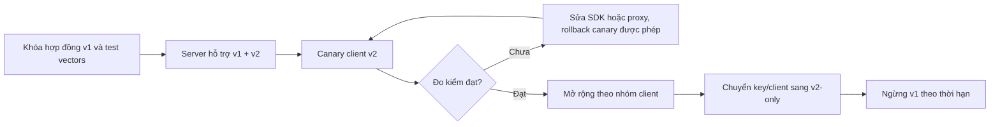

# Di trú header trong HMAC Request Authentication

## 1. Bài toán và mục tiêu

Hệ thống dùng **HMAC Request Authentication** thường yêu cầu client gửi `keyId`, chữ ký, timestamp, nonce và có thể cả digest của body qua HTTP header. Server lấy shared secret tương ứng với `keyId`, xây dựng **canonical request** theo một hợp đồng ký xác định, tính lại HMAC và so sánh chữ ký. Cùng với việc chống replay bằng timestamp/nonce, hệ thống phải phân biệt rõ **xác thực** (ai sở hữu secret hợp lệ) với **phân quyền** (client được thực hiện thao tác gì).

Khi giao thức tích hợp phát triển, đội ngũ có thể cần đổi tên header, đổi vị trí chữ ký sang `Authorization`, thêm version của giao thức hoặc đưa thông tin xác thực qua API gateway mới. Những thay đổi này gọi là **di trú header** (*header migration*). Nếu làm sai, request hợp lệ có thể bị từ chối hàng loạt; nghiêm trọng hơn, server có thể chấp nhận một biến thể chữ ký yếu hơn dự kiến, cho phép replay hoặc bỏ sót một thành phần đã phải được ký.

Sau bài học, người học có thể:

- Nhận diện thay đổi ở **cú pháp header**, **canonicalization**, **phương thức truyền qua proxy** và **chính sách chấp nhận credential**.
- Thiết kế profile HMAC `v1`/`v2` với quy tắc nhận diện và xác minh không mơ hồ.
- Phát hành theo từng giai đoạn, theo dõi mức sử dụng header cũ và đặt thời điểm ngừng chấp nhận.
- Xử lý an toàn header trùng, nhiều giá trị, tên header không phân biệt hoa/thường, `Authorization` bị gateway xử lý và lỗi downgrade.
- Kiểm thử client, gateway, Spring Security, key rotation và replay trong quá trình chuyển đổi.

**Phạm vi:** Bài này tập trung vào thay đổi header của giao thức xác thực HTTP request bằng HMAC với shared secret. Nếu muốn thay đổi thuật toán ký, cách tính body digest, chính sách quyền hoặc key rotation, phải quản lý các thay đổi đó thành các quyết định tương thích riêng; không mặc nhiên xem chúng là hệ quả của việc đổi tên header.

## 2. Header là một phần của hợp đồng ký

Không có một quy ước header HMAC tùy biến nào được mọi hệ thống Java/Spring Security tự động hiểu. Header nào mang key ID, timestamp, nonce, signature; header nào được đưa vào canonical request; thứ tự, encoding và kiểu nhiều giá trị đều do **hợp đồng client–server** xác định.

Ví dụ một giao thức cũ:

```http
POST /v1/orders?currency=VND HTTP/1.1
Host: api.example.test
Content-Type: application/json
X-Auth-Key: partner-key-17
X-Auth-Date: 2026-11-28T05:00:00Z
X-Auth-Nonce: 6d1e4b9fa02c
X-Auth-Signature: <base64-hmac>

{"amount":150000}
```

Nhóm vận hành muốn chuyển sang profile mới:

```http
POST /v1/orders?currency=VND HTTP/1.1
Host: api.example.test
Content-Type: application/json
Authorization: HMACv2 Credential="partner-key-17",Signature="<base64-hmac>"
X-HMAC-Timestamp: 2026-11-28T05:00:00Z
X-HMAC-Nonce: 6d1e4b9fa02c
X-Content-SHA256: <lowercase-hex-sha256-of-body>

{"amount":150000}
```

Các tên, dấu phân cách và cú pháp `HMACv2` ở đây là **giao thức ví dụ do ứng dụng định nghĩa**, không phải chuẩn HMAC mặc định của HTTP hay Spring Security. Giá trị `<...>` chỉ là placeholder; chữ ký thật phải được tính theo byte của canonical request. Trong triển khai thực, nên có tài liệu giao thức, phiên bản và test vector có kết quả MAC cụ thể để các SDK sử dụng thống nhất.

| Thành phần | Profile `v1` | Profile `v2` | Cần quyết định rõ |
| --- | --- | --- | --- |
| Key ID | `X-Auth-Key` | Trường `Credential` trong `Authorization` | Cách escape và giới hạn ký tự của key ID |
| Signature | `X-Auth-Signature` | Trường `Signature` trong `Authorization` | Base64 chuẩn hay URL-safe, cho phép padding hay không |
| Timestamp | `X-Auth-Date` | `X-HMAC-Timestamp` | UTC, định dạng chính xác, độ lệch đồng hồ được chấp nhận |
| Nonce | `X-Auth-Nonce` | `X-HMAC-Nonce` | Độ dài, charset, uniqueness và khóa lưu replay |
| Body digest | Tính từ body theo quy tắc `v1` | Header `X-Content-SHA256` cộng bước so khớp với body thực | Dạng hex, body bytes gốc và cách xử lý body rỗng |
| Profile ID | Được xác định theo envelope cũ và chính sách key | Scheme `HMACv2`, đồng thời bind trong canonical string | Không cho hạ cấp phiên bản bằng cách sửa header |

Thay đổi **tên header** khác với thay đổi **trường được ký**. Nếu `v1` đưa dòng `x-auth-date:...` vào canonical request, việc đổi thành `x-hmac-timestamp:...` làm thay đổi dữ liệu ký dù timestamp giữ nguyên. Server phải thực thi đúng profile tương ứng, không tự đổi tên header rồi thử lại nhiều loại MAC cho đến khi có một loại khớp.

### Những quy tắc HTTP dễ gây lỗi

- **Tên header không phân biệt chữ hoa/thường.** `X-HMAC-Nonce` và `x-hmac-nonce` là cùng tên header; HTTP/2 thường dùng tên chữ thường. Không yêu cầu client giữ nguyên chữ hoa/thường của tên để có chữ ký hợp lệ, trừ khi canonical contract quy định phải đưa tên về dạng chuẩn trước khi ký.
- **Giá trị header vẫn có ý nghĩa byte/ngữ nghĩa riêng.** Không tùy tiện trim, ghép, đổi khoảng trắng, tách dấu phẩy hoặc URL-decode giá trị ngoài quy tắc canonicalization đã công bố. Những trường HMAC nhạy cảm nên được định nghĩa là trường đơn trị, với parser chặt chẽ.
- **Header lặp và giá trị ghép** có thể được proxy hoặc framework xử lý khác nhau. Không lấy `getHeader(name)` rồi âm thầm bỏ qua bản thứ hai; kiểm tra `getHeaders(name)` và cấm các dạng không hợp lệ theo hợp đồng.
- **`Authorization` là trường đặc biệt.** Reverse proxy, gateway, middleware, cơ chế Bearer/Basic auth và bộ lọc log có thể đọc, xóa hoặc thay đổi header này. Cần xác nhận nó đi đến đúng verifier và không xung đột chuỗi xác thực hiện có.
- **`Content-Length`, `Transfer-Encoding`, hop-by-hop header** có thể thay đổi theo HTTP framing. Không ký trực tiếp các giá trị có thể bị proxy hợp lệ viết lại nếu hợp đồng không xử lý được; ký body digest dựa trên byte payload được hai đầu thống nhất.

## 3. Thiết kế versioned signing profile

Phải định nghĩa `v1` và `v2` như hai profile **xác thực riêng biệt**. Mỗi profile mô tả envelope header, parser, tập trường ký, thuật toán, cách encode và quy tắc canonicalization. Một request chỉ được giải mã theo **một** profile đã chọn, rồi xác minh đúng profile đó.

### 3.1. Ví dụ canonical contract minh họa

Giả sử cả hai phiên bản dùng `HmacSHA256`, UTF-8, newline `LF`, HTTP method in hoa, cùng quy tắc canonical URI/query và SHA-256(body bytes) dạng hex chữ thường.

Profile `v1` ký:

```text
POST
/v1/orders?currency=VND
x-auth-date:2026-11-28T05:00:00Z
x-auth-nonce:6d1e4b9fa02c
sha256:<body-digest-hex>
```

Profile `v2` ký:

```text
HMACv2
partner-key-17
POST
/v1/orders?currency=VND
x-hmac-timestamp:2026-11-28T05:00:00Z
x-hmac-nonce:6d1e4b9fa02c
x-content-sha256:<body-digest-hex>
```

Ở ví dụ này, dòng `HMACv2` và `keyId` là phần của canonical string mới. Server tính digest từ **body nhận được** rồi đối chiếu giá trị `X-Content-SHA256` trước khi chấp nhận, vì việc một giá trị digest được ký không chứng minh nó khớp body nếu không kiểm tra lại. Chữ ký `v2` không tự động tương thích chữ ký `v1`; client phải ký lại với chính profile sẽ được gửi đi.

Hợp đồng triển khai phải nêu chính xác các chi tiết chưa được thể hiện ở ví dụ rút gọn: request-target gốc hay path sau gateway, xử lý percent-encoding, thứ tự query param trùng, trường hợp query rỗng, body rỗng, Unicode/charset, có newline cuối hay không, canonical host nếu đưa vào MAC, và cách lấy byte body trước/ sau giải nén. **Hai phía phải ký cùng một chuỗi byte**, không dựa trên mô tả mơ hồ như “ký URL và các header”.

### 3.2. Chọn profile trước khi xác minh

Một quy tắc chọn profile an toàn cho endpoint chỉ hỗ trợ HMAC:

1. Nếu có `Authorization: HMACv2 ...`, kiểm tra không có header xác thực `v1`, parse nghiêm ngặt toàn bộ envelope `v2`, rồi **chỉ** kiểm tra chữ ký `v2`.
2. Nếu có nhóm header `v1`, kiểm tra không có dấu hiệu envelope `v2`, parse đủ bộ `v1`, rồi **chỉ** kiểm tra chữ ký `v1`.
3. Nếu thiếu trường bắt buộc, duplicate, header trộn hai profile, Authorization không hỗ trợ hoặc cú pháp sai, trả lỗi xác thực chung. Không thử “v2 thất bại thì fallback v1”.
4. Sau khi lấy `keyId`, đối chiếu **chính sách profile được phép của key/client** trong nguồn cấu hình tin cậy. Request tự khai `HMACv2` không thể tự cấp quyền dùng `v2`, và request thiếu marker không thể khôi phục quyền dùng `v1` đã bị tắt.
5. Verify HMAC, timestamp và nonce theo hợp đồng; sau đó mới tạo authenticated principal và chạy authorization độc lập.

Khóa có thể cho phép `v1` và `v2` trong giai đoạn chuyển tiếp, nhưng phải có ngày kết thúc. Khi key đã được nâng lên trạng thái **v2-only**, request `v1` phải bị từ chối ngay cả khi MAC theo secret cũ vẫn tính đúng. Nếu có yêu cầu chống downgrade mạnh hơn trong suốt giai đoạn song song, ưu tiên **key ID hoặc secret riêng theo phiên bản**, hoặc cơ chế ràng buộc profile tối thiểu theo client; tránh dùng hai profile với cùng secret mãi mãi.

### 3.3. Tránh replay xuyên profile

Timestamp và nonce vẫn bắt buộc. Replay store nên dùng thao tác **insert-if-absent nguyên tử** với khóa tối thiểu chứa định danh credential nội bộ đáng tin và nonce; nếu cùng một secret/key được phép ký hai profile, **không tách namespace nonce theo `v1`/`v2`**. Tách nonce store theo profile có thể cho phép lặp cùng nonce ở hai phiên bản trong cửa sổ chuyển tiếp. Thời gian giữ nonce phải bao phủ cửa sổ timestamp cho phép, sai lệch đồng hồ và độ trễ xử lý dự kiến.

HMAC được kiểm tra trên request cụ thể trước khi ghi nonce; request ký sai không được dùng để “chiếm” nonce của client hợp pháp. Nếu API có side effect, xem xét idempotency key/transaction ID độc lập: chống replay HMAC và ngăn nhân đôi giao dịch là hai kiểm soát có mục đích khác nhau.

## 4. Chiến lược di trú từng bước

### Giai đoạn 0 — Kiểm kê và cố định hợp đồng `v1`

Liệt kê client/SDK, phiên bản, route, vùng triển khai, gateway/WAF, ứng dụng quản lý HMAC key, vị trí verifier và bộ lọc bảo mật. Thu thập số request theo profile cũ và tỷ lệ lỗi theo nguyên nhân nội bộ (thiếu header, sai canonical, lệch đồng hồ, sai signature, replay). Không ghi secret hay nguyên văn Authorization/signature vào log.

Tạo **test vector `v1` bất biến**: method, raw URI/query, header, body bytes, canonical string và chữ ký kỳ vọng với secret thử nghiệm. Những vector này giúp phát hiện vô ý phá tương thích khi thêm profile mới.

### Giai đoạn 1 — Công bố hợp đồng `v2` và xây dựng verifier

Định nghĩa rõ scheme/version, tên header, parsing, charset, canonical string, body digest, nonce và response lỗi. Tạo test vector `v2` cho cả client Java và các SDK khác. Bổ sung bộ parser chọn profile, kiểm soát quyền dùng profile theo key/client, replay store dùng chung và metric phân loại phiên bản.

Kiểm tra các route HMAC nhận đúng `Authorization`. Nếu hệ thống đang dùng Bearer hoặc nhiều loại authentication trong cùng ứng dụng Spring Security, phải định tuyến qua `SecurityFilterChain` phù hợp và quyết định rõ trường hợp có nhiều scheme. Không ghép HMACv2 với Bearer theo cách làm parser chấp nhận một phần token này, một phần token khác.

### Giai đoạn 2 — Dual-accept có kiểm soát, không dual-sign mơ hồ

Triển khai server hiểu hai profile trước khi client chuyển đổi. Trong thời gian song song, mỗi request mang **chính xác một** envelope hợp lệ và được xác minh bằng **một** profile. Không khuyến khích client gửi đồng thời `X-Auth-Signature` và `Authorization: HMACv2 ...`; server phải từ chối để tránh khác biệt giữa gateway và backend.

Cho phép `v2` dần theo key ID/client ID qua feature flag hoặc policy; client nào còn `v1` tiếp tục trong thời hạn đã công bố. Ghi nhận profile đã **xác thực thành công** thay vì suy ra chỉ từ header mà request tự khai.

### Giai đoạn 3 — Canary, mở rộng và theo dõi

Chuyển một nhóm client thử nghiệm có khả năng rollback sang `v2`; xác minh request có body, upload lớn, ký query phức tạp, retry và luồng qua gateway. Sau đó mở dần theo nhóm tích hợp và vùng triển khai.

Theo dõi `authentication_success`, `invalid_signature`, `missing_or_mixed_headers`, `timestamp_out_of_window`, `replay_rejected` theo profile, route và phiên bản SDK; theo dõi thêm thời gian xử lý verifier. Tránh dùng `keyId` hoặc `clientId` làm metrics label cardinality cao; dùng audit log có kiểm soát để truy vết từng client.

### Giai đoạn 4 — Siết chính sách và loại bỏ `v1`

Khi client đã chuyển, gắn policy **v2-only** cho client/key đó. Công bố mốc ngừng `v1`, kiểm tra ngoại lệ đã phê duyệt, sau đó tắt `v1` theo mốc ở server; không chỉ xóa header khỏi tài liệu SDK. Quan sát số request `v1` vẫn tới từ mạng công khai để phát hiện thành phần chưa cập nhật.

Chỉ dọn parser, metric và tài liệu cũ sau khi hết cửa sổ hỗ trợ và không còn khách hàng cần `v1` theo chính sách. Nếu nghi ngờ compromise trong giai đoạn di trú, **thu hồi key compromised ngay**; migration không phải lý do để kéo dài grace period cho secret bị lộ.

### Giai đoạn 5 — Rollback khi phát hiện lỗi

Rollback có thể là chuyển SDK về gửi `v1` cho **những client vẫn được phép `v1`**, hoặc sửa lỗi proxy/parser `v2` rồi triển khai lại. Tránh âm thầm bật lại `v1` cho client đã v2-only: đó là hạ cấp chính sách và cần quyết định xử lý sự cố có kiểm soát, audit, hạn dùng và đánh giá rủi ro. Không khôi phục credential đã revoked.

Sơ đồ tổng quan:



## 5. Những điểm cần kiểm soát ở gateway, proxy và Spring Security

**Gateway và trust boundary.** Bảo đảm gateway forward `Authorization` mới, không gỡ nhầm vì policy Bearer/Basic, không viết lại timestamp/nonce/signature, không thêm các header v1 tương đương “để tương thích”. Nếu gateway xác thực HMAC rồi chuyển danh tính xuống backend, phải xóa header định danh do client tự gửi và truyền principal qua kênh nội bộ đáng tin (ví dụ mTLS hoặc chứng thực gateway). Nếu backend cũng tự xác minh HMAC, nó phải thấy đúng representation của request theo canonical contract.

**URI/query.** Reverse proxy có thể thêm prefix, chuẩn hóa dấu gạch chéo, mã hóa lại path, sắp xếp lại query hoặc thay đổi host. Hợp đồng ký phải chỉ định server xác minh trên request-target nào. Không tin `X-Forwarded-Host`, `X-Original-URI` hoặc các header tương tự do Internet tự gửi; chỉ lấy metadata gốc từ proxy đã được tin cậy và cấu hình làm sạch các header đó.

**Body và streaming.** Nếu body digest nằm trong chữ ký, bộ verifier phải đọc/capture đúng byte payload dùng để ký mà không làm mất body trước controller. Với Servlet, cần wrapper hoặc giải pháp streaming phù hợp, có giới hạn kích thước và cơ chế tránh đọc vô hạn; với WebFlux dùng `WebFilter` và `DataBuffer` đúng vòng đời. Kiểm tra ảnh hưởng của gzip, charset và gateway body transformation theo hợp đồng ký.

**Browser/CORS.** Nếu có browser client, header mới có thể kích hoạt preflight; cấu hình `Access-Control-Allow-Headers` cho `Authorization`, `X-HMAC-Timestamp`, `X-HMAC-Nonce`, `X-Content-SHA256` theo origin và method được phép. CORS chỉ là chính sách trình duyệt, không thay thế xác thực HMAC. Không nhúng shared secret lâu dài trong JavaScript công khai của trình duyệt.

**Cache, CDN, logging.** `Authorization` thường thay đổi chính sách caching; kiểm tra không cache response nhạy cảm sai cách, và bộ lọc log/redaction đã nhận ra tên mới. Sử dụng TLS, `Cache-Control` khi phù hợp, và tránh ghi lại secret/signature/timestamp+nonce đầy đủ ở vị trí không có kiểm soát truy cập.

**Thứ tự filter.** Parser `v1`/`v2` và verifier HMAC phải chạy trước khi tạo principal. Sau xác thực cần kiểm tra chính sách client/key bị chặn rồi thực hiện authorization theo quyền nghiệp vụ. Chỉ thay header không được làm thay đổi quy tắc `403` khi client không đủ quyền hay `401` khi chữ ký sai.

## 6. Ví dụ Java: chọn đúng một envelope

Hàm sau minh họa **phân loại cấu trúc header** tại một endpoint chỉ cho phép HMAC, trước bước tính HMAC. Các tên và cú pháp tương ứng với hợp đồng ví dụ ở trên. `readExactlyOneHeader` kiểm tra số giá trị do Servlet container trả về; parser cụ thể vẫn cần validate đầy đủ `Credential`, `Signature`, timestamp, nonce, digest, các ký tự bị cấm và byte encoding.

```java
import jakarta.servlet.http.HttpServletRequest;
import java.util.Enumeration;

final class HmacHeaderMigration {
    enum Profile { V1, V2 }

    static Profile selectProfile(HttpServletRequest request) {
        boolean legacy = has(request, "X-Auth-Key")
                || has(request, "X-Auth-Date")
                || has(request, "X-Auth-Nonce")
                || has(request, "X-Auth-Signature");

        boolean modern = has(request, "Authorization")
                || has(request, "X-HMAC-Timestamp")
                || has(request, "X-HMAC-Nonce")
                || has(request, "X-Content-SHA256");

        if (legacy && modern) {
            throw new InvalidHmacEnvelopeException("Mixed HMAC profiles");
        }
        if (modern) {
            String authorization = readExactlyOneHeader(request, "Authorization");
            if (!authorization.startsWith("HMACv2 ")) {
                throw new InvalidHmacEnvelopeException("Unsupported HMAC scheme");
            }
            readExactlyOneHeader(request, "X-HMAC-Timestamp");
            readExactlyOneHeader(request, "X-HMAC-Nonce");
            readExactlyOneHeader(request, "X-Content-SHA256");
            // Parse chính xác Credential, Signature; cấm duplicate field.
            return Profile.V2;
        }
        if (legacy) {
            readExactlyOneHeader(request, "X-Auth-Key");
            readExactlyOneHeader(request, "X-Auth-Date");
            readExactlyOneHeader(request, "X-Auth-Nonce");
            readExactlyOneHeader(request, "X-Auth-Signature");
            return Profile.V1;
        }
        throw new InvalidHmacEnvelopeException("Missing HMAC envelope");
    }

    private static boolean has(HttpServletRequest request, String name) {
        return request.getHeader(name) != null;
    }

    static String readExactlyOneHeader(
            HttpServletRequest request, String name) {
        Enumeration<String> values = request.getHeaders(name);
        if (values == null || !values.hasMoreElements()) {
            throw new InvalidHmacEnvelopeException("Missing header: " + name);
        }
        String value = values.nextElement();
        if (values.hasMoreElements()
                || value == null || value.isBlank()
                || value.indexOf('\r') >= 0 || value.indexOf('\n') >= 0) {
            throw new InvalidHmacEnvelopeException("Invalid header: " + name);
        }
        return value;
    }

    static final class InvalidHmacEnvelopeException extends RuntimeException {
        InvalidHmacEnvelopeException(String message) {
            super(message);
        }
    }
}
```

**Giới hạn của ví dụ:** Đây mới là lớp chọn profile. Trong triển khai thật, cần xử lý việc proxy đã gộp header trùng thành một giá trị; cấm dấu phẩy đối với trường mà hợp đồng quy định đơn trị không chứa dấu phẩy; giới hạn kích thước header và parse `Authorization` theo grammar chính xác, không chỉ dùng `startsWith`. Các message exception là chi tiết nội bộ; response ra Internet nên giữ thông điệp lỗi xác thực chung, tránh tiết lộ key có tồn tại hay không.

Sau bước chọn profile, verifier phải thực hiện theo thứ tự logic:

```text
profile = selectProfile(request)
envelope = parseStrict(profile, request)
credential = credentialStore.findActive(envelope.keyId)
require credential.allowedProfiles contains profile
require credential not revoked and client not blocked
canonicalBytes = canonicalizer(profile).build(request, envelope, rawBody)
require bodyDigestMatchesActualBytesIfPresent(envelope, rawBody)
presentedMac = decodeAndValidateMacLength(envelope.signature)
expectedMac = HMAC_SHA256(credential.secret, canonicalBytes)
require constantTimeEqual(expectedMac, presentedMac)
require timestampWithinWindow(envelope.timestamp)
require nonceStore.claimOnceAtomically(credential.id, envelope.nonce)
principal = trustedClientPrincipal(credential.clientId)
authorize(principal, route, action)
```

Đây là **giả mã**, không phải đoạn chương trình biên dịch độc lập. Việc kiểm tra trạng thái client bị block dựa trên mapping credential trong kho nội bộ (có thể diễn ra sớm để tiết kiệm tài nguyên) nhưng chỉ được ghi nhận một request là “đã xác thực” sau khi MAC hợp lệ. `nonceStore.claimOnceAtomically` phải có TTL và phạm vi nhất quán giữa các instance. Giữ thời gian so sánh MAC không phụ thuộc vào vị trí byte sai, giới hạn kích thước và cách decode của MAC để tránh lỗi parser. Đồng thời phân biệt yêu cầu chống replay với cơ chế chống giao dịch trùng lặp.

## 7. Bảng kiểm thử di trú header

| Trường hợp | Input hoặc tình huống | Kết quả mong đợi |
| --- | --- | --- |
| `v1` trước thời hạn | Header `v1` đầy đủ, MAC đúng, key được phép `v1` | Xác thực thành công, phân quyền tiếp tục như cũ |
| `v2` theo profile mới | `Authorization: HMACv2 ...`, timestamp, nonce, digest và MAC đúng | Xác thực thành công, log profile `v2` |
| Chỉ đổi tên header, giữ MAC cũ | Canonical string v2 nhưng signature của v1 | Từ chối; không fallback profile |
| Gửi cả hai profile | `X-Auth-Signature` và `Authorization: HMACv2 ...` | Từ chối vì envelope trộn |
| Thiếu trường hoặc header lặp | Thiếu nonce hoặc có hai timestamp | Từ chối, không lấy ngẫu nhiên giá trị đầu tiên |
| Hoa/thường tên header | `x-hmac-nonce` thay cho `X-HMAC-Nonce` | Kết quả nhất quán theo HTTP và canonical contract |
| Chữ ký sai | Signature sai 1 byte hoặc Base64 không hợp lệ | Từ chối `401`, không cấp principal |
| Key v2-only gửi v1 | MAC v1 đúng bằng secret cũ nhưng policy đã tắt v1 | Từ chối `401` theo chính sách profile |
| Key đã thu hồi | Request v1 hoặc v2 dùng credential revoked | Cả hai đều bị từ chối |
| Nonce lặp xuyên phiên bản | Dùng cùng key/nonce ở v1 và v2 trong cửa sổ hợp lệ | Replay store dùng chung từ chối lần claim sau |
| Đồng hồ lệch | Timestamp quá cửa sổ cho phép | Từ chối, ghi lý do nội bộ `TIMESTAMP_OUT_OF_WINDOW` |
| Proxy đổi path/query | Proxy thêm prefix hoặc đổi query normalization | Test vector phát hiện mismatch; sửa đúng hợp đồng |
| Proxy strip Authorization | Header v2 biến mất trước verifier | Từ chối, cảnh báo lỗi triển khai gateway |
| Body bị sửa | Body thực không khớp `X-Content-SHA256` | Từ chối, không chạy nghiệp vụ |
| HTTP/2 và HTTP/1.1 | Cùng yêu cầu qua hai protocol khi representation tương đương | Canonical bytes/MAC đồng nhất theo hợp đồng |
| Client không đủ quyền | MAC hợp lệ, profile được phép, thiếu permission | `403` từ authorization; không đánh đồng với signature lỗi |
| CORS/browser | Preflight cho header mới, origin/method được phép | Chính sách CORS đúng; không lưu secret trong JS công khai |
| Triển khai đa vùng | Một vùng mới hỗ trợ v2, vùng khác chưa cập nhật | Chặn rollout v2 đến khi mọi vùng đích hỗ trợ; không phát sinh lỗi ngẫu nhiên |

Ngoài mã HTTP, cần kiểm tra hệ thống **không tạo side effect** khi xác thực thất bại, audit/metrics không lộ credential, các retry có nonce mới theo hợp đồng, và key rotation không vô tình phục hồi profile cũ. Với request có query trùng tên, body rỗng hoặc ký tự Unicode, dùng test vector có byte và chữ ký kỳ vọng để bắt lỗi khác biệt giữa SDK, framework và gateway.

## 8. Các anti-pattern và cách xử lý

1. **“Thử tất cả header và chọn chữ ký khớp.”** Cách này tạo ambiguity và có thể đưa client đã v2-only quay về logic v1. Chọn profile một lần, kiểm tra policy rồi verify đúng profile.
2. **Đổi tên header ở proxy mà quên canonical string.** Nếu tên được ký, chữ ký mất hiệu lực. Định nghĩa rõ canonical contract theo từng profile và end-to-end test qua proxy thật.
3. **Tự động ghép header cũ và mới.** Khi hai nguồn khác giá trị, gateway và backend có thể quyết định khác nhau. Từ chối envelope trộn hoặc duplicate.
4. **Đưa chữ ký vào `Authorization` nhưng không cập nhật gateway.** Header bị strip, Bearer middleware tiêu thụ hoặc log thô. Cập nhật routing/auth chain/redaction trước khi phát hành client.
5. **Mở hai profile vô thời hạn.** Tăng surface tấn công, khó giải thích policy khi xảy ra sự cố. Gắn profile được phép theo key/client và mốc sunset có audit.
6. **Dùng nonce store riêng cho mỗi profile của cùng một key.** Tạo điểm yếu replay xuyên giai đoạn song song. Đặt phạm vi replay theo credential thực tế và nonce, với insert nguyên tử.
7. **Coi HMAC hợp lệ là đủ quyền.** Migration chỉ đổi authentication envelope; quyền truy cập route, tenant và hành động vẫn phải được xác minh độc lập.
8. **Rollback bằng cách bật lại secret cũ bị lộ.** Credential compromised vẫn phải revoked; rollback cú pháp giao thức không được vô hiệu hóa chính sách ứng phó sự cố.

## 9. Checklist giao hàng cho migration header

- [ ] Đã công bố hợp đồng đầy đủ cho `v1` và `v2`, có test vector HMAC với dữ liệu thử nghiệm.
- [ ] Server và gateway ở mọi vùng đích hiểu `v2` trước khi SDK bắt đầu gửi.
- [ ] Parser chỉ chọn một profile, từ chối header trộn/duplicate và validate chặt trường bắt buộc.
- [ ] Chính sách cho phép profile gắn với key/client và không fallback khi MAC sai.
- [ ] Timestamp/nonce được kiểm tra; replay store nhất quán giữa các profile dùng cùng credential.
- [ ] Canonical URI/query/header/body digest đã được kiểm thử xuyên gateway, Servlet/WebFlux và HTTP/2.
- [ ] `Authorization` mới được chuyển tiếp đúng, không xung đột Bearer/Basic, log đã redact.
- [ ] CORS, CDN/cache và các rule WAF được cập nhật theo luồng sử dụng thực tế.
- [ ] Có metrics theo profile và cơ chế audit; không đưa secret hay chữ ký thô vào log.
- [ ] Có canary, điều kiện go/no-go, mốc sunset `v1` và rollback có kiểm soát.
- [ ] Key revoked vẫn bị từ chối; authorization và block-client policy vẫn hoạt động sau migration.

Di trú header thành công khi client và server có thể chuyển từ envelope `v1` sang `v2` mà **không thay đổi ngoài ý muốn các byte được ký, phạm vi tin cậy hoặc chính sách bảo mật**. Thiết kế profile tường minh, kiểm tra signature nghiêm ngặt, thực thi cùng chính sách key/client và rollout theo dữ liệu thực tế giúp quá trình chuyển đổi an toàn, dễ quan sát và có điểm kết thúc rõ ràng.
