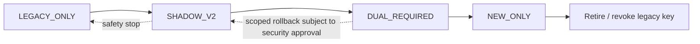

# Dual signing: ký HMAC song song trong quá trình migration

## 1. Dual signing giải quyết vấn đề gì?

Trong module `SECURITY_AUTHENTICATION_HMAC_REQUEST_AUTHENTICATION`, client dùng **shared secret** tạo HMAC trên **canonical request** gồm HTTP method, URI, header và/hoặc body theo hợp đồng ký. Server tra key, dựng lại đúng canonical bytes và xác minh chữ ký. Hệ thống còn dùng timestamp/nonce chống replay, quản lý key rotation, đi qua proxy/gateway và phân biệt **authentication** với **authorization**.

Khi cần thay đổi **key**, **thuật toán HMAC**, **định dạng chữ ký**, **canonicalization** hoặc bộ signed headers, client và server thường không thể chuyển toàn bộ trong cùng một thời điểm. Đối tác có nhiều phiên bản SDK, nhiều region và hạ tầng gateway; chuyển đột ngột có thể khiến request hợp lệ bị từ chối. Nếu ngược lại, server cứ chấp nhận cả giao thức cũ lẫn mới mãi mãi, kẻ tấn công có thể chọn giao thức yếu hơn.

**Dual signing** là kỹ thuật client tạo **hai chữ ký độc lập cho cùng một request** trong giai đoạn migration: một chữ ký theo hợp đồng cũ (V1), một chữ ký theo hợp đồng mới (V2). Server kiểm tra từng chữ ký theo key/version/canonical contract tương ứng, sau đó quyết định chấp nhận dựa trên **chính sách migration nằm ở phía server**. Có thể dùng bước *shadow verification* để đo mức tương thích trước khi thực sự bắt buộc V2.

Ba mục tiêu:

1. **Tương thích có kiểm soát:** client cũ được hỗ trợ có thời hạn, client mới chứng minh có thể ký V2.
2. **Không downgrade:** khi server đã yêu cầu V2 thì việc xóa header V2, đổi version hoặc chỉ gửi V1 **không thể** khiến request được chấp nhận.
3. **Không nhân đôi tác dụng:** hai chữ ký là **hai bằng chứng trên một request**, không phải hai request nghiệp vụ; replay protection và idempotency phải xử lý nhất quán.

Dual signing thường phù hợp khi migration thay key hoặc cấu trúc canonical request. Đây không phải yêu cầu mặc định của HMAC, cũng không phải phương tiện để “sửa” một giao thức cũ đã bị compromise: trong tình huống shared secret V1 bị lộ, cần **thu hồi khẩn**, không duy trì thời gian chấp nhận V1 chỉ để tránh gián đoạn.

## 2. Phân biệt các khái niệm dễ nhầm

| Thuật ngữ | Hành vi | Rủi ro nếu áp dụng sai |
|---|---|---|
| **Dual signing** | Client gửi cả HMAC V1 và V2 cho **cùng** method, URI, headers/body. | Nếu server chấp nhận một trong hai không giới hạn, V1 yếu còn là đường vào. |
| **Dual verification** | Server có thể xác minh V1 và V2; client có thể chỉ gửi một phiên bản. | Cần policy theo client/phase, không phải `verify(v1) OR verify(v2)` toàn cục. |
| **Shadow verification** | Server vẫn quyết định theo V1 nhưng đo kết quả V2 khi được gửi. | `shadow V2 PASS` không tự động cấp quyền; giai đoạn này **vẫn** phụ thuộc an toàn của V1. |
| **Dual-required** | Một client đã nâng cấp phải có **cả hai** chữ ký hợp lệ. | Tăng phụ thuộc availability vào cả hai key; chỉ dùng trong khoảng ngắn có mục đích rõ. |
| **New-only** | Server chỉ xác thực theo V2, V1 không còn giá trị chấp nhận. | Nếu rollback tự mở lại V1 thì migration không đạt mục tiêu chống downgrade. |
| **Key rotation** | Chuyển secret/key version, có thể giữ nguyên thuật toán/canonical contract. | Grace period cũ không được áp dụng cho key đã `REVOKED` vì nghi compromise. |

Một hệ thống có thể **đọc** hai chữ ký nhưng chỉ **bắt buộc** một chữ ký, hoặc có thể **bắt buộc** cả hai; đây là quyết định khác nhau. Bài học sử dụng các phase có tên rõ ràng để tránh nhầm “server hỗ trợ V2” với “client đã được bảo vệ bằng V2”.

## 3. Threat model và các bất biến bắt buộc

### 3.1. Các cách migration bị khai thác

- **Signature stripping:** đối tượng trung gian xóa `X-Hmac-V2-Signature` nhưng giữ chữ ký V1 vốn vẫn hợp lệ.
- **Downgrade bằng metadata:** sửa `X-Hmac-Contract` từ `dual-v1-v2` sang `v1`, hoặc đổi key/version để kích hoạt nhánh legacy.
- **Cross-client/key confusion:** dùng secret của tenant A hoặc key version khác để xác minh request khai báo tenant B.
- **Canonicalization mismatch:** client ký raw URI, proxy decode/rewrite path hoặc thay Content-Type/body; mỗi verifier xác minh dữ liệu khác nhau.
- **Replay qua hai nhánh:** cùng request/nonce được chấp nhận một lần theo V1 rồi được chấp nhận lần hai theo V2 nếu mỗi verifier lưu nonce riêng.
- **Policy race:** node A đã `NEW_ONLY`, node B còn `LEGACY_ONLY`; attacker chọn node B hoặc đi qua gateway cũ.
- **Silent algorithm fallback:** verifier thử hết secret hoặc thuật toán cho đến khi có một MAC khớp, vô tình chấp nhận một đường xác thực yếu hơn.

### 3.2. Quy tắc bất biến

1. **Server quyết định phase:** không cho header do client gửi tự quyết định mode xác thực. Phase phải được lấy từ cấu hình/registry có thẩm quyền theo tenant, client và endpoint, có revision/rollout kiểm soát.
2. **V2 là bằng chứng riêng:** dùng key material mới, thuật toán và canonical contract được định danh rõ; không chỉ đổi tên header nhưng tái sử dụng cùng secret mà tuyên bố là hai lớp độc lập.
3. **Một request, một định danh:** cả hai chữ ký phải ràng buộc cùng method, raw target, body bytes, client, timestamp, nonce theo hợp đồng. Các phần V1 không ký phải được V2 bảo vệ và chỉ tin khi phase yêu cầu V2.
4. **Không ghép quyền:** chữ ký V1 hợp lệ của client A và V2 hợp lệ của client B không bao giờ được kết hợp thành một authentication. Key lookup phải xác nhận ownership và trạng thái key.
5. **Replay dùng chung:** nonce được đánh dấu **một lần nguyên tử** ở mức client/scope phù hợp, sau khi đủ chữ ký bắt buộc đã hợp lệ; không tạo hai lần xử lý nghiệp vụ.
6. **Revocation cao hơn migration:** key `REVOKED` không được thử lại trong grace period, rollback hay fallback, kể cả khi HMAC tính toán đúng.
7. **Phân quyền độc lập:** V1 và V2 chỉ chứng minh khả năng sử dụng secret. Principal sau xác thực vẫn phải qua role/scope/tenant/resource authorization.

## 4. Hợp đồng minh họa: ký cùng request bằng V1 và V2

Ví dụ sử dụng API giả lập `POST /v1/orders`, không phải chuẩn HMAC chung. Tên header, canonical text và các phiên bản dưới đây là **hợp đồng mẫu để luyện tập**. Trên hệ thống thật, phải dùng chính sách hiện hữu đã được thống nhất giữa client, server và gateway.

### 4.1. Request được gửi

```http
POST /v1/orders?store=vn&order=A-42 HTTP/1.1
Host: api.example.test
Content-Type: application/json
Content-Length: 34
X-Client-Id: merchant-01
X-Hmac-Contract: dual-v1-v2
X-Hmac-V1-Key-Id: key-old-001
X-Hmac-V1-Signature: hmac-sha256=ae3955ed0b353ec68ab9c7661e23eeb5fb19b359753ff75b4341cf5f28a7e82a
X-Hmac-V2-Key-Id: key-new-002
X-Hmac-V2-Signature: hmac-sha256=92d051419d9ecbeb06ffcee4b0036e975fb259002fb775963581a5a407a35b45
X-Timestamp: 1735689600
X-Nonce: n-dual-0001

{"orderId":"A-42","amount":150000}
```

Trong ví dụ trên:

- Body là **34 byte ASCII/UTF-8**, không BOM, không newline cuối: `{"orderId":"A-42","amount":150000}`.
- Raw request target là `/v1/orders?store=vn&order=A-42`. Không tự đảo thứ tự query, percent-decode hay normalize.
- Timestamp `1735689600` = **01/01/2025 00:00:00 UTC**, cố định để làm golden vector. Muốn chạy HTTP integration test có kiểm tra freshness cần **fake clock** hoặc tạo timestamp/nonce mới rồi ký lại; không đưa fixture cũ vào production.
- V1 và V2 dùng **hai secret khác nhau**, thuộc cùng `merchant-01`, mỗi key có version/ownership/state riêng. Secret test không dùng production.
- `Host` và hai header chứa chữ ký **không** nằm trong dữ liệu ký mẫu. Tránh đưa chính header signature vào canonical text của chữ ký đó vì tạo phụ thuộc vòng. Hợp đồng thực tế có thể ký thêm Host nếu xác định rõ định dạng và proxy behavior.

### 4.2. Hợp đồng canonical V1

V1 là dạng legacy minh họa: ký method, raw path/query, client ID, timestamp, nonce và body SHA-256, nhưng **chưa ký Content-Type hay key identifiers**.

```text
HMAC-LEGACY-1
POST
/v1/orders?store=vn&order=A-42
client:merchant-01
timestamp:1735689600
nonce:n-dual-0001
body-sha256:c1943e1e11399b431ce00a8c991dd346cf656f38998b845e96c8447ba2c25846
```

### 4.3. Hợp đồng canonical V2

V2 thêm domain/version marker riêng và ký chính xác các header đã được định nghĩa trong contract. Các dòng header tên chữ thường, sắp xếp theo thứ tự ASCII như bên dưới, chỉ giữ giá trị ASCII được hợp đồng cho phép; ví dụ này không có OWS cần trim.

```text
HMAC-NEW-2
POST
/v1/orders?store=vn&order=A-42
content-type:application/json
x-client-id:merchant-01
x-hmac-contract:dual-v1-v2
x-hmac-v1-key-id:key-old-001
x-hmac-v2-key-id:key-new-002
x-nonce:n-dual-0001
x-timestamp:1735689600
body-sha256:c1943e1e11399b431ce00a8c991dd346cf656f38998b845e96c8447ba2c25846
```

V2 ký `X-Hmac-Contract` và **hai key IDs** để khóa ý nghĩa migration ở cấp request. V1 không ký Content-Type, vì thế việc chỉ chấp nhận V1 **không** bảo vệ giá trị đó. Trong `DUAL_REQUIRED`, thay đổi `Content-Type` làm V2 mismatch; yêu cầu cả hai chữ ký hợp lệ sẽ chặn request. Trong `SHADOW_V2`, nếu server vẫn quyết định theo V1, rủi ro legacy chưa được loại bỏ: shadow chỉ giúp đo chứ không phải biện pháp chống tấn công.

Nếu chuyển sang `NEW_ONLY`, ví dụ hợp đồng mới có thể yêu cầu `X-Hmac-Contract: v2-only` và **ký lại V2** với giá trị đó, không còn `X-Hmac-V1-Key-Id` trong canonical V2 nếu contract mới đã định nghĩa bỏ trường này. Đó là **một dạng canonical V2 khác cần fixture riêng**, không tái sử dụng chữ ký `dual-v1-v2` bên trên. Việc biến đổi hợp đồng phải được version hóa rõ để không tạo canonical mơ hồ.

### 4.4. Golden vector ở mức byte

Tất cả các giá trị sau được tính trên canonical UTF-8 **không BOM**, nối dòng bằng LF (`\n`), **không thêm LF cuối**.

| Thành phần | Golden value |
|---|---|
| Body Base64 | `eyJvcmRlcklkIjoiQS00MiIsImFtb3VudCI6MTUwMDAwfQ==` |
| Body bytes | `34` |
| Body SHA-256 hex | `c1943e1e11399b431ce00a8c991dd346cf656f38998b845e96c8447ba2c25846` |
| Secret V1 (UTF-8 test) | `test-v1-migration-only-2026` |
| Secret V1 Base64 | `dGVzdC12MS1taWdyYXRpb24tb25seS0yMDI2` |
| Secret V2 (UTF-8 test) | `test-v2-migration-only-2026` |
| Secret V2 Base64 | `dGVzdC12Mi1taWdyYXRpb24tb25seS0yMDI2` |
| Canonical V1 bytes | `184` |
| Canonical V1 SHA-256 | `58e6f66e14a491e657b6b383457cc9417350b711474e246fcd6663ba6d4c4e2c` |
| HMAC-SHA256 V1 | `ae3955ed0b353ec68ab9c7661e23eeb5fb19b359753ff75b4341cf5f28a7e82a` |
| Canonical V2 bytes | `305` |
| Canonical V2 SHA-256 | `c1cbc0b61bf65046481d48ca133742a0c8267ed11b31ad024b4e4261bf250a68` |
| HMAC-SHA256 V2 | `92d051419d9ecbeb06ffcee4b0036e975fb259002fb775963581a5a407a35b45` |

Golden vector giúp phân biệt lỗi:

1. **Body hash sai:** client/server không dùng cùng raw body bytes, serializer thay đổi JSON, proxy đổi body hoặc thêm newline.
2. **Canonical hash sai nhưng body đúng:** khác thứ tự dòng, header normalization, method, URI, LF/CRLF hoặc contract version.
3. **Canonical hash đúng nhưng HMAC sai:** secret material, key ID, thuật toán hoặc encoding/format chữ ký khác nhau.
4. **Cả hai MAC đúng nhưng authentication bị từ chối:** policy phase, key revoked, timestamp/nonce hoặc trạng thái revocation gate; **không phải lỗi thuật toán**.

## 5. Server-pinned migration phases

Thay vì tin `X-Hmac-Contract` do client gửi, server giữ trạng thái migration cho từng client và phạm vi endpoint, ví dụ `(tenant, clientId, apiGroup)`. Một bảng phase an toàn:

| Phase server | Client gửi | Chữ ký bắt buộc để authenticate | Mục đích |
|---|---|---|---|
| `LEGACY_ONLY` | V1 | V1 hợp lệ, đúng key/state. | Chưa tham gia migration. Chỉ dùng cho client được allowlist legacy. |
| `SHADOW_V2` | V1 + V2 nếu SDK hỗ trợ | **V1**; V2 chỉ verify và ghi telemetry, không cấp quyền. | Thu thập sai khác canonical/key trước khi enforcement. |
| `DUAL_REQUIRED` | V1 và V2 | **V1 AND V2**, thuộc cùng client, cùng request. | Chứng minh client đã sẵn sàng V2 và ràng buộc thêm signed fields. |
| `NEW_ONLY` | V2, contract mới theo rollout | **V2** hợp lệ; V1 không thể dùng để thay thế. | Kết thúc migration, lên lịch thu hồi/retire V1. |



**Các chuyển trạng thái phải do control plane có quyền kiểm soát thực hiện**; mỗi thay đổi cần revision, audit, thời điểm có hiệu lực và bằng chứng triển khai tới mọi verifier/gateway. Phải có chính sách **migration state monotonic** hoặc quy trình override có phê duyệt để event `LEGACY_ONLY revision=10` đến muộn không ghi đè `NEW_ONLY revision=13`.

Trong `SHADOW_V2`, nếu V2 signature sai, server có thể ghi lỗi nhưng vẫn chấp nhận theo V1 **nếu policy đã quy định rõ đó là cơ chế đánh giá tương thích**. Không được hiển thị “V2 authentication success” cho request chỉ pass V1. Khi muốn bắt đầu bảo vệ các trường chỉ V2 mới ký, **phải chuyển sang phase yêu cầu V2**.

Trong `DUAL_REQUIRED`, V1 và V2 được kiểm tra độc lập, nhưng kết quả chỉ được kết hợp khi tất cả metadata/key ownership cùng thuộc một client, body/URI/timestamp/nonce đã xác định từ **một request**. Không cho phép “V1 của client A + V2 của client B”, kể cả khi hai chữ ký riêng lẻ đều hợp lệ.

**Chống stripping/downgrade:** kẻ tấn công có thể xóa header V2 khỏi một request đã ký V1. Vì V1 không ký header V2, V1 có thể vẫn đúng. Nhưng với phase server = `DUAL_REQUIRED` hoặc `NEW_ONLY`, request đó **phải bị từ chối**; không được tự chuyển về `LEGACY_ONLY` dựa trên số chữ ký hiện có. Việc ký `X-Hmac-Contract` ở V2 tăng độ ràng buộc, **không thay thế** policy server.

### 5.1. Policy theo endpoint và giới hạn thời gian

Một client không nhất thiết nâng cấp mọi API cùng lúc. Có thể roll out theo nhóm endpoint, nhưng **tài nguyên nhạy cảm không được chạy ở phase yếu hơn chỉ vì route khác vẫn legacy**. Phase phải xác định trên route/tenant đã được chuẩn hóa và kiểm soát; gateway và application phải dùng cùng định danh route sau rewrite. Các deadline cần có owner, tiêu chí cutover và ngày sunset legacy; không để `SHADOW_V2` tồn tại vô thời hạn.

## 6. Đảm bảo chống replay và không nhân đôi nghiệp vụ

Dual signing có **hai MAC nhưng chỉ một request HTTP**. Vì vậy:

- Cả hai canonical request nên dùng **cùng timestamp và nonce** lấy từ một bộ header chung, được ký ở cả hai contract.
- Kiểm tra timestamp trong allowed skew và chỉ đánh dấu nonce **sau khi đủ các bằng chứng bắt buộc theo phase**. Không ghi nhận nonce như đã xác thực nếu MAC cuối cùng thất bại.
- Nonce store phải chống đồng thời bằng thao tác atomic `insert-if-absent`. Scope thường theo `(client/tenant, nonce)` trong cửa sổ hiệu lực; nếu tách theo key ID/version hoặc signature version, cùng nonce có thể được chấp nhận lần hai qua hai nhánh migration.
- Không phát lại request vào controller hai lần (một lần cho V1, một lần cho V2). Controller chỉ chạy một lần sau **một** quyết định authentication và authorization.
- Với endpoint tạo đơn hàng/thanh toán, dùng **idempotency key** theo hợp đồng nghiệp vụ. Timestamp/nonce ngăn request bị phát lại trong cửa sổ, nhưng không tự giải quyết trường hợp client gửi hai request hợp lệ khác nonce cho cùng một giao dịch.

Ví dụ lỗi cần tránh:

```text
WRONG:
verifyV1() -> mark nonce N -> execute POST
verifyV2() -> mark nonce N (or ignore duplicate) -> execute POST again

CORRECT:
resolve phase -> verify required V1/V2 -> check timestamp
              -> atomic mark nonce N once -> check revocation gate
              -> authenticate once -> authorize once -> execute POST once
```

Thứ tự revocation gate và ghi nonce phải có hợp đồng rõ khi xảy ra race; một lần đọc trạng thái sau nonce không tự tạo bảo đảm thu hồi tức thì. Đối với hệ thống nhạy cảm, cần định nghĩa điểm tuyến tính hóa chấp nhận request và kiểm thử concurrency trên cả verifier và store. Tránh retry tự động một request ghi nếu không có cơ chế idempotency.

## 7. Java/JUnit 5: dựng hai MAC từ cùng raw bytes

Ví dụ sau sử dụng **JDK 17+**, `javax.crypto.Mac`, `MessageDigest` và JUnit Jupiter. Test chạy độc lập với HTTP server; chuỗi body lấy bằng Base64 nên không lệ thuộc editor/serializer. Trong thực tế, tạo canonical bytes từ **request đã nhận**, xác thực header trùng/thiếu, chuẩn hóa OWS theo hợp đồng và ràng buộc client/key ownership.

```java
import org.junit.jupiter.api.Test;

import javax.crypto.Mac;
import javax.crypto.spec.SecretKeySpec;
import java.nio.charset.StandardCharsets;
import java.security.MessageDigest;
import java.util.Base64;
import java.util.HexFormat;

import static org.junit.jupiter.api.Assertions.*;

class DualSigningGoldenTest {
    static final String BODY_B64 =
        "eyJvcmRlcklkIjoiQS00MiIsImFtb3VudCI6MTUwMDAwfQ==";
    static final String KEY_V1_B64 =
        "dGVzdC12MS1taWdyYXRpb24tb25seS0yMDI2";
    static final String KEY_V2_B64 =
        "dGVzdC12Mi1taWdyYXRpb24tb25seS0yMDI2";
    static final String RAW_TARGET = "/v1/orders?store=vn&order=A-42";

    static String hex(byte[] input) {
        return HexFormat.of().formatHex(input);
    }

    static String sha256Hex(byte[] input) throws Exception {
        return hex(MessageDigest.getInstance("SHA-256").digest(input));
    }

    static byte[] canonicalV1(String bodyHash) {
        return String.join("\n",
            "HMAC-LEGACY-1",
            "POST",
            RAW_TARGET,
            "client:merchant-01",
            "timestamp:1735689600",
            "nonce:n-dual-0001",
            "body-sha256:" + bodyHash
        ).getBytes(StandardCharsets.UTF_8);
    }

    static byte[] canonicalV2(String bodyHash) {
        return String.join("\n",
            "HMAC-NEW-2",
            "POST",
            RAW_TARGET,
            "content-type:application/json",
            "x-client-id:merchant-01",
            "x-hmac-contract:dual-v1-v2",
            "x-hmac-v1-key-id:key-old-001",
            "x-hmac-v2-key-id:key-new-002",
            "x-nonce:n-dual-0001",
            "x-timestamp:1735689600",
            "body-sha256:" + bodyHash
        ).getBytes(StandardCharsets.UTF_8);
    }

    static String macHex(String keyBase64, byte[] canonical) throws Exception {
        byte[] key = Base64.getDecoder().decode(keyBase64);
        Mac mac = Mac.getInstance("HmacSHA256");
        mac.init(new SecretKeySpec(key, "HmacSHA256"));
        return hex(mac.doFinal(canonical));
    }

    @Test
    void bothSignaturesMatchGoldenVector() throws Exception {
        byte[] body = Base64.getDecoder().decode(BODY_B64);
        assertEquals(34, body.length);
        String bodyHash = sha256Hex(body);
        assertEquals(
            "c1943e1e11399b431ce00a8c991dd346cf656f38998b845e96c8447ba2c25846",
            bodyHash);

        byte[] oldCanonical = canonicalV1(bodyHash);
        byte[] newCanonical = canonicalV2(bodyHash);
        assertEquals(184, oldCanonical.length);
        assertEquals(305, newCanonical.length);
        assertEquals(
            "58e6f66e14a491e657b6b383457cc9417350b711474e246fcd6663ba6d4c4e2c",
            sha256Hex(oldCanonical));
        assertEquals(
            "c1cbc0b61bf65046481d48ca133742a0c8267ed11b31ad024b4e4261bf250a68",
            sha256Hex(newCanonical));
        assertEquals(
            "ae3955ed0b353ec68ab9c7661e23eeb5fb19b359753ff75b4341cf5f28a7e82a",
            macHex(KEY_V1_B64, oldCanonical));
        assertEquals(
            "92d051419d9ecbeb06ffcee4b0036e975fb259002fb775963581a5a407a35b45",
            macHex(KEY_V2_B64, newCanonical));
    }

    @Test
    void changingV2OnlySignedContentTypeMustChangeV2Mac() throws Exception {
        byte[] body = Base64.getDecoder().decode(BODY_B64);
        byte[] oldCanonical = canonicalV1(sha256Hex(body));
        byte[] newCanonical = canonicalV2(sha256Hex(body));
        String modified = new String(newCanonical, StandardCharsets.UTF_8)
            .replace("content-type:application/json",
                     "content-type:application/json; charset=utf-8");
        assertEquals(
            "ae3955ed0b353ec68ab9c7661e23eeb5fb19b359753ff75b4341cf5f28a7e82a",
            macHex(KEY_V1_B64, oldCanonical)); // V1 không ký Content-Type
        assertNotEquals(
            macHex(KEY_V2_B64, newCanonical),
            macHex(KEY_V2_B64, modified.getBytes(StandardCharsets.UTF_8)));
    }
}
```

Trong code production, việc so sánh MAC nhận từ client cần kiểm tra encoding, version và độ dài, sau đó so sánh **byte MAC** bằng API thích hợp như `MessageDigest.isEqual(...)` (với kích thước đã kiểm soát), không so sánh string bằng `equals`. Giá trị `assertEquals` ở test chỉ dùng cho fixture công khai. Không sử dụng key test, body test hoặc timestamp cố định trong production.

## 8. Bộ quyết định xác thực theo phase (pseudocode)

Một implementation HMAC dùng hai phiên bản thường tách **chính sách migration**, **key resolver**, **canonicalizer V1/V2** và **replay guard**. Ví dụ sau là pseudocode; các type/interface là của ứng dụng, không phải API mặc định của Spring Security.

```java
AuthenticationResult authenticate(HttpRequest request) {
    ParsedRequest r = parseStrictly(request);
    // ClientId ban đầu chưa được xác thực: dùng chỉ để tìm policy/key,
    // không được cấp role/tenant authority từ giá trị này.
    MigrationPolicy policy = policyStore.findAuthoritative(
        r.clientId(), r.routeIdentity());

    boolean requireV1 = switch (policy.phase()) {
        case LEGACY_ONLY, SHADOW_V2, DUAL_REQUIRED -> true;
        case NEW_ONLY -> false;
    };
    boolean requireV2 = switch (policy.phase()) {
        case DUAL_REQUIRED, NEW_ONLY -> true;
        case LEGACY_ONLY, SHADOW_V2 -> false;
    };

    Verification v1 = requireV1 || policy.phase() == Phase.SHADOW_V2
        ? verifyV1IfPresent(r, policy) : Verification.SKIPPED;
    Verification v2 = requireV2 || policy.phase() == Phase.SHADOW_V2
        ? verifyV2IfPresent(r, policy) : Verification.SKIPPED;

    if (requireV1 && v1 != Verification.VALID) {
        throw authenticationFailed();
    }
    if (requireV2 && v2 != Verification.VALID) {
        throw authenticationFailed();
    }
    // Trong SHADOW_V2, v2 chỉ để đo; không làm bằng chứng cấp quyền.
    if (policy.phase() == Phase.SHADOW_V2) {
        telemetry.recordShadowV2(v2);
    }
    // verifyV1/V2 phải dùng cùng một request r và tra key đúng owner;
    // với NEW_ONLY phải yêu cầu contract mode/canonical V2-only hợp lệ.
    freshness.requireFresh(r.timestamp());
    nonceStore.requireUnusedAndMarkAtomically(
        r.clientId(), r.nonce()); // 1 nonce, 1 quyết định cho cả hai MAC
    revocationGate.requireAcceptable(policy.revision(), r.keyIds());

    // Không gọi hai lần controller; authority lấy từ registry/policy,
    // không tin role/scope do client tự khai báo.
    return AuthenticationResult.forClient(policy.clientId());
}
```

Đoạn pseudocode **không** phải implementation hoàn chỉnh: trường hợp `LEGACY_ONLY` có thể cần xác định rõ yêu cầu có/không có V2, còn `NEW_ONLY` phải phân tích contract `v2-only` và không phụ thuộc V1. `verifyV1IfPresent`/`verifyV2IfPresent` phải kiểm tra algorithm allowlist, signature syntax/length, canonical bytes, trạng thái key, ownership và integrity. Với `SHADOW_V2`, nên chỉ thực hiện shadow nếu header V2 có mặt để tránh tốn lookup vô ích. Đặc biệt cần thiết kế **transaction/điểm tuyến tính hóa** hợp lý giữa nonce store và revocation gate: kiểm tra trạng thái một lần ở cuối không tự loại trừ mọi race với lệnh revoke đang diễn ra.

Trong Spring Security Servlet, có thể triển khai logic trong `OncePerRequestFilter` và `AuthenticationProvider`; Spring WebFlux dùng `WebFilter` hoặc `ReactiveAuthenticationManager`. Cả hai cần:

- không gọi controller nếu thiếu bất kỳ chữ ký **bắt buộc** nào;
- không biến lỗi registry/KMS/nonce store thành permit-all; xử lý lỗi hạ tầng theo **fail closed**;
- không chặn/cấp quyền khác biệt giữa Servlet và WebFlux;
- không dùng `SecurityContext` đã xác thực cho phase shadow;
- đưa principal sau authentication vào **authorization** riêng để kiểm tra tenant, role, scope và resource.

## 9. Kế hoạch rollout qua client, gateway và nhiều region

### 9.1. Chuẩn bị

1. **Đóng băng đặc tả:** V1 và V2 cần tài liệu byte-level cho method, raw URI, query order, header normalization, body hashing, encoding UTF-8, LF và cơ chế version/key ID. Golden vectors phải khớp qua Java, Node.js, Go hoặc mọi SDK đang được dùng.
2. **Tách key material:** cấp key V2 độc lập với V1, gắn `clientId/keyId` và trạng thái `ACTIVE/GRACE/REVOKED` rõ ràng. Không để client khác dùng chung secret hoặc quyền của key version.
3. **Chuẩn bị policy control plane:** lưu phase theo client/endpoint, revision, audit, quyền người vận hành, thống kê phiên bản SDK. Khuyến nghị allowlist client legacy và đặt deadline sunset.
4. **Kiểm tra proxy:** xác định nơi nào rewrite path, decode percent, thay đổi signed headers, thêm BOM hoặc nén/giải nén body; đảm bảo verifier dùng đúng dữ liệu được client ký hoặc hợp đồng định nghĩa canonicalization sau gateway.
5. **Chuẩn bị fail closed và SLO:** khi key lookup, revocation stream, policy store hoặc nonce store lỗi, request phải không được xác thực. Có canary, quan sát và kế hoạch cô lập vùng chưa đồng bộ.

### 9.2. Rollout theo giai đoạn

| Giai đoạn | Hành động | Điều kiện chuyển tiếp |
|---|---|---|
| 0. Baseline | Đo tỷ lệ xác thực V1, lỗi canonical, replay và key rotation hiện tại. | Biết đường request và client còn dùng V1. |
| 1. Server hỗ trợ parse V2 | Triển khai verifier V2 dưới feature flag, chưa thay quyết định authentication. | Golden vectors, negative tests, gateway tests đạt. |
| 2. Client dual-sign trong `SHADOW_V2` | SDK gửi cả hai header signature; server xác thực V1, đo kết quả V2. | Shadow pass ổn định theo client/region/endpoint; lỗi đã được phân tích. |
| 3. Canary `DUAL_REQUIRED` | Bật yêu cầu V1 AND V2 cho một nhóm client đã sẵn sàng. | Không có mismatch không giải thích được, nonce/idempotency và authorization đúng. |
| 4. `NEW_ONLY` | Chuyển client/endpoint sang V2-only contract được version hóa, chặn V1 fallback. | Client triển khai V2-only, policy đồng bộ mọi region, old request bị từ chối. |
| 5. Retire V1 | Thu hồi/expire V1 key theo kế hoạch, xóa lookup/fallback và cuối cùng bỏ code legacy. | Không còn traffic hợp lệ phụ thuộc V1, có audit và test hồi quy. |

**Mỗi phase rollout là thay đổi chính sách bảo mật**, không chỉ một feature flag trải nghiệm. Cần có canary theo client, tránh chia traffic cùng client vào hai verifier có phase trái ngược mà không có gate hoặc revision đồng nhất. Gateway nào kết thúc HMAC authentication phải áp dụng **cùng policy authoritative** với backend; không được cho direct-to-service bypass chính sách.

### 9.3. Shadow verification không được biến thành đường cấp quyền

Kết quả V2 shadow nên gồm `NOT_SENT`, `PASS`, `SIGNATURE_MISMATCH`, `KEY_NOT_FOUND`, `INVALID_CANONICAL`, `TIMEOUT` và `POLICY_MISMATCH`. Khi V1 pass mà V2 fail, request được chấp nhận trong `SHADOW_V2` **chỉ** vì policy cho phép V1; nó không chứng minh “client đã migrate”. Không đưa quyền, principal hoặc kết luận xác thực V2 vào audit cho request này.

Trong bước `DUAL_REQUIRED`, nếu một trong hai dependency lỗi thì fail closed theo policy. Không “bật tạm OR” để giảm lỗi. Đánh giá trade-off độ trễ và availability của hai lần HMAC/key lookup: có thể tính MAC song song từ **cùng raw body snapshot**, nhưng không đọc HTTP body hai lần khiến dữ liệu lệch, đặc biệt trong WebFlux.

## 10. Quan sát, alert và kiểm thử migration

### 10.1. Telemetry cần có

| Metric / log trường | Câu hỏi được trả lời |
|---|---|
| `hmac_migration_requests_total{phase,contract}` | Bao nhiêu request ở từng phase và loại contract? |
| `hmac_signature_check_total{version,outcome}` | Tỷ lệ V1/V2 PASS, mismatch, absent, revoked, unavailable? |
| `hmac_shadow_v2_mismatch_total{reason_class}` | Client nào/nhóm API nào chưa sẵn sàng V2? |
| `hmac_policy_revision_lag` | Gateway/node nào chưa nhận phase mới? |
| `hmac_key_revocation_lag` | Key cũ còn được chấp nhận ở điểm nào sau revoke? |
| `hmac_nonce_replay_rejected_total` | Có replay qua hai nhánh/region không? |
| `hmac_auth_latency_seconds{phase}` | Dual verification ảnh hưởng p95/p99 như thế nào? |

Không đưa `clientId`/`keyId` tùy ý vào metric labels có cardinality cao. Có thể phân tích theo cohort/region/SDK; khi cần truy dấu client cụ thể dùng audit/log có quyền truy cập giới hạn. Không log shared secret, full signature, canonical payload chứa dữ liệu nhạy cảm. Với các sự kiện phase thay đổi, cần audit operator, revision và thời gian có hiệu lực.

### 10.2. Ma trận test tối thiểu

| Ca | Dữ liệu/thao tác | Kết quả bắt buộc |
|---|---|---|
| Golden vectors | Byte fixture ở phần 4, đúng cả hai key. | V1/V2 hash, canonical bytes và MAC đúng chính xác. |
| Dual hợp lệ | `DUAL_REQUIRED`, cùng client, hai signature đúng. | Authentication pass một lần rồi authorization. |
| Chỉ V1 ở dual | Xóa header V2 (signature stripping). | Từ chối, **không fallback**. |
| Chỉ V2 ở dual | Xóa header V1. | Từ chối theo `DUAL_REQUIRED`. |
| Đổi mode | Đổi `X-Hmac-Contract` `dual-v1-v2` → `v1` mà giữ chữ ký. | Server phase không đổi; V2 mismatch hoặc thiếu bắt buộc → từ chối. |
| V1 Content-Type không ký | Đổi Content-Type, giữ hai chữ ký. | V1 vẫn có thể pass, V2 phải mismatch; dual từ chối. |
| Payload tampering | Thay body, URI, method, nonce hoặc timestamp mà giữ signature. | MAC bắt buộc mismatch, không vào controller. |
| Cross-tenant mixing | V1 key client A + V2 key client B. | Từ chối dù từng chữ ký toán học đúng cho đầu vào khác nhau. |
| Key revoked | V1 hoặc V2 key ở trạng thái `REVOKED`, dùng đúng secret để ký. | Không chấp nhận tại phase bắt buộc key đó; `NEW_ONLY` không cần V1. |
| Key lookup outage | Registry timeout hoặc KMS không trả secret V2 ở `DUAL_REQUIRED`. | Fail closed; không lùi về V1. |
| New-only downgrade | Server `NEW_ONLY`, client gửi chỉ V1/contract cũ. | Bị từ chối ở mọi region, không tự hạ phase. |
| Replay cross-mode | Gửi cùng nonce một lần ở V1 rồi lần nữa ở V2, hoặc gửi song song. | Nonce atomic/scope chung ngăn chấp nhận hai lần theo chính sách. |
| Proxy rewrite | Gateway biến đổi raw URI, signed headers hoặc body. | Phát hiện mismatch, không ký “lại cho đúng” bằng secret client để che lỗi. |
| Header duplication | Lặp signature/version/key ID bằng khác casing. | Parser từ chối nhập nhằng, không chọn giá trị tùy thứ tự. |
| Policy out of order | Nhận `NEW_ONLY rev13` rồi `LEGACY_ONLY rev10`. | Không quay về legacy do event cũ. |
| Authorization | HMAC đúng nhưng principal không có quyền ghi đơn hàng. | Authentication pass, authorization từ chối (ví dụ `403`). |
| Servlet/WebFlux parity | Cùng fixture qua `MockMvc`, `WebTestClient` và HTTP thực. | Kết quả tương thích; test HTTP thực xác minh behavior gateway/wire. |

**Kiểm thử stripping là bắt buộc:** chỉ test hai MAC cùng pass chưa chứng minh migration an toàn. Nếu header V2 có thể bị bỏ mà request vẫn đi qua ở phase cần V2, toàn bộ giá trị chống downgrade bị mất. **Kiểm thử replay** phải dùng nonce mới cho ca khác, fake clock hoặc timestamp ký lại; tránh để lỗi replay che mất lỗi migration đang muốn đo.

## 11. Rollback, sự cố và điều kiện loại bỏ V1

Rollback trong migration bảo mật có hai mức:

**Rollback code không đổi policy:** có thể quay lại binary cũ **chỉ nếu** binary đó vẫn hiểu và cưỡng chế phase server hiện tại. Nếu binary cũ không hỗ trợ V2, rollback sau khi bật `NEW_ONLY` thường làm mất availability; **không** tự bật lại chấp nhận V1 để chữa.

**Rollback policy về phase cũ:** làm tăng bề mặt tấn công và cần đánh giá/phê duyệt bảo mật, audit và phạm vi rất hẹp. Không dùng khi V1 key đã compromise, revoked, thuật toán cũ không còn đáp ứng yêu cầu hoặc endpoint nhạy cảm bắt buộc bảo vệ mới. Khi đó ưu tiên sửa V2, cô lập traffic hoặc hỗ trợ client chuyển credential mới.

Điều kiện được loại bỏ V1:

1. Client/cohort và mọi region đã triển khai V2-only contract, golden vectors và tích hợp end-to-end đạt.
2. `NEW_ONLY` được enforce bằng policy server, không còn nhánh `OR V1` hoặc “best effort fallback”.
3. V1 key đã được revoke/expire theo scope, positive cache và secret store được xử lý theo retention/audit phù hợp.
4. Đã quan sát đủ thời gian chứng minh không còn traffic hợp lệ cần V1; lỗi của client còn legacy có lộ trình xử lý cụ thể.
5. Đã kiểm thử gateway/proxy, replay, key lookup outage, client ID confusion, authorization, recovery/rollback an toàn.

### Bài tập thực hành

Giả lập một merchant tích hợp HMAC V1 có key cũ A và chuẩn bị chuyển sang V2 với key mới B. Sử dụng golden vector ở phần 4 làm request đầu tiên, viết verifier có `SHADOW_V2` và `DUAL_REQUIRED`. Tạo bốn tình huống: **(a)** cả hai MAC đúng, **(b)** xóa V2 signature, **(c)** đổi Content-Type nhưng giữ hai MAC, **(d)** gửi V1 key của merchant khác. Xác nhận chỉ (a) được chấp nhận trong `DUAL_REQUIRED`.

Tiếp theo chuyển phase sang `NEW_ONLY` với contract `v2-only` đã được ký lại, gửi request với V1 cũ và chứng minh bị chặn. Kiểm thử hai request đồng thời cùng nonce trên các verifier khác nhau; chúng không được cùng thực thi nghiệp vụ. Cuối cùng mô phỏng backend lookup của V2 bị timeout và một region nhận policy cũ; đề xuất biện pháp fail-closed và cách phục hồi **không bật lại V1 đã bị thu hồi**.

**Tiêu chí đạt:** người học giải thích được *hai chữ ký không phải hai giao dịch*, dựng đúng canonical bytes độc lập, có server-pinned migration phase, chặn signature stripping/downgrade, kiểm soát replay/authorization và hoàn tất chuyển đổi bằng việc retire V1 có bằng chứng vận hành.
