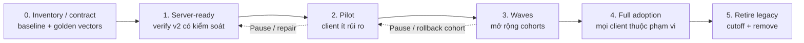
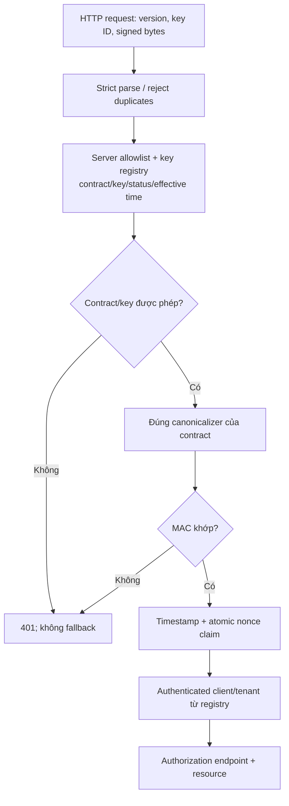

# Triển khai client theo giai đoạn khi chuyển đổi xác thực HTTP HMAC

## 1. Bối cảnh: vì sao không nên chuyển toàn bộ client trong một lần?

Module `SECURITY_AUTHENTICATION_HMAC_REQUEST_AUTHENTICATION` hướng dẫn xác thực HTTP request bằng **HMAC** với shared secret và **canonical request** có thể gồm method, URI/query, các header đã thỏa thuận và body hoặc body digest. Server xác minh MAC, kiểm tra timestamp/nonce chống replay, quản lý key rotation, xử lý proxy/gateway, sau đó mới tạo danh tính và thực hiện **authorization**.

Giả sử một nền tảng tích hợp có 120 client thuộc nhiều đối tác. Một số đang dùng SDK cũ; một số tự xây signer bằng Java, JavaScript hoặc Python; một số gọi qua API gateway còn rewrite đường dẫn. Tổ chức muốn chuyển sang hợp đồng ký `HMAC-REQ-V2` với signed headers rõ ràng và key ID riêng cho từng key version. Nếu triển khai đồng loạt, chỉ cần một khác biệt về UTF-8, percent-encoding, JSON serialization hay retry nonce là hàng loạt request hợp lệ có thể bị `401`. Nếu để server tự thử mọi canonical variant và secret để tăng “tương thích”, hệ thống lại tạo lỗ hổng downgrade và làm suy yếu kiểm soát key.

Bài **Triển khai client theo giai đoạn** thuộc chương **Migration** giải quyết vấn đề đó: chuyển từ nhóm client đầu tiên sang toàn bộ hệ sinh thái bằng các bước có **cửa kiểm soát kỹ thuật, chỉ số quan sát, cơ chế tạm dừng và điều kiện kết thúc hỗ trợ cũ**.

Kết thúc bài, người học có thể:

- Lập inventory và chia client thành những nhóm triển khai có thứ tự dựa trên mức ảnh hưởng.
- Phân biệt **phiên bản SDK**, **hợp đồng canonical HMAC**, **key version**, **algorithm suite** và **API version**.
- Thiết kế rollout theo hướng **server-ready → pilot → waves → 100% → retire legacy**, không bỏ qua kiểm tra bảo mật.
- Triển khai signer Java bảo vệ đúng method, URI/query, signed headers, body digest, timestamp và nonce.
- Giám sát từng nhóm client bằng metric/audit có nhãn hữu hạn, phát hiện `401` do canonical mismatch, replay hoặc key lifecycle.
- Xác định tiêu chí **go/no-go**, rollback an toàn, test Spring MVC/WebFlux và E2E qua gateway.
- Chứng minh khi đóng migration, server không còn chấp nhận đường xác thực cũ ngoài chính sách.

## 2. “Client” là ai và các phiên bản không nên trộn lẫn

Trong bài này, **client** là một ứng dụng/đối tác đã đăng ký credential và gọi API HMAC. Một client có thể có nhiều instances, nhiều SDK releases và nhiều key versions đồng thời trong giai đoạn chuyển đổi. Không được đồng nhất một instance, một request hoặc một key ID với toàn bộ client.

| Trục thay đổi | Ví dụ | Có ảnh hưởng MAC? | Ai kiểm soát? |
| --- | --- | --- | --- |
| Client SDK release | `sdk-java-2.4` → `sdk-java-3.0` | Có thể thay bytes được ký hoặc retry | Đơn vị phát triển/đối tác |
| Canonical contract | `HMAC-REQ-V1` → `HMAC-REQ-V2` | **Có**; format method/URI/header/body thay đổi | Provider công bố hợp đồng |
| Secret/key version | `reporting-a` → `reporting-b` | **Có**; HMAC key đổi | Credential registry và client |
| Algorithm suite | `HmacSHA1` → `HmacSHA256` | **Có**; MAC/độ dài đổi | Security policy và key binding |
| Gateway/proxy policy | Rewrite path, normalize header | Có thể | Edge/platform team |
| API version | `/api/v1/orders` → `/api/v2/orders` | Nếu method/URI được ký thì có | API contract owner |
| Authorization policy | `ORDER_READ`/`ORDER_CREATE` | Không tự thay đổi HMAC | Server identity/policy owner |

**Ví dụ quan trọng:** một SDK mới có thể vẫn ký đúng `HMAC-REQ-V1` trong thời gian migration; ngược lại, một client không dùng SDK chính thức vẫn có thể triển khai chính xác `HMAC-REQ-V2`. Vì vậy “90% SDK đã được nâng cấp” **không đồng nghĩa** “90% request đã được server xác minh bằng v2”.

Gắn tiến độ migration với **request thực sự được xác thực thành công theo contract/key version** và trạng thái từng client đã được xác minh, không chỉ với giá trị `X-Hmac-Version` do Internet tự gửi.

## 3. Những bất biến bảo mật phải giữ nguyên qua mọi giai đoạn

Để giảm tỷ lệ lỗi, không được hy sinh các thuộc tính bảo vệ:

1. **Một request → một contract được phép → một key version → một kết quả xác thực.** Nếu chữ ký v2 sai, không thử v1 hoặc các secret khác như đường fallback bí mật.
2. **Signed data đầy đủ:** các thành phần method, URI/query, signed headers và body/digest được bảo vệ đúng hợp đồng. Nếu client đổi payload sau khi ký, server phải từ chối.
3. **Key ID là lookup hint chưa đáng tin:** principal và tenant chỉ được xác lập từ registry sau khi MAC hợp lệ; không dựa vào `X-Client-Id` tự khai.
4. **Freshness:** timestamp và nonce phải nằm trong dữ liệu ký, kiểm tra cửa sổ thời gian và atomic nonce claim trên kho chia sẻ khi cần.
5. **Key lifecycle:** PREPARED/REVOKED không được verify; key RETIRING chỉ được phép trong overlap có hạn định.
6. **Authorization độc lập:** HMAC đúng chưa bảo đảm có `ORDER_CREATE` hoặc được truy cập tài nguyên của tenant khác.
7. **Fail closed:** key registry, nonce store hoặc verifier không khả dụng không được khiến request tự động được chấp nhận.
8. **Trust boundary nhất quán:** client và verifier phải ký/đọc cùng representation được thỏa thuận, kể cả qua gateway.
9. **Công khai lỗi có kiểm soát:** không tiết lộ secret, expected MAC, key enumeration hoặc nội bộ canonical bytes trong response/log công khai.

Đây là **migration bất biến về mức bảo vệ**, không phải migration “chấp nhận bất kỳ chữ ký nào để đạt 100% adoption”.

## 4. Đặc tả hợp đồng HMAC mục tiêu trước khi phát hành SDK

Một ví dụ **HMAC-REQ-V2 giả định** áp dụng cho `POST /integrations/orders`:

| Header | Bắt buộc? | Quy tắc | Được ký? |
| --- | --- | --- | --- |
| `X-Hmac-Version` | Có, đúng một | `hmac-req-v2` | Có, thông qua domain prefix trong canonical |
| `X-Key-Id` | Có, đúng một | ID ASCII opaque, thuộc registry | Có |
| `X-Timestamp` | Có, đúng một | UTC ISO-8601 cố định | Có |
| `X-Nonce` | Có, đúng một | Ngẫu nhiên, entropy đủ, cú pháp theo contract | Có |
| `X-Content-SHA256` | Có, đúng một | Lowercase hex SHA-256 của body bytes | Có |
| `Content-Type` | Có đối với POST ví dụ | `application/json` | Có |
| `Idempotency-Key` | Có đối với POST ví dụ | Opaque ASCII operation ID, ổn định qua retry cùng ý định | Có; ảnh hưởng tới deduplication nghiệp vụ |
| `X-Signature` | Có, đúng một | Base64 chuẩn của 32-byte HMAC-SHA-256 | **Không**; đây là MAC output |
| `X-Request-Id`/`traceparent` | Tùy chọn | Correlation, có thể bị sanitize ở gateway | Không |
| `Host`/`:authority` | Theo giao thức HTTP | Có thể bị proxy đổi | Không trong v2 ví dụ |
| `Content-Length`/`Transfer-Encoding` | Tùy transport | Framing, có thể đổi giữa các hop | Không |

Định nghĩa canonical bytes ví dụ dưới dạng **UTF-8**, các dòng cách nhau bằng LF (`0x0A`), không có LF ở cuối:

```text
HMAC-REQ-V2
POST
/integrations/orders?source=partner
content-type:application/json
idempotency-key:order-operation-17
x-content-sha256:<lowercase-hex-sha256-of-exact-body>
x-key-id:fulfillment-2026b
x-nonce:<nonce>
x-timestamp:2026-11-28T03:15:00Z
```

Trong contract này, dòng `HMAC-REQ-V2` ràng buộc protocol version nên header `X-Hmac-Version` phải được parser kiểm tra đúng `hmac-req-v2`. Danh sách signed headers do **provider định nghĩa cố định**, được biểu diễn lowercase và sắp thứ tự quy định. Vì `Idempotency-Key` ảnh hưởng tới việc deduplicate side effects, v2 minh họa cũng ký header này; không cho attacker sửa operation ID mà giữ nguyên MAC. Header `X-Signature` không tự ký chính nó.

**Không được tự lấy ví dụ này làm chuẩn HMAC chung.** Giao thức thực tế phải công bố chính xác raw path/query, xử lý percent-encoding, duplicate query parameters, OWS, header lặp, body encoding, version negotiation và kích thước tối đa. Nếu API khác yêu cầu ký authority hoặc nhiều signed headers hơn, hãy version hóa hợp đồng và golden vectors.

### 4.1. Một byte khác cũng là thay đổi contract

```text
Client ký: POST /integrations/orders?b=2&a=1
Server lấy: POST /integrations/orders?a=1&b=2
```

Hai query có thể cùng ngữ nghĩa với một số ứng dụng, nhưng nếu v2 ký raw query, thứ tự bytes khác nhau → HMAC khác. Tương tự JSON whitespace, `%2F` so với `/`, header value có dấu cách và body được gateway giải nén đều phải được xem xét theo contract.

Do đó phải phát hành **golden canonical bytes và expected MAC với secret test**, không chỉ phát hành một đoạn mã signer. Test vector phải độc lập với implementation client/server để phát hiện bug chung.

## 5. Lộ trình triển khai tổng thể



| Giai đoạn | Mục tiêu | Gate trước khi chuyển tiếp |
| --- | --- | --- |
| 0. Inventory | Biết ai dùng credential/contract nào | Có danh sách owners, baseline, test vectors |
| 1. Server-ready | Backend/gateway có khả năng verify v2 cho client được cấp phép | Golden vectors, negative tests và failure injection PASS |
| 2. Pilot | Vài client có thể phản hồi nhanh dùng v2 trên traffic thật | Success/latency/side effects ổn định qua cửa sổ quan sát |
| 3. Waves | Chuyển theo nhóm, có pause/rollback | Wave trước đạt SLO và không có regression bảo mật |
| 4. Full adoption | Tất cả client thuộc phạm vi dùng v2 | Verified v2 adoption theo client; không còn phụ thuộc legacy |
| 5. Retire legacy | Tắt acceptance v1 và xóa đường code cũ theo policy | Valid v1 MAC **bị từ chối** ở mọi ingress, v2 vẫn đúng |

Tỷ lệ 1%, 5%, 25%, 50% và 100% chỉ là **ví dụ**. Với đối tác ít nhưng mỗi đối tác lưu lượng lớn, rollout theo **client/capability/route** hữu ích hơn theo phần trăm requests ngẫu nhiên.

## 6. Giai đoạn 0: inventory và chọn cohort

Trước khi viết feature flag, lập bảng:

| Client/nhóm | SDK và cách ký hiện tại | Route nhạy cảm | Gateway path | Owner | Chiến lược rollout |
| --- | --- | --- | --- | --- | --- |
| Partner sandbox | SDK mới, test secret | GET/read-only | Sandbox proxy | Integration team | Pilot đầu tiên |
| Reporting partner | SDK Java cũ | GET báo cáo | Shared gateway | Partner owner | Wave 1 |
| Fulfillment service | SDK Python riêng | POST tạo đơn | Rewrite `/public` → `/internal` | Backend team | Wave 2 sau E2E |
| Payment adapter | Ký POST nhạy cảm, nhiều regions | Giao dịch | Multi-gateway | Payment/security | Wave cuối, canary hẹp |

Các tiêu chí chọn cohort:

- **Tác động nếu lỗi:** chỉ đọc hay tạo/chuyển giao dịch, có idempotency tốt không?
- **Khả năng rollback:** client có hỗ trợ hai signing profiles theo cấu hình có kiểm soát không?
- **Đường mạng:** direct integration hay nhiều proxy/gateway biến đổi request?
- **Thời gian hỗ trợ:** owner có thể phối hợp test, mở logs và sửa SDK không?
- **Năng lực bảo mật:** client có nonce ngẫu nhiên, clock đồng bộ, secret manager và retry signer an toàn không?
- **Khối lượng traffic:** đủ số mẫu để đo success rate, nhưng không gây blast radius lớn khi pilot.

**Cohort assignment là hoạt động vận hành**, không phải bằng chứng danh tính. Đừng tin `X-Rollout-Wave: pilot` do Internet gửi để cho request hưởng chính sách bypass. Quyết định client nào được phép dùng v2/v1 phải dựa vào registry/feature flags do server quản lý và chỉ gắn verified client ID sau khi MAC hợp lệ.

### 6.1. Baseline nào cần chốt?

Đo trước migration: attempts/s, authentication success/failure rate, reason `mac_mismatch`/`timestamp_invalid`/`nonce_replay`/`key_unusable`, p95/p99 authentication latency, key/nonce-store availability, `401`/`403`/`503`, business SLO và số sự kiện idempotency duplicate. Baseline nên phân theo route/nhóm traffic hữu hạn và chu kỳ giờ/ngày, thay vì lấy một con số trung bình cho cả API.

Nếu hệ thống chưa phân biệt authentication với authorization, phải sửa semantics/telemetry trước rollout; không thể kết luận SDK signer hỏng khi một request MAC đúng nhưng bị `403` vì thiếu quyền.

## 7. Giai đoạn 1: server-ready trước, client chuyển sau

**Server phải chấp nhận v2 cho client có quyền trước khi client bắt đầu ký v2.** Ngược lại, bật client signer v2 khi gateway/backend chưa triển khai verifier v2 gây `401` hàng loạt.

Các bước server-ready:

1. Công bố contract v2, golden vector, SDK hướng dẫn và error schema.
2. Thêm parser strict cho version, key ID, timestamp, nonce, body digest và signature; reject duplicate/malformed headers.
3. Đăng ký key versions mới trong credential registry, ràng buộc với client/tenant, suite và effective window.
4. Triển khai verifier v2 có allowlist **một protocol/key version cho một request**; v1 chỉ còn trong phạm vi và thời hạn migration được phê duyệt.
5. Cấu hình atomic nonce store dùng chung, TTL đủ dài, clock policy và fail-closed khi store lỗi.
6. Kiểm thử Spring MVC/WebFlux với security filters thật và proxy/gateway E2E.
7. Triển khai canary backend và kiểm tra metrics, audits, config version ở từng region.
8. Chỉ bật `v2-eligible` cho nhóm client đã đăng ký và được cấp secret đúng cách.

**Không biến dual accept thành silent fallback:**

```text
ĐÚNG:
  Parse strict X-Hmac-Version và X-Key-Id
  -> kiểm tra server policy/key binding
  -> chọn đúng một canonical contract + key version
  -> verify MAC một lần
  -> freshness + nonce claim
  -> authorization

SAI:
  MAC v2 sai -> thử MAC v1
  MAC v1 sai -> thử key cũ khác
  vẫn sai -> bỏ kiểm tra nonce để client cũ hoạt động
```

Nếu legacy là một authentication scheme yếu hơn hoặc không có HMAC, cần **chính sách riêng cho client/endpoint có thời hạn**, kèm risk acceptance và sunset. Không mở một route legacy công khai cho mọi client chỉ vì provider muốn hỗ trợ di trú.

## 8. Giai đoạn 2: pilot có kiểm soát

Pilot nên có **positive control** và đường quay lại được phê duyệt, nhưng không được bảo mật thấp hơn:

1. Chọn một hoặc vài client có owner phối hợp và route ít side effect.
2. Cấp secret/key ID mới qua kênh bảo vệ; có test kết nối/signer ở sandbox.
3. Bật signing profile v2 cho client pilot bằng cấu hình có version; **không tự chuyển thuật toán từ response lỗi**.
4. Chạy canary traffic thật với request mới, nonce mới, timestamp hợp lệ và golden contract.
5. Đo verified v2 success, `401` theo reason, latency và business outcome theo khoảng thời gian đủ ý nghĩa.
6. Kiểm tra retry sau timeout, gateway rewrite và body digest trong môi trường thực.
7. Ghi gate decision, owner, thời điểm bật/tắt và các sự cố đã xử lý.

Khi pilot chưa đạt, có thể **pause mở rộng** và sửa nguyên nhân. Nếu v1 vẫn còn **được server cho phép theo policy**, client pilot có thể rollback signing profile sang v1 bằng một thay đổi được phê duyệt; không được tự động thử v1 sau mỗi `401` như cách dò credential. Nếu v1 đã bị cấm vì compromise hoặc cutoff, rollback đó **không hợp lệ**.

### 8.1. Ví dụ gate có cỡ mẫu

Điều kiện dưới đây chỉ là **minh họa**, không phải tiêu chuẩn áp dụng mọi hệ thống:

- Tối thiểu 500 authenticated attempts trong 30 phút trên pilot route, hoặc đạt số mẫu phù hợp SLO.
- HMAC failure ratio không tăng quá 2 điểm phần trăm so với baseline tương đương trong ít nhất ba cửa sổ liên tiếp.
- Không có `auth.success` với nonce đã claim, không có duplicate side effect, không có key revoked được chấp nhận.
- Lỗi key/nonce store và p95 verification latency nằm trong ngưỡng vận hành đã thỏa thuận.
- Chủ sở hữu client, API và security xác nhận kết quả E2E, đặc biệt với endpoint POST.

Nếu workload có 10 requests/ngày, không nên cố lấy 500 attempts bằng cách phát request giả vào production. Thay thế bằng soak test/synthetic controlled traffic và đánh giá tác động theo đặc tính của khách hàng.

## 9. Giai đoạn 3: mở rộng theo waves, không randomize mỗi request

Ví dụ:

| Wave | Đối tượng | Kiểm tra bổ sung |
| --- | --- | --- |
| Pilot | Sandbox + 1–2 client nhỏ | Golden vector, header/method/body |
| Wave 1 | Client chỉ đọc, một region | Clock skew, GET/query/path |
| Wave 2 | POST tạo đơn, một gateway | Nonce atomic, retry/idempotency, body replay |
| Wave 3 | Các SDK/ngôn ngữ khác nhau | Unicode, Base64, URL encoding, Content-Type |
| Wave 4 | Multi-region, endpoint nhạy cảm | Failover, revocation propagation, alert và recovery |
| Full | Mọi client trong phạm vi được phê duyệt | Từ chối legacy sau cutoff |

Nên duy trì **cohort ổn định theo registered client identity hoặc deployment unit**, không lấy `request_id`/`nonce` làm biến chọn rollout. Nếu cùng một client bị chuyển ngẫu nhiên giữa hai signing profiles theo từng request, retry sẽ khó điều tra và có thể dùng lẫn key version. Trong nhiều hệ thống, quyết định chuyển profile thuộc **client deployment config**; server chỉ xác minh đúng các contract được cho phép theo policy.

### 9.1. Khuyến nghị cấu hình signing profile

```yaml
integration:
  clientId: partner-fulfillment
  rollout:
    wave: wave-2
    signingProfile: hmac-req-v2
    configRevision: migration-2026-11-28.3
  hmac:
    keyId: fulfillment-2026b
    secretRef: secure-credential-store://partner/fulfillment/2026b
    canonicalContract: HMAC-REQ-V2
    macAlgorithm: HmacSHA256
  retry:
    regenerateTimestampNonceAndMac: true
    preserveBusinessIdempotencyKey: true
```

Đây là cấu hình **minh họa**, không phải properties mặc định của Spring hay URL thật. `secretRef` không chứa raw secret và phải được truy xuất bằng credential store an toàn. Không để client tự chọn mọi algorithm string hoặc tắt MAC/freshness bằng feature flag.

**Cấu hình phải cập nhật nhất quán theo gói:** `key ID`, secret reference và canonical contract version phải cùng một profile. Nếu chỉ đổi `X-Key-Id` nhưng signer vẫn dùng secret cũ, tất cả request sẽ bị `401`. Nên có revision/atomic refresh và thử smoke test trên mỗi release.

## 10. Signer Java: tạo request HMAC cho đúng một profile

Đoạn sau minh họa **HMAC-REQ-V2** ở phần 4. Nó chỉ xây các header ký từ dữ liệu đã được client chuẩn bị; phần HTTP sender phải gửi **chính xác body bytes và raw request-target đã ký**. Secret ở đây là **test/credential input được quản lý**, không phải String hardcode trong source.

```java
import java.nio.charset.StandardCharsets;
import java.security.GeneralSecurityException;
import java.security.MessageDigest;
import java.security.SecureRandom;
import java.time.Clock;
import java.util.Base64;
import java.util.HexFormat;
import java.util.Locale;
import javax.crypto.Mac;
import javax.crypto.spec.SecretKeySpec;

public final class HmacV2ClientSigner {
    public record SigningProfile(String keyId, byte[] secret) {
        public SigningProfile {
            if (keyId == null || keyId.isBlank()
                    || secret == null || secret.length < 32) {
                throw new IllegalArgumentException("Invalid signing profile");
            }
            secret = secret.clone();
        }
        @Override
        public byte[] secret() { return secret.clone(); }
    }

    public record SignedHeaders(
            String version,
            String keyId,
            String idempotencyKey,
            String timestamp,
            String nonce,
            String bodySha256,
            String signature) {}

    private final Clock clock;
    private final SecureRandom random;

    public HmacV2ClientSigner(Clock clock, SecureRandom random) {
        this.clock = clock;
        this.random = random;
    }

    public SignedHeaders sign(
            SigningProfile profile,
            String method,
            String rawPathAndQuery,
            String contentType,
            String idempotencyKey,
            byte[] exactBodyBytes)
            throws GeneralSecurityException {

        if (!"POST".equals(method)
                || !"application/json".equals(contentType)
                || idempotencyKey == null
                || !idempotencyKey.matches("[A-Za-z0-9._-]{1,128}")
                || rawPathAndQuery == null
                || !rawPathAndQuery.startsWith("/")) {
            throw new IllegalArgumentException(
                    "Unsupported method or HMAC contract");
        }

        byte[] nonceBytes = new byte[18];
        random.nextBytes(nonceBytes);
        String nonce = Base64.getUrlEncoder()
                .withoutPadding().encodeToString(nonceBytes);
        // V2 yêu cầu timestamp có độ chính xác giây, ở UTC.
        String timestamp = clock.instant()
                .truncatedTo(java.time.temporal.ChronoUnit.SECONDS)
                .toString();
        String digestHex = HexFormat.of().formatHex(
                MessageDigest.getInstance("SHA-256")
                    .digest(exactBodyBytes));

        String canonical = String.join("\n",
                "HMAC-REQ-V2",
                method,
                rawPathAndQuery,
                "content-type:" + contentType,
                "idempotency-key:" + idempotencyKey,
                "x-content-sha256:" + digestHex,
                "x-key-id:" + profile.keyId(),
                "x-nonce:" + nonce,
                "x-timestamp:" + timestamp);

        Mac mac = Mac.getInstance("HmacSHA256");
        byte[] secretCopy = profile.secret();
        try {
            mac.init(new SecretKeySpec(secretCopy, "HmacSHA256"));
        } finally {
            java.util.Arrays.fill(secretCopy, (byte) 0);
        }
        byte[] macBytes = mac.doFinal(
                canonical.getBytes(StandardCharsets.UTF_8));

        return new SignedHeaders(
                "hmac-req-v2",
                profile.keyId(),
                idempotencyKey,
                timestamp,
                nonce,
                digestHex,
                Base64.getEncoder().encodeToString(macBytes));
    }
}
```

Các giá trị trả về tương ứng `X-Hmac-Version`, `X-Key-Id`, `Idempotency-Key`, `X-Timestamp`, `X-Nonce`, `X-Content-SHA256` và `X-Signature`. Cần gửi thêm `Content-Type: application/json`. Không thay đổi `exactBodyBytes` sau khi ký hoặc tự serialize JSON lần hai bằng serializer khác. Client phải gửi nguyên `Idempotency-Key` được MAC bảo vệ, không để interceptor thay nó giữa ký và gửi.

**Phạm vi ví dụ:** method `POST` và content type cố định được harden để bài học tập trung rollout profile. Production cần validate cú pháp key ID/nonce/path/query, giới hạn body size, xử lý HTTP client redirects, duplicate headers và contract riêng cho GET. `SigningProfile` vẫn giữ một bản sao secret trong heap; code xóa `secretCopy` chỉ giảm thời gian tồn tại của **bản sao tạm**, không bảo đảm key material đã được xóa khỏi JVM/provider. Nên dùng secret manager và lifecycle giới hạn; với HSM/non-exportable secret, phải dùng crypto provider tương ứng thay vì yêu cầu raw bytes.

### 10.1. Không dùng lại object mutable `Mac` giữa các request

`javax.crypto.Mac` có trạng thái. Không đặt một instance `Mac` mutable vào Spring singleton để nhiều client/threads cùng `init/update/doFinal`. Trong quá trình rollout nhiều keys, việc dùng nhầm secret giữa request A/B dễ gây sai signature và key isolation. `Mac` cục bộ cho mỗi phép tính là lựa chọn mặc định an toàn, sau đó chỉ tối ưu khi benchmark chứng minh lợi ích mà vẫn giữ key lifecycle.

## 11. Retry, nonce và idempotency khi SDK đổi phiên bản

Trong một đợt rollout, lỗi phổ biến là SDK mới chỉ tạo nonce và signature **một lần**, rồi HTTP retry interceptor phát lại nguyên request sau timeout.

```text
Lần đầu:
  POST /orders
  X-Timestamp=T1, X-Nonce=N1, X-Signature=MAC1
  -> Server claim N1, tạo order, response bị mất

Retry sai:
  POST /orders
  X-Timestamp=T1, X-Nonce=N1, X-Signature=MAC1
  Idempotency-Key=order-operation-17
  -> 401 NONCE_REPLAY

Retry theo hợp đồng:
  POST /orders
  X-Timestamp=T2, X-Nonce=N2, X-Signature=MAC2
  Idempotency-Key=order-operation-17 (được ký trong v2 minh họa)
  -> Authentication hợp lệ; nghiệp vụ trả kết quả cũ
```

**Nonce và idempotency key khác mục đích:**

- Nonce giúp từ chối **phát lại cùng thông điệp đã ký** trong thời gian cho phép; phải được ký và claim nguyên tử.
- Idempotency key mô tả **cùng một ý định nghiệp vụ** qua các attempts; cần được server xử lý với unique constraint/ledger phù hợp. Khi nó là header ảnh hưởng đến xử lý nghiệp vụ, hãy **ký nó** (như v2 minh họa) hoặc bảo vệ bằng trust boundary được chứng minh.
- `request_id`/`trace_id` là correlation, không thay thế cả hai.

Retry hợp lệ phải tạo **timestamp/nonce/MAC mới**, nhưng không mặc nhiên retry mọi POST: phải biết liệu request đầu đã tạo side effect hay chưa và API có cam kết idempotency hay không. Nếu không có idempotency, client cần query/truy vấn trạng thái hoặc quy trình đối soát thay vì tự động tạo lại giao dịch.

### 11.1. Nonce scope khi migration hai key versions

Khi cùng client sử dụng key v1 và v2 trong overlap, nonce uniqueness phải theo **phạm vi được contract xác định**, thường là `verifiedClientId + nonce`, không tự chia thành `keyId + nonce` để một request có thể được replay qua version khác. Atomic nonce store phải dùng namespace nhất quán giữa instances/regions; TTL cần bao phủ toàn bộ cửa sổ freshness, kể cả clock skew.

Nếu nonce store lỗi hoặc kết quả claim không chắc chắn, backend **fail closed**; client không được thay sang legacy hoặc cho qua MAC để tăng success rate. Với timestamp skew, sửa đồng hồ/format, không tăng window vô hạn chỉ để SDK cũ tiếp tục chạy.

## 12. Gateway/proxy: so contract tại điểm xác minh thật

Một client SDK có thể hoạt động trong unit test nhưng thất bại sau khi qua gateway:

```text
Client ký:
  POST /public-api/orders?source=partner
  X-Key-Id: fulfillment-2026b

Gateway chuyển:
  POST /integrations/orders?source=partner
  X-Key-Id: fulfillment-2026b

Backend dựng canonical từ /integrations/orders
  -> MAC_MISMATCH, dù shared secret đúng
```

Hai chiến lược hợp lệ tùy kiến trúc:

1. **Gateway verify trước rewrite** trên external request-target đã ký, sau đó chuyển verified identity bằng assertion/kênh nội bộ được bảo vệ; backend không tin header identity do client tự gửi.
2. **Backend verify sau rewrite** nhưng có hợp đồng thống nhất về representation cần ký và cơ chế nhận external target đáng tin nếu cần; không lấy `X-Original-URI`/`X-Forwarded-*` từ Internet rồi tin trực tiếp.

Đối với từng cohort, kiểm thử:

| Biến đổi | Kỳ vọng |
| --- | --- |
| Đổi casing tên `X-Key-Id` | Không làm đổi MAC khi canonical field names lowercase |
| Đổi **giá trị** `X-Key-Id` sau ký | `401` |
| Gộp hai `X-Key-Id` | Reject; không chọn tùy ý header đầu/cuối |
| Rewrite signed path/query | Reject hoặc verify tại trust boundary đúng contract |
| Body bị giải nén/chuẩn hóa JSON | Digest theo raw bytes khác; không bỏ body check |
| HTTP/1.1 chunked → HTTP/2 DATA | Không ký transport framing; giữ content bytes |
| HTTP/1.1 `Connection: X-Signature` | Gateway nên reject; backend thiếu signature phải fail closed |
| Thêm `traceparent`/`X-Request-Id` | Không đổi MAC nếu unsigned, không dùng để cấp quyền |
| Redirect sang origin khác | Không tự gửi HMAC secret/header sang origin chưa tin cậy |

Khi thử gateway, kiểm tra thêm HTTP/1.1, HTTP/2 và HTTP/3 nếu được hỗ trợ, TLS termination, signed headers và signed body bytes. Không “chữa” mismatch bằng cách bỏ method, URI, header hoặc body khỏi chữ ký.

## 13. Server policy trong giai đoạn hỗ trợ hai contract

Một ví dụ metadata:

```text
partner-reporting:
  allowedContracts: [HMAC-REQ-V1, HMAC-REQ-V2]  # grace only
  keys:
    reporting-2026a -> HMAC-REQ-V1, RETIRING, cutoff T
    reporting-2026b -> HMAC-REQ-V2, ACTIVE

partner-fulfillment:
  allowedContracts: [HMAC-REQ-V2]
  keys:
    fulfillment-2026b -> HMAC-REQ-V2, ACTIVE
```

Đây là policy **do server quản lý**, không phải dữ liệu do client được phép tự cấp quyền. Key metadata có thể chứa version/suite khác nhau; mỗi request phải được ràng buộc đúng **một** key version, trạng thái key và contract. Nếu một client đã được đánh dấu `v2-only`, một request tự khai `HMAC-REQ-V1` không được phép quay về v1 chỉ vì nó còn tồn tại trong code.



Không gọi `Mac.getInstance(request.getHeader("X-Algorithm"))` với chuỗi tùy ý. Nếu migration đồng thời đổi thuật toán, suite phải đến từ enum allowlist và ràng buộc với metadata key/policy. Nếu key đã revoked hoặc contract đã cutoff, một MAC đúng về mặt toán học **vẫn phải bị từ chối**.

### 13.1. Thời điểm cutoff và in-flight requests

Dùng **server clock** tại điểm verify để áp dụng cutoff, không dùng `X-Timestamp` do client khai nhằm kéo dài cửa sổ nhận v1. Một request được ký trước T nhưng tới sau T thường bị từ chối; nếu doanh nghiệp cần in-flight grace period, phải có quy tắc giới hạn thời gian và được phê duyệt riêng.

Policy propagation giữa gateway, các pods và regions phải có tính nhất quán đủ cho yêu cầu an ninh. Nếu một pod vẫn verify v1 sau cutoff do cache stale, migration chưa hoàn tất. Đặc biệt khi key bị compromise, không được tiếp tục tin cached state mà không có cơ chế revocation hợp lệ.

## 14. Telemetry: đo adoption đã xác minh, không tin header tự khai

Một dashboard rollout hữu ích có cả **technical success** và **customer impact**:

| Nhóm | Tín hiệu | Ý nghĩa |
| --- | --- | --- |
| Volume | `hmac_auth_attempts_total{outcome}` | Mỗi attempt một outcome |
| Authentication failures | `hmac_auth_failures_total{reason}` | Signature, timestamp, nonce, key hoặc contract lỗi |
| Verified adoption | Audit `auth.success` với `verified_contract_version` | Bao nhiêu client/request thật dùng v2? |
| Latency | `hmac_auth_verification_seconds`, p95/p99 | Key lookup/nonce store/canonicalization có chậm hơn? |
| Infra health | `hmac_auth_dependency_errors_total{dependency}` | Nonce/key store lỗi |
| Authz | `hmac_authorization_denied_total` | `403` riêng với `401` |
| Business health | Order creation SLO, duplicate effects, error budget | Rollout ảnh hưởng nghiệp vụ không? |
| Deployment | `config_revision`/wave/cutoff marker | Lỗi xuất hiện sau thay đổi nào? |

**Cẩn thận về danh tính trước MAC:** `X-Key-Id`, `X-Hmac-Version` và `X-Client-Id` đều là input có thể bị giả mạo. Chỉ gắn nhãn “client A đã chuyển v2” sau **authentication success**. Với failed attempts, dùng reason code nội bộ và `claimed_contract` đã qua allowlist ở mức tổng hợp, không gán chúng cho một verified client.

Không đưa raw key ID, nonce, signature, request ID, trace ID, URL/query hoặc client ID của hàng nghìn đối tác vào Prometheus labels. Dùng `service`, `route template`, `environment`, `outcome`, `reason`, `contract_version` hữu hạn và `wave` có danh sách nhỏ từ cấu hình tin cậy. Truy vấn client cụ thể qua audit có phân quyền, retention phù hợp và correlation ID đã sanitize.

### 14.1. PromQL tỷ lệ lỗi với mẫu tối thiểu

Giả sử exporter cung cấp metric `hmac_auth_attempts_total` và tag `migration_wave` chỉ nhận các giá trị hữu hạn do **server config** sinh:

```promql
(
  sum by (service, migration_wave) (
    rate(hmac_auth_attempts_total{
      environment="prod", outcome="failure"
    }[5m])
  )
  /
  clamp_min(
    sum by (service, migration_wave) (
      rate(hmac_auth_attempts_total{environment="prod"}[5m])
    ), 0.001
  )
) > 0.05
and
sum by (service, migration_wave) (
  increase(hmac_auth_attempts_total{environment="prod"}[5m])
) > 200
```

Ví dụ phát hiện **failure ratio trên 5% khi có hơn khoảng 200 attempts trong 5 phút**. Ngưỡng này chỉ để học; phải điều chỉnh theo baseline, traffic, business SLO và tolerance của từng cohort. Một request lỗi trong một cửa sổ chỉ có một request sẽ tạo tỷ lệ 100%, không nên tự động coi là outage.

Nếu `migration_wave` chỉ xác định được sau MAC hợp lệ, không được giả gán một wave cho failures bằng key ID tự khai. Khi đó hãy dùng dữ liệu trusted route/gateway cohort assignment hoặc giám sát failures tổng hợp theo service, rồi điều tra audit/client configuration riêng.

Metric biến mất không phải 0 lỗi: cần alert cho `up==0`, scrape target down hoặc missing telemetry ở region.

## 15. Điều kiện go/no-go và cảnh báo cần hành động

Một wave có thể tiến tiếp khi:

1. **Signer và verifier** vượt qua golden vectors/contract tests.
2. **Authentication success** và p95/p99 latency nằm trong ngưỡng so với baseline tương ứng.
3. Không có request MAC sai được chấp nhận, key revoked được verify hoặc replay nonce thành công.
4. Gateway, từng region và mỗi SDK platform đã test đúng signed bytes.
5. Không có tăng bất thường về duplicate side effects/incident nghiệp vụ.
6. Nonce/key store khỏe, errors được fail closed; không có `401`/`503` chưa giải thích.
7. Owner client, API và security đã ghi nhận quyết định rollout.

**Tạm dừng hoặc rollback wave** khi có regression xác thực có hệ thống, `NONCE_REPLAY` tăng sau SDK retry release, canonical mismatch diện rộng, key registry/nonce store không ổn định, bất kỳ dấu hiệu bypass/replay acceptance, hoặc SLO nghiệp vụ bị ảnh hưởng rõ rệt.

Không dùng `403` tăng đơn thuần làm bằng chứng HMAC lỗi: một client ký đúng nhưng thiếu `ORDER_CREATE` vẫn phải nhận `403`. Cần truy tới authentication outcome trước khi sửa signer.

## 16. Error semantics và trải nghiệm migration của client

| Trường hợp | HTTP thường dùng | Client nên làm gì? |
| --- | --- | --- |
| MAC sai, key ID không tồn tại, key revoked, contract bị tắt | `401 Unauthorized` | Kiểm tra cấu hình và contract; **không tự thử secret/algorithm khác** |
| Timestamp ngoài cửa sổ | `401` | Đồng bộ clock, kiểm tra format và độ trễ; ký request mới nếu chính sách cho phép |
| Nonce đã dùng | `401` | Kiểm tra retry; không replay nguyên request |
| Header HMAC malformed/duplicate | `401` theo credential contract, hoặc `400` từ parser | Sửa parser/signer; không bỏ kiểm tra |
| HMAC hợp lệ nhưng thiếu authority | `403 Forbidden` | Kiểm tra permission, không xoay secret tùy tiện |
| HMAC hợp lệ nhưng truy cập tenant khác | `403`/`404` theo policy | Không truy cập ngoài phạm vi client |
| Key registry/nonce store unavailable | `503` hoặc lỗi server phù hợp | Retry có backoff theo contract, giữ idempotency |
| Rate limit | `429 Too Many Requests` | Tôn trọng `Retry-After` nếu có, hạn chế bùng retry |
| Body quá lớn | `413 Content Too Large` | Tuân thủ size limit; không tự bỏ digest |

`401` phải có HTTP authentication challenge `WWW-Authenticate` phù hợp với scheme API công bố; một scheme HMAC tự định nghĩa cần tài liệu hóa cú pháp của chính nó. Không trả `WWW-Authenticate: Bearer` cho HMAC-only API nếu không hỗ trợ Bearer.

Phản hồi công khai có thể thống nhất mã `INVALID_REQUEST_AUTHENTICATION` cho key ID không tồn tại, key bị thu hồi và MAC sai để hạn chế key enumeration. Reason code chi tiết chỉ thuộc audit/metrics nội bộ; không gửi expected MAC, danh sách keys hoặc canonical body nhạy cảm cho client.

### 16.1. Lỗi `401` không phải lệnh “đổi về v1”

Một client thử v2, nhận `401` rồi tự ký lại v1 bằng secret cũ sẽ tạo **silent downgrade**. Vấn đề có thể là body bytes bị đổi, header bị proxy xóa, nonce hết hạn hoặc key version chưa ACTIVE; fallback không sửa nguyên nhân và có thể phá cutoff. Cần điều tra theo request ID, deployment revision và contract vector, rồi quyết định profile qua cấu hình vận hành được phê duyệt.

## 17. Rollback và kill switch an toàn

Một migration cần có **đường rollback của chức năng mới**, nhưng không được có **đường bypass authentication**.

| Tình huống | Rollback có thể chấp nhận? | Không được làm |
| --- | --- | --- |
| Pilot v2 lỗi canonical; v1 còn được policy cho phép, không compromise | Có thể chuyển client pilot về signing profile v1 theo approval | Tự fallback trên mỗi `401` |
| v2 key vừa bị revoke vì lộ | Không được dùng lại v2; cấp key version mới | Re-enable revoked key để tăng success |
| v1 đã cutoff do security policy | Không mặc định quay lại v1 | Bật `allowLegacy=true` ngoài phê duyệt |
| Nonce store hỏng | Tạm hạn chế ingress/`503`, khôi phục dependency | Bỏ nonce check hoặc `onErrorReturn(true)` |
| Gateway rewrite phá signed path | Sửa route/canonical boundary, rollback gateway nếu an toàn | Bỏ URI khỏi MAC |
| Client SDK lỗi retry | Pause release, vá retry/idempotency | Cho phép replay cùng nonce |

**Client-side kill switch** nên có nghĩa “ngừng phát rollout profile v2 cho client thuộc cohort”, không phải “không ký request”. Khi một client bắt buộc HMAC, nếu không có signing profile hợp lệ theo server policy thì phải ngừng gửi request nghiệp vụ nhạy cảm hoặc báo lỗi cấu hình rõ ràng.

Đối với key rotation khẩn, rollback phải tôn trọng revocation và incident response; không phát lại secret nghi lộ vào client cũ.

## 18. Runbook phối hợp giữa provider, SDK và đối tác

| Mốc | Chủ sở hữu | Việc thực hiện | Bằng chứng đóng bước |
| --- | --- | --- | --- |
| Inventory | API owner + partner success | Xác định client, routes, SDK, credential, proxy | Danh sách owner và baseline |
| Contract | Security + API | Đặc tả canonical bytes v2, headers, freshness, errors | Golden vector được review |
| Server-ready | Platform/SRE | Verify v2 allowlisted, nonce/key store, gateway configs | Negative/positive integration PASS |
| Provision | Credential admin | Cấp key/secret mới qua kênh bảo vệ | Audit provisioning, key ACTIVE đúng |
| Pilot | Client/SDK owner | Bật v2 cho client canary | Verified adoption và SLO ổn |
| Waves | Migration lead | Mở rộng cohort, theo dõi, pause nếu cần | Go/no-go theo từng wave |
| Full adoption | Partner owners | Chuyển các client còn lại | Không còn verified legacy usage trong cửa sổ đủ |
| Cutoff | Security owner | Tắt legacy theo server clock ở mọi region | Valid legacy MAC bị từ chối |
| Cleanup | Credential admin/platform | Thu hồi old keys, xóa legacy code path theo policy | Audit, E2E và inventory kết thúc |

Các bước cần **UTC timestamps, change record và người phê duyệt**. Ví dụ deadline “T+7 ngày” chỉ có ý nghĩa khi nêu rõ T tính từ thời điểm nào, region nào và cutover được server thực thi khi nào.

### 18.1. Quy trình xử lý sự cố trong một wave

1. Xác nhận telemetry còn đầy đủ và xác định scope: cohort, route, region, deployment.
2. Kiểm tra verified outcome, reason code `MAC_MISMATCH`/`KEY_UNUSABLE`/`TIMESTAMP_INVALID`/`NONCE_REPLAY`.
3. Đối chiếu key ID/secret version trong **cấu hình bảo mật**, không sao chép secret vào ticket.
4. Dùng golden vector và request test có timestamp/nonce mới để xác định signer và verifier lệch bytes ở đâu.
5. Kiểm tra gateway raw/external path, header normalization và body encoding trước khi thay policy.
6. Nếu có business risk, pause cohort/route một cách có kiểm soát; giữ fail closed.
7. Áp dụng hotfix/rollback **hợp lệ theo security policy**, rồi kiểm thử cả positive và tampering negative.
8. Mở lại từng bước, đối chiếu business side effects và ghi timeline/postmortem khi cần.

## 19. Kiểm thử migration từ unit đến gateway E2E

| # | Test | Kỳ vọng |
| --- | --- | --- |
| 1 | SDK v2 và provider v2 dùng golden bytes/MAC độc lập | Kết quả bằng expected vector |
| 2 | Client pilot ký v2, key ACTIVE, nonce mới | Authentication success, đúng client/tenant |
| 3 | Client legacy được phép trong grace | Thành công đúng v1 contract, không fallback |
| 4 | Client v2-only gửi v1 dù key cũ còn lưu | `401` |
| 5 | Client v2 gửi MAC tính bằng secret v1 | `401`, không thử key khác |
| 6 | Thay `X-Key-Id` sau ký | `401` |
| 7 | Thiếu/duplicate/malformed HMAC headers | Reject, không tự chọn first/last |
| 8 | Đổi method hoặc raw URI/query sau ký | `401` |
| 9 | Đổi Content-Type/body byte sau ký | `401` |
| 10 | Header name khác casing, value giữ nguyên | Canonical tương đương theo contract |
| 11 | Timestamp quá cũ/quá tương lai | `401` |
| 12 | Nonce replay tuần tự | Lần hai `401`, không side effect |
| 13 | Nonce replay đồng thời nhiều instances | Tối đa một atomic claim thành công |
| 14 | Retry ký mới, cùng idempotency key | Không nhân đôi nghiệp vụ |
| 15 | Key v1 bị revoke ngay cutoff | MAC v1 đúng vẫn `401` |
| 16 | Key registry/nonce store unavailable | Fail closed, lỗi server phù hợp |
| 17 | HMAC v2 đúng nhưng thiếu `ORDER_CREATE` | `403`, không tạo order |
| 18 | HMAC v2 đúng nhưng truy cập tenant khác | `403/404` |
| 19 | Gateway rewrite path/signed headers | Theo đúng trust boundary hoặc reject |
| 20 | HTTP/1.1 ↔ HTTP/2/3 nếu được hỗ trợ | Không đổi signed semantics vì framing |
| 21 | Cohort flag/update profile giữa retries | Không trộn key ID/secret/contract |
| 22 | Rollback khi legacy còn cho phép | Hành vi có kiểm soát, không fallback tự động |
| 23 | Legacy bị tắt sau cutoff ở mọi region | Valid v1 MAC chủ động bị chặn |
| 24 | Không có telemetry/scrape lỗi | Alert dữ liệu thiếu, không báo migration “khỏe” giả |

**Một negative test chỉ assert `401` chưa đủ:** có thể toàn bộ requests đều thất bại vì `Clock` của test lệch hoặc nonce đã dùng. Phải có **positive control** với đúng contract/key, timestamp mới và nonce độc lập. Assert thêm security principal, controller/side effects và audit reason code.

### 19.1. Unit test signer với Clock cố định

```java
import static org.junit.jupiter.api.Assertions.assertEquals;
import static org.junit.jupiter.api.Assertions.assertNotEquals;
import java.nio.charset.StandardCharsets;
import java.security.SecureRandom;
import java.time.Clock;
import java.time.Instant;
import java.time.ZoneOffset;
import org.junit.jupiter.api.Test;

class HmacV2ClientSignerTest {
    private final Clock fixedClock = Clock.fixed(
            Instant.parse("2026-11-28T03:15:00Z"), ZoneOffset.UTC);

    @Test
    void producesV2HeadersWithNewNonceForEachAttempt()
            throws Exception {
        var profile = new HmacV2ClientSigner.SigningProfile(
                "fulfillment-2026b",
                "test-secret-has-at-least-thirty-two-byte-entropy-placeholder"
                    .getBytes(StandardCharsets.UTF_8));
        var signer = new HmacV2ClientSigner(
                fixedClock, new SecureRandom());
        byte[] body = "{\"orderId\":\"O-17\"}"
                .getBytes(StandardCharsets.UTF_8);

        var first = signer.sign(
                profile, "POST", "/integrations/orders",
                "application/json", "order-operation-17", body);
        var second = signer.sign(
                profile, "POST", "/integrations/orders",
                "application/json", "order-operation-17", body);

        assertEquals("hmac-req-v2", first.version());
        assertEquals("fulfillment-2026b", first.keyId());
        assertEquals("order-operation-17", first.idempotencyKey());
        assertEquals("2026-11-28T03:15:00Z", first.timestamp());
        assertEquals(44, first.signature().length()); // Base64 32-byte MAC
        assertNotEquals(first.nonce(), second.nonce());
        assertNotEquals(first.signature(), second.signature());
    }
}
```

Đây là test **hình dạng signer và nonce randomness**, không phải golden vector kiểm tra MAC. Test sử dụng test secret giả từ fixture, **không** chứa secret production; trong code thực nên dùng byte array ngẫu nhiên test và vector độc lập thay vì chuỗi demo. Xác suất hai nonce ngẫu nhiên 18 byte trùng gần như không đáng kể trong test này, nhưng với một kiểm thử deterministic chặt chẽ có thể inject một `SecureRandom` test double có trình tự bytes đã biết.

### 19.2. MockMvc cho provider đang dual-accept

```java
@SpringBootTest
@AutoConfigureMockMvc(addFilters = true)
class PhasedMigrationMvcTest {
    @Autowired MockMvc mockMvc;

    @Test
    void v2OnlyClientCannotDowngradeAfterPolicyChange()
            throws Exception {
        // Fixture: Clock.fixed, nonce store fresh; registry có key
        // legacy còn lưu để test nhưng policy client là V2_ONLY.
        // oldSigner tạo MAC v1 thực sự đúng contract v1.
        SignedRequest old = oldSigner.validPost(
                "/integrations/orders", "nonce-legacy-001");

        mockMvc.perform(post("/integrations/orders")
                .headers(old.headers())
                .content(old.body()))
            .andExpect(status().isUnauthorized());

        // Assert: HMAC verifier V1 không fallback;
        // business service không tạo order.
    }
}
```

`SignedRequest`/`oldSigner` là **test helpers do ứng dụng tự định nghĩa**, không phải API Spring. Test phải có MAC v1 **thật sự hợp lệ** với key fixture để chứng minh `401` do **policy cutoff**, không phải do input sai. Thêm positive control v2 trong cùng security chain với quyền `ORDER_CREATE` thích hợp.

### 19.3. WebTestClient và kiểm thử qua proxy

Với WebFlux, dùng `WebTestClient` chạy `SecurityWebFilterChain` thật, test v1/v2 theo policy và gửi body bytes giống hệt signer đã hash. `ReactiveAuthenticationManager` phải đợi HMAC verify, timestamp và reactive nonce claim trước khi controller được thực hiện; không `block()`/`subscribe()` thủ công trên event-loop.

Qua gateway, dùng các request v1/v2 đã ký thật để kiểm tra rewrite, signed headers và HTTP protocol translation. Nếu gateway đã verify HMAC và gửi identity assertion, backend phải xác minh trust boundary nội bộ; không tin `X-Verified-Client` do external request tự gửi. Test cả một region bị stale configuration và failover/restart pod.

## 20. Kết thúc migration: không thể chỉ nhìn “100% client đã cập nhật”

Muốn đóng công việc phải chứng minh:

- Mọi client trong phạm vi đã được xác nhận **đang ký bằng profile mục tiêu**, không chỉ cài SDK mới.
- Gateway/backend ở mọi ingress đều có cùng policy cutoff và key registry state.
- Legacy contract/key đã bị cấm sau thời điểm hiệu lực, kể cả khi raw secret vẫn được lưu theo retention.
- **Valid legacy signed requests** bị từ chối chủ động; **valid v2 signed requests** vẫn thành công.
- Replay checks và nonce history không bị reset khi chuyển giữa key versions.
- Không có đường fallback sang credential cũ, đường trực tiếp bypass gateway hoặc cờ `skipAuthentication`.
- Authorization/tenant checks vẫn chính xác và business idempotency không bị phá.
- Metrics, incident runbook, test vectors, SDK docs và key cleanup đã được cập nhật.

Đừng kết luận “legacy đã tắt” chỉ vì không thấy request v1 trong bảy ngày: có thể đơn giản là không có traffic hoặc một region đang thiếu telemetry. **Test chủ động valid v1 MAC sau cutoff** mới chứng minh đường chặn thật sự hoạt động.

## 21. Bài thực hành: rollout 4 wave cho hệ thống Java/Spring

Giả sử API:

- `GET /integrations/orders/{id}` yêu cầu `ORDER_READ`.
- `POST /integrations/orders` yêu cầu `ORDER_CREATE`.
- `partner-reporting` thuộc `tenant-a`, chỉ đọc; `partner-fulfillment` thuộc `tenant-b`, được đọc và tạo.
- Client Java có thể dùng `HMAC-REQ-V1` và `HMAC-REQ-V2` theo server policy tạm thời; key A/B được quản lý độc lập.
- Gateway có thể rewrite `/public-api` thành `/integrations`; backend triển khai cả Spring MVC hoặc Spring WebFlux tùy service.

Thực hiện:

1. Lập **migration inventory** và baseline: client owners, traffic, SDK, routes, gateway, key versions và freshness failures.
2. Viết **HMAC-REQ-V2 contract** ở mức byte, tạo independent golden vectors với method/URI/query/signed headers/body digest.
3. Viết Java signer có `SigningProfile` bất biến, `Clock` và `SecureRandom` được inject, một nonce mới mỗi attempt.
4. Chuẩn bị verifier server allowlist v1/v2 theo đúng key/client policy; không fallback khi MAC sai.
5. Chạy integration tests với key v1/v2, timestamps hợp lệ, nonce atomic và error semantics `401/403/503`.
6. Chọn **pilot** ở route chỉ đọc; kiểm tra HMAC success, authz denied và gateway behavior.
7. Mở **wave 2** sang POST có idempotency; thử timeout và retry ký mới nhưng giữ business idempotency key.
8. Mở **wave 3** sang SDK/ngôn ngữ khác; fuzz percent-encoding, query order, Unicode và header duplicates.
9. Mở **wave 4** sang multi-region/critical clients; kiểm tra cache propagation, revocation và failover.
10. Lập dashboard theo verified contract, failure reason và health; chọn ngưỡng go/no-go phù hợp cỡ mẫu.
11. Thử rollback trước cutoff khi security policy cho phép; không bật legacy sau khi revoke hoặc hết hạn.
12. Thực hiện **cutoff v1** theo server clock, test valid v1 MAC bị từ chối ở mọi ingress; hoàn thành cleanup và change record.

### Câu hỏi tự kiểm tra

**1. Vì sao nên server-ready trước khi client chuyển signer?** Vì nếu backend/gateway chưa hỗ trợ contract/key mới, request hợp lệ của client sẽ bị từ chối; server-ready còn giúp kiểm thử policy và failure mode trước traffic thật.

**2. Đã nâng cấp SDK lên phiên bản mới có chứng minh client dùng HMAC v2 chưa?** Không. SDK có thể vẫn chạy profile cũ; phải quan sát **xác thực thành công với contract/key được xác minh**.

**3. Nếu MAC v2 sai, nên retry v1 ngay không?** Không. Đây là silent downgrade; cần điều tra canonical bytes/key/config và chỉ đổi profile bằng thay đổi có kiểm soát khi policy cho phép.

**4. Khi nào có thể chấp nhận hai contract cùng lúc?** Chỉ trong giai đoạn migration được phê duyệt, theo allowlist/client/key và cutoff hữu hạn; mỗi request vẫn chỉ có một đường verify.

**5. Vì sao rollout theo client/cohort ổn định tốt hơn random theo request?** Vì hạn chế trộn key/contract giữa retries, dễ cô lập blast radius và đo adoption theo client.

**6. Tại sao cần ký `X-Nonce` và `X-Timestamp`?** Nếu không, chúng có thể bị sửa độc lập với MAC, làm suy yếu freshness và replay protection.

**7. HTTP `403` tăng sau rollout có chắc do signer lỗi không?** Không. Một client HMAC hợp lệ có thể thiếu quyền hoặc sai tenant; đây là authorization, phải đo riêng `401`.

**8. Gateway rewrite URI khiến MAC sai có nên bỏ URI khỏi canonical request?** Không. Phải sửa điểm xác minh hoặc hợp đồng canonicalization qua trust boundary.

**9. Khi nonce store không khả dụng, có thể cho request qua tạm không?** Không. Phải fail closed; request chưa đủ kiểm tra không được thực hiện nghiệp vụ.

**10. Khi nào có thể tuyên bố đã ngừng hỗ trợ v1?** Khi server policy đã cutoff ở mọi ingress, test có MAC v1 hợp lệ bị từ chối, v2 vẫn hoạt động và không còn bypass/fallback.

## 22. Ghi nhớ

**Triển khai client theo giai đoạn là một quá trình chuyển đổi có đo lường và kiểm soát rủi ro, không đơn thuần là bật tính năng cho 5% rồi 100% người dùng.** Hãy chuẩn bị verifier và golden contracts trước, chọn pilot/nhóm client ổn định, mở rộng từng wave dựa trên verified HMAC outcomes, latency, replay và business SLO, rồi cắt hỗ trợ legacy theo policy rõ ràng.

Mỗi request vẫn phải ký và xác minh **đúng canonical method/URI/signed headers/body**, key ID hợp lệ, timestamp/nonce chống replay; xoay secret và protocol version không được nhập nhằng. Đối với các lỗi trong rollout, **pause, điều tra và rollback hợp lệ**, chứ không tự thử mọi secret/algorithm hoặc bỏ kiểm tra để giữ SLA. Chỉ kết thúc migration khi **client mục tiêu hoạt động đúng và các đường legacy đã được chủ động chứng minh bị từ chối**, trong khi authorization/tenant policy và idempotency vẫn bảo vệ nghiệp vụ.
