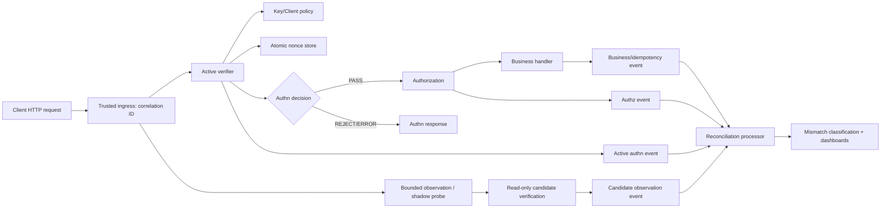
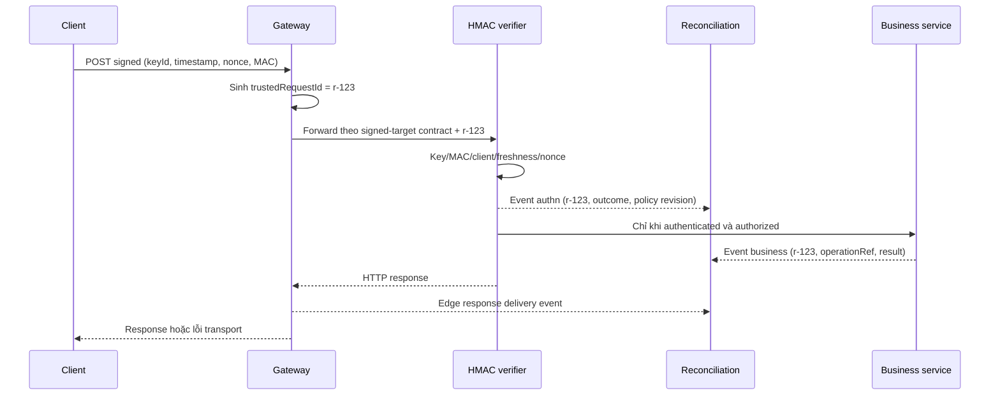
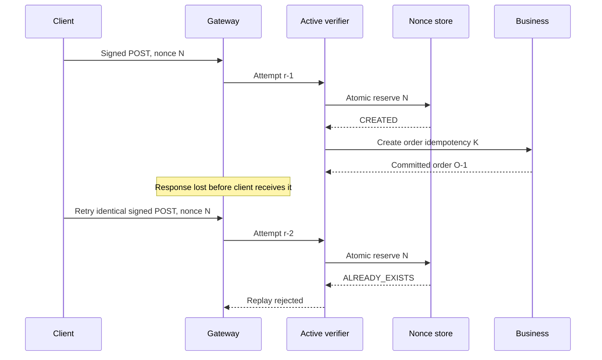

# Đối soát request khi migration xác thực HTTP HMAC

## 1. Bài toán: chuyển đổi thành công không chỉ là “không còn lỗi 401”

Module `SECURITY_AUTHENTICATION_HMAC_REQUEST_AUTHENTICATION` thiết kế xác thực HTTP request bằng **HMAC với shared secret**, ký một **canonical request** từ HTTP method, URI/query, header và/hoặc body theo hợp đồng. Bên nhận chọn key ứng viên, kiểm chữ ký, chống phát lại bằng timestamp/nonce, theo dõi key rotation, xử lý proxy/gateway và tách **authentication** khỏi **authorization**.

Khi chuyển từ một cơ chế xác thực cũ sang HMAC, chuyển canonicalization v1 sang v2, bổ sung thuật toán mới hoặc đổi vị trí verify từ backend ra gateway, request có thể bị xử lý khác nhau dù mã HTTP cuối cùng giống nhau. Ví dụ:

- Backend cũ cho phép request dùng key A; verifier mới trả 401 vì canonical path sau reverse proxy khác với path client đã ký.
- Cả hai đều trả 200, nhưng hệ thống mới gán nhầm principal hoặc tenant, mở ra lỗi **cross-tenant authorization**.
- Gateway retry một POST đã được backend xử lý; request thứ hai bị replay guard từ chối nhưng nghiệp vụ đã có một side effect, còn phía caller chỉ thấy timeout.
- Log cho biết 10.000 request hợp lệ, nhưng 100 request không xuất hiện trong báo cáo do event đến muộn hoặc bị lấy mẫu.
- Một bản thử nghiệm *shadow* dùng chung nonce store với verifier thật; lần kiểm thử thứ hai tự tiêu thụ nonce rồi làm request hợp lệ bị từ chối.

**Đối soát request** (*request reconciliation*) là hoạt động **ghép, kiểm và giải thích các bằng chứng** từ client, gateway, verifier, authorization và nghiệp vụ để xác định sự khác biệt giữa hành vi **trước/sau migration** là mong đợi, không thể so sánh hay là lỗi cần khắc phục.

Bài thuộc chương **Migration**, chủ đề trực tiếp **“Đối soát request”**. Sau bài học, người học có thể:

1. Xây tập baseline và xác định đơn vị đối soát cho HTTP HMAC, không đánh đồng HTTP request với một thao tác nghiệp vụ.
2. Phân biệt **canonical bytes**, signature validity, policy acceptance, anti-replay, authorization và side effects.
3. Thiết kế **shadow verification chỉ đọc**, không tiêu thụ nonce, không tạo `Authentication` và không tác động đường chạy thật.
4. Xây event schema, correlation ID đáng tin, join keys, trạng thái đối soát và cửa sổ xử lý dữ liệu đến muộn.
5. Dùng golden vectors, Java/JUnit, Spring MVC và WebFlux để kiểm tương thích có chủ đích.
6. Đọc báo cáo sai lệch, đặt quality gates cho canary/rollout và rollback mà không hạ mức bảo mật.
7. Bảo vệ secret, raw canonical request, nonce, chữ ký, PII và dữ liệu tenant trong log/metrics.

> Trong bài, `legacy` là đường xác thực đang phục vụ traffic, còn `candidate` là đường mới cần đánh giá. Đây là **vai trò triển khai**, không mặc định legacy kém an toàn hoặc candidate luôn đúng. Các phiên bản, route, key và ngưỡng vận hành đều là ví dụ; phải gắn với hợp đồng HMAC và policy của từng dự án.

## 2. Đối soát cái gì: sáu lớp kết quả không thể gộp thành một

### 2.1. Từng lớp có ý nghĩa và nguồn sự thật riêng

| Lớp | Câu hỏi đối soát | Nguồn bằng chứng |
| --- | --- | --- |
| **Ingress/routing** | Request nào thực sự đi qua gateway và tới backend nào? | Edge log đáng tin, routing/trace ID |
| **Canonicalization** | Những **bytes được ký** có đúng hợp đồng ở mỗi phiên bản không? | Golden fixtures, canonicalizer output ở test environment |
| **HMAC/key policy** | Chữ ký có khớp với key được phép dùng tại thời điểm verify? | Verifier reason code, key/client policy revision |
| **Freshness/replay** | Timestamp còn hợp lệ, nonce đã được dùng chưa? | Clock/policy và atomic nonce reservation outcome |
| **Authorization** | Verified principal có quyền đối với tenant, route, resource không? | Authorization decision/audit |
| **Business/response** | Có tạo đúng số side effects, trả đúng outcome và gửi response thành công? | Idempotency/transaction log, response delivery telemetry |

Một kết quả `200` hoặc `401` không chứa đủ thông tin để kết luận sáu lớp giống nhau. Đặc biệt, **401** có thể do thiếu chữ ký, MAC sai, key bị revoke, timestamp quá hạn hoặc nonce replay; **403** thường là authorization denied sau khi xác thực hợp lệ, nhưng cũng có thể do gateway/WAF chặn trước backend. Cần giữ **stage + reason code nội bộ** để giải thích.

### 2.2. Không nên dùng signature làm ID để ghép request

Một HMAC signature là credential-derived artifact, không phải correlation ID:

- Hai request có canonical bytes giống nhau và cùng key có thể cho cùng MAC.
- Request được ký lại với nonce/timestamp mới sẽ có MAC khác dù là cùng thao tác nghiệp vụ.
- Raw signature là dữ liệu nhạy cảm; log nó có thể hỗ trợ phát lại nếu request chưa hết freshness.
- Đổi thuật toán/canonical version sẽ khiến signature khác dù cùng logical command.

Hãy dùng **request correlation ID do trusted ingress tạo**, một `operationId`/`idempotencyKey` có quy tắc tin cậy riêng cho nghiệp vụ và **định danh sự kiện độc lập** cho quá trình đối soát.

### 2.3. Định nghĩa đơn vị đối soát

```text
Request attempt:
  Một lần HTTP được ingress nhận và xử lý qua security pipeline.

Signed request:
  Tập method, target, signed headers, raw body và signature
  được ràng buộc bởi HMAC contract.

Logical business operation:
  Một nghiệp vụ (ví dụ tạo đơn hàng) có thể được client retry
  bằng nhiều signed requests khác nhau.

Reconciliation event:
  Một bằng chứng từ một stage của một request attempt;
  việc vận chuyển event có thể giao ít nhất một lần.
```

Một POST bị caller retry có thể tạo **hai request attempts**, một hoặc hai signatures, nhưng vẫn phải tạo **tối đa một logical operation** nếu API có idempotency contract phù hợp. Đối soát chỉ bằng số lượng POST thành công sẽ bỏ qua sự phân biệt này.

## 3. Thiết lập migration contract trước khi thu thập dữ liệu

### 3.1. Inventory những trục có thể thay đổi

| Trục | Legacy | Candidate | Điều cần cố định/đối soát |
| --- | --- | --- | --- |
| Điểm verify | Backend Spring MVC | Gateway hoặc Spring WebFlux | Ai là bên có thẩm quyền tạo Authentication? |
| Canonical version | `HMAC-V1` | `HMAC-V2` | Raw path/query, signed headers, body bytes, LF và encoding |
| HMAC algorithm | HMAC-SHA256 | HMAC-SHA512 (nếu cần) | Algorithm allowlist, output length, alg binding |
| Key version | `key-A1` RETIRING | `key-A2` ACTIVE | Mapping owner/tenant/allowed algorithm, rotation overlap |
| Timestamp | ISO-8601 UTC | ISO-8601 UTC/epoch theo contract | Precision, skew và signed field |
| Nonce scope | Verified client | Verified client | Atomicity và TTL xuyên version/key |
| Authorization | Service policy cũ | Policy engine mới | Principal/authorities/tenant mapping |
| Gateway | HTTP/1.1 path rewrite | HTTP/2, header normalization | Representation được ký tại điểm verify |

Nếu dự án chuyển cùng lúc cả key, canonicalization và điểm verify, khi thấy 401 tăng lên sẽ khó biết nguyên nhân. Nên **tách từng trục** hoặc tạo các cohort có mục đích rõ ràng để quy trách nhiệm chính xác.

### 3.2. Define support matrix và expected difference

```text
MigrationProfile LEGACY_V1:
  acceptedUntil       : cutoff timestamp có approval
  canonicalVersion    : HMAC-V1
  keyFamily           : key A1 trong overlap được phép
  routeScope          : một tập route legacy xác định

MigrationProfile CANDIDATE_V2:
  activationCondition : key/policy + client SDK đã sẵn sàng
  canonicalVersion    : HMAC-V2
  keyFamily           : key A2 ACTIVE
  requiredSignedFields: tenant, timestamp, nonce, method, target, body
```

Một sai khác có thể là **mong đợi**: request v1 được legacy chấp nhận nhưng candidate v2-only được thiết kế để từ chối **sau cutoff**. Tuy nhiên, sai khác chỉ được đánh dấu `EXPECTED_POLICY_CHANGE` khi đã có **migration rule cụ thể, thời điểm hiệu lực và approval**, không được đánh dấu như vậy cho mọi 401/403 mới.

### 3.3. Security invariants cần giữ trong cả migration

1. Không có đường **fail open** khi HMAC/key metadata/nonce store không cho kết luận.
2. Không thử nhiều key/algorithm/canonicalization versions “cho tới khi MAC khớp” để cứu request.
3. Identity/authorities luôn đến từ registry/policy tin cậy, không từ header client tự khai báo.
4. Mỗi request được kiểm timestamp và **atomic nonce reservation** ở **một điểm có thẩm quyền**.
5. Client/key đã revoke không được mở lại chỉ vì rollback hay gateway/cache stale ngoài policy.
6. Candidate/shadow không được tự cấp `Authentication` hoặc quyền truy cập.
7. Business idempotency vẫn hoạt động khi client retry sau timeout hoặc thay đổi key/version.

**Không đạt invariant bảo mật thì dừng migration**, kể cả tỷ lệ HTTP 200 và latency nhìn có vẻ tốt.

## 4. Kiến trúc đối soát: nguồn sự thật, shadow và event pipeline



Trong mô hình trên:

- **Active verifier** là thành phần duy nhất có thẩm quyền quyết định request được chấp nhận hay không.
- **Shadow candidate** chỉ quan sát theo khả năng giao thức cho phép. Nó không được ghi nonce, tạo principal, thay `SecurityContext` hay gọi controller.
- **Reconciliation processor** ghép events và đánh giá sai khác theo một contract đã version hóa.
- **Business event** giúp kiểm số side effects thay vì chỉ kiểm authentication.

### 4.1. Khi nào không thể shadow-verify độc lập?

Một giới hạn rất quan trọng: **signature HMAC-V1 thường không hợp lệ với canonical bytes HMAC-V2**. Nếu request của client chỉ chứa chữ ký v1, candidate v2 **không có đủ chứng cứ** để kết luận “v2 verifier hoạt động sai” khi HMAC-V2 từ chối nó.

Có ba chiến lược:

| Chiến lược | Có thể so gì? | Không thể suy ra gì? |
| --- | --- | --- |
| **Golden request fixtures** | V1/v2 canonical bytes và MAC với expected độc lập | Chưa chứng minh behavior trên traffic runtime |
| **Canary client ký đúng v2** | Candidate end-to-end với traffic được tạo theo v2 contract | Không tự phản ánh mọi legacy consumer |
| **Controlled dual-sign pilot** | Hai signature được tạo độc lập theo hai hợp đồng đã định | Không được mặc định cho phép hai đường verify nhận quyền |
| **Passive legacy observation** | Volume, routing, parse errors, key policy, metadata đủ an toàn | Không thể khẳng định v2 signature hợp lệ nếu thiếu v2 signature |

Trong **dual-sign pilot**, nếu một request mang đồng thời signature v1/v2, các signature phải được quy định **tách biệt, versioned, ràng buộc identity và signed fields**, chống thay thế, duplicate và downgrade. Chỉ **một** đường active được trao quyền; shadow signature còn lại không được mở thêm một đường authn. Dual signing có rủi ro, cần security review và thường chỉ nên dùng trong test/canary có kiểm soát.

### 4.2. Đừng so sánh những thứ không cùng tầng

Sai:

```text
Active HMAC-V1: AUTHENTICATED
Shadow HMAC-V2 trên cùng MAC V1: SIGNATURE_INVALID
=> Kết luận candidate bug
```

Đúng:

```text
Active HMAC-V1: AUTHENTICATED
Shadow HMAC-V2: NOT_APPLICABLE (thiếu v2-signed credential)
=> Chỉ so các stage tương thích, và kiểm v2 bằng fixture/canary v2.
```

Tương tự, shadow không gọi nonce store để reserve thử lần hai; lần thứ hai sẽ bị chặn bởi **replay do chính cơ chế shadow tạo ra**, không phản ánh client thực.

## 5. Xác định correlation và truy vết một request

### 5.1. ID ở từng ranh giới

| ID | Cách tạo | Dùng vào mục đích gì? | Không được nhầm với |
| --- | --- | --- | --- |
| `trustedRequestId` | Gateway hoặc server đáng tin, bảo đảm không bị client overwrite | Ghép stages của một attempt | Nonce hoặc signature |
| `eventId` | Producer sinh duy nhất cho một security/business event | Dedup event delivery | Request ID |
| `traceId` | Distributed tracing có policy tin cậy | Theo luồng nhiều service/hop | Danh tính xác thực |
| `trustedClientRef` | Key registry sau khi xác minh MAC/key mapping | Phân tích outcome theo client ở audit bảo vệ | `X-Client-Id` chưa xác thực |
| `businessOperationRef` | Nghiệp vụ/transaction khi đã được chấp nhận | Đối soát side effects và idempotency | HTTP attempt |
| `nonce` | Client tạo và đưa vào signed bytes | Anti-replay | Correlation key để log |

Nếu client gửi `X-Request-Id`, ingress phải validate/strip/overwrite hoặc tạo một **server-generated ID** rõ ràng. Không đặt toàn bộ niềm tin vào một giá trị do caller tự tạo vì attacker có thể tạo collision hoặc làm nhiễu báo cáo.

### 5.2. Một request qua các hop



Response 200 do backend tạo nhưng **không được gateway chuyển đến caller** là một outcome khác với “handler chưa xử lý”. Trường hợp này thường dẫn đến retry; đối soát phải nối **attempts** với một **business operation** qua cơ chế idempotency.

### 5.3. Đối soát không cần lưu raw signature

Không log:

```text
sharedSecret
X-Hmac-Signature / expected signature
raw nonce
full canonical request
raw signed body có dữ liệu nhạy cảm
client-supplied raw tenant/ID trong metric labels
```

Khi cần đối chiếu canonical representations trong **test fixture**, có thể lưu bytes expected vì dữ liệu đều giả. Trong production, nếu cần một fingerprint để phân loại mismatch, cân nhắc **HMAC telemetry key riêng**, domain-separated, với key rotation/retention/quyền truy cập riêng và chỉ trên dữ liệu đã được duyệt. **Hash SHA-256 công khai của canonical request có entropy thấp có thể làm lộ thông tin** qua đoán dictionary; không mặc định an toàn chỉ vì đã hash. Fingerprint không thay thế bằng chứng byte-level từ test environment.

## 6. Golden vectors: đối soát canonical bytes theo hợp đồng

### 6.1. Bắt đầu từ một known-answer test

Đối với HMAC-SHA256, bộ test RFC 4231 cho case 1 dùng key byte `0x0b` lặp 20 lần và ASCII message `Hi There`:

```text
HMAC-SHA256:
b0344c61d8db38535ca8afceaf0bf12b881dc200c9833da726e9376c2e32cff7
```

Vector này kiểm **primitive HMAC**, không kiểm canonicalization của HTTP. Bước kế tiếp cần fixture gồm:

- Method HTTP, raw target/path/query, signed headers và raw body bytes chính xác.
- Cách biểu diễn header name/value, signed header order.
- UTF-8 hoặc byte encoding, dấu `LF`/`CRLF` và trailing newline.
- Body digest algorithm, cách encode digest và MAC.
- `keyId`, algorithm/protocol version, timestamp, nonce được ký.
- Expected canonical bytes và expected MAC **đã được tính/duyệt độc lập**.

### 6.2. Hai phiên bản không nhất thiết có canonical bytes bằng nhau

Ví dụ v1 chỉ ký:

```text
HMAC-V1
POST
/public/orders?tenant=t1&include=items
content-type:application/json
x-hmac-key-id:test-key-01
x-hmac-nonce:nonce-01
x-hmac-timestamp:2026-11-28T00:00:00Z
<sha256-body-hex>
```

V2 bổ sung signed tenant, domain separator và một quy tắc query normalization **đã công bố**:

```text
HMAC-V2
POST
/public/orders?include=items&tenant=t1
content-type:application/json
x-hmac-key-id:test-key-01
x-hmac-nonce:nonce-01
x-hmac-timestamp:2026-11-28T00:00:00Z
x-hmac-version:v2
x-tenant-id:t1
<sha256-body-hex>
```

Hai đoạn là **sơ đồ format**, `<sha256-body-hex>` chỉ là placeholder; chưa phải test vectors với expected MAC. Khác bytes là **mong đợi** vì hai giao thức khác nhau. Test đúng phải so:

```text
actualCanonicalV1 == approvedGoldenCanonicalV1
actualCanonicalV2 == approvedGoldenCanonicalV2
```

không phải:

```text
actualCanonicalV1 == actualCanonicalV2
```

Nếu v2 thay query sort, phải đặc tả cách xử lý repeated query params, empty values, `+`/`%20`, percent encoding case và Unicode. Không tự dùng `Map<String,String>` rồi làm mất duplicate values.

### 6.3. Mutation test giúp tìm nguyên nhân mismatch

| Đầu vào thay đổi | Bằng chứng cần kiểm |
| --- | --- |
| `POST` → `PUT` | Method thuộc signed bytes thì MAC cũ phải sai |
| Raw path thêm slash | V1/v2 dùng chính xác target của contract |
| Query order thay đổi | V1 raw query vs v2 normalization theo rule |
| `Content-Type` có thêm charset | Signed header canonicalization khác hay không |
| JSON body đổi field order | Nếu hash raw bytes, body digest phải khác |
| Header name casing qua HTTP/2 | Tên field canonical lowercase nếu contract yêu cầu |
| Timestamp/nonce đổi | Signature cũ không còn khớp |
| Header HMAC duplicate | Edge/verifier reject theo single-value policy |
| Protocol version bị sửa | Reject khi MAC/version binding không khớp |

Lỗi canonicalization tại gateway có thể gây **false reject**. Không “sửa” bằng cách tắt kiểm method/path/body; phải xác định representation đáng tin và tạo golden fixture từ chính contract đó.

## 7. Shadow verification: quan sát mà không tạo tác dụng phụ

### 7.1. Shadow verification cần những giới hạn nào?

**Một candidate verifier ở shadow mode không được:**

1. Gọi `nonceStore.reserve(...)` trên namespace production của active verifier.
2. Gọi controller/service hoặc tạo business transaction.
3. Cài `Authentication`/`SecurityContext`/`ReactiveSecurityContextHolder` cho request thật.
4. Thay đổi HTTP response, status, body hoặc routing của request thật.
5. Tự chọn fallback key/algorithm để làm tăng tỷ lệ “pass”.
6. Ghi raw shared secret, signature, nonce hoặc body vào event/log.
7. Khi gặp lỗi shadow, khiến request thật mất availability ngoài chính sách thử nghiệm đã duyệt.

Shadow có thể thực hiện **parse, canonicalization, key metadata/policy lookup và HMAC comparison** trên snapshot trong memory có giới hạn. Nhưng nếu kiểm replay cần store có mutation, **không thể chạy đầy đủ anti-replay giống active với cùng nonce**. Tách phép kiểm như sau:

| Kiểm tra | Active path | Shadow path |
| --- | --- | --- |
| Parse signed fields | Có | Có, read-only |
| Canonicalize | Có | Có, read-only |
| Resolve key/client policy | Có, nguồn được phê duyệt | Read-only với policy revision xác định |
| HMAC comparison | Có | Có, nếu có credential/signature hợp lệ cho profile đó |
| Timestamp check | Có | Có thể dùng cùng trusted time snapshot, không làm thay clock |
| **Reserve nonce** | **Có**, một lần tại điểm có thẩm quyền | **Không** dùng production namespace |
| Create Authentication | Có sau tất cả điều kiện | **Không** |
| Authorization side effect | Sau authn, theo policy | Chỉ dry-run nếu engine hỗ trợ read-only thực sự |
| Business write | Có theo quyền/idempotency | **Không** |

Nếu muốn kiểm một candidate replay guard thực sự, dùng **synthetic requests trong staging** hoặc một **replay store tách biệt** có cùng semantics và kiểm cả concurrent/failover. Một lời gọi `nonceStore.contains(...)` read-only không nguyên tử **không chứng minh** rằng candidate sẽ reserve đúng; phải đánh dấu `NOT_EVALUATED` hoặc `REUSED_ACTIVE_DECISION` theo mục đích.

### 7.2. Thu thập dữ liệu cho shadow có thể ảnh hưởng bảo mật

Để verify HMAC, shadow có thể cần raw body bytes, signed headers, signature và key material trong runtime. Đây là **dữ liệu nhạy cảm**, dù không được log. Giới hạn:

- Request body size và thời gian giữ bytes ở bộ nhớ.
- Executor/concurrency/queue size cho shadow; khi hết ngân sách thì **bỏ mẫu quan sát**, không block request thật và báo `OBSERVATION_DROPPED`.
- Không queue raw body/credential vào message bus hoặc persistent store.
- Không dùng long-lived object cache cho `HttpServletRequest`, `DataBuffer` hay `ServerWebExchange`.
- Có chính sách quyền secret provider, timeout và cancellation riêng cho shadow.
- Với data nhạy cảm, dùng **test-only synthetic traffic** thay vì mirror production payload nếu chính sách không cho phép.

Chỉ phát reconciliation event đã **giảm dữ liệu** sau khi shadow hoàn thành; event không chứa canonical bytes, body hoặc signature.

### 7.3. Khi shadow failure là một kết quả hợp lệ

```text
Shadow outcome:
  PASS                  : Đã kiểm thành công những stage được phép
  REJECT                : Đã kiểm và từ chối theo reason code nội bộ
  NOT_APPLICABLE        : Chưa có signature/contract phù hợp để kiểm
  NOT_EVALUATED         : Stage cần state mutation hoặc dữ liệu không có
  OBSERVATION_ERROR     : Shadow dependency/timeout lỗi
  OBSERVATION_DROPPED   : Budget/queue/sampling policy chủ động bỏ
```

Không cộng `NOT_APPLICABLE` hoặc `OBSERVATION_DROPPED` vào tổng “matched”. Đó là **coverage gap** cần được công bố trong dashboard.

## 8. Phân loại sai lệch và quy tắc so sánh

### 8.1. Chỉ so những decision có cùng phạm vi

Một event không nên chỉ có `accepted=true/false`. Cần biết:

```text
stage = CRYPTO_AND_KEY_POLICY
profile = HMAC-V2 / HS256 / policy revision 42
credentialPresent = true
verifiedPrincipalRef = opaque reference (nếu MAC pass)
decision = ACCEPT | REJECT | ERROR | NOT_EVALUATED
reason = enum hữu hạn
```

Nếu active event đã bao gồm replay/authorization nhưng shadow chỉ làm crypto/key check, **không so hai decision như thể cùng một tầng**. Có thể tách active observation thành `ACTIVE_CRYPTO_DECISION` và `ACTIVE_FINAL_AUTHN_DECISION`; đối chiếu shadow ở stage tương đương.

### 8.2. Outcome classification

| Nhóm | Ví dụ | Xử lý |
| --- | --- | --- |
| `MATCH_ACCEPT` | Hai implementation cùng accept **cùng profile/stage** và cùng verified client | Chứng cứ tương thích; vẫn kiểm nonce/authz bên active |
| `MATCH_REJECT` | Cả hai từ chối đúng một fixture không hợp lệ cùng stage | Theo dõi distribution lý do, không coi là chứng cứ độc lập của mọi check |
| `EXPECTED_POLICY_DELTA` | V1 bị cấm sau cutoff theo rule đã phê duyệt | Báo rõ rule ID, thời gian, cohort |
| `UNEXPECTED_NEW_REJECT` | Active chấp nhận một fixture hợp lệ, candidate từ chối | Có thể gây outage sau cutover |
| `UNEXPECTED_NEW_ACCEPT` | Active từ chối request nguy hiểm, candidate chấp nhận | **Ưu tiên bảo mật**; chặn promotion |
| `IDENTITY_OR_SCOPE_MISMATCH` | Cùng MAC pass nhưng principal/tenant/grants khác | **Ưu tiên bảo mật**; kiểm cross-tenant/authorization |
| `NOT_COMPARABLE` | Client v1 không cung cấp chữ ký v2 | Không tính vào pass/fail, tăng coverage gap |
| `OBSERVATION_ERROR` | Shadow bị timeout, thiếu event hoặc policy revision không khớp | Điều tra instrumentation/dependency, không suy từ 200 |
| `INCOMPLETE_EVIDENCE` | Thiếu gateway event hoặc event đến muộn | Chờ watermark / điều tra data loss |
| `DUPLICATE_SIDE_EFFECT` | Hai attempts tạo hai transaction trái idempotency | Ưu tiên nghiệp vụ/bảo mật |

**Sai khác cho phép** chỉ được nhận diện bằng **rule đã phê duyệt**, không dùng một tập điều kiện quá rộng như “mọi request HS256 legacy có thể khác nên bỏ qua”.

### 8.3. Phân loại lý do theo stage

```text
PARSE:
  MISSING_SIGNATURE, DUPLICATE_HMAC_HEADER, MALFORMED_TIMESTAMP

CRYPTO/KEY:
  UNSUPPORTED_VERSION, SIGNATURE_INVALID, KEY_NOT_FOUND,
  KEY_REVOKED, CLIENT_REVOKED, ALGORITHM_NOT_ALLOWED

FRESHNESS/REPLAY:
  TIMESTAMP_OUT_OF_WINDOW, NONCE_REPLAY, NONCE_STORE_UNAVAILABLE

AUTHORIZATION:
  AUTHORITY_MISSING, TENANT_ACCESS_DENIED, RESOURCE_ACCESS_DENIED

INFRA:
  KEY_REGISTRY_UNAVAILABLE, POLICY_REVISION_STALE,
  SHADOW_TIMEOUT, EVENT_DELIVERY_DELAYED
```

Những reason codes trên là **ví dụ enum nội bộ**, không phải API response công khai. Một lỗi `KEY_REGISTRY_UNAVAILABLE` là lỗi dependency và **phải fail closed**; không map nó thành `SIGNATURE_INVALID` rồi che mất nguồn sai lệch khi migration.

## 9. Java: mô hình đối soát thuần, không đụng SecurityContext

Để tránh shadow can thiệp request thật, logic phân loại nên nằm ở một **pure component** xử lý những observations đã được tạo từ các bộ kiểm hợp lệ.

### 9.1. Model stage và observations

```java
enum ProbeStage {
    CRYPTO_AND_KEY_POLICY,
    FRESHNESS,
    REPLAY,
    AUTHORIZATION
}

enum ProbeDecision {
    ACCEPT, REJECT, ERROR, NOT_EVALUATED, NOT_APPLICABLE
}

record ProbeObservation(
    String trustedRequestId,
    String profileId,
    ProbeStage stage,
    ProbeDecision decision,
    String reasonCode,
    String verifiedClientRef,
    long policyRevision
) {}

enum ReconciliationClass {
    MATCH_ACCEPT,
    MATCH_REJECT,
    EXPECTED_POLICY_DELTA,
    UNEXPECTED_NEW_REJECT,
    UNEXPECTED_NEW_ACCEPT,
    IDENTITY_OR_SCOPE_MISMATCH,
    NOT_COMPARABLE,
    OBSERVATION_ERROR
}
```

`verifiedClientRef` chỉ được điền từ registry **sau khi signature verification thành công**. Trong implementation thật, có thể thêm `verifiedTenantRef` hoặc normalized authorities để so trong memory; không ghi những giá trị này ra metrics labels. `policyRevision` giúp phát hiện hai đường verify đang dùng policy khác thời điểm.

### 9.2. Reconciler có kiểm comparability và expected rule

```java
import java.util.Objects;

final class HmacObservationReconciler {

    ReconciliationClass classify(
        ProbeObservation active,
        ProbeObservation candidate,
        boolean equivalentContractStage,
        boolean approvedPolicyDelta
    ) {
        if (!Objects.equals(
                active.trustedRequestId(),
                candidate.trustedRequestId())) {
            return ReconciliationClass.NOT_COMPARABLE;
        }

        if (!equivalentContractStage ||
            active.stage() != candidate.stage() ||
            active.policyRevision() != candidate.policyRevision() ||
            candidate.decision() == ProbeDecision.NOT_APPLICABLE ||
            candidate.decision() == ProbeDecision.NOT_EVALUATED) {
            return ReconciliationClass.NOT_COMPARABLE;
        }

        if (active.decision() == ProbeDecision.ERROR ||
            candidate.decision() == ProbeDecision.ERROR) {
            return ReconciliationClass.OBSERVATION_ERROR;
        }
        if (active.decision() == ProbeDecision.NOT_APPLICABLE ||
            active.decision() == ProbeDecision.NOT_EVALUATED) {
            return ReconciliationClass.NOT_COMPARABLE;
        }

        if (active.decision() == candidate.decision()) {
            if (active.decision() == ProbeDecision.ACCEPT) {
                if (active.verifiedClientRef() == null ||
                    candidate.verifiedClientRef() == null ||
                    !Objects.equals(
                        active.verifiedClientRef(),
                        candidate.verifiedClientRef())) {
                    return ReconciliationClass.IDENTITY_OR_SCOPE_MISMATCH;
                }
                return ReconciliationClass.MATCH_ACCEPT;
            }
            return ReconciliationClass.MATCH_REJECT;
        }

        if (active.decision() == ProbeDecision.REJECT &&
            candidate.decision() == ProbeDecision.ACCEPT) {
            // Safety-first: mọi new-accept cần security review riêng,
            // không được che bởi một cờ expected-delta quá rộng.
            return ReconciliationClass.UNEXPECTED_NEW_ACCEPT;
        }
        if (approvedPolicyDelta) {
            return ReconciliationClass.EXPECTED_POLICY_DELTA;
        }
        return ReconciliationClass.UNEXPECTED_NEW_REJECT;
    }
}
```

Đoạn code là **mô hình phân loại**, không phải bằng chứng toàn hệ thống an toàn. Trong thực tế:

- `approvedPolicyDelta` không được lấy từ request input, mà tra bằng **migration rule ID đã version hóa và phê duyệt**, trong phạm vi endpoint/client/time cụ thể.
- `equivalentContractStage` phải do test/migration planner quyết định, không phải cứ hai status HTTP giống nhau là true.
- Không nên trả `MATCH_REJECT` nếu hai nhánh reject vì **lý do trái ngược** mà policy yêu cầu reason equality; hãy tách `REJECT_REASON_MISMATCH` khi cần độ phân giải cao.
- Cần so **principal, tenant, authorities và key policy scope** theo tập trường đã định, không chỉ `verifiedClientRef`.
- Trong ví dụ safety-first này, một candidate `ACCEPT` khi active `REJECT` luôn là `UNEXPECTED_NEW_ACCEPT` để bắt buộc security review riêng, kể cả khi có migration rule; không cho cờ `approvedPolicyDelta` rộng vô tình che nhận sai. Nếu hệ thống thật cần mở quyền có chủ đích, phải đánh giá/cho phép ở một workflow approval có ranh giới cụ thể trước khi kết luận chấp nhận mới là an toàn.

### 9.3. Không ghi request secrets vào đối tượng event

Trong Java, `ProbeObservation` là kết quả **đã lược dữ liệu nhạy cảm**, không chứa shared secret, key bytes, signature, nonce hoặc raw body. API shadow có thể cần các bytes đó **chỉ trong phạm vi bộ nhớ tạm thời** để thực hiện verify, rồi hủy tham chiếu đúng vòng đời request. Không giả định `byte[]` bị xóa bảo đảm sau GC; giới hạn scope, tránh heap dumps và tuân thủ secret-handling policy.

## 10. Spring MVC: tích hợp quan sát mà không thay đường xác thực

### 10.1. Lớp nào chịu trách nhiệm?

Một ứng dụng Spring Security MVC thường có `OncePerRequestFilter`/`AuthenticationFilter` và một `HmacRequestVerifier`. Trong migration:

1. Active verifier vẫn là **nguồn quyết định** tạo `Authentication`.
2. Đối soát nhận **kết quả active** sau khi filter thực thi, có correlation ID do ingress tạo.
3. Nếu chạy shadow crypto, tách một **read-only verifier** với key policy/nonce semantics rõ, có budget và không gọi `filterChain.doFilter`.
4. Lỗi observation phải được ghi là `OBSERVATION_ERROR`, không tự chuyển active authn thành accept/reject khác.
5. Khi key registry hoặc nonce store **của active** lỗi, vẫn fail closed theo policy; không nhờ shadow “cứu” request bằng kết quả ở môi trường khác.

### 10.2. Ví dụ code tách active decision khỏi telemetry

```java
// Pseudocode trong application service: các interface do ứng dụng
// tự định nghĩa, KHÔNG phải API có sẵn của Spring Security.
final class HmacAuthnMigrationFacade {
    private final ActiveHmacAuthenticator active;
    private final ReconciliationObserver observer;

    Authentication authenticate(RequestSnapshot request) {
        AuthnAttempt attempt = active.authenticate(request);
        // active.authenticate phải thực hiện đầy đủ MAC, client/key policy,
        // timestamp và atomic nonce reservation; lỗi của active fail closed.

        observer.tryRecordNonBlocking(
            attempt.reducedObservation(request.trustedRequestId())
        );

        return attempt.authentication();
    }
}
```

Đây là fragment về **luồng tích hợp**, không phải snippet compile độc lập. `ReconciliationObserver` chỉ nhận event đã redacted, không chứa raw signed request hay secret; việc ghi telemetry không thay decision. **Trường hợp active từ chối/lỗi** cũng cần ghi event ở ranh giới xử lý exception của authentication filter, không chỉ happy path như fragment trên. `tryRecordNonBlocking` phải thực sự bounded; việc publish lỗi không được khiến caller được xác thực khi active chưa pass.

Nếu muốn thực hiện candidate HMAC computation với raw bytes trong same process, làm việc đó trong một thành phần riêng có **budget/timeouts và fallback sang NOT_EVALUATED**, không ghi raw body vào queue persistent. Không dùng `@Async` mặc định với executor không giới hạn hay giữ nguyên `HttpServletRequest` qua request lifetime.

### 10.3. Filter order và exception boundary

Một custom filter chạy trước `ExceptionTranslationFilter` cần xử lý `AuthenticationException` từ **bước authenticate** ở ranh giới phù hợp. Không bọc cả `filterChain.doFilter` rồi chuyển mọi lỗi downstream thành `INVALID_SIGNATURE`; hành vi đó sẽ làm **sai số liệu đối soát** và HTTP status.

Sau khi authentication thành công, Spring Security/ứng dụng vẫn phải kiểm `GrantedAuthority`/tenant/resource. Một response 403 do authorization denied **không phải** một HMAC verification failure; đối soát nên có event `AUTHZ_DENIED` độc lập.

### 10.4. Body buffering và raw URI

Khi body là signed field, verifier phải hash **raw body bytes thực nhận**; không deserialize JSON rồi serialize lại để “làm cho v1/v2 giống nhau”. Với Servlet, `InputStream` có tính tiêu thụ: cần request wrapper được thiết kế an toàn, giới hạn payload, kiểm controller vẫn đọc đủ bytes. Với raw URI/query, proxy rewrite và URL decoding có thể khiến `request.getRequestURI()` khác target client đã ký. Chọn canonical target theo **hợp đồng đã version hóa** và trusted gateway metadata.

## 11. Spring WebFlux: đối soát trong reactive pipeline

Trong WebFlux, `SecurityWebFilterChain` và `ReactiveSecurityContextHolder` truyền principal qua **Reactor Context**, không qua ThreadLocal `SecurityContextHolder` của MVC.

### 11.1. Cần tách observation và verification

```java
// Pseudocode: verifier chỉ tạo kết quả khi key/MAC/freshness/nonce PASS.
return reactiveActiveAuthenticator.authenticate(exchange)
    .flatMap(activeResult ->
        reactiveObservationSink.recordBestEffort(
            activeResult.reducedObservation()
        ).onErrorResume(error -> Mono.empty())
         .thenReturn(activeResult)
    )
    .flatMap(activeResult ->
        chain.filter(activeResult.replayableExchange())
            .contextWrite(
                ReactiveSecurityContextHolder.withAuthentication(
                    activeResult.authentication()
                )
            )
    );
```

Ví dụ chỉ biểu đạt **mối quan hệ luồng**; `recordBestEffort(...)` phải có **timeout, budget và cơ chế không chặn active request** khi production cho phép telemetry best-effort. Trong biểu thức trên, `recordBestEffort` vẫn nằm trên **critical path** trước `chain.filter`, nên **không dùng nguyên xi nếu sink có network I/O/latency khó kiểm soát**. Một triển khai tốt hơn là đưa **event đã redacted** vào một queue **in-memory bounded** không blocking, có thống kê dropped events và worker riêng; không gọi `subscribe()` tùy tiện trên một `Mono` chứa raw body/secret.

### 11.2. Những lỗi WebFlux dễ làm số liệu đối soát sai

- `Flux<DataBuffer>` bị subscribe hai lần rồi body thứ hai không còn bytes.
- Một candidate shadow tự gọi `nonceStore.reserve(...)` nên lần verify thật bị từ chối.
- Một nhánh `retryWhen` lặp lại cả active verification/nonce reservation.
- `Context` bị mất sau thread hop, làm log gắn principal của request khác hoặc thiếu trace ID.
- Dùng blocking key registry API trên Netty event loop tạo latency/timeout không liên quan HMAC contract.
- Event gửi sau khi response hoàn tất nhưng dùng `ServerWebExchange` đã hết vòng đời.

Giải pháp: **chỉ một active verification**, buffer/replay body có giới hạn, giữ observation ở dạng immutable/redacted, bọc timeout và kiểm event delivery độc lập với security decision. Test client cancellation và retry cùng nonce; không hoàn tác reservation chỉ vì caller disconnect.

### 11.3. Candidate không được thay Reactor Context

Một shadow pipeline chỉ được xuất **observation**, không được gọi:

```java
ReactiveSecurityContextHolder.withAuthentication(shadowAuthentication)
```

cho đường request thật. Nếu candidate vô tình đổi principal, test có thể thấy cả hai đều trả 200 nhưng resource của tenant khác được truy cập. Điều này là **identity mismatch/security regression**, không phải lỗi telemetry.

## 12. Đối soát qua gateway, reverse proxy và nhiều version HTTP

### 12.1. Chọn điểm nhìn canonical target

Giả sử:

```text
Client signs:  /public/orders?tenant=t1&include=items
Gateway maps:  /internal/orders?tenant=t1&include=items
Backend sees:  /internal/orders?tenant=t1&include=items
```

Nếu legacy verify tại gateway với **external target**, candidate verify tại backend với **internal target**, việc tính MAC trên hai path sẽ khác. Đối soát phải xác định **hợp đồng ký ở từng hop**, không chỉ so `request.getRequestURI()`.

| Kịch bản | Lớp cần so |
| --- | --- |
| Gateway rewrite public → internal path | Signed target source và trusted mapping |
| HTTP/2 lowercase field names | Canonical header name normalization |
| `Content-Type` thêm `charset` | Signed header value contract |
| Duplicate signature/key/timestamp header | Strict single-value policy trên mọi hop |
| Query reordered/percent re-encoded | Raw target vs versioned canonical sort |
| Body decompress/re-serialize | Raw body digest tại điểm verify |
| Gateway verify rồi truyền identity | Authenticated gateway assertion, not client header |
| Retry sau upstream timeout | Request attempts vs logical operation/idempotency |

### 12.2. Không tin `X-Verified-Client` từ internet

Nếu gateway xác minh HMAC và chuyển `X-Verified-Client` đến backend, backend chỉ được tin nó qua một **kênh gateway→backend đã xác thực** (ví dụ mTLS và route/network controls), cùng chính sách strip/overwrite inbound headers. Một request client tự mang `X-Verified-Client: admin` không được phép tạo principal dù backend chưa verify signature.

Trong migration có lúc **cả gateway và backend cùng verify**, cần tránh **double nonce reservation** trên cùng namespace. Chọn một bên có thẩm quyền tiêu thụ nonce, hoặc thiết kế **hop-specific signatures/nonce namespaces** được security review; không đơn giản “bỏ qua nonce error ở backend”.

### 12.3. Kiểm đường bypass thật

Canary đi qua gateway không đủ nếu production còn đường direct-to-backend hoặc ingress phụ. Đối soát phải xác định các điểm có thể tạo Authentication và kiểm synthetic requests qua từng tuyến trong phạm vi được phép. Không kết luận route an toàn từ một HTTP 403 của WAF nếu backend bypass vẫn có thể cho qua.

## 13. Key rotation, algorithm agility và client revocation

### 13.1. Các lý do mismatch có thể đồng thời xuất hiện

Một key mới ở `ACTIVE` nhưng một verifier node đang cache metadata cũ có thể trả `KEY_NOT_FOUND`; một client dùng `HMAC-V2` nhưng một gateway chưa chuyển sẽ trả `UNSUPPORTED_VERSION`. Những lỗi này khác nhau và cần được ghi theo **source policy revision**.

| Tình huống | Legacy | Candidate | Phân loại |
| --- | --- | --- | --- |
| Key A1 RETIRING còn trong overlap | Accept nếu policy còn cho phép | Accept nếu migration hỗ trợ | Match hoặc policy delta đã duyệt |
| Key A2 ACTIVE nhưng node chưa biết | Có thể reject | Accept | `POLICY_PROPAGATION_LAG` / chưa so nếu revision khác |
| Key A1 đã REVOKED | Reject | Reject | Bảo đảm key lifecycle |
| Client đã REVOKED nhưng key A2 vẫn ACTIVE trong cache | Reject | **Không được accept** | Candidate accept = security regression |
| Algorithm HS256 bị cấm sau cutoff | Reject | Reject | Expected policy decision |
| HMAC-V2 signed tenant thiếu | Không dùng v1 trên endpoint cần tenant integrity | Reject | Security policy gate |

Đừng so “hai phiên bản verifier chấp nhận cùng key ID” nếu các bên đang trỏ vào **khác key registry/policy revision** và nghĩ đó là lỗi crypto. Trước tiên ghép revision, timestamp hiệu lực, cache freshness và key owner từ nguồn tin cậy.

### 13.2. Algorithm header và protocol version là untrusted selector

Không để caller điều khiển `Mac.getInstance(...)` bằng raw `X-Hmac-Alg`; phải dùng allowlist và bắt chặt vào signed bytes/policy. Verifier không được thử `HS512` rồi fallback `HS256` khi MAC sai. Đối soát có thể ghi reason `ALGORITHM_NOT_ALLOWED`, nhưng response công khai không cần liệt kê thuật toán/key đang được bật.

### 13.3. Propagation test theo region/instance

Một kế hoạch:

1. Làm nóng cache key A1 ACTIVE tại gateway và hai backend test instances.
2. Control plane commit revoke A1 với revision N+1.
3. Cố ý làm chậm event ở một node trong lab.
4. Gửi synthetic signed requests bằng key test thuộc A1 tới từng điểm verify.
5. So kết quả với **revocation freshness guarantee** đã công bố; node chưa đủ mới phải refresh/fail closed/bị loại traffic.
6. Cho một old cache load hoàn thành sau invalidation để phát hiện race.

**TTL cache không phải bảo đảm thu hồi tức thời**. Nếu migration yêu cầu tính nhất quán cao hơn, cần authoritative check, policy barrier/ack hoặc fencing có mô hình lỗi rõ ràng; không chỉ tăng TTL để cải thiện hit ratio.

## 14. Replay, retry và idempotency trong đối soát

### 14.1. Cùng request được gửi hai lần không có nghĩa cùng kết quả



Đối soát cần ghi:

- Attempt r-1 đã authenticated, được phép, tạo order O-1.
- Attempt r-2 bị chặn vì `NONCE_REPLAY`; không tạo thêm order.
- Client có thể chưa biết kết quả r-1 vì transport failure.

Đây có thể là **hành vi đúng** của replay protection, không phải regression vì “hai attempts có status khác nhau”.

### 14.2. Retry bằng chữ ký mới

Client có thể tạo **nonce/timestamp mới, signature mới** nhưng giữ cùng `Idempotency-Key` theo API contract. Khi đó replay guard cho phép request mới được authenticated, còn **business idempotency layer** quyết định trả lại kết quả O-1 thay vì tạo O-2.

Không dùng nonce như idempotency key nghiệp vụ: nonce là một lần dùng ở tầng credential, còn idempotency key có thể đại diện một logical command được retry bằng nhiều credentials hợp lệ.

### 14.3. Đừng đồng bộ kết quả shadow bằng cách reserve thêm nonce

Nếu active đã reserve nonce N, shadow dùng cùng store sẽ nhận `ALREADY_EXISTS` — đây là **lỗi phép đo**. Nếu shadow reserve trước active, nó còn có thể khiến active từ chối request hợp lệ. Do đó **shadow không có independent live replay verdict** trong cùng production namespace; test replay riêng trên store cô lập hoặc ghi nhận `NOT_EVALUATED`.

### 14.4. Kiểm tác vụ đang thực thi khi cutover

Một request được xác thực trước khi đổi key/thu hồi client có thể còn xử lý sau cutover. Nếu nghiệp vụ cần bảo đảm “không phát sinh mutation sau thời điểm revoke”, phải có **credential epoch fencing** hoặc authoritative check tại transaction/job execution, không chỉ security filter. Đối soát gồm cả event commit/queue processing theo trusted operation ID và policy revision tương ứng.

## 15. Event schema và pipeline xử lý dữ liệu đến muộn

### 15.1. Ví dụ event giảm dữ liệu nhạy cảm

```json
{
  "eventId": "evt-opaque-01",
  "eventType": "HMAC_AUTHN_OBSERVED",
  "eventVersion": 1,
  "trustedRequestId": "req-opaque-123",
  "profile": "CANDIDATE_V2",
  "observationMode": "READ_ONLY_CRYPTO",
  "stage": "CRYPTO_AND_KEY_POLICY",
  "outcome": "REJECT",
  "reasonCode": "SIGNATURE_INVALID",
  "routeId": "POST_INTERNAL_ORDERS",
  "policyRevision": 42,
  "algorithm": "HS256",
  "recordedAt": "2026-11-28T08:00:01Z"
}
```

Đây là schema **minh họa**. Không thêm `signature`, `nonce`, `rawBody`, `canonicalRequest`, raw `keyId` hoặc client-provided arbitrary labels. Khi có `trustedClientRef` phục vụ audit, chỉ điền từ kết quả verify đáng tin, dùng storage có giới hạn quyền và retention.

### 15.2. Event delivery thường có duplicate và disorder

```text
Ingress event  r-1          arrives 08:00:01
Active authn   r-1          arrives 08:00:02
Business event r-1          arrives 08:00:04
Shadow event   r-1          arrives 08:00:07 (trễ)
Active authn   r-1 (retry delivery) arrives 08:00:08
```

Đối soát không được đếm `Active authn r-1` hai lần vì event được gửi trùng. Dùng `eventId` và stream partition/key phù hợp để deduplicate. Khi dữ liệu đến muộn, dùng **event-time window/watermark** có policy; trước khi window đóng, kết quả là `PENDING` thay vì `MISSING_SHADOW` vĩnh viễn.

### 15.3. Không coi missing event là 401

Một số lý do không có shadow event:

- Request không được lấy mẫu vì sampling/cost budget.
- Candidate không nhận chữ ký đúng protocol → `NOT_APPLICABLE`.
- Shadow queue full → `OBSERVATION_DROPPED`.
- Một hop lỗi telemetry, event gửi muộn hoặc bị mất.
- Request bị gateway/WAF chặn trước backend.

Mỗi trường hợp có phân loại riêng. **Lỗi observability không phải bằng chứng xác thực đã từ chối**; ngược lại, coverage thấp nghĩa là chưa có đủ bằng chứng để cutover.

### 15.4. Đảm bảo tính đầy đủ của số lượng

Một báo cáo theo cohort nên phân tách:

```text
trusted ingress received attempts
  ├─ blocked at edge
  ├─ reached active verifier
  │    ├─ active authn accepted
  │    │    ├─ authz granted → business accepted
  │    │    └─ authz denied → 403
  │    ├─ active authn rejected → 401/contract
  │    └─ active dependency error → fail closed/5xx
  └─ observations pending / not sampled / missing
```

Tổng số theo stage chỉ so được sau khi đã làm rõ **sampling, request retries, duplicated event delivery, timeouts và điểm đo**. Không lấy số `Controller 201` để suy ra tổng `HMAC attempts`.

## 16. Metrics, dashboards và ngưỡng chất lượng rollout

### 16.1. SLI cơ bản

| SLI | Công thức/định nghĩa | Lưu ý |
| --- | --- | --- |
| **Observation coverage** | Comparable observations / eligible sampled attempts | Không tính `NOT_APPLICABLE` là matched |
| **Crypto mismatch rate** | Unexpected crypto/key-policy deltas / comparable crypto probes | Cần cùng stage/profile/policy revision |
| **Unsafe acceptance count** | Candidate accepts khi active/policy đáng tin reject | Mức ưu tiên bảo mật cao nhất |
| **Unexpected reject rate** | Candidate rejects approved valid cases / comparable cases | Gợi ý outage khi cutover |
| **Principal/scope parity** | Số request cùng verified identity/scope / comparable accepted requests | Không log raw identity trong labels |
| **Authz difference rate** | Sự khác biệt quyền theo fixture/cohort | 403 khác 401 |
| **Duplicate side effects** | Logical operations có nhiều commits trái idempotency | Cần nghiệp vụ/audit |
| **Policy revision lag** | Độ trễ node áp revision mới | Liên quan revoke/key rotation |
| **Shadow dropped/error rate** | Observations dropped/errors / eligible observations | Coverage/instrumentation health |

Các ngưỡng như `0 unexpected candidate accept` đối với negative security vectors thường là **gate cứng**; tỷ lệ sai khác cho phép ở non-security aspects phải được tổ chức phê duyệt theo SLO, traffic volume và rủi ro. Không tự ấn định ngưỡng production khi chưa có baseline.

### 16.2. Ví dụ metric names và PromQL

Ứng dụng có thể phát:

```text
hmac_migration_observations_total{profile,stage,outcome}
hmac_migration_comparisons_total{classification,route_id}
hmac_migration_observation_dropped_total{reason}
hmac_migration_events_pending
hmac_migration_policy_revision_applied{region,component}
hmac_migration_business_duplicate_total{operation_type}
```

Những tên trên là **minh họa**, không phải metric mặc định của Spring/Micrometer. `profile`, `stage`, `classification`, `route_id` phải là **enum/allowlist hữu hạn từ server**, không dùng key ID, client ID, nonce, signature, raw path/query hoặc request ID làm Prometheus label.

Nếu đã tạo counter `hmac_migration_comparisons_total`:

```promql
sum(rate(hmac_migration_comparisons_total{
  classification="UNEXPECTED_NEW_REJECT"
}[5m]))
/
clamp_min(
  sum(rate(hmac_migration_comparisons_total{
    classification=~"MATCH_ACCEPT|MATCH_REJECT|EXPECTED_POLICY_DELTA|UNEXPECTED_NEW_REJECT|UNEXPECTED_NEW_ACCEPT|IDENTITY_OR_SCOPE_MISMATCH"
  }[5m])),
  0.000001
)
```

Mẫu PromQL này chỉ minh họa **unexpected reject ratio trên các comparison đã phân loại**. Dashboard production phải tách **comparable denominator** rõ ràng, tránh cộng `NOT_COMPARABLE` và `OBSERVATION_ERROR` như thể chúng là kiểm tra thành công. Đối với security mismatch hiếm nhưng nghiêm trọng, đừng chỉ dựa tỷ lệ trung bình 5 phút: một sự kiện đáng tin vẫn có thể yêu cầu rollback.

### 16.3. Những biểu đồ nên có khi canary

- Attempts theo route/cohort và protocol version.
- Active authn accept/reject/error và shadow applicable/NA/drop.
- Mismatch classification theo từng security stage.
- Policy revision/refresh age ở từng gateway/verifier region.
- Nonce replay và nonce store error (không ghi raw nonce).
- 401 vs 403 vs dependency 5xx với nguồn gateway/backend rõ.
- Idempotency duplicates và business side effect count.
- P50/P95/P99 của verification, key lookup và request end-to-end.

Không dùng chart “overall match = 100%” nếu phần lớn request bị đánh dấu `NOT_APPLICABLE`; biểu đồ coverage phải nằm cạnh kết quả parity.

## 17. Test plan: từ golden vectors đến traffic canary

### 17.1. Môi trường test phải đủ tách biệt

Một harness tối thiểu có:

```text
Client A: key-A1 (RETIRING), key-A2 (ACTIVE)
Client B: key-B1 (ACTIVE)
Client C: REVOKED (các key bị ràng buộc client state)

2 verifier instances + 1 gateway test
shared atomic nonce store
key registry có policy revision
Clock.fixed trong unit/integration
test-only shared secrets
golden canonical bytes + HMAC expected
business idempotency fixture
```

**Không lấy production shared secrets** để tạo shadow fixtures. Có thể quan sát metadata tổng hợp trên traffic thật theo security/privacy policy, còn những phép kiểm byte-level đầy đủ với secret/body nên ưu tiên môi trường test có dữ liệu giả.

### 17.2. Ma trận đối soát

| ID | Tình huống | Expected reconciliation |
| --- | --- | --- |
| MIG-01 | V1 fixture chuẩn, key ACTIVE | Legacy outcome khớp golden V1 |
| MIG-02 | V2 fixture chuẩn, key ACTIVE | Candidate outcome khớp golden V2 |
| MIG-03 | V1 request không có V2 signature | `NOT_COMPARABLE`, không gán candidate fail |
| MIG-04 | Controlled dual-sign canary với hai MAC đúng | Crypto parity theo hai expected fixtures, chỉ một authn authoritative |
| MIG-05 | Method thay, giữ signature | Reject tại đúng stage |
| MIG-06 | Raw query bị reorder qua gateway | Theo contract version; không bỏ ký query |
| MIG-07 | HTTP/2 lowercase header names | Tên canonical khớp contract |
| MIG-08 | Duplicate `X-Hmac-Key-Id` hoặc signature | Strict rejection ở edge/verifier |
| MIG-09 | Raw body JSON đổi field order | Nếu ký raw body, signature cũ fail |
| MIG-10 | V2 thêm signed tenant, caller thay tenant | Reject, không cross-tenant principal |
| MIG-11 | Client A quyền thấp gọi resource tenant B | 403/404 theo authz policy, không coi HMAC fail |
| MIG-12 | Key A1 RETIRING trong overlap | Accept/reject theo key policy đang hiệu lực |
| MIG-13 | Key A1 REVOKED, cache node stale | Fail closed hoặc không accept ngoài guarantee |
| MIG-14 | Client C REVOKED nhưng key metadata ACTIVE | Không có Authentication |
| MIG-15 | Algorithm HS256 bị cấm, MAC đúng | Reject theo algorithm policy, không fallback |
| MIG-16 | Unknown/duplicate protocol version | Reject, không đoán legacy default |
| MIG-17 | Timestamp quá hạn | 401, không bị nhầm signature invalid |
| MIG-18 | Nonce N được active reserve rồi shadow chạy | Shadow **không reserve lại N** |
| MIG-19 | Same nonce N trên hai active instances | Tối đa một reservation thành công |
| MIG-20 | Nonce store timeout | Active fail closed; shadow không rescue |
| MIG-21 | Key registry timeout | Active fail closed; error riêng |
| MIG-22 | Gateway retry signed POST đã reserve | Replay rejected, không có side effect thứ hai |
| MIG-23 | Retry nghiệp vụ với nonce mới, idempotency key cũ | Một logical operation, nhiều HTTP attempts |
| MIG-24 | Business commit thành công, response mất ở proxy | Không báo “request chưa xử lý”; ghi transport uncertainty |
| MIG-25 | Shadow queue full | Active không đổi, `OBSERVATION_DROPPED` tăng |
| MIG-26 | Shadow thiếu V2 credential | `NOT_APPLICABLE`, không tính “match” |
| MIG-27 | Active/client identity khác shadow dù cùng accept | `IDENTITY_OR_SCOPE_MISMATCH`, chặn promotion |
| MIG-28 | Event delivery duplicate/out-of-order | Dedup bằng eventId, watermark đúng |
| MIG-29 | Client key rotation làm policy revision lệch | `NOT_COMPARABLE`/propagation lag, không quy kết crypto |
| MIG-30 | Route alias/trailing slash bỏ qua filter | Security regression, không coi là parity |
| MIG-31 | Gateway tự gửi `X-Verified-Client` hoặc caller giả mạo | Trust boundary được kiểm, không bypass |
| MIG-32 | 401/403 đổi chỗ sau deploy | Phân biệt authn vs authz với reason và side effect |
| MIG-33 | Client disconnect khi request đã commit | Nghiệp vụ/audit vẫn ghi kết quả, retry theo idempotency |
| MIG-34 | Rollback sau client/key revoke | Không tái chấp nhận revoked key/client hoặc alg đã cấm |
| MIG-35 | Telemetry chứa sentinel secret/nonce/body | Không log/export dữ liệu nhạy cảm |
| MIG-36 | In-flight job vượt thời điểm revoke | Đánh giá theo business fencing guarantee |

Một suite chỉ kiểm “MIG-01 PASS và MIG-02 PASS” chưa chứng minh an toàn migration. Đặc biệt **MIG-18**, **MIG-27**, **MIG-34** và **MIG-36** là những điểm dễ bỏ sót khi tập trung vào việc giảm 401.

### 17.3. JUnit 5 test pure classifier

```java
import static org.junit.jupiter.api.Assertions.assertEquals;
import org.junit.jupiter.api.Test;

class HmacObservationReconcilerTest {
    private final HmacObservationReconciler reconciler =
        new HmacObservationReconciler();

    @Test
    void candidateRejectingPreviouslyAcceptedFixtureIsUnexpected() {
        var active = observation("req-1", ProbeDecision.ACCEPT, "client-a");
        var candidate = observation(
            "req-1", ProbeDecision.REJECT, null
        );

        assertEquals(
            ReconciliationClass.UNEXPECTED_NEW_REJECT,
            reconciler.classify(active, candidate, true, false)
        );
    }

    @Test
    void candidateAcceptingAnUnsafeRequestIsCritical() {
        var active = observation("req-2", ProbeDecision.REJECT, null);
        var candidate = observation(
            "req-2", ProbeDecision.ACCEPT, "client-a"
        );

        assertEquals(
            ReconciliationClass.UNEXPECTED_NEW_ACCEPT,
            reconciler.classify(active, candidate, true, false)
        );
    }

    @Test
    void absentV2SignatureIsNotAComparison() {
        var active = observation("req-3", ProbeDecision.ACCEPT, "client-a");
        var candidate = observation(
            "req-3", ProbeDecision.NOT_APPLICABLE, null
        );

        assertEquals(
            ReconciliationClass.NOT_COMPARABLE,
            reconciler.classify(active, candidate, true, false)
        );
    }

    @Test
    void acceptedIdentityChangeIsNotSuccessParity() {
        var active = observation("req-4", ProbeDecision.ACCEPT, "client-a");
        var candidate = observation(
            "req-4", ProbeDecision.ACCEPT, "client-b"
        );

        assertEquals(
            ReconciliationClass.IDENTITY_OR_SCOPE_MISMATCH,
            reconciler.classify(active, candidate, true, false)
        );
    }

    private ProbeObservation observation(
        String requestId, ProbeDecision decision, String clientRef
    ) {
        return new ProbeObservation(
            requestId,
            "TEST_PROFILE",
            ProbeStage.CRYPTO_AND_KEY_POLICY,
            decision,
            "TEST_REASON",
            clientRef,
            42L
        );
    }
}
```

Đây là test cho classifier **thuần**, không phải test Spring Security hoặc HMAC. Test cần được bổ sung bằng request thật qua `MockMvc`/`WebTestClient`/gateway và **golden vectors**; không suy rằng test classifier PASS nghĩa signature, nonce hoặc quyền đã đúng.

## 18. Quy trình canary, đối soát và cutover

### 18.1. Giai đoạn 0: Baseline và audit

1. Ghi lại hợp đồng ký hiện hành, những route/method bắt buộc HMAC, danh sách consumer/key versions được hỗ trợ.
2. Xây golden vectors và các known-failure cases độc lập.
3. Xác định source of truth cho key/client policy, nonce store, authorization và business idempotency.
4. Đánh dấu những biến đổi do gateway thực hiện đối với signed fields.
5. Thiết lập trusted correlation IDs, event schemas, redaction, sampling policy và event-delivery monitoring.
6. Chốt **go/no-go gates** cùng người phụ trách an toàn và nghiệp vụ.

### 18.2. Giai đoạn 1: Read-only observation

- Bật shadow **chỉ đọc** hoặc passive metrics theo policy.
- Trên traffic v1 không có v2 signature, đánh dấu đúng `NOT_APPLICABLE`; không yêu cầu v2 verify v1 MAC.
- Kiểm sample bias, dropped observations, policy revision alignment và event latency.
- Đối soát canonical bytes bằng **synthetic fixtures**, không bằng cách log raw production payload.
- Kiểm nhiều gateway/region và route aliases để tránh blind spots.

### 18.3. Giai đoạn 2: Canary có ký đúng candidate

1. Chọn một số client/tenant test hoặc cohort được duyệt.
2. SDK gửi request **đúng candidate signature contract**.
3. Chỉ một verifier là active, anti-replay reservation chỉ xảy ra một lần.
4. Theo dõi HMAC authn, authz, replay, key policy, business idempotency, latency và response delivery.
5. Kiểm **canary rollback** không mở lại key/client/protocol đã bị cấm.

Đối với state-changing APIs, không mirror request production đến một business handler khác để “so kết quả”: nó có thể thực hiện lệnh hai lần. Nếu cần so tính toán nghiệp vụ, dùng **read-only pure function** hoặc database/staging snapshot cô lập.

### 18.4. Giai đoạn 3: Ramp-up và cutoff

- Tăng traffic có kiểm soát từng cohort, route, region và gateway.
- Xác nhận no unexpected accept/no principal-scope mismatch; những sai khác đã duyệt có rule ID rõ.
- Đo coverage/lag và kiểm node nào còn key-policy/canonical version cũ.
- Chỉ sau khi đạt gating và approval mới chuyển đường candidate thành active.
- Loại legacy theo deadline; giữ regression tests chứng minh **legacy không còn được chấp nhận** tại endpoint đã cutoff.
- Tiếp tục theo dõi hậu cutover vì một số lỗi chỉ xuất hiện khi TTL cache, nonce expiry hoặc key rotation trùng thời điểm.

### 18.5. Quyết định rollback

**Rollback code** không tự cho phép rollback **security policy**. Nếu key đã REVOKED, client đã SUSPENDED/REVOKED hoặc algorithm v1 đã bị cấm do rủi ro, không bật lại chỉ để giảm 401. Khi không có đường an toàn để phục vụ request, chọn **fail closed/giảm chức năng có kiểm soát** và xử lý incident.

Một rollback plan nên nêu rõ traffic cohorts, authoritative verifier, namespace nonce, state/epoch của key, migration protocol cutoff và các bước xác nhận sau rollback.

## 19. Triage sai lệch và incident playbook

### 19.1. Khi tỷ lệ candidate reject tăng

```text
Signal:
  UNEXPECTED_NEW_REJECT tăng tại POST_INTERNAL_ORDERS.

Triage:
  1. Kiểm denominator: comparable hay NOT_APPLICABLE nhiều?
  2. So gateway profile, HTTP version và canonical target source.
  3. So actual vs golden canonical bytes trong test fixture.
  4. Kiểm key/client/policy revision và clock skew.
  5. Kiểm nonce store: shadow có vô tình reserve không?
  6. Tách authn 401, authz 403, dependency 5xx, edge reject.

Contain:
  7. Dừng tăng canary; không tắt HMAC/timestamp/nonce.
  8. Giữ active verifier an toàn; thu hẹp shadow nếu quá tải.
  9. Sửa canonicalization/version/gateway mapping theo contract.

Verify:
  10. Chạy golden vectors, negative tests, proxy và replay tests.
  11. Kiểm lại event coverage và policy revision alignment.
```

### 19.2. Khi candidate chấp nhận request active/policy từ chối

Đây là loại mismatch **nguy hiểm hơn false reject**. Ngay cả một sự kiện có evidence đáng tin cần được triage ưu tiên:

1. Chặn promotion/cutover và đánh dấu security gate failed.
2. Giữ nguyên raw credential khỏi log; dùng test fixture tái hiện trong lab.
3. Xác minh có phải candidate bỏ signed field, tin header giả, fallback algorithm/key hay nhầm tenant/authority không.
4. Kiểm route matcher/filter order và bypass qua gateway/direct backend.
5. Kiểm key/client revoke freshness và policy revision tại node accept.
6. Thêm regression test cho lớp lỗi; xác minh lại sau remediation và review.

Đừng gán toàn bộ `UNEXPECTED_NEW_ACCEPT` thành `EXPECTED_POLICY_DELTA` bằng rule rộng. Nếu thực sự thay policy cho phép một hành động mới, phải có approval và kiểm security implications ở đúng route/client/time.

### 19.3. Khi số business side effects không khớp

Kiểm thứ tự:

- Có phải **hai HTTP attempts** nhưng chỉ một business operation không?
- Request đầu đã commit nhưng response mất rồi caller retry?
- Retry có ký lại nonce/timestamp và dùng idempotency key đúng?
- Gateway/load balancer có retry POST không an toàn?
- Nonce store có thể làm mất reservation do failover/eviction?
- Hai instances có cùng đọc idempotency record rồi tạo mutation do thiếu transaction/unique constraint?
- Job async đã được enqueue trước client revoke rồi hoàn thành sau cutoff?

Không chỉ so HTTP 2xx; dùng transaction-level audit, uniqueness/idempotency record và counter side effects của hệ thống.

## 20. Checklist triển khai đối soát request

1. **Phân định đơn vị:** HTTP attempt, signed request, business operation, audit event — không dùng signature làm ID.
2. **Chốt migration contract:** Method, raw URI/query, signed headers/body, canonicalization version, algorithm, key state và policy revision.
3. **Cố định baseline:** Golden canonical bytes và HMAC expected độc lập với implementation.
4. **Lập ma trận tương thích:** Supported vs unsupported profiles, expected policy deltas có approval/deadline.
5. **Chỉ một active verifier:** Shadow read-only, không ghi nonce, không tạo Authentication hoặc business side effect.
6. **Không so quyết định không cùng tầng:** Crypto/key, freshness, replay, authorization và business outcome là các stage riêng.
7. **Đánh dấu không so sánh được:** V1 signature không mặc nhiên dùng để verify V2; `NOT_APPLICABLE` không tính là match.
8. **Giữ trust boundary:** Correlation ID do ingress đáng tin tạo, principal từ registry sau MAC, forwarded assertions có bảo vệ.
9. **Không log dữ liệu ký nhạy cảm:** Secret, raw MAC, nonce, raw body, full canonical request và identifiers có cardinality lớn.
10. **Đối soát end-to-end:** Ingress→authn→authz→business→response, side effects và retry/idempotency.
11. **Bảo toàn replay:** Atomic reserve nonce đúng một lần, scope client/key theo policy, không reset khi rotate/cutover.
12. **Kiểm key lifecycle:** STAGED/ACTIVE/RETIRING/REVOKED và client-level revocation, cache freshness trên mọi instance.
13. **Kiểm gateway thật:** HTTP/1.1/HTTP/2, path rewrite, duplicate headers, Content-Type, body transformations, route bypass.
14. **Theo dõi coverage:** Sampling, dropped shadow observations, late/duplicate audit events và policy revision drift.
15. **Phân loại mismatch hữu ích:** Expected delta khác unexpected accept/reject, identity/scope mismatch và observation error.
16. **Kiểm 401/403/5xx đúng nghĩa:** HMAC authn, authorization và dependency error không gộp làm một.
17. **Dùng test harness:** Java/JUnit, `MockMvc`, `WebTestClient`, Redis/nonce store đa instance, controlled fault injection.
18. **Giới hạn shadow:** Bounded CPU/memory/queue, không giữ raw credential quá request lifetime, có dropped counter.
19. **Gate canary theo security:** Không promote khi còn unexpected accept, principal mismatch, replay/bypass hoặc coverage không đủ.
20. **Rollback không downgrade:** Không tái chấp nhận key/client/algorithm đã bị cấm, không tắt HMAC để giải quyết false reject.

**Điểm cần nhớ:** **Đối soát request** trong migration HMAC không phải chỉ so mã HTTP hay tính tỷ lệ signature match. Phải biết **request nào đi qua đâu, bytes nào được ký, key và policy nào được dùng, nonce có được tiêu thụ một lần, principal/authority có đúng và nghiệp vụ có bị thực hiện trùng không**. So sánh phải cùng tầng và cùng hợp đồng; khi thiếu dữ liệu phải đánh dấu không thể so sánh thay vì đoán. Giữ một **đường xác thực có thẩm quyền**, shadow chỉ đọc, audit giảm dữ liệu nhạy cảm và gates an toàn là nền tảng để cutover mà không tạo lỗ hổng mới.
