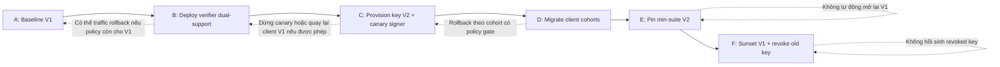
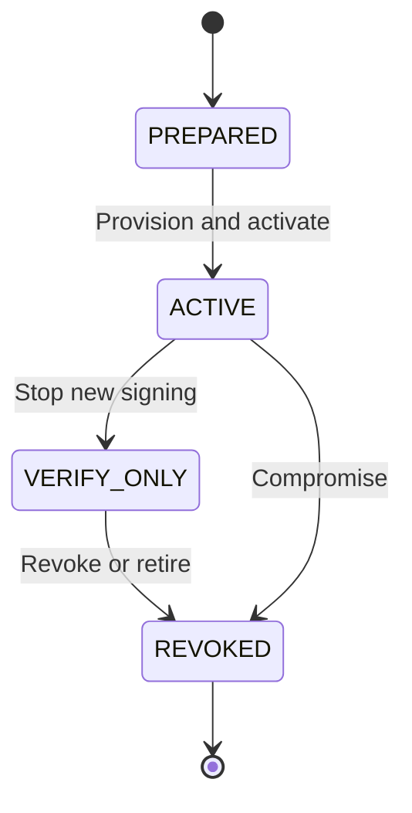
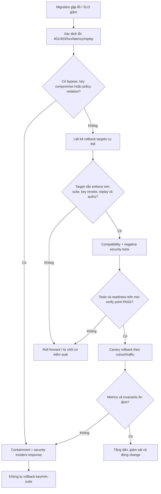

# Rollback migration trong xác thực HTTP request bằng HMAC

## 1. Mục tiêu và phạm vi

Trong chương **Migration**, chủ đề **Rollback migration** trả lời một câu hỏi thực tế: khi đang chuyển đổi cơ chế ký/xác thực HTTP request bằng HMAC mà tỷ lệ lỗi, độ trễ hoặc rủi ro bảo mật tăng, làm thế nào đưa hệ thống trở lại trạng thái ổn định **mà không làm suy yếu các điều kiện xác thực đã được thiết lập**?

Bài thuộc mô-đun `SECURITY_AUTHENTICATION_HMAC_REQUEST_AUTHENTICATION`. Hệ thống sử dụng **shared secret** và **canonical request** gồm HTTP method, URI, signed headers và/hoặc body theo một hợp đồng có phiên bản. Verifier cần so sánh HMAC, kiểm timestamp/nonce chống replay, quản lý key rotation, xử lý đúng các thay đổi qua proxy/gateway và **phân biệt xác thực với phân quyền**.

Một đợt migration thường không chỉ là thay một thư viện. Nó có thể đồng thời ảnh hưởng:

- Client SDK tạo request và canonical bytes;
- định dạng chữ ký, thuật toán HMAC và cách chọn key;
- verifier Spring MVC/WebFlux hoặc gateway;
- kho shared secret, trạng thái `ACTIVE` / `VERIFY_ONLY` / `REVOKED`;
- cửa sổ timestamp và TTL nonce trong replay store;
- route rewrite, signed headers và TLS termination;
- cách tạo authenticated principal và authority sau xác minh;
- rollout nhiều region, backend cũ/mới chạy song song và các đối tác chưa nâng cấp.

**Rollback không phải lúc nào cũng có nghĩa là triển khai lại phiên bản N-1.** Đôi khi bản phần mềm cũ không hiểu chữ ký mới; đôi khi bản cũ còn chấp nhận key đã bị thu hồi; đôi khi lùi cấu hình làm endpoint mở lại HMAC-V1 mà chính sách đã cấm. Khi đó **roll forward với bản vá tương thích** hoặc **containment có kiểm soát** có thể an toàn hơn rollback trực tiếp.

Sau bài, người học có thể:

1. Phân biệt rollback code, configuration, traffic, contract, credential và security policy.
2. Xây ma trận tương thích client–gateway–verifier–key–nonce store trước migration.
3. Đặt **security invariants** không được phá khi rollback.
4. Chọn điểm quay lại an toàn theo từng pha migration, có tiêu chí dừng và kiểm soát blast radius.
5. Xây rollback runbook, canary, metric và quyết định khôi phục dịch vụ.
6. Kiểm tra rollback của HMAC contract bằng golden vectors, integration tests, multi-node replay và proxy/gateway tests.
7. Ứng phó với lỗi sau key rotation, bị lộ secret, giảm mức bảo mật hoặc lỗi cấp quyền do thay xác thực.
8. Viết báo cáo migration/rollback có thể kiểm chứng và tránh khẳng định thành công chỉ từ tỷ lệ HTTP 2xx.

**Nguyên tắc:** chỉ rollback khi trạng thái đích **còn đáp ứng chính sách bảo mật hiện hành**. Không hy sinh tính toàn vẹn request, chống replay hoặc key revocation để giảm 401.

## 2. Rollback có nhiều lớp khác nhau

Cần xác định **đối tượng** và **phạm vi** đang lùi trước khi chạm vào hệ thống. Các lớp không đồng nghĩa với nhau.

| Loại rollback | Ví dụ | Rủi ro đặc biệt |
| --- | --- | --- |
| **Binary/application rollback** | Thay image backend N+1 bằng N. | N có thể thiếu verifier V2, sửa lỗi bảo mật hoặc logic fail-closed vừa có. |
| **Gateway/ingress rollback** | Khôi phục route rewrite hoặc cấu hình TLS trước migration. | Làm thay đổi public target/authority được ký, trust boundary và mTLS. |
| **Feature/config rollback** | Tắt routing V2 hoặc đưa cohort trở lại cấu hình cũ. | Flag có thể đồng thời tắt MAC verification hoặc mở `permitAll`. |
| **Traffic rollback** | Chuyển traffic khỏi canary sang nhóm backend trước đó. | Backend cũ có thể không kiểm đúng suite/key policy của request mới. |
| **Client/SDK rollback** | Đưa signer từ V2 về V1. | Client policy có thể đã yêu cầu V2; key V1 đã bị revoke hoặc không còn được cấp. |
| **Contract rollback** | Dùng canonicalization cũ, đổi thứ tự signed headers. | Thay đổi **byte được ký**, dễ gây signature confusion hoặc downgrade. |
| **Credential rollback** | Dùng lại key ID/secret trước rotation. | Có thể làm sống lại secret bị lộ hoặc đã revoked. |
| **Security policy rollback** | Cho phép lại HMAC-V1 sau mốc sunset. | Có thể trái chính sách tối thiểu và threat model. |
| **State/store rollback** | Restore Redis nonce store hoặc DB cache từ snapshot. | Có thể **quên nonce đã chấp nhận**, cho phát lại signed request. |
| **Operational rollback** | Hủy rollout, cô lập node mới và giữ bản an toàn hiện hữu. | Cần chắc chắn bản hiện hữu vẫn còn đúng chính sách. |

Nên dùng từ cụ thể trong incident channel, ví dụ “**rollback gateway path rewrite cho canary 5%**”, không chỉ “rollback HMAC”. Phạm vi chính xác giúp người điều phối hiểu thay đổi nào **không được** thực hiện cùng lúc.

### Phân biệt rollback với roll forward

**Rollback** là quay một thành phần về trạng thái cũ đã xác minh; **roll forward** là phát hành bản vá mới để khắc phục lỗi nhưng vẫn giữ các yêu cầu bảo mật mới.

Ví dụ vừa công bố rằng key V1 bị lộ và bắt buộc ngừng nhận V1, một backend N-1 vẫn cho V1 pass là **đích rollback không hợp lệ**. Giải pháp có thể là N+2 sửa canonicalization V2, hoặc tạm từ chối operation nhạy cảm trong khi triển khai bản vá. Trả 503 có kiểm soát có thể an toàn hơn một hệ thống 200 nhưng chấp nhận request ký bằng secret đã lộ.

## 3. Bất biến bảo mật không được rollback

Trước khi thiết kế bất kỳ nút “rollback”, cần ghi **invariants** thành test và điều kiện chặn triển khai.

### 3.1. Những điều kiện xác thực bắt buộc

Đối với request thuộc phạm vi HMAC:

1. **MAC phải hợp lệ** với canonical bytes đúng version, đúng method/URI/header/body theo contract. Không bỏ trường ký để khắc phục lỗi mismatch.
2. **Shared secret phải đúng scope** client/tenant/key ID; không thử tất cả secret hoặc các tenant khác đến khi tag khớp.
3. **Key state phải còn hợp lệ**: `REVOKED` hoặc `EXPIRED` không được quay lại `ACTIVE` chỉ do rollback phần mềm/cấu hình.
4. **Suite/algorithm phải được policy cho phép**, không dùng client capability header để vượt qua server-side allowlist.
5. **Timestamp** là dữ liệu đã ký, được kiểm độ mới theo trusted clock và policy. Không chấp nhận cửa sổ thời gian vô hạn.
6. **Nonce đã ký** phải được reserve nguyên tử trên replay store dùng chung; không tái sử dụng do mất trạng thái hoặc failover.
7. Nếu key store/replay store không đủ tin cậy, **fail closed**; không tạo authenticated principal khi dependency lỗi.
8. **Gateway assertion** chỉ được tin khi xuất phát từ verifier được xác thực và ràng buộc đúng trust boundary; không tin header do client tự đặt.
9. Chỉ tạo `Authentication` sau khi toàn bộ xác thực HMAC đạt; **authorization** vẫn kiểm authority/scopes riêng.
10. Mọi ingress, route alias và node thuộc phạm vi phải thực thi cùng chính sách tối thiểu.

Rollback **không được** biến 401 do chữ ký sai thành 200, 403 do thiếu quyền thành 200 hoặc lỗi replay store thành request được chấp nhận.

### 3.2. Vì sao “khôi phục secret cũ” rất nguy hiểm?

Giả sử key V1 bị lộ. Dù HMAC-SHA256 còn đúng về mặt thuật toán, attacker đã biết secret có thể tạo request mới với timestamp và nonce mới. Việc phục hồi key V1 để chữa lỗi client cũ sẽ mở lại khả năng giả mạo.

Vì vậy:

- **Revoke là quyết định bảo mật**, không phải một phần version application cần tự đảo ngược.
- Nếu cần thay đổi trạng thái credential, bắt buộc security owner phê duyệt theo threat model, audit và bằng chứng; **không tự động undo revoke**.
- Khi key bị lộ, phải phát hành credential mới qua kênh an toàn, đánh giá client impact, không tái dùng secret vì “chưa kịp update”.
- Rollback binary phải đọc chính sách key đang có hiệu lực; không mang theo một snapshot credential cũ trong artifact/container.
- Nếu cache giữ key cũ, cần kiểm TTL/invalidation và giới hạn thời gian revoke có hiệu lực.

**Security policy là sàn tối thiểu**, không phải một biến được tự động hạ khi SLO giảm.

## 4. Ví dụ migration HMAC-V1 sang HMAC-V2

Bài sử dụng hai suite minh họa, **không phải chuẩn mặc định của Spring Security**.

| Thuộc tính | HMAC-V1 | HMAC-V2 |
| --- | --- | --- |
| Algorithm | HMAC-SHA256 | HMAC-SHA512 |
| Java JCA name | `HmacSHA256` | `HmacSHA512` |
| Tag | 32 byte | 64 byte |
| Encoding | Base64 chuẩn của tag đầy đủ | Base64 chuẩn của tag đầy đủ |
| Canonical version | `HMAC-V1` | `HMAC-V2` |
| Signed data | Method, public URI/authority, selected headers, body digest, timestamp, nonce | Cùng các nhóm dữ liệu, nhưng version/algorithm được ràng buộc rõ |
| Key ID | Key V1 theo credential scope | Key V2 theo credential scope |
| Replay guard | Nonce store dùng chung, atomic | Nonce store dùng chung, atomic |
| Server policy | Legacy trong giai đoạn chuyển tiếp, tùy client | Preferred/required cho cohort mới |

Tên suite và bộ signed fields chỉ là ví dụ cho một contract versioned. Trong production, nếu V2 đổi cách canonicalize URI hoặc body digest, phải có golden vectors và lộ trình migration riêng. HMAC-SHA512 không tự khắc phục lỗi signature coverage thiếu method/body hoặc lộ shared secret.

### 4.1. Các pha triển khai có thể đảo ngược ở mức nào?



| Pha | Trạng thái | Rollback có thể chấp nhận | Điều cần tránh |
| --- | --- | --- | --- |
| A — V1 baseline | Chỉ V1 đã được chấp nhận | Quay lại baseline nếu chưa có thay đổi bảo mật buộc V2 | Dùng baseline không còn đáp ứng policy. |
| B — Verifier hỗ trợ V1+V2 | Client vẫn ký V1; backend mới đọc được V2 | Rollback deployment mới nếu V1 vẫn được phép và chưa có client dùng V2 | Rút V2 verifier khi đã có request V2 từ client. |
| C — Provision V2 + canary | Một nhóm nhỏ ký V2 | Dừng canary; dùng V1 **chỉ khi key/policy còn hợp lệ** | Tự đổi signer xuống V1 khi gặp 401. |
| D — Migrating cohorts | V1/V2 hoạt động đồng thời | Chuyển cohort về đường an toàn có tương thích và phê duyệt | Đưa V2-only client vào backend chỉ hiểu V1. |
| E — Pin minimum V2 | Một nhóm client bị cấm dùng V1 | Roll forward sửa V2 hoặc cô lập cohort | Tự nới `minSuite` xuống V1 để tăng 2xx. |
| F — Sunset/revoke V1 | V1 hết hiệu lực, key cũ thu hồi | Không rollback policy/key; chỉ rollback những thành phần vẫn giữ V2 đúng | Khôi phục key revoked hay bật legacy suite do rollout fail. |

**Một đợt migration có “point of no safe return” đối với chính sách legacy**: từ lúc V1 bị cấm vì rủi ro đã xác nhận, mọi bản quay lại phải giữ điều kiện cấm đó. Điều này không cấm rollback code hoàn toàn; nó cấm **rollback làm mất bảo vệ**.

### 4.2. Capability không phải quyền chọn

Client có thể biết cách ký V1 và V2. Nhưng `supportedByClient={V1,V2}` khác với `allowedByServerForCredential={V2}`. Một header `X-Client-Capabilities` chưa xác thực không thể tự mở lại V1. Nếu V2 request trả 401, nguyên nhân có thể là MAC, timestamp, nonce, key hoặc gateway — không phải tín hiệu để thử V1 tự động.

## 5. Compatibility matrix trước khi thiết kế rollback

Rollback an toàn đòi hỏi **biết ai còn gửi gì và ai có thể verify cái đó**. Một matrix cần được chốt trước mỗi giai đoạn.

| Client | Suite / key | Gateway | Backend | Server policy | Kỳ vọng |
| --- | --- | --- | --- | --- | --- |
| SDK cũ | V1 / key V1 active | G1 dual | B1 dual | V1 còn cho cohort này | Pass với nonce mới và quyền đúng. |
| SDK mới | V2 / key V2 active | G1 dual | B1 dual | V2 cho phép | Pass. |
| SDK mới | V2 / key V2 active | G1 dual | B0 V1-only | V2 yêu cầu | **Không tương thích**, không đưa traffic V2 đến B0. |
| SDK cũ | V1 / key V1 revoked | G1 dual | B1 dual | V1/key bị cấm | Reject **dù MAC chính xác**. |
| SDK mới | V1 / key V2-only | G1 dual | B1 dual | Key chỉ cho V2 | Reject key/suite mismatch. |
| SDK mới | V2 / key V2 active | G0 V1-only | B1 dual | V2 cho phép | Gateway path không sẵn sàng, phải chặn rollout. |
| SDK mới | V2 | G1 path rewrite mới | B1 dùng URI cũ | V2 cho phép | Signature mismatch nếu public target không được bảo toàn. |
| SDK mới | V2 | G1 verify HMAC, backend nhận assertion | Backend chỉ tin authenticated gateway | V2 cho phép | Pass khi trust boundary đúng; direct bypass bị chặn. |
| SDK mới | V2 | G1 dual | B1 dual | Replay store unavailable | Fail closed, không xử lý nghiệp vụ. |
| SDK mới | V2 | G1 dual | B1 dual | MAC đúng, thiếu authority | 403, không phải signature failure. |

Mỗi hàng cần test **với timestamp và nonce mới** khi đo positive compatibility. Nếu gửi lại chính một signed request qua hai backend trong cùng replay namespace, node thứ hai có thể trả 401 do replay **đúng**, không phải incompatibility.

### 5.1. Ai sở hữu quyết định?

Quyết định rollback phải bao gồm:

- **Security owner:** chấp nhận hay từ chối đích rollback theo minimum suite, key state và threat model.
- **API/backend owner:** bảo đảm verifier, security chain và handler tương thích.
- **Gateway/platform owner:** bảo đảm edge policy, TLS, routing, trusted forwarding và direct-backend protection.
- **Credential owner:** giám sát revoke/rotation và scope của shared secrets.
- **SRE/incident commander:** chịu trách nhiệm điều phối, canary, dừng/khôi phục và đánh giá ảnh hưởng.
- **Client/partner owner:** điều phối SDK/provisioning theo cohort, chuẩn bị phương án xử lý incompatibility.

Một runbook không nên cho deploy pipeline tự động “re-enable V1 for everyone” khi thấy 401 tăng. Nếu một thao tác có thể nới security policy, cần **kiểm soát thay đổi riêng**, có audit và phê duyệt phù hợp.

## 6. Kiến trúc tách code rollback khỏi policy rollback

### 6.1. Không gói toàn bộ security policy vào binary cũ

Ví dụ version N+1 có thể hỗ trợ cả V1 và V2; sau sunset V1, policy trung tâm cấm V1. Nếu binary N còn hard-code `allowV1=true`, rollback N có thể mở lại V1 bất chấp policy hiện hành.

Thiết kế an toàn hơn:

- Có nguồn chính sách có thẩm quyền theo client/tenant/key/route/suite/time, được kiểm quyền và audit.
- Mỗi verifier chỉ xử lý suite **vừa được implementation hỗ trợ vừa được policy cho phép**.
- Key state và revocation được kiểm từ nguồn tin cậy với freshness/invalidation phù hợp.
- Rollback binary **không thể** tự nới minimum policy; nếu binary không thực thi được policy hiện hành, nó **không đạt readiness** để phục vụ protected traffic.
- Các verifier có cơ chế phản ứng khi policy store unavailable: không dùng cached allow-all hoặc default V1.
- Quá trình deploy kiểm policy compatibility **trước khi chuyển traffic** và giám sát drift giữa các node.

Cần phân biệt policy **cache còn trong hạn** với policy **stale không còn đáng tin**. Khi có yêu cầu thu hồi key khẩn, một cache chưa invalidated có thể không chấp nhận được dù TTL còn dài. Thỏa thuận về revoke SLA và behavior khi không liên hệ được policy authority phải là một phần thiết kế.

### 6.2. Một quy tắc lựa chọn suite

```text
effectiveAllowedForRequest =
    implementationSupported
    ∩ endpointAllowed
    ∩ clientCredentialAllowed
    ∩ policyAllowedAtDecisionTime

request.suite ∈ effectiveAllowedForRequest
AND credential.state == usable
AND credential.scope == claimed client/tenant
AND signature == expected MAC over selected contract
AND timestamp within freshness window
AND nonce atomically reserved
```

Đây là mô hình điều kiện, không phải một cách cho phép client tự chọn dữ liệu server policy. `request.suite` và `keyId` trước khi verify chỉ là **lookup hints chưa được tin cậy**; chỉ sau MAC và các điều kiện bảo mật mới tạo authenticated principal.

### 6.3. Configuration generation và chống khôi phục policy cũ

Khi policy cần đồng bộ qua nhiều node, có thể gắn version/generation:

```yaml
policy_generation: 83
allowed_suites:
  partner-a: [HMAC-V2]
minimum_suite:
  partner-a: HMAC-V2
credential_revocations:
  - key-v1-compromised
effective_at: '2026-12-02T00:00:00Z'
```

Dữ liệu chỉ minh họa; trong hệ thống thật các định danh và key state có thể nằm ở credential service và policy là tập có scope rõ hơn. **Không** hard-code production secret trong cấu hình này.

Nếu một binary cũ chỉ hiểu policy schema thế hệ trước, có hai lựa chọn an toàn: **không route traffic vào binary đó**, hoặc cập nhật binary/cầu tương thích để nó **thực thi toàn bộ policy mới**. Đừng bỏ qua field không hiểu rồi mặc định allow.

Lưu ý: chỉ lưu số `policy_generation` trong một config file có thể bị rollback **không đủ chống rollback**. Cần nguồn policy tin cậy có quyền ghi hạn chế, audit, state so sánh không bị cùng thao tác rollback xóa đi và fail-closed semantics. Khi policy source bị khôi phục từ snapshot cũ, một counter trên chính snapshot đó cũng có thể bị lùi. Hệ thống cần một ranh giới chống rollback độc lập hoặc quy trình kiểm duyệt khôi phục trạng thái tương ứng.

## 7. Không rollback trạng thái nonce store

HMAC xác minh tính toàn vẹn request không ngăn một người có bản request đã ký **phát lại y nguyên** khi timestamp còn hợp lệ. Chống replay thường dùng nonce có chữ ký và một shared store với thao tác atomic insert-if-absent.

```text
SET replay:<scoped-credential>:<nonce> 1 NX PX <ttlMillis>
```

`NX` chỉ tạo key mới khi chưa có, `PX` đặt TTL trong cùng thao tác. Namespace cần theo credential/client scope đã xác minh; không cho phép giá trị `X-Client-Id` chưa kiểm MAC tự xác định một không gian replay có quyền cao hơn.

### 7.1. Restore Redis snapshot có thể mở replay

Giả sử request R được server chấp nhận lúc 12:00:00 và nonce đã ghi. Sau deploy lỗi, nhóm vận hành **restore Redis về snapshot 11:59:00**. Bản snapshot không chứa nonce của R; nếu timestamp của R vẫn nằm trong freshness window, bản sao R có thể tiếp tục được chấp nhận.

Vì vậy:

- Không rollback replay store như một bộ cache vô hại.
- Không xóa/bỏ qua nonce namespace khi chuyển V1 ↔ V2 mà chưa chứng minh tính đúng.
- Không dùng nonce store local theo node trong lúc rollback để “tránh phụ thuộc Redis”.
- Nếu mất tính toàn vẹn replay state, protected operations cần **fail closed hoặc containment** cho đến khi có cơ chế khôi phục an toàn.
- Phải đánh giá các request đã được chấp nhận kể từ snapshot và ảnh hưởng nghiệp vụ, gồm idempotency/transaction side effects.

Nếu client retry request đã ký với **nonce mới**, nó có thể được xác thực hợp lệ và **vẫn gây side effect trùng**. Nonce không thay idempotency key nghiệp vụ.

### 7.2. Cửa sổ timestamp và TTL nonce

Giả sử cho phép timestamp quá khứ tối đa 300 giây và tương lai tối đa 30 giây. Một nonce lần đầu được reserve khi timestamp đang ở tương lai 30 giây có thể cần được giữ **330 giây hoặc lâu hơn** (cộng giới hạn skew giữa verifier và margin).

```text
minimum_nonce_ttl >= maxPast + maxFuture
                     + boundedRelativeClockSkew
                     + operationalMargin
```

Đây là **ước lượng bảo thủ để thiết kế**, không thay việc chứng minh với clock/store thực và expiry semantics. Nếu rollback code đồng thời làm giảm TTL về 300 giây, một request có thể còn hợp lệ sau khi nonce đã bị quên. Cần regression test TTL, shared store, multi-node race và Redis eviction/failover.

### 7.3. Có đổi nonce namespace khi đổi key/suite không?

Không có quy tắc chung rằng nonce namespace **phải** chứa suite. Nó phụ thuộc protocol, credential scope, yêu cầu chống phát lại chéo suite và khả năng reuse key.

- Nếu V1 và V2 dùng **hai key riêng** với key ID khác nhau, namespace theo credential có thể phù hợp.
- Nếu cùng shared secret được dùng trong giai đoạn chuyển tiếp, cần thiết kế rõ domain separation, suite binding, nonce uniqueness và khả năng phát lại qua hai format.
- Không tự thêm/bỏ thành phần suite khỏi Redis key chỉ để tránh `NONCE_REPLAY` khi rollback.
- Giữ các nonce đã reserve của cả V1 và V2 còn hiệu lực trong thời gian chúng có thể được chấp nhận theo policy.
- Không biến một mismatch giữa replay namespaces thành lý do bỏ kiểm nonce.

Mọi thay đổi namespace là **thay đổi bảo mật của giao thức xác thực**, phải có threat model và tests.

## 8. Rollback key rotation: các trạng thái không đối xứng

Key rotation thường theo vòng đời:



Sơ đồ minh họa một chính sách, không bắt buộc mọi nền tảng dùng đúng tên trạng thái. Về nguyên tắc, từ `REVOKED` quay lại `ACTIVE` không được coi là thao tác rollback kỹ thuật tự động.

| Tình huống | Có thể rollback gì? | Không được rollback gì? |
| --- | --- | --- |
| SDK mới ký sai do canonicalization | Rollback signer cho cohort nếu key cũ vẫn được phép, hoặc roll forward sửa signer. | Không khôi phục key đã bị lộ/revoked. |
| Client chưa nhận key V2 | Dừng chuyển cohort, sửa provisioning; giữ client trên key V1 trong cửa sổ hỗ trợ còn hợp lệ. | Không cho client dùng key khác tenant hoặc bỏ key lookup. |
| Backend chưa cập nhật key cache | Sửa invalidation/readiness, rollback routing sang backend tương thích. | Không mở stale key vĩnh viễn. |
| Key cũ bị phát hiện lộ trong log | Rotate/revoke key, cô lập log, kiểm audit. | Không đưa key cũ trở lại chỉ vì 401 tăng. |
| Verify-only overlap kết thúc | Điều chỉnh rollout schedule trước cutoff nếu policy chưa cấm, có phê duyệt. | Không kéo dài verify-only sau revoke vì security incident. |
| Secret store unavailable | Containment, khôi phục store, fail closed. | Không dùng shared hard-coded fallback secret từ bản cũ. |

Key ID và thuật toán/contract version là **hai trục khác nhau**. Một key V2-only không được dùng để tính lại request V1 chỉ vì cả hai đều là HMAC. Server phải ràng buộc allowed suite theo key metadata.

### 8.1. Không dùng snapshot secret store cũ làm rollback plan

Một snapshot cũ có thể thiếu revocation mới, chứa secret đã bị thu hồi hoặc permission rộng hơn. Nếu cần khôi phục secret manager, phải có **quy trình phục hồi trạng thái bảo mật** riêng, audit và xác minh revocations; không mặc định restore một bản backup là quay về trạng thái được phép chấp nhận request.

## 9. Rollback proxy/gateway không làm sai canonical target

Một migration có thể đồng thời đổi ingress, TLS termination, upstream HTTP version hoặc strip path prefix. Khi rollback gateway, phải xác định **điểm xác minh HMAC có thẩm quyền**.

### Ví dụ

Client ký request:

```text
POST /public/api/orders?source=partner
Host: api.example.test
X-Timestamp: 2026-12-02T03:00:00Z
X-Nonce: <unique test nonce>
```

Gateway mới strip `/public` thành `/api/orders` trước backend. Nếu backend tái dựng canonical URI từ path sau rewrite thay vì **public target đã được ký** theo contract, signature mismatch có thể tăng.

Rollback route rewrite có thể giúp **nếu** trạng thái cũ còn đúng contract và trust boundary. Nhưng nếu backend mới chỉ hỗ trợ target dạng mới, rollback gateway đơn lẻ có thể tạo loại mismatch khác.

### Ba cách xác minh thường gặp

1. **Backend verify:** backend phải có nguồn public target/authority đáng tin được bảo toàn hoặc chuyển qua metadata được gateway xác thực. Không tin `X-Original-URI` từ client.
2. **Gateway verify trước rewrite:** edge xác minh MAC + timestamp + nonce, rồi chuyển principal assertion qua đường có xác thực như mTLS/service authentication; backend vẫn kiểm authorization.
3. **TLS passthrough:** backend nhận trực tiếp request ở mức TLS; vẫn phải kiểm routing, key state và replay policy.

**TLS termination không có nghĩa request đã xác thực HMAC.** Thay đổi mTLS, Host, `Forwarded` và `X-Forwarded-*` có thể đổi trust boundary; rollback phải test spoofed forwarding headers, direct-backend access và nhiều đường ingress.

### Ma trận gateway regression

| Thay đổi gateway | Positive test | Negative/security test |
| --- | --- | --- |
| Strip prefix | Client ký public URI đúng, verifier nhận đúng byte contract. | Đổi signed path sau ký phải thất bại, không bỏ ký path. |
| Query normalization | Known query vectors qua ingress thật. | Percent encoding/order/duplicate query bị thay phải đúng policy. |
| Host/authority rewrite | Public Host và HTTP/2 `:authority` đúng tại verify point. | Forged `X-Forwarded-Host` không cấp quyền sửa canonical authority. |
| Header forwarding | Signed headers được bảo toàn/chuẩn hóa theo grammar. | Duplicate signed header và identity assertion giả bị từ chối. |
| Body compression/decompression | Body bytes được hash đúng tại điểm verify. | Ký body A gửi body B không được chấp nhận. |
| HTTP/2 ↔ HTTP/1.1 | Contract tương thích hoặc có verify ở edge. | Không bypass qua method override/smuggling ambiguity. |
| Retry upstream | Idempotency/replay behavior theo contract. | Cùng signed request không được gây side effect hai lần. |
| TLS/mTLS reconfiguration | Trusted cert/identity hoạt động. | Cert không tin cậy/direct-backend bypass bị từ chối. |

Không “fix” rollback bằng cách bỏ method, URI, body digest hoặc header khỏi signed fields. Đó là **thay đổi coverage bảo mật**, không phải sửa tương thích.

## 10. Cách ra quyết định: rollback, roll forward hay containment?

Quyết định dựa trên **security validity của trạng thái đích**, không dựa riêng vào tốc độ hồi phục.

| Triệu chứng | Hướng ưu tiên | Lý do |
| --- | --- | --- |
| Bản backend N+1 crash, N vẫn verify V1/V2 đúng policy hiện tại | Rollback binary hoặc traffic canary có kiểm chứng. | Có rollback target đáp ứng security invariants. |
| Client V2 lỗi canonical serialization, V1 vẫn hợp lệ cho cohort đó | Có thể rollback client có kiểm soát; ưu tiên sửa signer/golden vector. | Không thay server min-suite khi policy còn cho V1. |
| Client V2 lỗi nhưng cohort đã pin V2-only | Roll forward V2 hoặc containment. | Rollback V1 sẽ phá minimum suite. |
| V1 secret bị lộ và bị revoke | Roll forward hoặc tạm chặn protected operation. | V1 không còn trạng thái bảo mật hợp lệ. |
| Gateway mới rewrite sai signed URI, gateway cũ còn đúng trust boundary | Rollback gateway canary sau gateway contract tests. | Khôi phục canonical target mà không hạ auth assurance. |
| Gateway cũ thiếu mTLS/identity assertion verification mới bắt buộc | Roll forward, không rollback gateway cũ. | Backward deployment sẽ mở trust boundary. |
| Replay store timeout / state mất sau failover | Fail closed, khôi phục store an toàn; có thể traffic containment. | Không rollback về local nonce cache hoặc restore snapshot thiếu nonce. |
| Policy server đang sai phạm vi client/tenant do config rollout | Rollback **phần policy sai** qua thay đổi được audit/security review, giữ revoke/minimum floor. | Cần phân biệt sửa nhầm cấu hình với mở lại policy cấm. |
| p99 HMAC tăng sau nâng cấp JDK | Đo stage/CPU, rollback runtime nếu còn tương thích security policy. | Performance regression không tự cho phép bỏ MAC/replay. |
| 403 tăng sau migration | Kiểm authority/principal mapping, sửa authz policy chính xác. | 403 không phải signature mismatch. |
| 401 tăng do clock skew node | Khôi phục time source/cô lập node, không rollback crypto suite. | Nới timestamp window có thể làm tăng replay risk. |

### Cây quyết định



Với sự cố đã chứng minh bypass hoặc key compromise, incident commander và security owner quyết định containment. Không chạy pipeline rollback tự động chưa có rào chắn security.

## 11. Định nghĩa điểm rollback an toàn trước khi bắt đầu migration

Một rollback plan chất lượng phải được chuẩn bị **trước cutover**, không viết khi đang có sự cố.

### 11.1. Hồ sơ baseline

Lưu các thông tin **không chứa secret**:

- Artifact/image digest của client SDK, gateway, backend verifier và security configuration.
- Contract version, algorithm ID, canonical byte grammar và golden vector IDs.
- Credential metadata: key ID, scope, state, allowed suites, effective/expiry times; **không lưu shared secret trong tài liệu rollout**.
- Policy generation, minimum suite theo cohort và sunset/revocation milestones.
- Replay store namespace schema, TTL, failover/eviction policy và cấu hình time sync.
- Topology các điểm verify, ingress/Host/path rewrite, TLS/mTLS boundaries.
- Baseline metrics p50/p95/p99, 401/403/5xx, key lookup/replay RTT và số lượng client theo suite.
- Danh sách endpoint protected và expected authorities, bao gồm đường direct backend.

Nếu có nhiều region, baseline phải nói rõ mỗi region/node đang chạy gì. “Tất cả đều N+1” có thể không đúng trong rolling deploy.

### 11.2. Tiêu chí bắt đầu rollback

Ví dụ **minh họa**:

- Tỷ lệ unexpected 401 trong **valid signed workload** vượt SLO/error budget hoặc baseline theo ngưỡng đã phê duyệt.
- 5xx tăng do credential/replay store hay gateway rollout; trước tiên phải chứng minh nguyên nhân.
- p99 authentication hoặc overall latency vượt giới hạn vận hành.
- Một phiên bản mới làm body/method/URI/header signature contract lệch khỏi golden vectors.
- Canary V2 không chạy được trên một số verifier nodes.
- Một lỗi bảo mật mới: bị chấp nhận request unsigned, revoked, replay hoặc key scope sai. Trường hợp này kích hoạt **containment**, không mặc định rollback.

Ngưỡng phải do hệ thống thực chọn; không có “p99 dưới 500 ms” hoặc “401 dưới 1%” chung cho mọi HMAC API.

### 11.3. Tiêu chí không được rollback

Có các **hard stops**:

- Target verifier chấp nhận key bị revoke hoặc legacy suite ngoài policy.
- Không có cách bảo đảm nonce shared/atomic hoặc store state đáng tin.
- Target bỏ signed fields, làm verifier với handler hiểu request khác nhau.
- Gateway rollback cho phép trực tiếp vào backend hoặc tin identity assertion giả.
- Rollback app sẽ làm mất authority check hoặc biến 403 thành 200.
- Không xác định được các client đã chuyển V2 và target không hỗ trợ V2.
- Một secret được chứng minh đã lộ sẽ phải được phục hồi để rollback.
- Canaries/negative tests chưa chạy hoặc cho thấy request tampered/replayed được chấp nhận.

Khi target không hợp lệ, giải pháp hợp lý là **roll forward** hoặc cô lập tác vụ nhạy cảm có kiểm soát.

## 12. Runbook rollback theo pha

### Pha 0 — Kích hoạt và điều phối

1. Ghi incident/change ID, thời điểm UTC và triệu chứng.
2. Chỉ định incident commander, security owner, gateway/backend/credential owners.
3. **Đóng băng các rollout đồng thời** làm thay đổi signer/verifier/policy/credential để tránh kết luận sai nguyên nhân.
4. Chốt scope: route, client cohort, region, key/suite, gateway path và môi trường.
5. Phân loại lỗi: signature mismatch, malformed tag, timestamp, nonce, key state, authorization, 5xx dependency hay performance.
6. Kiểm security impact: có request chưa xác thực được chấp nhận, key bị lộ hoặc replay không?
7. Chụp **metadata/snapshot cấu hình đã làm sạch**, version và telemetry cần thiết cho audit.

**Không** thu thập shared secrets, raw signatures hoặc canonical request của dữ liệu thật vào ticket. Dùng fixture/golden vectors với khóa giả để tái hiện.

### Pha 1 — Chọn đích và kiểu rollback

1. Từ compatibility matrix, liệt kê phiên bản verifier và gateway có thể xử lý **những client đang hoạt động**.
2. Kiểm target binary có enforce đúng server-side min-suite, key revocation, nonce TTL, authorization và TLS trust boundary.
3. Quyết định rollback **traffic**, **binary**, **gateway config**, **client cohort** hay cần roll forward.
4. Tách riêng những thay đổi **không được revert**: revoked keys, minimum policy sau sunset, replay state, security fixes bắt buộc.
5. Xác định điều kiện stop/abort, rollback của **chính thao tác rollback** và owner phê duyệt.

### Pha 2 — Kiểm target trước chuyển traffic

Chạy trên canary/staging gần production:

- Golden vectors V1/V2 với signer độc lập; byte canonical và tag không đổi.
- Valid requests có timestamp, nonce mới, key còn hiệu lực, authority đúng.
- Negative signature/body/method/URI/header mutation.
- Revoke/expired key, tenant mismatch, unknown suite.
- Expired/future signed timestamp, replay cùng node và multi-node, key/replay store timeout fail closed.
- Gateway public path/authority, signed headers, TLS/mTLS và direct-backend bypass.
- SecurityFilterChain MVC hoặc SecurityWebFilterChain WebFlux thực sự hoạt động.
- Positive 2xx, expected 401/403/413/429/503 và **không có side effect** từ các request bị cấm.

Nếu target không đạt, **dừng rollback** thay vì bỏ bớt tests.

### Pha 3 — Canary rollback

- Chuyển một phần nhỏ cohort/route/region bằng traffic control **có kiểm chứng**, không dựa vào raw client header làm identity.
- Giữ replay store chung và các nonce đã reserve.
- Giữ policy min-suite và revocation tại nguồn tin cậy; không restore bản snapshot cũ.
- Đảm bảo các edge nodes và backend được route tới hỗ trợ đúng suite cho cohort.
- Theo dõi actual accepted RPS và unexpected 401, không chỉ HTTP 2xx tổng.
- Dừng ngay nếu thấy request tampered/replayed/revoked được nhận, sai principal, mất 403 hoặc bypass đường trực tiếp.

**Không tự hạ cấp client V2 xuống V1 khi canary trả 401.** Nếu thay signer là thao tác rollback chính thức, nó cần nằm trong chính sách/cohort được phê duyệt và có key còn hiệu lực.

### Pha 4 — Mở rộng dần

Sau khi canary đạt thời gian quan sát và tiêu chí đã công bố:

1. Mở rộng từng vùng/cohort/route với khả năng dừng.
2. Kiểm policy generation và key revocation giống nhau ở mọi instance.
3. Theo dõi percentiles, error budget, credential/replay store RTT, nonce duplicate/error, CPU/GC.
4. Kiểm các phiên bản client còn được hỗ trợ không bị từ chối giả do routing.
5. Kiểm request có MAC đúng nhưng thiếu quyền **vẫn trả 403**.
6. So sánh với baseline cùng traffic mix, body size và gateway topology.
7. Ghi nhận mọi phiên bản còn lại: có node cũ nào đang chạy ngoài dự kiến không?

### Pha 5 — Ổn định và hậu kiểm

- Khóa lại configuration drift, kết thúc migration rollout đang dang dở khi có phương án rõ ràng.
- Kiểm kho nonce và key-state consistency sau rollback; không được mất entries còn hiệu lực.
- Báo cáo những giao dịch đã bị từ chối, retry/idempotency và các side effects cần reconciliation.
- Viết regression test bắt đúng nguyên nhân; không chỉ thay baseline golden vectors theo output mới.
- Cập nhật timeline/decision log, SLO, rollback runbook và ownership.
- Nếu rollback không được phép do security policy, ghi rõ lý do và kế hoạch roll forward.

## 13. Spring Security: rollback vẫn phải enforce cùng điều kiện HMAC

Một số migration chỉ đổi cách đăng ký verifier trong `SecurityFilterChain` hoặc `SecurityWebFilterChain`, nhưng rollback binary cũ có thể làm thay đổi **filter order** hoặc fallback authentication.

### Spring MVC

Các lỗi cần rà:

- `securityMatcher` và `requestMatchers` có bao phủ đúng protected routes sau rollback?
- Một `permitAll` cho health/status có vô tình bao phủ `/api/**`?
- HMAC custom filter có nằm trong security chain không, hay bị auto-register ngoài chain rồi chạy hai lần?
- `AuthenticationException` trong filter được map về auth failure/entry point đúng không?
- Có một cơ chế Basic/Session/JWT khác tạo authenticated principal cho route **bắt buộc HMAC** không?
- Filter đọc body đã cung cấp replayable wrapper cho `@RequestBody` chưa? `ContentCachingRequestWrapper` không tự biến stream đã đọc hết thành stream phát lại.
- `AuthorizationFilter`/method security còn enforce scope nghiệp vụ không?

Một cấu hình **khái niệm** có thể cho thấy invariant:

```java
@Bean
SecurityFilterChain partnerApi(
        HttpSecurity http,
        HmacAuthenticationFilter hmacFilter) throws Exception {

    http
        .sessionManagement(sm -> sm.sessionCreationPolicy(
            SessionCreationPolicy.STATELESS))
        .authorizeHttpRequests(auth -> auth
            .requestMatchers(HttpMethod.GET, "/health/live").permitAll()
            .requestMatchers("/api/partner/**")
                .hasAuthority("orders:write")
            .anyRequest().denyAll())
        .addFilterBefore(hmacFilter, AuthorizationFilter.class);

    return http.build();
}
```

**Không xem skeleton này là hệ thống bảo vệ hoàn chỉnh.** `HmacAuthenticationFilter` phải tự bảo đảm mọi request protected đi qua HMAC, và chỉ sau verify mới tạo principal; có thể cần chính sách xác thực phân biệt HMAC principal với session/bearer principal. `permitAll` là rule authorization, không tự tắt filter custom. `addFilterBefore` chỉ định thứ tự tương đối, không tự bảo đảm exception translation trong mọi cấu hình; cần integration tests để kiểm filter/entry point thực tế.

### Spring WebFlux

Với WebFlux, kiểm:

- `AuthenticationWebFilter` hoặc custom `WebFilter` có compose đúng `Mono`/`Flux` và **chỉ gọi downstream sau verify thành công**.
- Không có `onErrorResume(... -> chain.filter(exchange))` khi key/replay store lỗi.
- Không có `switchIfEmpty(chain.filter(exchange))` làm bypass khi không có authentication result.
- `ReactiveSecurityContextHolder`/Reactor Context được dùng đúng, không lấy principal từ ThreadLocal.
- Xác minh body qua `Flux<DataBuffer>` với bounded buffering/decorator, release pooled buffer và cho handler đọc đúng bytes đã ký.
- Retry/resubscribe không bỏ nonce guard hoặc làm handler chạy hai lần.

Một WebFlux test gắn mỗi controller mà không có `SecurityWebFilterChain` **không chứng minh HMAC đang bảo vệ endpoint**; cần test application context có security hoặc HTTP server thật.

## 14. Java: policy gate độc lập với phiên bản binary

Ví dụ sau minh họa **một cổng chính sách kiểm suite sau rollback**. Nó không phải Spring component có sẵn và không thay thế toàn bộ verifier.

```java
import java.util.EnumSet;
import java.util.Set;

enum SignatureSuite {
    HMAC_V1, HMAC_V2
}

enum KeyStatus {
    ACTIVE, VERIFY_ONLY, REVOKED, EXPIRED
}

record CredentialPolicy(
    String clientScope,
    String keyId,
    KeyStatus status,
    Set<SignatureSuite> allowedSuites,
    long generation) {}

final class HmacPolicyGate {

    void requireAllowed(
            SignatureSuite declaredSuite,
            CredentialPolicy credential,
            Set<SignatureSuite> endpointAllowed,
            Set<SignatureSuite> implementationSupported) {

        if (credential.status() == KeyStatus.REVOKED
                || credential.status() == KeyStatus.EXPIRED) {
            throw new SecurityException("HMAC credential not usable");
        }

        // ACTIVE hoặc VERIFY_ONLY là trạng thái được kiểm tiếp;
        // validity window / revoked flag riêng vẫn phải kiểm.
        if (!credential.allowedSuites().contains(declaredSuite)
                || !endpointAllowed.contains(declaredSuite)
                || !implementationSupported.contains(declaredSuite)) {
            throw new SecurityException("HMAC suite not allowed");
        }
    }
}
```

**Điều kiện an toàn khi dùng mẫu:**

- `CredentialPolicy` phải được lấy từ **nguồn server-side có thẩm quyền**, scoped theo client/tenant/key ID; `generation` phải được đối chiếu với trusted policy floor hiện hành, không chỉ so với giá trị do một snapshot có thể rollback cung cấp.
- `declaredSuite` trước HMAC là **dữ liệu chưa xác thực**; parse bằng exact allowlist. Sau đó suite identity phải nằm trong canonical bytes và được MAC chứng minh.
- `allowedSuites` và `endpointAllowed` không được lấy trực tiếp từ header `X-Client-Capabilities`.
- `VERIFY_ONLY` chỉ được cho xác minh theo key validity/overlap window; code mẫu **chưa xử lý thời hạn**, nên production phải kiểm thêm.
- Logic HMAC thực tế phải kiểm canonical bytes, tag length, constant-time comparison, timestamp, nonce atomic reservation và fail-closed.
- `SecurityException` dùng để minh họa fail-closed; code Spring thật cần map lỗi sang authentication exception/response phù hợp và tránh tiết lộ key existence.
- Khi binary N-1 không hỗ trợ V2, `implementationSupported` không chứa V2: request phải **bị từ chối an toàn**; node đó không nên nhận traffic từ client V2-only.

**Quan trọng:** `CredentialPolicy.generation` không làm code tự động an toàn trước policy rollback. Hệ thống vận hành cần một policy authority/version floor độc lập và cơ chế refresh/invalidation đã được kiểm.

## 15. Java: kiểm thử rollback policy không mở lại key revoked

Một regression test nên chứng minh binary/logic mới hay cũ không thể dùng lại credential đã thu hồi.

```java
import static org.junit.jupiter.api.Assertions.assertThrows;
import java.util.EnumSet;
import org.junit.jupiter.api.Test;

class HmacRollbackPolicyTest {

    private final HmacPolicyGate gate = new HmacPolicyGate();

    @Test
    void revokedV1KeyStaysRejectedAfterBinaryRollback() {
        CredentialPolicy revoked = new CredentialPolicy(
            "partner-a",
            "key-v1-revoked",
            KeyStatus.REVOKED,
            EnumSet.of(SignatureSuite.HMAC_V1),
            83L);

        assertThrows(SecurityException.class,
            () -> gate.requireAllowed(
                SignatureSuite.HMAC_V1,
                revoked,
                EnumSet.of(SignatureSuite.HMAC_V1,
                           SignatureSuite.HMAC_V2),
                EnumSet.of(SignatureSuite.HMAC_V1)));
    }

    @Test
    void v1NotAcceptedWhenEndpointRequiresV2() {
        CredentialPolicy key = new CredentialPolicy(
            "partner-a",
            "key-v1-active",
            KeyStatus.ACTIVE,
            EnumSet.of(SignatureSuite.HMAC_V1),
            83L);

        assertThrows(SecurityException.class,
            () -> gate.requireAllowed(
                SignatureSuite.HMAC_V1,
                key,
                EnumSet.of(SignatureSuite.HMAC_V2),
                EnumSet.of(SignatureSuite.HMAC_V1,
                           SignatureSuite.HMAC_V2)));
    }

    @Test
    void v2OnlyRequestCannotUseOldVerifier() {
        CredentialPolicy key = new CredentialPolicy(
            "partner-a",
            "key-v2-active",
            KeyStatus.ACTIVE,
            EnumSet.of(SignatureSuite.HMAC_V2),
            83L);

        assertThrows(SecurityException.class,
            () -> gate.requireAllowed(
                SignatureSuite.HMAC_V2,
                key,
                EnumSet.of(SignatureSuite.HMAC_V2),
                EnumSet.of(SignatureSuite.HMAC_V1)));
    }
}
```

Các test này kiểm **policy gate cục bộ**, chưa kiểm credential lookup, HMAC, replay store hay Spring Security chain. Trong release suite cần bổ sung **HTTP integration** tạo một request có MAC V1 thực sự đúng bằng key đã revoked, timestamp hợp lệ và nonce mới, rồi assert bị từ chối **vì key state**. Nếu test chỉ gửi một MAC sai và nhận 401, nó chưa chứng minh revoke policy hoạt động.

### 15.1. Golden vectors phải độc lập

Để kiểm migration/rollback V1/V2:

- Có input method/URI/headers/body, canonical expected bytes, test secret bytes và expected MAC theo từng suite.
- Expected được tạo/đối chiếu bởi **triển khai độc lập**, không gọi chính production signer/verifier để tạo expected rồi so với nó.
- Kiểm `LF`/`CRLF`, trailing newline, percent-encoding, query order, duplicate signed headers, Unicode body và Base64 tag.
- Dùng `Clock.fixed` trong test freshness; dùng **nonce mới** cho mỗi positive request.
- Đổi signed body/header/URI sau ký phải bị từ chối ngay cả trên target rollback.
- Không tự cập nhật golden snapshots khi test đỏ; phân biệt regression với breaking contract có chủ đích.

## 16. Bộ kiểm thử trước và sau rollback

Một bộ đủ sức quyết định release cần **positive, negative và failure-injection**. Mỗi case nên assert **HTTP outcome, authentication decision và side effect**.

| Case | Dữ liệu test | Bất biến cần giữ |
| --- | --- | --- |
| `P01` | Client V1 + key V1 active, V1 vẫn allowed, nonce mới | Pass theo support policy, không ngắt client chưa migrate. |
| `P02` | Client V2 + key V2 active, V2 allowed, nonce mới | Pass qua tất cả gateway/backend được route tới. |
| `P03` | Body có UTF-8 đa byte và JSON whitespace, ký exact bytes | MAC pass khi request bytes y hệt fixture; handler đọc đúng bytes. |
| `N01` | Không có chữ ký, route protected | Authentication reject; handler không chạy. |
| `N02` | Ký body A rồi gửi body B | MAC mismatch; không side effect. |
| `N03` | Đổi signed method/URI/header sau ký | MAC mismatch đúng contract; không bỏ trường ký. |
| `N04` | Unknown/duplicate/unsupported suite ID | Reject; không default legacy hoặc thử mọi suite. |
| `N05` | MAC đúng với key `REVOKED` | Reject key state sau rollback. |
| `N06` | V1 MAC đúng nhưng endpoint min-suite V2 | Reject, không nới policy. |
| `N07` | Key của tenant B với client ID A | Không tạo principal A. |
| `N08` | Timestamp expired **được ký hợp lệ** | Reject freshness; không nhầm MAC mismatch. |
| `N09` | Timestamp future quá hạn **được ký hợp lệ** | Reject freshness. |
| `N10` | Cùng signed request dùng hai lần | Replay rejected, tối đa một side effect. |
| `N11` | Đồng thời cùng nonce qua hai node | Atomic reservation, tối đa một success. |
| `N12` | Replay store timeout/unavailable | Fail closed; không cấp principal. |
| `N13` | Restore replay state thiếu nonce còn hiệu lực | Test phải phát hiện/không đưa store vào phục vụ. |
| `N14` | Gateway thay signed path/Host/body | Verify theo điểm tin cậy, không tự bỏ ký field. |
| `N15` | Forged `X-Authenticated-Client`/`Forwarded` | Không bypass identity trust boundary. |
| `N16` | HMAC hợp lệ, thiếu `orders:write` | 403 authorization; không side effect. |
| `N17` | Gateway rate-limit | 429 theo policy, không gộp thành signature mismatch. |
| `N18` | Body vượt limit | 413, không OOM hoặc cho bypass trước body verify. |
| `N19` | Retry request đã ký | HMAC replay/idempotency policy đúng, không nhân đôi giao dịch. |
| `N20` | Bản N-1 không hiểu suite V2 | Node không nhận traffic cohort V2-only hoặc fail closed. |

**Quan trọng:** request test của `N08`/`N09` phải được signer ký **với chính timestamp expired/future**, không sửa timestamp sau khi ký. Nếu sửa header mà giữ MAC, test chỉ chứng minh chữ ký sai.

### 16.1. Không nhầm 401 và 403

- `401` do thiếu/sai MAC, key bị từ chối, timestamp/replay không hợp lệ: **authentication failure** theo scheme minh họa.
- `403` do principal đã xác thực không đủ authority: **authorization failure**.
- `503` khi replay store không khả dụng và policy yêu cầu fail-closed: **infrastructure error**, không phải MAC mismatch.
- `413` khi body vượt limit, `429` khi bị throttling: lỗi request/resource policy.

HTTP 401 cần có semantics `WWW-Authenticate` phù hợp HTTP authentication contract. Không mặc định mọi custom `X-*` HMAC scheme đã được framework đăng ký như một chuẩn chung; ứng dụng cần document challenge/error behavior.

## 17. Canary test phải đi qua security chain thật

### Spring MVC

Một `MockMvc` test có `@SpringBootTest` và `@AutoConfigureMockMvc` nên nạp **đúng SecurityFilterChain**, HMAC filter/provider và exception handling của ứng dụng. Không dùng `mockUser` hoặc `@WithMockUser` để chứng minh signature verification.

```java
@SpringBootTest
@AutoConfigureMockMvc
class RollbackHmacMvcIntegrationTest {

    @Autowired MockMvc mvc;

    @Test
    void unsignedRequestMustNotReachHandler() throws Exception {
        mvc.perform(post("/api/partner/orders")
                .contentType(MediaType.APPLICATION_JSON)
                .content("{\"orderId\":\"lab-1001\"}"))
            .andExpect(status().isUnauthorized());

        // Suite đầy đủ phải assert OrderService/DB side effects = 0
        // và quan sát verifier-specific reject event.
    }
}
```

Ví dụ là skeleton, giả định route protected yêu cầu HMAC và entry point trả 401. **Một 401 khác nguồn hoặc 404/405 trước filter không chứng minh HMAC được thực thi**; thêm spy/probe/metric reason tại điểm verifier và check handler không bị gọi.

### Spring WebFlux

Với WebFlux:

```java
webTestClient.post()
    .uri("/api/partner/orders")
    .contentType(MediaType.APPLICATION_JSON)
    .bodyValue("{\"orderId\":\"lab-1001\"}")
    .exchange()
    .expectStatus().isUnauthorized();

// Đồng thời assert không có side effect.
// Client phải gắn với SecurityWebFilterChain thật.
```

`WebTestClient.bindToController(...)` thuần không bảo đảm chạy `SecurityWebFilterChain`. Verifier reactive phải không fail-open qua `onErrorResume`, không tin `ThreadLocal SecurityContextHolder` thay vì Reactor Context, và phải xử lý body `Flux<DataBuffer>` bounded/replay đúng bytes.

### Real HTTP gateway tests

Dù MVC/WebFlux integration đạt, rollback vẫn có thể sai do path/Host/TLS. Chạy qua public ingress với certificate verification, gateway rewrite và nhiều backend instances, dùng signer **độc lập**. Kiểm current/minimum policy ở từng vùng; không gửi cùng signed request qua nhiều node trong test positive nếu replay store dùng chung.

## 18. Metrics và cảnh báo khi rollback

Một rollback thành công cần thấy **hành vi xác thực đúng**, không chỉ HTTP success ratio.

| Nguồn | Metric/khía cạnh | Ý nghĩa |
| --- | --- | --- |
| Gateway | Offered RPS, status, upstream latency, ingress route | Có request bị chặn trước verifier hoặc rewrite khác nhau không? |
| HMAC authentication | `accepted/rejected/error` theo route, suite, reason | Sự thay đổi trong quyết định authentication. |
| Signature compare | `match/mismatch` | Chỉ gồm request thực sự đi tới MAC compare. |
| Key lifecycle | `key_not_accepted`, `key_suite_mismatch`, cache miss | Revoke/rotation có bị rollback sai không? |
| Freshness | `timestamp_expired`, `timestamp_future` | Clock/client queue hoặc contract time đang lỗi. |
| Replay store | new/duplicate/error, p95/p99 RTT, eviction/key count | Có fail-open, replay tăng hoặc mất state không? |
| Spring Security | 401/403; authorization denied | Không trộn auth với authz. |
| Business audit | Successful side effects vs verified decisions | Phát hiện request không verify vẫn tạo giao dịch. |
| Runtime | CPU, heap/direct memory, GC, p95/p99 | Hiệu năng/regression sau rollback. |
| Deployment | Binary/config/policy generation per node | Drift giữa các verifier/region. |

Một số query PromQL minh họa nếu ứng dụng xuất counters theo tên này:

```promql
sum by (route, suite, outcome) (
  rate(hmac_authentication_requests_total[5m])
)
```

```promql
sum by (route, reason) (
  rate(hmac_authentication_requests_total{
    outcome="rejected"
  }[5m])
)
```

```promql
sum by (route) (
  increase(hmac_replay_store_errors_total[5m])
)
```

Với HMAC duration histogram đã được bật:

```promql
histogram_quantile(
  0.99,
  sum by (le, route) (
    rate(hmac_authentication_duration_seconds_bucket[5m])
  )
)
```

Tên metric/histogram phụ thuộc exporter và cấu hình Micrometer; kiểm thực tế, không giả định mọi Timer có bucket. Chỉ dùng `route`/`suite`/`reason` từ enum/route template hữu hạn của server. Không ghi shared secret, raw signature, nonce, key ID có cardinality lớn, raw URI/query, body hoặc canonical request làm metric label.

### 18.1. Ba loại tín hiệu không được bỏ qua

1. **Unexpected 401** trên valid signed load có nonce/timestamp mới: có thể do canonicalization, key-state, clock hoặc một verifier chưa hỗ trợ suite.
2. **Mất 401 trên negative canary**: dấu hiệu nguy hiểm hơn một số lỗi hợp lệ; có thể filter/route/identity trust boundary bị bypass.
3. **403 biến mất** trong authorization-negative test: có thể việc rollback làm cấp quyền quá rộng sau authentication.

Nếu số 2xx tăng chỉ vì request sai không còn bị kiểm HMAC, thì rollback **thất bại về bảo mật** dù performance dashboard đẹp.

## 19. Khi rollback làm hệ thống trở về hai thế giới khác nhau

Một lỗi tinh vi xuất hiện khi hai phiên bản verifier chạy đồng thời:

- Node A hỗ trợ V1/V2 và dùng policy mới `minSuite=V2` cho partner-a.
- Node B là binary cũ chỉ hỗ trợ V1, có cache config không biết `minSuite`.
- Load balancer đưa V1 request tới B và được chấp nhận, dù A từ chối.
- Một route đi qua gateway có V2 verify, route khác bypass gateway đi thẳng B.

Đây là **policy consistency failure** và có thể là authentication bypass so với yêu cầu hiện hành.

### Điều kiện cho mixed-version deployment

- Tất cả verifier có khả năng được route traffic phải thực thi **cùng security floor**, kể cả khi chỉ hỗ trợ một tập thuật toán nhỏ.
- Client V2-only không được đi vào node V1-only và nhận fallback; nếu node không hiểu policy nó phải không đủ readiness.
- Policy store/generation được kiểm trên mọi instance, có cách phát hiện cache stale.
- Chặn direct-backend routes và xác thực identity assertions từ edge.
- Replay store dùng chung và giữ state khi đổi backend version.
- Key revocation được thực thi nhất quán ở tất cả node.
- Kiểm rollback trong tình huống một node chưa cập nhật, không chỉ trạng thái fleet “đẹp” cuối cùng.

Không cho một bản legacy đã mất hỗ trợ an toàn tiếp tục phục vụ chỉ vì “rollback mới được 50%”.

## 20. Phân biệt sự cố authentication, credential và authorization khi rollback

### 20.1. Signature mismatch tăng

Triệu chứng: `SIGNATURE_INVALID` tăng sau deploy gateway/canonicalizer.

Kiểm:

1. Method, public URI/query, signed headers/body bytes có bị thay đổi không?
2. Key ID và suite thuộc policy nào? Có V1/V2 canonical byte version mismatch không?
3. Body serializer/client HTTP library có tự thêm whitespace/charset/Content-Encoding không?
4. Proxy rewrite Host/path/query có làm server ký trên target khác client?
5. Golden vectors độc lập qua gateway và verifier trả cùng expected MAC không?

**Không sửa bằng cách bỏ body/URI khỏi signature.** Cân nhắc rollback gateway config/serializer nếu trạng thái trước đáp ứng security policy.

### 20.2. Key not accepted tăng

Kiểm credential provisioning, key ID, ACTIVE/VERIFY_ONLY/REVOKED, client scope, key-cache TTL/invalidation và rollout key mới trên mọi node. Nếu key V1 đã revoked do lộ, không rollback trạng thái key. Nếu chỉ là key V2 chưa provision tới một cluster, có thể khôi phục provisioning/compatibility mà không mở lại key cũ.

### 20.3. Timestamp/nonce bị từ chối

Kiểm trusted clock, freshness window, queueing, sign-to-send delay, nonce uniqueness và replay store; migration client có thể thay timestamp từ seconds sang milliseconds hoặc reuse nonce giữa retry. Không tăng window/giảm TTL tùy tiện. **Không** reset Redis nonce set để “hết NONCE_REPLAY”.

### 20.4. 403 tăng

MAC có thể đúng nhưng authorities bị đổi khi tạo `Authentication`, hoặc policy method authorization bị thay trong binary. Cần kiểm mapping scope server-side và phân quyền, không tắt HMAC. Nếu rollback dẫn đến `ROLE_ADMIN`/`orders:write` được cấp nhầm, đó là security blocker riêng.

## 21. Case study A — Client V2 đã cutover nhưng backend rollback V1-only

### Tình huống

Client partner-a ký `HMAC-V2` với key mới, backend N+1 hỗ trợ V2. Sau một lỗi memory, nhóm vận hành tự động rollback về N, nhưng N chỉ biết V1. Request V2 bắt đầu 401. Có đề xuất chuyển mọi client về V1 để khôi phục availability.

### Phân tích

- V1 có còn nằm trong `allowedSuites` của partner-a không?
- Key V1 có còn `ACTIVE` hoặc `VERIFY_ONLY` trong đúng thời gian không?
- Có secret V1 bị lộ hoặc sunset policy đã có hiệu lực không?
- Nếu chuyển sang V1, gateway/backend và nonce namespace có bảo toàn security invariants không?
- Có thể quay về N+1 nhưng sửa memory, hoặc phát hành N+2 tương thích V2 nhanh hơn không?

### Kết luận hướng xử lý

Nếu cohort đã pin minimum V2 hoặc key V1 revoked, **không downgrade V1**. Roll forward sửa memory hoặc cô lập operation theo policy. Nếu V1 **vẫn chính thức được phép** và client chưa qua cutover bắt buộc, một rollback cohort có kế hoạch/phê duyệt có thể là lựa chọn, kèm test signer, key scope, freshness và replay.

**Bài học:** “backend cũ còn chạy được” không đủ; target phải tương thích với **client contracts hiện tại và security floor hiện tại**.

## 22. Case study B — Rollback Redis snapshot làm mất nonce

### Tình huống

Trong lúc di chuyển replay store, cluster mới lỗi, nhóm khôi phục snapshot cũ. Các nonce đã chấp nhận trong thời gian giữa snapshot và restore không còn trong kho, dù request timestamp vẫn hợp lệ.

### Phân tích

HMAC tag vẫn đúng, nên một signed request đã có có thể bị phát lại. Giữ Redis healthy sau restore **không có nghĩa anti-replay state còn đầy đủ**.

### Hướng xử lý

- Xem đây là **mất tính toàn vẹn replay state**, không chỉ database availability incident.
- Fail closed/cô lập protected operations hoặc kích hoạt cơ chế chống replay thay thế đã được thiết kế và **chứng minh** bảo vệ khoảng trạng thái bị mất.
- Đánh giá signed requests có thể còn trong cửa sổ freshness, transaction side effects và idempotency.
- Khôi phục state bằng phương án an toàn; kiểm TTL, multi-node atomicity và time sync.
- Ghi regression test khi store failover/restore, không chỉ kiểm Redis trả `PONG`.

**Bài học:** rollback của dữ liệu chống replay là vấn đề **security state recovery**, không phải rollback cache thông thường.

## 23. Case study C — Rollback gateway mở lại đường header mạo danh

### Tình huống

Gateway mới strip `X-Authenticated-Client` trước khi gắn assertion có xác thực. Bản gateway cũ pass-through header này từ client. Một rollback chỉ vì tăng latency đã đưa cấu hình cũ trở lại.

### Tác động

Backend có thể tin header client tự khai, bỏ qua HMAC verification tại edge hoặc tiếp nhận principal không gắn đúng request. Dù gateway cũ đáp ứng traffic nhanh hơn, nó **không phải rollback target an toàn**.

### Cách khắc phục

Roll forward sửa latency của gateway mới hoặc khôi phục routing bằng một phiên bản vẫn strip/overwrite identity headers và dùng mTLS/service authentication giữa gateway–backend. Kiểm direct-backend bypass, policy của mọi ingress và signed method/URI/body.

**Bài học:** mọi rollback phải bảo toàn **trust boundary**, không chỉ giao thức ký.

## 24. Case study D — Chuyển signer quá sớm trước khi verifier sẵn sàng

### Tình huống

Một số client được provision key V2 rồi bắt đầu ký ngay, nhưng region R2 chưa deploy backend hỗ trợ V2. Tỷ lệ 401 chỉ xảy ra khi client đi R2.

### Khắc phục

- Dừng **thêm client chuyển V2**; không tự gửi request V1 khi nhận 401.
- Đánh giá rollback của cohort đã chuyển có còn hợp lệ về key/policy hay không.
- Cập nhật verifier capability/readiness trên **tất cả region** trước khi chuyển client.
- Chạy V1/V2 golden vectors qua từng ingress/region với nonce riêng và kiểm key scope.
- Chỉ tiếp tục canary khi deployment readiness và error budgets đạt.

**Bài học:** cần phân biệt “binary có code V2” với **toàn bộ đường xử lý có thể xác minh V2**.

## 25. Checklist rollback HMAC an toàn

### Trước khi bắt đầu migration

- [ ] Có contract version và golden vectors độc lập cho từng suite HMAC được hỗ trợ.
- [ ] Có compatibility matrix client–gateway–backend–key–policy–replay store theo từng cohort/region.
- [ ] Có baseline 401/403/5xx, accepted RPS, p95/p99, key/replay latency và error reasons.
- [ ] Đã phân loại các thao tác reversible và những hành động **không tự rollback** (revoke key, minimum suite, replay state).
- [ ] Có policy authority và chống stale/rollback state phù hợp; binary cũ không được tự mở lại key/suite.
- [ ] Đã thiết kế pha dual-support, cutover, sunset và điều kiện kết thúc hỗ trợ V1.
- [ ] Có các điểm rollback target đã xác minh và điều kiện chuyển sang roll forward/containment.
- [ ] Có owner, cơ chế phê duyệt, canary, kill switch an toàn và playbook.

### Khi kích hoạt rollback

- [ ] Đã triage nguyên nhân: signature, key, timestamp, nonce, gateway, authorization hay performance.
- [ ] Đã kiểm sự cố bảo mật/key compromise; không tự rollback policy khi phát hiện bypass.
- [ ] Đích rollback enforce đúng min-suite, revocations, signed fields, nonce atomic và authority policy.
- [ ] Không restore secret/nonce snapshots cũ để “đơn giản hóa” rollback.
- [ ] Target có thể phục vụ các SDK/keys/suites đang hoạt động; mỗi verifier node đạt readiness.
- [ ] Canary có request ký hợp lệ với nonce mới và tests âm tính.
- [ ] Mọi 401 trong negative canary còn đúng; 403 authorization không mất.
- [ ] Key/replay store lỗi vẫn fail closed.
- [ ] Proxy/gateway vẫn bảo vệ Host/URI/body, forwarded identity và direct-backend access.
- [ ] Có conditions dừng rõ, rollback của chính thao tác rollback và metrics theo cohort.

### Sau rollback

- [ ] Kiểm deployment/config/policy generation nhất quán trên mọi node/region.
- [ ] Không có key revoked được chấp nhận, legacy suite ngoài policy được mở lại hoặc nonce guard bị mất state.
- [ ] Signed request hợp lệ được xử lý và handler nhận đúng body bytes.
- [ ] Request tampered/replayed/expired/unknown-suite bị chặn trước side effect.
- [ ] Tách biệt authentication failures 401 và authorization denials 403.
- [ ] Có xác nhận về idempotency/reconciliation đối với giao dịch đã retry.
- [ ] Đã quan sát đủ lâu theo SLO và traffic mix, gồm p99, cache, Redis RTT/evictions và clock health.
- [ ] Đã cập nhật incident timeline, RCA, security review và regression suite bắt lỗi nguyên nhân.
- [ ] Có kế hoạch migration tiếp theo; không để hệ thống ở dual-support/verify-only vô thời hạn.

## 26. Câu hỏi tự đánh giá

1. Vì sao rollback application binary không đồng nghĩa rollback security policy?
2. Khi một key V1 đã bị lộ và revoke, điều gì sẽ xảy ra nếu khôi phục key để tăng tỷ lệ 2xx?
3. Tại sao bản N-1 hỗ trợ V1 nhưng không hỗ trợ V2 có thể không phải rollback target hợp lệ?
4. Phân biệt `implementationSupported`, `endpointAllowed` và `credentialAllowed`.
5. Header `X-Client-Capabilities` có được phép quyết định server allowed suites không? Vì sao?
6. Khi client V2 gặp 401, vì sao không tự retry cùng nghiệp vụ bằng HMAC-V1?
7. Golden vectors phải chứng minh những byte nào của canonical request sau rollback?
8. Nếu chỉ assert 401 trên request sai, làm sao biết filter thực sự chạy chứ không phải router trả 404?
9. Một Redis snapshot được restore thiếu nonce còn hiệu lực gây rủi ro gì?
10. Tại sao nonce TTL phải xét cả maxFuture của timestamp, không chỉ maxPast?
11. Một request ký hợp lệ nhưng thiếu authority phải trả 401 hay 403?
12. Vì sao một gateway rollback có thể mở đường mạo danh identity dù HMAC code backend không đổi?
13. Sau rollback mixed-version, vì sao phải kiểm policy generation trên mọi node?
14. Nếu suite V1 sunset rồi, rollback policy V1 cần bị ngăn ở đâu và bằng cơ chế gì?
15. Có thể dùng key `VERIFY_ONLY` mãi mãi vì client chưa nâng cấp không?
16. Khi clock drift gây 401, rollback crypto suite có phải cách khắc phục đúng không?
17. Vì sao không nên rollback cùng lúc client, backend, gateway và Redis mà không ghi rõ scope?
18. Một canary test qua `MockMvc` có chứng minh public TLS gateway đúng contract không?
19. Nếu HMAC verifier ở edge, backend cần xác minh điều gì để tin principal assertion?
20. Lỗi `NONCE_REPLAY` sau gateway retry có nhất thiết là bug không?
21. Làm sao phân biệt thay đổi principal authority mapping với signature mismatch sau migration?
22. Một cách rollback cân bằng availability và security khi replay store mất tính toàn vẹn là gì?
23. Vì sao HTTP success ratio tăng sau rollback vẫn có thể báo hiệu sự cố bảo mật?
24. Những thành phần nào của compatibility matrix cần được kiểm trước khi chuyển traffic?
25. Khi nào roll forward hợp lý hơn rollback, dù mất nhiều công hơn?
26. Cần ghi những quyết định và bằng chứng nào trong postmortem để migration lần sau an toàn hơn?

**Ghi nhớ:** **Rollback migration** HMAC là một quyết định tương thích **có điều kiện bảo mật**, không phải thao tác “đổi image về bản cũ” vô điều kiện. Hãy tách **binary, traffic, gateway, client, policy, key và replay state**; chọn rollback target từ compatibility matrix đã được kiểm chứng; giữ nguyên signed canonical contract, key revocation, minimum suite, timestamp/nonce atomic và authorization. Nếu bản cũ không còn an toàn, hãy **roll forward hoặc containment fail-closed**. Chỉ coi rollback thành công khi positive requests hợp lệ hoạt động **và** mọi negative/security invariants vẫn được thực thi trên toàn bộ gateway/backend fleet.
