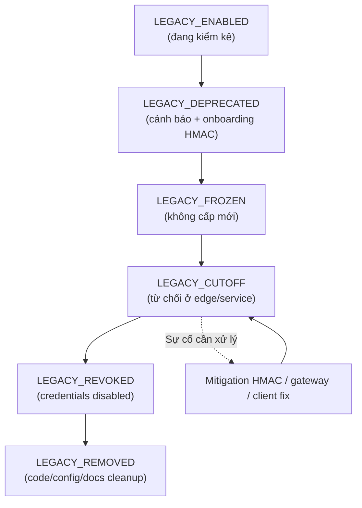
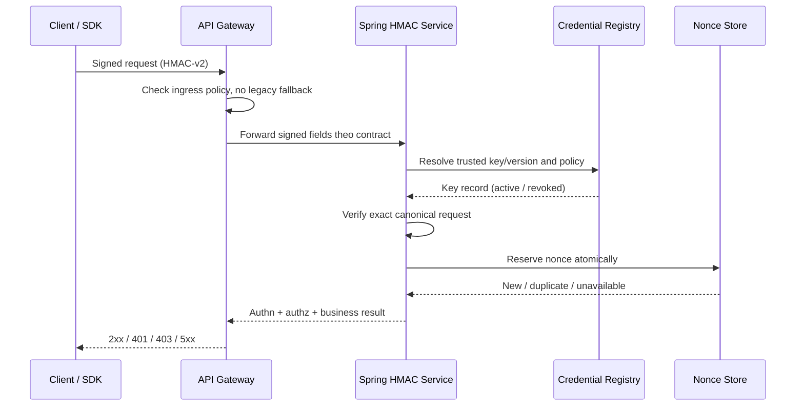

# Ngừng scheme cũ khi chuyển sang xác thực HTTP request bằng HMAC

## 1. Mục tiêu: ngừng chấp nhận cơ chế cũ mà không làm yếu xác thực

Trong module `SECURITY_AUTHENTICATION_HMAC_REQUEST_AUTHENTICATION`, client và server dùng **shared secret** để ký/xác minh HTTP request bằng HMAC. Hai phía thống nhất **canonical request** chứa method, URI và các signed headers hoặc body theo hợp đồng. Server xác minh chữ ký, kiểm tra timestamp/nonce chống replay, đối chiếu key version/rotation rồi tạo principal tin cậy; sau đó mới xét **authorization**.

Khi chuyển từ cơ chế xác thực cũ sang HMAC request signing, giai đoạn khó thường không phải viết `Mac.doFinal()` mà là **ngừng hẳn đường xác thực cũ**. Một gateway hoặc Spring Security filter còn chấp nhận API key tĩnh, Basic authentication, một custom bearer token, hoặc phiên bản HMAC quá cũ có thể biến hệ thống thành hai đường bảo mật không tương đương. Attacker sẽ chọn đường dễ vượt qua nhất.

**Ngừng scheme cũ** là quá trình có kiểm soát để chấm dứt việc **chấp nhận, phát hành, chuyển tiếp và sử dụng** một authentication scheme đã bị loại bỏ, sau khi các client hợp lệ đã được chuyển và kiểm chứng bằng giao thức đích.

Trong bài này, giả sử service từng chấp nhận **`X-API-Key` hoặc HTTP Basic** cho một số API, và muốn chuyển sang **HMAC request authentication**. Các nguyên tắc cũng áp dụng khi loại bỏ **HMAC-v1** để chỉ nhận **HMAC-v2**, nhưng cần phân biệt các khái niệm:

| Việc thay đổi | Ví dụ | Tác động |
| --- | --- | --- |
| Ngừng **authentication scheme** | `X-API-Key`/Basic → HMAC signed request | Loại bỏ hoàn toàn đường xác thực cũ |
| Ngừng **signing protocol version** | `HMAC-REQ-V1` → `HMAC-REQ-V2` | Thay quy tắc canonicalization, signed fields |
| Ngừng **algorithm** | HMAC-SHA256 cũ theo policy → algorithm mới được phép | Thay primitive mật mã/allowlist |
| **Key rotation** | Key v3 → key v4 | Thay shared secret/key version |
| Thay **authorization policy** | `orders:read` → `orders:write` | Quyền sau khi identity được xác minh |

Năm thay đổi này liên quan nhưng **không tự thay thế nhau**. Rotate key mới không vô hiệu một `BasicAuthenticationFilter` còn hoạt động. Và ngừng Basic không đương nhiên chặn một endpoint cũ được cấu hình `permitAll`.

### Kết quả học tập

Người học sẽ có thể lập kế hoạch deprecation/cutoff, quan sát mức sử dụng scheme, thiết kế tuyến xác thực không fallback, triển khai chính sách trong Spring MVC/WebFlux và gateway, revoke credential cũ, kiểm thử hợp đồng canonical request/anti-replay/authorization, xây runbook, rồi xác minh scheme cũ **không thể quay lại** qua cache, route hoặc rollback.

## 2. Vì sao tiếp tục hỗ trợ scheme cũ là một lỗ hổng tiềm tàng?

Một số API đã dùng API key tĩnh trong header:

```http
POST /api/orders HTTP/1.1
X-API-Key: <legacy-test-value>
Content-Type: application/json

{"sku":"A","quantity":1}
```

Khi chỉ dựa vào key tĩnh, cơ chế này không nhất thiết ràng buộc credential với **method, path, query, header, body hoặc thời gian**. Nếu key bị lộ, khả năng giả mạo request phụ thuộc chính sách khác như TLS, replay defense và rate limiting.

HMAC target contract có thể bảo vệ các trường đó:

```http
POST /api/orders HTTP/1.1
Content-Type: application/json
X-HMAC-Protocol: HMAC-REQ-V2
X-Key-Id: client-test-v2
X-Request-Timestamp: 1795834800
X-Request-Nonce: nonce-unique-example
X-HMAC-Signature: <base64-signature-from-test-secret>

{"sku":"A","quantity":1}
```

Signature là HMAC trên **canonical request tính từ bytes thực**, không phải một mã tùy ý client khai. Timestamp và nonce cần được ký và được server kiểm tra theo cửa sổ thời gian/anti-replay store nguyên tử.

Tuy nhiên, nếu server viết:

```java
// SAI: HMAC không hợp lệ lại được cứu bằng legacy API key.
if (hmacVerifier.verify(request)) {
    return authenticatedHmacClient;
}
if (legacyApiKeyVerifier.verify(request)) {
    return authenticatedLegacyClient;
}
return unauthorized();
```

thì một request không thể vượt HMAC vẫn có thể được chấp nhận bởi scheme cũ. Đó là **fallback authentication**, khác hoàn toàn với key rotation có kiểm soát. Kết quả là HMAC không còn là kiểm soát bắt buộc cho endpoint đó.

### 2.1. Threat model

| Đường tấn công hoặc sai sót | Hậu quả |
| --- | --- |
| Client gửi cả HMAC và `X-API-Key` | Filter order/preference mơ hồ, có thể chấp nhận legacy |
| Gateway vẫn giữ legacy-auth middleware | Edge xác thực bằng API key rồi service tin identity header |
| Service còn endpoint cũ ngoài `/api/**` | Một route nghiệp vụ bị bypass HMAC |
| `401` HMAC được hiểu là tín hiệu retry bằng Basic | Client tự downgrade |
| Legacy credential còn lưu trong cache vô hạn | Revocation/cutoff không có hiệu lực trên mọi pod |
| HMAC v1/v2 được thử lần lượt đến khi khớp | Chấp nhận nhiều canonical forms không có policy |
| Đổi scheme nhưng giữ quyền admin cũ | Authentication đã thay nhưng authorization vẫn quá rộng |
| Sau deployment rollback bật lại Basic | Scheme cũ sống lại mà không qua phê duyệt |
| Health check không yêu cầu ký rồi bị tái sử dụng cho business | Nhầm rule `permitAll` với protected route |
| Gateway rewrite URI làm HMAC mismatch | Nhiều `401` khiến team bật lại legacy để giảm lỗi |

**Bất biến cốt lõi:** kể từ cutoff, request vào tài nguyên HMAC-only phải thỏa **toàn bộ** HMAC verification, freshness, nonce atomic và authorization. Bất kỳ credential legacy nào **không được dùng** làm phương án thay thế.

## 3. Xác định chính xác “scheme cũ” trong hệ thống

Trước khi thay code, cần kiểm kê **bề mặt chấp nhận scheme**. Đừng chỉ tìm một class `LegacyAuthenticator` trong service rồi cho rằng đã bao phủ.

### 3.1. Inventory theo hop và điểm quyết định

| Vị trí | Câu hỏi cần xác minh |
| --- | --- |
| Client SDK, CLI, batch job | Có còn tự thêm `X-API-Key`/Basic? Có retry/fallback ngầm không? |
| API gateway/ingress | Có API key validation, Basic middleware, route exception hoặc identity injection không? |
| Service mesh/proxy | Có policy mTLS/identity headers khiến backend tin nhầm source không? |
| Spring `SecurityFilterChain` | Endpoint nào còn `httpBasic`, form login, custom legacy filter? |
| Servlet container filters | Legacy filter có bị đăng ký **ngoài** Spring Security chain không? |
| WebFlux `WebFilter` | Có filter global xử lý legacy trước `AuthenticationWebFilter` không? |
| Controller/annotation | Có endpoint `permitAll` hoặc tự kiểm tra header legacy bên trong handler không? |
| Batch, async callback, webhook | Có scheme riêng nằm ngoài route chính không? |
| Credential database/cache | Key legacy còn tồn tại, status nào, TTL/cutoff nào? |
| API docs, SDK, support runbook | Hướng dẫn cũ có tiếp tục được phân phối không? |
| Deploy/feature flags | Cấu hình nào có thể bật lại legacy sau cutoff? |

Mỗi mục cần **owner, đường đi thực, phiên bản deployment và bằng chứng**. Không được suy rằng một request ở test environment có thể đại diện mọi region/pod/edge.

### 3.2. Đặc biệt lưu ý dual registration của filter

Trong Spring Servlet, một `OncePerRequestFilter` có thể được gắn vào `SecurityFilterChain` **và** đăng ký như servlet filter qua Spring Boot/container. Khi loại bỏ khỏi chain, filter global vẫn có thể còn chạy. Điều ngược lại cũng nguy hiểm: code chặn legacy ở chain này nhưng một chain khác vẫn chấp nhận.

Muốn biết scheme đã ngừng, phải kiểm thử **HTTP end-to-end qua từng route và ingress** chứ không chỉ đếm bean trong unit test.

## 4. Định nghĩa target HMAC contract trước khi ép chuyển đổi

Một migration thất bại thường xuất phát từ việc tắt scheme cũ trước khi target signing contract được đóng băng và phát cho client.

### 4.1. Hợp đồng ký cần ghi rõ

| Thành phần | Ví dụ lựa chọn | Điều cần xác định |
| --- | --- | --- |
| Scheme/protocol ID | `HMAC-REQ-V2` | Encoding và version negotiation |
| HMAC algorithm | `HmacSHA256` / wire `HMAC-SHA256` | Server allowlist, không nhận `alg=none` |
| Key ID/version | `partner-a-key-v4` | Chỉ chọn trusted registry record, không là principal trước verify |
| Method | Uppercase `POST` | Tránh method override ngoài hợp đồng |
| Path/query | Public raw URI hoặc normalized target rõ ràng | Percent encoding, duplicate query, gateway rewrite |
| Signed headers | `content-type` và các headers cố định | Trim/space/case/duplicates và missing behavior |
| Body digest | SHA-256 của **exact request bytes** | Raw body, Content-Encoding, streaming/size limit |
| Timestamp | Unix epoch seconds | Acceptance window, skew/clock source |
| Nonce | Giá trị duy nhất theo credential scope | Atomic store, TTL, concurrency |
| Signature encoding | Base64 chuẩn có padding | Decode strict, MAC length, compare bytes |
| Error semantics | `401`/`403`/`503` | Không tiết lộ key existence/expected signature |

Ví dụ canonical string line-oriented, LF (`\n`) phân tách:

```text
HMAC-REQ-V2
POST
/api/orders?region=vn
content-type:application/json
<BASE64_SHA256_OF_EXACT_BODY_BYTES>
1795834800
nonce-unique-example
```

Đây là **ví dụ**, các placeholder phải được thay bằng digest thực. Method, URI, header values, body hash, timestamp và nonce được ký theo contract. Đừng chuyển sang HMAC v2 bằng cách server “thử” các dạng path/body đến khi chữ ký khớp.

### 4.2. API key hoặc password legacy không nhất thiết là HMAC shared secret tốt

Không mặc nhiên tái sử dụng password Basic, một API key từng đưa vào query string, hoặc key có entropy không rõ làm shared secret cho HMAC. Nên provisioning một **shared secret đủ entropy, riêng theo client/credential**, truyền qua kênh quản trị được xác thực, scope tối thiểu và có lifecycle/revoke.

Nếu hệ thống lựa chọn dùng lại secret vì lý do đặc biệt, phải có đánh giá crypto/key management riêng; migration mặc định **không nâng cấp độ an toàn của một secret đã lộ** chỉ bằng việc dùng HMAC.

### 4.3. Phải giữ ranh giới authentication và authorization

Sau HMAC thành công, principal/authorities phải đến từ credential registry server-side. Không dùng `X-Key-Id` chưa xác minh làm principal và không tự cấp quyền cũ chỉ vì migration.

Một client writer có HMAC đúng nhưng thiếu `orders:create` phải nhận `403`, không phải `401` và cũng không được “thử API key cũ để có quyền”.

## 5. Đặt mốc deprecation, migration và cutoff rõ ràng

Một vòng chuyển đổi nên công bố **thời điểm, phạm vi và điều kiện qua từng giai đoạn**, thay vì giữ cờ `legacyEnabled` vô thời hạn.

| Giai đoạn | Client được kỳ vọng | Server behavior | Điều kiện qua giai đoạn |
| --- | --- | --- | --- |
| **Inventory** | Còn dùng legacy, chưa chuyển | Chỉ quan sát, không đổi bất ngờ | Biết route/owner/traffic |
| **Provision** | Nhận test credentials HMAC | Target verifier có trên canary/staging | Golden vectors và anti-replay pass |
| **Dual support giới hạn** | Migrate có lịch | Legacy chỉ ở phạm vi ngoại lệ được kiểm soát | Thấy mức sử dụng legacy giảm |
| **No-new-legacy** | Không cấp client legacy mới | Ngừng provisioning credential legacy | Danh sách ngoại lệ đã duyệt |
| **Cutoff** | Chỉ HMAC trên protected routes | Legacy bị từ chối tại edge **và** service | Negative tests qua mọi hop pass |
| **Revoke/cleanup** | Không có fallback | Revoke credential, xóa filter/config/doc legacy | Không có accepted legacy sau cutoff |
| **Steady state** | HMAC-only | Giám sát và kiểm thử thường xuyên | Không thể tái bật legacy bằng rollback tùy ý |

Thời điểm cutoff phải chỉ rõ **UTC, API family/region/client cohort**, không ghi mơ hồ “cuối tháng”. Một cutover nhiều region cần định nghĩa ai là nguồn policy và điều kiện mọi replica đã áp dụng phiên bản mới.

### 5.1. Cutoff là quyết định bảo mật, không phải chỉ xóa code

Một số tổ chức đặt:
- `legacy_issuance_stop_at` — ngừng cấp mới.
- `legacy_warn_at` — tăng cảnh báo/thông báo.
- `legacy_accept_until` — mốc cuối cùng có quyền sử dụng.
- `legacy_revocation_effective_at` — revoke/cutoff có hiệu lực.
- `legacy_code_removal_release` — bản phát hành xóa hẳn khả năng chấp nhận.

Mốc này có thể khác nhau nhưng phải liên kết. Không để code removal trì hoãn đến mức một rollout cũ có thể nhận lại credential legacy sau cutoff.

### 5.2. Không dùng traffic gần bằng 0 làm bằng chứng duy nhất

Không thấy legacy trong 7 ngày **không chứng minh** các client tần suất tháng/quý đã chuyển. Có thể còn disaster-recovery jobs, webhook hiếm, mobile offline, scheduled exports hoặc region không được quan sát.

Kết hợp telemetry **đã có độ bao phủ**, inventory chủ sở hữu, công nhận từ đối tác và **negative tests** chứng minh server thực sự không nhận scheme cũ.

## 6. State machine của legacy scheme và chuyển tiếp an toàn

Một mô hình trạng thái rõ giúp tránh tình trạng “feature flag bật/tắt tùy cảm hứng”.



**Không vẽ đường tự động từ `LEGACY_CUTOFF` về `LEGACY_ENABLED`.** Nếu legacy bị ngừng do rủi ro bảo mật, rollback phải đi qua phê duyệt và một phương án giảm thiểu không tái mở lỗ hổng, không chỉ đảo một feature flag.

### 6.1. Hai chiều chuyển đổi khác nhau

Trong giai đoạn dual support, có thể có route riêng:
- `/legacy/api/**` dành cho cohort cũ, được kiểm soát và có cutoff.
- `/api/**` chỉ HMAC ngay từ lúc phát hành.

Hoặc cùng route phải hỗ trợ hai scheme trong khoảng chuyển tiếp: khi đó **phải parse một scheme rõ ràng**, không cho filter này reject xong filter kia “cứu”. Hai đường chỉ cùng tồn tại vì migration plan, không nên được coi là thiết kế đích.

### 6.2. Tránh trạng thái không xác định

Đừng để `legacyEnabled=false` nhưng Basic filter vẫn còn một `SecurityFilterChain` khác; cũng đừng cho phép `legacyEnabled=true` không có giới hạn thời gian/route. State phải tương ứng với **rule thực tế ở edge, app, credential store và SDK**, có test chứng minh.

## 7. Chọn một scheme duy nhất cho mỗi request

Điểm quan trọng nhất của giai đoạn migration: **request không được có nhiều con đường xác thực cạnh tranh hoặc tự fallback**.

### 7.1. Bảng quyết định sau cutoff

Giả sử `/api/orders/**` bắt buộc HMAC:

| Input | Kỳ vọng |
| --- | --- |
| HMAC đúng, timestamp/nonce mới, key active | Authentication accepted |
| HMAC đúng nhưng thiếu quyền | Authentication accepted → authorization `403` |
| Chỉ `X-API-Key` legacy | `401`; không tạo principal |
| Chỉ `Authorization: Basic ...` | `401`; không gọi Basic provider |
| HMAC sai kèm legacy key đúng | `401`; **không fallback** |
| HMAC thiếu, legacy key đúng | `401`; không fallback |
| HMAC đúng kèm legacy key | Reject mixed credentials theo policy; tránh ambiguity |
| HMAC protocol version cũ đã ngừng | Reject, không tự thử canonical v1 |
| Key/version đã revoke | Reject, kể cả MAC tính đúng |
| Nonce lặp hoặc timestamp quá hạn | Reject, không gọi controller |
| Key/nonce store timeout | Fail closed; `503`/`5xx` thích hợp |
| Không có credential | `401` theo HMAC contract |
| Route health công khai có matcher chính xác | Không yêu cầu HMAC theo health policy |

**Chọn scheme** là bước parse/dispatch, không phải bằng chứng đã xác thực. Việc nhận diện `X-HMAC-Signature` chỉ cho phép đi vào verifier; không cấp quyền.

### 7.2. Quy tắc đối với mixed credentials

Trong migration, request chứa cả `Authorization: Basic ...` và header HMAC có thể do SDK cũ vô tình giữ header. Nếu server chấp nhận HMAC và lờ Basic, việc đó có thể chấp nhận được nếu contract có quy định rõ, nhưng **nguyên tắc an toàn và dễ kiểm thử hơn là reject ambiguity** trên API HMAC-only.

Không cho phép “đọc scheme đầu tiên” khi có duplicate `Authorization`, duplicate key ID, duplicate signature headers hoặc chuỗi header được gateway gộp gây mơ hồ. Normalize/canonicalize theo hợp đồng và reject đầu vào vượt size limit trước khi làm crypto tốn kém.

## 8. Spring Security Servlet/MVC: loại bỏ đường xác thực cũ

Trong Spring Boot 3 / Spring Security 6, cấu hình thực tế thường gồm `SecurityFilterChain` và filter HMAC trước authorization. Khi cutoff, **tập route HMAC-only** phải được bảo vệ bằng đúng authentication manager của HMAC; Basic/form/legacy filter không được còn hoạt động ở phạm vi đó.

### 8.1. Ví dụ cấu hình chain HMAC-only

```java
@Configuration
@EnableWebSecurity
class HmacOnlySecurityConfiguration {

    @Bean
    @Order(1)
    SecurityFilterChain signedApiSecurity(
            HttpSecurity http,
            HmacAuthenticationFilter hmacFilter) throws Exception {

        return http
                .securityMatcher("/api/**")
                // Chỉ phù hợp cho API HMAC stateless không dựa cookie.
                .csrf(csrf -> csrf.disable())
                .httpBasic(basic -> basic.disable())
                .formLogin(form -> form.disable())
                .sessionManagement(s -> s.sessionCreationPolicy(
                        SessionCreationPolicy.STATELESS))
                .authorizeHttpRequests(auth -> auth
                        .anyRequest().authenticated())
                .addFilterBefore(hmacFilter,
                        UsernamePasswordAuthenticationFilter.class)
                .build();
    }

    @Bean
    @Order(2)
    SecurityFilterChain fallbackDeny(
            HttpSecurity http) throws Exception {

        // Ví dụ default-deny; public/health chains cần matcher riêng
        // và Order ưu tiên hơn nếu hệ thống có endpoint công khai.
        return http
                .authorizeHttpRequests(auth -> auth
                        .anyRequest().denyAll())
                .build();
    }
}
```

Các class `HmacAuthenticationFilter` và mọi import/exception handling là của ứng dụng; ví dụ chỉ minh họa cấu hình cutoff. Không copy máy móc `csrf.disable()` nếu route dùng cookie-based auth hoặc có yêu cầu CSRF riêng. Mọi auth mechanism khác do ứng dụng cài (custom, bearer, mTLS, global filters) phải được kiểm kê, không giả định `httpBasic().disable()` sẽ xóa tất cả.

**Cần chú ý:**

- `securityMatcher("/api/**")` chỉ áp cho phạm vi đó; nếu một business route mới nằm ngoài, chain fallback phải **deny** trừ khi có chính sách rõ.
- `permitAll` chỉ dành cho endpoint public/health xác định chính xác, không dùng `/api/**` hoặc `/actuator/**` tùy tiện.
- Đừng có thêm một chain precedence cao hơn chứa legacy provider với matcher rộng hơn.
- `OncePerRequestFilter` nếu là Spring bean có thể được Boot tự động đăng ký như Servlet filter toàn cục; cần ngăn đăng ký trùng hoặc vô tình xử lý ngoài security chain.
- Không bắt lỗi `AuthenticationException` ném từ **controller downstream** bằng một catch bao cả `chain.doFilter(...)` rồi trả `401` giả.

### 8.2. HMAC filter phải chủ động reject legacy

Một policy kiểm tra header trước khi xác minh:

```java
public enum AuthSchemeCandidate {
    HMAC, LEGACY, MISSING, AMBIGUOUS
}

public final class AuthSchemeClassifier {

    public AuthSchemeCandidate classify(HttpServletRequest request) {
        String apiKey = request.getHeader("X-API-Key");
        String authorization = request.getHeader("Authorization");
        String signature = request.getHeader("X-HMAC-Signature");

        boolean hasLegacy = apiKey != null
                || (authorization != null
                    && authorization.regionMatches(
                        true, 0, "Basic ", 0, 6));
        boolean hasHmac = signature != null;

        // Demo: production phải phát hiện duplicates,
        // header-length, malformed grammar và aliases.
        if (hasLegacy && hasHmac) return AuthSchemeCandidate.AMBIGUOUS;
        if (hasLegacy) return AuthSchemeCandidate.LEGACY;
        if (hasHmac) return AuthSchemeCandidate.HMAC;
        return AuthSchemeCandidate.MISSING;
    }
}
```

Code là ví dụ **chưa đầy đủ**; để phát hiện header trùng, dùng `getHeaders(...)`/`getHeaderNames()` và validate grammar/size cụ thể. Một bearer token, custom legacy header hoặc HMAC trong `Authorization` cần được classifier của hệ thống nhận diện theo **scheme contract thực**; đừng chỉ dùng ba header trên cho mọi API.

Sau cutoff, `LEGACY`, `AMBIGUOUS` và `MISSING` phải bị từ chối trên protected routes. `HMAC` chỉ đi tiếp sau khi verifier tính MAC từ request, xác minh timestamp/nonce, key state và tạo `Authentication`. Không bao giờ chuyển `LEGACY` sang một `Authentication` đã xác thực chỉ vì stored API key còn có trong DB.

### 8.3. Đặt lỗi đúng tầng

- Thiếu/sai HMAC, legacy không còn được phép: `401 Unauthorized` (hoặc `400` cho malformed HTTP theo contract).
- HMAC hợp lệ nhưng thiếu `orders:create`: `403 Forbidden`.
- Key store/nonce store không sẵn sàng: `503`/`5xx` phù hợp; không fallback Basic/API key và không fail open.
- Request body quá lớn: `413` theo API, không cần dùng legacy để “cứu” request.

Có thể dùng `AuthenticationEntryPoint` cho `401`, `AccessDeniedHandler` cho `403` và một error path riêng cho dependency outage. Response public không cần tiết lộ ID khóa tồn tại hay thuật toán nào được hỗ trợ theo credential.

## 9. Spring WebFlux: ngừng legacy trong reactive security chain

Trong WebFlux, protected routes thường dùng `SecurityWebFilterChain`, `AuthenticationWebFilter` và `ReactiveAuthenticationManager`. Cần loại bỏ legacy `WebFilter`/converter/manager, không chỉ tắt `httpBasic`.

### 9.1. Chain tham khảo

```java
@Bean
@Order(1)
SecurityWebFilterChain hmacOnlyApi(
        ServerHttpSecurity http,
        AuthenticationWebFilter hmacAuthenticationWebFilter) {

    return http
            .securityMatcher(
                    ServerWebExchangeMatchers.pathMatchers("/api/**"))
            .csrf(csrf -> csrf.disable())
            .httpBasic(basic -> basic.disable())
            .formLogin(form -> form.disable())
            .authorizeExchange(exchanges -> exchanges
                    .anyExchange().authenticated())
            .addFilterAt(hmacAuthenticationWebFilter,
                    SecurityWebFiltersOrder.AUTHENTICATION)
            .build();
}
```

Đây là ví dụ cấu hình **reactive**. `hmacAuthenticationWebFilter` được cấu hình với converter/manager HMAC riêng; phải xử lý `LEGACY`/mixed credentials như `AuthenticationException`, không trả `Mono.empty()` theo cách khiến một cơ chế xác thực khác tiếp tục xử lý request như thành công.

Nếu dùng driver key/nonce store blocking trên Netty event loop, throughput sẽ giảm và tăng rủi ro timeout; dùng reactive driver với timeout/concurrency limit hoặc cô lập blocking thích hợp. Không gọi `block()` hay tự `subscribe()` để thực hiện HMAC.

### 9.2. Replay và body trong reactive pipeline

Dù legacy scheme đã tắt, HMAC verifier vẫn phải:

1. Kiểm soát kích thước body, decode/parse signed headers theo contract.
2. Tính body hash trên **exact bytes** với `Flux<DataBuffer>`, release pooled buffers đúng cách.
3. Dựng canonical request từ method/URI/header do trust boundary xác định.
4. Xác minh MAC với key đúng version; không dùng key revoked.
5. Kiểm tra timestamp/nonce; reserve nonce **atomically** trên store dùng chung.
6. Trả `Authentication` có principal/authority từ trusted registry.
7. Phát lại body đã xác minh cho downstream nếu cần; không cho handler chạy khi reject.

HMAC-only không đồng nghĩa bỏ anti-replay hay ủy quyền cho một API gateway có thể bị bypass.

## 10. Gateway/proxy: tắt legacy ở edge nhưng không tin edge là đủ

Một hệ nhiều hop có thể đi như sau:



Trước cutoff, một gateway có thể xác thực legacy `X-API-Key` rồi inject `X-Authenticated-Client` cho backend. Sau cutoff cần loại bỏ logic đó **và** đảm bảo backend không tin identity header từ Internet.

### 10.1. Trust boundary cho identity headers

Không dùng:

```text
if X-Authenticated-Client exists:
    mark request authenticated
```

trừ khi tồn tại một kiến trúc **verify-at-edge** có trust contract chặt chẽ: gateway đã xác thực credential, mạng/mTLS giới hạn nguồn, header do client khai được strip/overwrite, service chỉ nhận metadata từ thành phần đáng tin và có biện pháp ngăn bypass gateway.

Nếu kiến trúc đích là **verify-at-service**, service phải kiểm tra HMAC độc lập. Gateway chỉ forward request theo contract và có thể từ chối legacy sớm như defense in depth.

### 10.2. Canonical URI qua rewrite

Ví dụ client ký:

```text
POST /public/v2/orders?region=vn
```

gateway rewrite thành:

```text
POST /internal/orders?region=vn
```

Nếu hợp đồng ký **public URI**, service phải có metadata trusted để dựng đúng public target hoặc xác minh HMAC ở edge trước rewrite. `Forwarded` chuẩn mô tả thông tin như host/proto/for/by, **không** tự mang original path/query theo quy tắc chuẩn. Các header như `X-Original-URI`, `X-Forwarded-Prefix` chỉ được dùng khi ingress làm sạch và kiểm soát nguồn.

Lỗi gateway rewrite **không phải lý do bật lại scheme cũ**. Khắc phục contract, dùng test vectors giả, rollback cấu hình rewrite đúng và giữ yêu cầu HMAC.

### 10.3. Test ở cả edge và service

Sau cutoff, chạy ít nhất:
- Legacy request qua public gateway → reject.
- Legacy request đi thẳng vào service (trong môi trường test được phép) → reject.
- HMAC signature đúng qua gateway → accepted, đúng body.
- HMAC signature đúng nhưng path/host/header bị sửa → reject theo contract.
- Client tự gắn legacy identity/forwarded headers → không được bypass.

Một cấu hình WAF chặn legacy ở edge không chứng minh service-side guard đã tồn tại.

## 11. Quy trình chuyển client: bỏ legacy credential mà vẫn giữ nghiệp vụ

Một client SDK thường cần thay đổi nhiều hơn việc thêm chữ ký:

1. Provision shared secret mới qua kênh tin cậy; ghi key ID/version và permission scope.
2. Dùng signer tạo canonical bytes theo hợp đồng đã công bố.
3. Ký **exact method, URI, selected headers, body bytes**, timestamp và nonce.
4. Gửi request không kèm `X-API-Key`/Basic nếu API mới yêu cầu HMAC-only.
5. Dùng nonce mới cho mỗi request; retry của request ghi phải có idempotency riêng.
6. Phân biệt `401` do HMAC/freshness với `403` do quyền; không retry bằng scheme legacy.
7. Hỗ trợ key rotation và cutoff đúng UTC; không thử mọi key/version để “tìm chữ ký khớp”.
8. Cập nhật health monitoring, metrics và SDK docs.

### 11.1. Không ký request rồi serialize lại body

Với JSON, hai chuỗi có thể cùng ý nghĩa nhưng khác bytes:

```json
{"sku":"A","quantity":2}
```

và

```json
{ "quantity": 2, "sku": "A" }
```

Nếu HMAC bảo vệ raw body, signer phải hash chính `byte[]` được gửi. Client không nên biến JSON object thành bytes một lần để ký rồi để HTTP library serialize lại khác đi. Lỗi này thường chỉ lộ sau khi tắt legacy, vì request trước đây được legacy auth chấp nhận dù HMAC không khớp.

### 11.2. Retry phải an toàn

Khi client không nhận response, nó có thể không biết request đầu đã được server xử lý chưa. Nếu ký lại với nonce mới, chống replay **không** ngăn được hai giao dịch cùng nội dung; API cần idempotency key/policy nghiệp vụ riêng.

Nếu gửi lại y nguyên request cũ, nonce store có thể trả `replay_detected` dù kết quả request đầu đã thành công. SDK phải hiểu contract, không kết luận server hỏng và chuyển về API key cũ.

### 11.3. Legacy client hiếm khi gọi API

Client gửi webhook mỗi quý hoặc batch job hàng tháng có thể không xuất hiện trong metrics trong một tuần. Inventory cần owner/contact, lịch dùng và xác nhận migration. Có thể chạy **signed canary**/test-only endpoint từ từng SDK để chứng minh tương thích mà không gọi nghiệp vụ thật.

## 12. Quản lý key rotation và revoke credential cũ

Ngừng scheme cũ phải gắn với **credential lifecycle**.

| Loại credential | Sau cutoff |
| --- | --- |
| Legacy static API key | Revoke/disable trong credential store, không còn verifier nào tham chiếu |
| HTTP Basic username/password dùng cho API | Disable authentication path, thu hồi credential theo chính sách |
| HMAC shared secret mới | Active theo key version và policy |
| HMAC previous key trong overlap | Chỉ được chấp nhận tới cutoff riêng của **key rotation**, không đến vô hạn |
| HMAC key revoked | Không được nhận, kể cả chữ ký đúng |
| Legacy credential nằm trong client logs/config | Thu gom/xóa theo quy trình bảo vệ dữ liệu, không coi là đã an toàn chỉ vì scheme dừng |
| Cache key metadata ở gateway/replica | Invalidate/fence theo policy revision, bảo đảm không còn accepted legacy |

### 12.1. Không tái dùng legacy credential trong danh nghĩa HMAC

Việc đổi header từ `X-API-Key` sang `X-Key-Id` nhưng vẫn nhận cùng một chuỗi tĩnh chưa có secret độ mạnh phù hợp và không có canonical MAC không phải migration HMAC thực sự. Đừng tạo một bước chuyển giả “tương thích” bằng cách coi legacy token là expected HMAC.

### 12.2. Revoke không chỉ là xóa row

Một số hệ thống giữ historical record để audit. Revoke có thể là trạng thái `REVOKED` với `effective_at`, policy revision, key reference bị chặn và cache invalidation. Không cho một backup cũ hồi sinh token/key legacy đã bị thu hồi.

Với client HMAC đang trong key rotation, lưu ý **scheme cutoff** và **key overlap cutoff** là hai thời điểm riêng; một cái không tự kéo dài cái còn lại.

## 13. Ngăn downgrade và scheme confusion khi có nhiều cơ chế trên cùng hệ

Một tổ chức có thể vẫn dùng Bearer cho browser API, mTLS cho admin API và HMAC cho machine-to-machine. Mục tiêu không nhất thiết là xóa mọi mechanism khỏi toàn hệ, mà là **mỗi route có đúng scheme contract**.

### 13.1. Route/scheme policy rõ ràng

| Endpoint | Scheme được phép sau migration | Scheme không được phép |
| --- | --- | --- |
| `POST /api/orders` | HMAC-REQ-V2 | Legacy API key, Basic |
| `GET /api/orders/{id}` | HMAC-REQ-V2 | Legacy API key, Basic |
| `GET /actuator/health/liveness` | Probe nội bộ theo security policy | Không yêu cầu HMAC business |
| `GET /actuator/health/readiness` | Probe nội bộ theo security policy | Không yêu cầu HMAC business |
| `POST /admin/rotate-key` | Admin auth mạnh riêng, có network policy | Không dùng API client HMAC thay admin |
| `GET /public/info` | Public nếu contract cho phép | Không tạo principal từ client-supplied key ID |

Bảng là ví dụ. Với admin endpoint, chọn scheme cụ thể theo threat model tổ chức, không coi mTLS hoặc HMAC là một lựa chọn tự động cho mọi route.

### 13.2. HMAC authentication và authorization phải cùng nguồn tin cậy

Server không được ánh xạ `X-Key-Id` chưa xác minh thành quyền. Khi scheme legacy đã tắt, mapping authority/tenant phải dựa trên **verified credential record**. Một request HMAC hợp lệ nhưng thiếu `orders:create` vẫn `403`.

### 13.3. Không dùng 401 làm tín hiệu downgrade

SDK không được hiểu `401` là “server chưa hỗ trợ HMAC, thử Basic”. Một phản hồi authentication failure có thể đến từ signature mismatch, timestamp expired, nonce replay, key revoked hoặc proxy rewrite.

Nếu cần discovery capability, nó phải qua kênh được xác thực và có **minimum acceptable policy** được pin; không học lại scheme an toàn từ HTTP error không đáng tin.

## 14. Metrics và audit: quan sát mức sử dụng legacy mà không lộ credential

Trong giai đoạn dual support, cần biết client nào còn phụ thuộc scheme cũ. Nhưng **không được dùng raw API key, Basic token, HMAC signature hoặc key ID client tự khai làm metric labels**.

### 14.1. Event schema có phân biệt trước và sau xác thực

Ví dụ event khi một request HMAC hợp lệ:

```json
{
  "event": "authentication.accepted",
  "request_id": "req-example-901",
  "route": "orders_create",
  "verified_scheme": "hmac_v2",
  "verified_key_tag": "keytag:83ab21",
  "auth_outcome": "accepted"
}
```

`verified_key_tag` là pseudonym ví dụ từ **stored key ID đã được xác minh**, sử dụng logging secret riêng nếu cần; nó không phải raw shared secret hay HMAC signature. Không ghi tag này vào event chỉ dựa trên `X-Key-Id` chưa được chứng thực.

Event khi request legacy bị chặn sau cutoff:

```json
{
  "event": "authentication.rejected",
  "request_id": "req-example-902",
  "route": "orders_create",
  "scheme_candidate": "legacy_api_key",
  "reason": "scheme_disabled",
  "http_status": 401
}
```

`scheme_candidate` ở đây là **phân loại cú pháp đầu vào**, không phải identity đã xác thực. Không log raw `X-API-Key`, `Authorization`, key string hay body.

### 14.2. Phân biệt accepted, attempted và rejected

| Metric gợi ý | Ý nghĩa | Nhãn phù hợp |
| --- | --- | --- |
| `auth_scheme_attempts_total` | Request khai/khớp một scheme candidate | `scheme_candidate` enum, route class |
| `auth_scheme_accepted_total` | Request **đã được xác thực** bằng scheme | `verified_scheme` enum |
| `auth_scheme_rejected_total` | Bị chặn, gồm scheme đã disable | `reason` allowlist, route class |
| `hmac_authentication_outcomes_total` | Accepted/rejected/unavailable | Outcome, bounded reason |
| `hmac_nonce_reserve_total` | New/replay/unavailable | Result enum |
| `http.server.requests` | End-to-end status và latency | Method, route template, status |
| `legacy_policy_epoch_lag` | Instance chưa theo cutoff revision | Region/service group |
| `gateway_auth_scheme_blocks_total` | Edge reject legacy | Route/group enum |

Đây là **meter tự định nghĩa** (trừ metric HTTP do framework cung cấp tùy cấu hình). Không giả định các tên trên tự xuất hiện trong Micrometer.

Nếu kiểm đếm request legacy được xác thực trước cutoff để liên hệ client owner, dùng **audit có phân quyền** dựa trên verified credential và mapping nội bộ, không biến client ID thô thành một time-series label không giới hạn.

### 14.3. PromQL để theo dõi cutoff

Khi metric đã được export dưới dạng counter:

```promql
sum by (verified_scheme) (
  rate(auth_scheme_accepted_total[15m])
)
```

Sau cutoff, một cảnh báo gợi ý:

```promql
sum(
  increase(auth_scheme_accepted_total{
    verified_scheme="legacy_api_key"
  }[15m])
) > 0
```

**Không** chỉ dựa trên query này để chứng minh không còn chấp nhận legacy: nếu mất metrics/scrape hoặc một route không instrument, kết quả bằng 0 chưa nói gì. Cần negative synthetic tests, log audit, policy distribution và quan sát độ đầy đủ telemetry.

### 14.4. Latency và nguyên nhân lỗi

Sau cutoff, `401` có thể tăng do client chưa migrate — **đúng như chính sách** — chứ không phải HMAC verifier hỏng. Song một đợt `signature_mismatch` tăng sau deploy proxy có thể là lỗi canonicalization. Tách `scheme_disabled`, `invalid_signature`, `replay_detected`, `timestamp_out_of_window`, `key_store_unavailable` và `insufficient_authority` thay vì gộp “auth failed”.

Không log expected HMAC, shared secret, full canonical request hoặc raw URI/query có dữ liệu nhạy cảm để debug.

## 15. Cutover orchestration: giao tiếp, readiness và traffic control

Một playbook cutover cần có **owner và bằng chứng từng bước**, không chỉ một lệnh deploy.

### 15.1. Trước cutoff

1. Chốt target contract và golden vectors có reference implementation độc lập.
2. Provision HMAC credentials mới; test đúng từng SDK/partner/route.
3. Bật target verifier và metrics trên canary/region thử nghiệm.
4. Kiểm tra key lookup, nonce atomic, timestamp skew, body replay, gateway rewrite.
5. Liệt kê toàn bộ route/partner legacy, mức ưu tiên nghiệp vụ và thời điểm sử dụng hiếm.
6. Đặt cutoff UTC, gửi thông báo/SDK release theo SLA, hướng dẫn rollback **client** mà không dùng legacy.
7. Chặn provisioning legacy mới và đóng danh sách ngoại lệ.
8. Test negative với legacy-only và mixed credentials.
9. Thiết lập alert accepted legacy **sau cutoff**, audit policy epoch và access logs.
10. Kiểm tra kế hoạch mất nonce/key store; không dùng legacy làm fallback.

### 15.2. Trong cutoff

1. Ghi change/approval ID, timestamp UTC và deployment/revision đang hiệu lực.
2. Áp rule chặn legacy ở gateway (nếu có) **và** service; thứ tự rollout tránh khoảng bypass.
3. Ngừng nhận legacy trên tất cả protected routes/cohorts trong scope.
4. Revoke credential legacy và invalidate cache/connection/session có liên quan.
5. Đồng bộ policy revision tới mọi region/pod; chặn traffic trên instance chưa theo cutoff.
6. Chạy signed synthetic checks qua gateway cùng request legacy negative.
7. Theo dõi `401`/`403`/`5xx` và business success riêng.
8. Nếu HMAC client lỗi, sửa signer/gateway/key provisioning; không bật lại legacy theo phản xạ.

### 15.3. Sau cutoff

1. Theo dõi một khoảng đủ bao phủ lịch sử gọi API, không chỉ peak traffic.
2. Xác minh 0 **accepted** legacy qua toàn bộ backend/region và có telemetry coverage.
3. Xóa middleware, authentication provider, filter registrations, fallback code và cấu hình cũ.
4. Thu hồi secrets/key IDs legacy và xóa tài liệu hỗ trợ tự downgrade.
5. Kiểm thử DR/rollback: deploy image cũ không thể mở lại scheme đã bị cấm bởi central policy.
6. Cập nhật incident runbook, alerting, audit retention và migration postmortem.

### 15.4. Cắt giảm traffic thay vì cắt giảm bảo mật

Nếu một số client chưa migrate, có thể quản lý bằng thông báo, routing tới **đường migration được thiết kế có quyền phê duyệt và giới hạn thời gian trước cutoff**, hỗ trợ kỹ thuật, thay đổi SDK hoặc tạm dừng nghiệp vụ tương ứng. Không được tự tạo một exception vĩnh viễn ở route HMAC-only.

## 16. Rollback và emergency access: không hồi sinh legacy sau cutoff

Tính khả dụng rất quan trọng, nhưng một rollback làm sống lại legacy scheme đã decommission có thể mở lại rủi ro bảo mật từng được chấp nhận là phải loại bỏ.

### 16.1. Những rollback thường an toàn hơn

- Rollback **gateway rewrite config** đến bản bảo toàn canonical request đúng, nhưng vẫn chặn legacy.
- Rollback **client signer SDK** đến bản HMAC đã biết hoạt động, không dùng API key cũ.
- Rollback **policy/config lỗi** của nonce/key store theo nguồn revision đáng tin.
- Tạm dừng rollout, chuyển traffic sang vùng có HMAC verifier đúng và đáp ứng policy cutoff.
- Sửa timestamp skew và key provisioning theo quy trình có chứng thực.

### 16.2. Rollback nguy hiểm

```text
Production HMAC-v2 gặp 401 sau deploy.
Operator đặt legacyEnabled=true để giảm lỗi.
Gateway và service lại chấp nhận API key cũ.
Client/attacker có đường bỏ qua HMAC-v2.
```

Không có bằng chứng “đã từng hoạt động” đủ để hợp thức hóa rollback này. Nếu tổ chức cho phép ngoại lệ khẩn cấp, cần **approval, scope hẹp, expiry tự động, network isolation, audit, threat assessment và kế hoạch chấm dứt**. Với legacy bị ngừng vì compromise hoặc yếu nghiêm trọng, có thể **không có phương án rollback chấp nhận được**.

### 16.3. Policy cutoff phải sống sót qua DR

Cấu hình `legacy_disabled_since`/`minimum_scheme_version` cần nguồn authority đáng tin và không tự lùi theo backup cũ. Nếu restore metadata trước ngày cutoff rồi code cũ lại được deploy, server không được ngầm nhận API key cũ.

Dùng security policy revision/epoch và khả năng kiểm chứng từ authority tách biệt; backup integrity checksum **không đủ** để chống rollback của policy. Khi không chứng minh cutoff state hiện hành, protected API nên fail closed theo chính sách thay vì đoán.

## 17. Contract tests: chứng minh đã ngừng scheme cũ

Một migration chỉ đạt yêu cầu khi có **positive controls và negative controls** ở đúng trust boundary.

| Ca thử | Input | Kỳ vọng sau cutoff |
| --- | --- | --- |
| Legacy-only API key | `X-API-Key` hợp lệ từ test registry cũ | `401`, handler không chạy |
| Legacy-only Basic | Credential Basic test hợp lệ trước đây | `401`, handler không chạy |
| Mixed schemes | HMAC sai + API key cũ đúng | `401`, không fallback |
| Mixed schemes khác | HMAC đúng + Basic | Reject theo mixed-credential policy |
| Missing credential | Không có HMAC | `401` |
| Valid HMAC | Method/path/header/body đúng, nonce mới | Authentication accepted |
| Changed method | Ký `POST`, gửi `PUT` không re-sign | Reject nếu method là signed field |
| Changed path/query | Ký A, gửi B, nonce mới | Signature mismatch; không side effect |
| Changed body | Ký JSON A, gửi raw JSON B | Signature mismatch |
| Wrong algorithm/protocol | Legacy canonical format đã cắt | Reject, không thử phiên bản khác |
| Expired/future timestamp | HMAC đúng nhưng freshness sai | Reject |
| Replay | Gửi cùng signed request hai lần | Lần sau reject |
| Concurrent replay | Cùng nonce vào hai replica | Tối đa một request accepted |
| Current/previous HMAC key | Theo rotation policy | Accepted chỉ trong window được phép |
| Revoked HMAC key | MAC tính đúng bằng secret cũ | Reject |
| Authenticated nhưng thiếu authority | HMAC đúng, `orders:create` thiếu | `403` |
| Key/nonce store outage | Không thể quyết định an toàn | `5xx`/`503`, fail closed |
| Health/public route | Matcher xác định | Không chặn sai và không làm bypass API |
| Direct service path | Bỏ gateway trong test được phép | Không chấp nhận legacy |
| Gateway forwarded spoof | Client tự gửi identity/original URI | Không tạo principal hoặc signed target sai |
| Rollback image cũ | Chính sách cutoff vẫn hiện hành | Legacy vẫn bị chặn hoặc node không nhận traffic |
| Backup restore cũ | Metadata trước cutoff | Không hồi sinh legacy credential |

**Không chấp nhận “test pass vì trả 404/403”** khi mục tiêu là chứng minh scheme cũ bị từ chối ở authentication stage. Negative tests nên dùng route hợp lệ và instrumentation cho security outcome.

## 18. Ví dụ JUnit/MockMvc và WebTestClient cho cutoff

### 18.1. Servlet test với security chain thực

```java
@SpringBootTest
@AutoConfigureMockMvc
class LegacySchemeCutoffMvcIT {

    @Autowired MockMvc mvc;

    @Test
    void oldApiKeyIsRejectedOnProtectedEndpoint() throws Exception {
        mvc.perform(post("/api/orders")
                .contentType(MediaType.APPLICATION_JSON)
                .header("X-API-Key", "TEST-LEGACY-KEY")
                .content("{\"sku\":\"A\",\"quantity\":1}"))
                .andExpect(status().isUnauthorized());
    }

    @Test
    void basicAuthenticationMustNotBeAccepted() throws Exception {
        mvc.perform(post("/api/orders")
                .header("Authorization", "Basic "
                        + Base64.getEncoder().encodeToString(
                            "test-user:test-password".getBytes(
                                StandardCharsets.UTF_8)))
                .contentType(MediaType.APPLICATION_JSON)
                .content("{\"sku\":\"A\",\"quantity\":1}"))
                .andExpect(status().isUnauthorized());
    }
}
```

Các import và test fixture của key/nonce store do project cung cấp. Test phải bật filters (không `addFilters=false`), dùng **credential legacy test từng hợp lệ trước cutoff** để chứng minh server đã dừng thật, và gắn service spy/Mockito kiểm tra `create(...)` không được gọi.

Nếu test Basic dùng credential không tồn tại ngay cả trước migration, `401` không chứng minh scheme đã bị gỡ. Positive control của **trạng thái trước cutoff** hoặc registry fixture xác nhận credential có thể xác thực bằng implementation legacy cũ sẽ giúp test có ý nghĩa.

### 18.2. Test chống HMAC → legacy fallback

Ví dụ cấu trúc:

```java
@Test
void invalidHmacPlusValidLegacyMustStillBeRejected() {
    // Dựng request có X-HMAC-Signature không hợp lệ,
    // đồng thời chứa X-API-Key test từng được chấp nhận.
    // Sau cutoff:
    // 1. HTTP trả 401 (hoặc 400 theo mixed-header contract).
    // 2. Legacy authenticator không được gọi.
    // 3. Controller/service không có side effect.
}
```

Với code thực tế, kiểm tra `verifyNoInteractions(legacyAuthenticator)` khi đã loại bean/provider, hoặc assert không có legacy acceptance audit; không đặt toàn bộ test trên mock Authenticated principal.

### 18.3. WebFlux test

```java
@SpringBootTest(
        webEnvironment = SpringBootTest.WebEnvironment.RANDOM_PORT)
@AutoConfigureWebTestClient
class LegacySchemeCutoffWebFluxIT {

    @Autowired WebTestClient client;

    @Test
    void legacyHeaderCannotAuthenticate() {
        client.post()
                .uri("/api/orders")
                .header("X-API-Key", "TEST-LEGACY-KEY")
                .contentType(MediaType.APPLICATION_JSON)
                .bodyValue("{\"sku\":\"A\",\"quantity\":1}")
                .exchange()
                .expectStatus().isUnauthorized();
    }
}
```

Cũng cần test positive HMAC (client signer độc lập tạo raw body + nonce mới), `403` với HMAC hợp lệ thiếu quyền, `503` khi nonce store outage, và race replay nhiều replica. `WebTestClient` không tự bảo đảm gateway compatibility; thêm test qua edge thật.

### 18.4. Đừng chỉ nhìn HTTP status

Để chứng minh chính xác:
- Kiểm tra **filter/manager nào ra quyết định**, nếu dùng test-only audit sink.
- Kiểm tra không có controller/service invocation.
- Kiểm tra legacy provider không được gọi/còn đăng ký.
- Kiểm tra không có accepted legacy event ở cả gateway và service.
- Chạy kiểm thử khi rollout các phiên bản khác nhau và khi rollback có kiểm soát.

## 19. Incident response sau cutoff

Khi phát hiện request legacy được **accepted** sau cutoff, đó có thể là một **security incident**, không chỉ lỗi telemetry.

### 19.1. Phân loại tình huống

| Dấu hiệu | Giả thuyết ban đầu | Hành động |
| --- | --- | --- |
| Legacy attempts còn xuất hiện, nhưng đều `401` | Client chưa migrate hoặc probing | Hỗ trợ đối tác, rate limit, theo dõi |
| Accepted legacy ở một region | Replica/policy lag hoặc gateway route ngoại lệ | Cô lập region/route, kiểm tra config |
| Accepted legacy sau deploy rollback | Image cũ tự bật filter | Dừng rollout, áp cutoff policy fence |
| Legacy identity header từ Internet được service tin | Gateway sanitization/trust boundary sai | Khẩn cấp loại bỏ bypass, điều tra ảnh hưởng |
| Accepted request từ key đã revoke | Cache/invalidation/restore lỗi | Điều tra credential compromise/policy rollback |
| HMAC `401` tăng diện rộng sau gateway change | URI/header/body canonicalization mismatch | Test vectors, rollback proxy config an toàn |
| Nonce store unavailable và API vẫn trả `2xx` | Anti-replay bị bypass | Ưu tiên sự cố bảo mật, fail closed |
| HMAC accepted nhưng `403` tăng | Authority/tenant policy thay đổi | Điều tra authorization, không bật Basic |

### 19.2. Trình tự xử lý

1. Xác định scope cutoff, UTC window, route và policy revision.
2. Thu thập security events, access logs, audit và deployment metadata đã phân quyền.
3. Xác minh sự kiện `accepted legacy` thật hay chỉ là `scheme_candidate=legacy` chưa được xác thực.
4. Cô lập điểm còn chấp nhận: gateway, service filter, legacy provider, direct service access hoặc stale cache.
5. Chặn legacy ngay theo policy hiện hành; nếu không bảo đảm, cho protected traffic fail closed.
6. Đánh giá request đã accepted và business side effects; kiểm tra tenant/resource/authorization.
7. Revoke token/key legacy còn hiệu lực, bảo toàn chứng cứ, đánh giá phạm vi lộ credential.
8. Khắc phục source và thêm regression test qua đúng hop gây lỗi.
9. Báo cáo rõ mức độ chắc chắn và khoảng trống log; không đưa secret/raw signature vào ticket.

**Không quy kết partner chỉ vì request có `X-Key-Id` của họ**. Trước HMAC verification đó là dữ liệu client tự khai.

## 20. Bài thực hành: ngừng API key/Basic để dùng HMAC-only

Giả sử hệ thống có `POST /api/orders` và `GET /api/orders/{id}`. Trước đây client gửi `X-API-Key` hoặc Basic. Mục tiêu mới là `HMAC-REQ-V2` ký method, public URI/path/query, `Content-Type`, SHA-256 exact JSON body, timestamp và nonce; server dùng credential registry, key rotation, Redis nonce store atomic và Spring Security authority `orders:create` hoặc `orders:read`. API chạy sau gateway có path rewrite.

### 20.1. Thực hiện

1. **Inventory:** lập bảng clients/SDK/jobs/routes/gateway policies đang chấp nhận legacy, xác định owner và lịch gọi hiếm.
2. **Target contract:** công bố canonical representation, signed header set, HMAC algorithm, signature encoding, timestamp window, nonce scope, key ID/version và lỗi `401`/`403`/`5xx`.
3. **Provisioning:** tạo test/prod HMAC credentials riêng có entropy cao và scope tối thiểu; không tái dùng static API key không đạt chính sách.
4. **Client fixture:** signer độc lập với verifier và golden vectors cho body rỗng, JSON Unicode, path/query encoding, gateway rewrite.
5. **Migration state:** áp giai đoạn deprecated → frozen → cutoff với UTC deadline, cohort và owner.
6. **Spring Security MVC/WebFlux:** triển khai HMAC-only matcher, bỏ legacy provider/filter trên protected route, default-deny các đường chưa phân loại.
7. **Gateway:** chặn legacy, sanitize identity/forwarded headers, giữ signed request target hoặc verify tại edge theo trust contract.
8. **Dual-period observability:** phân biệt legacy attempted với **verified legacy accepted**, không dùng raw key ID/secret làm metric labels.
9. **Cutoff:** áp security policy revision, disable legacy credentials, invalidation cache, xác minh mọi region/replica.
10. **Negative tests:** legacy-only, Basic-only, HMAC sai + legacy đúng, mixed headers, path/body tampering, protocol cũ, revoked key.
11. **Positive controls:** signed HMAC đúng và nonce mới → authentication accepted; thiếu authority → `403`.
12. **Anti-replay:** gửi lại same nonce, concurrent two-node replay và nonce store outage; không có fail open.
13. **Gateway E2E:** ký public URI qua rewrite, test spoofed forwarded headers và direct-to-service bypass.
14. **Rollback drill:** rollback gateway/client vì lỗi tương thích nhưng giữ policy không chấp nhận legacy; restore backup cũ không hồi sinh token.
15. **Cleanup:** loại code/dependency/filter/config/docs legacy, kiểm tra toàn bộ security chains và SDK fallback.
16. **Post-cutoff review:** theo dõi accepted legacy qua time window đủ bao phủ và lập runbook xử lý late clients.

### 20.2. Câu hỏi tự đánh giá

- Vì sao chỉ tắt `httpBasic()` trong một `SecurityFilterChain` chưa chứng minh Basic đã bị ngừng trên toàn hệ?
- Nếu HMAC signature sai nhưng legacy API key đúng, có bao giờ được cho phép controller chạy không?
- Vì sao số request legacy `401` tăng sau cutoff có thể là **tín hiệu chính sách hoạt động đúng**?
- Nếu không có legacy traffic 14 ngày, điều gì còn thiếu để tuyên bố tất cả client đã migrate?
- Vì sao HMAC request signing cần exact body bytes và URI canonical contract thay vì JSON sau parse?
- Một token legacy bị revoke có thể “sống lại” bằng cách nào qua replica cache hoặc backup cũ?
- Tại sao nonce store outage không thể được “khắc phục” bằng việc bỏ anti-replay hoặc thử Basic?
- Khi HTTP `403` tăng, team nên kiểm tra authority/tenant policy hay tự động thử lại scheme cũ?
- Làm sao rollback một cấu hình proxy sai mà vẫn giữ rule cấm legacy?
- Khi client gửi cả Basic và HMAC, request nên được parse/xử lý theo policy nào để không bị scheme confusion?

### 20.3. Tiêu chí hoàn thành

Một migration thực sự **ngừng scheme cũ** khi người học chứng minh được:

- Mọi protected route có **tập authentication schemes được phép minh bạch**, không fallback ngoài policy.
- Legacy API key/Basic từng hợp lệ nhưng sau cutoff không tạo được principal ở **gateway lẫn service**.
- Request HMAC đúng còn phải qua timestamp, nonce atomic, key rotation/state và authorization; thiếu quyền vẫn `403`.
- Mixed credentials, header duplication và HMAC failure không tạo đường downgrade sang legacy.
- Signing contract nhất quán qua client/gateway/Servlet/WebFlux, gồm canonical URI, signed headers và exact body bytes.
- Credential và code legacy đã được revoke/remove; backup, rollback, stale caches và các replica không làm hồi sinh nó.
- Quan sát accepted/rejected theo scheme có nguồn tin cậy, bảo vệ log/metric không lộ shared secret, signature hay raw key ID.
- Có negative E2E tests qua gateway và direct service, cùng canary HMAC positive control.
- Tình huống client chưa migrate, nonce store outage, gateway mismatch và rollout rollback có **runbook fail-closed**.

**Kết luận:** Ngừng scheme cũ không phải chỉ thay một header hoặc xóa một filter. Đó là việc **thu hẹp tập request mà hệ thống được phép chấp nhận**, từ client và gateway tới Spring Security, credential registry, key lifecycle, anti-replay và authorization. Một migration thành công loại bỏ hoàn toàn các đường xác thực legacy, giữ nguyên bảo đảm của HMAC trên canonical request, có kiểm chứng sau cutoff và không thể vô tình downgrade khi gặp lỗi vận hành.
