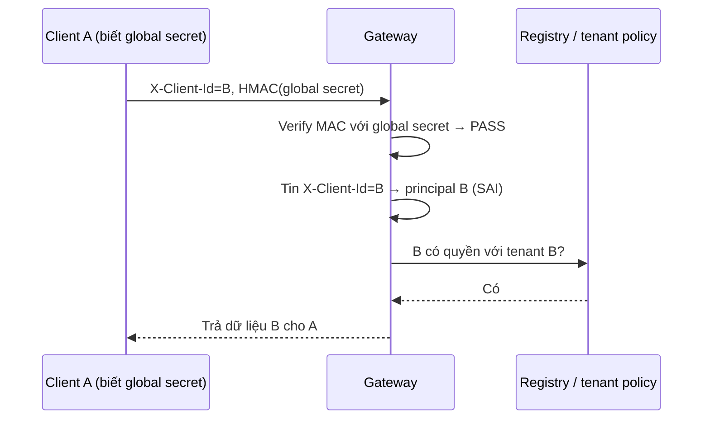
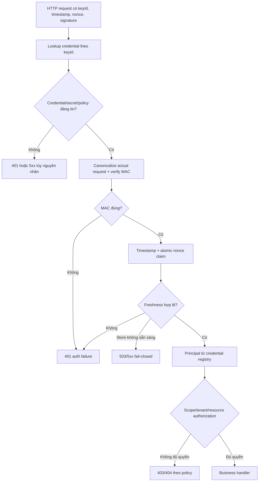
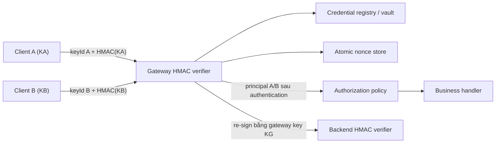
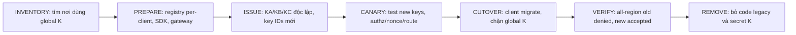
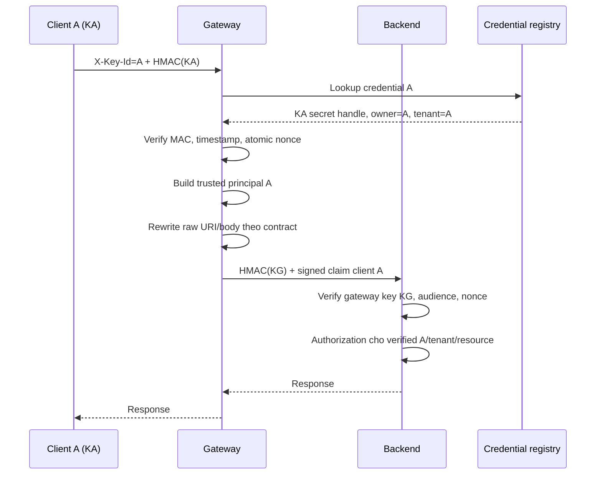

# Dùng secret chung mọi client: anti-pattern phá vỡ ranh giới danh tính HMAC

## 1. Mục tiêu bài học

Bài **Dùng secret chung mọi client** thuộc chương **Anti-pattern HMAC** của module **SECURITY_AUTHENTICATION_HMAC_REQUEST_AUTHENTICATION**. Module hướng dẫn xác thực HTTP request bằng **HMAC với shared secret**, sử dụng **canonical request** ràng buộc HTTP method, URI, header hoặc byte body theo hợp đồng ký. Người học còn phải xử lý timestamp/nonce chống replay, quản lý key rotation, kiểm thử proxy/gateway và phân biệt **authentication (xác thực)** với **authorization (phân quyền)**.

Trong thuật ngữ HMAC, *shared secret* là khóa bí mật được chia sẻ giữa **bên ký và bên xác minh**. Điều đó **không có nghĩa** là nên phát cùng một secret cho tất cả đối tác, ứng dụng hoặc tenant. Nếu client A và client B đều biết một khóa K, một chữ ký đúng dưới K chỉ chứng minh người tạo chữ ký có khả năng dùng **K**; nó không cho biết người đó là **A hay B**.

Đây là một anti-pattern về **thiết kế danh tính và cách ly miền tin cậy**. Nó không được khắc phục bằng việc chọn HMAC-SHA512 thay HMAC-SHA256, mã hóa kết nối bằng TLS, đổi tên header hoặc tăng độ dài secret, bởi vấn đề là **quá nhiều principal có cùng năng lực ký**.

Sau bài học, người học có thể:

1. Nhận diện việc dùng một secret chung cho nhiều client/tenant khác với việc một credential được chia sẻ hợp lệ giữa signer và verifier.
2. Chứng minh bằng request và code rằng một client nắm secret chung có thể ký hợp lệ dưới `clientId`/`keyId` của client khác.
3. Phân tích hậu quả đối với authentication, authorization, audit, quota, nonce replay, incident response, key rotation và gateway re-sign.
4. Thiết kế credential **riêng cho từng client và trust boundary**, gắn key ID với owner, tenant, audience, algorithm, canonical version và trạng thái.
5. Dùng Java/JCA cùng test JUnit 5 để phát hiện cross-client impersonation và xác minh cách ly khóa.
6. Lập kế hoạch chuyển đổi từ một secret global sang secret riêng **không tái kích hoạt khóa đã compromise**.
7. Kiểm tra hệ thống vận hành đa node, đa region, proxy/gateway và kênh provisioning an toàn bằng ma trận test có positive/negative controls.

## 2. Tình huống mở đầu: “HMAC đúng” nhưng client nào đã gửi?

Giả sử API có hai đối tác:

- `partner-a` được xem đơn hàng của tenant A.
- `partner-b` được xem đơn hàng của tenant B.

Hệ thống cấp cả hai cùng một giá trị secret `GLOBAL_HMAC_KEY`. Client gửi:

```http
GET /api/tenants/tenant-b/orders/42 HTTP/1.1
Host: api.example.test
X-Client-Id: partner-b
X-Key-Id: global-v1
X-Timestamp: 1795852800
X-Nonce: example-nonce-789
X-Signature: <BASE64URL_HMAC_SIGNED_WITH_GLOBAL_KEY>
```

Nếu `partner-a` biết `GLOBAL_HMAC_KEY`, họ hoàn toàn có thể tạo request trên và tính signature đúng. **HMAC verifier không phân biệt được** request này do signer của B hay signer của A tạo. Nếu ứng dụng lấy `X-Client-Id: partner-b` làm principal sau khi MAC dưới khóa global khớp, A có thể bị xác thực thành B. Sau đó authorization kiểm tra “principal B có được đọc tenant B không?” và trả lời **có**, vì principal đã bị xây dựng sai.



Đây là một **mô hình tấn công giả định dùng để nhận diện lỗi**, không phải chỉ dẫn thao tác lên hệ thống của người khác. Khi thực hành, chỉ dùng key, tenant và endpoint trong môi trường test được phép.

**Câu hỏi quan trọng:** “MAC đúng” có nghĩa là gì?

- **Đúng:** request do một bên biết secret K ký, các trường được MAC bảo vệ không bị sửa sau khi ký.
- **Không đúng:** request chắc chắn đến từ một principal cụ thể khi **nhiều principal khác nhau có cùng secret K**.
- **Không đúng:** principal đó có quyền với mọi route/tenant; authorization còn phải thực hiện riêng.
- **Không đúng:** request chưa từng được gửi trước đó; chống replay vẫn cần timestamp/nonce.

### 2.1. Vì sao ký thêm client ID vẫn chưa đủ?

Giả sử canonical request có cả client ID:

```text
HMAC-V1
GET
/api/tenants/tenant-b/orders/42
partner-b
1795852800
example-nonce-789
<HEX_SHA256_EMPTY_BODY>
```

Một bên biết global secret vẫn có thể chọn chuỗi `partner-b` rồi ký lại **toàn bộ canonical** một cách hợp lệ. Việc thêm client ID vào MAC **ngăn người ngoài không biết secret tự sửa claim**, nhưng **không ngăn thành viên đang sở hữu secret chung ký dưới danh tính của thành viên khác**.

Thay đổi cần thiết là **ràng buộc một credential với một owner đáng tin**. Ví dụ:

```text
keyId=partner-a-k1 → secret KA → registry owner=partner-a
keyId=partner-b-k1 → secret KB → registry owner=partner-b
KA != KB
```

Verifier tra key ID, lấy secret, kiểm tra credential active và HMAC, rồi **suy client ID/tenant từ registry**, không từ lời khai độc lập trong request. Nếu A biết KA nhưng thử ký với `keyId=partner-b-k1`, server dùng KB để verify nên MAC không khớp.

## 3. Định nghĩa chính xác anti-pattern

### 3.1. Những thiết kế thường bị nhầm với nhau

| Thiết kế | Nhận định | Lý do |
|---|---|---|
| Một client và một verifier biết cùng secret của credential đó | **Hợp lệ về mô hình HMAC**, còn phụ thuộc bảo mật toàn bộ hệ thống | Bản chất của symmetric MAC |
| Nhiều replica gateway cùng truy cập secret của **một** client theo RBAC | Có thể hợp lệ | Replica đều xác minh cho đúng credential, không phải cấp secret cho nhiều client |
| Mỗi client có key ID/secret độc lập trong registry | **Nên dùng** | Có thể revoke, audit, giới hạn quyền từng credential |
| Tất cả client dùng một biến `HMAC_SECRET` | **Anti-pattern** | Mọi client có khả năng giả danh client khác nếu identity dựa vào key chung |
| Mỗi client có key ID riêng nhưng secret bytes giống hệt nhau | **Vẫn là anti-pattern** | Key ID khác không bù được việc mọi bên biết cùng secret |
| Cùng root secret được cấp cho client để họ tự dẫn xuất khóa | **Rất rủi ro** | Client có root có thể dẫn xuất khóa của client khác |
| Root chỉ nằm trong KMS; mỗi client nhận derived key qua KDF đã review | Có thể thiết kế được, nhưng root compromise có blast radius lớn | Cần domain separation, key isolation, revocation và lifecycle riêng |
| Gateway→backend dùng một secret nội bộ cho nhóm gateway được cấp quyền | Có thể chấp nhận trong cùng trust group đã định nghĩa | Không dùng key đó để xác thực trực tiếp nhiều client Internet |
| mTLS phía client, một global HMAC key cho tất cả | Không tự khắc phục nếu HMAC được dùng làm danh tính client | Cần xác định mTLS identity đáng tin và binding với request |
| Một secret khác nhau theo **môi trường** nhưng chung mọi tenant trong môi trường | Vẫn rủi ro cross-tenant | Tách prod/staging chưa giải quyết identity giữa các tenant |

Một khóa HMAC **chung trong một nhóm thực sự được định nghĩa là cùng một security principal** có thể là lựa chọn hệ thống có chủ đích, ví dụ một cluster gateway tự nhận diện như cùng một dịch vụ với backend. Khi đó API phải thể hiện principal ở **mức nhóm**, không giả định có thể phân biệt từng thành viên chỉ từ chữ ký HMAC. Nếu các thành viên cần quyền/audit/revocation riêng, phải dùng credential riêng.

### 3.2. Các biến thể anti-pattern ngoài code

- `application.yml` hoặc environment variable `HMAC_SECRET` được inject giống nhau vào mọi tenant-facing client.
- Portal cấp key ID riêng cho từng đối tác nhưng backend tìm một `GLOBAL_SECRET` để verify.
- Client SDK có một secret hard-code chung trong file config, mobile app hoặc thư viện tải xuống công khai.
- Tất cả integration partners được gửi cùng một “API signing secret” qua email.
- Dùng cùng secret cho production và staging, hoặc giữa client HMAC và gateway-to-backend HMAC.
- Một service có quyền ký mọi request cho mọi client do secrets được nhúng trong code artifact, thay vì quản lý quyền qua vault.
- Có bảng `client` với các dòng khác nhau nhưng cột `secret_hash`/`secret_value` đều phản ánh cùng key.
- Một hàm `verifySignature(body, GLOBAL_SECRET)` được gọi cho mọi request rồi đọc `X-Tenant-Id` làm identity.

**Đừng chỉ tìm chuỗi ký tự `GLOBAL_SECRET` trong code.** Thiết kế có thể dùng biến tên `DEFAULT_SIGNING_KEY` hoặc một secret được resolve ở runtime; cần kiểm tra **mapping credential→owner→secret thực tế** và provisioning flow.

## 4. Hậu quả bảo mật: từ impersonation đến cross-tenant access

### 4.1. Client impersonation và confused deputy

Hãy giả sử A có quyền `orders:read` với tenant A, B có quyền `orders:delete` với tenant B. Nếu gateway xác minh global HMAC rồi tin `X-Client-Id=B`:

1. A dựng canonical có `clientId=B`, method `DELETE`, tenant B và body tự chọn.
2. A dùng global secret hợp lệ để ký.
3. Gateway báo `authentication success` cho “B”.
4. Authorization nhìn thấy principal B có quyền DELETE tại tenant B.
5. Backend có thể xóa dữ liệu B.

Ở đây **authorization có thể đã chạy đúng logic trên một principal sai**. Không thể chỉ nói “có Spring Security authorizeHttpRequests là an toàn”: luồng tạo `Authentication` ban đầu đã đánh tráo danh tính.

Nếu registry map `keyId` tới owner nhưng các key khác nhau lại chứa **cùng secret**, A có thể khai `keyId=B` và tính đúng MAC với secret chung. Cho nên phải xác minh tính **duy nhất của secret material giữa các miền trust độc lập**.

### 4.2. Blast radius khi một client lộ secret

| Thiết kế | Client A lộ secret | Kết quả |
|---|---|---|
| Global secret cho A, B, C | A lộ K | B và C cũng bị ảnh hưởng, phải coi K bị compromise cho mọi owner |
| Secret riêng KA, KB, KC | A lộ KA | Có thể khoanh vào A nếu nguồn cấp phát/registry/KMS không cùng bị lộ |
| Cùng root derivation key được gửi cho A, B | A lộ root | Có thể tính khóa của các client khác |
| KMS giữ root, chỉ cấp KA cho A | A lộ KA | Chưa mặc nhiên lộ KB; vẫn cần điều tra KMS/provisioning |
| Một key dùng chung ingress và internal gateway | Client lộ key | Có thể giả cả client hoặc gateway tùy các hop dùng lại secret thế nào |

**Secret riêng không phải bảo đảm tuyệt đối**. Nếu toàn bộ vault, root KMS hay tài khoản quản trị bị compromise, blast radius vẫn có thể bao trùm nhiều key. Mục đích là loại bỏ sự phụ thuộc **không cần thiết** giữa các client và giúp thu hồi theo phạm vi thực tế.

### 4.3. Không thể revoke một client độc lập

Khi A và B đều dùng K, có hai lựa chọn tệ:

- **Không revoke K** để B còn hoạt động: A (hoặc attacker giữ K) vẫn có thể ký request.
- **Revoke K** để chặn A: B và mọi client khác dùng K cũng bị gián đoạn.

Nếu hệ thống chỉ “disable clientId=A” nhưng cho request khai `clientId=B` sử dụng K, A vẫn có thể ký dưới B. Disable dựa trên ID tự khai chỉ có ý nghĩa khi ID được **gắn chặt với một credential mà client khác không thể sử dụng**.

Một cuộc rotation như vậy trở thành bài toán cập nhật hàng nghìn SDK cùng lúc, tăng nguy cơ rollout không đồng bộ, old-key overlap kéo dài và bypass từ một node cache cũ.

### 4.4. Audit và non-repudiation: giới hạn của symmetric HMAC

HMAC **không tạo non-repudiation theo nghĩa chữ ký số bất đối xứng** vì bên xác minh cũng biết secret và có thể tạo MAC. Dùng secret chung nhiều client càng làm attribution yếu hơn:

- Log “`partner-b ký request`” không có bằng chứng mật mã đủ để phân biệt A với B.
- Client A có thể phủ nhận request được gán cho A bởi nhiều bên biết key K.
- IP, mTLS peer certificate, device identity hay secure logs có thể cung cấp **bằng chứng bổ sung**, nhưng phải thiết kế binding và trust model cụ thể.
- Security events chỉ nên ghi mức bảo đảm thực sự có: “MAC verified using global credential K”, không gán principal cụ thể mà không có bằng chứng độc lập.

Nếu yêu cầu mỗi client có bằng chứng ký mạnh và verifier không được giả client, cần đánh giá **chữ ký bất đối xứng** (mỗi client giữ private key, server giữ public key) hoặc mTLS identity phù hợp, cùng contract ký HTTP riêng. Đây là quyết định kiến trúc, không đồng nghĩa HMAC luôn sai.

### 4.5. Tenant isolation và lỗi quyền trong gateway

Một header như `X-Tenant-Id` hoặc `X-Verified-Client-Id` chỉ đáng tin nếu:

1. Nó được tạo hoặc xác nhận bởi **thành phần trusted** sau khi có bằng chứng định danh đúng.
2. Nó được ràng buộc bởi MAC/signature nội bộ khi chuyển tới backend.
3. Backend kiểm tra audience, method, route/resource và scope phù hợp.

Nếu gateway chỉ kiểm tra global HMAC rồi chuyển `X-Verified-Client-Id=B`, backend có thể tin một lời khai sai nhưng đã được đóng dấu bởi gateway. Đây là một **confused deputy** qua trust boundary.

## 5. HMAC authentication không đồng nghĩa authorization

Cần tách các quyết định:



**Không bao giờ lấy principal trực tiếp từ** `X-Client-Id`, `X-Tenant-Id` hoặc `X-Key-Id` do requester gửi trước khi HMAC và credential policy được xác minh. `keyId` chỉ giúp **tìm credential**, còn owner/tenant/scope phải đến từ registry đáng tin.

Ngay cả sau khi có per-client secret và MAC hợp lệ, client có thể thiếu quyền. Một request từ A với KA đúng nhưng truy cập resource B phải bị **403 Forbidden** hoặc 404 theo chính sách che resource. Đó là **authorization failure**, không phải lỗi HMAC.

### 5.1. Vì sao rate limit theo key ID tự khai có thể bị lợi dụng?

Nếu gateway rate limit request theo `X-Key-Id=B` **trước khi MAC pass**, attacker có thể gửi hàng nghìn request sai MAC khai key ID B khiến B bị throttled. Với global secret, ngay cả khi MAC pass, việc gán identity cho B vẫn không đáng tin vì nhiều client có key.

Nên phân tầng:

- Trước xác thực: giới hạn dựa trên tín hiệu ingress/network và parser được harden, không coi claimed key ID là principal.
- Sau MAC/freshness/credential policy: quota theo **verified client ID** từ registry.
- Per-tenant resource authorization: quyền kiểm tra riêng, không dựa vào quota success.

## 6. Anti-replay bị ảnh hưởng ra sao bởi secret chung?

Một HMAC signature đúng vẫn có thể bị gửi lại. Protocol dùng timestamp + nonce để giới hạn việc phát lại request đã ký. Nhưng **nonce namespace** và attribution trở nên khó xử lý khi mọi client dùng global key.

### 6.1. Namespace dựa vào client ID chưa xác thực

Một thiết kế sai:

```text
nonce_key = "nonce:" + request.header("X-Client-Id") + ":" + nonce
```

Nếu client A và B dùng chung K, A có thể tự khai B, ký request và chiếm nonce namespace của B. Nếu nonce được claim **trước** khi MAC được xác minh, bất kỳ attacker không biết K cũng có thể tiêu thụ nonce của một client khác.

Những lỗi liên quan:

| Cách tạo nonce key | Rủi ro |
|---|---|
| `nonce:<rawXClientId>:<nonce>` | ID chưa xác thực; dễ spoof/DoS và khó quy trách nhiệm |
| `nonce:<globalKeyId>:<nonce>` | Các client độc lập chia cùng namespace, dễ collision ngoài ý muốn |
| `nonce:<localNode>:<nonce>` | Multi-node replay bypass |
| `nonce:<credentialId>:<nonce>` với credential riêng | Phù hợp khi contract uniqueness theo từng credential |
| `nonce:<verifiedClientId>:<audience>:<nonce>` | Phù hợp khi uniqueness xuyên nhiều credentials cùng client được yêu cầu |
| `nonce:<tenantId>:<nonce>` quá rộng | Có thể collision giữa các client cùng tenant nếu không thiết kế trước |

Với credential riêng, namespace theo **credentialId từ registry** hoặc verified client+audience theo contract. Claim phải là thao tác **nguyên tử** dùng chung mọi verifier cần chia sẻ chống replay.

### 6.2. Atomic claim và TTL

Một Redis pattern:

```text
SET hmac:nonce:<credentialId>:<nonceDigest> 1 NX EX 630
```

Trong đó `NX` đảm bảo chỉ tạo khi key chưa tồn tại, `EX` đặt thời hạn giữ state, còn `nonceDigest` là biểu diễn đã giới hạn, có thể băm/định danh an toàn theo policy. Đây là ví dụ về **lệnh atomically claim nonce**; nếu dùng `GET` rồi `SET` sẽ có race.

`630` giây chỉ là **tham số minh họa**: chọn TTL dựa trên cửa sổ timestamp, future/past clock skew và margin. Ví dụ nếu chấp nhận timestamp từ 300 giây trước tới 300 giây tương lai, nonce từng được claim ở biên sớm phải còn được nhớ cho đến hết biên muộn; TTL cần bao phủ **future allowance + past allowance + safety margin** theo contract.

- MAC sai: không claim nonce.
- Nonce đã có sau MAC hợp lệ: authentication fail `nonce_replay`.
- Redis timeout/unknown result: **fail-closed 503/5xx**, không coi là nonce mới hoặc replay chắc chắn.
- Key revoked: reject ngay theo credential state, bất kể nonce mới.
- Operation có side effect: idempotency nghiệp vụ còn cần thiết ngay cả khi nonce luôn mới.

**Secret riêng không thay thế chống replay**; hai cơ chế bảo vệ hai thuộc tính khác nhau: **ai được phép ký** và **một proof được chấp nhận bao nhiêu lần**.

## 7. Sai lầm cấu hình: key ID riêng nhưng secret vẫn trùng

Một cấu hình dễ đánh lừa reviewer:

```yaml
# KHÔNG AN TOÀN: ví dụ minh họa, không dùng production.
clients:
  partner-a:
    key-id: partner-a-k1
    secret-ref: vault/shared/global-hmac-secret
  partner-b:
    key-id: partner-b-k1
    secret-ref: vault/shared/global-hmac-secret
  partner-c:
    key-id: partner-c-k1
    secret-ref: vault/shared/global-hmac-secret
```

Nhìn bên ngoài có ba key ID. Nhưng cả ba `secret-ref` trỏ cùng một secret. Partner A biết secret đã cấp cho mình, có thể tạo signature dưới key ID B; verifier lấy secret B nhưng thực chất cũng là K.

Thay bằng mapping có isolation:

```yaml
# MẪU THIẾT KẾ, không chứa plaintext secret.
credentials:
  partner-a-k1:
    credential-id: cred-a-1
    owner-client-id: partner-a
    tenant-id: tenant-a
    algorithm: HMAC-SHA256
    canonical-version: HMAC-REQ-1
    secret-ref: vault/clients/partner-a/cred-a-1
    state: ACTIVE
    audience: orders-api
  partner-b-k1:
    credential-id: cred-b-1
    owner-client-id: partner-b
    tenant-id: tenant-b
    algorithm: HMAC-SHA256
    canonical-version: HMAC-REQ-1
    secret-ref: vault/clients/partner-b/cred-b-1
    state: ACTIVE
    audience: orders-api
```

Đây là schema minh họa, không phải file cấu hình được Spring Security tự động nhận. Mục tiêu là cho mỗi `keyId` một credential riêng và **secret bytes độc lập**, đồng thời **principal/tenant** được suy ra từ metadata sau khi authentication thành công.

### 7.1. Ngăn vô tình cấp trùng secret

Provisioning nên:

1. Sinh secret ngẫu nhiên độc lập với CSPRNG/KMS cho mỗi credential, entropy phù hợp (ví dụ ít nhất 256 bit cho HMAC-SHA256).
2. Không clone secret từ template của một partner hoặc môi trường sang partner khác.
3. Không dùng cùng seed/counter dự đoán được để sinh key.
4. Ghi metadata owner/tenant/audience/algorithm/version/rotation state và audit provisioning.
5. Có kiểm tra tự động phát hiện secretRef trỏ cùng đối tượng khi **khác owner/trust boundary**.
6. Nếu cần phát hiện trùng **material** dù secretRefs khác nhau, thực hiện trong secret store hoặc workflow có quyền hạn và giới hạn; không xuất plaintext hay hash secret lên dashboard.
7. Định nghĩa việc dùng chung key là **một exception chính thức** nếu thực sự có một principal nhóm, kèm owner/risk acceptance, không ngầm hợp thức hóa dùng chung toàn hệ thống.

Với secret entropy cao, một fingerprint an toàn phục vụ kiểm tra duplicate có thể được tính bằng cơ chế trong vault/HSM hoặc HMAC với **audit key riêng** được bảo vệ, chỉ xuất tín hiệu trùng/không trùng cho admin. Không cần đưa fingerprint vào telemetry công khai. Không tự lập một bảng chứa plaintext secrets hoặc mã băm của secret kém entropy rồi coi đó là biện pháp bảo vệ.

## 8. Java 17: anti-pattern trong HMAC verifier

Một ví dụ cố ý **không an toàn**:

```java
// ANTI-PATTERN — không sao chép vào production.
final class SharedSecretAuth {
    private static final byte[] GLOBAL_SECRET = loadOneSecretForAll();

    AuthenticatedClient authenticate(HttpRequest req) {
        byte[] canonical = canonicalize(req);
        if (!verifyHmac(GLOBAL_SECRET, canonical,
                        req.header("X-Signature"))) {
            throw new UnauthorizedException();
        }

        // Nguy hiểm: clientId là claim tùy ý của bất cứ ai biết K.
        return new AuthenticatedClient(req.header("X-Client-Id"));
    }
}
```

Nếu `X-Client-Id` có nằm trong canonical, vấn đề vẫn còn: **A biết K thì ký được client ID B**. Nếu key ID riêng nhưng `loadOneSecretForAll()` vẫn dùng K chung, vấn đề cũng không đổi.

Một anti-pattern khác:

```java
// SAI: ai khai tenant nào sẽ được gán tenant đó sau MAC global.
Authentication authentication = new UsernamePasswordAuthenticationToken(
        request.getHeader("X-Tenant-Id"),
        null,
        List.of(new SimpleGrantedAuthority("SCOPE_orders:delete")));
```

Ở đây có **hai** lỗi: principal đến từ header chưa được ràng buộc với một owner riêng, và granted authorities bị hard-code không dựa vào registry/policy. Sửa HMAC mà vẫn gán scope quá rộng thì authorization vẫn sai.

## 9. Thiết kế đúng: mỗi credential một secret, identity từ registry

### 9.1. Kiến trúc đề xuất



Các invariant:

- **KA, KB và KG độc lập**; không cấp secret gateway cho client.
- `keyId A` và `keyId B` chỉ định credential để lookup, không phải principal đã được chứng minh.
- Registry lưu ownerClientId, tenantId, state, algorithm, canonical version, audience, scope policy và secret reference.
- HMAC tính trên **actual method/raw URI/body bytes** theo hợp đồng tại điểm verify.
- Timestamp + nonce được MAC bảo vệ và được kiểm tra/claim nguyên tử.
- Chỉ sau khi toàn bộ authentication pass mới tạo principal.
- Authorization kiểm tra đúng client/tenant/scope/resource; không tự cho toàn quyền vì đã xác thực.
- Gateway ký lại request theo trust boundary khác với secret gateway riêng sau mọi rewrite; backend xác minh outbound request thực nhận.

### 9.2. Credential metadata nên có

| Trường | Ví dụ | Vì sao cần? |
|---|---|---|
| `credentialId` | `cred-b-17` | Định danh nội bộ bất biến, audit/nonce namespace |
| `keyId` | `partner-b-k3` | Chọn credential trên wire; không được mặc nhiên tin như identity |
| `ownerClientId` | `partner-b` | Principal owner tin cậy từ registry |
| `tenantId` | `tenant-b` | Boundary dữ liệu và authorization |
| `secretRef` | `vault/partner-b/cred-b-17` | Quản lý secret qua vault, không ghi key vào config |
| `algorithm` | `HMAC-SHA256` | Cho phép thuật toán cố định theo credential |
| `canonicalVersion` | `HMAC-REQ-1` | Tránh parser ambiguity khi upgrade protocol |
| `audience` | `orders-api` | Chặn dùng cùng key sai service/hop |
| `state` | `ACTIVE`, `SUSPENDED`, `REVOKED` | Revocation/rotation lifecycle |
| `notBefore`, `expiresAt` | UTC instants | Giới hạn hiệu lực credential |
| `policyRevision` | `105` | Quản lý cache freshness và cutover |
| `scopes` | `orders:read` | Chỉ dùng để xây authorization policy, không do client tự khai |

**Không bắt buộc mỗi HTTP request tạo TCP connection mới.** Keep-alive/HTTP/2 có thể reuse connection, nhưng mỗi request phải verify credential, HMAC, timestamp và nonce riêng; không cache `authenticated=true` theo socket.

## 10. Ví dụ Java 17: kiểm tra MAC theo secret riêng

Đoạn mã dưới đây là **mô hình lõi tự chứa** để kiểm chứng việc ràng buộc client/key. Nó không thay thế Spring Security filter đầy đủ, không có network, không triển khai repository/vault, timestamp checking, nonce store hoặc authorization. Những bước đó được mô tả riêng trong pipeline ở mục sau.

### 10.1. Canonical request và credential

```java
import java.nio.charset.StandardCharsets;
import java.security.GeneralSecurityException;
import java.security.MessageDigest;
import java.util.Arrays;
import java.util.Base64;
import java.util.HexFormat;
import java.util.Objects;
import java.util.Optional;
import java.util.Set;

import javax.crypto.Mac;
import javax.crypto.spec.SecretKeySpec;

record SignedHttpRequest(
        String method,
        String rawPath,
        String rawQuery,
        String keyId,
        String timestamp,
        String nonce,
        byte[] body,
        String signature) {
}

record MacVerifiedCredential(
        String credentialId,
        String ownerClientId,
        String tenantId) {
    // Chỉ chứng minh MAC với credential; chưa phải authenticated principal.
}

final class HmacCredential {
    private final String credentialId;
    private final String keyId;
    private final String ownerClientId;
    private final String tenantId;
    private final boolean active;
    private final byte[] secret;

    HmacCredential(String credentialId, String keyId,
            String ownerClientId, String tenantId,
            boolean active, byte[] secret) {

        this.credentialId = Objects.requireNonNull(credentialId);
        this.keyId = Objects.requireNonNull(keyId);
        this.ownerClientId = Objects.requireNonNull(ownerClientId);
        this.tenantId = Objects.requireNonNull(tenantId);
        this.active = active;
        this.secret = Arrays.copyOf(
                Objects.requireNonNull(secret), secret.length);
        if (secret.length < 32) {
            throw new IllegalArgumentException("Weak test key material");
        }
    }

    String credentialId() { return credentialId; }
    String keyId() { return keyId; }
    String ownerClientId() { return ownerClientId; }
    String tenantId() { return tenantId; }
    boolean active() { return active; }

    byte[] computeMac(byte[] canonicalBytes) {
        try {
            // Tạo Mac mới theo request; Mac không thread-safe.
            Mac mac = Mac.getInstance("HmacSHA256");
            mac.init(new SecretKeySpec(secret, "HmacSHA256"));
            return mac.doFinal(canonicalBytes);
        } catch (GeneralSecurityException failure) {
            // Production: đây là lỗi server/config, không phải bad MAC.
            throw new IllegalStateException("HMAC provider unavailable",
                    failure);
        }
    }
}

interface HmacCredentialRepository {
    // Missing credential => Optional.empty().
    // Registry outage phải ném exception riêng và được map thành 503/5xx.
    Optional<HmacCredential> findByKeyId(String keyId);
}

final class HmacV1Canonical {
    private static final Set<String> METHODS = Set.of(
            "GET", "HEAD", "POST", "PUT", "PATCH", "DELETE");

    static byte[] bytes(SignedHttpRequest r) {
        Objects.requireNonNull(r);
        if (!METHODS.contains(r.method())) {
            throw new IllegalArgumentException("Unsupported method");
        }
        String path = Objects.requireNonNull(r.rawPath());
        String query = r.rawQuery() == null ? "" : r.rawQuery();
        if (!path.startsWith("/")) {
            throw new IllegalArgumentException("Invalid path");
        }

        String keyId = requiredToken(r.keyId());
        String timestamp = requiredToken(r.timestamp());
        String nonce = requiredToken(r.nonce());
        rejectCRLF(path);
        rejectCRLF(query);

        byte[] digest;
        try {
            digest = MessageDigest.getInstance("SHA-256")
                    .digest(Objects.requireNonNull(r.body()));
        } catch (GeneralSecurityException failure) {
            throw new IllegalStateException(failure);
        }

        String canonical = String.join("\n",
                "HMAC-REQ-1",
                r.method(),
                path,
                query,
                keyId,
                timestamp,
                nonce,
                HexFormat.of().formatHex(digest));

        return canonical.getBytes(StandardCharsets.UTF_8);
    }

    private static String requiredToken(String value) {
        if (value == null
                || !value.matches("[A-Za-z0-9._-]{1,128}")) {
            throw new IllegalArgumentException("Invalid signing token");
        }
        return value;
    }

    private static void rejectCRLF(String value) {
        if (value.indexOf('\r') >= 0 || value.indexOf('\n') >= 0) {
            throw new IllegalArgumentException("CRLF in signed field");
        }
    }
}
```

**Vì sao ví dụ dùng `class HmacCredential` thay vì `record` chứa secret?** Một `record` thường sinh `toString()`/accessor, dễ khiến key bị lộ khi log object hoặc trả reference mảng mutable. Class trên không cung cấp secret getter/toString; nó copy mảng đầu vào và chỉ cho tính MAC. Đây **chưa phải key management production**: JVM vẫn có key bytes trong heap, bản sao có thể tồn tại, còn secret retrieval/expiry/cache/zeroization cần thiết kế theo vault/KMS và quyền truy cập.

Một hệ thống thực không nên giữ toàn bộ secret của mọi khách hàng thường trực trong RAM nếu không cần. Mỗi verifier chỉ được truy cập secret cần thiết theo quyền và chiến lược cache được duyệt, với freshness khi revoke.

### 10.2. MAC verification không lấy principal từ header

```java
final class IsolatedHmacMacVerifier {
    private final HmacCredentialRepository repository;

    IsolatedHmacMacVerifier(HmacCredentialRepository repository) {
        this.repository = Objects.requireNonNull(repository);
    }

    Optional<MacVerifiedCredential> verifyMac(
            SignedHttpRequest request) {
        // Request ký metadata bao gồm keyId, method, raw URI, nonce, body.
        // Source of principal = registry, không phải X-Client-Id.
        Optional<HmacCredential> resolved =
                repository.findByKeyId(request.keyId());

        if (resolved.isEmpty()) {
            return Optional.empty();
        }
        HmacCredential credential = resolved.get();
        if (!credential.active()
                || !credential.keyId().equals(request.keyId())) {
            return Optional.empty();
        }

        // Giới hạn header/method/body/raw URI phải được áp dụng
        // trước khi tới core theo HTTP contract.
        byte[] canonical;
        try {
            canonical = HmacV1Canonical.bytes(request);
        } catch (IllegalArgumentException invalid) {
            return Optional.empty();
        }

        byte[] received;
        try {
            String signature = Objects.requireNonNull(
                    request.signature());
            // HMAC-SHA256 = 32 bytes = 43 Base64URL chars no-padding.
            if (signature.length() != 43) {
                return Optional.empty();
            }
            received = Base64.getUrlDecoder().decode(signature);
            if (received.length != 32) {
                return Optional.empty();
            }
            // Contract này chỉ chấp nhận canonical Base64URL no padding.
            if (!Base64.getUrlEncoder().withoutPadding()
                    .encodeToString(received).equals(signature)) {
                return Optional.empty();
            }
        } catch (IllegalArgumentException | NullPointerException invalid) {
            return Optional.empty();
        }

        byte[] expected = credential.computeMac(canonical);
        if (!MessageDigest.isEqual(expected, received)) {
            return Optional.empty();
        }

        return Optional.of(new MacVerifiedCredential(
                credential.credentialId(),
                credential.ownerClientId(),
                credential.tenantId()));
    }
}
```

**Giới hạn quan trọng của lớp này:**

- `verifyMac` chỉ kiểm tra **MAC và active flag trong fixture**. Kết quả `MacVerifiedCredential` **không phải** hoàn tất authentication: production còn phải kiểm tra credential audience/expiry, policy revision, timestamp window và atomic nonce claim trước khi tạo Spring Security `Authentication`.
- Không để `Optional.empty()` che lỗi registry outage: repository cần ném exception hạ tầng riêng, handler phân loại thành **503/5xx fail-closed**.
- Với threat model key-existence oracle, có thể bổ sung dummy-key work path cho unknown/revoked credential để giảm khác biệt timing; không cho dummy key tạo principal.
- `MessageDigest.isEqual` dùng trên MAC thô để tránh comparator tự viết dừng sớm. Việc kiểm tra signature length/Base64 và lookup vẫn có thể tạo timing difference; cần kiểm thử timing riêng.
- Thời gian kiểm tra policy/canonical không ràng buộc với `X-Client-Id` do client khai báo. **Không cần** nhận header client ID khi server có thể suy identity từ credential.
- Nếu client chuyển thuật toán/canonical version, phải bind thuật toán và version theo credential/contract. Không đưa header `alg` chưa được kiểm soát vào `Mac.getInstance` và không thử nhiều thuật toán rồi chọn cái khớp.
- `HmacV1Canonical` dùng canonical minh họa riêng; Spring không tự chuẩn hóa raw path/query/body giống hệt. Phải kiểm thử proxy rewrite, percent-encoding, duplicate signed headers và actual body bytes.

### 10.3. Pipeline thực tế có nonce và authorization

```text
HTTP parser / trust boundary
  → limit method/path/header/body size, reject ambiguous framing
  → lấy keyId từ header để lookup credential
  → registry OK? (timeout → 503)
  → credential state/audience/algorithm/version/policy revision
  → canonical(method thật, raw URI, signed headers, body bytes)
  → compute HMAC bằng secret của credential đã lookup
  → constant-time MAC comparison
  → signed timestamp in allowed window
  → atomic claim nonce theo credential/verified owner (Redis SET NX TTL)
  → tạo principal từ ownerClientId/tenantId/scopes của registry
  → authorize(request.method, route, tenant, resource, scopes)
  → controller/business handler
```

Không đặt bước “tạo principal từ `X-Client-Id`” vào pipeline. Nếu MAC sai, nonce chưa được claim. Nếu nonce claim fail vì Redis timeout, request không được đi tiếp. Với gateway re-sign, mỗi hop có credential/audience riêng.

## 11. JUnit 5: chứng minh shared secret cho phép giả danh

### 11.1. Test fixture kiểm soát

Trong các unit test, hai principal được mô phỏng trong bộ nhớ, **không gọi API thật**. Test cố ý cấp cùng một secret cho A và B để chứng minh anti-pattern, sau đó cấp secret độc lập để chứng minh tính cách ly.

```java
import static org.junit.jupiter.api.Assertions.*;

import java.nio.charset.StandardCharsets;
import java.util.Arrays;
import java.util.Map;
import java.util.Optional;
import org.junit.jupiter.api.Test;

class SharedSecretAntiPatternTest {
    private static final byte[] GLOBAL = bytes(
            "0123456789abcdef0123456789abcdef");
    private static final byte[] KEY_A = bytes(
            "AAAAAAAAAAAAAAAAAAAAAAAAAAAAAAAA");
    private static final byte[] KEY_B = bytes(
            "BBBBBBBBBBBBBBBBBBBBBBBBBBBBBBBB");

    private static byte[] bytes(String s) {
        return s.getBytes(StandardCharsets.UTF_8);
    }

    private static HmacCredential credential(
            String keyId, String owner, String tenant, byte[] secret) {
        return new HmacCredential(
                "cred-" + keyId, keyId, owner, tenant, true, secret);
    }

    private static SignedHttpRequest unsignedForB() {
        return new SignedHttpRequest(
                "GET",
                "/api/tenants/tenant-b/orders/42",
                "mode=full",
                "partner-b-k1",
                "1795852800",
                "nonce-new-001",
                new byte[0],
                "");
    }

    private static SignedHttpRequest signedBy(
            SignedHttpRequest unsigned, HmacCredential signer) {
        byte[] canonical = HmacV1Canonical.bytes(unsigned);
        String signature = java.util.Base64.getUrlEncoder()
                .withoutPadding()
                .encodeToString(signer.computeMac(canonical));
        return new SignedHttpRequest(
                unsigned.method(), unsigned.rawPath(),
                unsigned.rawQuery(), unsigned.keyId(),
                unsigned.timestamp(), unsigned.nonce(),
                unsigned.body(), signature);
    }

    @Test
    void globalSecretLetsClientASignAsClientB() {
        HmacCredential credentialA = credential(
                "partner-a-k1", "partner-a", "tenant-a", GLOBAL);
        HmacCredential credentialB = credential(
                "partner-b-k1", "partner-b", "tenant-b", GLOBAL);

        Map<String, HmacCredential> registry = Map.of(
                credentialA.keyId(), credentialA,
                credentialB.keyId(), credentialB);

        IsolatedHmacMacVerifier verifier = new IsolatedHmacMacVerifier(
                keyId -> Optional.ofNullable(registry.get(keyId)));

        // A có GLOBAL và chọn keyId B trong canonical.
        SignedHttpRequest forged = signedBy(
                unsignedForB(), credentialA);

        Optional<MacVerifiedCredential> result =
                verifier.verifyMac(forged);

        // Đây là assertion chứng minh hệ thống ĐÃ CÓ LỖ HỔNG:
        assertTrue(result.isPresent());
        assertEquals("partner-b", result.get().ownerClientId());
        // Không phải chứng nhận an toàn! Test này chứng minh lỗi.
    }

    @Test
    void uniqueSecretsRejectClientATryingToSignAsB() {
        HmacCredential credentialA = credential(
                "partner-a-k1", "partner-a", "tenant-a", KEY_A);
        HmacCredential credentialB = credential(
                "partner-b-k1", "partner-b", "tenant-b", KEY_B);

        Map<String, HmacCredential> registry = Map.of(
                credentialA.keyId(), credentialA,
                credentialB.keyId(), credentialB);

        IsolatedHmacMacVerifier verifier = new IsolatedHmacMacVerifier(
                keyId -> Optional.ofNullable(registry.get(keyId)));

        SignedHttpRequest forged = signedBy(
                unsignedForB(), credentialA);

        assertTrue(verifier.verifyMac(forged).isEmpty());
    }

    @Test
    void legitimateBWithOwnSecretPassesTheMacCheck() {
        HmacCredential credentialB = credential(
                "partner-b-k1", "partner-b", "tenant-b", KEY_B);

        IsolatedHmacMacVerifier verifier = new IsolatedHmacMacVerifier(
                keyId -> "partner-b-k1".equals(keyId)
                        ? Optional.of(credentialB)
                        : Optional.empty());

        SignedHttpRequest fromB = signedBy(
                unsignedForB(), credentialB);

        assertEquals("partner-b",
                verifier.verifyMac(fromB).orElseThrow().ownerClientId());
        // Sau đó mới cần timestamp/nonce và authorization riêng.
    }

    @Test
    void revokedCredentialMustFailEvenWithMatchingMac() {
        HmacCredential revokedB = new HmacCredential(
                "cred-b", "partner-b-k1", "partner-b", "tenant-b",
                false, KEY_B);
        IsolatedHmacMacVerifier verifier = new IsolatedHmacMacVerifier(
                keyId -> Optional.of(revokedB));

        SignedHttpRequest signed = signedBy(
                unsignedForB(), revokedB);

        assertTrue(verifier.verifyMac(signed).isEmpty());
    }
}
```

**Giải thích test đầu tiên:** `assertTrue(result.isPresent())` cố ý chứng minh **lỗ hổng shared-secret** ở mô hình anti-pattern, không phải một acceptance test mong hệ thống production tiếp tục hành xử như vậy. Test cách ly ở case thứ hai và positive control case thứ ba mới phản ánh điều ta muốn bảo đảm sau migration.

Mỗi test dùng timestamp cố định vì chỉ đo **cryptographic MAC binding**; test end-to-end có timestamp/nonce validation phải dùng fake clock hoặc fresh timestamp/nonces. Test data ở trên là **test-only**, không dùng trong production và không commit secret thật.

### 11.2. Một security regression test nên có cả hai phía

```text
GIVEN:
  - credential A active, secret KA
  - credential B active, secret KB, KA != KB
  - B có quyền truy cập tenant B
WHEN:
  - A tự tạo canonical request với keyId B và tenant B
  - A ký bằng KA
THEN:
  - server lookup B → tính expected HMAC với KB
  - MAC mismatch → public 401
  - authenticated principal B KHÔNG được tạo
  - authorization/handler KHÔNG chạy
  - nonce của request invalid-MAC KHÔNG bị claim

CONTROL:
  - B ký request tương đương bằng KB, timestamp/nonce hợp lệ
  - MAC pass, nonce claim thành công
  - authorization quyết định quyền thực tế
```

Nếu chỉ có negative test, verifier luôn trả false cũng có thể pass. Positive control bảo đảm verifier thực sự chấp nhận credential đúng. Nếu route chưa cho B xem tài nguyên, authorization trả 403/404 theo policy, **không** được coi là lỗi MAC.

## 12. Hậu quả vận hành: rotation, revocation, support và observability

### 12.1. Rotation một client thành rotation toàn hệ thống

Khi global K bị lộ từ A, hành vi phù hợp là coi **tất cả client sử dụng K** chịu ảnh hưởng, không chỉ A. Việc phát new K global cho tất cả tiếp tục lặp lại anti-pattern và tạo khủng hoảng lần sau.

Kế hoạch ứng phó nên:

1. Inventory tất cả client/key IDs/tenant/route/hop/region dùng K.
2. Kiểm soát quyền đọc secret store và nguyên nhân lộ; nếu control plane đang bị chiếm, không phát key mới qua kênh đó.
3. Chặn hoặc revoke K theo mức độ compromise; không giữ overlap đối với key đã bị lộ chỉ vì downtime.
4. Cấp **mỗi client một secret mới độc lập** cùng key ID mới.
5. Phân phối qua kênh xác thực/portal có RBAC, không gửi qua chat/email thường.
6. Đo verified new traffic, negative old-key tests và applied policy revision trên mọi gateway/backend/DR.
7. Loại bỏ global secret khỏi config, vault, CI, code, backup theo retention và quy trình chứng cứ.
8. Kiểm tra mọi direct backend path hoặc route cũ còn accept K.

Nếu global secret **chưa bị compromise** và migration là planned improvement, có thể có giai đoạn overlap tạm thời có giới hạn, nhưng phải biết **toàn bộ group vẫn có quyền giả danh lẫn nhau trong overlap**. Không tuyên bố tenant isolation đã đạt trước khi global secret bị chặn hoàn toàn.

### 12.2. Audit “đúng chữ ký” chưa đủ để đổ trách nhiệm

Với global secret, một log:

```json
{
  "requestId": "req-8fd3",
  "keyId": "global-v1",
  "claimedClientId": "partner-b",
  "macResult": "MATCHED",
  "authResult": "SUCCESS"
}
```

không chứng minh `partner-b` là actor. Nhãn `authResult=SUCCESS` có thể chỉ mang nghĩa **group credential** đã pass; nếu ghi `verifiedClientId=partner-b` dựa trên claim, event có độ tin cậy sai.

Sau migration, một event hữu ích hơn:

```json
{
  "requestId": "req-9e11",
  "credentialId": "cred-b-17",
  "keyId": "partner-b-k3",
  "verifiedClientId": "partner-b",
  "tenantId": "tenant-b",
  "credentialState": "ACTIVE",
  "authResult": "SUCCESS",
  "authorizationResult": "ALLOWED",
  "routeTemplate": "/api/orders/{id}"
}
```

Vẫn không khẳng định con người nào ở phía B đã bấm nút; event chứng minh request gắn với **credential của B**, không phải non-repudiation. HMAC secret của B có thể bị lộ hoặc máy B bị xâm nhập. Việc attribution cần kết hợp audit log, device/network signal và investigation.

**Không log raw secret, expected MAC, raw signature, nonce hoặc canonical chứa PII**, kể cả khi cần điều tra. Có thể giữ request ID, credential ID, reason nội bộ hữu hạn và hop trong protected event store theo RBAC/retention.

### 12.3. Quota và monitoring theo verified identity

Metrics thích hợp:

| Metric / event | Ý nghĩa |
|---|---|
| `hmac_auth_decisions_total{hop,outcome,reason}` | Theo dõi HMAC success/failure theo tập reason hữu hạn |
| `hmac_credentials_active_total{algorithm,region}` | Inventory active credential đã loại trừ secret material |
| `hmac_legacy_shared_key_usage_total` | Số request xác thực bằng group/global credential trong giai đoạn migration |
| `hmac_new_isolated_key_usage_total` | Các request mới được xác thực với per-client credential |
| `hmac_credential_revocations_total{reason}` | Kết quả revoke theo lý do nội bộ có giới hạn |
| `hmac_nonce_claim_total{result,hop}` | Claimed/replay/error, không nhầm Redis failure |
| `hmac_policy_revision_lag_seconds` | Độ trễ áp dụng revocation ở gateway/backend |
| Protected security event store | Phân tích per-client và historical key mappings có RBAC |

**Không dùng key ID, client ID tùy ý, raw URI, signature, nonce, request ID làm Prometheus labels**. Nếu cần báo cáo từng đối tác, aggregate từ event store có kiểm soát; chỉ gán verifiedClientId sau khi có bằng chứng phù hợp.

## 13. Migration: từ global secret sang per-client credential

### 13.1. Lộ trình ít bất ngờ



**Nếu K đang bị compromise**, thứ tự ưu tiên là containment: chặn old trước hoặc song song với cấp phát mới, chấp nhận gián đoạn có kiểm soát. Đừng vì muốn làm canary đẹp mà kéo dài khả năng sử dụng compromised K.

### 13.2. Mỗi giai đoạn cần quyết định rõ

| Giai đoạn | Việc làm | Chứng cứ hoàn tất |
|---|---|---|
| Inventory | Liệt kê từng nơi biết/cấp K; owner, environment, route, gateway/backend, DR | Danh sách phạm vi có reviewer |
| Prepare | Bổ sung credential registry và kiểm tra principal từ registry | Tests cross-client deny, positive control |
| Issue | Sinh KA, KB, KC độc lập bằng CSPRNG/KMS | Secret refs khác, không plaintext trong log/CI |
| Delivery | Gửi key qua portal/secret manager đã xác thực | Owner ACK + access audit |
| Client cutover | Signer chọn đúng keyId+secret per-client ở mỗi attempt | Verified traffic bằng new keys |
| Enforce | Tắt acceptance của global K trên mọi route/node | Old valid-MAC negative tests FAIL ở verifier |
| Cleanup | Xóa config/key legacy sau retention, cập nhật backup/DR | Không có direct bypass hoặc stale cache |
| Close | Theo dõi success/401/403/5xx, khép incident/migration | Approval + test matrix và audit evidence |

**Đừng đo sự hoàn thành bằng số key mới đã tạo.** Một client có thể đã nhận secret mới nhưng cron job/region phụ vẫn ký global K. Cần dựa trên **verified new traffic**, owner xác nhận, quan sát đủ cửa sổ hoạt động và canary old-key rejection.

### 13.3. “Dual key period” cần ranh giới an toàn

Trong chuyển đổi **không có compromise**, có thể để verifier nhận:

- Global legacy K, chỉ cho một tập route/operation rất hạn chế và có deadline;
- New KA/KB/KC theo owner, scope, tenant và audience riêng.

Tuy nhiên, nếu legacy K còn được chấp nhận cho thao tác có thể tác động tới B, A vẫn có khả năng giả danh B bằng global K. Các biện pháp giảm rủi ro:

1. **Không cấp đặc quyền tenant mới cho credential legacy group**.
2. Hạn chế legacy route vào operation ít nhạy cảm, không phân quyền dựa vào client ID tự khai.
3. Coi global credential là **một group principal** không có phân biệt tenant; nếu business API cần tenant isolation, phải chặn legacy ngay ở route đó.
4. Đặt deadline cụ thể; không có fallback từ new credential sang K.
5. Tách traffic/metric legacy khỏi per-client, phát alert nếu còn old usage sau cutover.
6. Không cấp old K cho client mới; onboarding luôn dùng credential riêng.
7. Sau khi revoke K, không bật lại vì một SDK chưa migrate mà không có đánh giá Security.

### 13.4. Chuyển API từng bước nhưng không “tin claim”

Một lỗi hay gặp là:

```text
If keyId startsWith("new-"): verify per-client
Else: verify global secret and trust X-Client-Id
```

Nhánh legacy vẫn cho giả danh và có thể là route bypass vĩnh viễn. Thay vì vậy:

```text
If keyId is a registered per-client credential:
    verify with its unique secret
    principal = registry owner
Else if keyId is an explicitly allowed legacy group credential:
    verify global HMAC under restricted group policy
    principal = LEGACY_SHARED_GROUP
    deny tenant-scoped or privileged routes
Else:
    authentication failure
```

Nếu legacy group vẫn cần gắn request tới một đối tác cụ thể, phải có **bằng chứng danh tính độc lập đáng tin** (ví dụ một mTLS identity được kiểm tra và bind với partner), không chỉ `X-Client-Id`. Đây là một phương án bắc cầu cần security review; không làm global HMAC tự biến thành per-client proof.

## 14. Secret provisioning và vòng đời credential

### 14.1. Tạo khóa độc lập

Một luồng cấp credential đúng:

```text
Authenticated partner admin / approved service owner
  → credential issuance request được authorize
  → tạo keyId mới (public identifier)
  → sinh secret mới bằng CSPRNG/KMS (không dựa vào clientId/time)
  → ghi secret vào vault với access policy hẹp
  → ghi metadata owner/tenant/algorithm/audience/expiry/state
  → lưu audit: ai, lúc nào, vì sao, operationId
  → secret delivery một lần hoặc retrieval qua portal an toàn
  → client signer update + signed canary
```

Không nên đưa secret qua query parameter, support ticket, regular chat, plain-text email hoặc một response API public. Đối tác không cần gửi secret lại để chứng minh đã cấu hình; họ có thể gửi một test request ký bằng secret của mình tới môi trường kiểm thử đã được cấp quyền.

### 14.2. Không dùng dữ liệu dự đoán được làm secret

```java
// SAI: các chuỗi dễ đoán không phải secret có entropy cao.
String bad1 = "hmac-" + clientId;
String bad2 = clientId + "-" + System.currentTimeMillis();
String bad3 = "my-company-api-shared-secret";
```

Mã tạo key test bằng Java 17:

```java
import java.security.SecureRandom;
import java.util.Arrays;

final class KeyMaterialExample {
    private static final SecureRandom RNG = new SecureRandom();

    static byte[] newIndependentKey() {
        byte[] key = new byte[32]; // 256 bits
        RNG.nextBytes(key);
        return key;
    }

    static void testOnly() {
        byte[] keyA = newIndependentKey();
        byte[] keyB = newIndependentKey();
        try {
            if (Arrays.equals(keyA, keyB)) {
                throw new AssertionError("Unexpected key collision");
            }
            // Production: lưu an toàn vào vault theo các credential riêng.
            // KHÔNG in bytes, Base64, key fingerprint ra log.
        } finally {
            Arrays.fill(keyA, (byte) 0);
            Arrays.fill(keyB, (byte) 0);
            // JVM wipe là best effort, có thể tồn tại các bản sao khác.
        }
    }
}
```

Mục đích minh họa **khóa độc lập**. Production nên dùng provisioning service/KMS đã có policy, không cho mọi service tùy ý tạo key rồi phát qua kênh thiếu kiểm soát.

### 14.3. Rotation riêng và revocation freshness

Với KA, KB, KC độc lập:

- Partner A có thể rotate KA → KA2 mà B/C vẫn hoạt động.
- Key A bị lộ có thể revoke ngay mà không ép B/C cập nhật.
- Credential A old/new chỉ overlap khi policy cho phép, không kéo dài nếu compromised.
- Registry `ACTIVE/REVOKED` và revision/freshness phải được áp trên mọi verifier, kể cả DR.
- Keep-alive/HTTP2 connection còn mở không được giữ “A authenticated” cho request mới sau revoke.

Nếu một gateway còn cache `ACTIVE` cho key revoked, đó là một vấn đề khác nhưng nghiêm trọng; tách khóa chỉ giảm blast radius, còn **revocation propagation** phải có SLO/consistency guarantee và negative tests.

## 15. Gateway/proxy: một secret theo đúng trust boundary

Trong kiến trúc gateway:



Ba nguyên tắc:

1. **KA không phải KG.** Không cấp gateway secret cho Internet clients và không dùng client secret ký lại request nội bộ.
2. Nếu gateway thay method, raw path/query hoặc byte body, hãy verify chữ ký client **trước** transform và ký outbound **sau** khi transform theo hợp đồng backend; không giữ nguyên HMAC cũ trên bytes mới.
3. Backend không tự tin header `X-Verified-Client` do Internet gửi; gateway phải xóa spoofed headers và tạo signed claims theo contract nội bộ.

### 15.1. Một internal gateway key có được dùng chung không?

Nếu nhiều gateway instances cùng tạo request **dưới một service identity được kiểm soát**, chúng có thể dùng một credential dịch vụ chung theo thiết kế đã review. Khi cần audit/revoke riêng từng instance hoặc giảm blast radius giữa workload, nên dùng **per-service/per-workload credential** riêng, không coi “gateway group” là lý do phát secret client toàn cục.

Quan trọng là identity semantics: một internal key chia sẻ trong một trust group không thể phân biệt từng thành viên nhóm chỉ từ MAC; nếu ứng dụng cần phân biệt họ, hãy cấp key hoặc workload identity riêng.

### 15.2. Khi proxy thay header, có thể gặp algorithm confusion

Một proxy có thể normalize header, đổi URL encoding, nén body hoặc có duplicate `X-Key-Id`. Verifier phải:

- Reject duplicate signing headers hoặc áp quy tắc đã chuẩn hóa rõ, được kiểm thử end-to-end.
- Pin thuật toán và canonical version với credential registry, không dùng `X-Alg` tự khai như policy.
- Ký actual method/URI/body tại **điểm verify**; nếu cần translate, gateway re-sign với key nội bộ.
- Giới hạn header/body size và parse HTTP framing nhất quán để tránh request smuggling.
- Đảm bảo client A không thể sửa key ID/tenant/audience qua một hop mà không cần MAC mới.

Ký key ID vào canonical vẫn là biện pháp đúng, nhưng **không thay thế phân tách secret**.

## 16. Kiểm thử Spring Security ở request boundary

### 16.1. Spring MVC / Servlet

Một `OncePerRequestFilter` tùy biến có thể:

1. Đọc header HMAC và canonical inputs với giới hạn.
2. Lookup credential từ registry và kiểm tra policy.
3. Verify MAC/body hash.
4. Check timestamp + nonce atomic.
5. Tạo `Authentication` với principal/scope từ registry.
6. Cho request tiếp tục đến authorization.

Lưu ý: khi custom filter chạy trước `ExceptionTranslationFilter`, phải map authentication failures qua `AuthenticationEntryPoint` đúng cách; không ném unchecked exception rồi trả HTML 500. `SecurityContextHolder` là request/thread-scoped context theo cách tích hợp framework, không chứa principal global static hoặc connection-wide.

### 16.2. Spring WebFlux

Một `AuthenticationWebFilter` hoặc custom `WebFilter` dùng Reactor Context theo request, không cache principal theo Netty channel. Nếu body được ký, phải tính hash trên byte body thực nhận, giới hạn memory/backpressure và cấp lại body downstream phù hợp. Không dùng `block()` hoặc `subscribe()` thủ công trong filter; Redis/credential lookup cần reactive driver hoặc xử lý blocking I/O trên scheduler có giới hạn.

### 16.3. MockMvc/WebTestClient end-to-end intent

```text
GIVEN:
  - keyId A, secret KA, registry principal=A/tenant=A
  - keyId B, secret KB, registry principal=B/tenant=B
  - scope của A chỉ cho tenant A
WHEN:
  A ký một request với keyId B bằng KA (nonce fresh)
THEN:
  verifier lookup B, expected MAC theo KB
  HTTP 401 chung, không tạo principal, không gọi backend
  nonce chưa bị claim vì MAC sai

WHEN:
  A ký request với keyId A bằng KA, yêu cầu tenant B
THEN:
  MAC/timestamp/nonce pass
  principal=A được tạo từ registry
  authorization 403/404 theo policy; không chạm dữ liệu B

WHEN:
  B ký request với keyId B bằng KB, yêu cầu tenant B
THEN:
  authentication pass; authorization theo quyền B
```

Nếu scenario đầu trả `405` do route không hỗ trợ method hoặc `401` do timestamp hết hạn, test **không chứng minh** isolation. Chọn route có verifier chạy, dùng fake clock hoặc timestamp mới và nonce chưa được dùng. Dùng spy/service recorder kiểm tra handler không được gọi và DB/outbox không đổi.

## 17. Error contract và hỗ trợ client

Một error contract public có thể định nghĩa:

| Trường hợp | HTTP | Ý nghĩa |
|---|---:|---|
| Unknown key, key revoked, MAC sai, key/algorithm mismatch | **401** | Không có authentication proof hợp lệ |
| MAC đúng + timestamp sai hoặc nonce replay | **401** | Freshness không hợp lệ |
| Principal đã xác thực nhưng thiếu quyền tenant/resource | **403** (hoặc 404 theo chính sách) | Authorization denied |
| Credential registry/nonce store không sẵn sàng | **503/5xx** | Không thể xác minh; fail-closed |
| Request body vượt giới hạn | **413** | Input limit |
| Gateway/backend timeout | **502/504/503** theo nguyên nhân | Lỗi hạ tầng, không giả là invalid HMAC |
| Rate limit | **429** | Throttling |

Ví dụ 401 thống nhất:

```http
HTTP/1.1 401 Unauthorized
WWW-Authenticate: HMAC realm="partner-api"
Content-Type: application/problem+json
Cache-Control: no-store
X-Request-Id: req-test-7a2c

{
  "type": "about:blank",
  "title": "Unauthorized",
  "status": 401,
  "detail": "Authentication is required or invalid.",
  "code": "AUTHENTICATION_FAILED",
  "requestId": "req-test-7a2c"
}
```

`HMAC` là authentication scheme **do API định nghĩa**, cần tài liệu hóa cho client. Public response không nên báo “partner-b key tồn tại, nhưng secret không khớp” vì tạo key-existence oracle. Nội bộ có thể ghi reason theo enum hữu hạn, nhưng phải không log secret, expected MAC hoặc raw body.

**Không dùng HTTP 401 để báo lỗi Redis timeout**: nếu nonce không thể được kiểm tra, request phải bị chặn vì hạ tầng không sẵn sàng và client cần biết đó không phải lỗi secret của họ. Ngược lại, không cho client có MAC sai được retry vô hạn qua 5xx.

## 18. Audit và telemetry: phát hiện anti-pattern trong thực tế

### 18.1. Kiểm kê an toàn

Một job offline được Security phê duyệt có thể kiểm kê:

```text
For each HMAC credential in authoritative registry:
  collect credentialId, owner, tenant, audience,
          algorithm, keyId, secretRef, state and policyRevision

  for distinct security owners:
      flag references to the same secret object
      flag known reused key material from authorized secret-store checks
      flag deployment templates injecting a global secret

  report only affected credential IDs, scope and remediation owners
  NEVER export plaintext secrets
```

Nếu người vận hành chỉ có quyền đọc metadata, họ vẫn có thể kiểm tra `secretRef` trùng. Nếu các secret refs khác nhau nhưng trỏ đến cùng bytes, secret store hoặc audit workflow riêng có quyền mới nên xác minh, không tạo một dashboard hiển thị mã băm/fingerprint tự do.

### 18.2. SQL kiểm tra secretRef được tái sử dụng

Giả định registry có bảng `hmac_credential` với `credential_id`, `owner_client_id`, `secret_ref` và `state`:

```sql
-- Chỉ kiểm tra metadata; không đọc secret bytes.
-- Cần kết hợp lineage/aliases vì hai secretRef khác nhau vẫn có
-- thể dẫn tới cùng secret material.
SELECT secret_ref,
       COUNT(DISTINCT owner_client_id) AS owner_count,
       COUNT(*) AS credential_count
FROM hmac_credential
WHERE state = 'ACTIVE'
GROUP BY secret_ref
HAVING COUNT(DISTINCT owner_client_id) > 1
ORDER BY owner_count DESC;
```

Đây là SQL minh họa, không phải schema production mặc định. Báo cáo kết quả phải bảo vệ quyền đọc secretRef và tenant ownership; nếu cùng principal group được phép có nhiều owner labels, cần security review thay vì tự động xóa.

### 18.3. Kiểm soát thay đổi để lỗi không tái xuất hiện

- Code review bắt buộc cho mọi thay đổi credential provisioning/lookup logic.
- Lint/policy-as-code phát hiện default global HMAC secret trên production endpoints; cấm inline secret trong config.
- CI test với ít nhất hai client **có secret khác nhau**, cross-client negative assertions, revoked key và provider outage.
- Kiểm tra manifest/helm/env templating không cấp cùng secretRef cho nhiều tenant.
- Vault audit và IAM policy bảo đảm chỉ đúng provisioning service có quyền phát key, signer đọc secret của chính mình.
- Canary trên gateway/backend/DR xác minh key A không authenticate thành B.
- Migration dashboard có số requests còn dùng legacy group key và deadline revoke.
- Drills định kỳ: lộ key A chỉ làm A bị ảnh hưởng, không buộc B/C đổi key.

## 19. Incident response khi phát hiện đã dùng một secret chung

Nếu một audit phát hiện 500 client dùng global K, **đừng xem việc không có alert là bằng chứng an toàn**. Ngay cả khi không có compromise đã biết, toàn bộ client đang có khả năng ký dưới identity của nhau nếu hệ thống trust client ID từ request.

### 19.1. Runbook đề xuất

1. **Xác nhận mapping:** source of truth nào cấp K, bao nhiêu client/tenant/region/hop sử dụng, có client key ID riêng nhưng shared bytes hay không?
2. **Đánh giá authorization paths:** những route nào gán principal từ header client/tenant, route nào có tác dụng phụ, có direct backend bypass không?
3. **Đặt severity:** nếu có cross-tenant access ngay, cần containment sớm; nếu chưa có evidence abuse, vẫn mở remediation vì ranh giới danh tính đang sai.
4. **Cô lập rủi ro:** tạm deny privileged tenant-scoped routes cho legacy K, hạn chế exposure và giám sát, hoặc revoke K nếu có compromise.
5. **Khắc phục provisioning:** tạo secret độc lập từng credential từ nguồn CSPRNG/KMS tin cậy; tách key ingress và gateway.
6. **Cấp key mới:** key ID, secretRef, owner/tenant/audience/scopes, expiry, version, policy revision; phân phối an toàn theo owner.
7. **Triển khai verifier per-key:** không fallback global secret cho key IDs mới, identity từ registry, timestamps/nonces/authz vẫn giữ.
8. **Canary:** mỗi owner có positive request, cross-client forged request fail, old K bị từ chối trên route yêu cầu isolation.
9. **Cutover & revoke:** bảo đảm key K không còn được chấp nhận ở gateway/backend/DR/direct routes; kiểm tra cache freshness.
10. **Postmortem:** tìm vì sao key chung tồn tại, có lộ secret/hành vi giả danh không, cập nhật threat model/CI/policy.

Nếu K bị compromise, **không nên chờ toàn bộ client nhận key mới rồi mới revoke K** nếu chờ đợi đó cho phép attacker tiếp tục truy cập; quyết định containment có thể cần chặn API và hỗ trợ recovery có kiểm soát.

### 19.2. Vì sao rollback về global secret nguy hiểm?

Nếu một client chưa kịp migrate, bật lại global K cho họ đồng nghĩa **mọi client biết K có thể tiếp tục sử dụng nó**. Không có cách làm global K chỉ hợp lệ cho “một client chưa migrate” khi client ID không được gắn với yếu tố tin cậy độc lập.

Một rollback an toàn hơn là:
- Cấp lại credential độc lập cho client chưa chuyển.
- Tạm dừng route/operation bị ảnh hưởng hoặc chuyển qua kênh authentication đã được review.
- Xác thực partner bằng control plane, hỗ trợ họ cập nhật SDK signer.
- Giữ policy deny global K và ghi rõ incident/business impact.

Không coi điều kiện 5xx giảm hoặc support ticket đóng là đủ chứng minh bảo mật đã phục hồi.

## 20. Ma trận kiểm thử chấp nhận

| Test ID | Tình huống | Kỳ vọng |
|---|---|---|
| S01 | A và B dùng cùng secret K, B key ID được A khai | Test anti-pattern **chứng minh** B có thể bị giả mạo |
| S02 | A dùng KA để ký request với B key ID/tenant B | 401, không tạo principal B |
| S03 | B dùng KB đúng request của B | MAC pass, freshness pass nếu hợp lệ |
| S04 | A dùng KA đúng rồi truy cập tenant B | 403/404 theo policy, không lộ dữ liệu B |
| S05 | A khai `X-Client-Id=B` nhưng ký bằng KA và keyId A | Principal vẫn là A; không tin claim B |
| S06 | A khai keyId B nhưng chữ ký malformed | 401, không tiết lộ B tồn tại |
| S07 | Key B revoked, MAC tính đúng bằng KB | 401, không tạo principal |
| S08 | Key A revoked, key B active | A bị chặn, B tiếp tục hoạt động |
| S09 | New key B được cấp nhưng secret bytes trùng KA | Provisioning policy FAIL |
| S10 | Hai secretRefs khác nhau nhưng material trùng | Authorized duplicate check FAIL |
| S11 | Global K còn active ở legacy direct route | Cutover FAIL |
| S12 | Gateway cache global K active sau revoke | Freshness/negative test FAIL |
| S13 | DR restart bằng snapshot giữ old key | Không accept old trước khi áp policy mới |
| S14 | Nhiều request qua cùng HTTP/2 connection | Auth per request, không lẫn principal |
| S15 | Timestamp quá cũ/tương lai với MAC hợp lệ | 401 freshness, không tạo principal |
| S16 | Cùng nonce gửi lại qua hai gateway instances | Tối đa một atomic claim theo namespace |
| S17 | Redis nonce store timeout | 503/5xx, fail-closed |
| S18 | Registry unavailable | 503/5xx, không coi là unknown key |
| S19 | Gateway ký lại bằng KG, client ký KA | Backend verify KG theo đúng hop/audience |
| S20 | Client dùng KA cố giả internal gateway KG | Internal MAC fail, không nhận signed claims |
| S21 | Proxy thay raw URI/body sau ký | MAC fail đúng hop |
| S22 | Client SDK retry cùng HMAC nonce | 401 replay; sửa signer per attempt |
| S23 | Client retry với nonce mới và cùng business idempotency key | Không duplicate operation |
| S24 | Ingress rate limit theo claimed key ID | Test phát hiện khả năng spoof/DoS |
| S25 | HMAC đúng nhưng thiếu scope nghiệp vụ | 403/404, không gộp 401 |
| S26 | Client A nhìn dashboard tenant B | 403/404, API filter theo verified identity |
| S27 | Public error lộ secret hoặc expected MAC | Security test FAIL |
| S28 | Old global key vẫn ký được sau deadline revoke | Migration FAIL |
| S29 | New secret gửi qua kênh không xác thực | Provisioning compliance FAIL |
| S30 | Multi-client app config inject cùng secretRef | Configuration policy FAIL |
| S31 | Key rotation dùng cùng secret K cho key mới | Rotation security objective FAIL |
| S32 | Algorithm header tự chọn hoặc fallback old | Reject theo per-credential algorithm policy |

### 20.1. Những false positives cần loại trừ

- Request A→B trả 401 vì **nonce đã dùng**, không chứng minh KA và KB độc lập.
- Request A→B trả 404 trước khi filter, không chứng minh HMAC binding.
- Request B valid trả 403 do thiếu quyền, không chứng minh MAC thất bại.
- Request dùng global K có 401 do timestamp cũ, không chứng minh key K bị revoke.
- Dashboard báo không có legacy traffic vì exporter lỗi; chưa chứng minh K đã bị vô hiệu hóa.
- Test chỉ có một client, không thể phát hiện **cross-client impersonation**.
- Test so `secretRef` khác nhau nhưng cả hai alias cùng secret bytes, chưa chứng minh key independence.
- Test mock authentication principal sẵn, không đi qua HMAC verifier thật; chỉ kiểm tra authorization.

Dùng fake clock hoặc timestamp trong cửa sổ, nonce mới chưa claim, đúng raw URI/body bytes, positive control và internal reason trong test environment. Nếu nhận 401 do lệnh Redis timeout thì đó phải được xem là lỗi mapping; không tính là PASS của test isolation.

## 21. Bài thực hành

Hệ thống giả định có ba đối tác:

- `partner-a`: chỉ được xem đơn hàng tenant A.
- `partner-b`: được xem và cập nhật đơn hàng tenant B.
- `partner-c`: được tạo thanh toán tenant C.

Ban đầu cả ba dùng `GLOBAL_SECRET`; gateway Spring Security xác thực HMAC trên canonical gồm method, raw URI, key ID, timestamp, nonce và SHA-256 body, nhưng principal lấy từ `X-Client-Id`. Backend tin `X-Verified-Client-Id` do gateway chuyển tiếp. Redis dùng namespace nonce từ raw client ID. Khi security review, đội phát hiện secret của A được nhúng trong SDK và code của B/C cũng có cùng material.

**Nhiệm vụ:**

1. **Threat model:** vẽ trust boundary client→gateway→backend; chỉ rõ nơi client ID bị tin nhầm và secret chung làm mất isolation.
2. **Tái hiện có kiểm soát:** trong test harness, dùng secret đã cấp cho A để ký một request khai B; chứng minh global verifier pass và gán sai principal B.
3. **Thiết kế credential registry:** key ID, client owner, tenant, audience, algorithm/canonical version, secretRef, state, expiry, policy revision.
4. **Tạo khóa độc lập:** phát hành KA/KB/KC riêng bằng CSPRNG/KMS; bảo đảm secretRef và material không trùng giữa các owner.
5. **Đổi verifier:** lookup theo key ID, tính MAC với secret của credential đó; principal từ registry, **không** từ `X-Client-Id`; xử lý unknown/revoked key chung 401.
6. **Sửa anti-replay:** claim nonce sau MAC hợp lệ theo credential hoặc verified client+audience; Redis atomic SET NX với TTL đúng timestamp window.
7. **Sửa authorization:** A ký đúng KA nhưng xin tenant B → 403; B ký đúng KB và đủ quyền → nghiệp vụ chạy.
8. **Sửa gateway re-sign:** gateway tạo trusted claims từ registry và ký outbound bằng KG riêng; backend verify KG và kiểm tra tenant/resource.
9. **Triển khai migration:** tắt quyền dùng global K trên các route yêu cầu tenant isolation; cấp key mới theo owner, audit và canary, không fallback.
10. **Test revocation:** revoke KA, đảm bảo B/C không bị ảnh hưởng; thử một request mới có MAC đúng theo old K nhưng bị chặn trên mọi route/DR.
11. **Test hạ tầng:** registry/Redis timeout phải fail-closed 503, không tạo principal; không dùng global secret làm fallback.
12. **Review logging/metrics:** sửa những chỗ gắn client ID từ header chưa verified vào dashboard, không lộ raw secret hoặc signature.
13. **Viết acceptance report:** S02, S03, S04, S08, S11, S15, S16, S17, S19, S28 được kiểm chứng và có evidence theo từng hop.

### Câu hỏi tự đánh giá

1. Vì sao “HMAC dùng shared secret” **không** có nghĩa “mọi client dùng chung một secret”?
2. Nếu canonical đã ký `X-Client-Id` nhưng secret là global K, A có thể ký dưới client ID B không? Vì sao?
3. Key ID riêng có khắc phục được việc các key record chứa cùng bytes không?
4. Vì sao authorization vẫn có thể bị bypass dù luật scope/tenant trong Spring Security là đúng?
5. Lộ secret của A ảnh hưởng B/C thế nào trong thiết kế global và per-client?
6. Vì sao không thể revoke A một cách độc lập bằng cách deny `X-Client-Id=A` khi mọi bên biết K?
7. HMAC có cung cấp non-repudiation tương tự chữ ký số bất đối xứng không?
8. Vì sao quota theo `X-Key-Id` trước MAC verification dễ bị lạm dụng?
9. Một nonce namespace theo raw client ID gây rủi ro gì?
10. Secret per-client có thay thế timestamp/nonce hoặc business idempotency không?
11. Khi nào key gateway→backend được phép dùng chung giữa nhiều instances, và giới hạn identity là gì?
12. Vì sao gateway phải ký lại sau rewrite và dùng secret nội bộ khác secret client?
13. Trong migration, tại sao legacy group K chưa bị chặn nghĩa là cross-client risk vẫn tồn tại?
14. Nếu global K đã bị lộ, có nên giữ old/new overlap để tránh downtime không?
15. Vì sao cần negative test **A dùng KA giả B** và positive control **B dùng KB đúng**?
16. Test trả 401 vì timestamp hết hạn có chứng minh cross-client isolation không?
17. Khi registry unavailable, vì sao không được dùng global key làm fallback?
18. Làm sao phát hiện trùng secret material khi secretRefs trỏ tới các alias khác nhau mà không xuất plaintext?
19. Vì sao principal phải được tạo từ registry **sau** MAC/freshness, thay vì từ header tự khai?
20. Nếu hệ thống có cùng một nhóm gateway thật sự là một principal, điều kiện nào khiến shared gateway key khác với global key cấp cho mọi client?

**Kết quả mong đợi:** người học nhận diện và loại bỏ anti-pattern **dùng secret chung mọi client** bằng cách cấp credential/secret độc lập theo client và trust boundary, xây principal từ registry tin cậy, ràng buộc HMAC vào canonical request, bảo vệ timestamp/nonce, thực hiện authorization riêng, giới hạn blast radius khi lộ khóa, hỗ trợ rotate/revoke độc lập, kiểm thử gateway/proxy và chứng minh **client A không thể tạo chữ ký được chấp nhận dưới credential của client B chỉ vì A biết khóa của chính mình**.
