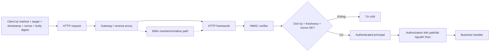

# Ký không bao phủ path — Anti-pattern HMAC làm mất ràng buộc đích của HTTP request

## 1. Vấn đề: chữ ký đúng nhưng request đi sai đường dẫn

Trong **HMAC request authentication**, client và server có một *shared secret* để tính và kiểm tra HMAC của **canonical request**. Hợp đồng ký có thể bao gồm HTTP method, URI, những header được chọn, timestamp, nonce và body hoặc body digest. Mục tiêu là xác thực bên có khả năng sử dụng secret và phát hiện thay đổi của **các thành phần thực sự được ký**.

**Anti-pattern “Ký không bao phủ path”** xảy ra khi chữ ký HMAC không ràng buộc HTTP path — tức phần đường dẫn xác định tài nguyên/route — dù backend lại dùng path để chọn endpoint, tenant, tài nguyên hoặc hành động. Khi đó cùng một chữ ký có thể vẫn khớp nếu path đổi, miễn mọi trường đã ký khác giữ nguyên.

Đây là bài thuộc chương **Anti-pattern HMAC** của module `SECURITY_AUTHENTICATION_HMAC_REQUEST_AUTHENTICATION`. Người học cần phân biệt:

- **Integrity của phần đã ký:** HMAC có thể hoàn toàn chính xác nhưng không nói gì về path bị bỏ qua.
- **Authentication:** credential đúng chỉ chứng minh request được ký bằng một secret được chấp nhận; không tự chứng minh request được ký cho *đúng URL*.
- **Authorization:** quyền trên path/tài nguyên đích vẫn phải được kiểm tra độc lập; ký path đúng cũng không tự trao quyền.
- **Replay protection:** timestamp/nonce giúp chặn dùng lại cùng request theo policy, nhưng không tự bổ sung path vào chữ ký.
- **Đường đi HTTP:** gateway, reverse proxy, servlet container và WebFlux có thể xử lý path/encoding khác nhau; chỉ có một hợp đồng byte-level rõ ràng mới giúp ký và xác minh nhất quán.

Điểm cần nhớ: **chữ ký HMAC không bao phủ path thì không thể dùng chữ ký ấy làm bằng chứng rằng request đã được gửi tới path dự kiến**. Không nên suy luận rằng mọi biến đổi path đều dẫn tới khai thác thành công: TLS, kiểm soát điểm trung gian, phân quyền và trạng thái nonce có thể giới hạn từng kịch bản. Tuy vậy thiếu ràng buộc mật mã với path là một điểm yếu thiết kế độc lập cần sửa.

## 2. Ví dụ cụ thể: hai URL, một chữ ký HMAC

Giả sử ứng dụng cấp cho `partner-a` quyền thao tác với đơn hàng. Client chuẩn bị request:

```http
GET /v1/orders/123 HTTP/1.1
Host: api.example.test
X-Key-Id: partner-a-key-1
X-Timestamp: 1795800000
X-Nonce: n-7d4f1c2a098b
X-Signature: <hmac-sha256-base64url>
```

Hợp đồng **lỗi** chỉ ký:

```text
BAD-HMAC-v1
GET
partner-a-key-1
1795800000
n-7d4f1c2a098b
<sha256-of-empty-body>
```

Không có dòng `/v1/orders/123`. Nếu giữ nguyên method, key ID, timestamp, nonce và body, chữ ký sẽ giống hệt khi request-target thành:

```http
GET /v1/orders/999 HTTP/1.1
Host: api.example.test
X-Key-Id: partner-a-key-1
X-Timestamp: 1795800000
X-Nonce: n-7d4f1c2a098b
X-Signature: <same-original-signature>
```

Đó không phải lỗi của HMAC-SHA256; server đang xác minh **đúng thông điệp nhưng thông điệp thiếu thành phần thiết yếu**. Chữ ký không thể phát hiện thay đổi `123` thành `999`.

Có hai điều kiện quan trọng:

1. **Nonce:** Nếu request đầu tiên đã được chấp nhận và nonce được reserve nguyên tử, request thứ hai dùng lại nonce có thể bị từ chối vì replay. Nhưng nếu request đã ký bị đổi **trước lần sử dụng nonce đầu tiên**, hoặc có thành phần đáng tin cậy không nhất quán trong xử lý nonce, việc chống replay không chứng minh path còn nguyên.
2. **Phân quyền:** Nếu principal `partner-a` không được phép đọc đơn `999`, authorization đúng phải từ chối. Nhưng với API có quyền rộng, cấu hình phân quyền sai hoặc phân quyền chỉ theo route mà không kiểm tra ownership ở tầng tài nguyên, chữ ký không bao phủ path làm tăng tác động. Lỗ hổng HMAC và lỗ hổng phân quyền là **hai vấn đề cần kiểm tra riêng**, không được dùng việc có authorization làm lý do bỏ path khỏi chữ ký.

### Rủi ro lớn hơn khi path chọn tenant hoặc hành động

Path có thể quyết định tài nguyên như `/tenants/a/orders/123`, `/tenants/b/orders/123`; hoặc chức năng như `/v1/payments/submit` và `/v1/payments/cancel`. Nếu path không được ký, một chữ ký hợp lệ không chứng minh bên ký đã chọn tenant hay hành động nào.

Phạm vi rủi ro thực tế phụ thuộc HTTP method, schema body, kiểm tra quyền, route mapping và ai có khả năng thay đổi request-target. Đây là lý do cần **threat model end-to-end**, thay vì chỉ kiểm tra phép toán HMAC.

## 3. Vì sao “ký body + timestamp + nonce” vẫn chưa đủ?

Một nhóm triển khai thường cho rằng: “Body đã có SHA-256, timestamp và nonce được ký, vậy request an toàn.” Lập luận đó bỏ qua tác dụng của path.

| Thành phần được ký | Điều được bảo vệ | Điều không được bảo vệ nếu path bị bỏ sót |
| --- | --- | --- |
| HTTP method | `GET` không thể âm thầm biến thành `POST` khi dùng lại chữ ký | Vẫn có thể đổi giữa hai path cùng method |
| SHA-256 của body | Ngăn sửa body bytes nếu không có secret | Body giống nhau có thể được dùng ở hai endpoint khác nhau |
| Timestamp | Ngăn sửa thời điểm ký, hỗ trợ freshness window | Không xác định request đã được ký cho path nào |
| Nonce | Ngăn sửa nonce; chống replay khi server reserve đúng | Không đưa path vào dữ liệu MAC; nonce mới/chưa dùng không ràng buộc tài nguyên |
| Key ID | Ràng buộc lựa chọn credential nếu key ID được ký | Key đúng vẫn có thể được dùng cho path khác nếu policy cho phép |
| Một vài header | Chống sửa đúng những header đã liệt kê | Không bảo vệ path, query hay authority nếu chúng không được ký |

**Không nên tìm cách chữa lỗi bằng một nonce dài hơn, một thuật toán MAC “mạnh hơn” hoặc một secret mới** nếu canonical request vẫn bỏ qua path. Các biện pháp đó không bổ sung thông tin path vào đầu vào HMAC.

Dù truyền trên TLS, vấn đề vẫn tồn tại ở **ranh giới ứng dụng và proxy**: gateway có thể rewrite path, hệ thống có thể ký một đối tượng request rồi gửi một đối tượng khác, hoặc một bên nắm được credential/đầu ra chữ ký có thể tạo thông điệp ở path khác. TLS hạn chế việc một bên ngoài tự sửa byte trên kết nối TLS đã được bảo vệ, nhưng không thay thế kiểm tra rằng **đích nghiệp vụ được gắn vào chữ ký**.

## 4. Sửa hợp đồng ký: đưa path vào canonical request một cách chính xác

Sửa tối thiểu là thêm path vào canonical request. Tuy nhiên, nếu chỉ gọi `uri.toString()` ở client và `request.getPath()` ở server, hai bên vẫn có thể ký **hai biểu diễn khác nhau** của cùng request.

Hợp đồng đầy đủ nên định nghĩa:

| Đầu vào | Quy tắc bắt buộc phải thống nhất |
| --- | --- |
| `METHOD` | Chuỗi method được ký, không tùy ý đổi case |
| `PATH` | Dạng path đã chọn: raw percent-encoded hay đã canonicalize theo thuật toán phiên bản cụ thể |
| `QUERY` | Có được ký không, thứ tự tham số, duplicate, percent-encoding và empty value |
| `HOST/AUTHORITY` | Có tham gia vào định danh tài nguyên/tenant/routing không? Nếu có, phải được bảo vệ theo contract |
| `HEADERS` | Danh sách header có ý nghĩa bảo mật, normalization, duplicate và cách nối giá trị |
| `BODY` | Raw body bytes hoặc digest tại ranh giới được thống nhất |
| `VERSION` | Phiên bản signature profile để tránh diễn giải khác schema |
| `KEY_ID` | Liên kết chữ ký với credential đúng |
| `TIMESTAMP/NONCE` | Định dạng, đơn vị, giới hạn thời gian và replay namespace |
| `ENCODING` | UTF-8, dấu phân cách, newline, định dạng digest/signature |

### 4.1. Hợp đồng minh họa hmac-v2

Để minh họa, định nghĩa `hmac-v2` ký **request-target** ở dạng origin-form đã thỏa thuận, gồm `path` và `?query` nếu có. Ví dụ:

```text
HMAC-REQUEST
hmac-v2
partner-a-key-1
GET
/v1/orders/123?expand=items
1795800000
n-7d4f1c2a098b
<lowercase-hex-SHA256-of-body-bytes>
```

Canonical string trên gồm tám dòng, nối bằng ký tự LF (`\n`), **không có LF cuối**. HMAC-SHA256 được tính trên byte UTF-8 của chuỗi đó bằng secret đăng ký cho `(client, keyId, profile)`. Chữ ký truyền dưới dạng Base64url không padding của 32 byte MAC.

Trong hợp đồng minh họa:

- Dòng `/v1/orders/123?expand=items` phải là request-target đã chốt **tại điểm ký**, được bảo toàn hoặc được tái dựng **đúng bằng cùng thuật toán canonicalization** tại điểm verify.
- `?expand=items` cũng được ký. Nếu chỉ ký path mà **bỏ query**, request vẫn có thể bị thay tham số query có ý nghĩa nghiệp vụ.
- Path không được có CR/LF trong đầu vào canonical; HTTP parser phải chặn request-target sai cú pháp, dấu điều khiển, độ dài vượt hạn mức hoặc encoding mơ hồ.
- Các giá trị method, key ID, timestamp, nonce và body digest cũng phải có grammar rõ ràng để việc nối dòng không tạo **nhiều cách phân tách cùng một chuỗi**.
- Nếu hệ thống phụ thuộc authority/host để chọn tenant, cần ràng buộc authority trong signature profile hoặc có chính sách trusted-routing độc lập; ví dụ này chỉ giả định **một authority cố định**.
- Nếu header như `Content-Type`, `Idempotency-Key` hay `X-Tenant-Id` ảnh hưởng trực tiếp đến nội dung/tenant/hành động, phải quyết định và ghi rõ có ký chúng không. Không giả định tất cả header được bảo vệ.

Một thay đổi làm khác **canonical request-target** mà giữ nguyên chữ ký cũ phải bị từ chối, trừ khi contract **cố ý** định nghĩa hai biểu diễn là cùng một giá trị canonical.

### 4.2. Path khác nhau về byte có thể “trông giống nhau”

Những cặp dưới đây cần được **quyết định trong hợp đồng**, không tùy theo framework:

| Cặp biểu diễn | Điều cần xem xét |
| --- | --- |
| `/a%2Fb` và `/a/b` | Encoded slash có thể thay đổi phân đoạn đường dẫn khi decode |
| `/a/%2E%2E/b` và `/b` | Dot-segment normalization và giải mã percent |
| `/orders` và `/orders/` | Trailing slash có thể map hai route khác nhau |
| `/a//b` và `/a/b` | Collapsing repeated slash ở proxy/router |
| `/%7Euser` và `/~user` | Percent-encoding của ký tự không cần mã hóa |
| `/api/%2fadmin` và `/api/%2Fadmin` | Hex case trong percent-encoding |
| `/orders?id=1&id=2` và `/orders?id=2&id=1` | Duplicate query và thứ tự tham số |
| `/café` và dạng percent-encoded UTF-8 | Unicode/charset và normalization nếu được hỗ trợ |

Không mặc định từng cặp là tương đương hoặc không tương đương với **mọi API**. Điều cần xác minh là cùng request sẽ được client, gateway, security filter và router hiểu nhất quán theo hợp đồng đã công bố.

Đặc biệt, path dùng để ký phải tương ứng **route được ứng dụng xử lý sau khi xác thực**. Nếu verify một path nhưng handler thực thi một path khác do rewrite, route alias hoặc forward nội bộ, cần có quy tắc mapping đáng tin cậy và kiểm thử binding đó.

## 5. Sơ đồ: ranh giới mà path có thể bị thay đổi



Có hai kiến trúc khả thi, cần lựa chọn rõ:

**Phương án A — Xác minh ở gateway đáng tin cậy trước rewrite.** Gateway nhìn thấy request-target ở ranh giới ngoài và xác minh trên canonical bytes trước khi định tuyến. Backend chỉ tin nhận dạng đã xác thực được gateway truyền qua kênh nội bộ an toàn và phải bảo đảm route backend thực thi tương ứng với request đã kiểm tra. Không tin header identity do client tự gửi.

**Phương án B — Xác minh ở backend.** Gateway phải bảo toàn canonical request-target đầu vào hoặc truyền metadata **do chính gateway đáng tin cậy thiết lập**, có kiểm soát tính toàn vẹn, để backend tái dựng đúng request đã ký. Nếu dùng header nội bộ như `X-Original-URI`, gateway phải **loại bỏ mọi header cùng tên do client gửi**, tự tạo lại giá trị, giới hạn đường truy cập backend và bảo vệ kênh giữa các thành phần.

Không bao giờ dùng trực tiếp `X-Original-URI`, `X-Forwarded-Prefix` hay `Forwarded` do client tự gửi như nguồn tin cậy để quyết định canonical target hoặc principal. Các header đó chỉ có ý nghĩa khi proxy đáng tin cậy có chính sách sanitize/overwrite phù hợp.

Với Spring MVC, cần hiểu sự khác nhau giữa URI mà Servlet API cung cấp, `contextPath`, `servletPath` và URL đã qua proxy. Với Spring WebFlux, `ServerHttpRequest.getURI().getRawPath()` và `getRawQuery()` cung cấp biểu diễn của **request backend nhận**, không bảo đảm đó là request-target ban đầu ở biên ngoài. Hệ thống phải kiểm chứng hành vi thực tế của gateway/HTTP stack, thay vì suy ra từ tên phương thức.

## 6. Java 17 + JUnit 5: chứng minh lỗi và phép sửa

Lớp ví dụ sau có hai chế độ:

- `signWithoutTarget()`: **cố ý sai**, mô phỏng HMAC không bao phủ path/query. Chỉ dùng để trình diễn anti-pattern và tạo test hồi quy.
- `signWithTarget()`: minh họa profile mới, ràng buộc request-target vào HMAC; đổi path/query không thể tái sử dụng chữ ký cũ.

Code dùng Java 17 và JUnit 5. Nó giả định `rawTarget` đã được một parser HTTP nghiêm ngặt kiểm tra, có biểu diễn ổn định và **không chứa LF/CR**. Đoạn mã chỉ kiểm thử mật mã/canonicalization, chưa chứa timestamp validation, replay store, key registry, Spring Security hoặc authorization; không copy trực tiếp thành production filter.

```java
import org.junit.jupiter.api.Test;

import javax.crypto.Mac;
import javax.crypto.spec.SecretKeySpec;
import java.nio.charset.StandardCharsets;
import java.security.GeneralSecurityException;
import java.security.MessageDigest;
import java.util.Base64;
import java.util.HexFormat;

import static org.junit.jupiter.api.Assertions.assertFalse;
import static org.junit.jupiter.api.Assertions.assertTrue;

class UnsignedPathHmacTest {
    private static final byte[] SECRET =
            "test-only-long-random-looking-secret-123"
                    .getBytes(StandardCharsets.UTF_8);

    record Request(
            String method,
            String rawTarget,
            String keyId,
            String timestamp,
            String nonce,
            byte[] body
    ) {
        Request withTarget(String target) {
            return new Request(method, target, keyId, timestamp, nonce, body);
        }

        Request withBody(byte[] newBody) {
            return new Request(method, rawTarget, keyId,
                    timestamp, nonce, newBody);
        }
    }

    private static Request sample() {
        return new Request(
                "GET",
                "/v1/orders/123?expand=items",
                "partner-a-key-1",
                "1795800000",  // Unit test cố định, không dùng cho HTTP freshness.
                "unit-test-nonce-12345",
                new byte[0]);
    }

    private static String sha256Hex(byte[] body)
            throws GeneralSecurityException {
        return HexFormat.of().formatHex(
                MessageDigest.getInstance("SHA-256").digest(body));
    }

    // ANTI-PATTERN: rawTarget hoàn toàn không có trong thông điệp ký.
    private static String canonicalWithoutTarget(Request r)
            throws GeneralSecurityException {
        return String.join("\n",
                "BAD-HMAC-v1", r.method(), r.keyId(),
                r.timestamp(), r.nonce(), sha256Hex(r.body()));
    }

    // PROFILE ĐÚNG: rawTarget có cả path và query.
    private static String canonicalWithTarget(Request r)
            throws GeneralSecurityException {
        return String.join("\n",
                "HMAC-REQUEST", "hmac-v2", r.keyId(), r.method(),
                r.rawTarget(), r.timestamp(), r.nonce(),
                sha256Hex(r.body()));
    }

    private static byte[] hmac(String text)
            throws GeneralSecurityException {
        Mac mac = Mac.getInstance("HmacSHA256");
        mac.init(new SecretKeySpec(SECRET, "HmacSHA256"));
        return mac.doFinal(text.getBytes(StandardCharsets.UTF_8));
    }

    private static byte[] signWithoutTarget(Request r)
            throws GeneralSecurityException {
        return hmac(canonicalWithoutTarget(r));
    }

    private static byte[] signWithTarget(Request r)
            throws GeneralSecurityException {
        return hmac(canonicalWithTarget(r));
    }

    private static boolean verifyWithoutTarget(Request r, byte[] signature)
            throws GeneralSecurityException {
        return signature != null && signature.length == 32
                && MessageDigest.isEqual(
                        signWithoutTarget(r), signature);
    }

    private static boolean verifyWithTarget(Request r, byte[] signature)
            throws GeneralSecurityException {
        return signature != null && signature.length == 32
                && MessageDigest.isEqual(
                        signWithTarget(r), signature);
    }

    @Test
    void oldSchemeAcceptsDifferentPathWithSameSignature()
            throws GeneralSecurityException {
        Request original = sample();
        byte[] signature = signWithoutTarget(original);
        Request changedPath = original.withTarget(
                "/v1/orders/999?expand=items");

        assertTrue(verifyWithoutTarget(original, signature));
        // Cố ý tái tạo lỗ hổng: chữ ký cũ vẫn khớp dù đổi path.
        assertTrue(verifyWithoutTarget(changedPath, signature));
    }

    @Test
    void newSchemeBindsPathAndQuery()
            throws GeneralSecurityException {
        Request original = sample();
        byte[] signature = signWithTarget(original);

        assertTrue(verifyWithTarget(original, signature));
        assertFalse(verifyWithTarget(
                original.withTarget("/v1/orders/999?expand=items"),
                signature));
        assertFalse(verifyWithTarget(
                original.withTarget("/v1/orders/123?expand=payments"),
                signature));
    }

    @Test
    void encodedSlashAndDecodedSlashAreDifferentUnderRawTargetPolicy()
            throws GeneralSecurityException {
        Request encoded = sample().withTarget(
                "/v1/orders/a%2Fb?expand=items");
        Request decoded = sample().withTarget(
                "/v1/orders/a/b?expand=items");
        byte[] signature = signWithTarget(encoded);

        assertTrue(verifyWithTarget(encoded, signature));
        assertFalse(verifyWithTarget(decoded, signature));
    }

    @Test
    void newSchemeAlsoBindsBody()
            throws GeneralSecurityException {
        Request original = sample().withBody(
                "{\"amount\":100}".getBytes(StandardCharsets.UTF_8));
        byte[] signature = signWithTarget(original);

        assertTrue(verifyWithTarget(original, signature));
        assertFalse(verifyWithTarget(
                original.withBody(
                    "{\"amount\":900}".getBytes(StandardCharsets.UTF_8)),
                signature));
    }
}
```

Trong ví dụ, mã `verifyWithoutTarget()` xác minh HMAC thành công đối với path sai không có nghĩa request đó **được phân quyền**; đó là bằng chứng rất cụ thể rằng bước **authentication integrity** không bảo vệ route. Mã `verifyWithTarget()` khắc phục thiếu sót ở dữ liệu ký theo profile minh họa, không giải quyết các vấn đề khác như secret bị lộ, replay race, header parser hoặc authorization.

`Base64` được dùng khi đưa chữ ký lên wire, nhưng đoạn test so sánh trực tiếp byte MAC để tập trung vào path binding. Khi triển khai thực, cần parse signature theo định dạng và độ dài đã công bố, giới hạn input trước decode, tránh nhiều biểu diễn có thể được hiểu khác nhau; hãy dùng phép so sánh MAC phù hợp, ví dụ `MessageDigest.isEqual` sau kiểm tra độ dài.

Đối với hệ thống xử lý route từ các giá trị đã decode, đừng đơn giản copy `r.rawTarget()` vào production: phải bảo đảm request-target từ client và request-target ở verifier được trích xuất đúng tại cùng ranh giới, với policy canonicalization có test vectors độc lập.

## 7. Integration test thật: ràng buộc đúng path qua security filter

Một unit test chỉ chứng minh công thức MAC không bao phủ hoặc có bao phủ target. Để xác minh đường đi HTTP, cần test với **request hợp lệ thực sự được ký** và cùng security filter mà sản phẩm đang dùng. Với Spring MVC có thể dùng `MockMvc`; với Spring WebFlux dùng `WebTestClient`. Những biến thể phụ thuộc raw path/percent-encoding phải chạy thêm qua gateway và HTTP server thực tế vì test client/mock có thể chuẩn hóa trước khi gửi.

Mẫu test:

```text
given:
  tenant/client có key ACTIVE và được phép dùng signature profile hmac-v2
  method GET
  original target = /v1/orders/123?expand=items
  current timestamp nằm trong freshness window
  nonce chưa từng dùng
  body bytes trống
  signature = HMAC(secret, canonical(original target + các field khác))

positive control:
  gửi đúng original target với nonce riêng chưa dùng
  expect authentication thành công (và authorization đúng tài nguyên)

negative test:
  tạo một request độc lập, timestamp hợp lệ và nonce mới
  ký trên original target trước khi mutate
  chỉ thay raw target trên request gửi thực tế thành /v1/orders/999?expand=items
  giữ nguyên signature và các signed fields khác
  expect HMAC mismatch ở đúng tầng xác thực

assert:
  không có authenticated principal cho negative test
  protected handler không được gọi và không tạo side effect
  status theo API contract (thường 401 cho invalid signature)
  không có 5xx bất ngờ
  reason nội bộ = INVALID_SIGNATURE, không phải NONCE_REPLAY hay EXPIRED_TIMESTAMP
```

**Lưu ý về nonce:** Không gửi hai request tích hợp với **cùng nonce** đã được positive test tiêu thụ, bởi request thứ hai có thể bị từ chối do replay trước khi kiểm tra path. Mỗi HTTP request thực tế cần nonce mới; test có thể tạo hai cặp ký độc lập rồi mutate path của cặp âm.

**Lưu ý về authorization:** Có thể cần principal có quyền truy cập **cả hai path** trong test để đảm bảo negative case thất bại do HMAC chứ không bị từ chối sớm vì không đủ quyền. Dù vậy, không bỏ qua kiểm tra quyền ở production. Unit test giả lập cùng một chữ ký trên hai path chứng minh lỗi coverage; integration test phải xác định ranh giới từ chối chính xác.

### Các ca phải chạy qua gateway

1. Path gốc và path rewrite có cùng method, body, header.
2. Encoded slash `%2F`, dot segments, repeated slash, trailing slash.
3. Query thay đổi nhưng path giữ nguyên.
4. Tên header khác case, duplicate `Host`/credential headers, `X-Original-URI` do client tự đặt.
5. Gateway strip path prefix, ví dụ public `/api/v1/orders/123` → backend `/v1/orders/123`.
6. HTTP/1.1 và HTTP/2 (nếu sản phẩm hỗ trợ), bao gồm `:path` ở HTTP/2 và cách chuyển thành request-target.
7. Backend được gọi trực tiếp không qua gateway; phải được bảo vệ hoặc chặn theo network/authentication policy.
8. Nhiều region/instance trong rolling deploy; cùng một test vector phải có kết quả như nhau.

Tại mỗi tuyến, so sánh **dạng canonical được verifier dùng** bằng test hook được kiểm soát, không log secret hoặc full body nhạy cảm. Nếu gateway làm verify trước rewrite, cũng phải xác minh backend xử lý đúng route mà gateway đã ủy quyền và không chấp nhận identity header giả mạo từ client.

## 8. Rủi ro khi “sửa nhanh” bằng normalize hoặc fallback

### 8.1. Thử nhiều path cho đến khi chữ ký khớp

Ví dụ anti-pattern thứ hai:

```text
if verify(request, rawPath) fails:
    try verify(request, decodedPath)
    try verify(request, normalizedPath)
    try verify(request, xOriginalUriHeader)
```

Cách này tạo nhiều cách diễn giải credential và tăng nguy cơ path confusion hoặc signature acceptance ngoài contract. Nếu client và server có thể dùng hai canonical schema trong giai đoạn migration, hãy **đặt signature profile/version riêng**, đưa version vào dữ liệu ký, và áp allowlist theo client/key. **Một request chỉ được xác minh bằng một profile được phép**, không thử mọi biến thể đến khi khớp.

### 8.2. Chỉ dùng route template

Ký `/v1/orders/{id}` thay vì path cụ thể `/v1/orders/123` là chưa đủ nếu ID xác định đối tượng có ý nghĩa bảo mật. HMAC trên route template không bảo vệ ID. Có thể dùng route template cho telemetry, nhưng chữ ký phải bảo vệ **các thành phần đích xác định resource thực**.

### 8.3. Dùng path sau rewrite mà bỏ qua path ngoài

Nếu gateway thay public path thành internal path và backend verify internal path, client ký public path sẽ gặp mismatch. “Sửa” bằng cách bảo client ký theo internal path dễ khiến contract phụ thuộc hạ tầng riêng và tạo khác biệt giữa client/proxy/backend. Cần chọn rõ điểm xác minh hoặc định nghĩa một phép ánh xạ trusted, được kiểm thử và không bị client điều khiển.

### 8.4. Chỉ thêm path, bỏ query

Nhiều API dùng query để chọn ID, filter, operation hoặc quyền truy cập. Nếu query không được ký mà lại ảnh hưởng tài nguyên hoặc action, anti-pattern tương tự sẽ lặp lại với query. Phải đánh giá path và query theo **tác dụng thực tế**, không chỉ theo hình thức URL.

### 8.5. Tắt HMAC mismatch để cứu khả dụng

Một đợt tăng 401 sau deploy gateway có thể do path canonicalization bị lệch. Không được trả lời bằng cách bỏ HMAC verification, chỉ verify body, hoặc chuyển sang secret/algorithm yếu hơn. Ưu tiên rollback thay đổi rewrite, chốt test vectors và sửa signature contract có kiểm soát.

## 9. Ma trận kiểm thử và tiêu chí nghiệm thu

| Biến thể | Kỳ vọng của profile ký raw request-target |
| --- | --- |
| Request gốc được ký đúng, nonce mới | Xác thực thành công nếu key/time/nonce hợp lệ |
| Chỉ thay path `/123` → `/999` sau khi ký | HMAC mismatch |
| Chỉ thay query `expand=items` → `expand=payments` | HMAC mismatch |
| Chỉ thay method `GET` → `POST` | HMAC mismatch |
| Đổi body bytes trong request có body đã được ký | HMAC mismatch |
| Thay timestamp đã ký | HMAC mismatch hoặc từ chối do freshness; phải xác định oracle |
| Thay key ID đã ký | Từ chối do key binding/policy hoặc HMAC mismatch |
| Nonce đã dùng trong window | Replay reject; không dùng ca này để chứng minh path binding |
| `/a%2Fb` → `/a/b` sau khi ký | HMAC mismatch dưới raw-target policy |
| `/%7Euser` → `/~user` sau khi ký | HMAC mismatch nếu contract không normalize tương đương |
| Trường `Host` khác trong hệ thống định tuyến theo host | Từ chối theo policy/binding, hoặc đưa authority vào signed contract |
| `X-Original-URI` do client thêm | Không được coi là nguồn trusted để verify |
| Gateway strip prefix trước backend | HMAC nhất quán qua verified trusted mapping hoặc verify tại ingress |
| HTTP/2 `:path` có query | Phải ràng buộc cùng target mà router thực sự xử lý |
| Header signed bị duplicate hoặc parser mơ hồ | Từ chối có kiểm soát |
| Signature đúng nhưng principal không có quyền tài nguyên | Authorization từ chối, không đánh đồng authn |
| Client dùng profile legacy không ký path sau cutoff | Từ chối dù MAC legacy hợp lệ |
| Path dài, malformed percent-encoding, CRLF | Từ chối ở HTTP/parser boundary; không 5xx/side effect |

**Tiêu chí đạt:** mọi route có ý nghĩa bảo mật đều được liên kết với canonical target đã ký; cùng một request không được xác minh dưới nhiều cách diễn giải; client, gateway và backend có test vector chung; negative test đổi path/query sau khi ký bị từ chối vì **đúng nguyên nhân**; và mọi request thất bại không chạy nghiệp vụ.

## 10. Migration từ profile cũ không ký path

Nếu đã có client legacy đang ký method/body/timestamp/nonce nhưng **không ký path**, cần có migration có kiểm soát thay vì thay công thức HMAC ngay một lần cho toàn bộ client.

**Bước 1 — Kiểm kê.** Xác định client nào dùng canonical schema cũ, tài nguyên/endpoint ảnh hưởng, ai có thể đổi target và quyền hiện tại của các credential legacy. Ghi nhận những client vẫn có thể xác thực thành công trên profile cũ.

**Bước 2 — Định nghĩa profile mới.** Chọn tên version như `hmac-v2`; chốt raw/canonical path, query, authority nếu cần, signed headers, body digest, encoding, signature format, timestamp/nonce và key scope. Cấp **key ID/secret mới** nếu có nhu cầu tách profile và giảm rủi ro; không dùng secret đã lộ cho profile mới.

**Bước 3 — Hỗ trợ song song nhưng không fallback.** Với từng client, quản lý `allowedProfiles` phía server. Mỗi request khai báo và ký version, đi qua đúng một verifier theo policy. Không thử legacy khi v2 mismatch.

**Bước 4 — Canary.** Dùng golden vectors và gateway integration test cho raw path, `%2F`, query duplicate, body, header, timestamp/nonce, rolling deploy. Theo dõi `INVALID_SIGNATURE`, `UNKNOWN_PROFILE`, replay và số request legacy hợp lệ.

**Bước 5 — Cutoff.** Đặt client mới ở `v2-only`, revoke hoặc disable profile/key legacy và thử một request **ký đúng bằng secret legacy**: nó vẫn phải bị từ chối ở mọi gateway/backend/region. Xóa nhánh legacy sau khi có bằng chứng không còn đường chấp nhận.

**Rollback:** Nếu profile mới gặp lỗi do canonical drift, ưu tiên sửa hợp đồng/proxy hoặc tạm dừng rollout. Mở lại legacy cho client đã cutoff là **thay đổi bảo mật cần phê duyệt và giới hạn thời gian**; tuyệt đối không bật lại secret bị compromise.

Với các endpoint có side effect, dùng idempotency key theo ý nghĩa nghiệp vụ. Nonce chỉ chống dùng lại nonce, **không tự ngăn** một bên có credential hợp lệ gửi cùng thao tác với nonce khác.

## 11. Observability và chẩn đoán sau khi sửa

Một bản ghi kết quả xác thực nội bộ nên cho biết vì sao request thất bại mà không làm lộ secret hay dữ liệu nhạy cảm:

```json
{
  "event": "hmac_auth_rejected",
  "requestId": "req-example-123",
  "clientId": "partner-a",
  "keyId": "key-2026-b",
  "profile": "hmac-v2",
  "routeTemplate": "GET /v1/orders/{id}",
  "reasonCode": "INVALID_SIGNATURE",
  "canonicalizationRevision": "target-v2",
  "gatewayRevision": "gw-42",
  "region": "region-a"
}
```

Có thể theo dõi:

- Tỷ lệ `INVALID_SIGNATURE` sau deployment proxy, theo route/client/gateway revision.
- Những request có canonical target khác nhau giữa client SDK test vector và backend.
- Các trường hợp legacy còn được chấp nhận sau ngày cutoff.
- Số path rewrite/normalization bị policy từ chối, tách rõ parser error và HMAC mismatch.
- Số lần authorization từ chối trên request đã xác thực, tránh lẫn với authn failure.
- Số request xác thực thất bại nhưng business handler vẫn tạo side effect — phải bằng 0.

Không ghi shared secret, raw signature, canonical request chứa thông tin nhạy cảm, body hay ID tài nguyên nhạy cảm vào log thường. Với dữ liệu dùng debug, chỉ ghi thông tin tối thiểu, có retention và quyền truy cập phù hợp.

## 12. Bài tập thực hành

**Bài tập A — Tìm lỗ hổng.** Một verifier dùng canonical string `METHOD + "\n" + TIMESTAMP + "\n" + NONCE + "\n" + BODY_SHA256`. Hãy liệt kê các trường chưa được bảo vệ, rồi chỉ ra vì sao đổi path từ `/tenants/a/payments` sang `/tenants/b/payments` vẫn có thể giữ chữ ký hợp lệ. Phân biệt tình huống chữ ký khớp với tình huống authorization có thể từ chối.

**Bài tập B — Viết regression test.** Mở rộng `UnsignedPathHmacTest` để kiểm tra thay đổi `GET` thành `POST`, thay key ID, thay query duplicate và đổi `/orders` thành `/orders/`. Mỗi test cần giữ cố định các thành phần khác, nêu rõ thuộc parser, HMAC, replay hay authorization.

**Bài tập C — Gateway rewrite.** Với gateway ánh xạ `/api/v1/orders/123` thành `/v1/orders/123` ở backend, chọn nơi thực hiện HMAC verification và cách bảo đảm endpoint backend xử lý chính request-target đã được ủy quyền. Giải thích vì sao header `X-Original-URI` từ client là dữ liệu không tin cậy.

**Bài tập D — Rollout.** Lập migration plan cho 50 client legacy không ký path: phân nhóm, cấp credential v2, test trực tiếp/backend/gateway, allowlist theo client, metric, cutoff và bằng chứng chặn chữ ký legacy sau ngày ngừng hỗ trợ.

**Thông điệp cuối:** Một chữ ký HMAC chỉ bảo vệ **những byte đã được đưa vào MAC**. Nếu path quyết định endpoint, tenant hoặc tài nguyên nhưng bị bỏ khỏi canonical request, hệ thống không có ràng buộc mật mã giữa chữ ký và đích HTTP. Hãy **ký đúng canonical request-target (và authority/header có ý nghĩa bảo mật khi cần), thống nhất byte qua gateway/backend, chống replay và kiểm tra phân quyền độc lập**. Đây là cách loại bỏ anti-pattern “Ký không bao phủ path” mà không biến việc sửa thành một lỗ hổng canonicalization hoặc downgrade mới.
