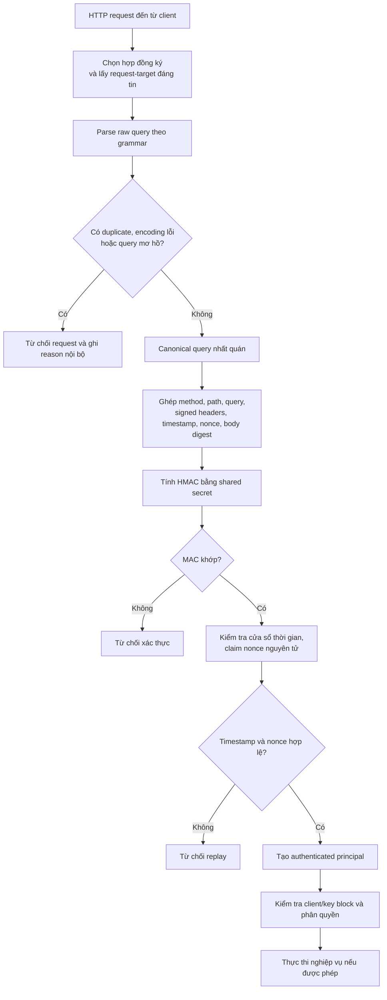

# Ký query không canonical: anti-pattern trong HMAC Request Authentication

## 1. Vấn đề: cùng một request nhưng hai cách hiểu query

Trong module **SECURITY_AUTHENTICATION_HMAC_REQUEST_AUTHENTICATION**, client dùng shared secret để ký HTTP request bằng HMAC. Hợp đồng ký thường bao gồm HTTP method, URI, một số header, timestamp, nonce và có thể cả body hoặc digest của body. Server tạo lại cùng chuỗi byte từ request nhận được, tính HMAC và so sánh chữ ký. Timestamp/nonce giới hạn replay; sau xác thực, hệ thống vẫn phải **phân quyền** độc lập.

**Anti-pattern “ký query không canonical”** xuất hiện khi bên gửi và bên nhận đưa query string vào dữ liệu ký theo những cách không được quy định chính xác, hoặc một bên dùng URL thô còn bên kia dùng query đã parse/chuẩn hóa tùy tiện. Ngay cả khi cả hai đều dùng `HmacSHA256` và cùng secret, chúng vẫn có thể ký **hai chuỗi byte khác nhau**. Tệ hơn, hai bộ phận của server có thể hiểu **hai ý nghĩa nghiệp vụ khác nhau** từ request có cùng chữ ký.

Ví dụ:

```http
GET /v1/orders?status=paid&page=2 HTTP/1.1
Host: api.example.test
X-HMAC-Key-Id: partner-17
X-HMAC-Timestamp: 2026-11-28T06:00:00Z
X-HMAC-Nonce: n-7d4f203a
X-HMAC-Signature: <base64-hmac>
```

Một SDK ký chuỗi `status=paid&page=2`; verifier lại ký chuỗi `page=2&status=paid` vì framework trả về map theo thứ tự khác. Kết quả là chữ ký sai dù người dùng không sửa request. Nếu để “sửa nhanh”, verifier bỏ query khỏi MAC, kẻ tấn công có thể thay `page=2` thành `page=200`, hoặc đổi filter nghiệp vụ mà vẫn giữ chữ ký hợp lệ khi các thành phần khác không đổi.

Mục tiêu bài học:

- Giải thích vì sao query phải được canonical hóa theo **hợp đồng byte-level rõ ràng** trước khi tính HMAC.
- Phân biệt các lỗi do thứ tự tham số, percent-encoding, dấu `+`, tham số lặp, tham số rỗng, Unicode và proxy/gateway.
- Thiết kế một quy tắc canonical query có thể triển khai thống nhất ở Java và các SDK khác.
- Phòng lỗi parser differential: verifier và handler nghiệp vụ xử lý query khác nhau.
- Tạo test vector, kiểm thử end-to-end và di trú an toàn khi cần thay đổi canonical contract.

## 2. Canonical query có vai trò gì trong chữ ký?

Query là phần sau dấu `?` trong **request-target**, không bao gồm fragment `#...` (fragment do user agent xử lý và không được gửi lên HTTP server trong request-target thông thường). Với URI:

```text
/v1/orders?status=paid&page=2
```

path là `/v1/orders`, raw query là `status=paid&page=2`. Nếu hợp đồng ký gồm query, mọi thay đổi có ý nghĩa với handler phải làm thay đổi dữ liệu được ký và làm chữ ký cũ không hợp lệ.

Một canonical request **minh họa** có thể là:

```text
HMAC-REQ-V1
GET
/v1/orders
page=2&status=paid
x-hmac-timestamp:2026-11-28T06:00:00Z
x-hmac-nonce:n-7d4f203a
body-sha256:<hex-sha256-of-request-body>
```

Trong ví dụ, `page=2&status=paid` là **canonical query**, không phải thứ tự tham số tình cờ được thấy trên đường truyền. Các dòng được ghép bằng ký tự `LF`, mã hóa UTF-8; hợp đồng phải quy định cả việc có hay không newline cuối. Giá trị digest là placeholder. Cách xây dựng toàn bộ request, canonical path, body digest và header ở đây chỉ mang tính thiết kế tham khảo; các client/server phải dùng **cùng một phiên bản hợp đồng ký đã công bố**.

Với request đã nhận `?status=paid&page=2` hoặc `?page=2&status=paid`, nếu **ngữ nghĩa query là tập tham số đơn trị, không phụ thuộc thứ tự**, hai chuỗi có thể canonical về cùng `page=2&status=paid`. Nếu API cho phép thứ tự tham số thể hiện thứ tự danh sách hoặc chứa các tham số lặp có thứ tự, không được tùy tiện áp dụng phép sắp xếp đó.

**Tính chất phải giữ:** Nếu canonicalizer tạo cùng kết quả cho hai query khác nhau, backend phải xem chúng có cùng ý nghĩa liên quan đến quyết định bảo mật và nghiệp vụ. Nếu backend có thể xử lý khác nhau, đây là nguy cơ chấp nhận chữ ký cho một hành động không được chủ thể ký chủ ý.

## 3. Các biểu hiện điển hình của anti-pattern

| Biểu hiện | Vì sao nguy hiểm hoặc dễ lỗi | Cách xử lý |
| --- | --- | --- |
| Ký nguyên chuỗi query theo thứ tự client gửi, server dựng lại bằng `Map` | Thứ tự tham số có thể đổi khi framework hoặc proxy xử lý | Chọn contract sắp xếp rõ ràng, hoặc ký nguyên thứ tự nếu đó là ngữ nghĩa thực |
| Dùng `request.getParameterMap().toString()` làm dữ liệu ký | Format `Map`, thứ tự khóa, cách biểu diễn array/giá trị không phải canonical format | Không ký biểu diễn debug của object; serialize theo quy tắc byte-level |
| Dùng `URLEncoder` để canonicalize URI query mà không quy định format | `URLEncoder` dành cho `application/x-www-form-urlencoded`, có thể mã hóa space thành `+` | Quy định chính xác RFC 3986 percent-encoding hoặc một profile form-encoding rõ ràng |
| Một bên giải mã `%2F`, bên kia giữ `%2F` | Dữ liệu HMAC khác; còn có rủi ro khác nghĩa giữa verifier/backend | Decode đúng một lần rồi re-encode theo contract, hoặc dùng raw-byte contract được thống nhất |
| Ký tham số đầu tiên nhưng nghiệp vụ lấy tham số cuối | `role=user&role=admin` được verifier và handler hiểu khác nhau | Từ chối duplicate hoặc thống nhất semantics multi-value từ đầu đến cuối |
| Bỏ tham số rỗng khi canonicalize | `flag`, `flag=`, không có `flag` có thể khác nghĩa | Quy định chấp nhận/cấm từng dạng, không tự loại bỏ |
| Tự sắp xếp chỉ key, bỏ qua value trùng | Tham số trùng có thể đổi thứ tự và làm khác nghĩa | Định nghĩa thứ tự cả key/value, hoặc loại bỏ multi-value nếu không cần |
| Canonicalize theo URL sau khi gateway rewrite | Backend thấy path/query khác client đã ký | Thống nhất vị trí xác minh và representation gốc đáng tin |
| Unicode normalization vô tình khác nhau | `é` một code point và `e` + dấu kết hợp có thể có byte UTF-8 khác | Công bố chính sách Unicode normalization, kiểm thử bằng test vector |
| Gặp HMAC lỗi thì bỏ qua query và thử MAC khác | Chấp nhận chữ ký theo hợp đồng yếu hơn, mở đường downgrade | Chọn profile một lần, không fallback tùy ý |

### 3.1. Percent-encoding không phải phép biến đổi tùy ý

Trong URI, ký tự unreserved gồm `A-Z a-z 0-9 - . _ ~`. Một số biểu diễn khác nhau có thể diễn đạt cùng chuỗi ký tự theo quy tắc URI; ví dụ `%7E` và `~`. Nhưng không phải mọi cặp biểu diễn đều tương đương về ngữ nghĩa ứng dụng:

```text
?name=a%20b     # percent-encoded space
?name=a+b       # dấu +: là space trong form-encoding, nhưng có thể là dấu + literal ở profile khác
?name=a%2Bb     # dấu + được percent-encode
?name=a%2520b   # sau một lần decode là a%20b, không phải a b
```

Nếu client dùng quy tắc RFC 3986, còn backend dùng form decoder coi `+` là space, việc so sánh dựa trên raw string hoặc tự decode nhiều lần dễ tạo mâu thuẫn. Không thể chọn một canonicalizer “chung cho mọi loại URL” nếu chưa xác định **ngữ nghĩa query parser của ứng dụng**.

### 3.2. Tham số lặp và tên được mã hóa

```text
?scope=read&scope=write
?scope=read&%73cope=write
```

Sau percent-decoding, `scope` và `%73cope` cùng tên. Một verifier có thể lấy giá trị đầu tiên `read`, trong khi handler lấy giá trị cuối `write`, hoặc ngược lại. Nếu chỉ ký một giá trị nhưng backend thực hiện hành động từ giá trị khác, lỗi này ảnh hưởng trực tiếp đến tính toàn vẹn request.

Đối với endpoint không cần tham số lặp, cách dễ kiểm chứng là **từ chối duplicate sau khi decode/normalize tên**. Với endpoint thực sự cần multi-value, nên ký một biểu diễn có quy tắc rõ: có giữ thứ tự không, có cho giá trị trùng không, trường hợp thiếu `=` xử lý ra sao, và API nghiệp vụ phải dùng cùng parser đó.

### 3.3. Có query và không có query

Ba request-target sau có thể được framework xử lý tương tự hoặc khác nhau:

```text
/v1/orders
/v1/orders?
/v1/orders?sort=
```

Hợp đồng phải xác định `query = null` và `query = ""` có cùng canonical form hay không. Đồng thời, tham số `sort=` có **khóa tồn tại với giá trị rỗng**, không tương đương việc không có `sort`, trừ khi đây là chính sách nghiệp vụ đã công bố. Không được âm thầm lược bỏ `sort=` để tạo MAC.

## 4. Thiết kế một canonical query contract cụ thể

Không có một thuật toán canonical query chung bắt buộc cho mọi hệ thống HMAC tùy biến. Để minh họa cách thiết kế **có thể kiểm thử**, ta chọn profile sau cho một API có **tham số đơn trị, thứ tự không mang ý nghĩa**. Đây là một lựa chọn thiết kế, không khẳng định là chuẩn bắt buộc:

1. Nhận **raw query** từ request-target tại ranh giới tin cậy; không lấy `Map.toString()`, không lấy query đã bị thư viện khác chuẩn hóa trước đó. `null` và chuỗi rỗng cùng canonical thành chuỗi rỗng theo hợp đồng của API ví dụ.
2. Phân tách trên dấu `&` thô; mỗi phần tử **bắt buộc có đúng một dấu `=` phân cách tên/giá trị**, tên không rỗng, giá trị được phép rỗng. Dấu `=` thuộc giá trị phải encode thành `%3D`. Reject phần tử rỗng, trailing `&`, `&&`, hoặc `?flag` thiếu dấu `=`.
3. Với từng tên và giá trị, chỉ cho phép ký tự unreserved dạng ASCII trực tiếp; những byte khác **phải** có dạng `%HH` hợp lệ. Dấu `+` thô không được chấp nhận; dấu cộng literal phải là `%2B`. Raw non-ASCII cần được UTF-8 percent-encode. Quy tắc chặt này tránh phụ thuộc vào form decoder.
4. Percent-decode **đúng một lần** thành byte, giải mã UTF-8 bằng chế độ báo lỗi nếu byte không hợp lệ; từ chối control characters. **Không thực hiện Unicode NFC/NFD normalization** trong profile ví dụ.
5. Percent-encode lại byte UTF-8: unreserved xuất hiện trực tiếp; các byte khác thành `%HH` với hex **chữ hoa**. Không tự biến dấu `+` thành space.
6. Từ chối tên tham số lặp sau chuẩn hóa, kể cả tên có biểu diễn mã hóa khác nhau như `a` và `%61`.
7. Sắp xếp cặp tham số theo tên đã encode, so sánh chuỗi ASCII theo thứ tự từ điển; ghép bằng `&` dưới dạng `name=value`. Vì đã cấm trùng key nên không cần tiêu chí sắp xếp phụ theo value.
8. Tính HMAC trên **canonical request đầy đủ**, trong đó canonical query chỉ là một dòng/trường đã phân định, kết hợp method, path, timestamp, nonce và body digest theo cùng hợp đồng ký.

**Quan trọng:** API sử dụng thuật toán này phải đảm bảo handler/ngăn phân quyền dùng cùng semantics. Nếu Servlet hoặc gateway parse `+ `, duplicate, `%2F` hoặc ký tự Unicode theo quy tắc khác, cần xác thực/chuẩn hóa đầu vào tại ranh giới trước khi cả verifier lẫn handler xử lý. Không thể bảo vệ một ngữ nghĩa backend không tương thích chỉ bằng cách thay canonicalizer.

### Test vector cho canonical query của profile minh họa

| Raw query nhận được | Canonical query / quyết định | Giải thích |
| --- | --- | --- |
| `b=2&a=hello%20world` | `a=hello%20world&b=2` | Sắp xếp tên, giữ space dưới dạng `%20` |
| `a=hello%20world&b=2` | `a=hello%20world&b=2` | Cùng nghĩa theo profile tham số đơn trị |
| `q=%7e` | `q=~` | Unreserved có thể viết trực tiếp |
| `x=%2f` | `x=%2F` | Hex percent-encoding được chuẩn hóa về chữ hoa |
| `q=a%2Bb` | `q=a%2Bb` | Dấu cộng literal phải được encode |
| `q=a+b` | **Reject** | Dấu cộng thô không thuộc grammar này |
| `k=` | `k=` | Giữ khóa có giá trị rỗng |
| `k` | **Reject** | Thiếu `=` |
| `id=1&id=2` | **Reject** | Duplicate tên đã decode |
| `a=1&%61=2` | **Reject** | Tên `%61` trùng với `a` |
| `a=1&&b=2` | **Reject** | Có phần tử rỗng |
| `x=%GG` | **Reject** | Percent-encoding sai |
| `x=%C3%A9` | `x=%C3%A9` | UTF-8 hợp lệ, không tự đổi Unicode normalization |
| `x=e%CC%81` | `x=e%CC%81` | Khác byte với `x=%C3%A9` theo profile này |
| `x=%252F` | `x=%252F` | Decode đúng một lần rồi encode; không biến thành `x=%2F` |
| `(không có query)` | Chuỗi rỗng | Quy ước cho API ví dụ |

Các test vector trên mô tả **đầu ra canonical hóa**, chưa phải MAC kỳ vọng. Khi tích hợp, nên phát hành thêm bộ vector với secret thử nghiệm, canonical request đầy đủ và MAC Base64 chuẩn để Java, mobile SDK và các ngôn ngữ khác kiểm chứng có **cùng byte đầu vào** trước khi đưa vào production.

## 5. Ví dụ Java: canonicalize query nghiêm ngặt

Ví dụ Java 17 dưới đây hiện thực profile đơn trị vừa nêu. Nó nhận `rawQuery` (không có dấu `?`), từ chối input mơ hồ rồi trả về chuỗi ASCII chuẩn hóa. Ví dụ mang tính **thành phần học tập**: ứng dụng vẫn cần kiểm tra request-target/trusted proxy và đồng nhất parser với tầng nghiệp vụ.

```java
import java.io.ByteArrayOutputStream;
import java.nio.ByteBuffer;
import java.nio.charset.CharacterCodingException;
import java.nio.charset.CodingErrorAction;
import java.nio.charset.StandardCharsets;
import java.util.ArrayList;
import java.util.Comparator;
import java.util.HashSet;
import java.util.List;
import java.util.Set;
import java.util.stream.Collectors;

public final class CanonicalQuery {
    private static final String HEX = "0123456789ABCDEF";

    private CanonicalQuery() {}

    private record Param(String name, String value) {}

    public static String canonicalize(String rawQuery) {
        if (rawQuery == null || rawQuery.isEmpty()) {
            return "";
        }

        List<Param> params = new ArrayList<>();
        Set<String> seenNames = new HashSet<>();

        for (String entry : rawQuery.split("&", -1)) {
            if (entry.isEmpty()) {
                throw new IllegalArgumentException("Empty query entry");
            }

            int equal = entry.indexOf('=');
            if (equal <= 0) {
                throw new IllegalArgumentException("Expected name=value");
            }

            String name = normalize(entry.substring(0, equal));
            String value = normalize(entry.substring(equal + 1));
            if (!seenNames.add(name)) {
                throw new IllegalArgumentException("Duplicate query name");
            }
            params.add(new Param(name, value));
        }

        params.sort(Comparator.comparing(Param::name));
        return params.stream()
                .map(p -> p.name() + "=" + p.value())
                .collect(Collectors.joining("&"));
    }

    private static String normalize(String rawComponent) {
        ByteArrayOutputStream decodedBytes = new ByteArrayOutputStream();

        for (int i = 0; i < rawComponent.length();) {
            char c = rawComponent.charAt(i);
            if (c == '%') {
                if (i + 2 >= rawComponent.length()) {
                    throw new IllegalArgumentException("Truncated percent escape");
                }
                int hi = Character.digit(rawComponent.charAt(i + 1), 16);
                int lo = Character.digit(rawComponent.charAt(i + 2), 16);
                // Chỉ chấp nhận 0-9, A-F, a-f dạng ASCII.
                if (hi < 0 || lo < 0
                        || !isAsciiHex(rawComponent.charAt(i + 1))
                        || !isAsciiHex(rawComponent.charAt(i + 2))) {
                    throw new IllegalArgumentException("Bad percent escape");
                }
                decodedBytes.write((hi << 4) | lo);
                i += 3;
            } else {
                // Không dùng URLDecoder: dấu '+' không được đổi thành space.
                if (!isUnreserved(c)) {
                    throw new IllegalArgumentException("Encode non-unreserved byte");
                }
                decodedBytes.write(c);
                i++;
            }
        }

        String decoded;
        try {
            decoded = StandardCharsets.UTF_8.newDecoder()
                    .onMalformedInput(CodingErrorAction.REPORT)
                    .onUnmappableCharacter(CodingErrorAction.REPORT)
                    .decode(ByteBuffer.wrap(decodedBytes.toByteArray()))
                    .toString();
        } catch (CharacterCodingException ex) {
            throw new IllegalArgumentException("Invalid UTF-8 query", ex);
        }
        if (decoded.codePoints().anyMatch(Character::isISOControl)) {
            throw new IllegalArgumentException("Control character in query");
        }

        StringBuilder canonical = new StringBuilder();
        for (byte b : decoded.getBytes(StandardCharsets.UTF_8)) {
            int unsigned = b & 0xFF;
            if (isUnreserved(unsigned)) {
                canonical.append((char) unsigned);
            } else {
                canonical.append('%');
                canonical.append(HEX.charAt(unsigned >>> 4));
                canonical.append(HEX.charAt(unsigned & 0x0F));
            }
        }
        return canonical.toString();
    }

    private static boolean isUnreserved(int c) {
        return (c >= 'A' && c <= 'Z')
                || (c >= 'a' && c <= 'z')
                || (c >= '0' && c <= '9')
                || c == '-' || c == '.' || c == '_' || c == '~';
    }

    private static boolean isAsciiHex(char c) {
        return (c >= '0' && c <= '9')
                || (c >= 'A' && c <= 'F')
                || (c >= 'a' && c <= 'f');
    }
}
```

**Giải thích các quyết định quan trọng:**

- `split("&", -1)` giữ lại phần tử rỗng cuối; nếu dùng `split("&")` mặc định, `a=1&` có thể bị diễn giải nhầm thành `a=1`.
- `indexOf('=')` chọn dấu `=` phân tách đầu tiên; ký tự `=` thứ hai không hợp lệ dưới grammar này và sẽ bị `normalize` từ chối. Nếu muốn truyền `=` trong value, dùng `%3D`.
- `%61` được decode thành `a`, vì thế `a=1&%61=2` được phát hiện là duplicate **sau chuẩn hóa**.
- `Character::isISOControl` từ chối control characters sau giải mã. Chính sách production có thể chặt hơn với các ký tự có tác dụng đặc biệt ở tầng nghiệp vụ, nhưng phải đồng bộ giữa verifier và handler.
- Không sử dụng `URLDecoder.decode` vì API này áp dụng semantics form-encoding và tự biến `+` thành khoảng trắng; trong profile ví dụ, `+` thô phải bị từ chối.
- Bộ decoder UTF-8 dùng `CodingErrorAction.REPORT` để không âm thầm thay byte lỗi bằng ký tự replacement.

Ví dụ sử dụng:

```java
String canonical = CanonicalQuery.canonicalize(
        "b=2&a=hello%20world");
// canonical == "a=hello%20world&b=2"

// Hai trường hợp sau phải ném IllegalArgumentException:
CanonicalQuery.canonicalize("id=1&id=2");
CanonicalQuery.canonicalize("q=a+b");
```

Lưu ý rằng ví dụ **chưa phải HMAC verifier hoàn chỉnh**. Trong Spring MVC/Servlet, `HttpServletRequest.getQueryString()` thường cung cấp raw query; cần xác minh proxy có giữ nguyên representation theo hợp đồng và kiểm tra giới hạn độ dài query **trước khi parse** để tránh chi phí CPU/bộ nhớ bất thường. Ở WebFlux, chọn API lấy raw query thích hợp của request URI và bảo đảm adapter không âm thầm giải mã/ghép lại trước canonicalization.

## 6. Từ canonical query đến xác minh HMAC an toàn

Lưu đồ kiểm tra đề xuất:



Đảm bảo thêm các điều kiện sau:

1. **Không bỏ query khỏi MAC.** Nếu endpoint dùng query để chọn tenant, filter, object ID, mức giá, pagination hay quyền nghiệp vụ, query phải được bảo vệ bởi hợp đồng ký phù hợp.
2. **Phân định trường rõ ràng.** Nếu ghép method, path, query và header chỉ bằng nối chuỗi không có delimiter/quy ước escape, hai tổ hợp có thể tạo cùng chuỗi. Sử dụng format có version, thứ tự trường, dấu phân cách và escaping được quy định chính xác.
3. **Giữ method và canonical URI nhất quán.** `GET` khác `POST`, path khác query; xác nhận contract có hoặc không đưa host/scheme vào MAC theo mô hình gateway.
4. **Signed timestamp và nonce** phải nằm trong canonical request; nonce store dùng insert-if-absent nguyên tử trong khoảng thời gian hợp lệ. Không ghi nhận nonce cho request có MAC sai nếu như vậy cho phép người ngoài chiếm nonce của client khác.
5. **Secret và key ID.** `keyId` từ header ban đầu chưa được xác thực; chỉ dùng để tra cứu credential theo cách chống tiết lộ thông tin, sau đó mới xác thực chữ ký. Key bị thu hồi không được tiếp tục sử dụng do canonicalization thành công.
6. **So sánh MAC** trên byte có độ dài và encoding được kiểm tra trước, dùng hàm so sánh không lộ vị trí byte khác nhau thay vì `String.equals`; hạn chế chi tiết lỗi trả cho bên ngoài.
7. **Authorization riêng biệt.** MAC hợp lệ xác định bên gửi có thể sử dụng shared secret; không chứng minh được phép truy cập mọi tenant/endpoint. Phân quyền phải dùng principal và đối tượng nghiệp vụ đã được parse nhất quán.
8. **Không ký một representation rồi xử lý representation khác.** Nếu verifier dùng raw request còn handler dùng parser khác, hệ thống phải xác nhận hai parser có semantics tương thích, nhất là duplicate, normalization và decode-once.

Với Java HMAC, phần tính MAC thông thường có dạng:

```java
Mac mac = Mac.getInstance("HmacSHA256");
mac.init(new SecretKeySpec(secretBytes, "HmacSHA256"));
byte[] expected = mac.doFinal(canonicalRequest.getBytes(StandardCharsets.UTF_8));
byte[] actual = Base64.getDecoder().decode(signatureHeader);
boolean verified = actual.length == 32
        && MessageDigest.isEqual(expected, actual);
```

Đoạn rút gọn sử dụng `javax.crypto.Mac`, `javax.crypto.spec.SecretKeySpec`, `java.security.MessageDigest`, `java.util.Base64` và `java.nio.charset.StandardCharsets`. Trước khi chạy, phải có `canonicalRequest` từ hợp đồng ký, xác định `secretBytes` bằng credential còn hiệu lực và parse `signatureHeader` đúng grammar/giới hạn kích thước; không sử dụng ví dụ này như bộ lọc HTTP hoàn chỉnh.

## 7. Trường hợp proxy, gateway và các framework parse query khác nhau

Giả sử client gửi:

```http
GET /api/search?q=java%20security&sort=asc HTTP/1.1
```

Gateway có thể chuyển tiếp thành `/internal/search?sort=asc&q=java%20security`. Sắp xếp query tự nó không gây lỗi nếu cả hai đầu ký canonical query bất biến theo thứ tự và **backend xử lý tham số đơn trị**. Tuy nhiên, việc đổi path từ `/api/search` sang `/internal/search`, decode `%20` thành space hoặc đổi ký tự dành riêng có thể làm lệch canonical request. Phải chọn và document một ranh giới xác minh:

- **Verifier tại edge/gateway:** kiểm tra MAC đối với request-target gốc, sau đó truyền principal đã xác thực và thông tin cần cho authorization xuống backend bằng cơ chế nội bộ đáng tin (ví dụ mTLS/metadata có bảo vệ); loại bỏ mọi header định danh do client tự khai.
- **Verifier tại backend:** gateway phải bảo toàn representation cần ký hoặc truyền **request-target gốc có xác thực** qua kênh tin cậy; backend không được tin trực tiếp `X-Original-URI`, `X-Forwarded-*` do Internet cung cấp.
- **Nhiều verifier:** cùng profile, test vector, cách xử lý query và chính sách key; không thể một node ký raw order còn node khác ký sorted order.

Các tác nhân cần được thử trực tiếp gồm: reverse proxy rewrite prefix, HTTP/1.1 so với HTTP/2, cache/CDN, proxy gộp query trùng, SDK encode `+`, URL builder tự thêm `&`, proxy chuẩn hóa percent-encoding, routing dựa trên raw path và framework dùng `getParameterMap()` (thường có logic form decoding).

**Điểm then chốt:** Dù HMAC bảo vệ đúng canonical query, backend vẫn cần chặn **request smuggling về ngữ nghĩa**: hai parser khác nhau nhận một raw request nhưng đưa ra hai tập tham số nghiệp vụ khác nhau. Nếu không thể chứng minh tính tương thích, dùng cùng thư viện/parser hoặc từ chối những biểu diễn ambiguous trước cả bước xác thực và xử lý.

## 8. Quy trình điều tra lỗi chữ ký do query

Khi tỷ lệ `INVALID_SIGNATURE` tăng sau khi nâng cấp SDK hoặc gateway, đừng vội kết luận secret bị lộ hoặc tự động block client. Tách ba nhóm: **thay đổi representation**, **lỗi canonical contract** và **thao tác tấn công thật sự**.

1. Lấy request ID, thời điểm, key ID (chưa xác thực hoặc đã xác thực phải ghi rõ), phiên bản SDK/profile ký, tên gateway/node, lý do xác thực thất bại. Không log shared secret, chữ ký thô, toàn bộ URI chứa dữ liệu nhạy cảm hoặc body thực.
2. Tại môi trường kiểm thử có quyền truy cập, tái tạo request bằng secret **thử nghiệm**, so sánh **canonical bytes** và digest của chuỗi canonical client/server. Với production, ưu tiên đối chiếu hash/traces đã được bảo vệ và test vector không chứa thông tin cá nhân.
3. Kiểm tra raw query tại điểm nhận đầu tiên và tại verifier, kể cả thứ tự `&`, `%HH`, `+`, duplicate, encoding UTF-8 và trường hợp rỗng. Chỉ dùng metadata từ trusted proxy.
4. Kiểm tra backend parse có cùng ý nghĩa với canonical query: nếu query lặp hoặc encoded aliases có thể cho kết quả khác, từ chối biểu diễn đó và sửa chung parser.
5. Xác minh timestamp/nonce đã nằm trong signed fields, clock skew và replay store hoạt động bình thường; không nhầm `REPLAY` với `INVALID_SIGNATURE`.
6. Nếu cần thay đổi algorithm canonical query đã triển khai, phát hành **profile ký phiên bản mới**, hỗ trợ chuyển tiếp có thời hạn theo key/client và test cả v1/v2. Không âm thầm đổi canonicalizer của profile đang phục vụ.
7. Sau sửa lỗi, thử end-to-end qua proxy/gateway thật, đo tỷ lệ thành công/thất bại theo profile và bảo đảm request bị từ chối không gây side effect.

### Ví dụ cách một lỗi giả mạo gây hậu quả

Ứng dụng cũ cho phép `?limit=10&limit=10000`. Verifier lấy `limit=10` khi ký, còn controller lấy `limit=10000` làm giới hạn dữ liệu xuất. Nếu kẻ tấn công có một request hợp lệ với `limit=10`, khả năng chèn thêm duplicate mà không ảnh hưởng dữ liệu được verifier ký có thể khiến backend thực hiện truy vấn vượt mức mà chữ ký vẫn qua.

Khắc phục là **từ chối duplicate ngay tại ranh giới**, hoặc thay đổi hợp đồng và controller cùng lúc để ký/xử lý đầy đủ danh sách giá trị theo semantics công bố. Đồng thời cần có **giới hạn nghiệp vụ độc lập** (ví dụ giới hạn số bản ghi tối đa theo quyền client), vì HMAC hợp lệ không tự hạn chế được chi phí truy vấn.

## 9. Kiểm thử bắt buộc để tránh tái diễn

| Ca kiểm thử | Đầu vào | Kết quả mong đợi |
| --- | --- | --- |
| Hoán đổi thứ tự | `b=2&a=1` và `a=1&b=2` | Cùng canonical query trong profile tham số đơn trị |
| Chữ hoa/thường của escape | `q=%2f` và `q=%2F` | Cùng canonical `q=%2F` |
| Unreserved được percent-encode | `x=%7E` và `x=~` | Cùng canonical `x=~` |
| Dấu cộng literal | `q=a+b` | Reject do grammar cấm raw `+` |
| Space qua percent encoding | `q=a%20b` | Canonical giữ `%20` |
| Dấu bằng trong giá trị | `token=a%3Db` | Hợp lệ, canonical giữ `%3D` |
| Dấu bằng không encode trong giá trị | `token=a=b` | Reject vì grammar không cho `=` thô trong value |
| Tham số lặp | `id=1&id=2` | Reject trước xử lý nghiệp vụ |
| Alias encoded của tên | `a=1&%61=2` | Reject duplicate sau decode |
| Tham số giá trị rỗng | `flag=` | Giữ `flag=`, không loại bỏ |
| Thiếu dấu `=` | `flag` | Reject |
| Dấu phân cách thừa | `a=1&&b=2`, `a=1&` | Reject |
| Escaping sai | `x=%`, `x=%G1` | Reject |
| UTF-8 lỗi | `x=%C3%28` | Reject, không tự thay bằng `U+FFFD` |
| Unicode khác normalization | `x=%C3%A9` và `x=e%CC%81` | Hai canonical byte sequences khác nhau theo profile này |
| Double-decoding | `x=%252F` | Canonical vẫn là `x=%252F`; không biến thành `x=%2F` |
| Query bị đổi sau khi ký | Ký `page=2`, gửi `page=3` | HMAC không hợp lệ |
| Body/header bị đổi sau khi ký | Thay body hoặc signed timestamp | HMAC không hợp lệ |
| Nonce bị replay | Gửi lại request đã dùng nonce trong cửa sổ | Replay store từ chối lần sau |
| Gateway rewrite | Edge nhận request-target A, backend thấy B | HMAC theo trust boundary đã chọn; không xác thực nhầm representation |
| Signature hợp lệ, thiếu quyền | Client ký đúng query nhưng truy cập tenant khác | Authorization từ chối, không nhầm với HMAC failure |
| Multiregion/SDK | Java, Go/Node SDK, gateway khác vùng | Canonical bytes và MAC kỳ vọng trùng test vector |

Các bài test nên có **golden vectors** với input, canonical query, canonical request, secret thử nghiệm và Base64 HMAC kỳ vọng; dùng thêm property-based/fuzz testing cho duplicate, ký tự đặc biệt, UTF-8 sai, percent-encoding ngẫu nhiên và giới hạn độ dài. Đối chiếu cả parser phía nghiệp vụ để chứng minh không tồn tại cặp query có cùng canonical bytes nhưng tạo quyết định bảo mật khác nhau.

## 10. Checklist dành cho người thiết kế và vận hành

- [ ] Có tài liệu profile ký/version và canonical query theo byte, bao gồm đường dẫn/URI, header và body digest theo hợp đồng.
- [ ] Đã định nghĩa rõ query null/rỗng, ký tự được phép, percent-encoding, `+`, Unicode, `=`, `&` và duplicate.
- [ ] Không ký `Map.toString()`, `getParameterMap().toString()` hoặc dữ liệu query đã qua nhiều lần decode tùy tiện.
- [ ] Verifier và handler dùng semantics query giống nhau; tham số gây ambiguity bị từ chối.
- [ ] Không bỏ query khỏi MAC để xử lý lỗi tương thích; không tự thử lại với canonical profile yếu hơn.
- [ ] Signature so khớp trên canonical request có method, path, signed headers, timestamp/nonce và body theo hợp đồng đã công bố.
- [ ] Replay store nguyên tử, timestamp window và key rotation/revocation được kiểm thử độc lập.
- [ ] Đã kiểm thử trên proxy, gateway, HTTP/1.1, HTTP/2 và các SDK sử dụng thực tế.
- [ ] Golden vectors và kiểm thử lỗi malformed đã được lưu cùng version của hợp đồng ký.
- [ ] Có phân biệt metric/lý do nội bộ giữa `BAD_QUERY`, `INVALID_SIGNATURE`, `REPLAY`, `KEY_REVOKED` và `AUTHORIZATION_DENIED`.
- [ ] Logs và traces không chứa secret, MAC thô, URI nhạy cảm hoặc body chưa được bảo vệ.
- [ ] Mọi thay đổi không tương thích của canonicalization được phát hành qua migration profile rõ ràng và có kế hoạch sunset.

**Điểm cốt lõi:** HMAC chỉ bảo vệ đúng những **byte đã ký**. Ký query không canonical khiến hai bên tính chữ ký khác nhau hoặc, nguy hiểm hơn, chấp nhận cùng chữ ký cho hai cách hiểu request khác nhau. Hợp đồng canonical query phải chính xác, có test vector và thống nhất với cách backend diễn giải tham số, đồng thời không làm mất các kiểm soát replay, key lifecycle và phân quyền nghiệp vụ.
