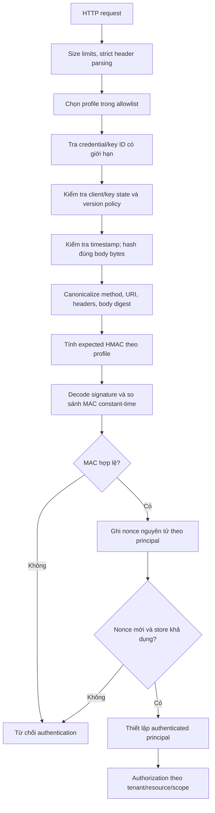

# Anti-pattern HMAC: So sánh signature bằng `equals`

## 1. Vấn đề: xác minh đúng kết quả nhưng có thể rò rỉ thông tin qua thời gian

Trong module **`SECURITY_AUTHENTICATION_HMAC_REQUEST_AUTHENTICATION`**, client và server chia sẻ một secret để ký **canonical request** của HTTP request bằng HMAC. Dữ liệu được ký có thể gồm phương thức HTTP, URI/query, các header đã thỏa thuận, body digest, timestamp và nonce. Server dựng lại đúng chuỗi byte theo hợp đồng, tính MAC dự kiến rồi so với chữ ký nhận được. Chỉ sau khi chữ ký hợp lệ và kiểm tra chống replay đạt, server mới thiết lập principal đã xác thực; **phân quyền** tenant/resource là bước tiếp theo, độc lập.

Một cách viết dễ gặp trong Java là chuyển HMAC thành chuỗi Base64 hoặc hex rồi so sánh bằng `String.equals()`:

```java
String expectedSignature = base64Url(hmacSha256(secret, canonicalRequest));
String suppliedSignature = request.getHeader("X-HMAC-Signature");

if (expectedSignature.equals(suppliedSignature)) {
    // Sai thiết kế: coi phép so sánh này đủ an toàn cho bí mật mật mã.
    return authenticatedClient;
}
return unauthorized();
```

Đoạn code có thể trả kết quả logic đúng với từng request nhưng mắc **anti-pattern so sánh dữ liệu mật mã bằng hàm so sánh chuỗi thông thường**. `String.equals()`, `Arrays.equals()` và các phép so sánh tương tự **không được thiết kế hay cam kết** có thời gian độc lập với nội dung bí mật. Một implementation có thể dừng ở byte/ký tự khác nhau đầu tiên, hoặc tối ưu hóa theo dữ liệu. Thời gian xử lý có nguy cơ tiết lộ hai giá trị trùng nhau đến đâu trước khi khác nhau, còn gọi là *timing side channel*.

Giải pháp cơ bản trong Java là: **giải mã signature về đúng dãy byte MAC, kiểm tra định dạng/độ dài công khai, sau đó dùng `MessageDigest.isEqual(expectedMac, suppliedMac)`**. Điều này cần đi cùng xác thực toàn bộ request, policy version/key, timestamp/nonce và phân quyền; riêng một hàm so sánh an toàn chưa biến toàn bộ HMAC verifier thành an toàn.

## 2. Tại sao `equals()` có thể tạo timing side channel?

Giả sử server tạo MAC 32 byte và so sánh lần lượt từ đầu đến cuối. Hai request sai khác nhau có thể tiêu tốn thời gian so sánh khác nhau:

```text
Expected MAC : A7 93 28 4F 11 5C ... (32 bytes)
Candidate A  : 00 00 00 00 00 00 ... -> khác ở byte 1
Candidate B  : A7 93 00 00 00 00 ... -> khác ở byte 3
Candidate C  : A7 93 28 4F 00 00 ... -> khác ở byte 5
```

Nếu phép so sánh dừng ngay ở byte đầu tiên không trùng, thời gian xử lý của B có thể dài hơn A và của C dài hơn B. Một đối tượng có thể gửi nhiều request và phân tích sự khác biệt theo thống kê, trong điều kiện đo đủ tốt, sẽ có thêm một tín hiệu về MAC dự kiến.

Đây là **mô hình giải thích rủi ro**, không có nghĩa mọi bản JDK hoặc mọi request Internet đều rò rỉ số byte đúng theo cách tuyến tính. JIT, CPU, độ dài chuỗi, dữ liệu khác nhau, TLS, mạng, rate limit và tải server đều tác động đến thời gian đo. Tấn công trên mạng thường có nhiễu lớn, nhưng điều đó không biện minh cho việc phụ thuộc vào tối ưu hóa của hàm `equals()` để bảo vệ dữ liệu mật mã.

### 2.1. Sự khác biệt giữa phép so sánh logic và phép so sánh an toàn

| Cách so sánh | Có cho kết quả đúng/sai? | Có nên dùng để so sánh MAC bí mật? | Lý do |
| --- | --- | --- | --- |
| `String.equals()` | Có | **Không** | Không bảo đảm thời gian độc lập với nội dung; còn kéo dữ liệu MAC sang dạng text. |
| `String.equalsIgnoreCase()` | Có thể phù hợp với text thông thường | **Không** | Signature phải có wire encoding xác định; cho phép nhiều dạng chữ ký và không giải quyết timing. |
| `Arrays.equals(byte[], byte[])` | Có | **Không** | Là phép so sánh giá trị byte thông thường; không có cam kết constant-time. |
| Vòng lặp `return false` ngay khi gặp byte khác | Có | **Không** | Rò rỉ vị trí khác nhau đầu tiên rõ ràng theo luồng điều khiển. |
| `MessageDigest.isEqual(byte[], byte[])` | Có | **Có**, với MAC byte đã kiểm soát độ dài | Được JDK thiết kế để tránh thời gian phụ thuộc vào nội dung các byte cần so sánh; vẫn phải kiểm soát các nhánh xung quanh. |
| Hàm so sánh constant-time đã được thư viện mật mã uy tín cung cấp | Có | Có, theo hợp đồng API của thư viện | Cần kiểm tra yêu cầu về độ dài và semantics của từng thư viện. |

`String.equals()` **vẫn hoàn toàn phù hợp** khi so sánh những dữ liệu công khai như tên profile cố định, route hoặc biểu diễn Base64url để kiểm tra tính canonical của **chuỗi do client cung cấp**. Điều cần tránh là dùng nó làm quyết định so sánh trực tiếp giữa **MAC dự kiến có chứa thông tin mật mã** và MAC ứng viên.

### 2.2. Constant-time nên được hiểu trong phạm vi nào?

Với các mảng byte có **độ dài cố định**, `MessageDigest.isEqual()` tránh việc thời gian so sánh phụ thuộc vào nội dung khác nhau ở vị trí nào. Điều này không cam kết toàn bộ HTTP endpoint có thời gian xử lý cố định. Ví dụ, nhánh từ chối version lạ, key ID không tồn tại, Base64 sai cú pháp, body quá lớn hoặc key provider timeout tất nhiên có thể chạy nhanh/chậm khác nhau.

Vì vậy, mục tiêu thực tế là **loại bỏ tín hiệu timing phụ thuộc vào các byte MAC bí mật**, đồng thời thiết kế thông báo lỗi, key lookup, quota và giới hạn tài nguyên để không tạo oracle không cần thiết. Không tự viết một vòng lặp “constant time” rồi kết luận có bảo đảm chính thức dưới mọi compiler/JIT/CPU.

## 3. Hai lớp dữ liệu phải tách biệt: signature encoding và MAC bytes

Signature được chuyển qua HTTP thường là **chuỗi**, còn kết quả `Mac.doFinal(...)` là **byte array**. Hãy chốt hợp đồng wire format trước khi viết verifier:

| Thuộc tính | Ví dụ profile minh họa `hmac-v1` |
| --- | --- |
| Thuật toán MAC | `HmacSHA256` (`javax.crypto.Mac`) |
| Độ dài MAC đầy đủ | 32 byte = 256 bit |
| Dạng HTTP signature | Base64url **không padding** của 32 byte, chính xác 43 ký tự ASCII |
| Key ID | `X-HMAC-Key-Id`, ánh xạ tới một shared secret và principal trong registry đáng tin |
| Version | `X-HMAC-Version: hmac-v1`, version nằm trong canonical bytes được ký |
| Dữ liệu được bảo vệ | Method, URI/query, signed headers, body digest, timestamp/nonce theo hợp đồng byte |
| Chống replay | Kiểm tra timestamp, ghi nonce atomically sau khi MAC hợp lệ, với TTL đủ cửa sổ |

Đây là profile **minh họa do bài định nghĩa**, không phải chuẩn tự động áp dụng cho mọi hệ thống. Nếu profile dùng HMAC-SHA-512, MAC đầy đủ dài 64 byte và Base64url không padding dài 86 ký tự; nếu dùng tag cắt ngắn thì phải được thiết kế, phê duyệt và quy định riêng, không âm thầm nhận prefix ngắn hơn.

### Những lỗi dễ xảy ra trong lớp encoding

- So sánh chữ ký `String` trước khi kiểm tra có **đúng Base64url** hay không: dễ sinh ra nhiều biểu diễn không thuộc contract hoặc xử lý ký tự lạ bất nhất.
- Dùng `Base64.getDecoder()` thay cho URL-safe decoder, hoặc cho phép dấu `=` padding dù profile chỉ chấp nhận không padding.
- Chấp nhận chữ ký chỉ có 8/16 byte, hoặc so sánh prefix thay vì toàn bộ 32 byte HMAC-SHA-256 theo hợp đồng.
- Vô tình dùng byte UTF-8 của **chuỗi Base64 secret** làm key, trong khi phía phát hành đã quy định decode Base64 thành bytes.
- Dùng `equalsIgnoreCase` với signature hex: hex có thể hỗ trợ một dạng canonical được thỏa thuận, nhưng việc nới case tùy tiện khiến wire format kém nhất quán và không giải quyết side channel.
- Dùng chung `Mac` instance giữa các thread dù API đó có trạng thái và không được thiết kế để chia sẻ tùy tiện; cần tạo instance riêng hoặc cơ chế sử dụng thread-safe có kiểm chứng.

Khi độ dài chữ ký khác 43 ký tự, đó là thông tin **công khai về input của người gửi**, nên từ chối sớm hợp lý. Không cần tính HMAC cho mọi request sai định dạng chỉ để giữ một thời gian giả tạo. Điểm quan trọng là khi đi vào so sánh MAC thực sự, cả hai mảng phải có độ dài được kiểm soát và phép so sánh không dừng vì byte MAC khác ở đầu hay cuối.

## 4. Sửa anti-pattern trong Java

### 4.1. Phiên bản lỗi: tính Base64 string rồi dùng `equals`

```java
Mac mac = Mac.getInstance("HmacSHA256");
mac.init(new SecretKeySpec(sharedSecretBytes, "HmacSHA256"));
byte[] expectedMac = mac.doFinal(canonicalRequestBytes);
String expectedSignature = Base64.getUrlEncoder()
        .withoutPadding()
        .encodeToString(expectedMac);

// Anti-pattern: String.equals không có bảo đảm constant-time cho MAC.
boolean accepted = expectedSignature.equals(receivedSignatureHeader);
```

Nếu code này đang chạy, bản sửa nên tập trung vào **điểm so sánh cuối cùng**, giữ nguyên quy tắc canonicalization đã được hai phía chấp nhận. Không cần đổi `HmacSHA256`, secret hay key ID chỉ vì thay hàm so sánh; đổi các phần đó là thay đổi khác của giao thức và cần contract/version testing riêng.

### 4.2. Phiên bản sửa: kiểm tra định dạng công khai, so sánh MAC bytes

Ví dụ Java 17+ (phần dưới sử dụng API có trong Java 17, phù hợp cho verifier của một profile cụ thể):

```java
import java.security.GeneralSecurityException;
import java.security.MessageDigest;
import java.util.Base64;
import java.util.regex.Pattern;
import javax.crypto.Mac;
import javax.crypto.spec.SecretKeySpec;

public final class HmacSha256SignatureVerifier {
    private static final int TAG_BYTES = 32;
    private static final Pattern SIGNATURE_FORMAT =
            Pattern.compile("[A-Za-z0-9_-]{43}");
    private static final Base64.Decoder DECODER = Base64.getUrlDecoder();
    private static final Base64.Encoder ENCODER =
            Base64.getUrlEncoder().withoutPadding();

    private HmacSha256SignatureVerifier() {}

    /**
     * Điều kiện đầu vào: key đã được tra từ key ID hợp lệ, còn active,
     * profile hmac-v1 được policy của principal/key cho phép,
     * canonicalBytes đã được tạo đúng theo contract được ký.
     */
    public static boolean matches(
            byte[] secretKeyBytes,
            byte[] canonicalBytes,
            String signatureHeader) throws GeneralSecurityException {

        // Lọc cú pháp công khai trước khi thực hiện phép tính MAC.
        if (signatureHeader == null
                || !SIGNATURE_FORMAT.matcher(signatureHeader).matches()) {
            return false;
        }

        final byte[] receivedMac;
        try {
            receivedMac = DECODER.decode(signatureHeader);
        } catch (IllegalArgumentException malformedBase64) {
            return false;
        }

        if (receivedMac.length != TAG_BYTES) {
            return false;
        }

        // Chỉ so biểu diễn công khai do client gửi với cách encode canonical.
        // Phép equals này KHÔNG so sánh expected MAC bí mật.
        if (!ENCODER.encodeToString(receivedMac).equals(signatureHeader)) {
            return false;
        }

        Mac mac = Mac.getInstance("HmacSHA256");
        mac.init(new SecretKeySpec(secretKeyBytes, "HmacSHA256"));
        byte[] expectedMac = mac.doFinal(canonicalBytes);

        // Hai mảng cùng dài 32 byte; so sánh nội dung không dừng ở byte khác.
        return MessageDigest.isEqual(expectedMac, receivedMac);
    }
}
```

Trong ví dụ, regex giới hạn **43 ký tự** đối với HMAC-SHA-256 đầy đủ; phép round-trip Base64url `decode -> encode` từ chối các encoding không canonical (ví dụ khác biệt ở các bit đệm không mang dữ liệu). Phép `equals` dùng để kiểm tra **chuỗi biểu diễn do người gửi cung cấp**, vốn không chứa MAC dự kiến của server; nhánh quyết định bằng MAC bí mật chỉ dùng `MessageDigest.isEqual`.

API này minh họa **một bước** của verifier. Khi chạy trong sản phẩm, caller phải kiểm tra giới hạn header/body, version, key state, secret format, timestamp, nonce và binding principal trước/sau bước so sánh theo hợp đồng. Không đưa `secretKeyBytes` từ HTTP request vào tham số này; bytes đó phải đến từ hệ thống lưu credential đã được cấp quyền. Exception của hệ thống mật mã/key store phải được xử lý fail-closed, không chuyển thành authentication thành công.

### 4.3. Không đánh đồng `MessageDigest.isEqual()` với thuật toán HMAC

`MessageDigest.isEqual(a, b)` chỉ **so sánh hai byte array**. Nó không tự băm body, tính HMAC, tìm key, kiểm tra nonce hay xác định dữ liệu nào đã được ký. Việc dùng class `MessageDigest` để so sánh không biến HMAC thành SHA-256 thuần: **HMAC vẫn phải được tính bằng `Mac` với shared secret**.

```text
Client                               Server
------                               ------
canonical request bytes             canonical request bytes (dựng lại)
        |                                      |
HMAC(secret, bytes)                   HMAC(secret, bytes)
        |                                      |
32-byte MAC -> Base64url             32-byte expected MAC
        |                                      |
HTTP signature header ---> decode -> 32-byte received MAC
                                               |
                       MessageDigest.isEqual(expected, received)
                                               |
                                     Authenticated / rejected
```

Nếu client và server canonicalize request khác nhau do proxy rewrite URI, query order, body encoding hoặc header chưa đồng bộ, `MessageDigest.isEqual()` vẫn trả `false`: lúc đó cần **sửa hợp đồng ký và test qua gateway**, không sửa verifier thành `equalsIgnoreCase()`, bỏ body digest hoặc thử nhiều kiểu canonicalization để cho request đi qua.

## 5. Đặt phép so sánh đúng chỗ trong toàn bộ authentication pipeline



Trên thực tế có thể kiểm tra signature format và giới hạn body sớm hơn để tránh tiêu tốn CPU. Tuy nhiên một yêu cầu có MAC sai **không được ghi nonce thành đã sử dụng**: như vậy attacker có thể khiến nonce của request thật bị chiếm. Ngược lại, khi hai request có **MAC hợp lệ** và cùng nonce đến đồng thời, replay store phải dùng thao tác nguyên tử để chỉ một request được chấp nhận trên toàn cụm.

### Những ràng buộc không được bỏ khi sửa `equals`

1. **Key ID và principal:** key ID từ header là dữ liệu chưa tin cậy; dùng nó làm selector tra record có phạm vi và giới hạn, lấy principal thật từ registry/key store. Không tạo principal từ `X-Client-Id` do caller tự khai mà chưa đối chiếu.
2. **Version/algorithm:** chỉ xác minh theo một signature profile được policy cho phép. Không thử HMAC-SHA-256 nếu MAC của `hmac-v2` thất bại; không chọn tên thuật toán trực tiếp từ header.
3. **Canonical request:** method/path/query/header/body phải được ký đúng contract. Duplicate header, percent-encoding mơ hồ và query parse không nhất quán cần bị từ chối hoặc xử lý theo quy tắc đã chốt.
4. **Body:** tính digest trên byte body đúng ở điểm ký và kiểm tra cả digest được khai báo lẫn dữ liệu thực. Tránh ký JSON sau khi parse rồi serialize lại theo cách khác nhau.
5. **Timestamp/nonce:** timestamp trong cửa sổ đã định; nonce khó đoán/duy nhất theo scope, đăng ký nguyên tử với TTL đủ thời gian còn chấp nhận. Không tắt replay guard khi store lỗi.
6. **Authorization:** chữ ký đúng chứng minh sở hữu shared secret và tính toàn vẹn các trường đã ký; principal vẫn có thể thiếu quyền thao tác trên tenant/resource.
7. **Proxy/gateway:** ranh giới lấy request-target, forwarded headers, body bytes và signed authority phải được xác định rõ. Việc proxy làm mất hoặc rewrite byte đã ký cần được phát hiện bằng contract test.

## 6. Những anti-pattern liên quan thường bị che khuất bởi việc sửa `equals`

| Anti-pattern | Triệu chứng | Cách khắc phục |
| --- | --- | --- |
| `expectedSignature.equals(received)` | Phép so sánh MAC bí mật có thể dừng theo nội dung. | Decode thành MAC bytes có độ dài cố định; `MessageDigest.isEqual`. |
| `Arrays.equals(expectedMac, receivedMac)` | Cùng nguy cơ so sánh thông thường. | Dùng API so sánh mật mã được hỗ trợ. |
| `received.startsWith(expectedPrefix)` | Chấp nhận tag bị cắt ngắn và dễ đoán hơn. | Đòi đúng toàn bộ độ dài MAC của profile. |
| So sánh `String` hex bằng `equalsIgnoreCase` | Tùy tiện chấp nhận nhiều biểu diễn, không bảo vệ timing. | Chốt format, decode và so byte. |
| Tự viết vòng lặp XOR nhưng return sớm, hoặc loop chỉ theo độ dài input | Thời gian vẫn phụ thuộc byte/độ dài do attacker chọn. | Dùng thư viện mật mã; kiểm soát độ dài trước khi gọi. |
| Dùng `hash(secret + message)` thay HMAC | Không phải construction HMAC đã được tiêu chuẩn hóa; có thể có nhược điểm thiết kế. | Dùng `Mac` với `HmacSHA256`/profile được phê duyệt. |
| Thử nhiều secret/key cho một request | Khuếch đại tính toán, có thể gây nhầm principal và lộ thông tin khác nhau giữa key. | Tra đúng record theo key ID, binding principal và policy. |
| MAC không bao gồm timestamp/nonce | Replay request đã ký vẫn được chấp nhận. | Ký timestamp/nonce và dùng replay store nguyên tử. |
| Bỏ ký field chọn tenant, route hoặc body digest | Thay đổi ngữ nghĩa request nhưng chữ ký còn hợp lệ. | Cập nhật signed fields trong version contract và kiểm thử qua gateway. |
| Tạo principal ngay khi tìm thấy key ID | Bất kỳ ai đoán được key ID có thể thành authenticated. | Chỉ tạo principal khi MAC, policy và replay đều hợp lệ. |
| Trả lỗi quá cụ thể: `key_exists`, `correct_prefix` | Có thể hình thành oracle thông tin. | Lỗi công khai có giới hạn; phân loại chi tiết trong telemetry nội bộ. |

### So sánh signature không đủ để ngăn replay

Ngay cả khi HMAC đúng và được so sánh constant-time, attacker vẫn có thể **phát lại nguyên một request hợp lệ đã quan sát được**. MAC hợp lệ chứng minh request không bị sửa trong các trường đã ký, nhưng không chứng minh request chưa từng được xử lý. Timestamp giúp giới hạn thời gian; nonce và replay store giữ trạng thái để chỉ chấp nhận một lần trong phạm vi hợp đồng. Key rotation cũng không được làm “reset” replay scope cho cùng principal một cách vô tình.

## 7. Unit test và integration test cần thiết

### 7.1. Ví dụ JUnit 5 kiểm tra định dạng và phép so sánh

Test dưới đây kiểm tra trực tiếp verifier ví dụ ở mục 4.2. Secret là dữ liệu **chỉ dành cho unit test**; các vector kiểm thử canonicalization/client-server thực tế nên được phát hành độc lập để tránh lỗi chung giữa signer và verifier.

```java
import static org.junit.jupiter.api.Assertions.assertFalse;
import static org.junit.jupiter.api.Assertions.assertTrue;

import java.nio.charset.StandardCharsets;
import java.util.Base64;
import javax.crypto.Mac;
import javax.crypto.spec.SecretKeySpec;
import org.junit.jupiter.api.Test;

class HmacSha256SignatureVerifierTest {
    private static final byte[] TEST_KEY =
            "test-only-32-byte-key-for-fixtures".getBytes(StandardCharsets.UTF_8);
    private static final byte[] REQUEST =
            "HMAC-REQUEST\nhmac-v1\nGET\n/v1/orders".getBytes(StandardCharsets.UTF_8);

    private static String sign(byte[] request) throws Exception {
        Mac mac = Mac.getInstance("HmacSHA256");
        mac.init(new SecretKeySpec(TEST_KEY, "HmacSHA256"));
        return Base64.getUrlEncoder().withoutPadding()
                .encodeToString(mac.doFinal(request));
    }

    @Test
    void acceptsOnlyFullCorrectTag() throws Exception {
        assertTrue(HmacSha256SignatureVerifier.matches(TEST_KEY, REQUEST, sign(REQUEST)));
        assertFalse(HmacSha256SignatureVerifier.matches(
                TEST_KEY, "changed-body".getBytes(StandardCharsets.UTF_8), sign(REQUEST)));
    }

    @Test
    void rejectsChangedFirstAndLastMacByte() throws Exception {
        byte[] correctTag = Base64.getUrlDecoder().decode(sign(REQUEST));
        byte[] changedFirst = correctTag.clone();
        byte[] changedLast = correctTag.clone();
        changedFirst[0] ^= 0x01;
        changedLast[changedLast.length - 1] ^= 0x01;

        String wrongFirst = Base64.getUrlEncoder().withoutPadding()
                .encodeToString(changedFirst);
        String wrongLast = Base64.getUrlEncoder().withoutPadding()
                .encodeToString(changedLast);

        assertFalse(HmacSha256SignatureVerifier.matches(TEST_KEY, REQUEST, wrongFirst));
        assertFalse(HmacSha256SignatureVerifier.matches(TEST_KEY, REQUEST, wrongLast));
    }

    @Test
    void rejectsMalformedAndTruncatedTags() throws Exception {
        String valid = sign(REQUEST);
        assertFalse(HmacSha256SignatureVerifier.matches(TEST_KEY, REQUEST, null));
        assertFalse(HmacSha256SignatureVerifier.matches(TEST_KEY, REQUEST, ""));
        assertFalse(HmacSha256SignatureVerifier.matches(TEST_KEY, REQUEST, valid + "="));
        assertFalse(HmacSha256SignatureVerifier.matches(
                TEST_KEY, REQUEST, valid.substring(0, valid.length() - 1)));
        assertFalse(HmacSha256SignatureVerifier.matches(
                TEST_KEY, REQUEST, "AAAAAAAAAAAAAAAAAAAAAAAAAAAAAAAAAAAAAAAAAAA"));
    }
}
```

Các test này kiểm tra tính đúng/sai của kết quả, **không chứng minh thời gian chạy là constant-time**. Việc thấy hai case mất thời gian gần bằng nhau trong CI không phải bằng chứng không rò rỉ timing; ngược lại một benchmark mạng có chênh lệch cũng có thể do key lookup, cache, GC hoặc proxy thay vì hàm so sánh. Ưu tiên dùng API đã được thiết kế cho mục đích này và review luồng xử lý, sau đó thực hiện đánh giá timing chuyên biệt nếu threat model yêu cầu.

### 7.2. Ma trận kiểm thử ở ranh giới HTTP

| ID | Tình huống | Kỳ vọng |
| --- | --- | --- |
| E01 | MAC 32 byte đúng, profile/key active, nonce mới, timestamp hợp lệ | Authentication thành công, principal đúng theo key record. |
| E02 | MAC có cùng độ dài nhưng một byte đầu bị đổi | Từ chối, không tạo principal và không ghi nonce. |
| E03 | MAC có cùng độ dài nhưng một byte cuối bị đổi | Từ chối như E02; không trả lỗi phân biệt vị trí sai. |
| E04 | Signature Base64url sai ký tự, có padding, khác độ dài hoặc encoding không canonical | Từ chối đúng contract; không chấp nhận tag rút ngắn. |
| E05 | Header `X-HMAC-Signature` lặp hoặc chứa CR/LF | Từ chối theo quy tắc parse nghiêm ngặt. |
| E06 | Header version không hỗ trợ hoặc client v2-only gửi MAC v1 **đúng** | Từ chối theo policy, không tự fallback version. |
| E07 | MAC đúng nhưng HTTP method, URI/query, signed header hoặc byte body bị sửa | Từ chối vì canonical request/body digest khác. |
| E08 | Nonce/timestamp bị sửa trong request đã ký | MAC sai hoặc policy thời gian/replay từ chối. |
| E09 | Gửi lại nguyên request có MAC hợp lệ | Lần sau bị từ chối replay trong cùng scope/window. |
| E10 | 32 request cùng nonce, cùng MAC hợp lệ đến nhiều replica | Tối đa một request được authenticated nhờ atomic replay registration. |
| E11 | Key ID không có, key revoked/expired, secret provider không khả dụng | Không có request chưa xác minh nào được authenticated. |
| E12 | Request đi qua gateway rewrite path/query/host hoặc body compression | Canonical byte được bảo vệ theo hợp đồng; khác biệt bị từ chối. |
| E13 | MAC đúng cho principal A nhưng gọi tài nguyên tenant B | Authentication đúng principal A; authorization từ chối. |
| E14 | Lưu lượng MAC sai và key ID lạ có giới hạn trên staging | Không vượt quota/tài nguyên không giới hạn; không lộ secret hoặc raw MAC trong log. |

Để test E02/E03 đúng mục tiêu, phải giữ **đúng 32 byte**, chỉ thay đúng một byte trong MAC rồi encode lại Base64url. Thay một ký tự cuối chuỗi Base64 có thể vô tình chỉ đổi bit đệm không mang dữ liệu hoặc bị chặn ở bước format; khi đó test không thực sự chạm phép so sánh MAC. Để test E09/E10, phải dùng request có **MAC hợp lệ**; chữ ký sai sẽ bị chặn trước replay store, tạo ra kết quả kiểm thử sai lệch.

## 8. Vận hành: giảm oracle và phân biệt lỗi khi xảy ra nhiều `401`

Việc sửa `equals` không thay thế cơ chế bảo vệ hệ thống trước các request được gửi liên tục để đo thời gian. Hãy áp dụng **rate limit, quota, giới hạn kích thước body/header/query**, timeout và backpressure phù hợp; theo dõi cả số request sai và mức độ ảnh hưởng đến request hợp lệ. Đừng dựa riêng vào IP hoặc key ID chưa xác minh để xác định tenant chịu quota, bởi key ID có thể bị giả hoặc xoay liên tục.

Các phản hồi công khai cho sai signature, unknown key hoặc key bị revoke có thể dùng thông điệp authentication chung theo API contract để hạn chế lộ cấu trúc registry. Log nội bộ vẫn cần phân biệt `malformed_signature`, `bad_mac`, `unsupported_profile`, `expired`, `replay`, `key_revoked`, `body_digest_mismatch` và `authorization_denied` với **label có cardinality giới hạn**. Không log shared secret, raw MAC, nonce đầy đủ hoặc body chứa thông tin nhạy cảm.

Khi client báo `401`, nên kiểm tra theo thứ tự: version/key policy, thời gian/nonce, Base64url format và độ dài, canonical request (method, path/query, header, body digest), rồi đến gateway/proxy có rewrite dữ liệu hay không. Đừng chuyển ngược về `String.equals()` hoặc bỏ signed fields để xử lý lỗi tích hợp. Với Spring Security Servlet, kiểm tra filter ordering, body caching và cách lấy URI; với WebFlux, kiểm tra việc tiêu thụ `Flux<DataBuffer>` và giải phóng bộ đệm đúng cách.

### Đo timing trong phạm vi kiểm thử có kiểm soát

Nếu muốn đánh giá sâu side channel, thử trên staging cô lập, sử dụng key/secret test, payload và độ dài tag giống nhau; phân biệt các nhóm **MAC sai ở các vị trí khác nhau** trong một công cụ đánh giá thống kê phù hợp. Cần warm-up JIT, ghi GC/CPU noise, tốc độ request và tác động của các tầng gateway. Kết luận phải dựa trên phân tích đủ mẫu và mô hình nhiễu, **không đặt `assertTrue(durationA == durationB)` trong unit test**. Dù timing benchmark không phát hiện chênh lệch, vẫn nên giữ primitive so sánh an toàn đã được cung cấp bởi thư viện mật mã.

## 9. Bài tập thực hành: sửa verifier có `String.equals`

Một dịch vụ đối tác dùng Spring Security nhận `POST /v1/payments` đã ký HMAC-SHA-256 với key ID, timestamp, nonce và body digest. Code cũ chuyển MAC sang hex rồi dùng `equalsIgnoreCase` với header do đối tác gửi. Có lúc request sai chữ ký nhận `401`, nhưng hệ thống chưa kiểm soát format, key state và replay khi tải cao.

**Yêu cầu thực hiện:**

1. Xác định đúng profile wire format (ví dụ Base64url không padding 43 ký tự), chốt cách dựng canonical bytes và viết một golden vector có method/path/query, signed headers, body digest, timestamp/nonce.
2. Thay phần so sánh `String.equals`/`equalsIgnoreCase` bằng decode signature + kiểm tra canonical encoding/32 byte + `MessageDigest.isEqual(expectedMac, receivedMac)`.
3. Viết test positive và negative: MAC đúng, sửa byte đầu/cuối, tag bị rút ngắn, padding không hợp lệ, header trùng và body bị sửa. Không thử kiểm tra constant-time bằng so sánh thời gian trong unit test.
4. Kiểm tra key ID liên kết đúng principal, key chưa revoke, version được phép và không có fallback sang signature profile khác khi MAC sai.
5. Gửi lại **cùng request có MAC đúng** nhiều lần qua hai replica; kiểm tra timestamp window và nonce store nguyên tử chỉ chấp nhận một request.
6. Gửi request được ký đúng cho principal A nhưng thao tác trên tài nguyên thuộc B; xác minh authentication thành công nhưng authorization từ chối.
7. Chạy contract test qua gateway để xác định URI/query/header/body phía signer và verifier giống nhau; kiểm tra 401 metrics và log không tiết lộ secret/signature.

**Câu hỏi tự đánh giá:** Vì sao `String.equals()` có thể trả kết quả đúng nhưng vẫn không phù hợp để so sánh MAC? Khi nào `equals` vẫn an toàn để dùng trong cùng verifier? Vì sao cần kiểm tra độ dài signature công khai trước khi `MessageDigest.isEqual()`? Nếu đã sửa phép so sánh nhưng nonce store chỉ nằm trong memory của mỗi instance, rủi ro nào vẫn còn? Tại sao MAC hợp lệ chưa đủ để cho phép một principal gọi mọi tenant?

## 10. Checklist khi review anti-pattern này

- [ ] Không dùng `String.equals`, `equalsIgnoreCase`, `Arrays.equals`, `startsWith` hoặc vòng lặp dừng sớm để quyết định khớp MAC bí mật.
- [ ] MAC được tính bằng `javax.crypto.Mac` theo profile được phép, trên **canonical bytes** được chốt giữa client/server.
- [ ] Signature header được parse nghiêm ngặt, decode đúng Base64url/hex contract; độ dài tag đầy đủ và encoding canonical được kiểm tra.
- [ ] Hai mảng MAC byte có độ dài mong đợi được so bằng `MessageDigest.isEqual` hoặc API mật mã có cam kết tương đương.
- [ ] Key ID chỉ định đúng record gắn principal/secret; key còn active và profile/version được policy cho phép.
- [ ] HMAC bảo vệ method, URI/query, signed headers, body digest, timestamp và nonce theo hợp đồng; proxy/gateway không làm mơ hồ trường được ký.
- [ ] Chỉ ghi nonce sau khi MAC đúng; replay protection có TTL đủ cửa sổ và insert nguyên tử trên các replica.
- [ ] Có positive/negative tests cho MAC sai ở byte đầu/cuối, tag rút ngắn, malformed encoding, tampering và version mismatch.
- [ ] Authentication thiết lập principal sau các kiểm tra bắt buộc; authorization tenant/resource kiểm tra riêng.
- [ ] Lỗi xác thực, rate limit, metrics và logs không tạo oracle không cần thiết hoặc tiết lộ secret, MAC và dữ liệu nhạy cảm.

**Điểm cần nhớ:** thay `equals()` bằng `MessageDigest.isEqual()` là một sửa đổi nhỏ nhưng cần thiết ở ranh giới xác minh HMAC. Việc sửa đúng nghĩa phải giữ nguyên hợp đồng byte được ký, kiểm soát phiên bản và key, chống replay bằng timestamp/nonce, kiểm thử qua proxy/gateway và kiểm tra phân quyền sau khi xác thực thành công.
