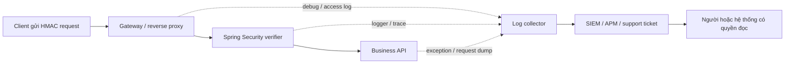

# Anti-pattern HMAC: Log signature — ghi chữ ký vào log và hệ quả bảo mật

## 1. Bối cảnh và mục tiêu

Module `SECURITY_AUTHENTICATION_HMAC_REQUEST_AUTHENTICATION` hướng dẫn xác thực HTTP request bằng HMAC với **shared secret** và **canonical request** gồm method, URI, header và/hoặc body theo hợp đồng ký; người học thực hành xác minh chữ ký, chống replay bằng timestamp/nonce, quản lý key rotation, kiểm thử proxy/gateway và tách biệt authentication khỏi authorization.

Trong quá trình triển khai, một nhu cầu có thật là chẩn đoán lỗi `INVALID_SIGNATURE`. Vì vậy developer đôi khi thêm dòng log:

```java
// SAI: ví dụ anti-pattern. Không áp dụng trong production.
log.warn("HMAC failed: providedSignature={}, expectedSignature={}",
         suppliedSignature, expectedSignature);
```

Hoặc bật dump toàn bộ header:

```text
POST /v1/payments HTTP/1.1
X-Client-Id: merchant-a
X-Key-Id: key-2026-11
X-Timestamp: <timestamp>
X-Nonce: <nonce>
X-Signature: hmac-sha256=<full-mac-hex>       <-- không nên ghi log
Content-Type: application/json
```

**Anti-pattern "Log signature"** là đưa **giá trị chữ ký HMAC đầy đủ** (chữ ký nhận từ client hoặc chữ ký server tự tính) vào application logs, access logs, audit logs, traces, APM, error reports, SIEM, ticket hay các artifact debug thông thường. Khi ghi cả canonical string/raw body kèm MAC, rủi ro tăng thêm vì log vô tình trở thành bản sao của request xác thực có thể phát lại.

**Mục tiêu bài học:** nhận diện những đường rò rỉ signature; hiểu rủi ro theo đúng khả năng của HMAC; thiết kế logging theo allowlist và mã kết quả thay cho dữ liệu bí mật; kiểm tra Spring Servlet/WebFlux, gateway/proxy và telemetry; và xây kịch bản ứng phó khi phát hiện log chứa chữ ký.

## 2. Signature có phải shared secret không?

**Không.** Cần phân biệt ba loại dữ liệu:

| Dữ liệu | Ý nghĩa | Có nên đưa vào log thông thường? |
|---|---|---|
| **Shared secret / HMAC key** | Khóa bí mật dùng tạo MAC hợp lệ cho nhiều request khác nhau trong phạm vi quyền của credential. | **Tuyệt đối không.** Lộ key cho phép giả mạo chữ ký mới đến khi bị thu hồi. |
| **HMAC signature/MAC** | Kết quả mật mã gắn với **một canonical message cụ thể** và key tương ứng. | **Không ghi nguyên giá trị**. Không đủ để tạo MAC cho request tùy ý, nhưng có thể giúp phát lại request đã ký nếu các điều kiện khác cho phép. |
| **Canonical request, raw body, signed headers** | Dữ liệu làm đầu vào ký, có thể chứa endpoint, query, tenant, PII, payload nghiệp vụ, timestamp/nonce. | Chỉ log metadata đã kiểm soát; tránh raw canonical/body và trường nhạy cảm. |

Một giá trị HMAC hợp lệ **không tiết lộ trực tiếp key**, cũng **không giúp suy ra MAC cho nội dung mới** nếu dùng thuật toán và key đủ mạnh. Tuy nhiên, signature có thể trở thành **bằng chứng xác thực có thể tái sử dụng** cho *chính request tương ứng*, chẳng hạn khi kẻ tấn công có thêm method, raw URI, headers, body và gửi lại trước khi hết cửa sổ timestamp.

Điều kiện quyết định replay thành công hay thất bại:

- **Không có kiểm tra nonce:** kẻ có bản sao request, signature và timestamp còn hạn có thể phát lại request; mức độ tác động phụ thuộc endpoint và idempotency.
- **Có nonce store nguyên tử, chia sẻ đúng phạm vi:** request đã nhận và đánh dấu nonce không được nhận lần thứ hai trong khoảng hiệu lực; log signature không dễ dẫn tới replay thành công. Nhưng nếu có **race**, region tách nonce store, TTL sai hoặc verifier khác không kiểm tra nonce, rủi ro vẫn tồn tại.
- **Chỉ log signature, không có request/canonical:** khả năng lạm dụng trực tiếp thấp hơn rõ rệt; không được diễn giải rằng chỉ từ MAC có thể ký request bất kỳ. Rủi ro ở đây còn gồm lan truyền dữ liệu xác thực không cần thiết, tương quan với các nguồn dữ liệu khác và ảnh hưởng khi log bị ghép với request dump.
- **Key đã bị thu hồi:** ngay cả request có MAC toán học hợp lệ cũng phải bị từ chối theo credential state; không tự động được chấp nhận vì chữ ký khớp.

**Quy tắc thực hành:** chữ ký là *dữ liệu xác thực nhạy cảm theo ngữ cảnh*, không phải mật khẩu dùng lại toàn cục. Không ghi nó vào log chỉ vì “HMAC là hash nên an toàn”. Từ "hash" không làm một authentication artifact trở thành vô hại.

## 3. Vì sao logging lại mở rộng bề mặt tấn công?

Trong hệ thống production, application log thường được sao chép sang log collector, dashboard, SIEM, cold storage, ticket, crash report, APM và môi trường staging phục vụ điều tra. Quyền đọc những nơi này có thể rộng hơn nhiều so với quyền gọi API ký HMAC.



Các con đường gây rò rỉ phổ biến:

1. **Request header logging:** `Authorization: HMAC ...`, `X-Signature`, `X-Hmac-Signature` hoặc tên header tùy chỉnh xuất hiện trong access log, debug dump, HTTP client interceptor, proxy/WAF.
2. **Log so sánh chữ ký:** log cả `expectedMac` và `receivedMac` để “so hai giá trị cho nhanh”. Đây là anti-pattern đặc biệt nguy hiểm vì cung cấp **MAC hợp lệ do server tính** ngay cả khi client gửi signature sai.
3. **Log canonical request:** ghi nguyên method, raw URI, signed headers, body để điều tra khác biệt byte-level; có thể tiết lộ payload nhạy cảm. Nếu log này còn gắn MAC và timestamp/nonce, sẽ tạo bộ dữ liệu gần như đầy đủ để replay.
4. **Log đối tượng:** `request.toString()`, map headers, DTO hoặc exception chứa đối tượng authentication. Lombok `@Data`/`@ToString`, record mặc định `toString()` có thể tự in field `signature`/`secret` khi log cả object.
5. **Metrics/traces:** đưa signature thành tag của Prometheus, span attribute, baggage, MDC hoặc URL/query có thể gây rò rỉ và **cardinality cực cao**.
6. **Gateway trước ứng dụng:** dù Spring đã redact, NGINX, ingress, CDN, service mesh hoặc API gateway vẫn có thể capture header nguyên vẹn. Redaction tại một chỗ không đủ.
7. **Debug tạm thời không được tắt:** flag “log full request 10 phút” bị quên, cấu hình bật đồng loạt khi sự cố `401` tăng, file trace tồn tại lâu hơn dự kiến.
8. **Nền tảng ngoài phạm vi kiểm soát:** third-party APM, hệ thống hỗ trợ kỹ thuật, artifact CI, repository chứa fixture production, screenshot dashboard, chat/ticket có người sao chép log.

Rủi ro **không chỉ là replay**. Log thừa có thể làm tăng chi phí tuân thủ, mở rộng phạm vi thông báo sự cố, gây phân tán dữ liệu khách hàng, biến log thành điểm tập trung dữ liệu nhạy cảm và tạo ảnh hưởng khi khóa/log access bị compromise.

## 4. Những mẫu code sai và nguyên nhân

### 4.1. Ghi chữ ký nhận vào log

```java
// SAI: signature từ request là dữ liệu không tin cậy và không cần lưu nguyên vẹn.
String signature = request.getHeader("X-Signature");
log.debug("HMAC signature received={}", signature);
```

Một `DEBUG` statement vẫn có thể xuất hiện trong production khi tăng log level hoặc qua test log collector. Đừng dựa vào giả định “debug thường tắt” để bảo vệ.

### 4.2. Ghi cả MAC do server tính

```java
// SAI: tự tiết lộ MAC hợp lệ cho request đang được xác minh.
byte[] expected = hmacSha256(secret, canonicalBytes);
byte[] received = signatureCodec.decode(signatureHeader);
if (!MessageDigest.isEqual(expected, received)) {
    log.warn("bad HMAC: expected={}, got={}",
             HexFormat.of().formatHex(expected),
             HexFormat.of().formatHex(received));
    throw invalidSignature();
}
```

Nếu request bị sửa và client gửi MAC không hợp lệ, `expected` chính là MAC do server tính cho request đã nhận. Không gửi `expected` trong response, exception message hoặc log.

### 4.3. Dump tất cả headers và body

```java
// SAI: nhiều framework sẽ stringify map bao gồm Authorization/X-Signature.
log.info("headers={}, body={}", requestHeaders, requestBody);
```

Nếu URI query chứa signed token, PII hoặc dữ liệu nghiệp vụ, log cả `request.getRequestURI() + "?" + request.getQueryString()` cũng có thể rò rỉ. Không nên tự động xem raw URI an toàn chỉ vì nó phục vụ canonicalization.

### 4.4. Trộn chữ ký và principal

```java
// SAI: chữ ký không phải identity, càng không phải quyền truy cập.
authentication.setPrincipal(signatureHeader);
log.info("authenticated user={}", authentication.getPrincipal());
```

Principal cần là danh tính của client đã được xác minh theo credential registry, không phải giá trị signature. Phân quyền tenant/scope/role được áp dụng sau authentication; không log signature dưới tên “user” rồi hợp thức hóa nó thành audit identifier.

## 5. Chính sách logging an toàn: allowlist trước, redact sau

### 5.1. Thông tin đủ để chẩn đoán mà không cần MAC thô

Tập metadata nên được thiết kế từ **mục tiêu điều tra**:

| Trường gợi ý | Mục đích | Điều kiện an toàn |
|---|---|---|
| `requestId` hoặc `traceId` do hạ tầng phát hành | Liên kết gateway ↔ verifier ↔ service. | ID có kiểm soát định dạng; tránh tin và phản chiếu dữ liệu attacker gửi nguyên văn. |
| `authScheme` và `contractVersion` | Biết request dùng contract canonical nào. | Chỉ nhận các giá trị từ allowlist; không lấy nguyên header không kiểm tra. |
| `algorithm`, `keyVersion`, `keyStateClass` | Phân tích lỗi key rotation/revocation. | Lấy từ registry đáng tin; key ID chỉ log khi policy cho phép, tuyệt đối không log secret. |
| `clientRef`, `tenantRef` | Liên hệ đơn vị ảnh hưởng. | Từ nguồn xác thực đáng tin; trước khi xác minh chỉ ghi dạng untrusted/bucket đã chuẩn hóa. |
| `signaturePresent` | Biết header chữ ký có được gửi không. | Boolean, không chứa nội dung. |
| `signatureSyntaxValid` / `signatureLengthClass` | Chẩn đoán sai encoding hoặc số byte. | Chỉ ghi boolean hoặc bucket kích thước đã định nghĩa, không ghi hex/base64. |
| `verifyOutcome` / `reasonClass` | Phân biệt malformed, key lookup, MAC mismatch, freshness, replay. | Mã enum có giới hạn, không chứa raw exception message. |
| `method` / `routeTemplate` / `status` / `latencyMs` | Quan sát endpoint bị ảnh hưởng. | Dùng route **template** như `/v1/orders/{id}`, không log raw query/body. |
| `clockSkewBucket`, `nonceStoreResult` | Chẩn đoán lỗi timestamp và replay. | Bucket số liệu và enum; không cần ghi nonce thô hoặc signature. |

**Không log:** shared secret, derived secret, full signature đã gửi, expected MAC, full canonical text, body nhạy cảm, raw `Authorization`, cookies, access tokens, các signed headers nhạy cảm, KMS response thô. Với key ID, policy cần đánh giá mức độ nhạy cảm và cardinality; identifier không phải secret nhưng cũng có thể hỗ trợ enumeration.

Ví dụ sự kiện audit an toàn (**giá trị giả**):

```json
{
  "event": "hmac.authentication",
  "requestId": "req-7f3c21",
  "routeTemplate": "/v1/payments/{id}",
  "method": "POST",
  "authScheme": "HMAC",
  "contractVersion": "v2",
  "clientRef": "merchant-a",
  "keyVersion": "2026-11",
  "signaturePresent": true,
  "signatureSyntaxValid": true,
  "verifyOutcome": "REJECTED",
  "reasonClass": "MAC_MISMATCH",
  "latencyMs": 12
}
```

Trong ví dụ này **không có** chữ ký nhận, MAC dự kiến, key bytes, canonical string, body hay nonce. Tùy chính sách bảo vệ thông tin, `clientRef` chỉ nên được ghi sau khi ràng buộc được với credential hoặc được thay bằng reference đã chuẩn hóa.

### 5.2. Tại sao allowlist tốt hơn chỉ regex redact?

Nếu logger tự động serialize mọi header rồi mới thay giá trị header có tên `X-Signature` bằng `[REDACTED]`, các biến thể vẫn có thể lọt:

- Tên header khác: `Authorization`, `X-Hmac-V2-Signature` hoặc scheme do đối tác tự định nghĩa.
- Nhiều giá trị cùng tên header, khác chữ hoa/thường, gộp bằng dấu phẩy hoặc xuất hiện trong nested map.
- Signature được copy sang `exception.message`, MDC, OpenTelemetry attribute, JSON field hoặc `request.toString()` mà rule header không thấy.
- Giá trị signature nằm trong query, payload debug hoặc một trường phụ do gateway chuyển tiếp.

Vì vậy **tạo event từ những field được phép**, không serialize toàn request rồi cố che phần cấm. Redaction ở log collector chỉ là **lớp phòng vệ bổ sung**, không thay thế kỷ luật logging tại nguồn. Không nên dựa vào regex để bắt mọi base64/hex vì vừa nhiều false positive vừa dễ bỏ sót cách encoding lạ.

## 6. Ví dụ Java/Spring: audit theo kiểu dữ liệu

Đoạn code dưới đây là ví dụ **Java 17 + SLF4J** tập trung vào logging; nó không phải toàn bộ filter hoặc HMAC verifier. Logic tính canonical request, tra secret, xác minh MAC bằng `MessageDigest.isEqual`, timestamp/nonce và xây principal phải nằm ở thành phần xác thực riêng.

### 6.1. Event chỉ gồm thông tin được phép

```java
import org.slf4j.Logger;
import org.slf4j.LoggerFactory;

import java.util.Set;

enum HmacOutcome {
    ACCEPTED, MALFORMED, KEY_LOOKUP_FAILED, KEY_REVOKED,
    MAC_MISMATCH, STALE_TIMESTAMP, REPLAY, INTERNAL_ERROR
}

// Không có field signature, secret, canonicalRequest, body hoặc raw headers.
record HmacAuditEvent(
    String requestId,
    String routeTemplate,
    String method,
    String contractVersion,
    HmacOutcome outcome,
    boolean signaturePresent,
    long elapsedMillis
) { }

final class HmacAuditLogger {
    private static final Logger LOG = LoggerFactory.getLogger(HmacAuditLogger.class);
    private static final Set<String> METHODS =
        Set.of("GET", "POST", "PUT", "PATCH", "DELETE");
    private static final Set<String> CONTRACTS =
        Set.of("v1", "v2", "dual-v1-v2", "unknown");

    void record(HmacAuditEvent e) {
        // Mã enum, route template và ID phải đến từ nguồn đáng tin.
        String method = METHODS.contains(e.method()) ? e.method() : "OTHER";
        String version = CONTRACTS.contains(e.contractVersion())
            ? e.contractVersion() : "unknown";
        String route = safeRouteTemplate(e.routeTemplate());
        String requestId = safeRequestId(e.requestId());
        long elapsed = Math.max(0, e.elapsedMillis());

        LOG.info(
            "event=hmac.auth request_id={} route={} method={} contract={} " +
            "outcome={} signature_present={} elapsed_ms={}",
            requestId, route, method, version,
            e.outcome(), e.signaturePresent(), elapsed
        );
    }

    // Ví dụ: route lấy từ mapping đã đăng ký, không phải raw path client.
    private static String safeRouteTemplate(String route) {
        if (route == null || !route.matches("/[a-zA-Z0-9_{}./-]{1,128}")) {
            return "unmapped";
        }
        return route;
    }

    // Request ID có thể đến từ header attacker kiểm soát; chặn log injection.
    private static String safeRequestId(String id) {
        if (id == null || !id.matches("[A-Za-z0-9_-]{1,64}")) {
            return "invalid";
        }
        return id;
    }
}
```

Đây là **output log có trường cố định**; không có đường nào trực tiếp nhận `signatureHeader`. Nếu muốn thêm metadata, phải review riêng xem dữ liệu có thể chứa signature, PII hoặc dữ liệu attacker kiểm soát không. Không dùng `record.toString()` cho object đang giữ secret; record minh họa này đã được giới hạn rõ chỉ chứa audit fields.

### 6.2. Kết nối với pipeline Servlet và WebFlux

Một luồng Servlet có thể dùng `OncePerRequestFilter` để lấy timestamp bắt đầu và `requestId`; thành phần HMAC verifier phát sinh **kết quả đã phân loại** (ví dụ enum `MAC_MISMATCH`, `REPLAY`). Bộ phận audit chỉ nhận kết quả enum, route template và elapsed time. Không truyền cả request, header map hoặc exception với nội dung tự do vào logger.

```java
// Pseudocode trong authentication component; không phải filter hoàn chỉnh.
HmacAuditEvent event = new HmacAuditEvent(
    safeInfrastructureRequestId,
    matchedRouteTemplate,
    request.getMethod(),
    selectedContractVersion,
    HmacOutcome.MAC_MISMATCH,
    request.getHeader("X-Signature") != null, // chỉ boolean
    elapsedMillis
);
auditLogger.record(event);

// Không dùng:
// log.debug("request={} headers={}", request, request.getHeaderNames());
// log.debug("authException={}", rawException.getMessage());
```

Ở đây, ví dụ chỉ dùng `getHeader(...) != null` để minh họa boolean, **không log** nội dung. Trong triển khai thực, parser phải xử lý nhiều header trùng tên, độ dài và cấu trúc giá trị; không dựa vào một lần `getHeader` làm toàn bộ kiểm soát an ninh. Dữ liệu `safeInfrastructureRequestId` và `matchedRouteTemplate` phải được chuẩn hóa trước khi tạo audit event.

Với **WebFlux**, có thể ghi sự kiện tại `WebFilter`/`ReactiveAuthenticationManager` sau khi nhận outcome; không chặn event loop để serialize/log body, không subscribe body lần hai chỉ để debug, và không đưa `ServerWebExchange.toString()`/headers nguyên vẹn vào MDC hoặc Reactor Context. Nếu cần capture raw bytes để tính HMAC, phải thiết kế cache/buffering giới hạn kích thước và quản lý vòng đời buffer; **không để raw bytes trôi vào observability pipeline**.

Trong cả hai stack, khi `INVALID_SIGNATURE` xảy ra:

1. Hệ thống **từ chối authentication**, không tiếp tục đến controller có bảo vệ.
2. Audit ghi **outcome/class**, không ghi raw MAC hoặc canonical text.
3. Request trả mã lỗi xác thực theo hợp đồng, tránh phản hồi `expectedSignature` hoặc tiết lộ key tồn tại.
4. Key rotation/revocation và authorization vẫn được áp dụng theo chính sách riêng.

## 7. Gateway, access log, OpenTelemetry, APM và test pipeline

Chỉ sửa logger trong ứng dụng **chưa đủ**. Dữ liệu HMAC có thể bị ghi trước khi Spring nhận request hoặc sau khi response trả về.

| Điểm thu thập | Dấu hiệu dễ gặp | Hành động phòng ngừa |
|---|---|---|
| API gateway / ingress | Access log dump `$http_authorization`, `X-Signature`, entire headers. | Dùng template log **allowlist**; vô hiệu header dump; kiểm tra nhiều gateway/region. |
| CDN / WAF / service mesh | Debug trace lưu header đã qua proxy, kể cả authorization. | Mask hoặc không capture credential headers ở cấu hình nguồn và downstream. |
| Spring Servlet filters | `CommonsRequestLoggingFilter` / custom interceptor được cấu hình log headers/payload. | Review cấu hình và wrapper; tắt header/body logging cho route HMAC hoặc whitelist trường. |
| Spring WebFlux | Trace `ServerWebExchange`/headers hoặc body bằng filter reactive. | Không stringify exchange; không subscribe body vì mục tiêu logging. |
| HTTP client / SDK | Wire log ở client/partner chứa chữ ký outbound. | Cấu hình sanitizer và logging policy trong SDK, tài liệu integration. |
| OpenTelemetry | `http.request.header.authorization`, custom `hmac.signature`, baggage/MDC. | Không thu header nhạy cảm; chỉ allowlist attributes và span events. |
| APM/crash reporting | Exception, request snapshot, local variable, stack context chứa MAC. | Tắt request dump/sensitive locals; kiểm tra field scrubbing và quyền truy cập. |
| CI/test reports | Test thất bại in expected/actual HMAC, full signed request. | Dùng **chỉ test keys** và fixture giả; không đưa production secrets/traffic vào test. |
| Dashboard/ticket/export | Người vận hành copy toàn bộ log để nhờ phân tích. | Quy trình chia sẻ log đã làm sạch, kiểm soát retention và access. |

**Kiểm tra cả request vào lẫn request ra.** Một client HMAC có thể log outgoing signed headers trong `WebClient`, `RestClient`, Feign hoặc SDK; gateway có thể log header `Authorization` bằng config khác với application. Một dashboard trả về signature như “search field” cũng tạo cơ chế lan truyền thông tin giữa hệ thống.

Với tracing, nên đưa `traceId`/`spanId` vào log để nối các điểm xác minh. Dù cần debug canonicalization khác nhau giữa proxy/client, không nhất thiết phải ghi raw canonical request; dùng test vectors, kiểm thử bằng synthetic traffic và các **thông số đã cho phép** như version, body length bucket, normalized signed-header set ID hoặc đường lỗi chi tiết.

## 8. Có nên log hash/fingerprint của signature?

Trường hợp khó là điều tra xem hai hệ thống có thấy **cùng một chữ ký** hay không. Một lựa chọn tưởng như vô hại:

```java
// KHÔNG KHUYẾN KHÍCH dùng mặc định:
log.info("signatureHash={}", sha256Hex(receivedMacBytes));
```

SHA-256 của MAC **không trực tiếp tiết lộ MAC ban đầu**, nhưng vẫn tạo định danh xác định của một authentication artifact, có thể hỗ trợ **linkability** giữa logs và hệ thống; người có bản sao MAC từ nguồn khác có thể tự tính hash để đối chiếu. Với chữ ký ngắn, yếu, legacy hoặc miền giá trị có cấu trúc, giả định an toàn cần được đánh giá cẩn thận. Không nên coi `sha256(signature)` là cách tự động “ẩn danh” mọi dữ liệu xác thực.

**Ưu tiên:** dùng request ID do hạ tầng phát hành và trace context được quản trị. Nếu một sự cố đặc biệt cần correlation theo signature, có thể xem xét **fingerprint có khóa riêng cho telemetry** do security phê duyệt, tách khỏi HMAC authentication key, giới hạn scope/thời gian lưu và quyền truy cập. Dữ liệu đầu vào và output đều cần được phân loại nhạy cảm; không tạo một nguồn secret thứ hai mà không có quy trình quản lý. Nhu cầu này không phải điều kiện để vận hành xác thực HMAC bình thường.

Tương tự, **truncated MAC** (ví dụ 8 hoặc 16 ký tự đầu) không phải biện pháp bảo vệ mặc định. Truncated text vẫn là một phần authentication artifact và có thể tạo correlation không mong muốn; cũng không giúp chẩn đoán sai canonicalization tốt bằng test vector và structured outcome.

## 9. Kiểm thử anti-pattern: chứng minh không có chữ ký trong log

Không chỉ nhìn source code của một class. Cần test **đường thực tế xuất log**, các lớp logging/tracing và sự kiện lỗi, bằng signature test có hình dạng dễ tìm. Trong môi trường test, có thể dùng MAC giả hoặc test key; tuyệt đối không lấy secret/token production để “xem log có leak không”.

### 9.1. Checklist negative tests

| Test | Kích hoạt | Điều cần chứng minh |
|---|---|---|
| HMAC hợp lệ | Request có signature test đúng, timestamp/nonce mới. | Log có outcome `ACCEPTED` nhưng không có raw signature. |
| Signature sai | Thay 1 byte MAC. | Không log `received` **hoặc** `expected`; response không chứa chúng. |
| Header thiếu/trùng | Không gửi `X-Signature` hoặc gửi 2 header với casing khác. | Parser từ chối nhập nhằng; audit chỉ ghi `MALFORMED`/boolean. |
| Wrong key ID | Client gửi key ID không tồn tại/sai tenant. | Không ghi secret, full headers hay canonical request. |
| Key revoked | HMAC đúng bằng secret test đã thu hồi. | Từ chối; audit `KEY_REVOKED` nếu chính sách cho phép, không log MAC. |
| Timestamp cũ | Signature toán học đúng nhưng timestamp ngoài window. | Báo lỗi freshness không kèm signature. |
| Replay nonce | Phát lại request test đã được chấp nhận. | Nonce store chặn; log chỉ outcome `REPLAY`, không dump request. |
| Body mismatch | Body đổi sau khi ký. | Log `MAC_MISMATCH`, không log body/canonical. |
| Gateway forwarding | Bật access log thật, gửi signature test qua ingress. | Không có signature ở gateway, sidecar, app, tracer và collector. |
| Error/exception | Resolver/KMS timeout, parser ném exception, HMAC error. | Error handler và APM không dump headers/local secret. |
| DEBUG/TRACE | Bật mức debug trong test môi trường cô lập. | Cấu hình vẫn không xuất chữ ký vì logger theo allowlist. |
| Multi-version | V1, V2, `Authorization` và custom signature header. | Mọi header chữ ký đều bị loại bỏ đúng, kể cả nested maps. |
| Log injection | Header do client kiểm soát chứa newline/tab và văn bản đánh lừa. | Output chỉ có trường enum/ID đã kiểm tra, không bị chèn dòng log. |
| Metrics labels | Tấn công gửi nhiều chữ ký khác nhau. | Không tạo series metrics theo signature/key bytes/nonce. |

Với expected MAC (server tự tính), test nên mock/kiểm soát được giá trị sinh ra để assert **không nằm trong log**, thay vì chỉ tìm chữ ký do client gửi. Cũng cần tìm trong exception capture, span exporter, gateway log, không chỉ test appender của một logger.

### 9.2. Ví dụ test đơn vị cho audit logger

Ví dụ dưới đây dùng JUnit 5, không cần gắn vào hệ thống logging thật: nó kiểm tra một **formatter allowlist thuần** rồi yêu cầu integration test xác nhận cấu hình logger/exporter. Ưu tiên test output có cấu trúc thay vì dựa vào regex che toàn chuỗi.

```java
import static org.junit.jupiter.api.Assertions.*;
import org.junit.jupiter.api.Test;
import java.util.LinkedHashMap;
import java.util.Map;

class HmacAuditProjectionTest {
    // Production nên có API nhận đúng field cho phép,
    // không nhận cả request hoặc signature ở đây.
    static Map<String, Object> toAuditFields(
            String requestId, String routeTemplate, String outcome) {
        Map<String, Object> event = new LinkedHashMap<>();
        event.put("event", "hmac.authentication");
        event.put("requestId", requestId);
        event.put("routeTemplate", routeTemplate);
        event.put("outcome", outcome);
        return event;
    }

    @Test
    void auditEventMustNotContainAuthenticationArtifacts() {
        String incomingSignature =
            "hmac-sha256=TEST_RECEIVED_MAC_MARKER_ABC123";
        String expectedSignature =
            "hmac-sha256=TEST_EXPECTED_MAC_MARKER_XYZ789";

        // Đường build audit chỉ nhận metadata đã chuẩn hóa.
        Map<String, Object> audit = toAuditFields(
            "req-test-42", "/v1/payments/{id}", "MAC_MISMATCH");
        String serializedForTest = audit.toString();
        assertFalse(serializedForTest.contains(incomingSignature));
        assertFalse(serializedForTest.contains(expectedSignature));
        assertFalse(audit.containsKey("signature"));
        assertFalse(audit.containsKey("secret"));
        assertFalse(audit.containsKey("canonicalRequest"));
        assertEquals("MAC_MISMATCH", audit.get("outcome"));
    }
}
```

Đây chỉ là **unit test minh họa**, vì hai chuỗi marker không thực sự đi qua HTTP request hay logger. Một integration test mạnh hơn phải thực sự inject test signature vào HTTP request, chạy qua Spring Security, proxy và log exporter, sau đó assert không có marker **ở mọi sink**. Với HMAC đúng, cần fixture test secret và fake clock/nonce store; không dùng public production traffic.

### 9.3. Tiêu chí chấp nhận

Một triển khai đạt khi:

1. **Không** sinh log chứa raw/expected signature hoặc secret trên các nhánh success, failure, exception, DEBUG và TRACE.
2. Request và gateway telemetry chỉ chứa **field allowlist**; không vô tình ghi raw canonical request, body, signed headers hay nonce.
3. Dashboard đủ thông tin để phân biệt `KEY_LOOKUP_FAILED`, `MAC_MISMATCH`, `STALE_TIMESTAMP`, `REPLAY` và `AUTHORIZATION_DENIED`, mà không cần MAC.
4. Lỗi `401` xác thực không biến thành bypass; HMAC hợp lệ vẫn phải qua kiểm tra nonce, key state/revocation và **authorization**.
5. Các kiểm tra được chạy ở **cả Spring Servlet và WebFlux nếu cùng hỗ trợ**, thêm ingress/gateway và collector theo đường lưu lượng thực.

## 10. Runbook khi phát hiện signature trong log

### Bước 1 — Xác nhận phạm vi

Tạo incident record, ghi nhận nơi chứa log (application, gateway, APM, support, SIEM), phạm vi thời gian, tenant/client/key versions liên quan nếu có thể xác định từ metadata. **Không copy thêm nguyên signature hoặc secret** vào ticket/chat để báo sự cố. Hạn chế lan truyền: vô hiệu/thu hẹp tính năng ghi raw headers, bật allowlist tại nguồn và kiểm tra nơi log đã được replicate.

### Bước 2 — Đánh giá khả năng lạm dụng

Đặt câu hỏi: log chứa **chỉ signature**, hay cả method/raw URI/body/timestamp/nonce? Timestamp đã quá hạn chưa? Nonce store có nguyên tử và dùng chung mọi region không? Endpoint đã chạy side effect chưa? Có người ngoài phạm vi cần thiết truy cập log không? Key còn `ACTIVE` hay đã `REVOKED`? Quyết định mức nghiêm trọng phải theo bằng chứng, tránh tự động khẳng định “MAC lộ nghĩa là secret lộ”.

Nếu **shared secret** cũng có trong log, đây là tình huống nghiêm trọng hơn: cần xử lý như **nghi compromise credential**, thu hồi key theo runbook khẩn cấp và cấp key mới an toàn. Nếu chỉ MAC và một request lịch sử có nonce đã dùng, vẫn cần khắc phục rò rỉ và rà soát dữ liệu/log access, nhưng không mặc định mọi key đã mất tính bí mật.

### Bước 3 — Cô lập và giữ bằng chứng

Giới hạn quyền xem log, thu hồi link chia sẻ không cần thiết, chặn export tự do và rà soát retention. Đảm bảo bằng chứng phục vụ điều tra được bảo vệ theo chính sách; tránh xóa toàn bộ log ngay khiến mất dấu vết cần thiết. Nếu cần purge bản sao nhạy cảm, phối hợp cùng chủ sở hữu log store, an ninh và các nghĩa vụ lưu giữ liên quan.

### Bước 4 — Xác minh mitigation và sửa tận gốc

Đổi logging sang event allowlist ở verifier, gateway và SDK; rà soát APM và exception. Kiểm thử lại bằng **test signatures** và tìm trên mọi sink. Xác nhận replay protection vẫn hoạt động ở tất cả region; nếu phát hiện replay thực tế, điều tra các business actions và áp dụng kiểm soát tương ứng.

### Bước 5 — Postmortem

Ghi nhận **nguồn phát sinh**, thời gian có hiệu lực của cấu hình, phạm vi hệ thống nhận bản sao, người/quyền truy cập, bằng chứng đã kiểm tra, quyết định có/không thu hồi key và hành động phòng ngừa. Nên có static analysis/code review checklist cho các biểu thức `log.*(signature)`, request dump và logging interceptor. Không giữ một bản ví dụ chứa secret thật trong tài liệu đào tạo.

## 11. Phân biệt logging bảo mật, authentication và authorization

Logging là **công cụ quan sát**; không phải thành phần quyết định signature đúng hay sai. Một hệ thống bảo mật tốt có thể hoạt động mà không bao giờ ghi MAC đầy đủ, miễn là đủ dữ liệu audit để giải thích **loại kết quả** và **đường đi** của quyết định.

Ví dụ với request `POST /v1/payments/{id}`:

- Key lookup thành công, HMAC match, timestamp/nonce mới, nhưng principal thiếu quyền `payments:write` → **authentication thành công, authorization từ chối**. Ghi outcome phân quyền ở lớp authorization; không ghi signature.
- HMAC mismatch vì client ký raw URI khác gateway → **authentication thất bại**. Dùng test vector, route template, version hợp đồng và trace ID để khoanh vùng; không gửi `expected MAC` về client.
- HMAC match nhưng nonce đã sử dụng → **replay bị từ chối**. Ghi reason code `REPLAY` và thông tin thời điểm dạng bucket; không log lại raw signed request.
- Key version đã bị thu hồi → **không xác thực** dù MAC tính toán khớp. Không dùng log có chữ ký cũ để “thử lại” hoặc bật lại revoked key.

### Bài tập thực hành

Một nhóm tích hợp HMAC thấy nhiều response `401`, bèn bật log tất cả request headers ở NGINX và thêm:

```java
log.error("HMAC invalid client={} received={} expected={} canonical={}",
          clientId, receivedSignature, expectedSignature, canonicalRequest);
```

Hãy thực hiện bốn việc: **(a)** chỉ ra từng artifact có thể bị rò rỉ và những hệ thống lưu bản sao; **(b)** viết lại audit event bằng allowlist gồm `requestId`, route template, contract version, reason enum, elapsed time và key state class; **(c)** thiết kế test gửi một signature test qua gateway, Servlet/WebFlux và exporter để tìm sự xuất hiện của nó cùng expected MAC; **(d)** mô tả khi nào cần incident review/thu hồi credential và khi nào một MAC đơn lẻ không chứng minh shared secret đã lộ.

**Kết luận:** nguyên tắc đúng không phải “cứ redact vài ký tự signature là ổn”, mà là **không đưa authentication artifacts vào log ngay từ thiết kế**, dùng định danh/metric đã giới hạn để debug, và bảo đảm HMAC verification, anti-replay, revocation và authorization tiếp tục thực thi độc lập với logging.
